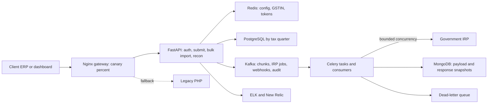
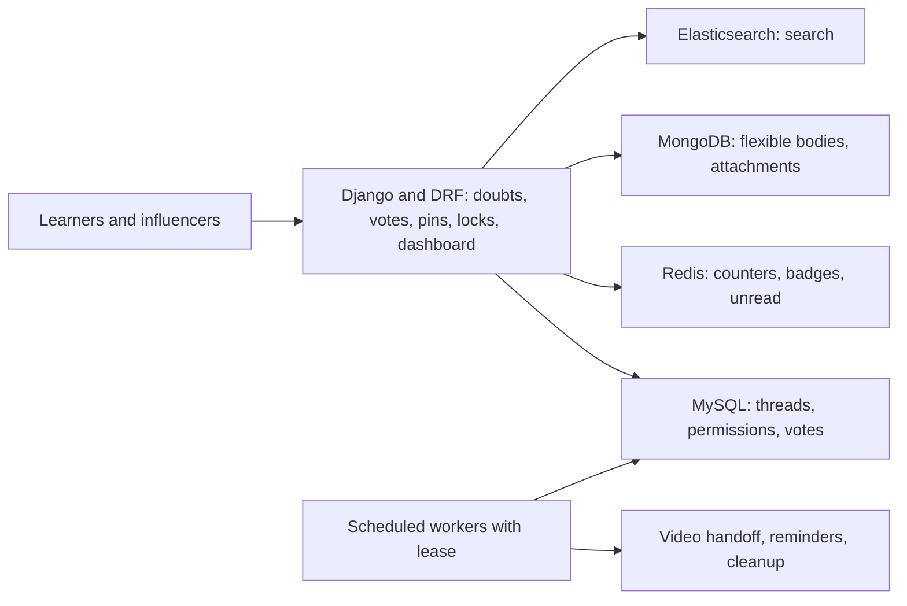

> Canonical interviewer packs for the current resume Masters India and GeeksforGeeks bullets (FastAPI track). 1,500+ clients. No TPS or RPS on the PDF. Synced to the current PDF: three Masters bullets, two GFG bullets.

# Masters India and GeeksforGeeks: Interview Pack

**How to use this page**

- **What it covers:** a fast, speakable pack for both roles: what to say in 30 seconds and 2 minutes, the architecture, each current resume bullet with the probes interviewers use, mock Q&A, an honesty box and a practice drill.
- **When to read it:** the morning of an interview, or right before a round that may touch Masters India or GFG. For full mechanisms, code sketches and every term explained in depth, read the [deep dive](04_masters_gfg_deep_dive.md). The prep-folder pack is [`23c_masters_gfg_interview_packs.md`](../../../prep/23c_masters_gfg_interview_packs.md).
- **What to memorise:** the 30-second answers, the consensus numbers below, the three "derive it" answers (75%, requests per second, submissions per second), and the "say this carefully" lines.

**What the tags mean.** **HISTORICAL** means from my past work records and earlier resumes. **ESTIMATED** means arithmetic I can show, so I say "roughly". **MEASURED** means there is a log, doc or code. **TARGET** means a design goal.

---

# Part 1. Masters India

**Role:** SDE 2, Noida, Dec 2022 to Jun 2024. GST Compliance and E-Invoicing Platform.

**Consensus numbers:** 1,500+ enterprise clients. p95 from 1.2 seconds to 300 milliseconds (75%). From 700 to 4,000 requests per minute. 1M+ government submissions a day. 100K+ concurrent imports. Triage down 70%. Database reads down 30%. Coverage from 35% to 82%. 98% deployment success. Mentored 2 engineers.

**Framing:** an event-driven Kafka platform for bulk government e-invoice registration, plus a careful strangler migration. Not a "CRUD monolith rewrite" story.

**Current PDF bullets**

- **MI1.** p95 down 75% (from 1.2s to 300ms) across 1,500+ enterprise clients by spearheading the PHP monolith to **FastAPI** microservices migration. Mentored two engineers. Throughput from **700 to 4,000 requests per minute**.
- **MI2.** High-concurrency bulk e-invoicing pipeline, **1M+** daily government submissions, **Kafka** event bus, **PostgreSQL** horizontally sharded by tax quarter. Exactly-once, idempotent processing for **100K+** concurrent imports, dead-letter queues and bounded retries against volatile IRP portals.
- **MI3.** Incident triage down **70%** and database read load down **30%** via **ELK** and **New Relic** distributed tracing plus a Redis caching layer. Test coverage from **35% to 82%**, **98%** deployment success.

**Older-resume details not on this PDF:** support tickets down 35%, audit-log churn down 15%, 2,500+ clients (never say it), and a four-bullet layout where throughput sat with Kafka and Redis had its own bullet.

## 1.1 The business in plain English

In India, B2B invoices above a threshold must be registered with a government system, the **IRP (Invoice Registration Portal)**, before they are legally valid. The IRP returns an **IRN (Invoice Reference Number)** and a digitally signed QR code. Masters India sits between enterprises and the IRP. Clients' ERP systems push invoices to us, singly or in big bulk files. We validate, register, return the IRN and QR, and keep reconciliation and audit trails. Correctness matters more than raw speed, but filing-deadline days bring huge spikes, and a timeout on deadline day loses clients.

## 1.2 Words you need (short version)

The deep dive has the full glossary. These are the ones you must be able to define on the spot.

- **Strangler pattern:** replace a legacy system route by route behind the same front door. *Like a strangler fig growing around an old tree until it stands alone.*
- **Canary release:** send a small percentage of traffic to the new version, watch it, then ramp. *The canary in the coal mine.*
- **Async IO:** start a slow network call, do other work, resume when it answers. *Making toast while the kettle boils.*
- **p95 latency:** 95% of requests are faster than this. *When 95 of 100 buses have arrived.*
- **Kafka partition key:** same key, same partition, same order. *Same surname, same post-office counter.*
- **Sharding by tax quarter:** separate tables per quarter, the app routes by invoice date. *A filing cabinet per quarter.*
- **Idempotency key:** a unique key per operation so repeats have no extra effect. *A raffle ticket can only win once.*
- **Exactly-once (in practice):** at-least-once delivery plus idempotent writes. *The courier rings twice, you sign once.*
- **DLQ (dead-letter queue):** where repeatedly failing messages park for later replay. *The "problem parcels" shelf.*
- **Cache-aside:** check the cache, on a miss read the database and cache it with an expiry. *Check your sticky note before walking to the filing room.*
- **Distributed tracing and request ID:** one ID follows a request through every service. *A parcel tracking number.*

## 1.3 30 seconds and 2 minutes

**30 seconds.**
"At Masters India I worked on GST e-invoicing for 1,500-plus enterprise clients. I spearheaded the migration from a PHP monolith to FastAPI microservices and mentored two engineers through it, which took p95 from 1.2 seconds to 300 milliseconds and throughput from 700 to 4,000 requests a minute. I architected the bulk pipeline on Kafka with PostgreSQL sharded by tax quarter, handling over a million government submissions a day, with idempotency keys, dead-letter queues and bounded retries so a 100K-row import never double-registers an invoice."

**2 minutes.**
"GST e-invoicing is a compliance product. Clients push invoices, we validate them, register them with the government's Invoice Registration Portal, and return a signed IRN and QR. Deadline days spike load. Correctness beats speed, but timeouts still lose clients.

The PHP monolith was synchronous. One slow government call blocked a PHP-FPM worker, deploys were all-or-nothing, and scaling meant scaling everything. I led a strangler migration: FastAPI services cut over behind the Nginx gateway endpoint by endpoint with canaries, a shared database during the traffic move so there were no dual writes, contract tests against the old PHP payloads, and table ownership split later. I mentored two engineers on the extraction conventions.

The bulk path is where Kafka earns its keep. An import file goes to S3, gets chunked and validated, and Kafka topics carry the IRP submit jobs, signed-response persistence and webhook fan-out, with PostgreSQL quarter shards for hot-quarter writes. The partition key is the client GSTIN for per-taxpayer ordering. Idempotency keys of client plus file hash plus batch index, exponential backoff, and DLQ replay for poison batches. On the ops side, a Redis cache-aside layer cut database reads about 30%, ELK and New Relic with request-ID correlation cut triage about 70%, and coverage went from 35% to 82% with 98% deployment success.

If they ask why Kafka: ordering, durable replay for GST disputes, and independent consumer groups on the same log. RabbitMQ could have dispatched work at our scale. Replay and multi-consumer audit are why Kafka won."

## 1.4 Architecture

*What to notice: request threads never call the IRP directly. Workers do, with bounded concurrency, idempotency keys and a DLQ.*

**Walkthrough.** The gateway sends each route to PHP or FastAPI by percentage, so rollback is a config change. FastAPI validates, uses Redis for hot lookups, and writes accepted invoices to the current quarter's PostgreSQL shard. Async work goes onto Kafka keyed by GSTIN. Workers call the IRP with backoff, store raw responses in MongoDB, update PostgreSQL and fire webhooks. Failing batches park in the DLQ. Every log line carries a request ID into ELK, and New Relic traces the path. **Migration rule:** shared database until a route is 100% on FastAPI, then carve out service-owned tables.

## 1.5 One bulk import, step by step (illustrative)

1. A client uploads a 100,000-invoice file. We store it in S3 and compute its file hash.
2. We split it into batches (say 1,000 rows, illustrative), indexes 0 to 99, and publish chunk events to Kafka keyed by the client's GSTIN.
3. A worker takes batch 37 and tries to claim key `client + fileHash + 37` with a unique-constraint insert. It succeeds, so it calls the IRP with bounded concurrency.
4. The IRP returns IRNs and signed QRs. The worker stores raw responses in MongoDB, marks rows registered in the quarter shard, and pushes a progress update.
5. If the worker crashes before acknowledging, Kafka redelivers batch 37. The claim already exists, so the IRP call is skipped. No double registration.
6. If batch 37 keeps failing (a malformed row), it goes to the DLQ after the retry budget. Batches 38 to 99 continue. An operator fixes and replays it later.

## 1.6 Design decisions

| Decision | Chose | Rejected | Why |
|---|---|---|---|
| Migration shape | Strangler plus gateway canaries | Big-bang rewrite | Zero tolerance on filing days. Rollback is a config flip. |
| Async runtime | FastAPI plus workers | Sync Django, or keep PHP | IRP fan-out must not pin workers. |
| Event bus | Kafka | SQS or RabbitMQ alone | Per-GSTIN ordering, durable replay, multiple consumer groups. |
| Partition key | Client GSTIN (optionally plus doc type) | Random or invoice id | Per-taxpayer order for submit, callback, webhook. |
| Data during cutover | Shared DB, then split | Dual writes | One source of truth. No reconciliation nightmare. |
| Shard strategy | PostgreSQL by tax quarter | One big table, or hash only | GST is quarter-scoped. Cold quarters archive cleanly. |
| Fault model | Idempotency, backoff, DLQ | Fire-and-forget retries | Double IRP registration is not recoverable. |
| Cache | Cache-aside Redis plus SETNX | Write-through everywhere | Hot config and GSTIN on every bulk row. Stampede control. |

## 1.7 Bullet by bullet: probes and answers

### MI1: PHP to FastAPI, p95 from 1.2s to 300ms, 1,500+ clients, 700 to 4,000 rpm, mentored 2

| Probe | Answer |
|---|---|
| What did you own? | The design, the cutover playbook and the conventions. Two engineers extracted services under my review. |
| Why not a rewrite? | Compliance product. Per-endpoint canary with instant rollback. |
| Where did the latency win come from? | Async IRP calls (no blocked PHP-FPM workers), connection pooling, composite indexes on `(client_id, invoice_date)`, N+1 removal. Redis moved the median. Async and query fixes moved p95. |
| Derive 75%? | (1,200 − 300) ÷ 1,200 = 75%. |
| Throughput in RPS? | 700 ÷ 60 ≈ 12. 4,000 ÷ 60 ≈ 67. Driven by the async rewrite and worker autoscaling on queue depth. |
| Client count? | Always **1,500+**. Never 2,500+. |
| Mentoring day to day? | Router, service, repository layering. Pydantic at the boundary. Shared retry and idempotency helpers. Paired on the first canary. |

### MI2: Kafka, quarter sharding, 1M+ a day, 100K+ idempotent imports, DLQ, bounded retries

| Probe | Answer |
|---|---|
| Where is Kafka? | Import chunks, IRP submit jobs, signed-response persistence, webhooks, audit projector. |
| Rate behind 1M a day? | 1,000,000 ÷ 86,400 ≈ 12 a second on average. Peaks roughly 8 to 10 times, so 100+ a second. Both ESTIMATED, verbal only. |
| Why quarter sharding? | Hot writes in the current quarter. Small hot indexes. Archive cold quarters cleanly. App routes by invoice date. |
| Idempotency key? | `client + fileHash + batchIndex`, plus client invoice references. |
| Why a DLQ? | A poison batch parks, the rest of the import continues, an operator replays. |
| Exactly-once? | At-least-once delivery plus idempotent claims. Exactly-once in effect. |
| Circuit breaker? | Verbal prep only. Not a resume metric. |

### MI3: ELK and New Relic, triage down 70%, reads down 30%, coverage 35 to 82%, 98% deploys

| Probe | Answer |
|---|---|
| What changed? | From SSH and grep to structured JSON logs with a request ID across API, consumer and worker, plus New Relic traces and alerts. |
| 70% math? | Roughly 30 minutes to under 10 minutes. The baseline is ESTIMATED behind the HISTORICAL 70% cut. |
| Why did Redis cut reads 30%? | The same config and GSTIN lookups ran on every row of a 100K import. Cache-aside removed that fan-out. |
| Stampede? | TTL jitter plus SETNX single-flight. |
| On-call title? | Claim alerting and faster triage. Not an invented incident-commander role. |
| Coverage focus? | Money paths first: registration, reconciliation, imports. CI gate. |
| 98%? | HISTORICAL deployment success under the CI gates. |

**Tech line, if pressed:** Python, FastAPI, Kafka, PostgreSQL, MongoDB (payload snapshots), Redis, Elasticsearch (search and ELK), Celery, Docker, ELK, New Relic, AWS.

## 1.8 Mock interview: 10 questions

**Q1. Why Kafka over SQS or RabbitMQ for e-invoicing?**
"We needed per-client ordering, durable replay for GST disputes, and independent consumer groups on one log, so we partitioned by GSTIN. SQS loses cheap multi-consumer replay once a message is acked, and FIFO caps throughput per group. RabbitMQ could honestly have dispatched work at our scale. Replay, multi-reader audit, and the asyncio Kafka client already in our stack (AsyncIOKafka) are why Kafka won."

**Q2. Derive TPS and RPS. Do the numbers hang together?**
"A million a day is about 11.6, so roughly 12 a second on average, and I'd size peaks at 8 to 10 times that, so 100-plus. Those are estimates. 700 to 4,000 requests a minute is about 12 to 67 a second. Requests per minute is gateway and service capacity, daily submissions are registered documents, so they're complementary meters. I keep TPS and RPS off the resume."

**Q3. Caching can't take p95 from 1.2 seconds to 300 milliseconds. What did?**
"The tail came from PHP workers held hostage by IRP calls. Async IO, connection pooling, N+1 removal and composite indexes fixed that. Redis cut redundant reads by about 30%, which helped the median, not the tail."

**Q4. Cache-aside: keys, TTL, invalidation, herd?**
"Miss, read the DB, set with a TTL. Hot keys were IRP auth tokens with a TTL under the token life, client config and flags, GSTIN masters and tax rates. Config and GSTIN were deleted on write. Masters used TTL with jitter. For the herd, a SETNX lock so one worker rebuilds and the others wait or serve slightly stale. The 30% is plausible because 100K-row imports repeat the same lookups."

**Q5. Why shard by financial quarter?**
"GST returns and filing spikes are quarter-scoped. Writes land in the current quarter, older quarters are reconciliation and audit reads. Quarter tables mean smaller hot indexes and clean archiving. The cost is app-level routing and the risk is a wrong-quarter write, so we derived the quarter from the invoice date at the API boundary and rejected mismatches."

**Q6. Sketch the IRP path and where Kafka sits.**
"The client posts JSON, we validate schema and GSTIN, register with the IRP, and get a signed IRN and QR. Kafka carries accepted chunks, IRP submit jobs, response snapshots to Mongo, and client webhooks. Idempotency stops double registration. Bulk files go through S3 and chunking to the IRP with bounded concurrency and dashboard progress. That's how we handle 100K-plus imports and a million-plus submissions a day."

**Q7. What did "mentored two" mean day to day?**
"I set the conventions: router, service, repository, Pydantic at the boundary, retry and idempotency helpers. Each engineer owned a service extraction. I did heavy PR review early and paired on the first Nginx percentage canary, watching errors and latency to ramp or roll back. The shared database during cutover kept things safe."

**Q8. Triage down 70%: vanity or real?**
"Before, SSH and grep with no correlation. After, a request ID through the API, the Kafka consumer and the IRP worker, New Relic APM, alerts on errors and latency. Roughly 30 minutes to under 10 is my estimated baseline behind the 70%. I claim alerting, not unproven pager ownership. Coverage went from 35% to 82% on money paths, and deploy success reached 98%."

**Q9. Dual writes during migration?**
"Avoided. A shared database through the traffic cutover kept one source of truth. Table ownership split only after 100% of a route was on FastAPI. Contract tests pinned PHP response shapes field for field."

**Q10. What broke in an early canary?**
"A timeout mismatch. PHP allowed 60 seconds and we'd set 10. Legitimate long IRP calls failed. We moved IRP fully async and returned 202 with polling. The canary caught it before full ramp."

## 1.9 Say this carefully (Masters)

- **1,500+ clients**, never 2,500+.
- **Mentored 2** at Masters. "Led 3" is Uber FRM. Never merge them.
- **Exactly-once** means at-least-once delivery plus idempotency keys. No claim that Kafka guarantees exactly-once to the government.
- **TPS and RPS are verbal only** and ESTIMATED.
- **Async and query fixes moved p95.** Redis moved the median.
- **Alerting and triage**, not incident commander.
- **Not on this PDF:** tickets down 35%, audit churn down 15%. Don't volunteer them.
- **No Flink at Masters.** Masters Kafka is a different product from Uber Menu Kafka.

---

# Part 2. GeeksforGeeks

**Role:** SDE, Noida, Aug 2021 to Nov 2022. Courses Platform and Influencer Dashboard.

**Consensus numbers:** 10K+ daily queries (not 1K, not 100K). 10x contest spikes. Premium subscriptions up **20%** (relative). Course sales up 30%. Engineering ops efficiency up 70%.

**Framing:** early-career reliability plus product APIs on a high-traffic education platform. The foundation for the Masters ownership story.

**Current PDF bullets**

- **G1.** Stabilized the doubt-support platform for **10K+** daily queries and **10x** traffic spikes during live coding contests by migrating the backend to **Django**. REST APIs for voting, pinning and locking threads using MySQL, MongoDB, Redis and Elasticsearch, driving a **20%** lift in premium subscriptions.
- **G2.** Course sales up **30%** via an influencer analytics and earnings dashboard tracking transactions and affiliate coupon conversions. Engineering ops efficiency up **70%** via asynchronous scheduled workflows for video processing, user reminders and data cleanup.

**Older wording:** "premium up 15 to 20%" is replaced by **20%**. SMTP "50% faster" is from older resumes and is prep depth only.

## 2.1 The business in plain English

GeeksforGeeks runs coding articles and paid courses. The **doubt-support platform** is the Q&A layer where learners ask questions on articles and courses and vote on helpful answers. Live coding contests drive about ten times normal traffic. The old PHP backend buckled under those spikes. Separately, influencer partners promote courses with affiliate coupons and need to see their conversions and earnings, and the ops team was doing video handoffs, reminders and cleanup by hand.

**Words you need:** *Django* is a "batteries included" Python web framework (admin, auth, ORM), like a fully equipped kitchen. *Hot row* is a single database row updated so often it becomes a bottleneck, like the one checkout lane everyone queues at. *Locking a thread* means closing it to new replies. *Lease lock* is a short-lived "room booked" sign so only one host runs a scheduled job.

## 2.2 30 seconds and 2 minutes

**30 seconds.**
"At GeeksforGeeks I migrated the doubt-support backend from PHP to Django, which stabilised it at 10K-plus daily queries and 10x spikes during live coding contests. I built the voting, pinning and thread-locking APIs across MySQL, MongoDB, Redis and Elasticsearch, which the growth team tied to a 20% relative lift in premium subscriptions. I also launched an influencer analytics and earnings dashboard tied to a 30% lift in course sales, and scheduled workflows that raised ops efficiency about 70%."

**2 minutes.**
"Doubt support is the Q&A layer on articles and courses: high read volume, contest spikes and messy legacy PHP. We migrated page by page behind the same URLs to Django and DRF, which gave us transactions, validation, a cleaner read and write split, and staging discipline.

For voting I used a unique user-and-content constraint so votes are idempotent, with Redis display counters reconciled asynchronously to MySQL so viral posts don't create hot rows. Pinning is per-context ordering columns, and locking closes a thread to new replies. Some interactions were premium-gated. I own the APIs. The growth team attributed the 20% lift.

The influencer dashboard used near-real-time Redis counters plus daily scheduled rollups for transactions, coupon conversions and earnings. The scheduled jobs handled video processing handoffs, reminders and recording cleanup, with leases so two hosts never double-run. I owned the engineering. Sales and efficiency are business-attributed historical metrics.

Why Django here and FastAPI at Masters? In 2021 this was a CMS-style product where Django's admin and ORM batteries fit. Masters later needed async IO against government APIs."

## 2.3 Architecture

*What to notice: MySQL is the source of truth, Redis only serves fast counters, and scheduled jobs take a lease before running.*

**Scale honesty.** 10K+ daily is well under one request a second on average (10,000 ÷ 86,400 ≈ 0.12, ESTIMATED). Contest days are about 10 times that. Reliability and spike survival matter more than raw scale.

**One vote, step by step.** A learner upvotes answer 5521. Django checks the thread isn't locked and the user may vote. It inserts into `votes (user_id, content_id)` with a unique key, so a double tap is a no-op or update. It increments Redis `votes:5521`. A periodic job reconciles Redis counts to MySQL.

## 2.4 Design decisions

| Decision | Chose | Rejected | Why |
|---|---|---|---|
| Stack migration | PHP to Django and DRF, incremental | Big-bang, or stay on PHP | Same URLs. Transactions and validation without an outage. |
| Vote correctness | Unique (user, content) plus MySQL as truth | Counter-only in Redis | Double submits are idempotent. Counters can drift safely. |
| Hot counters | Redis display plus async reconcile | Update MySQL on every vote | Viral posts melt hot rows. |
| Search vs documents | Elasticsearch plus MongoDB | Everything in MySQL JSON | Search path is a different job from document shape. |
| Scheduled job safety | Lease plus idempotent job keys | Naive cron on every host | No double video or reminder runs. |
| Mail sending | Persistent SMTP connection | Connect per message | Handshakes cost 100 to 400 ms. Reuse roughly halves wall-clock (older-resume prep depth). |

## 2.5 Bullet by bullet: probes and answers

### G1: PHP to Django, 10K+ daily, 10x spikes, voting, pinning, locking, 20% premium

| Probe | Answer |
|---|---|
| Scale number? | **10K+ daily**, standardised. Never 100K. Older "1K+ doubts a day" was a narrower metric. |
| What improved? | ORM transactions, request validation, read and write separation, review and staging discipline. |
| Spike story? | Contest days run about 10x. Designed so bursts don't melt the write path. |
| Average RPS? | About ten thousand a day is far below 1 request a second on average (ESTIMATED). |
| Vote idempotency? | Unique constraint. A second vote is a no-op or update, never a double count. |
| Hot rows? | Redis counters for the badge and UI, reconciled to MySQL. |
| Data split? | MySQL relational truth, MongoDB flexible bodies, Elasticsearch search, Redis hot reads. |
| Locking threads? | Closes a thread to new replies. Keep implementation detail qualitative beyond "a locked state checked on the reply path". |
| 20%? | Relative lift attributed by growth. I own the APIs and reliability, not a causal monopoly. |

### G2: influencer dashboard, 30% sales, scheduled workflows, 70% ops

| Probe | Answer |
|---|---|
| Dashboard? | Redis near-real-time counters plus daily scheduled rollups of transactions, coupon conversions and earnings. |
| Which jobs? | Video processing handoffs, reminders, payment processing, recording and data cleanup. |
| Reliability? | Host lease, idempotent job keys, success and failure logs, retry or dead-letter for partial batches. |
| Metrics? | HISTORICAL business attribution. I engineered the system and attribute carefully. |

## 2.6 Mock interview: 6 questions

**Q1. Design unread counts for 10K+ daily queries without melting MySQL.**
"At 10K a day, the problem is spikes, not average load. Redis per-user counters serve the badge, MySQL holds threads and messages. Increment on a reply, clear on read, and reconcile periodically to fix drift. The Django migration gave us the transactional write paths PHP lacked."

**Q2. Voting idempotency and hot rows. How did MySQL, Redis, MongoDB and Elasticsearch split?**
"A unique user-and-content constraint makes votes idempotent. Redis holds display counters, reconciled asynchronously to MySQL. MySQL is threads, permissions and truth. MongoDB holds variable bodies and attachments. Elasticsearch is search. Pinning is ordered columns per context. The 20% premium lift is growth-team attribution."

**Q3. Scheduled jobs claimed +70% ops efficiency. How do you keep them honest?**
"A lease so two hosts don't double-run, idempotent job keys, structured logs, and retry or dead-letter for partial batches. The 70% is time saved on manual video, reminder and cleanup work. The 30% course sales is business attribution on the dashboard. I own the engineering."

**Q4. Why Django at GFG but FastAPI at Masters?**
"In 2021 GFG was a CMS-style product where Django's admin, auth and ORM batteries fit well. Masters needed async IO against flaky government APIs and an event-driven bulk pipeline, so FastAPI and Kafka fit that job."

**Q5. SMTP 50% faster: is that real?**
"It's from my older resumes, not the current one. We reused one SMTP connection across a batch instead of a TCP and TLS handshake per message, which is often 100 to 400 milliseconds each. Amortising that roughly halves wall-clock time for reminder and promo batches. It's a GFG detail, not a Masters claim."

**Q6. What would you change today?**
"Put vote events on a queue with event-sourced counters, make idempotency keys the default on reminder jobs, and set clearer latency targets for contest days. The Django migration and vote and pin models were right for 2021. The event patterns I later owned at Masters are what I'd backport."

## 2.7 Say this carefully (GFG)

- **20%** premium lift, relative, attributed by growth. Not "15 to 20%".
- **10K+ daily queries.** Not 100K.
- Own the engineering. The business attributed the 30% and 70% figures.
- SMTP 50% is older-resume prep depth, GFG only.

---

# Part 3. Practice drill (both roles)

1. **Masters in one line?** GST e-invoicing for 1,500+ enterprises: validate invoices, register with the government IRP, return a signed IRN and QR.
2. **Derive 75%.** From 1,200 to 300 ms saves 900 ms, and 900 ÷ 1,200 is 75%.
3. **700 and 4,000 requests a minute in RPS?** About 12 and 67.
4. **1M+ a day per second?** About 12 on average, 100+ at deadline peaks, both estimated.
5. **What moved p95?** Async IRP calls, pooling, N+1 and index fixes. Redis helped the median.
6. **How did the migration stay safe?** Strangler, per-route canary, shared DB, contract tests, rollback by config.
7. **Why Kafka?** Per-GSTIN ordering, replay, multiple consumer groups. RabbitMQ could have dispatched tasks at our scale.
8. **Why shard by quarter?** GST is quarter-scoped, hot writes stay small, archiving is clean.
9. **Idempotency key?** Client plus file hash plus batch index, claimed before calling the IRP.
10. **What does exactly-once mean here?** At-least-once delivery plus idempotent writes.
11. **Where does triage −70% come from?** Request IDs, ELK and New Relic. About 30 to under 10 minutes, estimated baseline.
12. **GFG: why Redis plus MySQL for votes?** MySQL is the truth with a unique constraint. Redis keeps counters fast and avoids hot rows.
13. **GFG: who owns the 20% and 30%?** The growth and business teams attributed them. I owned the engineering.

# Part 4. 3-minute whiteboard script

**First (30 seconds).** Write "Invoice in, signed IRN out". Say who the clients are (1,500+ enterprises) and why deadline spikes and double registration are the two big risks.

**Second (90 seconds).** Draw the client ERP, the Nginx gateway splitting to PHP and FastAPI, then Redis, PostgreSQL by quarter, S3 and Kafka off FastAPI, then workers to the IRP with a DLQ beside them, and ELK and New Relic underneath. Narrate the strangler migration (p95 from 1.2 seconds to 300 milliseconds, 700 to 4,000 requests a minute, two engineers mentored), then one bulk import with the idempotency key and DLQ (1M+ a day, 100K+ imports).

**Third (60 seconds).** Write the ops numbers (triage −70%, reads −30%, coverage 35 to 82%, 98% deploys) and the two caveats: "Async and queries moved p95, Redis moved the median" and "exactly-once means at-least-once plus idempotency".

**GFG in 30 seconds if asked.** Draw Django with MySQL, Redis, MongoDB and Elasticsearch around it. Say: "PHP to Django for 10K+ daily queries and 10x contest spikes, idempotent votes, Redis counters reconciled to MySQL, 20% premium lift attributed by growth."
