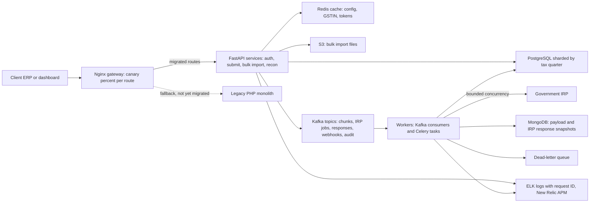
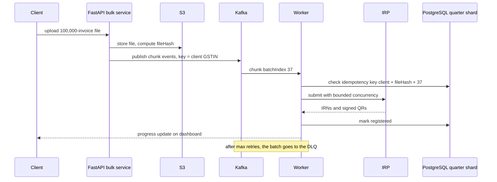
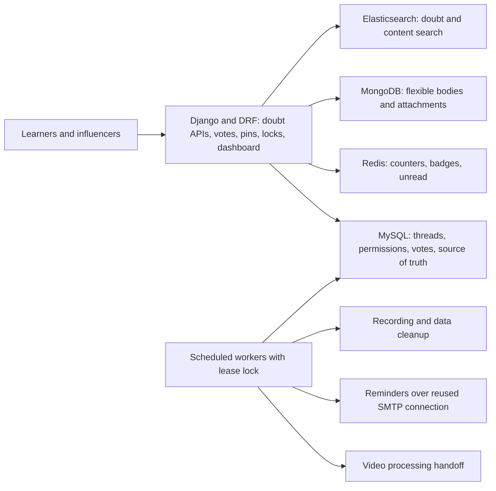

# Masters India and GeeksforGeeks Deep Dive (v2 resume defense)

<div class="callout highlight">

**How to use this page**

- **What it covers:** the full depth behind the Masters India bullets (GST e-invoicing, PHP to FastAPI migration, Kafka bulk pipeline, observability and caching) and the GeeksforGeeks bullets (Django migration, doubt-support APIs, influencer dashboard, scheduled workflows). Every term is defined, every number is derived, and every design choice has alternatives.
- **When to read it:** the week before a backend or system-design loop where interviewers will go deep on migrations, queues, idempotency, sharding or caching. For a quick refresher the morning of an interview, use the shorter pack: [`04_05_masters_gfg.md`](04_05_masters_gfg.md) or [`23c_masters_gfg_interview_packs.md`](../../../prep/23c_masters_gfg_interview_packs.md).
- **What to memorise:** the two one-minute versions, the Masters numbers (from 1.2 seconds to 300 milliseconds p95, 1,500+ clients, 700 to 4,000 requests per minute, 1M+ submissions a day, 100K+ per import, triage down 70%, DB reads down 30%, coverage from 35% to 82%, 98% deploy success), the GFG numbers (10K+ daily queries, 10x spikes, 20% premium lift, 30% course sales, 70% ops efficiency), and the "say this carefully" boxes.

</div>

**What the tags mean.** **HISTORICAL** means the number comes from my past work records and earlier resumes. **ESTIMATED** means arithmetic I can show, so I say "roughly" and give the derivation. **MEASURED** means a log, doc or code exists. **TARGET** means a design goal. Every number here traces to `GROUND_TRUTH.md` in the track's `prep/` folder.

<div class="callout note">

**Current resume bullets (FastAPI track)**

*Masters India, SDE 2, Noida, Dec 2022 to Jun 2024. GST Compliance and E-Invoicing Platform.*

- **MI1.** Reduced p95 API latency by **75%** (from **1.2s to 300ms**) across **1,500+** enterprise clients by spearheading the migration of a legacy PHP monolith to a **FastAPI** microservices architecture. Mentored two engineers through the transition, optimizing backend design to drive overall system throughput from **700 to 4,000 requests per minute**.
- **MI2.** Architected a high-concurrency bulk e-invoicing pipeline processing **1M+** daily government submissions by orchestrating a **Kafka** event bus and a **PostgreSQL** database horizontally sharded by tax quarter. Enforced exactly-once, idempotent processing for **100K+** concurrent imports with fault-tolerant state management via dead-letter queues and bounded retries against volatile IRP portals.
- **MI3.** Decreased incident triage time by **70%** and lowered database read load by **30%** by instrumenting **ELK** and **New Relic** distributed tracing alongside a Redis caching layer. Hardened the CI/CD release cycle by driving test coverage from **35% to 82%**, achieving a **98%** deployment success rate.
- **Tech:** Python, FastAPI, Kafka, PostgreSQL, MongoDB, Redis, Elasticsearch, Celery, Docker, ELK, New Relic, AWS.

*GeeksforGeeks, SDE, Noida, Aug 2021 to Nov 2022. Courses Platform and Influencer Dashboard.*

- **G1.** Stabilized the doubt-support platform to handle **10K+** daily queries and **10x** traffic spikes during live coding contests by migrating the backend to **Django**. Engineered high-throughput REST APIs for voting, pinning, and locking threads using MySQL, MongoDB, Redis, and Elasticsearch, driving a **20%** lift in premium subscriptions.
- **G2.** Accelerated course sales by **30%** by launching an influencer analytics and earnings dashboard to track transactions and affiliate coupon conversions. Increased engineering operational efficiency by **70%** by designing asynchronous scheduled workflows for video processing, user reminders, and data cleanup.
- **Tech:** Python, Django, MySQL, MongoDB, Redis, Elasticsearch.

</div>

<div class="callout warn">

**Older-resume details that are NOT on the current PDF**

- **Support tickets down 35%** (from a client usage dashboard and log downloads), **audit-log churn down 15%**, and **2,500+ clients** come from older resumes. None are on the current PDF. Never say 2,500+ clients. Do not volunteer tickets or audit churn.
- **"Premium up 15 to 20%"** is older wording. The current PDF says **20%**.
- **SMTP email sends 50% faster** (GFG) comes from the 1-year and 2.5-year resumes. Prep depth only.
- **p95 "1000 to 1200ms down to 300 to 400ms"** is the older-resume band. The PDF says from 1.2 seconds to 300 milliseconds.
- **Peak TPS and RPS** are not on the PDF. Verbal only, ESTIMATED.
- The older layout had four Masters bullets. The current PDF has three. Throughput (700 to 4,000 requests per minute) now sits in MI1, and Redis caching now sits in MI3.
- Do not merge "mentored 2" (Masters) with "led 3" (Uber FRM). Do not put Flink at Masters. Masters Kafka is a different product from Uber Menu Kafka.

</div>

---

# Part A. Masters India

## A1. The one-minute version (say this out loud)

"At Masters India I worked on a GST compliance and e-invoicing platform used by more than 1,500 enterprise clients. Businesses send us their invoices, we validate them and register them with the government's Invoice Registration Portal, and we hand back a signed invoice number and QR code.

I spearheaded the migration from a legacy PHP monolith to FastAPI microservices, using a strangler approach with per-route canaries, and mentored two engineers through it. That took p95 latency from 1.2 seconds to 300 milliseconds and throughput from 700 to 4,000 requests per minute.

I also architected the bulk pipeline: a Kafka event bus with PostgreSQL sharded by tax quarter, processing more than a million government submissions a day, with idempotency keys so 100K-plus-row imports never double-register an invoice, plus dead-letter queues and bounded retries against the flaky government portal. On the ops side, ELK and New Relic tracing cut incident triage by 70%, Redis caching cut database reads by 30%, and test coverage went from 35% to 82% with a 98% deployment success rate."

**Follow-up they may ask:** "What was hardest?" Answer: "Never registering the same invoice twice with the government. That's not recoverable, so idempotency was designed in from the start."

---

## A2. The business in plain English

**What GST e-invoicing is.** In India, businesses selling to other businesses (B2B) above a turnover threshold must register each invoice with a government portal before it is legally valid. The portal is the **IRP (Invoice Registration Portal)**. It checks the invoice and returns an **IRN (Invoice Reference Number)** and a **digitally signed QR code**. Without these, the buyer cannot claim tax credit.

**Who the users are.** Finance and accounts teams at large Indian enterprises. Their ERP systems (the software they run their business on) push invoices to our APIs, one at a time or in big bulk files.

**What they do with us.** Submit invoices, get IRNs and QR codes back, upload bulk files of tens of thousands of invoices, reconcile against their GST returns, and keep an audit trail.

**What hurt before.** The PHP monolith was synchronous. One slow call to the government portal held a server worker hostage for the whole round trip. Deploys were all-or-nothing, and scaling meant scaling everything. On filing-deadline days, traffic spikes caused queue pile-ups and timeouts. In a compliance product, a timeout on deadline day is the worst possible failure.

**Why the company paid for this.** Correctness and traceability matter more than raw speed, but slow or failed submissions lose clients. Faster, reliable, never-double-registered submissions are the product.

---

## A3. Words you need

| Term | Plain meaning | Analogy |
|---|---|---|
| **GST** | Goods and Services Tax, India's indirect tax. | VAT in Europe. |
| **GSTIN** | A business's 15-character GST identification number. | A tax passport number for a company. |
| **IRP** | Invoice Registration Portal, the government system that registers e-invoices. | The passport office that stamps your document as official. |
| **IRN and signed QR** | The unique reference number and digitally signed QR code the IRP returns. This is what makes the invoice valid. | The official stamp and hologram on the passport. |
| **Filing deadline spike** | Traffic jumps as everyone submits before the GST deadline. | Tax-day queues at the post office. |
| **Monolith** | One big application where every feature is deployed together. | One huge kitchen where a broken oven stops every dish. |
| **PHP, Laravel, PHP-FPM** | PHP is the language, Laravel the framework, PHP-FPM the process pool serving requests. Each worker handles one request at a time. | A row of cashiers who each must wait at their till until the card machine answers. |
| **Microservices** | Small services, each owning one domain, deployed independently. | Separate food stalls: one breaks, the others keep serving. |
| **Strangler pattern** | Replace a legacy system piece by piece behind the same front door until the old one can be switched off. | A strangler fig tree that grows around an old tree until it stands on its own. |
| **API gateway (Nginx)** | The front door that routes each request to the old or new service. | A receptionist directing visitors to the old wing or the new wing. |
| **Canary release** | Send a small percentage of traffic to the new version, watch it, then ramp up. | Miners sending a canary in first to check the air. |
| **Contract test** | A test that pins the exact response shape of an API, so a rewrite cannot silently change it. | Tracing paper over the old drawing to check the new one matches line for line. |
| **FastAPI** | A modern async Python web framework with built-in validation and OpenAPI docs. | A cashier who takes the next customer while the card machine is thinking. |
| **Async IO** | Code that starts a slow network call, does other work, and resumes when the answer arrives. | Putting the kettle on and making toast while it boils. |
| **Pydantic** | A Python library that validates and parses data against a typed model. | A bouncer checking every ID at the door. |
| **Connection pooling** | Reuse a fixed set of open database connections instead of opening one per request. | A taxi rank of waiting cabs instead of calling a new cab for every trip. |
| **N+1 query** | Fetching a list with one query, then one more query per item. | Going to the shop once for the list, then once per item on it. |
| **Composite index** | A database index on several columns together, such as `(client_id, invoice_date)`. | A phone book sorted by surname, then first name. |
| **p95 latency** | 95% of requests are faster than this. It measures the slow tail users actually feel. | The time by which 95 of 100 buses have arrived. |
| **RPM, RPS, TPS** | Requests per minute, requests per second, transactions per second. Divide RPM by 60 for RPS. | Cars per minute versus cars per second at a toll booth. |
| **Kafka** | A durable, ordered, replayable event log. | A conveyor belt with a recording you can rewind. |
| **Partition key** | The value that decides which Kafka partition a message goes to. Same key, same partition, same order. | Same surname always queues at the same counter. |
| **Consumer group** | A set of workers sharing a topic. Different groups each get their own full copy of the stream. | Several departments each reading the same newspaper at their own pace. |
| **Celery** | A Python task queue for running background jobs on worker processes. | A back office that takes jobs from a tray and works through them. |
| **PostgreSQL** | An open-source relational database. | A very organised filing cabinet with strict rules. |
| **Sharding** | Splitting data across separate tables, schemas or databases by a key, with the application routing to the right one. | Filing invoices into a separate cabinet for each quarter of the year. |
| **Idempotency key** | A unique key per operation, so repeating it has no extra effect. | A raffle ticket number: you cannot win twice with the same ticket. |
| **Exactly-once processing** | The effect happens once even if the message is delivered more than once. In practice: at-least-once delivery plus idempotent writes. | The courier may ring twice, you sign once. |
| **DLQ (dead-letter queue)** | A side queue where messages that keep failing are parked for later inspection and replay. | A "problem parcels" shelf at the depot. |
| **Bounded retries and exponential backoff with jitter** | Retry a failed call a limited number of times, waiting longer each time, with randomness so clients don't all retry together. | If a line is busy, call back after 1, 2, then 4 minutes, at slightly random times. |
| **Circuit breaker (verbal only)** | Stop calling a failing dependency for a while once errors spike. | A fuse that trips so the whole house doesn't burn. |
| **MongoDB** | A document database storing flexible JSON-like documents. | A folder where each sheet can have a different layout. |
| **Redis** | An in-memory key-value store, very fast, used for caching. | A sticky note on your monitor instead of walking to the filing room. |
| **Cache-aside** | The app checks the cache first. On a miss it reads the database and puts the result in the cache with an expiry. | Check your sticky note first. If it's missing, look it up and write a new note. |
| **TTL and TTL jitter** | Time to live, how long a cached value lasts. Jitter adds randomness so many keys don't expire at the same moment. | Milk with slightly different expiry dates so you don't run out all at once. |
| **Cache stampede (thundering herd)** | Many requests miss the same key at once and all hit the database. | Everyone rushing the fridge the moment the milk runs out. |
| **SETNX** | Redis "set if not exists", used as a simple lock so only one worker rebuilds a cache entry. | Grabbing the single talking stick. Whoever has it speaks. |
| **Elasticsearch** | A search engine for fast full-text search and log analytics. | A book's index, for every book at once. |
| **ELK** | Elasticsearch, Logstash and Kibana: collect, store, search and visualise logs. | A CCTV system for your servers, with a search bar. |
| **New Relic APM and distributed tracing** | Application performance monitoring. A trace follows one request across every service it touches. | A parcel tracking number you can follow through every depot. |
| **Request ID (correlation ID)** | A unique ID attached to a request and logged by every service it passes through. | A case number on every form in a file. |
| **Test coverage** | The share of code lines executed by automated tests. | The share of rooms a safety inspector actually walked into. |
| **Deployment success rate** | The share of deploys that go out without rollback or failure. | The share of flights that land on schedule. |
| **AWS S3** | Amazon's object storage for files. | A giant, cheap warehouse for boxes. |

---

## A4. Architecture



*What to notice: the gateway lets old and new code serve traffic side by side, and the only path to the government portal goes through workers with bounded concurrency, never straight from a request thread.*

**Box by box.**

1. **Client ERP or dashboard.** Enterprises send single invoices or upload bulk files.
2. **Nginx gateway.** During the migration, each route is either still on PHP or sent, by percentage, to FastAPI. Rollback is a config change, not a deploy.
3. **FastAPI services.** Separate services for auth, e-invoice submit, bulk import and reconciliation. Async by default.
4. **Redis.** Cache-aside for hot reads: client config and feature flags, GSTIN masters, tax rates, IRP auth tokens.
5. **PostgreSQL sharded by tax quarter.** Hot writes land in the current quarter. Older quarters are mostly read for reconciliation and audit.
6. **S3.** Bulk import files land here first.
7. **Kafka.** The event bus between stages: accepted import chunks, IRP submit jobs, signed-response persistence, client webhooks, and an audit projector. Partition key is the client GSTIN, so one taxpayer's events stay in order.
8. **Workers.** Kafka consumers and Celery tasks call the IRP with bounded concurrency, exponential backoff and idempotency keys. They also handle PDF generation, webhooks and email.
9. **MongoDB.** Stores flexible invoice payload snapshots and raw IRP responses.
10. **DLQ.** Batches that keep failing park here for operator replay, so the rest of the import continues.
11. **ELK and New Relic.** Structured JSON logs with a request ID, APM traces across API, consumer and worker.

**How Kafka and Celery fit together.** Older notes described bulk chunk validation as a Celery chain, and the pack described Kafka topics carrying import chunks. Both are true in the sense that matters: Kafka is the durable event bus between stages (which is what the PDF claims), and Celery is the task runner for background jobs like PDF generation, email and some IRP calls. If asked, say: "Kafka carried the events between stages. Workers, some Kafka consumers and some Celery tasks, did the work."

**Migration rule.** Shared database until 100% of a route's traffic is on FastAPI. Only then carve out service-owned tables.

---

## A5. One invoice and one bulk import, step by step

### A single invoice (illustrative data)

Client "Acme Steel Pvt Ltd", GSTIN `27AAACA1234F1Z5`, invoice `INV-2024-00871`, dated 14 March 2024 (quarter Jan to Mar 2024).

1. Their ERP posts JSON to `POST /v1/einvoice`, with header `X-Request-ID: 7f3c…`.
2. Gateway routes this path to FastAPI (route fully migrated).
3. FastAPI validates the body with Pydantic: GSTIN format, amounts add up, required fields present.
4. It looks up client config and the GSTIN master. Redis hit, so no database read.
5. It computes the idempotency key from the client and the client's invoice reference, and writes an "accepted" row in the Jan to Mar 2024 quarter shard. If the same invoice was already accepted, it returns the existing status instead.
6. It publishes an IRP submit job to Kafka with key `27AAACA1234F1Z5`, and returns `202 Accepted` with a status URL (or waits briefly and returns the IRN if the IRP is fast).
7. A worker picks up the job and calls the IRP with backoff. The IRP returns IRN and signed QR.
8. The worker stores the raw response in MongoDB, updates the PostgreSQL row to "registered", and publishes a webhook event.
9. The client gets the IRN and QR by webhook or by polling. Every log line from step 1 to 9 carries the same request ID.

### A bulk import



*What to notice: the idempotency check happens before the IRP call, so a retried batch never registers twice.*

**Worked example.** A client uploads a 100,000-row file. We store it in S3 and compute `fileHash = sha256(file)`. We split it into batches (say 1,000 rows each, purely illustrative), giving batch indexes 0 to 99. Each batch's key is `client_id + fileHash + batchIndex`. If the worker handling batch 37 crashes after submitting but before acknowledging, Kafka redelivers batch 37. The worker sees key `acme + 9b1e… + 37` already marked done and skips the IRP call. If batch 37 keeps failing because of a malformed row, it goes to the DLQ after the retry budget, and batches 38 to 99 carry on. An operator fixes and replays batch 37 later.

---

## A6. Bullet MI1 decoded: PHP to FastAPI, latency, throughput, mentoring

> Reduced p95 API latency by 75% (from 1.2s to 300ms) across 1,500+ enterprise clients by spearheading the migration of a legacy PHP monolith to a FastAPI microservices architecture. Mentored two engineers through the transition, optimizing backend design to drive overall system throughput from 700 to 4,000 requests per minute.

### In plain words

I led moving the product off an old PHP application onto modern Python services, one route at a time, without breaking anything for clients. The slowest 5% of requests got four times faster, the system handled almost six times more traffic, and I coached two engineers to ship services on their own.

### How it works: the migration playbook

1. **Strangler, not big bang.** New FastAPI services went behind the existing gateway one domain at a time: auth, e-invoice submit, bulk import, reconciliation. The monolith kept serving everything not yet migrated.
2. **Route-level canary with fallback.** Nginx sent a small percentage of traffic per endpoint to the new service. We watched error rate and latency dashboards, then ramped to 100%. Rollback was a config change.
3. **Shared database first, then split.** New services read the same MySQL or PostgreSQL data as the monolith during the traffic cutover, to avoid a risky data migration at the same time. Only after traffic fully moved did we carve out service-owned tables.
4. **Contract tests pinned old PHP responses.** We recorded monolith responses for the top endpoints and asserted the FastAPI replacements matched field for field, so clients never saw a payload change.
5. **Async by default.** IRP calls, PDF generation, webhooks and email went through background workers with retries and idempotency keys, so request threads never blocked on third parties.

Illustrative Nginx canary split (teaching sketch, not the production config):

```nginx
split_clients "${request_id}" $einvoice_backend {
    10%   fastapi_einvoice;
    *     php_monolith;
}
location /v1/einvoice {
    proxy_pass http://$einvoice_backend;
}
```

Ramp from 10% to 50% to 100% by editing one number. Roll back by setting it to 0%.

### How it works: where the latency win came from

- **Async IO for IRP and internal fan-out.** A PHP-FPM worker used to sit blocked for the whole IRP round trip. FastAPI awaits the call, or hands it to a worker and returns 202, so no process is held hostage.
- **Connection pooling** per service instead of PHP-FPM's per-request connections, which caused connect storms under load.
- **Query fixes found during the rewrite:** composite indexes on `(client_id, invoice_date)`, N+1 removal, and pagination on list endpoints.
- **Redis caching of hot reads** (client config, tax rates, auth context). This mostly helped the median and read-heavy endpoints.

The honest split: **async IO, pooling and query fixes moved the p95 tail. Redis moved the body of the distribution.**

```python
# Illustrative: an N+1 list endpoint, before and after
# Before: 1 query for invoices + 1 query per invoice for its buyer
invoices = db.query(Invoice).filter_by(client_id=cid).all()
for inv in invoices:
    inv.buyer = db.query(Buyer).get(inv.buyer_id)

# After: one query with a join, using the (client_id, invoice_date) index, paginated
invoices = (db.query(Invoice)
              .options(joinedload(Invoice.buyer))
              .filter(Invoice.client_id == cid)
              .order_by(Invoice.invoice_date.desc())
              .limit(50).offset(page * 50)
              .all())
```

### How it works: mentoring two engineers

Two junior engineers each owned individual service extractions. I set the conventions: router, service and repository layering, Pydantic schemas at the boundary, shared retry and idempotency helpers. I reviewed every PR closely for the first months and paired with them on the first canary cutover (Nginx percentage route, watch errors and latency, ramp or roll back by config). By the end both were shipping services independently. The headcount of two is user-confirmed.

### Why this design

- **Why strangler over rewrite?** It is a compliance product with zero tolerance for a broken filing day. Strangler let us cut over per endpoint with instant rollback.
- **Why FastAPI over Django or Flask?** Async-native for IRP fan-out, Pydantic validation at the boundary, auto-generated OpenAPI docs for enterprise clients, and a small footprint per service.
- **Why shared DB during cutover?** One source of truth. Dual writes create reconciliation nightmares.

### Alternatives and why not

| Alternative | Why not |
|---|---|
| Big-bang rewrite | One bad cutover on a filing day is unacceptable. No gradual rollback. |
| Keep PHP and scale horizontally | Each worker still blocks on IRP. You just buy more hostages. |
| Django (sync) | Batteries are great for CMS-style apps, but sync request handling has the same blocking problem against a slow government API. |
| Dual writes during migration | Two sources of truth and reconciliation pain. |

### Trade-off and what I'd do differently

The strangler period means running two stacks and a shared database for a while, which is operational overhead. If I did it again, I would add the request-ID logging (from MI3) before the first canary, not after, so comparing old and new paths is easier from day one. *(A reflection, not a claim about what happened.)*

### The numbers

**p95 from 1.2 seconds to 300 milliseconds, a 75% cut (HISTORICAL).**
- *Measures:* the 95th-percentile API response time.
- *Derivation:* (1,200 − 300) ÷ 1,200 = 900 ÷ 1,200 = 75%.
- *Why it mattered:* the slow tail is what times out on deadline day.
- *Say it:* "p95 went from 1.2 seconds to 300 milliseconds, a 75% cut."
- *Don't say:* "average latency" (it's p95), or "caching did it".
- *Older band:* earlier resumes said 1,000 to 1,200 ms down to 300 to 400 ms. Use that only if an interviewer cites an older resume.

**1,500+ enterprise clients (HISTORICAL).** Always 1,500+. Never 2,500+ (older, dropped).

**700 to 4,000 requests per minute (HISTORICAL).**
- *Measures:* sustained gateway and service throughput under load and peaks.
- *Derivation:* 700 ÷ 60 ≈ 12 requests per second. 4,000 ÷ 60 ≈ 67 requests per second. That is about 5.7 times more.
- *Why it moved:* the async rewrite plus worker autoscaling on queue depth.
- *Say it:* "From 700 to 4,000 requests per minute, so roughly 12 to 67 requests a second."

**Mentored 2 engineers.** Masters only. Never merge with "led 3 engineers" at Uber FRM.

### Questions they will ask

**Q: Caching alone can't take p95 from 1.2 seconds to 300 milliseconds. What did?**
"Right, caching wasn't the tail story. The tail came from PHP workers blocking on the government portal. Moving those calls to async IO and background workers, adding connection pooling, and fixing N+1 queries and missing composite indexes moved the p95. Redis cut redundant reads by about 30%, which helped the median."

**Q: How did you avoid dual writes during the migration?**
"We kept a shared database through the traffic cutover, so there was only ever one source of truth. Table ownership was split only after a route was 100% on FastAPI. Contract tests pinned the PHP response shapes field for field."

**Q: What did mentoring look like day to day?**
"I set the conventions, router, service, repository, Pydantic at the boundary, shared retry and idempotency helpers. Each of the two engineers owned a service extraction. I reviewed their PRs heavily early on and paired on the first canary. By the end both were shipping independently."

**Q: What broke in an early canary?**
"A timeout mismatch. PHP allowed 60 seconds and we'd set 10 seconds on the new service. Some IRP calls legitimately took longer, so they failed on the new path. We moved those calls fully async and returned 202 with polling. The canary caught it at a small percentage, before full ramp."

---

## A7. Bullet MI2 decoded: Kafka bulk pipeline, quarter sharding, idempotency

> Architected a high-concurrency bulk e-invoicing pipeline processing 1M+ daily government submissions by orchestrating a Kafka event bus and a PostgreSQL database horizontally sharded by tax quarter. Enforced exactly-once, idempotent processing for 100K+ concurrent imports with fault-tolerant state management via dead-letter queues and bounded retries against volatile IRP portals.

### In plain words

I designed the system that takes huge invoice files and registers every invoice with the government, more than a million a day, without ever registering one twice and without one bad batch blocking the rest. Data is split by tax quarter so the busy current quarter stays fast.

### How it works

**Kafka.** Topics for accepted import chunks, IRP submit jobs, signed-response persistence, client webhooks, and an audit projector. Partition key is the client GSTIN (sometimes GSTIN plus document type), so submit, IRN callback and webhook for one taxpayer stay ordered on one partition. Different consumer groups (IRP workers, audit projector, metrics) read the same topic independently.

**Quarter sharding in PostgreSQL.** Separate tables or schemas per tax quarter. The application derives the quarter from the invoice date at the API boundary and routes to that shard.

```python
# Illustrative quarter routing
def quarter_of(d: date) -> str:
    q = (d.month - 1) // 3 + 1
    return f"y{d.year}_q{q}"            # e.g. 2024-03-14 -> "y2024_q1"

def invoice_table(invoice_date: date) -> str:
    return f"invoices_{quarter_of(invoice_date)}"
```

Older notes say the data-access layer did this routing (mentioning the async Motor driver and the SQL layer). Mismatched quarters were rejected at the boundary.

**Idempotency.** The key is `client + fileHash + batchIndex`, plus the client's own invoice references for single invoices. A unique constraint makes the second attempt a no-op.

```sql
-- Illustrative: claim a batch exactly once
INSERT INTO import_batches (idem_key, client_id, file_hash, batch_index, status)
VALUES (:k, :client, :hash, :idx, 'processing')
ON CONFLICT (idem_key) DO NOTHING
RETURNING idem_key;
-- No row returned means another attempt already owns or finished this batch: skip the IRP call.
```

On a conflict the worker looks up the existing row's status. It skips the IRP call only if the batch is already `registered`. A `PENDING` or failed batch (including a DLQ replay) retries through the same key, so the key prevents a double registration without blocking a legitimate retry.

**Bounded retries.** Exponential backoff with jitter and a cap on attempts and on concurrent IRP calls, so we never hammer a struggling government portal.

```python
def backoff(attempt, base=0.5, cap=30):
    return min(cap, base * 2 ** attempt) * random.uniform(0.5, 1.0)
```

**Dead-letter queue.** Poison batches (bad data, or repeated IRP rejections) park after the retry budget, so the rest of the import continues. Operators replay them after a fix.

**Circuit breaker (verbal only).** Open when the IRP error rate spikes, serve a degraded "pending" status to clients. This is prep depth, not a resume metric.

**Why "exactly-once" holds.** Say this carefully: Kafka delivers at-least-once. The idempotency key and unique constraint make the effect exactly-once. Double registration with the government is not recoverable, which is why this was non-negotiable.

### Why this design

- **Why Kafka?** We needed per-client ordering, durable replay for GST disputes and audit reprocessing, and independent consumer groups on one log. The team also already used an asyncio Kafka client (AsyncIOKafka, per my 2.5-year resume) in the FastAPI stack.
- **Why shard by quarter?** GST returns and filing spikes are quarter-scoped. Writes land in the current quarter. Older quarters are reconciliation and audit reads. Quarter tables keep hot indexes small and make archiving a cold quarter clean.
- **Why idempotency plus DLQ, not fire-and-forget retries?** A double IRP registration cannot be undone, and one poison batch must not block a 100K-row import.

### Alternatives and why not

| Alternative | Why not |
|---|---|
| SQS | Deletes on acknowledgement, so no cheap multi-consumer replay. SQS FIFO caps throughput per message group. |
| RabbitMQ | Honestly, it could have dispatched tasks at our scale. Kafka won on replay, audit reprocessing and multiple consumer groups without fan-out exchange plumbing. |
| One big table | Hot indexes grow forever. Archiving a quarter means huge deletes. |
| Hash-only sharding | Spreads load, but a quarter's data is scattered, so archive and reconciliation by quarter get harder. |
| Native PostgreSQL RANGE partitioning | A fair option. We owned routing in application code, which is more moving parts, but gave explicit drop and archive of a whole quarter and clearer runbooks. |
| Partition key = random or invoice id | Loses per-taxpayer ordering for submit, callback and webhook. |

### Trade-off and what I'd do differently

Kafka costs operational effort, and application-level shard routing has a footgun: writing to the wrong quarter. We mitigated it by deriving the quarter at the boundary and rejecting mismatches. Today I would evaluate native declarative partitioning first, since it removes the routing code.

### The numbers

**1M+ daily government submissions (HISTORICAL).**
- *Derivation of the rate:* 1,000,000 ÷ 86,400 seconds ≈ 11.6, so about 12 per second on average (ESTIMATED).
- *Peaks:* filing deadlines are the real sizing problem. Peaks were roughly 8 to 10 times the average, so about 100+ per second (ESTIMATED). Queue-based load leveling absorbed them.
- *Say it:* "More than a million submissions a day. That averages around 12 a second, but deadline peaks were 8 to 10 times that."
- *Don't put TPS on the resume.* It's verbal only.

**100K+ concurrent imports (HISTORICAL).** Imports of 100K+ invoices, processed concurrently, with idempotent batches.

**How 1M a day and 4,000 a minute fit together.** They measure different things. Requests per minute is gateway and service capacity (MI1). Daily submissions are IRP-registered documents. They're complementary, not the same meter.

### Questions they will ask

**Q: Why Kafka over SQS or RabbitMQ?**
"We needed three things together: per-client ordering, durable replay for compliance, and several independent consumers on the same stream. Partitioning by GSTIN kept one taxpayer's submit, callback and webhook in order. SQS deletes on ack and FIFO caps throughput per group. RabbitMQ could honestly have handled the task dispatch at our scale, but replay and multi-reader audit were first-class for GST disputes, and the team already had an asyncio Kafka client in the stack. Kafka's ops cost was the trade-off."

**Q: Why shard by quarter instead of plain partitioning?**
"GST is quarter-scoped and deadline-driven. Writes concentrate in the current quarter, older quarters are mostly reconciliation reads. Quarter tables keep hot indexes small and let us archive a whole quarter cleanly. The cost is routing in application code, and the risk is a wrong-quarter write, which we blocked by deriving the quarter from the invoice date at the API boundary."

**Q: What's your idempotency key and why?**
"Client plus file hash plus batch index. The file hash means re-uploading the same file maps to the same keys, and the batch index pins each chunk. A unique constraint makes a second attempt a no-op, so a retry after a crash can't register twice with the government."

---

## A8. Bullet MI3 decoded: observability, Redis, coverage, deploy success

> Decreased incident triage time by 70% and lowered database read load by 30% by instrumenting ELK and New Relic distributed tracing alongside a Redis caching layer. Hardened the CI/CD release cycle by driving test coverage from 35% to 82%, achieving a 98% deployment success rate.

### In plain words

When something broke, we used to SSH into servers and grep logs. I made every request carry an ID through every service and worker, shipped structured logs to ELK, and added New Relic tracing, so finding the cause got much faster. A Redis cache removed a lot of repeated database reads. And I raised automated test coverage so deploys almost never failed.

### How it works: observability

- **Before:** SSH into boxes and grep, with no correlation between services.
- **After:** structured JSON logs with a request ID, shipped to ELK. New Relic APM traces. Alert rules on error rate and latency.
- **The real win is correlation.** One request ID follows a transaction across API, Kafka consumer and IRP worker.

```python
# Illustrative FastAPI middleware: one request ID everywhere
@app.middleware("http")
async def request_id_mw(request, call_next):
    rid = request.headers.get("X-Request-ID") or uuid4().hex
    request_id_ctx.set(rid)
    response = await call_next(request)
    response.headers["X-Request-ID"] = rid
    return response

def log(event, **fields):
    print(json.dumps({"ts": time.time(), "request_id": request_id_ctx.get(), "event": event, **fields}))
```

The same ID is put into Kafka message headers so the consumer and worker logs carry it too.

### How it works: Redis cache-aside

Classic cache-aside: on a miss, read the database, then SET with a TTL.

- **Hot keys:** IRP auth tokens (TTL set below the token's lifetime, with a safety margin), client config and feature flags, GSTIN master lookups, tax-rate masters, session and auth lookups.
- **Invalidation:** config and GSTIN keys are deleted inside the update path, so admins never see stale credentials. Slow-changing masters use TTL only, with jitter so expiries don't line up.
- **Stampede control:** TTL jitter plus a SETNX lock, so one worker recomputes while others wait briefly or serve slightly stale data.

```python
# Illustrative cache-aside with SETNX single-flight
def get_client_config(client_id):
    key = f"cfg:{client_id}"
    if (hit := redis.get(key)) is not None:
        return json.loads(hit)
    if redis.set(f"lock:{key}", "1", nx=True, ex=5):
        try:
            cfg = db.load_client_config(client_id)
            redis.set(key, json.dumps(cfg), ex=3600 + random.randint(0, 300))
            return cfg
        finally:
            redis.delete(f"lock:{key}")
    time.sleep(0.05)
    return json.loads(redis.get(key) or "null") or db.load_client_config(client_id)
```

**Why 30% fewer reads is plausible.** The same client config and GSTIN validation ran on every invoice in a bulk import. Across 100K-row imports, caching those lookups removes a huge duplicate read fan-out.

### How it works: coverage and deploy success

Coverage went from 35% to 82% with pytest, enforced as a CI gate. Focus was money paths first: registration, reconciliation, imports. Deployment success reached 98%.

### Why this design

- **Why ELK plus New Relic?** ELK gives searchable logs. New Relic gives traces and APM. Together, an alert in New Relic leads straight to the request ID's logs in Kibana.
- **Why cache-aside and not write-through everywhere?** Most hot data is read far more than written. Cache-aside only caches what's actually requested and is simple to reason about.
- **Why a coverage gate on money paths first?** Bugs there are the expensive ones in a compliance product.

### Alternatives and why not

| Alternative | Why not |
|---|---|
| Keep SSH and grep | No correlation across services, slow triage. |
| Write-through cache everywhere | More write-path complexity for data that's rarely written. |
| No stampede control | A popular key expiring during a 100K import sends every worker to the database at once. |
| Chasing 100% coverage | Diminishing returns. Covering the money paths was the high-value target. |

### The numbers

**Triage down 70% (HISTORICAL cut, ESTIMATED baseline).**
- *Measures:* time from an alert to finding the cause.
- *Derivation:* roughly 30 minutes before to under 10 minutes after. 30 to 9 minutes is a 70% cut. The 30-minute baseline is an estimate.
- *Say it:* "Triage got about 70% faster, roughly from half an hour to under ten minutes."
- *Don't say:* that I was an incident commander or owned a formal pager rotation. Claim alerting and faster triage.

**Database read load down 30% (HISTORICAL).** From Redis cache-aside on hot lookups.

**Coverage from 35% to 82% (HISTORICAL).** pytest, CI gate, money paths first.

**98% deployment success (HISTORICAL).** Under the CI gates.

**Not on the PDF:** support tickets down 35% (older resume, client usage dashboard and log downloads) and audit-log churn down 15%. Don't volunteer them. If an interviewer brings up tickets from an older resume, say it was ops attribution from that time, and I owned the dashboard engineering, not every ticket outcome.

### Questions they will ask

**Q: Prove the 70% triage cut isn't a vanity metric.**
"Before, we SSH'd into boxes and grepped, with no way to connect logs across services. After, every request had an ID that followed it through the API, the Kafka consumer and the IRP worker, with structured logs in ELK, New Relic traces and alerts on error rate and latency. Going from roughly half an hour to under ten minutes is my estimate of the baseline behind the 70% figure. The real change was correlation."

**Q: Cache-aside: keys, TTLs, invalidation, thundering herd?**
"Hot keys were IRP auth tokens, client config and flags, GSTIN masters and tax rates. Config and GSTIN were deleted on write. Masters used TTL with jitter. For stampedes, jitter plus a SETNX lock so one worker rebuilds and the rest wait or serve slightly stale. The 30% read cut makes sense because every row of a 100K import hit the same lookups."

---

## A9. Design decisions at a glance

| Decision | Chose | Rejected | Why |
|---|---|---|---|
| Migration shape | Strangler plus gateway canaries | Big-bang rewrite | Zero tolerance on filing days. Rollback is a config flip. |
| Async runtime | FastAPI plus workers | Sync Django, or keep PHP | IRP fan-out must not pin workers. |
| Event bus | Kafka | SQS or RabbitMQ alone | Per-GSTIN ordering, durable replay, multiple consumer groups. |
| Partition key | Client GSTIN (optionally plus doc type) | Random or invoice id | Per-taxpayer order for submit, callback, webhook. |
| Data during cutover | Shared DB, then split | Dual writes | One source of truth. |
| Shard strategy | PostgreSQL by tax quarter | One big table, or hash only | GST is quarter-scoped. Cold quarters archive cleanly. |
| Fault model | Idempotency, backoff, DLQ | Fire-and-forget retries | Double IRP registration is unrecoverable. |
| Cache | Cache-aside Redis plus SETNX | Write-through everywhere | Hot config and GSTIN on every bulk row. Stampede control. |

---

## A10. Tech used and why

| Tech | One line | Why here | Alternative |
|---|---|---|---|
| Python | General-purpose language. | Team language, strong async ecosystem. | PHP (the legacy). |
| FastAPI | Async Python web framework. | Non-blocking IRP calls, Pydantic validation, OpenAPI docs. | Django, Flask. |
| Kafka | Replayable event log. | Ordering per GSTIN, replay, multiple consumers. | SQS, RabbitMQ. |
| PostgreSQL | Relational database. | Strong consistency for invoice state, quarter sharding. | MySQL (the monolith's shared DB during cutover). |
| MongoDB | Document store. | Flexible invoice payload snapshots and raw IRP and vendor responses. | JSON columns in PostgreSQL. |
| Redis | In-memory cache. | Cache-aside for hot lookups, SETNX locks. | Memcached. |
| Elasticsearch | Search engine. | Invoice search and the ELK log store. | PostgreSQL full-text search. |
| Celery | Python task queue. | Background jobs: PDFs, email, webhooks, some IRP calls. | Plain Kafka consumers for everything. |
| Docker | Containers. | One image per service. | Bare VMs. |
| ELK | Log pipeline and search. | Structured logs with request IDs. | Grep on boxes. |
| New Relic | APM and tracing. | Traces and alerts across services. | Datadog. |
| AWS | Cloud. | Hosting, S3 for import files. | Other clouds. |

**Why both MongoDB and Elasticsearch?** Mongo held flexible invoice payload snapshots and vendor responses. Elasticsearch powered invoice search and the ELK stack.

---

## A11. Hard problems and failure stories

**The canary timeout mismatch.** *What broke:* the new FastAPI route timed out on some legitimate IRP calls. *How we found it:* the canary at a small percentage showed a higher error rate than PHP. *Cause:* PHP allowed 60 seconds, we had set 10. *Fix:* moved IRP calls fully async and returned 202 with polling. *Lesson:* canaries exist to catch exactly this before it hits all clients, and timeouts are part of the API contract.

**Never double-register.** *Risk:* a worker crashes after the IRP accepted an invoice but before we recorded it, and the retry registers again. *Fix:* claim the batch with an idempotency key and unique constraint before calling the IRP, and skip if already claimed or done. *Lesson:* when a side effect can't be undone, idempotency is designed in, not bolted on.

**A poison batch blocking an import.** *Risk:* one malformed batch retried forever stalls a 100K import. *Fix:* bounded retries, then DLQ. The rest of the import continues, and operators replay after a fix.

**Cache stampede during bulk imports.** *Risk:* a hot config key expires mid-import and every worker hits the database. *Fix:* TTL jitter plus SETNX single-flight.

**Wrong-quarter writes.** *Risk:* application routing writes an invoice into the wrong quarter shard. *Fix:* derive the quarter from the invoice date at the API boundary and reject mismatches.

---

## A12. Say this carefully (Masters)

<div class="callout warn">

| Say this | Don't say this |
|---|---|
| "1,500+ enterprise clients." | "2,500+ clients." |
| "Mentored two engineers." | "Led three engineers" (that's Uber FRM). |
| "Exactly-once in effect: at-least-once delivery plus idempotency keys." | "Kafka guarantees exactly-once to the government." |
| "About 12 a second on average, 8 to 10 times that at deadline peaks, estimated." | Putting TPS or RPS on the resume. |
| "Async IO and query fixes moved p95. Redis moved the median." | "Caching cut p95 by 75%." |
| "Claimed alerting and faster triage." | "I was the incident commander" or "owned the pager rotation." |
| "Circuit breaker is how I'd describe the degraded mode." | Quoting a circuit-breaker metric. |
| Kafka at Masters is a different product from Uber Menu. | Flink at Masters. |

</div>

---

# Part B. GeeksforGeeks

## B1. The one-minute version (say this out loud)

"At GeeksforGeeks, my first role, I worked on the courses platform. The doubt-support system, where learners post questions on articles and courses, ran on legacy PHP and struggled during live coding contests. I migrated its backend to Django, which stabilised it at 10K plus daily queries and 10x contest spikes. I built the REST APIs for voting, pinning and locking threads across MySQL, MongoDB, Redis and Elasticsearch, and the growth team attributed a 20% lift in premium subscriptions to that work.

I also launched an influencer analytics and earnings dashboard that tracked transactions and affiliate coupon conversions, which the business tied to a 30% lift in course sales. And I designed asynchronous scheduled workflows for video processing, reminders and data cleanup, which raised engineering operational efficiency by about 70%. I owned the engineering. The business team attributed the lifts."

---

## B2. The business in plain English

**Who the users are.** Learners on GeeksforGeeks courses and articles, and influencer partners (content creators) who promote courses with affiliate coupons.

**What they do.** Learners post doubts (questions), vote on helpful answers, and read pinned answers. During live coding contests, traffic jumps about tenfold. Influencers want to see how their coupons convert and what they've earned.

**What hurt before.** The PHP doubt-support backend lacked transactions and validation discipline and buckled during contest spikes. Influencer reporting and ops chores (video handoffs, reminders, recording cleanup) were manual.

**Why the company paid for this.** A reliable doubt-support experience is a premium feature, so it drives subscriptions. Good influencer analytics keeps partners promoting, which drives course sales. Automating ops chores frees engineers.

---

## B3. Words you need (GFG)

| Term | Plain meaning | Analogy |
|---|---|---|
| **Doubt-support platform** | The Q&A layer on articles and courses where learners ask and answer questions. | A class noticeboard for questions. |
| **Django and DRF** | Django is a "batteries included" Python web framework (ORM, admin, auth). DRF (Django REST Framework) builds REST APIs on top. | A fully equipped kitchen versus buying every pan separately. |
| **ORM** | Object-relational mapper: work with database rows as Python objects. | A translator between Python and SQL. |
| **REST API** | Web endpoints using standard HTTP verbs on resources, such as `POST /doubts/42/vote`. | A menu of standard orders a waiter understands. |
| **Voting** | Users upvote helpful answers. One vote per user per item. | A show of hands where each person has one hand. |
| **Pinning** | Moderators or authors pin an answer to the top of a thread. | Pinning a notice to the top of the noticeboard. |
| **Locking a thread** | Closing a thread to new replies. | Putting "closed" on the noticeboard question. |
| **Hot row** | One database row updated so often it becomes a bottleneck, such as a vote counter on a viral post. | One checkout lane everyone insists on using. |
| **Source of truth** | The system whose data wins if copies disagree. | The original contract, not the photocopies. |
| **Affiliate coupon conversion** | A purchase made using an influencer's coupon code. | A referral code at a gym. |
| **Cron / scheduled workflow** | A job that runs on a schedule. | An alarm clock for code. |
| **Lease or advisory lock** | A short-lived lock so only one host runs a given job at a time. | A "room booked" sign on the door. |

MySQL, MongoDB, Redis and Elasticsearch are defined in Part A.

---

## B4. Architecture (GFG)



*What to notice: MySQL is the truth for votes and threads, Redis only serves fast display counters, and every scheduled job takes a lease first so two hosts never run it twice.*

**Scale honesty.** 10K+ daily queries averages well under one request a second (10,000 ÷ 86,400 ≈ 0.12, ESTIMATED). Contest days are about 10 times that, concentrated into contest windows. The story is reliability and surviving spikes, not "Uber scale".

---

## B5. One vote, step by step (illustrative)

1. Learner 9917 taps upvote on answer 5521. The app calls `POST /api/answers/5521/vote`.
2. Django checks the thread isn't locked and the user is allowed to vote (some interactions were gated behind premium).
3. Insert into `votes (user_id, content_id)` with a unique constraint. If the user already voted, the constraint makes it a no-op or an update, never a double count.
4. Increment the Redis display counter `votes:5521`.
5. A periodic job reconciles Redis counters to MySQL counts, so drift is corrected and MySQL stays the truth.

```sql
-- Illustrative vote table
CREATE TABLE votes (
  user_id    BIGINT NOT NULL,
  content_id BIGINT NOT NULL,
  value      TINYINT NOT NULL,
  created_at DATETIME NOT NULL,
  PRIMARY KEY (user_id, content_id)
);
INSERT INTO votes (user_id, content_id, value, created_at)
VALUES (9917, 5521, 1, NOW())
ON DUPLICATE KEY UPDATE value = VALUES(value);
```

---

## B6. Bullet G1 decoded: Django migration, doubt APIs, 20% premium lift

> Stabilized the doubt-support platform to handle 10K+ daily queries and 10x traffic spikes during live coding contests by migrating the backend to Django. Engineered high-throughput REST APIs for voting, pinning, and locking threads utilizing MySQL, MongoDB, Redis, and Elasticsearch, driving a 20% lift in premium subscriptions.

### In plain words

I moved the doubt-support backend from PHP to Django so it stopped falling over during contests, and built the APIs that let learners vote, pin and lock threads. The growth team credited that work with a 20% relative lift in premium subscriptions.

### How it works

**The migration.** Incremental, page by page, behind the same URLs, to Django with DRF. Reliability came from ORM-managed transactions, request validation, separating read views from write endpoints, and staging plus code review discipline the PHP stack lacked.

**Voting.** Unique `(user_id, content_id)` so a double submit is idempotent. Display counters in Redis, reconciled asynchronously to MySQL, so viral posts don't create hot-row contention.

**Pinning.** Per-context ordering columns, so a pinned answer sorts first within its thread, not a free-for-all sort.

**Locking threads.** Locking closes a thread to new replies. The bullet names it as one of the APIs. If asked for implementation detail beyond "a locked state checked on the reply path", keep it qualitative.

**The data split.** MySQL holds relational threads, permissions and votes (source of truth). MongoDB holds flexible doubt bodies and attachments whose shape varies. Elasticsearch powers search across doubts and content. Redis serves hot reads: counters, badges, unread counts.

**Unread counts.** Per-user counters in Redis for the badge, durable rows in MySQL for threads and messages. Increment on a new reply, clear on read. A periodic reconcile from MySQL fixes drift.

### Why this design

- **Why Django?** In 2021 this was a CMS-style product. Django's admin, auth and ORM came built in. (Masters later needed async IO against government APIs, which is why FastAPI fit there.)
- **Why a unique constraint plus Redis?** The constraint guarantees correctness. Redis keeps the display fast without hammering one MySQL row.
- **Why four data stores?** Each does one job: relational truth, flexible documents, search, and hot reads.

### Alternatives and why not

| Alternative | Why not |
|---|---|
| Big-bang rewrite or staying on PHP | Outage risk, or the same instability. |
| Counter only in Redis | Fast, but can drift or be lost. Needs a source of truth. |
| Update the MySQL counter on every vote | Viral posts melt one hot row. |
| Store everything in MySQL JSON columns | Search and flexible document shapes are different jobs. |

### The numbers

**10K+ daily queries (standardised).** Order of ten thousand daily interactions. Never 100K. Older resumes said "1,000+ doubts a day" (a narrower metric) or 100K (dropped).

**10x traffic spikes (ESTIMATED shape).** Contest days run about ten times normal traffic.

**20% lift in premium subscriptions (HISTORICAL, relative, attributed by growth).**
- *Say it:* "A 20% relative lift in premium subscriptions, attributed by the growth team. I owned the APIs and the reliability."
- *Don't say:* "15 to 20%" (older wording) or that I alone caused it.

### Questions they will ask

**Q: Design unread counts for 10K+ daily queries without melting MySQL.**
"Per-user counters in Redis for the badge, durable threads and messages in MySQL. Increment on a new reply, clear on read. A periodic job reconciles from MySQL to fix drift. The Django migration gave us the transactional write path the PHP stack lacked."

**Q: Voting idempotency and hot rows?**
"A unique constraint on user and content makes a double submit a no-op. Display counts live in Redis and reconcile to MySQL asynchronously, so a viral post doesn't hammer one row. MySQL stays the truth."

---

## B7. Bullet G2 decoded: influencer dashboard and scheduled workflows

> Accelerated platform course sales by 30% by launching an influencer analytics and earnings dashboard to dynamically track transactions and affiliate coupon conversions. Increased engineering operational efficiency by 70% by designing asynchronous scheduled workflows for automated video processing, user reminders, and data cleanup.

### In plain words

I built a dashboard where influencers see their coupon sales and earnings, which helped them promote courses better. The business tied it to a 30% rise in course sales. I also automated the chores the team did by hand, such as video processing handoffs, reminders and cleanup, which saved about 70% of that effort.

### How it works

**Dashboard.** Near-real-time counters in Redis plus daily rollups computed by scheduled jobs, showing transactions, affiliate coupon conversions and earnings per partner.

**Scheduled workflows.** Jobs covered video processing handoffs, automated reminders, payment processing, and cloud recording deletion and data cleanup. Reliability pattern:
- a lease or database advisory lock so two hosts never double-run a job,
- idempotent job keys,
- structured success and failure logs,
- retry or dead-letter for partial batches.

```python
# Illustrative lease so only one host runs a job
def run_once(job_name, fn):
    if not redis.set(f"lease:{job_name}", host_id, nx=True, ex=900):
        return  # another host holds the lease
    try:
        fn()
    finally:
        if redis.get(f"lease:{job_name}") == host_id:
            redis.delete(f"lease:{job_name}")
```

**SMTP reuse (older-resume detail, not on the PDF).** Reminder and promo batches reused one SMTP connection instead of a new TCP and TLS handshake per message. Handshakes often cost 100 to 400 ms each, so amortising them cut wall-clock send time roughly in half. The "50% faster" claim is from the 1-year and 2.5-year resumes and is prep depth only.

### The numbers

**Course sales up 30% (HISTORICAL, business attribution).** "The business team attributed it. I owned the engineering."

**Engineering ops efficiency up 70% (HISTORICAL).** Framed as time saved on the manual video, reminder and cleanup workflows.

### Questions they will ask

**Q: How do you keep scheduled jobs reliable?**
"A lease so only one host runs each job, idempotent job keys so a rerun is safe, structured logs, and retry or dead-letter for partial batches. The 70% is time saved on those manual workflows."

**Q: Is the 30% sales lift yours?**
"I built the dashboard. The business team measured and attributed the 30% lift. I'm careful to own the engineering and let them own the causality."

---

## B8. Hard problems and lessons (GFG)

- **Hot rows on viral posts.** Solved with Redis display counters plus async reconcile.
- **Contest spikes.** The Django migration's transactions, validation and read/write separation are what made the 10x spikes survivable.
- **Double-running crons across hosts.** Solved with leases and idempotent job keys.

**What I'd change today.** Put vote events on a queue with event-sourced counters, make idempotency keys the default on reminder jobs, and set clearer latency targets for contest days. The Django migration and vote and pin models were the right call in 2021. The event patterns I later owned at Masters are what I'd backport.

## B9. Say this carefully (GFG)

<div class="callout warn">

- Say **20%** premium lift, relative, attributed by growth. Not 15 to 20%.
- Say **10K+ daily queries**. Not 100K.
- Own the engineering. The business attributed the 30% sales and 70% efficiency figures.
- SMTP 50% is older-resume prep depth, not a PDF claim, and it's GFG, not Masters.

</div>

---

# Part C. Mock interview: hardest questions

### Masters India

**Interviewer:** You were on AWS. Why Kafka instead of RabbitMQ or SQS?
**Candidate:** "We needed per-client ordering, durable replay for compliance, and independent consumer groups together. The partition key was the client GSTIN, sometimes plus document type, so submit, IRN callback and webhook for one taxpayer stayed ordered. Kafka lets us reset offsets and reprocess after a parser bug. SQS deletes on ack, has no cheap multi-consumer replay, and FIFO caps throughput per group. RabbitMQ could have worked for task dispatch at our scale, and I say that honestly. Kafka won because replay was first-class for GST disputes, multiple groups could read one topic without fan-out plumbing, and the team already used an asyncio Kafka client in FastAPI. Ops cost was the trade-off."

**Interviewer:** Derive TPS and RPS from your numbers. Do they hang together?
**Candidate:** "A million a day is 1,000,000 over 86,400 seconds, about 11.6, so roughly 12 a second on average. Filing deadlines were the sizing problem, roughly 8 to 10 times that, so 100-plus a second at peak. Those are estimates. Throughput went from 700 to 4,000 requests a minute, which is about 12 to 67 requests a second. They measure different things: requests per minute is gateway and service capacity, daily submissions are registered documents."

**Interviewer:** What drove p95 from 1.2 seconds to 300 milliseconds? Caching alone can't.
**Candidate:** "Agreed. Caching helped the median and read-heavy endpoints. The tail was PHP workers blocking on the government portal. Async IO and background workers removed that, connection pooling ended connect storms, and N+1 fixes plus composite indexes on client and invoice date sped up lists. Redis cut redundant reads by about 30%. Async, pooling and queries moved the tail. The cache moved the body."

**Interviewer:** Cache-aside specifics. Make the 30% plausible.
**Candidate:** "Miss, read the database, set with a TTL. Hot keys were IRP auth tokens with a TTL below the token lifetime, client config and flags, GSTIN masters and tax rates. Config and GSTIN were deleted on write. Masters were TTL with jitter. Stampedes were handled with jitter plus a SETNX lock. 30% is plausible because every row of a 100K import ran the same config and GSTIN lookups."

**Interviewer:** Why shard by quarter instead of plain partitioning?
**Candidate:** "GST is quarter-scoped and deadline-driven. Writes concentrate in the current quarter, older quarters are reconciliation reads. Quarter tables keep hot indexes small and let us archive a whole quarter cleanly. Versus native range partitioning, we owned the routing in application code, more moving parts but explicit archive and clear runbooks. The footgun is wrong-quarter writes, so we derived the quarter from the invoice date at the API boundary and rejected mismatches."

**Interviewer:** Sketch the IRP path and where Kafka sits.
**Candidate:** "The client's ERP posts invoice JSON. We validate schema and GSTIN and register with the IRP, which returns a signed IRN and QR, and that's what makes a B2B invoice valid. Kafka carries the async stages: accepted chunks, IRP submit jobs, persisting responses to Mongo snapshots, and client webhooks. Idempotency keys plus client references stop double registration, which is not recoverable. Bulk files go to S3, get chunked, go to the IRP with bounded concurrency, and progress streams to the dashboard."

**Interviewer:** What did "mentored 2" mean day to day?
**Candidate:** "Strangler behind the gateway, not big bang. I owned the conventions and shared helpers. Each engineer extracted a service. I reviewed their early PRs closely and paired on the first canary: Nginx percentage route, watch errors and latency, ramp or roll back by config. Shared DB during cutover avoided dual writes."

**Interviewer:** ELK plus New Relic cut triage 70%. Prove it's not vanity.
**Candidate:** "Before, SSH and grep, no correlation. After, structured logs with request IDs in Elasticsearch and Kibana, New Relic traces, alerts on error rate and latency. Roughly 30 minutes to under 10 is my estimated baseline behind the 70% figure. The real win was one request ID across the API, the Kafka consumer and the IRP worker. Coverage went from 35% to 82% on money paths and deploy success reached 98%."

### GeeksforGeeks

**Interviewer:** Doubt support at 10K+ daily queries. Design unread counts without melting MySQL.
**Candidate:** "10K a day is well under one request a second on average, with contest days about 10 times that. Redis per-user counters serve the badge, MySQL holds threads and messages. Increment on a reply, clear on read, and reconcile periodically from MySQL. The Django migration gave us transactions and validation the PHP stack lacked."

**Interviewer:** Voting idempotency and the four-store split?
**Candidate:** "Unique user and content constraint for idempotency. Redis counters reconciled to MySQL to avoid hot rows. MySQL for threads, permissions and truth, Mongo for variable bodies and attachments, Elasticsearch for search. Pinning is per-context ordering. The 20% premium lift is the growth team's relative attribution."

**Interviewer:** Crons claimed +70% ops efficiency. How do you keep crons honest?
**Candidate:** "Leases so two hosts don't double-run, idempotent job keys, structured logs, and retry or dead-letter for partial batches. The 70% is time saved on manual video, reminder and cleanup work. The 30% course sales is business attribution on the influencer dashboard."

**Interviewer:** You also cut email send time 50% with SMTP changes. Real?
**Candidate:** "That's from my earlier resumes, not the current one. We reused one SMTP connection across a batch instead of a TCP and TLS handshake per message, which is often 100 to 400 milliseconds each. Amortising that roughly halves wall-clock time for reminder and promo batches. It's a GFG detail, not a Masters claim."

---

# Part D. Confidence audit

| Resume claim | Rating | Fallback wording if pressed |
|---|---|---|
| MI1: FastAPI migration, mentored 2, p95 from 1.2s to 300ms, 1,500+ clients, 700 to 4,000 rpm | Solid | Older band 1,000 to 1,200 ms to 300 to 400 ms if they cite old resumes. Never 2,500+. |
| MI2: Kafka, quarter sharding, 1M+ a day, 100K+ idempotent imports, DLQ, bounded retries | Solid on pattern. Needs care on peak TPS | About 12 a second average and 100+ peak, both ESTIMATED. Admit RabbitMQ could work at that scale. |
| MI3: ELK and New Relic, triage down 70%, reads down 30%, coverage 35 to 82%, 98% deploys | Solid on coverage and deploys. Needs care on triage baseline | Claim alerting, not pager ownership. Baseline about 30 to under 10 minutes is ESTIMATED. |
| G1: Django, 10K+ daily, 10x spikes, voting, pinning, locking, 20% premium | Solid on engineering. Needs care on attribution | "Relative lift attributed by growth. I owned the APIs and reliability." |
| G2: dashboard, 30% sales, scheduled workflows, 70% ops | Needs care on attribution | Own the engineering. Sales and efficiency are business-attributed HISTORICAL figures. |

---

# Part E. Practice drill

1. **What does Masters India do?** GST e-invoicing for Indian enterprises: we validate invoices and register them with the government IRP, which returns a signed IRN and QR.
2. **Why migrate off PHP?** Synchronous workers blocked on slow IRP calls, deploys were all-or-nothing, and deadline spikes caused timeouts.
3. **How did the migration avoid risk?** Strangler with per-route Nginx canaries, shared database during cutover, contract tests pinning PHP responses, rollback by config.
4. **What actually cut p95?** Async IO for IRP calls, connection pooling, N+1 and index fixes. Redis helped the median.
5. **Derive the 75%.** From 1,200 ms to 300 ms saves 900, and 900 ÷ 1,200 is 75%.
6. **Convert 700 and 4,000 requests per minute.** About 12 and 67 requests a second.
7. **Why Kafka?** Per-GSTIN ordering, replay for disputes, and independent consumer groups on one log.
8. **Why shard by tax quarter?** GST is quarter-scoped. Hot writes in the current quarter, small indexes, clean archiving.
9. **What's the idempotency key?** Client plus file hash plus batch index, with a unique constraint, checked before calling the IRP.
10. **Is it truly exactly-once?** In effect: at-least-once delivery plus idempotent writes.
11. **What does the DLQ do?** Parks poison batches after bounded retries so the rest of the import continues, for operator replay.
12. **Where does 70% triage come from?** Request IDs across services, ELK and New Relic. Roughly 30 minutes to under 10, baseline estimated.
13. **Why did Redis cut reads 30%?** Every row of a bulk import hit the same config and GSTIN lookups.
14. **GFG: why Django?** In 2021 a CMS-style product benefits from Django's admin, auth and ORM.
15. **GFG: how are votes idempotent?** Unique user and content constraint. Redis counters reconcile to MySQL.

---

# Part F. 3-minute whiteboard script (Masters India)

**First (30 seconds): the problem.** Write "Invoice in, signed IRN out". Say: "Enterprises must register B2B invoices with the government IRP. We had 1,500+ clients, a synchronous PHP monolith, and deadline spikes that caused timeouts."

**Second (90 seconds): draw the system.** Client ERP, then Nginx gateway with a split arrow to "PHP (old)" and "FastAPI (new)". From FastAPI draw Redis, PostgreSQL by quarter, S3, and Kafka. From Kafka draw Workers, then IRP. Add a DLQ box off Workers and ELK and New Relic underneath. Say: "Strangler with per-route canaries took p95 from 1.2 seconds to 300 milliseconds and throughput from 700 to 4,000 requests a minute. Bulk imports go S3, Kafka keyed by GSTIN, workers with bounded concurrency to the IRP. Idempotency key client plus file hash plus batch index means a retry never double-registers. Poison batches go to the DLQ. Over a million submissions a day."

**Third (60 seconds): numbers and caveats.** Write "12/s avg, 8–10x peak (est.)", "triage −70%", "reads −30%", "coverage 35→82%, 98% deploys". Say: "Async IO and query fixes moved p95, Redis moved the median. Exactly-once means at-least-once plus idempotency. I mentored two engineers through the migration."

**GFG in 30 seconds if asked:** draw Django in the middle with MySQL, Redis, MongoDB and Elasticsearch around it. Say: "PHP to Django for reliability at 10K+ daily queries and 10x contest spikes. Votes idempotent by unique constraint, Redis counters reconciled to MySQL. 20% premium lift attributed by growth."
