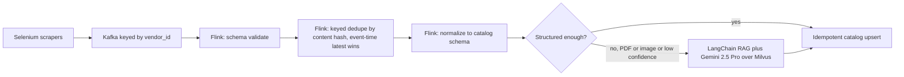

# Apache Flink (Uber Menu hot path), with Spark as a verbal backfill option

<div class="callout note">

**How to use this page**

- **What it covers:** what Apache Flink is, the ideas interviewers probe (keyed state, event time, watermarks, checkpoints, backpressure, exactly-once), and how the Flink job sat in the Uber Menu ingestion pipeline. It also covers Spark, but only as a verbal "how I would backfill" answer.
- **When to read it:** before the Uber Menu deep dive, any streaming design round, or a "why Flink and not Spark" question.
- **What to memorise:** Flink did keyed deduplication (by vendor and content hash), schema validation and normalization, and routing between the structured path and the RAG path. Exactly-once catalog upserts in practice means at-least-once delivery plus idempotent upserts. Flink is Menu only.

</div>

**Labels used on this page.** MEASURED means we have a log, doc or code for it. ESTIMATED means arithmetic I can show. HISTORICAL means it comes from my past work records. TARGET means a design goal.

<div class="callout warn">

**Say these carefully**

- **Flink is Uber Menu only.** Never Masters India (that was Kafka plus workers). Never Impact Analytics (that was ClickHouse plus a Python batch pipeline).
- **Spark is not on the resume.** Treat it as "how I would do backfills", a verbal option. Do not claim Spark ownership.
- **Do not claim a measured Flink peak throughput.** The about 200 to 500 events per second figure is an ESTIMATE used in prep only.
- **Exactly-once** on the resume means the catalog ends up with each change once. Mechanically that is at-least-once delivery plus idempotent upserts. No zero-message-loss claims and no two-phase commit across Gemini or third-party sites.
- The menu pipeline wrote to a catalog, **not ClickHouse**.

</div>

---

## 1. What Flink is, in plain English

Apache Flink is a **stream processor**: a framework for running long-lived programs that read an endless stream of events, keep some memory about what they have seen, and emit results continuously. Think of a sorting clerk at a post office who never goes home. Letters (events) arrive all day. The clerk remembers which letters each address already got, throws away exact duplicates, fixes badly written addresses, and drops each letter into the right outgoing bin. The clerk also takes a photo of the desk every few minutes, so if they faint, a replacement can pick up exactly from the last photo.

The "memory" is what makes Flink different from a simple Kafka consumer. Flink manages **state** for you, keeps it fault tolerant, and lets you reason about **when events happened** rather than when they arrived.

Who uses it: companies with real-time pipelines for fraud detection, metrics, enrichment, deduplication and stream joins.

---

## 2. How Flink works: the ideas interviewers probe

### 2.1 Jobs, operators and parallelism

A Flink **job** is a graph of operators, for example source, then map, then keyed process, then sink. Each operator runs as several parallel copies called **subtasks**. When reading from Kafka, a source subtask reads one or more partitions, so useful source parallelism is roughly the Kafka partition count.

### 2.2 keyBy and keyed state

`keyBy(vendor_id)` routes every event with the same key to the same subtask. That subtask can keep **keyed state**: a small value per key, such as "the last content hash I saw for this vendor's menu". Flink stores it, scales it across machines, and restores it after a crash. For large state, a disk-backed **state backend** such as RocksDB is used (older prep names RocksDB for this job).

```python
# Teaching sketch in PyFlink style. Not production code.
class DedupeMenu(KeyedProcessFunction):
    def open(self, ctx):
        self.last_hash = ctx.get_state(ValueStateDescriptor("last_hash", Types.STRING()))

    def process_element(self, event, ctx):
        h = event["content_hash"]
        if self.last_hash.value() == h:
            return                      # exact duplicate page or retry: drop it
        self.last_hash.update(h)
        yield normalize(event)          # schema normalization, then route downstream

stream.key_by(lambda e: e["vendor_id"]).process(DedupeMenu())
```

*What to notice: dedupe is a per-vendor memory of "what did I last see", which is exactly what keyed state is for.*

A worked example. Vendor 42's menu page is scraped three times because of anti-bot retries:

| Arrival | vendor_id | content_hash | Action |
|---|---|---|---|
| 1 | 42 | a1f9 | New hash: normalize and send to catalog upsert |
| 2 | 42 | a1f9 | Same hash: drop |
| 3 | 42 | c77e | Menu actually changed: normalize and upsert the new version |

### 2.3 Event time and watermarks

- **Processing time** is when Flink sees the event.
- **Event time** is when the event really happened, here the scrape timestamp carried in the event.

Scrapes arrive out of order because of retries and slow pages. If you decide "latest menu wins" by arrival order, a late, older page can overwrite a newer one. Flink lets you work in event time.

A **watermark** is Flink's running statement that "I believe I have now seen everything up to time T". With **bounded out-of-orderness** of, say, a few minutes (illustrative), Flink waits that long before closing windows or treating a key as settled. Events that arrive later than the watermark are **late events** and can be dropped, sent to a side output, or used to update state, depending on the design.

Analogy: a teacher collecting homework says "anything dated before Monday counts if it reaches me by Wednesday". Wednesday is the watermark.

Older prep describes the Menu rule as event-time last-write-wins: the version with the newest scrape timestamp wins, not the one that arrived last.

### 2.4 Checkpoints and recovery

Flink periodically takes a **checkpoint**, a consistent snapshot of all operator state plus the Kafka offsets that produced it. It does this by sending **checkpoint barriers** through the stream, like a marker dropped into a conveyor belt. When every operator has seen the marker, the snapshot is complete. If a machine dies, Flink restarts the job from the last checkpoint: state goes back to the snapshot, and Kafka is re-read from the matching offsets.

The consequence: after a crash, some events after the checkpoint are processed again. That is fine if the sink is idempotent, and it is why the catalog upsert had to be idempotent.

### 2.5 Exactly-once, honestly

- **Inside Flink**, checkpoints give exactly-once *state*: each event affects Flink's state once.
- **Into Kafka**, a transactional sink can give exactly-once *output*.
- **Into an external catalog**, you need the catalog write to be idempotent or transactional. We used idempotent upserts keyed by vendor, menu and version or content hash.

So the resume's "exactly-once catalog upserts" means the catalog shows each change once. Mechanically it is at-least-once plus idempotent upserts.

### 2.6 Backpressure

If the sink (catalog or the RAG path) slows down, Flink's network buffers fill up and its credit-based flow control slows the upstream operators, which in turn read Kafka more slowly. The visible symptom is **rising Kafka consumer lag**, which is the right alert. The system slows down instead of running out of memory.

---

## 3. Where Flink sat in Uber Menu

> Scaled menu extraction success to **95%+** by hardening a Selenium fleet with dynamic proxy pools and adaptive retries. Designed a large-scale data ingestion and processing pipeline using **Kafka** and **Apache Flink**, with stateful keyed deduplication and schema normalization to guarantee exactly-once catalog upserts.



*What to notice: one Flink job does validate, dedupe, normalize and route, before anything touches the catalog or the expensive LLM path.*

Step by step for one menu:

1. A scraper fetches vendor 42's menu page and publishes an event with `vendor_id`, scrape timestamp, raw payload reference and content hash.
2. Kafka stores it in vendor 42's partition.
3. Flink validates the event shape and drops malformed events to a side path.
4. Keyed dedupe: if the content hash equals the last one seen for vendor 42, drop it. If it is newer in event time, keep it.
5. Normalization maps fields to the catalog schema (names, prices, currency, modifiers).
6. Routing: clean structured menus go straight to the catalog upsert. Unstructured inputs (multilingual PDFs, images) go to the RAG extraction path, then back through schema validation to the catalog.
7. The catalog upsert is keyed, so a re-delivery after a checkpoint restore changes nothing.

### Why we needed Flink at Menu scale

30K+ menus a month is about 1,000 a day. That is not a "huge TPS" problem, and I say so. The drivers were the **shape** of the data:

1. **Bursts and retries** from the Selenium fleet and anti-bot backoff. You need continuous processing, not a nightly batch.
2. **Keyed dedupe.** The same vendor emits duplicate and late pages. Keyed state drops duplicates cheaply.
3. **Event time.** Scrape timestamps arrive out of order. Watermarks bound how long to wait.
4. **Freshness.** Onboarding went from 24 hours to 2 hours. Waiting for batch windows would eat into that.
5. **Fan-out routing.** One job validates and then splits structured and unstructured paths.

---

## 4. Design decisions

### Flink on the hot path

- **What:** a stateful Flink job between Kafka and the catalog.
- **Why:** keyed dedupe, event-time ordering and routing in one place, with checkpointed state.
- **Alternatives considered:**
  - *Plain Kafka consumers in Python.* Fine for stateless transforms. You end up re-implementing keyed state, checkpoints and late-event handling yourself.
  - *Kafka Streams.* A real option for lighter transforms, and I admit it could have worked at this event rate. Flink was preferred for richer event-time support, larger keyed state and a clearer operational model for a dedicated processing cluster.
  - *Spark Structured Streaming.* Micro-batches add seconds of delay and keyed state is more awkward. Better for batch-shaped work.
  - *Dedupe in the catalog database only.* Possible with unique keys, but every duplicate still costs a write and possibly an LLM call. Dropping duplicates before the RAG path saves money.
- **Trade-off:** Flink is another cluster to run, and state can grow large if key cardinality explodes.
- **What I'd do differently:** add state TTL (time-to-live) from the start so dedupe state for vendors that went quiet expires automatically, and version the parse modules so a bad parser can be rolled back without touching the job graph.

### Flink versus Spark

| Need | Flink | Spark |
|---|---|---|
| Keyed state per vendor or menu | Native | More awkward |
| Event time and late pages | Watermarks | Possible, with micro-batch delay |
| Catalog freshness in minutes | Better fit | Heavier |
| Huge historical reprocess (for example 90 days) | Possible | **Better fit** |

### Spark as a verbal backfill answer (not on the resume)

If asked "how would you reprocess 90 days after a schema change?", the answer is a batch job, and Spark is a natural tool: read raw payloads from object storage, transform with DataFrames, write idempotent upserts. Older prep estimated about 1 to 2 million item rows for a typical multi-day reprocess window. Treat that as ESTIMATED and verbal only. Watch for skew: very large vendors can be salted or isolated. Do not claim Spark kernel or Delta Lake work.

---

## 5. Failure modes and recovery

| Failure | What happens | Recovery |
|---|---|---|
| TaskManager (worker) dies | Job restarts from the last checkpoint | State and Kafka offsets roll back together. Idempotent catalog upserts absorb re-processed events. Lag alert fires until caught up |
| Bad parser or normalizer deploy | Wrong data goes to the catalog | Stop the job, fix, rewind Kafka offsets to before the bad deploy (restore from a savepoint or checkpoint from before it), reprocess. Batch backfill for larger gaps |
| State blowup | Key cardinality explodes, checkpoints get slow | State TTL, tighter keys, RocksDB backend |
| Idle partitions stall watermarks | A quiet Kafka partition holds back event time for everyone | Idleness detection on the source so idle partitions do not block the watermark |
| Brittle HTML or PDF parsing inside the job | Exceptions on certain vendors | Route failures to a side output, version parse modules, keep the job alive |

---

## 6. The numbers tied to Flink

| Number | What it measures | How derived | Tag |
|---|---|---|---|
| 30K+ menus a month | Volume through the pipeline | Work records. About 1,000 a day | HISTORICAL |
| From 24 hours to 2 hours | Onboarding time | Work records. 24 / 2 = 12 times faster, about a 92% cut | HISTORICAL |
| 95%+ extraction success | Usable scrapes | From an estimated 60 to 65% | HISTORICAL, baseline ESTIMATED |
| About 200 to 500 events per second peak | Kafka and Flink event rate during fleet runs | About 1,000 menus a day, each emitting many item, retry and health events, concentrated into short fleet windows | ESTIMATED, prep only |

Say it out loud: "Volume was about 30 thousand menus a month. The pipeline is justified by burstiness, duplicates and replay, not raw throughput."

Do NOT say: "We ran Flink at millions of events per second", or anything that ties Flink to ClickHouse.

---

## 7. Interview questions with speakable answers

**Q1. Why Flink and not just Kafka consumers?**
Plain consumers are fine for stateless work. We needed per-vendor keyed state for dedupe, event-time ordering because scrapes arrive late and out of order, and one job that validates, dedupes, normalizes and routes before anything hits the catalog or the LLM. Flink gives that state with checkpoints, so I am not hand-building fault-tolerant state in a consumer. For example, a retried scrape with the same content hash is dropped in Flink and never costs a Gemini call.

**Q2. Why Flink and not Spark?**
For the hot path, freshness and keyed state matter, and Flink is built for true streaming with native keyed state and watermarks. Spark Structured Streaming works in micro-batches, which adds delay and makes per-key state clumsier. Spark is the better tool for big historical reprocessing, so that is where I would use it, but it is not on my resume and I describe it as an option.

**Q3. How do you handle late events?**
We use event time from the scrape timestamp, with a watermark that allows bounded out-of-orderness. Within that bound, a late but newer-in-event-time page still wins. Anything later than the watermark goes to a side output instead of silently overwriting newer data. The rule is that the newest scrape timestamp wins, not the last arrival.

**Q4. What is in your dedupe key?**
The key is the vendor id, which is also the Kafka partition key, so ordering and state line up. The state is the last content hash or menu version seen for that vendor. A duplicate hash is dropped. A changed hash is a real update and flows on. The catalog upsert is keyed the same way, so even if Flink replays after a restore, the catalog sees no duplicate.

**Q5. A checkpoint fails mid-fleet. What happens?**
The job restarts from the last successful checkpoint. State goes back to that snapshot and Kafka offsets rewind to the positions recorded with it. Events after that point are processed again, and the idempotent upserts absorb them. Consumer lag rises and alerts until the job catches up. If a whole window was corrupted by bad code, we rewind further or run a batch backfill.

**Q6. Is 30K menus a month enough to justify Flink?**
Not if you only look at the average. About 1,000 menus a day is modest. The justification is the shape: bursty scraper waves, retries that create duplicates, out-of-order pages, a need to replay after bad deploys, and a split into structured and RAG paths. At this event rate Kafka Streams or a careful consumer could also work, and I would say that openly. Flink gave us managed keyed state and checkpoints for those properties.

**Q7. How did you get exactly-once catalog upserts?**
Flink checkpoints give exactly-once state inside the job, but the catalog is an external system. So the catalog write is an idempotent upsert keyed by vendor, menu and version. Delivery is at-least-once, and replays are no-ops. I do not claim zero message loss or two-phase commit across Gemini or third-party sites.

**Q8. How do you roll back a bad parser?**
Stop the job, fix or revert the parser, and restart from a checkpoint or savepoint taken before the bad deploy, which rewinds Kafka offsets with it. Then reprocess. Because upserts are idempotent and latest event time wins, the corrected output overwrites the bad output. For gaps bigger than Kafka retention, a batch backfill from the stored raw payloads is the tool.

---

## Resume placement

- **Skills line:** Apache Flink under Data and Streaming.
- **Menu bullet and Menu tech line:** Kafka plus Flink.
- **Masters:** Kafka only. **IA:** neither.

## Related

- [kafka_streaming.md](kafka_streaming.md) for Kafka fundamentals
- [kafka_flink_scale_defense.md](kafka_flink_scale_defense.md) for scale pushback
- [selenium_scraping.md](selenium_scraping.md) for the producer side
- [langgraph_mcp_rag.md](langgraph_mcp_rag.md) for the RAG path
- [../architecture/03_uber_menu.md](../architecture/03_uber_menu.md)
- [../../../handbook/09_tech_glossary.md](../../../handbook/09_tech_glossary.md)
