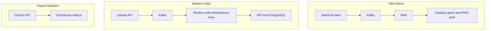

# Kafka and Flink: where they are used, why at these numbers, and how to defend them

**How to use this page**

- **What it covers:** the attack-and-defense sheet for Kafka and Flink. It shows where each technology sits on my resume, the numbers behind each project, the arithmetic, and speakable answers to the hard pushback ("30K a month is tiny", "prove you needed Flink", "what was your peak TPS?").
- **When to read it:** right after [kafka_streaming.md](kafka_streaming.md) and [flink.md](flink.md), and again the night before any streaming or system design round.
- **What to memorise:** the map (Menu has Kafka and Flink, Masters has Kafka only, IA has neither), the four rate derivations in section 4, and the line "we chose Kafka and Flink for burst, replay and keyed state, not for vanity throughput".

**Labels used on this page.** MEASURED means we have a log, doc or code for it. ESTIMATED means arithmetic I can show; say "roughly, derived from...". HISTORICAL means it comes from my past work records; state it plainly as the outcome. TARGET means a design goal. STUDY means study-only or verbal, not a resume claim.

**Say these carefully**

- Do not invent a throughput number you never measured. Menu peak events per second and Masters peak per second are **ESTIMATED**.
- **No Kafka or Flink at Impact Analytics.** Older versions of this sheet said IA used Kafka for async embedding jobs. The current resume says no. IA's data story is ClickHouse.
- **Masters Kafka is a different product from Menu Kafka.** No Flink at Masters.
- **Spark and Pinot are not on the resume.** Study only.
- "Exactly-once" means at-least-once delivery plus idempotent writes. No zero-loss claims.

---

## 1. Where each technology is used

| Place | Kafka? | Flink? | Job | Headline numbers |
|---|---|---|---|---|
| **Uber Menu** (Uber via EPAM) | Yes. Ingest bus after Selenium | Yes. Validate, keyed dedupe, normalize, route | Menus into the Uber Eats catalog | 30K+ menus a month, from 24 hours to 2 hours, 95%+ extraction success, $600K a year |
| **Masters India** | Yes. Bulk IRP e-invoice pipeline | **No** | Register invoices with the government portal | 1M+ submissions a day, 100K+ concurrent imports, from 700 to 4,000 requests per minute |
| **Impact Analytics** | **No** | **No** | ClickHouse rollups and a Python batch pipeline | Not a streaming story |
| **Uber FRM, GeeksforGeeks** | No | No | n/a | n/a |

**One-liner to say:** "Kafka absorbs bursts and lets us replay. Flink adds stateful stream logic, and I only needed that at Uber Menu. Masters stayed on Kafka plus idempotent workers plus quarter-sharded Postgres."

*What to notice: only one box has Flink, and the IA box has no streaming at all.*

---

## 2. Uber Menu: why not "just call the catalog API from the scraper"?

| Pressure | Number or shape | Why synchronous HTTP breaks | Why Kafka helps | Why Flink helps |
|---|---|---|---|---|
| Volume | 30K+ menus a month, about 1,000 a day, with spikes when vendors refresh | Scrapers block on slow catalog writes | Buffers and allows several consumers | Processes continuously without waiting for batch windows |
| Latency goal | Onboarding from 24 hours to 2 hours | Retry storms amplify delay | Decouples scrape success from catalog success | Stateful dedupe avoids redoing work |
| Burstiness | Scrape waves, anti-bot backoff, retries | Thread pools melt down | The partitioned log absorbs spikes | Backpressure shows as Kafka lag, not scraper crashes |
| Bad deploy | A parser bug ships | You cannot replay HTTP calls | Rewind offsets and reprocess | Restore state from a checkpoint before the bug |
| Fan-out | Structured path, RAG path, health signals | One HTTP call cannot fan out cleanly | Many consumer groups | Routes in-stream after validation |
| Ordering | Per-vendor menu updates | Races overwrite newer data | Key by vendor id | Keyed state matches that key |

### The rate arithmetic, done correctly

30,000 menus a month divided by about 2,592,000 seconds in a 30-day month is about **0.012 menus per second**, or one menu every 80 to 90 seconds on average. That is tiny, and I say so.

But the bus does not carry one event per menu. Each menu emits many item-level events, plus retries, page chunks and health events, and fleet runs concentrate work into short windows. Older prep estimates the **peak bus rate at about 200 to 500 events per second** during fleet runs (ESTIMATED, prep only). Steady state is much lower.

Older versions of this sheet said "about 0.4 to 1 event per second average if one event per menu". That arithmetic was wrong. One event per menu is about 0.012 per second. Use the corrected figure.

Say it: "On average it's about a thousand menus a day, which is modest. The design driver was bursts, retries, duplicates and replay, not average throughput."

---

## 3. Masters India: why Kafka at 1M+ a day and 4,000 requests per minute

| Pressure | Number | Why the synchronous PHP monolith struggled | Why Kafka helps |
|---|---|---|---|
| Daily IRP submissions | 1M+ a day, about 12 per second average, peaks roughly 90 to 120 per second (ESTIMATED) | One slow IRP call holds a worker hostage | The queue absorbs deadline spikes |
| Bulk import | 100K+ concurrent imports | Memory pressure and request timeouts | Chunk the file, publish chunks, let consumers process them |
| API throughput | From 700 to 4,000 requests per minute (about 12 to 67 per second) | The monolith scaled as one unit | Microservices plus an async bulk path |
| Safety | Risk of double filing with the government | Retries without idempotency double-register | Idempotency keys, DLQ and replay |
| Ordering | Per taxpayer | Races on the same GSTIN | Partition key is the client GSTIN |

**Why no Flink at Masters:** consumers, Celery workers and idempotent database writes were enough. Each message is processed independently, with an idempotency check. There was no stateful windowing or dedupe-by-event-time requirement like Menu's late scrape pages. Adding Flink would duplicate the pipeline for no gain.

---

## 4. Rate cheat sheet (say the tag out loud)

| Claim | Arithmetic | Tag |
|---|---|---|
| 30K+ menus a month | 30,000 / 30 is about 1,000 a day, about 0.012 a second | HISTORICAL, rate ESTIMATED |
| Menu peak about 200 to 500 events per second | Items, retries and health events per menu, concentrated in fleet windows | ESTIMATED, prep only, not on the resume |
| From 24 hours to 2 hours | 24 / 2 = 12 times faster, about a 92% cut | HISTORICAL |
| $600K a year saved | About $2 per menu x 30,000 x 12 = $720K list, floored to $600K | ESTIMATED on HISTORICAL inputs |
| 95%+ extraction success | From an estimated 60 to 65% | HISTORICAL, baseline ESTIMATED |
| 1M+ IRP submissions a day | 1,000,000 / 86,400 is about 11.6, so about 12 a second | HISTORICAL, rate ESTIMATED |
| Masters peaks | 8 to 10 times the average, so roughly 90 to 120 a second | ESTIMATED |
| From 700 to 4,000 requests per minute | 700 / 60 is about 12 a second, 4,000 / 60 is about 67 a second, about 5.7 times more | HISTORICAL, per second ESTIMATED |
| 100K+ concurrent imports | Bulk imports processed idempotently | HISTORICAL |
| Kafka and Flink on Menu | Architecture on the resume | HISTORICAL |
| Spark, Pinot | Not on the resume | STUDY, verbal only |

---

## 5. Attack and answer (memorise these)

**"Kafka and Flink for only 30K menus a month? Isn't that overkill?"**
Average rate was not the design driver, and I agree the average is small: about a thousand menus a day. Scrapers are bursty and flaky because of anti-bot blocks and retries, and the catalog and RAG extraction have very different latency. Kafka lets a scrape succeed even when downstream is slow, and lets us replay after a bad parser. Flink owns keyed dedupe and routing, so we never double-apply the same vendor's menu when late or retried pages arrive. With only synchronous chains, a bad deploy meant re-scraping instead of rewinding the log.

**"Prove you needed Flink and not just Kafka consumers."**
Plain consumers are fine for fire-and-forget transforms. We needed keyed state per vendor, event-time handling for late pages, and a single job that validates, dedupes, normalizes and routes before the catalog or the RAG path. That is Flink's core strength, and it gives checkpointed state so I am not hand-building fault tolerance. I will also say that Kafka Streams or a careful consumer could have worked at this event rate. Flink was the stronger fit for state and event time.

**"What was your peak events per second on Menu?"**
I don't claim a measured Flink peak. What I can state is the outcome: 30K+ menus a month, onboarding from 24 hours to 2 hours, and 95%+ extraction success. If you want an order of magnitude, my estimate is a few hundred events per second during fleet runs, because each menu fans out into many item, retry and health events. That is an estimate, not a dashboard number.

**"Masters 1M+ a day: was that Kafka or the API?"**
Both, and they are different paths. The interactive API went from 700 to 4,000 requests per minute after the strangler migration to FastAPI. Bulk submissions, 1M+ a day and 100K+ concurrent imports, went through Kafka so deadline spikes did not melt Postgres or overload the IRP. Idempotency keys stopped double filing on replay.

**"How do you get exactly-once?"**
End-to-end exactly-once delivery is a slogan. The practical recipe is at-least-once from Kafka plus an idempotent sink. At Menu the catalog upsert is keyed by vendor, menu and version. At Masters the key is client plus file hash plus batch index. Flink can write transactionally into Kafka, but the external catalog still needs idempotent writes. Poison messages go to a DLQ, never infinite retry.

**"A bad Flink or parser deploy shipped. How do you recover?"**
Stop the job, fix it, and restart from a checkpoint or savepoint from before the bad deploy, which rewinds Kafka offsets too. Then reprocess, and idempotent upserts make the re-run safe. If the gap is longer than Kafka retention, a batch backfill from stored raw payloads repairs it. Spark would be my tool for that, as a verbal option. We do not re-hit the open web for every repair if the raw payload is still stored.

**"Why Kafka and not RabbitMQ, SQS or just Celery?"**
We needed a replayable, partitioned, multi-consumer log with per-key ordering. Celery is a task queue, good for jobs, but weak for "reprocess last Tuesday's events". SQS deletes on acknowledgement and does not give the same ordered multi-subscriber replay. RabbitMQ could have handled Masters' task dispatch at our scale, and I say that honestly. Kafka matched Menu's fan-out and Masters' replay needs.

**"Why not put Kafka at Impact Analytics too?"**
There was no streaming requirement in my scope there. The IA work is interactive analytics on ClickHouse rollups and batch AI scoring with checkpoints. Adding a bus would add infrastructure without a problem to solve. I also don't claim the CDC pipeline there, because a colleague built it.

---

## 6. Twenty-second stories

**Menu:** "Scrapers are bursty. Kafka is the replayable bus. Flink does keyed dedupe and normalization and routes structured menus straight to the catalog and messy PDFs to the RAG path. That pipeline is how 30K+ menus a month went from 24-hour to 2-hour onboarding."

**Masters:** "Filing deadlines spike IRP traffic. Kafka plus idempotent consumers and quarter-sharded Postgres handled 1M+ submissions a day without double filing on replay, and the API went from 700 to 4,000 requests per minute. No Flink, because workers were enough."

---

## 7. Practice drill

1. **What is the average menu rate per second?** About 0.012 a second, one menu every 80 to 90 seconds. The bus is busier because each menu fans out into many events.
2. **Average Masters submission rate?** About 12 a second, from 1,000,000 / 86,400.
3. **Masters peak?** Estimated 8 to 10 times average, roughly 90 to 120 a second.
4. **700 to 4,000 requests per minute in per second?** About 12 to 67.
5. **Where is Flink?** Uber Menu only.
6. **Where is Kafka?** Uber Menu and Masters India, two different products.
7. **What does exactly-once mean on my resume?** At-least-once delivery plus idempotent upserts.
8. **Menu partition key?** Vendor id. **Masters partition key?** Client GSTIN, sometimes plus document type.
9. **Is Spark on the resume?** No. Verbal backfill option only.
10. **Is the Menu peak rate measured?** No, estimated and prep only.

---

## Related

- [flink.md](flink.md) and [kafka_streaming.md](kafka_streaming.md)
- [../architecture/03_uber_menu.md](../architecture/03_uber_menu.md)
- [../architecture/04_masters_gst.md](../architecture/04_masters_gst.md)
- [../deployment_and_scale.md](../deployment_and_scale.md)
- [../numbers_defense.md](../numbers_defense.md)
