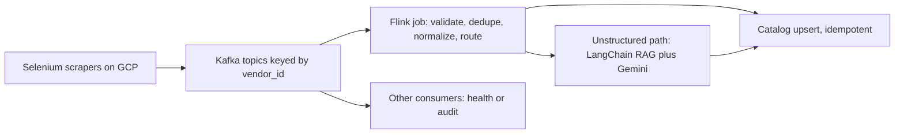
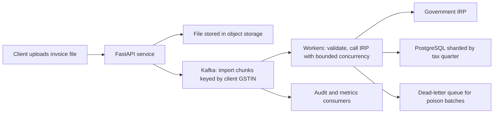

# Kafka and event-driven paths (Uber Menu and Masters India)

<div class="callout note">

**How to use this page**

- **What it covers:** what Apache Kafka is, the five or six ideas every interviewer probes (topics, partitions, keys, offsets, consumer groups, delivery guarantees), and how I used it on two different products: Uber Menu ingestion and Masters India e-invoicing.
- **When to read it:** before any streaming, event-driven or "design a pipeline" round, and before the Menu or Masters deep dives.
- **What to memorise:** Kafka is a replayable, partitioned log. Menu keys by vendor, and Kafka feeds Flink. Masters keys by client GSTIN, with idempotent workers and no Flink. "Exactly-once" in practice means at-least-once delivery plus idempotent writes.
- **Hard pushback on scale** ("isn't 30K a month tiny for Kafka?") lives in [kafka_flink_scale_defense.md](kafka_flink_scale_defense.md).

</div>

**Labels used on this page.** MEASURED means we have a log, doc or code for it. ESTIMATED means arithmetic I can show. HISTORICAL means it comes from my past work records. TARGET means a design goal.

<div class="callout warn">

**Say these carefully**

- Kafka is on the resume at **Uber Menu** (with Flink) and at **Masters India** (without Flink). These are **two different products** with different Kafka setups. Do not merge them.
- **No Kafka at Impact Analytics.** Older prep said IA used Kafka for async embedding jobs. The current resume has no Kafka, Flink or CDC at IA. If asked, say ClickHouse and the Python batch pipeline are the IA data story.
- **Do not claim zero message loss** or two-phase commit across third parties. Say "at-least-once delivery with idempotent upserts".
- Menu peak event rate (about 200 to 500 events per second) is an **ESTIMATE used only in prep**. It is not on the resume. Masters peak rate is also ESTIMATED.

</div>

---

## 1. What Kafka is, in plain English

Apache Kafka is a system for moving streams of events between services. An **event** is a small record that says "something happened", such as "menu page scraped for vendor 123" or "invoice batch 7 of file X accepted". Producers write events into Kafka. Consumers read them later at their own pace.

The key difference from a normal queue: **Kafka keeps the events after they are read.** It is an append-only log, like a ledger book where every new line is written at the bottom and nothing is torn out when someone reads it. Each reader keeps a bookmark. If a reader has a bug, you fix it and move its bookmark back to re-read old pages. That ability is called **replay**, and it is the main reason I used Kafka in both projects.

Who uses it: almost every large company with event-driven services, for activity tracking, order pipelines, log shipping, change streams and so on.

---

## 2. How Kafka works: the ideas interviewers probe

### 2.1 Topics, partitions and offsets

- A **topic** is a named stream, for example `menu.scrape.events` (illustrative name).
- A topic is split into **partitions**. Each partition is an ordered, append-only log stored on a broker (a Kafka server). Partitions are how Kafka scales: more partitions means more parallel readers.
- Each event in a partition gets an increasing number called its **offset**. Offset 0, 1, 2, and so on.

```text
topic: menu.scrape.events
  partition 0:  [o0 vendor=12] [o1 vendor=40] [o2 vendor=12] ...
  partition 1:  [o0 vendor=7]  [o1 vendor=7]  [o2 vendor=91] ...
  partition 2:  [o0 vendor=55] ...
```

*What to notice: all events for vendor 12 are in partition 0, in order. Different vendors can be processed in parallel on different partitions.*

### 2.2 Keys decide ordering

When a producer sends an event with a **key**, Kafka hashes the key to choose the partition. Same key, same partition, so events for one key stay in order. **Ordering is only guaranteed within a partition, not across the whole topic.**

- Uber Menu keyed by `vendor_id`, so one restaurant's menu updates are processed in order.
- Masters India keyed by the client's **GSTIN** (GST Identification Number, the tax id of a business), sometimes GSTIN plus document type, so one taxpayer's invoice submit, IRN callback and webhook stay in order.

```python
# Teaching sketch (kafka-python style). Not production code.
producer.send(
    "irp.submit.jobs",
    key=client_gstin.encode(),          # same taxpayer -> same partition -> ordered
    value=json.dumps({"file_hash": fh, "batch_index": 7}).encode(),
)
```

Watch out for **hot keys**: if one vendor or one client produces most of the traffic, its partition becomes the bottleneck. Mitigations include splitting the key (GSTIN plus document type) or isolating very large tenants.

### 2.3 Consumer groups

A **consumer group** is a set of consumers that share the work of reading a topic. Kafka gives each partition to exactly one consumer in the group. If you have 12 partitions and 4 consumers, each consumer reads 3 partitions. Add a fifth consumer and Kafka **rebalances**, moving partitions between them.

The big benefit: **different groups read the same topic independently.** At Masters, IRP submit workers, an audit projector and a metrics consumer could all read the same events without the producer knowing about any of them. At Menu, Flink was the main online consumer, and health or audit readers could attach separately.

Rule of thumb: maximum parallelism in a group equals the partition count. A sixth consumer on a 5-partition topic sits idle.

### 2.4 Offsets, commits and replay

Each consumer group stores its committed offset per partition, which is its bookmark. Two important behaviours:

- **Commit after processing**, not before. If you crash after processing but before committing, you will re-read that event. That is **at-least-once** delivery. Duplicates are possible, so the processing must be safe to repeat.
- **Replay** means resetting a group's offsets to an earlier point and reprocessing. For example: a parser bug shipped on Tuesday, so after the fix we rewind to before the deploy and re-run. This is only possible if retention (how long Kafka keeps data) covers that window.

### 2.5 Durability: replication and acks

Each partition is copied to several brokers (the **replication factor**, typically 3). One copy is the leader. With `acks=all`, a write is acknowledged only after the in-sync replicas have it, so a single broker failure does not lose acknowledged data. This is general Kafka behaviour. I do not claim specific broker configurations for either project.

### 2.6 Delivery guarantees in one table

| Guarantee | Meaning | How you get it |
|---|---|---|
| At-most-once | May lose events, never duplicates | Commit before processing |
| At-least-once | Never loses committed events, may duplicate | Commit after processing |
| Exactly-once (inside Kafka) | Each event affects Kafka state once | Idempotent producer plus Kafka transactions, read-process-write within Kafka |
| "Exactly-once" end to end | The external store shows each change once | **At-least-once plus an idempotent sink**. This is what I built in both projects |

An **idempotent** operation has the same effect whether you do it once or five times, like pressing a lift button twice. An **upsert** inserts a row or updates it if the key already exists.

### 2.7 Dead-letter queues and retries

A **poison message** is an event that will always fail, such as a malformed payload. If a consumer retries it forever, the whole partition stalls behind it. A **dead-letter queue (DLQ)** is a side topic or table where such events are parked after a bounded number of retries, so the rest keeps flowing and an operator can inspect and replay them later.

**Bounded retries** with **exponential backoff and jitter** means: wait 1s, then 2s, then 4s, with a little randomness so thousands of retries do not all fire at the same instant, and stop after N tries.

### 2.8 Consumer lag and backpressure

**Consumer lag** is how far a consumer group is behind the newest offset. It is the single most useful Kafka health metric. Rising lag means the consumer cannot keep up, or the downstream it writes to is slow. **Backpressure** is the system slowing intake when downstream is slow. With Kafka in the middle, slow downstream shows up as growing lag rather than producers crashing, because Kafka simply holds the events.

---

## 3. Where I used Kafka

### 3.1 Uber Menu Ingestion (Uber via EPAM)

> Scaled menu extraction success to **95%+** by hardening a Selenium fleet with dynamic proxy pools and adaptive retries. Designed a large-scale data ingestion and processing pipeline using **Kafka** and **Apache Flink**, with stateful keyed deduplication and schema normalization to guarantee exactly-once catalog upserts.



*What to notice: scrapers only have to get the event into Kafka. They never wait for the catalog or the LLM path.*

**What Kafka did here**

- **Decoupling.** Scrapers are bursty and flaky (anti-bot blocks, retries). The catalog write and the RAG extraction are slower and have different latency. Kafka lets a scrape "succeed" as soon as its event is stored.
- **Per-vendor order.** Keyed by `vendor_id`, so updates for one restaurant are applied in order.
- **Replay.** After a bad parser deploy, rewind the consumer and reprocess from the log instead of re-scraping the internet.
- **Fan-out.** Flink reads it for the hot path, and other consumers can read the same events.

**Numbers**

| Number | Meaning | Tag |
|---|---|---|
| 30K+ menus per month | Menus processed. 30,000 / 30 is about 1,000 a day | HISTORICAL |
| From 24 hours to 2 hours | Restaurant onboarding time, about a 92% cut | HISTORICAL |
| 95%+ extraction success | From an estimated 60 to 65% | HISTORICAL, baseline ESTIMATED |
| About 200 to 500 events per second peak | Each menu emits many item, retry and health events during fleet runs | ESTIMATED, prep only |

### 3.2 Masters India GST e-invoicing

> Architected a high-concurrency bulk e-invoicing pipeline processing **1M+** daily government submissions by orchestrating a **Kafka** event bus and a **PostgreSQL** database horizontally sharded by tax quarter. Enforced exactly-once, idempotent processing for **100K+** concurrent imports with fault-tolerant state management via dead-letter queues and bounded retries against volatile state IRP portals.

Plain words: enterprise clients upload invoice files. Each invoice must be registered with the government **IRP** (Invoice Registration Portal), which returns an **IRN** (Invoice Reference Number) and a signed QR code. The IRP is slow and flaky around filing deadlines. Registering the same invoice twice is a compliance problem, not just a data bug.



*What to notice: the HTTP request returns quickly. The slow, risky IRP calls happen in workers that can retry safely.*

**What Kafka did here**

- **Load levelling.** Deadline spikes are absorbed by the log, so Postgres and the IRP see a controlled rate.
- **Ordering per taxpayer.** Keyed by client GSTIN.
- **Safe retries.** Every chunk carries an **idempotency key** like `client + fileHash + batchIndex`. Before registering, the worker checks whether that key is already done. Re-delivery from Kafka becomes a no-op.
- **DLQ and bounded retries.** Poison batches park for operator replay instead of blocking a whole 100K-row import.
- **Multiple consumers.** IRP workers, audit and metrics read the same events independently.
- Celery workers also handled async jobs (validation chains, PDF generation, webhooks) with retries and idempotency keys. Kafka was the event bus between stages.

**Numbers**

| Number | Meaning | Tag |
|---|---|---|
| 1M+ submissions a day | IRP submissions | HISTORICAL |
| About 12 per second average | 1,000,000 / 86,400 is about 11.6 | ESTIMATED |
| Peaks 8 to 10 times average | Roughly 90 to 120 per second around filing deadlines | ESTIMATED |
| 100K+ concurrent imports | Bulk imports processed idempotently | HISTORICAL |
| From 700 to 4,000 requests per minute | API throughput, about 12 to 67 per second | HISTORICAL, per-second ESTIMATED |

The 700 to 4,000 requests per minute is the interactive API path. The 1M+ a day is the bulk submission path through Kafka. They are complementary numbers, not the same measurement.

### 3.3 Why Menu had Flink and Masters did not

Masters needed ordered, replayable, retry-safe job delivery. Plain consumers, Celery workers and idempotent database writes were enough. Menu needed **stateful** stream logic: dedupe by vendor and content hash with keyed state, event-time handling for late pages, and in-stream routing between the structured and RAG paths. That is Flink's job. See [flink.md](flink.md).

---

## 4. Design decisions

### Why Kafka at all (both projects)

- **What:** a durable, partitioned log between producers (scrapers, upload API) and consumers (Flink, workers).
- **Why:** bursts, slow downstreams, and the need to replay after bugs.
- **How:** keyed topics, consumer groups, commit after processing, idempotent sinks, DLQ.
- **Alternatives considered:**
  - *Synchronous HTTP calls* from scraper to catalog, or from upload to IRP. A slow downstream blocks threads, and there is no replay.
  - *RabbitMQ.* A good broker for task dispatch. At Masters' scale it could have worked, and I say that honestly. Kafka won on cheap replay for GST disputes and multiple independent consumer groups.
  - *Amazon SQS.* Messages are deleted on acknowledgement, so there is no cheap multi-consumer replay. SQS FIFO also limits throughput per message group.
  - *Celery alone.* Celery is a task queue and is great for jobs, but it is a weak audit and replay bus for "reprocess last Tuesday".
  - *Google Pub/Sub* (Menu was on GCP). It is a reasonable managed choice. I have no story where we evaluated it, so if asked, say it is a valid alternative with different replay and ordering semantics.
- **Trade-off:** Kafka is operationally heavier: partitions, retention, rebalances and lag monitoring. You also have to design for duplicates.
- **What I'd do differently:** define the event schema and versioning (a schema registry) up front, and put DLQ replay tooling in place before the first incident rather than after.

---

## 5. Failure modes and how we handled them

| Failure | What it looks like | Mitigation |
|---|---|---|
| Duplicate delivery | Same invoice or menu processed twice after a crash or rebalance | Idempotency keys and upserts. Commit offsets after processing |
| Poison message | One partition stops moving, lag grows on one partition only | Bounded retries, then DLQ |
| Bad deploy of a consumer | Wrong data written for an hour | Fix, rewind offsets to before the deploy, reprocess. Idempotent sink makes the re-run safe |
| Slow downstream (IRP, catalog) | Lag rises across all partitions | Bounded concurrency, backoff, alert on lag. Kafka buffers in the meantime |
| Hot key | One partition far behind the others | Better key choice (GSTIN plus document type), isolate whale tenants |
| Dual writes without idempotency | Database and Kafka disagree | Write state once with an idempotent key. Never "write DB, then publish" without a recovery story |

---

## 6. Interview questions with speakable answers

**Q1. What is Kafka and why is it different from a queue?**
Kafka is a partitioned, append-only log. Consumers track their own offsets, and events stay after being read, so I can replay them and several consumer groups can read the same stream independently. A classic queue deletes a message once it is acknowledged. I used Kafka at Uber Menu and at Masters India mainly for replay and decoupling. For example, after a bad parser deploy at Menu we could rewind and reprocess instead of re-scraping.

**Q2. How does Kafka guarantee ordering?**
Only within a partition. The producer's key is hashed to pick a partition, so all events with the same key land in order on one partition. At Menu the key was the vendor id. At Masters it was the client GSTIN, sometimes GSTIN plus document type. If you need global ordering you need one partition, which kills parallelism, so you design the key around what actually needs ordering.

**Q3. How did you get exactly-once?**
End to end, I got exactly-once effects, not exactly-once delivery. Kafka gave at-least-once delivery because we committed offsets after processing. The sink was idempotent: catalog upserts keyed by vendor, menu and content hash at Menu, and an idempotency key like client plus file hash plus batch index at Masters. So a duplicate delivery becomes a no-op. I do not claim zero message loss or two-phase commit across the government portal.
*Follow-up they may ask:* "What about Kafka transactions?" They give exactly-once for read-process-write inside Kafka. The moment you write to an external system, you still need idempotency there.

**Q4. What is a DLQ and when do you use one?**
A dead-letter queue is where a message goes after a bounded number of failed retries, so it does not block the partition behind it. At Masters, a malformed batch in a 100K-row import would otherwise stall every later batch for that client. We retried with exponential backoff and jitter against the IRP, and after the limit the batch parked in the DLQ for an operator to inspect and replay.

**Q5. How do you size partitions?**
Partitions cap consumer parallelism in a group, so I size for the peak consumer count I expect, with headroom, because adding partitions later reshuffles key-to-partition mapping and breaks per-key ordering during the change. I also check key skew, since a hot key can make one partition the bottleneck no matter how many partitions exist. I do not quote exact partition counts from either project.

**Q6. Consumer lag is growing. What do you do?**
First, check whether lag is growing on all partitions or one. One partition usually means a poison message or a hot key. All partitions means the consumer or its downstream is slow. Then look at the downstream: at Masters that was usually the IRP slowing near a deadline, at Menu the catalog or the RAG path. Mitigations are scaling consumers up to the partition count, bounded concurrency to the slow dependency, and DLQ for poison messages. Kafka buffering is the reason this is an alert and not an outage.

**Q7. Why not RabbitMQ or SQS at Masters?**
We needed per-taxpayer ordering, cheap replay for GST disputes and audit reprocessing, and multiple consumer groups on the same events. SQS deletes on acknowledgement and FIFO limits throughput per group. RabbitMQ could honestly have worked at our scale for task dispatch. Kafka won on replay and independent consumers, and the trade-off was more operational work.

**Q8. Why did Menu need Flink but Masters did not?**
Masters' processing was stateless per message plus an idempotency check in the database, so plain consumers and workers were enough. Menu needed keyed state to dedupe repeated or late pages per vendor, event-time handling, and in-stream routing to the structured or RAG path. That is what a stream processor like Flink is for. Adding Flink at Masters would have duplicated the pipeline without a stateful requirement.

---

## Related

- [kafka_flink_scale_defense.md](kafka_flink_scale_defense.md) for scale pushback and numbers
- [flink.md](flink.md)
- [selenium_scraping.md](selenium_scraping.md) for the producer side at Menu
- [postgres_mysql_redis.md](postgres_mysql_redis.md) for quarter sharding at Masters
- [../architecture/03_uber_menu.md](../architecture/03_uber_menu.md)
- [../architecture/04_masters_gst.md](../architecture/04_masters_gst.md)
- [../../../handbook/09_tech_glossary.md](../../../handbook/09_tech_glossary.md)
