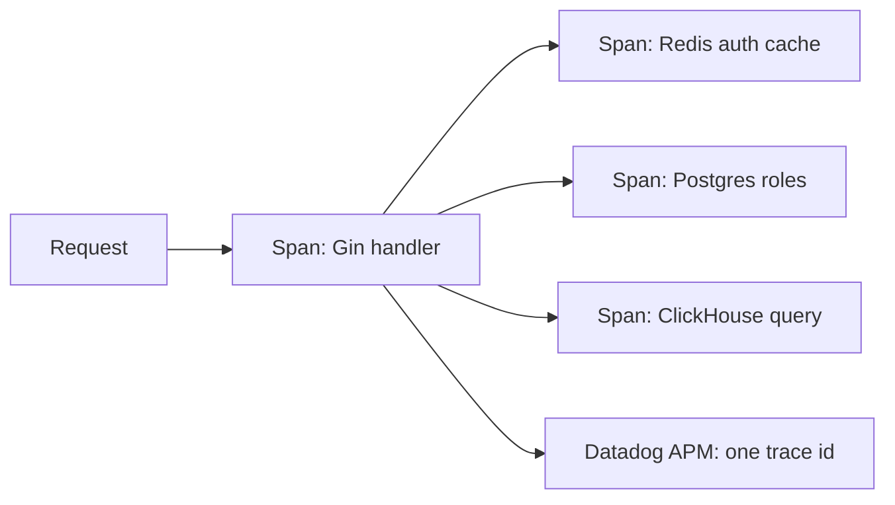
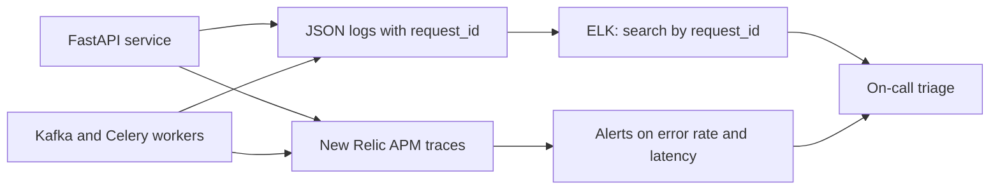

# Observability and cloud: Datadog, LangSmith, ELK, New Relic, Docker, GCP, AWS, Kubernetes, Bazel, CI/CD

<div class="callout note">

**How to use this page**

- **What it covers:** the observability tools (logs, metrics, traces, LLM traces) and the cloud and DevOps items on my resume. That means Datadog on the Impact Analytics Go edge, LangSmith on Ask Iris, custom JSON telemetry on the Keep/Drop batch, ELK and New Relic at Masters India, plus Docker, GCP, AWS, Bazel, CI/CD and Kubernetes (literacy only).
- **When to read it:** before any "how do you debug production", on-call, reliability or DevOps question.
- **What to memorise:** which tool lives where (Datadog is the IA Go edge, LangSmith is Ask Iris, ELK and New Relic are Masters). The Masters numbers: triage down 70% (roughly 30 minutes to under 10, estimated baseline), test coverage from 35% to 82%, and 98% deployment success. And that Kubernetes is literacy, not cluster operations.

</div>

**Labels used on this page.** MEASURED means we have a log, doc or code for it. STATED means printed on the resume from the project source. ESTIMATED means arithmetic I can show. HISTORICAL means from my past work records. TARGET means a design goal.

<div class="callout warn">

**Say these carefully**

- **LangSmith is Ask Iris only.** The Keep/Drop batch uses custom JSON telemetry, not LangSmith.
- **Datadog is the IA Go edge.** No invented SLA, p99 or uptime number.
- **ELK and New Relic are Masters India.** They are both on the current skills line too. Older prep said ELK might be off the skills list. It is on it now.
- **Kubernetes is literacy only.** No "I operated clusters". No Terraform production ownership. Do not claim org-wide ownership of Datadog or LangSmith.
- The **70% triage** cut is HISTORICAL. Its **30-minute baseline is ESTIMATED**. I claim on-call **alerting** and faster triage, not a formal pager rotation title.
- PostHog appeared in older IA prep as product analytics. It is not on the resume. Do not lead with it.

</div>

---

## 1. Observability in plain English

**Observability** is how well you can tell what a running system is doing from the outside, using the signals it emits. It answers "what is broken, where, and why" without SSH-ing into boxes and guessing.

The three classic signals:

| Signal | What it is | Analogy | Example |
|---|---|---|---|
| **Logs** | Timestamped records of events | A ship's logbook | `{"level":"error","request_id":"r-91","msg":"IRP timeout","client":"c-12"}` |
| **Metrics** | Numbers over time | The car dashboard | Request rate, error rate, p95 latency, consumer lag |
| **Traces** | One request's path across services, as timed steps | A parcel tracking history | API span, then Redis span, then ClickHouse span |

More terms you need:

- **Span:** one timed step in a trace (an HTTP handler, a database query).
- **Trace id or correlation id:** an id carried through every service and log line for one request, so you can stitch them together.
- **APM** (Application Performance Monitoring): tools that auto-instrument services to produce traces and latency breakdowns.
- **Structured logs:** JSON fields instead of free text, so you can filter by `client_id` or `request_id`.
- **SLI, SLO, SLA:** an SLI (Service Level Indicator) is a measured signal like p95 latency. An SLO (Service Level Objective) is the target for it. An SLA (Service Level Agreement) is a contractual promise. I quote none of these for IA.

---

## 2. Datadog at Impact Analytics (bullet C1)

> Architected a multi-tenant **Go/Gin** platform scaling to **10k peak RPS**, utilizing **Google Wire** for compile-time DI. Deployed as a self-protecting HTTP edge without a reverse proxy, guaranteeing high availability through native **h2c**, nested timeouts, and **Datadog** distributed tracing.

**Datadog** is a hosted monitoring platform for metrics, logs and APM traces. Its Go tracer instruments Gin, HTTP clients and database calls, so each request becomes a trace with spans.

Why it matters for this design: with no reverse proxy, there is no proxy access log or proxy dashboard to lean on. The Go process's own traces are the main view into latency. When a pivot is slow, the trace waterfall shows whether the time went to the auth waterfall on a Redis miss, to Postgres role resolution, or to a ClickHouse query.



*What to notice: one trace id ties every downstream call to the request, so the slowest span is obvious.*

Say it: "Datadog distributed tracing on the Go edge, so every request is a trace across Redis, Postgres and ClickHouse." Do NOT add an SLA or a p99.

---

## 3. LangSmith on Ask Iris (bullet A4)

**LangSmith** is the LangChain team's tracing and evaluation platform for LLM apps. Each graph run is a trace tree: nodes, prompts, model responses, token counts, latency and errors.

For Ask Iris it answers questions Datadog can't: which worker did the supervisor route to, why did the evaluator reject the first draft, how many attempts (at most 3) did it take, how many tokens did it cost. See [langgraph_mcp_rag.md](langgraph_mcp_rag.md).

---

## 4. Custom JSON telemetry on the Keep/Drop batch (bullet A3)

> Engineered a shared orchestration registry to guarantee **88k-article** batch runs survive provider failures by implementing hard timeouts, circuit breakers, and durable checkpoints that bypass redundant deterministic scoring. Ensured full observability by stamping every output row with a frozen config hash and custom JSON telemetry tracking tokens, USD cost, step duration, and batch fallbacks.

For a batch job, the questions are different: what did this run cost, how long did each step take, how many batches fell back to deterministic scores, and which configuration produced each row. So each run emits JSON telemetry (tokens, USD cost, step duration, batch fallbacks), and every output row carries `config_hash`, a SHA-256 of guardrails, parameters, prompts and catalog.

```json
{"run_id": "kd-2026-09-08-a", "config_hash": "9f2c...", "step": "lenses",
 "items": 88000, "tokens_in": 0, "tokens_out": 0, "usd_cost": 0.0,
 "duration_s": 0, "batches_fallback": 0}
```

*(Field names are illustrative and the values are zeroed on purpose. About $100 per pass is true but off the PDF.)*

Why not LangSmith here: we needed per-run cost accounting and fallback counts tied to output rows and to the config hash, inside our own batch CLI. A fallback spike is visible in the telemetry, so fallbacks don't silently hide problems.

---

## 5. ELK and New Relic at Masters India (bullet MI3)

> Decreased incident triage time by **70%** and lowered database read load by **30%** by instrumenting **ELK** and **New Relic** distributed tracing alongside a Redis caching layer. Hardened the CI/CD release cycle by driving test coverage from **35% to 82%**, achieving a **98%** deployment success rate across the microservices ecosystem.

### 5.1 What the tools are

- **ELK** is **Elasticsearch** (search and storage), **Logstash** (ingest and transform logs) and **Kibana** (search UI and dashboards). Services ship structured logs, and you search them by any field.
- **New Relic** is a hosted APM platform for traces, latency breakdowns, error rates and alerting.

### 5.2 Before and after

- **Before:** SSH into boxes and grep log files, with no way to follow one request across services.
- **After:** structured JSON logs carrying a **request id** shipped to ELK, New Relic APM traces, and alert rules on error rate and latency. One request id follows a transaction across the API, the Kafka consumer and the IRP worker.



*What to notice: the win is correlation. One id joins the logs and traces from every hop.*

### 5.3 The numbers

| Number | What it measures | How derived | Tag |
|---|---|---|---|
| 70% triage cut | Time from alert to knowing which service and request caused it | Roughly 30 minutes to under 10 minutes. 30 to 9 is a 70% cut | HISTORICAL, baseline ESTIMATED |
| 30% read load cut | Read queries hitting PostgreSQL | Redis cache-aside layer. It is load, not latency | HISTORICAL |
| From 35% to 82% | Test coverage, with pytest as a CI gate on money paths first (registration, reconciliation, imports) | Coverage reports | HISTORICAL |
| 98% | Deployments that went out without rollback | Release records | HISTORICAL |

Say it: "Incident triage time fell about 70%, roughly from half an hour to under ten minutes, thanks to ELK and New Relic tracing." Do NOT present the 30-minute baseline as measured, or say "zero downtime" here (that phrase belongs to the FRM stacked Bazel PRs).

---

## 6. Docker

**Docker** packages an application and its dependencies into an **image**. An image is a layered, read-only filesystem snapshot. A running image is a **container**. Containers share the host's kernel, so they are much lighter than virtual machines. Analogy: a shipping container. Whatever is inside, the crane and the ship handle it the same way.

Key ideas: layers are cached (put rarely changing steps first), images should be small and pinned to versions, and a container should run one process.

```dockerfile
# Teaching sketch.
FROM python:3.11-slim
WORKDIR /app
COPY requirements.txt .
RUN pip install --no-cache-dir -r requirements.txt
COPY . .
CMD ["uvicorn", "app.main:app", "--host", "0.0.0.0", "--port", "8080"]
```

Where: on the tech line for Impact Analytics, Uber FRM, Uber Menu and Masters India. At Menu it pinned browser and driver versions for the Selenium fleet.

---

## 7. GCP and AWS

| Cloud | Where | What to say |
|---|---|---|
| **GCP** (Google Cloud Platform) | Impact Analytics (with BigQuery on the tech line, and ClickHouse Cloud clusters), Uber Menu | Services ran on GCP. Keep product-level detail qualitative unless you are sure |
| **AWS** (Amazon Web Services) | Masters India | Bulk import files landed in object storage (S3). Secrets used AWS KMS (HISTORICAL framing) |

When asked "which services?", name only what you know, and describe patterns instead: object storage for files, managed databases, container deploys, secrets management.

---

## 8. Kubernetes (literacy only)

**Kubernetes** is a system that runs containers across a cluster of machines and keeps them in the desired state. Words to know:

- **Pod:** the smallest unit, one or more containers scheduled together.
- **Deployment:** declares "run N replicas of this pod" and handles rolling updates.
- **Service:** a stable network name and load balancing in front of pods.
- **Ingress:** HTTP routing from outside the cluster.
- **HPA** (Horizontal Pod Autoscaler): scales replicas on CPU or custom metrics.
- **Liveness and readiness probes:** "restart me if dead" and "don't send me traffic yet".

Why it matters for my Go edge: graceful shutdown on SIGTERM is exactly what a rolling deploy on Kubernetes or any orchestrator needs.

Say it: "I understand how Kubernetes deploys and scales services, and I write services that behave well on it, with graceful shutdown, health checks and stateless replicas. I haven't operated clusters, so I don't claim that." No cluster operations claims, no Terraform claims.

---

## 9. Bazel (Uber FRM)

**Bazel** is Google's open-source build system, used in large monorepos. Builds are **hermetic** (same inputs give the same outputs) and **incremental** (only rebuild and retest what changed), with explicit dependency graphs in `BUILD.bazel` files.

At Uber FRM it was the monorepo environment, not a choice. Each layer (database, schema, repository, service, handler) had a Python test target, and all had to pass before merge. **Stacked PRs** are a chain of small dependent pull requests, each reviewable and shippable on its own. They let the SQLAlchemy 2.0 migration go out in steps with zero downtime.

---

## 10. CI/CD

**CI** (Continuous Integration) runs automated checks on every change. **CD** (Continuous Delivery or Deployment) automates releasing it. My CI/CD stories:

| Project | Gate | Number |
|---|---|---|
| Masters India | pytest coverage as a CI gate, money paths first | Coverage from 35% to 82%, 98% deployment success (HISTORICAL) |
| Uber FRM | Bazel test targets per layer, tests required with every PR, stacked PRs | 100% module statement coverage (STATED), 1,100+ tests (verbal) |
| Impact Analytics | Offline eval as a promotion gate: at least 80% on the 300-case proxy set | 80% gate (MEASURED config). Not live accuracy |

---

## 11. Debugging end to end: a worked example

"A planner says Ask Iris gave a wrong answer about a dropped article."

1. Find the Ask Iris run in **LangSmith**. Which worker did the supervisor choose? What did the evaluator say on each attempt?
2. Check the data the worker had. If it came from the platform, follow the request into **Datadog** traces on the Go edge and see the ClickHouse query and its result.
3. Check the decision itself in the Keep/Drop output. Its `config_hash` says which prompts and parameters produced it, and the run's JSON telemetry says whether that batch fell back to the deterministic score.
4. Decide whether it is a routing problem (Ask Iris), a data problem (platform), or a scoring problem (Keep/Drop). Fix it there, and add the case to the relevant eval set.

---

## 12. Interview questions with speakable answers

**Q1. How do you debug a bad agent answer end to end?**
I start in LangSmith for the Ask Iris run: routing, evaluator attempts, tokens. If the problem is the data the worker read, I follow it into Datadog traces on the Go edge to see the exact ClickHouse call. If it's the underlying Keep/Drop decision, the output row's config hash tells me which prompts and parameters produced it, and the run telemetry tells me if that batch fell back. Then I fix it at the right layer and add the case to the eval set.

**Q2. What was your on-call improvement at Masters?**
Before, triage meant SSH and grep with no way to follow a request. I instrumented structured JSON logs with request ids into ELK and New Relic APM traces, with alerts on error rate and latency. Now one id follows a transaction through the API, the Kafka consumer and the IRP worker. Triage time dropped about 70%, roughly from half an hour to under ten minutes, where the baseline is my estimate.

**Q3. What does 98% deployment success mean?**
98% of deployments went out without needing a rollback. It came with raising test coverage from 35% to 82% as a CI gate, money paths first, plus canary releases per route during the migration. It is a release-quality number, not uptime.

**Q4. Why three observability tools instead of one?**
Each layer asks different questions. Datadog answers "where did this HTTP request spend its time". LangSmith answers "what did the LLM graph do and why". Custom JSON telemetry answers "what did this 88k-item batch cost and how often did it fall back". Forcing one tool to do all three gives you a worse version of each. The shared request or run id is what ties them together.

**Q5. Offline evaluation versus production monitoring?**
Offline evaluation gates changes before they ship: the 300-case set with an 80% promotion threshold. Production monitoring tells you what happens after: fallback rates, costs, traces. Neither replaces the other. A model can pass offline and still drift live, which is why fallbacks and cost are tracked per run.

**Q6. Have you used Kubernetes?**
At literacy level. I understand pods, deployments, services, autoscaling and probes, and I build services that behave well on an orchestrator: stateless, with health checks and graceful SIGTERM handling. I haven't operated clusters, and I don't claim that.

**Q7. What is Bazel and why did Uber use it?**
It's a hermetic, incremental build system for large monorepos. It only rebuilds and retests what a change affects, and builds are reproducible. At FRM every layer had a test target that had to pass before merge, and we used stacked PRs so the ORM migration shipped in small steps with zero downtime.

---

## Related

- [go_gin.md](go_gin.md) for the Datadog-traced Go edge
- [langgraph_mcp_rag.md](langgraph_mcp_rag.md) for LangSmith and offline eval
- [postgres_mysql_redis.md](postgres_mysql_redis.md) for the Redis read-load cut
- [../deployment_and_scale.md](../deployment_and_scale.md)
- [../../../prep/36_skills_ai_agents_defense.md](../../../prep/36_skills_ai_agents_defense.md)
