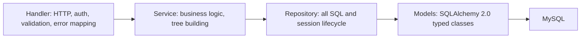
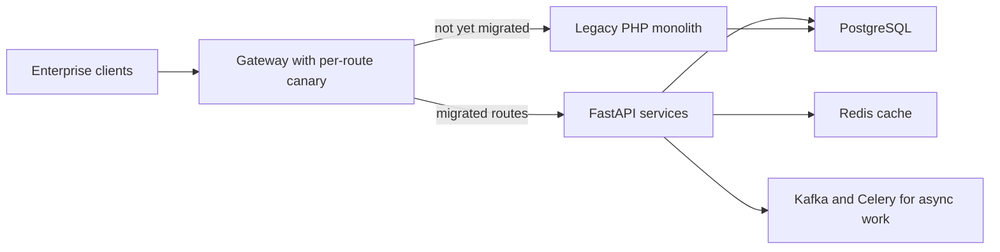

# Python, FastAPI, Pydantic, asyncio, Celery (and Django)

<div class="callout note">

**How to use this page**

- **What it covers:** Python as a backend language (the GIL, async versus threads), how FastAPI and Pydantic work, Celery for background jobs, and Django briefly. Then where I used each: the Impact Analytics agent plane, the 36 Uber FRM endpoints, the Masters India PHP-to-FastAPI strangler migration, Uber Menu's Python services, and GeeksforGeeks on Django.
- **When to read it:** before any Python backend round, and before the FRM and Masters deep dives.
- **What to memorise:** at Masters, p95 went from 1.2 seconds to 300 milliseconds and throughput from 700 to 4,000 requests per minute. The causes were async I/O, pooling, query fixes and Redis, not "FastAPI is fast". At FRM: 36 endpoints, handler, service and repository layers, `asyncio.to_thread` for sync SQLAlchemy, and 100% module statement coverage. At IA, Python is the agent plane while the platform is Go.

</div>

**Labels used on this page.** MEASURED means we have a log, doc or code for it. STATED means printed on the resume from the project source. ESTIMATED means arithmetic I can show. HISTORICAL means from my past work records. Verbal means true but off the resume.

<div class="callout warn">

**Say these carefully**

- **IA platform APIs are Go/Gin.** Python at IA is the agent plane: the Keep/Drop batch pipeline and Ask Iris (FastAPI WebSocket plus LangGraph). Older prep said "FastAPI hosts LangGraph/MCP agent chat endpoints". Drop "MCP", which is skills-level.
- **FastAPI did not make Masters faster by itself.** The latency win came from async I/O on IRP calls, connection pooling, query and index fixes, and Redis for reads.
- **Mentored 2** (Masters) and **led 3** (FRM) are different teams. Do not merge them.
- **36 FastAPI endpoints** on this track. About 31 are functional routes in the scoping service plus the collaboration-service APIs from the design doc. Do not claim you built the collaboration or Slack notification service.
- Snippets are teaching sketches, not company code.

</div>

---

## 1. Python for backends, in plain English

Python is a high-level, dynamically typed language with a huge ecosystem. For backends its strengths are speed of development, readable code, and the best libraries for data and AI work. Its weakness is raw CPU speed and the GIL.

### 1.1 The GIL

The **GIL** (Global Interpreter Lock) in CPython means only one thread runs Python bytecode at a time inside one process. Think of a kitchen with one knife: several cooks can be in the kitchen, but only one can chop at a time.

- For **I/O-bound** work (waiting on databases, HTTP calls, LLM APIs), the GIL is released while waiting, so threads and async work well.
- For **CPU-bound** work (heavy number crunching in pure Python), threads don't help. You use multiple processes, native libraries (NumPy) or another language.

That is part of why IA's high-RPS platform is Go while the LLM-heavy agent plane is Python. The agent plane mostly waits on model APIs.

### 1.2 asyncio

**asyncio** is Python's built-in framework for cooperative concurrency. An `async def` function can `await` a slow operation, and while it waits the **event loop** runs other tasks. One thread can juggle thousands of waiting network calls. Analogy: a waiter who takes an order, hands it to the kitchen, and serves other tables instead of standing at the kitchen door.

The main rule: **never block the event loop.** A synchronous database call or `time.sleep` inside an `async def` freezes every other request on that worker. Offload blocking work with `await asyncio.to_thread(fn)` or use an async driver.

```python
# Teaching sketch.
async def submit_batch(batch):
    results = await asyncio.gather(*(irp_client.register(inv) for inv in batch))  # concurrent I/O
    await asyncio.to_thread(repo.save_results, results)   # sync DB call off the event loop
    return results
```

### 1.3 Typing

Python type hints (`def f(x: int) -> str`) are not enforced at runtime by Python itself, but tools such as mypy check them, and frameworks such as Pydantic and FastAPI **use them at runtime** to validate data.

---

## 2. FastAPI and Pydantic

### 2.1 What they are

**FastAPI** is a modern Python web framework built on **Starlette** (the async web toolkit) and **Pydantic** (data validation). It runs on an **ASGI** server such as Uvicorn. **ASGI** (Asynchronous Server Gateway Interface) is the async successor to WSGI and supports async handlers and WebSockets.

**Pydantic** turns type-annotated classes into validators. Incoming JSON is parsed into a typed object or rejected with a clear 422 error.

### 2.2 The ideas interviewers probe

```python
# Teaching sketch of a FastAPI route.
class ThresholdUpdate(BaseModel):
    materiality_usd: Decimal = Field(gt=0)
    fiscal_quarter: Literal["Q1", "Q2", "Q3", "Q4"]

def get_auth_email(request: Request) -> str:
    email = request.headers.get("x-auth-params-email")
    if not email:
        raise HTTPException(status_code=401)
    return email

@router.patch("/thresholds/{uuid}", response_model=ThresholdOut)
async def update_threshold(uuid: str, body: ThresholdUpdate,
                           email: str = Depends(get_auth_email),
                           svc: ThresholdService = Depends(get_service)):
    return await svc.update(uuid, body, updated_by=email)
```

- **Validation from types.** `ThresholdUpdate` rejects a negative materiality or an unknown quarter before your code runs.
- **Dependency injection with `Depends`.** Auth, database sessions and services are injected per request, and tests can override them.
- **Automatic OpenAPI docs.** Every route's schema is published at `/docs`. That helped at Masters, where enterprise clients integrate against the API.
- **`async def` versus `def`.** FastAPI runs `async def` handlers on the event loop and plain `def` handlers in a thread pool. Mixing them wrongly (sync I/O inside `async def`) is the most common performance bug.
- **WebSockets** are first-class, which is how Ask Iris is served.

### 2.3 Layering I enforced



*What to notice: dependencies point one way, so each layer can be unit tested with the layer below mocked.*

- **Handlers** stay thin: HTTP, auth header, parameter validation, mapping errors to status codes.
- **Services** own orchestration, such as building the L1 to L4 tree and summing children into parents.
- **Repositories** own every session: open, `commit` on success, `rollback` on any exception, `close` in `finally`.
- **Models** hold column definitions.

---

## 3. Where I used Python and FastAPI

### 3.1 Uber FRM: 36 FastAPI endpoints (Uber via EPAM)

> Owned the Financial Risk Management scoping backend, reducing quarterly reconciliation time by **70%** (from **14 days to 3 days**) against a **$340M** materiality threshold. Engineered the Sheets-to-MySQL migration across **19M** raw GL rows, shipping **36 FastAPI** endpoints to automate custom financial math and a nested 4-level FSLI (L1-L4) hierarchy with dynamic quarter-annualization.

How it was built:

- **Layered as above.** Work was sliced by layer so 3 engineers could build one feature without colliding.
- **Auth:** every write path reads the `x-auth-params-email` header injected by Uber's gateway, returns 401 if missing, and records `created_by` / `updated_by`. Authorization was upstream.
- **Sync ORM inside async handlers:** SQLAlchemy calls were synchronous, so handlers used `await asyncio.to_thread(...)`.
- **Quarter-annualization:** scaling a quarter's figure to a yearly view, so thresholds compare like with like.
- **Testing:** FastAPI's `TestClient` with `AsyncMock` and `patch` to inject fake services. Tests covered status codes, response shapes, the 401-on-missing-header path and error mapping, with no database. Bazel `uber_py_test` targets per layer gated every merge. The suite grew past 1,100 tests (verbal), and the migrated module reached 100% statement coverage.
- **Reconciliation v1 to v2:** Sheets-backed v1 APIs ran in parallel with MySQL-backed v2 until they matched. The change set was 18 files and +1,268 lines (verbal).

Numbers: 36 endpoints (MEASURED: about 31 functional routes plus the collaboration-service APIs from the design doc). 70%, from 14 days to 3 days (STATED). See [postgres_mysql_redis.md](postgres_mysql_redis.md) for the schema and the column-aliasing bug.

### 3.2 Masters India: PHP monolith to FastAPI microservices

> Reduced p95 API latency by **75%** (from **1.2s to 300ms**) across **1,500+** enterprise clients by spearheading the migration of a legacy PHP monolith to a **FastAPI** microservices architecture. Mentored two engineers through the transition, optimizing backend design to drive overall system throughput from **700 to 4,000 requests per minute**.

**In plain words:** the old PHP (Laravel) monolith was synchronous. One slow call to the government IRP held a worker for the whole round trip, deployments were all-or-nothing, and scaling meant scaling everything. Filing-deadline spikes caused pileups and timeouts.

**The playbook (strangler pattern).** The **strangler pattern** replaces a legacy system piece by piece, routing one endpoint at a time to the new service, like a vine that slowly grows around a tree.

1. New FastAPI services went behind the existing gateway one domain at a time: auth, e-invoice submit, bulk import, reconciliation.
2. **Canary per route:** Nginx sent a small percentage of one endpoint's traffic to the new service, we watched error rate and latency, then ramped to 100%. Rollback was a config change.
3. **Shared database first, split later,** so there were never two sources of truth during cutover. No dual writes.
4. **Contract tests** recorded monolith responses for top endpoints and asserted the FastAPI replacements matched field for field.
5. **Async by default:** IRP calls, PDF generation, webhooks and email went through workers with retries and idempotency keys.



*What to notice: both old and new code read the same database during cutover, so there is only one source of truth.*

**Where the latency came from:**

| Cause | Effect |
|---|---|
| Async I/O for IRP and internal calls | Workers no longer blocked on the portal. This is the main p95 tail win |
| Connection pooling per service | No connect storm per request |
| Query and index fixes, N+1 removal, pagination | Faster database time |
| Redis cache-aside for hot reads | Helped p50 and read-heavy routes. Read load down 30% |

**A failure story from the migration:** an early canary showed timeout mismatches. PHP allowed 60 seconds and the new services used 10 seconds, but some IRP calls legitimately took longer. We moved those calls fully async and returned **202 Accepted** with a status endpoint for polling.

**Mentoring two engineers:** each owned a service extraction. I set the conventions (router, service, repository, Pydantic at the boundary, retry and idempotency helpers), reviewed their early PRs closely and paired on the first canary cutover.

**Numbers:**

| Number | Derivation | Tag |
|---|---|---|
| 75% p95 cut | (1.2 - 0.3) / 1.2 = 75% | HISTORICAL |
| From 1.2 seconds to 300 milliseconds | p95, not average | HISTORICAL |
| 1,500+ clients | Older resumes said 2,500+. Use 1,500+ | HISTORICAL |
| From 700 to 4,000 requests per minute | About 12 to 67 per second, about 5.7 times more | HISTORICAL, per second ESTIMATED |

### 3.3 Celery at Masters India

**Celery** is a Python distributed task queue. Your code enqueues a task onto a **broker** (such as Redis or RabbitMQ), and worker processes pick it up and run it, with retries, rate limits and scheduling. Think of a ticket rail in a kitchen: the waiter clips tickets, cooks take them in turn.

At Masters, Celery ran validation chains for bulk imports (schema, GSTIN checks, duplicate checks with idempotency keys), PDF generation, webhooks and email, with retries and task rate limits. Kafka carried events between pipeline stages. See [kafka_streaming.md](kafka_streaming.md).

```python
# Teaching sketch.
@app.task(bind=True, max_retries=5, rate_limit="50/s")   # illustrative values
def register_invoice(self, idem_key, payload):
    if already_done(idem_key):
        return
    try:
        irp.register(payload)
    except IRPTimeout as exc:
        raise self.retry(exc=exc, countdown=2 ** self.request.retries)
```

**Celery or Kafka?** Celery is for "run this job, retry it, rate-limit it". Kafka is for "keep this ordered stream, let several consumers read it, replay it later". We used both, for those different jobs.

### 3.4 Impact Analytics: the Python agent plane

- **Keep/Drop, Missed Opportunities and Top Style** run as a Python batch pipeline: deterministic KPI math, structured LLM lens calls, blending, checkpoints (`det.json`, `agent_progress.json`, `--resume`), and JSON telemetry. See [langgraph_mcp_rag.md](langgraph_mcp_rag.md).
- **Ask Iris** is a FastAPI WebSocket endpoint. It verifies the JWT on the handshake, freezes `plan_scope`, and runs a LangGraph supervisor with a 3-attempt evaluator.
- **Why Python here:** the LLM ecosystem (LangGraph, provider SDKs, Pydantic schemas for structured output) is strongest in Python, and the work is I/O-bound on model APIs.

### 3.5 Uber Menu: Python services

The Selenium scrapers and the LangChain RAG extraction with Gemini 2.5 Pro were Python services on GCP. See [selenium_scraping.md](selenium_scraping.md).

### 3.6 GeeksforGeeks: Django

> Stabilized the doubt-support platform to handle **10K+** daily queries and **10x** traffic spikes during live coding contests by migrating the backend to **Django**. Engineered high-throughput REST APIs for voting, pinning, and locking threads utilizing MySQL, MongoDB, Redis, and Elasticsearch, driving a **20%** lift in premium subscriptions.

**Django** is a "batteries included" Python web framework: ORM, admin, auth, forms and migrations out of the box. Django REST Framework (DRF) adds API tooling. We rebuilt the PHP doubt platform incrementally, page by page, behind the same URLs. Reliability came from ORM-managed transactions, request validation and separating reads from writes. Votes used a unique (user, content) constraint, so double-submitting is idempotent, with Redis counters for display.

10K+ a day averages about 0.1 per second, so the engineering challenge was the 10x contest spikes, not the average.

**Why Django there and FastAPI at Masters?** In 2021 GFG was a CMS-style product that benefited from Django's admin, auth and ORM. Masters needed async I/O for slow government APIs, which FastAPI handles natively.

---

## 4. Design decisions

### FastAPI as the service framework (FRM and Masters)

- **Why:** async-native for slow third parties, Pydantic validation at the boundary, automatic OpenAPI docs, a small footprint per service.
- **Alternatives:**
  - *Flask:* simple, but synchronous by default and validation is bolt-on.
  - *Django or DRF:* great batteries, heavier per service, and async support came later.
  - *Go:* better raw throughput and concurrency. I use it where that matters (the IA platform), and Python where libraries and delivery speed matter more.
- **Trade-off:** you must be disciplined about blocking calls in async code.
- **When I'd move a path to Go:** when a route is hot, CPU-heavy or latency-critical at high RPS, and its logic is stable and deterministic.

---

## 5. Failure modes

| Failure | Symptom | Guard |
|---|---|---|
| Blocking call inside `async def` | Latency spikes for every request on the worker | Async drivers or `asyncio.to_thread`. Lint for it in review |
| Fat handlers | Business logic untestable without HTTP | Handler, service and repository layering |
| Pydantic models drifting from the DB schema | 500s or silent field loss | Response models, contract tests, migrations reviewed together |
| Timeout mismatch in a migration | Canary errors on slow third-party calls | Make long calls async and return 202 with polling |
| Connection leaks | Pool exhaustion under load | Repositories always `close()` in `finally`, pooled sessions |
| Unbounded retries | Retry storms against a fragile dependency | Bounded retries with exponential backoff and jitter, DLQ |

---

## 6. Interview questions with speakable answers

**Q1. Why FastAPI over Flask or Django at Masters?**
We were calling a slow, flaky government portal on every invoice, so async I/O was the core need, and FastAPI is async-native. Pydantic gave strict validation at the boundary for compliance data, and the automatic OpenAPI docs helped enterprise clients integrate. Each microservice stayed small. Django would have brought batteries we didn't need per service.

**Q2. What actually made Masters 75% faster at p95?**
Not the framework by itself. The tail came down because IRP calls stopped blocking workers, which is async I/O. Per-service connection pooling replaced per-request connects. We fixed queries with composite indexes, removed N+1 patterns and paginated lists. Redis cache-aside cut database read load by about 30%, which mostly helped the middle of the distribution. Together that took p95 from 1.2 seconds to 300 milliseconds.

**Q3. How did you migrate a monolith without downtime?**
With the strangler pattern. New FastAPI services went behind the existing gateway one route at a time. Each route started as a canary with a small percentage of traffic, we watched errors and latency, then ramped up. Rollback was a config change. Both systems shared the database during cutover, so there were no dual writes, and contract tests pinned the old responses field by field.

**Q4. How do you structure a FastAPI service?**
Thin handlers that only do HTTP, auth and error mapping. Services that own business logic. Repositories that own every SQL statement and the session lifecycle. Typed models underneath. Dependencies point one way, so I can test a handler with a mocked service and a service with a mocked repository, with no database. At FRM that is how three engineers worked on one feature in parallel.

**Q5. What is the GIL and when does it matter?**
It's a lock in CPython that lets only one thread run Python bytecode at a time per process. For I/O-bound services it barely matters, because the lock is released while waiting on the network. For CPU-bound work you need processes, native libraries or another language. That's one reason our high-RPS platform at IA is Go, while the agent plane, which mostly waits on model APIs, is Python.

**Q6. `async def` or `def` for a FastAPI route?**
Use `async def` when everything inside is non-blocking, for example async HTTP clients and async drivers. Use plain `def` when the code is synchronous, and FastAPI will run it in a thread pool. The bug to avoid is synchronous I/O inside `async def`, which freezes the event loop. At FRM the ORM was synchronous, so async handlers offloaded repository calls with `asyncio.to_thread`.

**Q7. How did you test the FRM API?**
With FastAPI's `TestClient` plus `AsyncMock` and `patch`. Handlers accepted injected services, so tests swapped in fakes and asserted status codes, response shapes, the 401 when the auth header is missing, and error mapping, with no database. Bazel test targets per layer had to pass before merge, and every PR had to add or update tests. The migrated module reached 100% statement coverage.

**Q8. Celery versus Kafka?**
Different tools. Celery is a task queue: run this job, retry it, rate-limit it, schedule it. Kafka is a durable ordered log that many consumers can read and replay. At Masters we used Celery for validation chains, PDFs and webhooks, and Kafka as the event bus between pipeline stages.

---

## Related

- [postgres_mysql_redis.md](postgres_mysql_redis.md) for SQLAlchemy 2.0, schemas and caching
- [go_gin.md](go_gin.md) for when the platform is Go instead
- [langgraph_mcp_rag.md](langgraph_mcp_rag.md) for the IA agent plane
- [kafka_streaming.md](kafka_streaming.md) for the Masters bus
- [../architecture/02_uber_frm.md](../architecture/02_uber_frm.md)
- [../architecture/04_masters_gst.md](../architecture/04_masters_gst.md)
