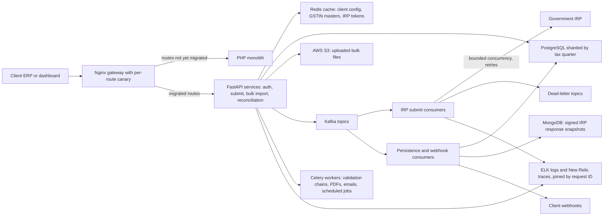
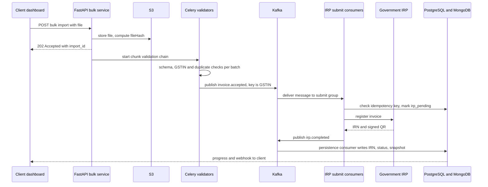
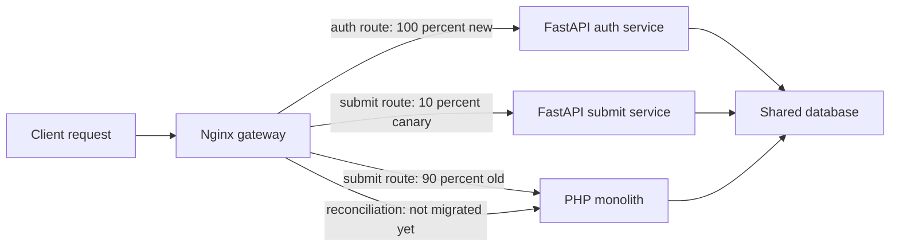
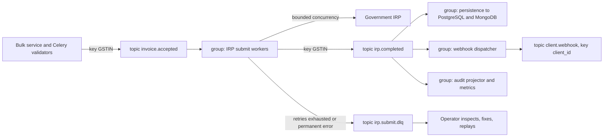

# 07. Masters India: GST Compliance & E-Invoicing Platform

<div class="callout note">
<b>How to use this chapter</b>
<ul>
<li><b>What it covers:</b> my SDE 2 role at Masters India (Noida, December 2022 to June 2024). The product is a GST e-invoicing platform. The chapter covers the PHP-to-FastAPI migration, the Kafka bulk pipeline, PostgreSQL sharded by tax quarter, idempotency, retries and dead-letter queues, Redis caching, ELK and New Relic, and test coverage.</li>
<li><b>When to read it:</b> before any interview that may ask about "a migration you led", "a high-throughput pipeline", "idempotency", "Kafka vs a queue" or "how you made an API faster".</li>
<li><b>What to memorise:</b> p95 from 1.2 seconds to 300 milliseconds (75% lower), 1,500+ enterprise clients, 700 to 4,000 requests per minute, 1M+ government submissions a day, 100K+ invoices processed concurrently in bulk imports, triage 70% faster, database reads 30% lower, coverage from 35% to 82%, 98% deploy success, mentored 2 engineers.</li>
<li><b>Tags used here:</b> HISTORICAL means it comes from my past work records and resume. ESTIMATED means it is arithmetic I can show on a whiteboard. If an illustration uses made-up sample numbers, I say "illustrative" next to it.</li>
</ul>
</div>

Related pages: [Start here](00_START_HERE.md) · [Every number explained](02_numbers_explained.md) · [Tech glossary](09_tech_glossary.md) · [Core concepts](10_core_concepts_explained.md) · [STAR stories](11_star_stories.md) · [Next chapter: GeeksforGeeks](08_geeksforgeeks.md). Older source packs: [Masters and GFG interview packs](../prep/23c_masters_gfg_interview_packs.md), [Masters and GFG deep dive](../prep/12_masters_gfg_deep_dive.md), [tables and why each tech](../prep/34_er_tables_tech_why.md), [schemas and APIs](../prep/35_table_schemas_api_design.md).

---

## 2. The one-minute version

Say this out loud, roughly as written:

> "At Masters India I worked on a GST e-invoicing platform used by more than 1,500 enterprise clients. Indian businesses must register every B2B invoice with a government portal, which gives back an official invoice number and a signed QR code. Our job was to validate their invoices and register them safely, at volume.
>
> I led the migration of a legacy PHP monolith to FastAPI microservices. We did it gradually, one route at a time behind the gateway, with a small canary percentage first and rollback by a config change. That cut p95 latency by 75%, from 1.2 seconds to 300 milliseconds, and throughput went from 700 to 4,000 requests per minute. I also mentored two engineers through it.
>
> I designed the bulk e-invoicing pipeline: a Kafka event bus, PostgreSQL sharded by tax quarter, and idempotency keys so a retry can never register the same invoice twice with the government. It handled 1M+ submissions a day. Failed batches went to dead-letter queues with bounded retries, because the government portal is often slow or down near filing deadlines.
>
> On the operations side, ELK logging and New Relic tracing with one request ID cut incident triage time by about 70%. A Redis cache cut database reads by 30%. I also pushed test coverage from 35% to 82%, which got us to a 98% deployment success rate."

---

## 3. The business in plain English

### What GST is

**GST (Goods and Services Tax)** is India's main indirect tax, introduced in July 2017. It replaced a long list of separate central and state taxes with one system. Every registered business gets a **GSTIN (GST Identification Number)**, a 15-character ID such as `29ABCDE1234F1Z5`. The first two digits are the state code. The middle ten are the business's PAN (tax ID). The last characters are an entity number and a checksum.

When a business sells to another business, the invoice shows the tax. Within one state the tax splits into **CGST** (central) and **SGST** (state). Across states it is **IGST** (integrated). The buyer later claims an **input tax credit**: "I already paid ₹18,000 of tax to my supplier, so subtract it from what I owe." That credit is why invoice accuracy matters to both sides. A wrong or missing invoice costs the buyer money, not only the seller.

Businesses file periodic **returns** (statements of their sales and tax) on fixed monthly or quarterly due dates. Reconciliation and audits look at a tax period, so the data naturally groups by period.

### What an e-invoice is

An **e-invoice** does not mean "a PDF sent by email". It means the invoice is **registered with the government** before it is legally valid for B2B use. Since 2020 India has required this for businesses above a turnover threshold, and the threshold has been lowered in phases, so more and more businesses fall under it.

The government runs the **IRP (Invoice Registration Portal)**. The flow is:

1. The seller's ERP (accounting software, like SAP or Tally) creates the invoice.
2. The invoice JSON is sent to the IRP.
3. The IRP validates it and returns an **IRN (Invoice Reference Number)**. This is a unique 64-character hash that identifies the invoice in the government's records.
4. The IRP also returns a **digitally signed QR code**. The QR carries the key invoice details plus the government's signature, so anyone can scan it and verify the invoice is genuine.
5. The seller prints the QR on the invoice and sends it to the buyer.

Think of the IRP like a notary office. You bring a document, the notary checks it, stamps it with a unique serial number and signs it. After that it is an official record.

### Where Masters India fits

Most enterprises do not want to talk to the government API directly. It has strict schemas, authentication tokens that expire, rate limits and bad days. Masters India sat in between. Clients sent invoices to us (one at a time from their ERP, or as bulk files with thousands of rows). We validated them, registered them with the IRP, stored the IRN and signed QR, and returned them to the client by API response or webhook. On top of that the product did bulk imports, reconciliation against GST returns, and audit trails. We served **1,500+ enterprise clients** (HISTORICAL).

### Why double registration is unrecoverable

This is the single most important constraint, and it is why idempotency appears everywhere in this chapter.

Once the IRP issues an IRN, that invoice is a legal record at the government. You cannot edit it. Under the GST rules as I worked with them, cancellation is allowed only in full and only within a short window (24 hours). After that, correcting a mistake needs credit notes and adjustments through returns, which is slow, manual and visible to auditors. If a retry bug registered the same sale twice (say, with a regenerated document number), the client would have two legal invoices for one sale. The buyer's tax credit and the seller's returns would no longer match. That shows up as a compliance problem for our client, and it is not something an engineer can "roll back".

So the design rule was: **retries must be safe**. Any step that talks to the IRP must be able to run twice and still produce exactly one registration.

<div class="callout warn">
<b>Say this carefully.</b> The 24-hour cancellation window and the "cannot edit" rule are general GST rules, not something I built. If an interviewer is a GST expert, keep it at "cancellation is narrow and time-limited, so a double registration becomes a compliance problem for the client". Don't argue tax law.
</div>

### Filing-deadline spikes

Businesses tend to do tax work close to due dates. On the days before a return deadline, many clients upload a whole month or quarter of invoices at once. Load on those days is many times the normal average, and the IRP itself is under load too, so it gets slower and returns more errors at exactly the same moment. Normal days are easy. The system has to be built for the deadline day.

### What hurt before, and why the company paid for this

Before the work in this chapter, the backend was a **PHP (Laravel) monolith**:

- It was **synchronous**. A request that called the IRP held a PHP worker for the whole round trip. When the IRP was slow, workers ran out and every other request queued behind them, even ones that had nothing to do with the IRP.
- **Deploys were all-or-nothing.** A change to reconciliation meant redeploying e-invoice submit too.
- **Scaling meant scaling everything.** You could not add capacity just for the bulk import path.
- **Debugging meant SSH into boxes and grep logs**, with no way to follow one request across components.

For a compliance product, a timeout on a filing day loses client trust fast. The company paid for the migration and the pipeline because faster, safer registration on deadline days is the product.

---

## 4. Words you need

| Term | Plain meaning |
|---|---|
| **Monolith** | One big application that holds every feature and deploys as one unit. Like a single restaurant kitchen where one cook does starters, mains and dessert. If he is stuck on one dish, everything waits. |
| **Microservices** | Many small services, each owning one job (auth, submit, bulk import, reconciliation), deployed separately. Like separate kitchen stations. |
| **Strangler fig pattern** | A way to replace an old system gradually. You put new code next to the old one and move traffic route by route until the old system has nothing left. Named after a fig vine that slowly grows around a tree and replaces it. |
| **Gateway** | The front door every request passes through. Here it was Nginx. It decides which backend gets each request. |
| **Canary release** | Sending a small slice of traffic (for example 5% or 10%) to new code first and watching errors and latency before sending more. From "canary in a coal mine": a small early warning. |
| **FastAPI** | A modern Python web framework built for async code, with request validation through Pydantic and auto-generated API docs. |
| **Async IO** | A style where one process starts a slow network call, does other work while waiting, and resumes when the answer arrives. Like a waiter who takes the next table's order while the kitchen cooks, instead of standing at the kitchen door. |
| **Connection pooling** | Keeping a set of open database connections and reusing them, instead of opening a new one for every request. Like keeping a phone line open instead of redialling for every sentence. |
| **N+1 query** | A bug where code runs 1 query to fetch a list, then 1 more query per item. Fetching 50 invoices and their lines this way is 51 queries instead of 2. |
| **p95 latency** | The response time that 95% of requests are at or below. Explained with an example in section 7. |
| **Throughput** | How many requests the system completes per unit of time (here, per minute). |
| **Kafka** | A durable, ordered log of messages. Producers append messages. Consumers read at their own pace and remember their position. Messages stay for a retention period, so you can re-read them. |
| **Topic, partition, offset** | A topic is a named stream (like `irp.completed`). It is split into partitions for parallelism. Order is guaranteed only within one partition. The offset is a consumer's bookmark in a partition. |
| **Partition key** | The value used to choose a partition. Messages with the same key always go to the same partition, so they stay in order. |
| **Consumer group** | A team of consumers that share a topic's partitions. Different groups each get their own full copy of the stream. |
| **Replay** | Moving a consumer group's offset back so it reprocesses old messages, for example after fixing a bug. |
| **Sharding** | Splitting one large dataset into separate pieces (shards) by some rule, so each piece is smaller and can be managed on its own. |
| **Idempotency** | An operation is idempotent if doing it twice has the same effect as doing it once. Pressing a lift button five times still calls one lift. |
| **Idempotency key** | A unique ID attached to a piece of work so the system can recognise "I have already done this one". |
| **Dead-letter queue (DLQ)** | A side queue where messages that keep failing are parked, so they stop blocking the main flow and can be inspected and replayed later. Like a "problem parcels" shelf in a post office. |
| **Exponential backoff with jitter** | Waiting longer after each failed retry (1s, 2s, 4s, 8s), plus a random amount, so thousands of clients don't all retry at the same instant. |
| **Celery** | A Python task queue. Code puts a task on a broker, and worker processes pick it up and run it in the background. |
| **Redis** | An in-memory key-value store, very fast. Used here as a cache. |
| **Cache-aside** | The app checks the cache first. On a miss it reads the database, stores the result in the cache with an expiry (TTL), then returns it. |
| **Cache stampede** | When a popular cache key expires and hundreds of requests all miss at once and hammer the database together. |
| **ELK** | Elasticsearch (stores and searches logs), Logstash (collects and parses logs), Kibana (the search and dashboard UI). |
| **New Relic** | An APM (Application Performance Monitoring) product. It shows how long each request takes, broken down into database calls, external calls and code. |
| **Request ID** | A unique ID stamped on a request at the front door and carried through every service, queue message and log line it touches, so you can find everything about one request with one search. |
| **Test coverage** | The percentage of code lines that run during automated tests. |
| **Deploy success rate** | The share of production deployments that go out without failing or needing a rollback. |

---

## 5. Architecture



*What to notice:* the PHP monolith and the FastAPI services sit side by side behind one gateway during the migration. Everything that talks to the government IRP sits behind Kafka, workers and retries, never inside a user's request thread.

**Walking through it box by box:**

- **Client ERP or dashboard.** Enterprise clients call our API from their accounting system, or upload bulk files through our dashboard.
- **Nginx gateway.** The front door. During the migration it decided, per route, whether a request went to the old PHP code or the new FastAPI service, and what percentage went to each.
- **PHP monolith.** Kept serving any route not yet migrated. Over time it served less and less.
- **FastAPI services.** Split by domain: auth, single e-invoice submit, bulk import and reconciliation. Pydantic schemas validated every request at the boundary.
- **Redis.** Held hot, repeated lookups: client configuration, GSTIN master data, tax-rate masters and IRP auth tokens.
- **PostgreSQL sharded by tax quarter.** The system of record for invoices and their IRP registration status. Each tax quarter had its own table set, and application code picked the right one from the invoice date.
- **AWS S3.** Bulk files landed here first, so the upload request could return quickly.
- **Kafka.** The event bus between pipeline stages: invoices accepted, submit jobs, IRP results, webhooks, and dead-letter topics.
- **Celery workers.** Ran task-style background work: chunk validation chains, PDF generation, emails, single-invoice async jobs and scheduled jobs.
- **IRP submit consumers.** Read submit messages from Kafka, called the IRP with a cap on how many calls run at once, retried with backoff, and parked failures in the dead-letter topic.
- **Persistence and webhook consumers.** Read IRP results, wrote the IRN and status to PostgreSQL, saved the full signed response in MongoDB, and notified the client by webhook.
- **MongoDB.** Stored the raw signed IRP responses and invoice payload snapshots. Their shape varies, and we needed them for audits.
- **ELK and New Relic.** Every component logged structured JSON with the request ID. New Relic traced requests end to end.

---

## 6. One job, step by step: a bulk import

**Sample job (illustrative data):** Acme Steel Pvt Ltd, GSTIN `29ABCDE1234F1Z5`, uploads `acme_oct_2023.xlsx` with 12,000 invoices for October 2023 two days before their filing deadline. Say the file is split into batches of 500 rows, which gives 24 batches. The batch size is illustrative. If asked for the real chunk size, keep it qualitative.



*What to notice:* the client gets an answer (202 plus an import ID) within the first request. All the slow work happens after that, and every IRP call is protected by an idempotency check first.

**The same flow in words:**

1. Acme uploads the file. The bulk service stores it in S3 and computes a SHA-256 hash of the file contents, the `fileHash`.
2. The service answers right away with `202 Accepted` and an `import_id`. The browser does not wait for 12,000 registrations.
3. A Celery chain validates the file batch by batch. Each row is checked for schema, the buyer's GSTIN format and master data, and duplicates. Each batch gets the idempotency key `client + fileHash + batchIndex`, for example `acme:9f2c...e1:7` for batch 7.
4. Valid invoices are published to the Kafka topic `invoice.accepted` with the GSTIN as the partition key, so every Acme message stays in order on one partition.
5. An IRP submit consumer picks up the message. It first checks PostgreSQL. If this key is already `registered`, it skips the call. If not, it marks the row `irp_pending` and calls the IRP.
6. The IRP returns the IRN and signed QR. The consumer publishes `irp.completed`.
7. A persistence consumer writes the IRN and status into the right quarter table. Invoice `INV-2023-10-0457`, dated 14 October 2023, lands in the table for financial year 2023, quarter 3. The raw signed response goes to MongoDB.
8. The dashboard shows progress ("batch 7 of 24 done, 3 rows failed validation"), and a webhook tells Acme's ERP which invoices are registered.
9. If the IRP keeps failing for one batch, that batch goes to the dead-letter topic after a bounded number of retries. The other 23 batches carry on.

---

## 7. Each resume bullet decoded

### Bullet 1: the migration, latency and throughput

> "Reduced p95 API latency by **75%** (from **1.2s to 300ms**) across **1,500+** enterprise clients by spearheading the migration of a legacy PHP monolith to a **FastAPI** microservices architecture. Mentored two engineers through the transition, optimizing backend design to drive overall system throughput from **700 to 4,000 requests per minute**."

#### In plain words

I led the move from one old PHP application to a set of small Python FastAPI services. I did it gradually, so clients never saw a big-bang switch. Responses got much faster for the slowest requests, the system could handle almost six times as many requests per minute, and two engineers learned to extract and ship services on their own.

#### How it works: the strangler-fig migration

We never turned the monolith off in one go. New FastAPI services went live behind the existing Nginx gateway one domain at a time: auth, e-invoice submit, bulk import, reconciliation. The monolith kept serving everything else.



*What to notice:* the decision is per route, not per system. One route can be fully moved, another split 10/90, another untouched. All three read the same database, so there is only ever one source of truth. The percentages are illustrative.

The playbook, step by step:

1. **Pick one route.** Build the FastAPI version.
2. **Contract tests first.** We recorded the monolith's responses for the top endpoints and asserted that the FastAPI replacement returned the same fields, field for field. Clients never saw a payload change.
3. **Canary.** Nginx sent a small percentage of that route's traffic to the new service. We watched error rate and latency dashboards.
4. **Ramp or roll back.** If the numbers looked good, we raised the percentage step by step to 100. If not, rollback was a config change and an Nginx reload, not a redeploy.
5. **Shared database during cutover.** Old and new code read and wrote the same database while traffic moved. We split service-owned tables only after a route was fully on FastAPI. We avoided dual writes on purpose.
6. **Async by default.** Anything that called a third party (the IRP, PDF generation, webhooks, email) went to background workers with retries and idempotency keys, so request threads never waited on someone else's server.

One way to express a per-route canary in Nginx (illustrative, not our exact config):

```nginx
split_clients "${request_id}" $submit_backend {
    10%   fastapi_submit;
    *     php_monolith;
}

location /api/v1/einvoice/submit {
    proxy_pass http://$submit_backend;
}
```

Rollback means changing `10%` to `0%` and reloading Nginx. That takes seconds and needs no build.

#### What p95 means, with 100 requests

Latency is how long one request takes. An average hides the slow ones, so we use **percentiles**. Take 100 requests, sort them from fastest to slowest, and look at the 95th one. Its time is the **p95**. It means "95% of requests were this fast or faster".

Illustrative "before" picture, not real logs:

- 70 requests took around 300 to 500 ms (simple reads).
- 25 requests took 600 ms to 1.2 s (lists with N+1 queries, waiting for a free PHP worker).
- 5 requests took 2 to 6 seconds (stuck behind a slow IRP call).

Sorted, request number 95 sits at the top of the middle group, about **1.2 seconds**. That is the p95.

Illustrative "after" picture: the IRP calls left the request path, list queries were fixed, and hot reads came from Redis. Now 95 of 100 requests finish at or under about **300 ms**, so the p95 is 300 ms.

Why p95 and not average: a client with a 12,000-row import calls us thousands of times. Even a small share of slow calls hits them over and over. p95 tracks what the unluckiest regular users feel.

#### Where the 1.2 s to 300 ms win came from

Caching alone cannot do that. Four changes added up:

1. **Async IO for IRP calls.** In PHP, a request that called the IRP held a worker for the whole round trip. When the IRP was slow, workers ran out and unrelated requests queued. In FastAPI, IRP work either moved off the request path entirely (the client gets `202 Accepted` and polls or receives a webhook), or it was awaited without holding a process hostage. This mostly fixed the **tail**, the slowest requests.
2. **Connection pooling.** PHP-FPM opened database connections per request. Each FastAPI service kept a pool of open connections and reused them, which removed connection setup from every request.
3. **Query and index fixes found during the rewrite.** We added missing composite indexes like `(client_id, invoice_date)`, removed N+1 list queries, and added pagination to list endpoints.
4. **Redis for repeated reads.** Client config, tax-rate masters, GSTIN lookups and auth context came from cache. This mostly sped up the **body** of the distribution, the typical request.

A short way to say it: "Async IO, pooling and query fixes moved the tail. Redis moved the body."

An N+1 fix in one picture (illustrative SQLAlchemy):

```python
# Before: 1 query for invoices + 1 query per invoice for its lines
invoices = session.scalars(select(Invoice).where(Invoice.client_id == cid)).all()
for inv in invoices:
    inv.lines  # lazy load, one query each

# After: 2 queries total, whatever the page size
invoices = session.scalars(
    select(Invoice)
    .where(Invoice.client_id == cid)
    .options(selectinload(Invoice.lines))
    .limit(50)
).all()
```

#### Throughput: 700 to 4,000 requests per minute

The arithmetic:

- 700 requests per minute ÷ 60 seconds = about **12 requests per second** (11.7).
- 4,000 requests per minute ÷ 60 seconds = about **67 requests per second** (66.7).
- 4,000 ÷ 700 = about **5.7 times** the capacity.

It went up for the same reasons latency went down. Workers were no longer pinned waiting on the IRP. Pooled connections were cheaper. Queries were lighter. Each service could scale on its own, and my notes also mention worker autoscaling on queue depth. This was sustained throughput of the gateway and services under load (HISTORICAL).

#### Mentoring two engineers

Two junior engineers each owned individual service extractions. I set the conventions everyone followed: router, service and repository layers, Pydantic schemas at the boundary, and shared retry and idempotency helpers. I reviewed every one of their PRs closely for the first months and paired with them on the first canary cutover. By the end both were shipping services on their own. This is **mentoring**, not people management.

#### Why this design

- **Why gradual instead of a rewrite?** It is a compliance product. A broken filing day is not acceptable. Per-route cutover meant any mistake affected one route, for a small percentage of traffic, and could be undone in seconds.
- **Why FastAPI?** It is async-native, which was the whole point for IRP calls. Pydantic gives strict validation at the boundary, which matters when the government rejects bad payloads. It generates OpenAPI docs that enterprise clients' integration teams could use. And each service stays small.
- **Why a shared database during cutover?** So there is one source of truth. Dual writes (old and new code each writing their own copy) create reconciliation problems, which is the worst kind of bug in a tax product.

#### Alternatives and why not

| Alternative | Why not |
|---|---|
| Big-bang rewrite and one switch-over day | One mistake breaks every route at once, on a product where a failed filing day hurts clients. No partial rollback. |
| Keep PHP and tune it | The core problem was synchronous IRP calls pinning workers. Tuning PHP-FPM worker counts only moves the cliff. |
| Django | Good framework, and I used it at GeeksforGeeks. But its strengths are an admin panel and a full ORM, and here the need was async calls to a slow third-party API. FastAPI fit that better. |
| Dual writes to old and new databases | Two sources of truth during a money-and-tax migration. We avoided it on purpose. |

#### Trade-off

For a while we ran two stacks side by side, which meant more to monitor and two codebases to keep consistent. Contract tests and the shared database kept that manageable. The shared database also delayed clean service ownership of tables until after cutover.

#### What I'd do differently

I would build the request-ID logging and New Relic tracing before the first canary, not alongside it. Comparing old and new behaviour per route is much easier when both sides log the same fields.

#### The numbers

| Number | What it measures | How derived | How to say it |
|---|---|---|---|
| 75% | Drop in p95 API latency | (1.2 − 0.3) ÷ 1.2 = 0.9 ÷ 1.2 = 0.75 | "p95 went from 1.2 seconds to 300 milliseconds, a 75% cut." |
| 1,500+ | Enterprise clients on the platform | Client count (HISTORICAL) | "More than fifteen hundred enterprise clients." |
| 700 to 4,000 | Sustained requests per minute | HISTORICAL. About 12 to 67 per second | "From 700 to 4,000 requests a minute, roughly 12 to 67 a second." |
| 2 | Engineers I mentored | Headcount | "I mentored two engineers through it." |

Why it mattered: deadline days are when clients judge us. Faster responses and almost six times the headroom meant fewer timeouts exactly when clients needed us most.

<div class="callout warn">
<b>Don't say:</b> "2,500+ clients". That was an older resume figure and is not on the current PDF. Always say 1,500+. Don't say "I led a team". At Masters India I <b>mentored 2 engineers</b>. "Led 3 engineers" is the Uber FRM story. Keep them separate.
</div>

#### Questions they will ask

**"Why a strangler migration and not a rewrite?"**
Because it was a compliance product and a broken filing day was not an option. With per-route cutover, a mistake only affected one route, for a small canary percentage, and rollback was a config flip. A rewrite puts every route at risk on the same day. For example, our first canary on submit caught a timeout problem while only a small slice of traffic was exposed.

**"What actually drove p95 down? Caching can't do 75%."**
Agreed, caching alone can't. The tail came down because IRP calls stopped pinning PHP workers. We moved them to async workers and returned 202 where the call could be slow. Connection pooling and query fixes, like composite indexes on client and invoice date and removing N+1 list queries, did the rest of the tail. Redis cut repeated reads, which helped the typical request. Async and queries moved the tail, cache moved the body.
*Follow-up they may ask:* "How did you measure p95?" From New Relic and gateway latency dashboards per route, compared before and after each cutover.

**"Did you do dual writes during the migration?"**
No, on purpose. Old and new code shared one database during the traffic move, so there was always one source of truth. We split service-owned tables only after a route was fully on FastAPI. Contract tests made sure the new service returned exactly what the old one did.

**"What did mentoring two engineers look like day to day?"**
Each of them owned a service extraction. I set the conventions: router, service, repository layers, Pydantic at the boundary, shared retry and idempotency helpers. I reviewed their PRs closely early on and paired on the first canary cutover. By the end both were shipping services independently.

**"How do 700 to 4,000 per minute and 1M per day fit together?"**
They measure different things. 700 to 4,000 per minute is API capacity at the gateway, about 12 to 67 requests per second. 1M+ a day is government submissions through the pipeline, about 12 a second on average. One API call can carry many invoices in a bulk upload, so the two numbers don't have to match.

---

### Bullet 2: the bulk e-invoicing pipeline

> "Architected a **high-concurrency** bulk e-invoicing pipeline processing **1M+** daily government submissions by orchestrating a **Kafka** event bus and a **PostgreSQL** database horizontally sharded by tax quarter. Enforced exactly-once, **idempotent** processing for **100K+** concurrent imports with **fault-tolerant state management** via dead-letter queues and bounded retries against volatile state IRP portals."

#### In plain words

I designed the path that takes huge invoice files and registers every invoice with the government. Kafka moves work between stages. Invoices are stored in PostgreSQL tables split by tax quarter. Every unit of work has a unique key, so a retry can never register an invoice twice. Batches that keep failing get parked on the side instead of blocking everyone else. Over a million registrations went through it each day.

#### The numbers first

- **1M+ per day** = 1,000,000 ÷ 86,400 seconds in a day = **about 12 per second on average** (11.6). ESTIMATED arithmetic.
- **Peaks** near filing deadlines were roughly **8 to 10 times** the average. That gives 12 × 8 ≈ 93 up to 12 × 10 ≈ 116, so **around 100 per second at peak**. ESTIMATED. The average is easy. The deadline peak is what you size for.
- **100K+ concurrent imports.** My older prep notes describe this as bulk imports carrying 100K+ invoice rows, processed concurrently. Say it that way: "100K+ invoices in flight across concurrent bulk imports". Don't claim 100,000 separate files were uploaded at the same instant.

#### How it works: Kafka as the event bus

Think of Kafka as a set of conveyor belts that never lose a parcel and remember every parcel for a while. Each stage puts its output on a belt. The next stage picks it up at its own pace.



*What to notice:* one `irp.completed` stream feeds three independent consumer groups. Persistence, webhooks and audit each read the full stream at their own pace. The dead-letter topic is a side exit, not a dead end. The topic names are the logical names from my notes.

The four Kafka ideas that matter:

1. **Topics per stage.** `invoice.accepted`, `irp.submit`, `irp.completed`, `client.webhook`, plus `.dlq` versions. Each stage is decoupled. If the webhook dispatcher is slow, registration does not slow down.
2. **Partition key = client GSTIN.** Every message for one taxpayer lands on the same partition, so submit, IRP result and webhook for that taxpayer are processed in order. Different taxpayers spread across partitions and run in parallel.
3. **Consumer groups.** The IRP submit workers are one group. Persistence, webhooks and the audit projector are separate groups reading the same results. Adding a new reader (say, a metrics job) does not touch the others.
4. **Replay.** Kafka keeps messages for a retention period. If a consumer had a bug, for example a parser that mis-read one field of the IRP response, we fix the code, move that group's offset back to before the bad window, and reprocess. For GST disputes and audits, being able to re-derive state from the log was valuable.

**Trade-off to name:** keying by GSTIN gives per-taxpayer ordering, but one very large client lands on one partition, which caps parallelism for that client. A refinement my notes mention is keying by GSTIN plus document type. If asked about partition counts, keep it qualitative.

#### Kafka vs RabbitMQ vs SQS

This question comes up often, especially since we were on AWS.

| Need | Kafka | RabbitMQ | AWS SQS |
|---|---|---|---|
| Per-taxpayer ordering | Yes, per partition by key | Possible per queue, harder at scale | Only with FIFO queues, which cap throughput per message group |
| Replay after a bug | Yes, move the offset back | No. Messages are gone once acknowledged | No. Messages are deleted on acknowledgement |
| Many independent readers of one stream | Yes, consumer groups | Needs fanout exchanges and a queue per reader | Needs SNS fan-out to multiple queues |
| Operational cost | Highest. Brokers, partitions, retention to manage | Medium | Lowest. Fully managed |

How I say it: "We needed three things together: per-client ordering, durable replay for compliance, and several independent consumers on the same stream. Kafka gives all three natively. SQS deletes on acknowledgement and FIFO caps throughput per group. RabbitMQ could honestly have handled task dispatch at our scale. We still picked Kafka because replay and multi-reader audit were first-class needs, and the team already used an async Kafka client in the FastAPI stack. The price was more operational work."

#### How it works: PostgreSQL sharded by tax quarter

**Sharding** means splitting one huge table into separate pieces by a rule, so each piece is smaller. Think of an accountant's filing cabinet with one drawer per quarter instead of one giant drawer.

**Why by tax quarter:**

- Our data access was period-scoped. Returns, reconciliation and audits all look at a tax period.
- Almost all **writes land in the current quarter**. Older quarters are mostly **read** for reconciliation and audits.
- So the hot table (current quarter) stays small, its indexes stay small, and inserts stay fast.
- A cold quarter can be archived as one unit without touching the hot write path.

**Routing in application code.** The API derived the quarter from `invoice_date` at the boundary and picked the matching table. India's financial year starts on 1 April, so April to June is Q1. An illustrative version:

```python
from datetime import date

def tax_quarter(d: date) -> str:
    fy_start = d.year if d.month >= 4 else d.year - 1
    q = (d.month - 4) % 12 // 3 + 1
    return f"fy{fy_start}_q{q}"

def invoice_table(d: date) -> str:
    return f"invoice_header_{tax_quarter(d)}"

# 14 Oct 2023 -> "invoice_header_fy2023_q3"
# 10 Feb 2024 -> "invoice_header_fy2023_q4"
```

If the client's declared filing period did not match the quarter derived from the invoice date, we rejected the request at the API. A **wrong-quarter write** is the main footgun of this design, so we stopped it at the front door.

**Trade-offs vs native partitioning.** PostgreSQL has built-in declarative partitioning (`PARTITION BY RANGE (invoice_date)`). The database routes rows automatically, prunes partitions in queries, and lets you detach an old partition.

| | Our app-routed quarter shards | Native PostgreSQL partitioning |
|---|---|---|
| Who routes rows | Our code | The database |
| Archive a quarter | Explicit, whole quarter, clear runbook | `DETACH PARTITION`, also clean |
| Cross-quarter queries | Our code must query several tables and combine | The database handles it |
| Risk | Wrong-quarter write if routing has a bug | Fewer moving parts |
| Flexibility | Quarters can be placed and managed separately | All partitions live in one database |

We chose app-level routing for explicit control over each quarter and clearer operational runbooks, and paid for it with more code.

<div class="callout note">
<b>Say this carefully.</b> The PDF says "horizontally sharded by tax quarter". My notes describe quarter tables or quarter schemas with routing in application code. If asked "were the quarters on separate servers?", don't claim separate database clusters unless you clearly remember that. Describe the routing and the reasons.
</div>

**What I'd do differently:** today I would start with native declarative partitioning by quarter inside one PostgreSQL cluster, and only move to multi-server sharding if one node could not take the write load. It gives most of the same benefits with less custom routing code.

#### How it works: idempotency, the "exactly-once" part

Here is the honest version of "exactly-once": Kafka and retries give **at-least-once delivery**, which means a message may arrive twice. We made **processing idempotent**, so a second arrival changes nothing. At-least-once delivery plus idempotent processing gives an exactly-once **effect**. The IRP is outside our database transaction, so true exactly-once delivery across systems is not possible. The idempotency key is what makes it safe.

The key for bulk work is `client + fileHash + batchIndex`:

- `client`: whose work it is.
- `fileHash`: SHA-256 of the uploaded file. If the client uploads the same file twice by mistake, the hash is identical.
- `batchIndex`: which slice of the file.

For single invoices, the client's own invoice reference plays the same role (an `Idempotency-Key` header and a unique constraint on the invoice record).

Illustrative code:

```python
import hashlib

def idempotency_key(client_id: str, file_bytes: bytes, batch_index: int) -> str:
    file_hash = hashlib.sha256(file_bytes).hexdigest()
    return f"{client_id}:{file_hash}:{batch_index}"

CLAIM_SQL = """
INSERT INTO irp_job (idempotency_key, client_id, status)
VALUES (:key, :client_id, 'irp_pending')
ON CONFLICT (idempotency_key) DO NOTHING
RETURNING job_id
"""

STATUS_SQL = "SELECT job_id, status FROM irp_job WHERE idempotency_key = :key"

async def claim_batch(db, key: str, client_id: str):
    row = (await db.execute(text(CLAIM_SQL), {"key": key, "client_id": client_id})).first()
    if row is not None:
        return row.job_id   # first time we have seen this batch
    existing = (await db.execute(text(STATUS_SQL), {"key": key})).first()
    if existing.status == "registered":
        return None         # already done: skip the IRP call
    return existing.job_id  # pending or failed: retry through the same key
```

Worked example: Acme's batch 7 has key `acme:9f2c...e1:7`. The worker claims it, calls the IRP, records `registered`, and crashes before committing the Kafka offset. Kafka redelivers the message. The new worker tries the same `INSERT`, hits the unique key, gets no row back, looks up the status, sees `registered`, and skips the IRP call. Result: one registration, not two. If Acme uploads the same file again an hour later, the same hash produces the same keys, so nothing is registered twice.

If asked "what if the worker timed out and you don't know whether the IRP registered it?": the job stays `irp_pending` and any retry goes through the same key. The IRP also rejects a duplicate document number for the same GSTIN, which is a second safety net. Don't invent more specifics than that.

#### How it works: dead-letter queue and bounded retries

The IRP fails in two ways. **Transient** failures (timeouts, 5xx errors, rate limits) are worth retrying. **Permanent** failures (a malformed invoice, an invalid GSTIN) will fail every time. Retrying those forever just blocks everyone else.

- **Bounded retries:** try a fixed number of times, then stop.
- **Exponential backoff:** wait longer after each failure, so a struggling IRP gets room to recover.
- **Jitter:** add randomness to each wait, so thousands of workers don't all retry at the same second (that would be a "thundering herd").
- **Dead-letter queue:** after the last attempt, or on a permanent error, park the batch in `irp.submit.dlq` with the reason. The rest of the import continues. An operator inspects, fixes and replays it.

Illustrative code. The attempt counts and delays are examples, not remembered production values:

```python
import asyncio, random

MAX_ATTEMPTS = 5
BASE_SECONDS = 0.5
CAP_SECONDS = 30

async def submit_with_retry(job):
    for attempt in range(1, MAX_ATTEMPTS + 1):
        try:
            return await irp_client.register(job.payload, token=await irp_token())
        except PermanentIRPError as err:
            await send_to_dlq(job, reason=f"permanent: {err}")
            return None
        except TransientIRPError:
            if attempt == MAX_ATTEMPTS:
                await send_to_dlq(job, reason="retries_exhausted")
                return None
            delay = min(CAP_SECONDS, BASE_SECONDS * 2 ** attempt)
            await asyncio.sleep(random.uniform(0, delay))   # full jitter
```

Worked example: the IRP returns a timeout for batch 12. The worker waits a random time up to 1 s, then up to 2 s, then up to 4 s. On the third attempt it succeeds. Batch 15 has an invalid buyer GSTIN, so it goes straight to the DLQ with the reason, and Acme's dashboard shows those rows as failed with a message. The other 22 batches finish normally.

**Bounded concurrency** is the other half. Workers capped how many IRP calls ran at the same time, for example with an `asyncio.Semaphore`. When the government portal is already struggling, flooding it makes everything worse.

A **circuit breaker**, which stops calling the IRP for a while when its error rate spikes, is something I can discuss as a design idea. It is not a resume metric, so present it as "here's what I'd add or discuss", not as a measured claim.

#### Celery's role

Kafka is the conveyor belt between pipeline stages. **Celery** was the task runner for background jobs that don't need a replayable log:

- validation chains for bulk file chunks (schema, GSTIN, duplicates)
- PDF generation of e-invoices
- emails and some client notifications
- single-invoice async work on the 202 path
- scheduled jobs

If asked exactly which step ran on Celery and which on a Kafka consumer, keep it at that level: Kafka carried stage events, and workers (Kafka consumers and Celery tasks) did the work. Don't invent a finer split.

#### Why this design

Bulk imports are bursty, the IRP is unreliable, and a double registration is unrecoverable. The design answers each of those. Queues absorb bursts (this is called load leveling). Retries with backoff and DLQs handle the unreliable IRP. Idempotency keys make retries safe. Quarter shards keep the hot write path small.

#### Alternatives and why not

| Alternative | Why not |
|---|---|
| Call the IRP inline from the upload request | A 12,000-row upload would hold a connection for minutes and time out. |
| Fire-and-forget retries without keys | Risk of double registration, which cannot be undone. |
| Infinite retries | A single poison batch blocks a partition forever. |
| One giant invoices table | Hot inserts compete with heavy audit reads, and indexes keep growing. |
| SQS or RabbitMQ only | Covered above. No cheap replay or multi-group reading. |

#### Trade-off

More moving parts: Kafka, workers, a DLQ to monitor, and app-level shard routing. In return we got deadline-day survival and safe retries.

#### Questions they will ask

**"Why Kafka and not SQS, since you were on AWS?"**
We needed per-client ordering, durable replay for compliance, and several independent consumer groups on one stream. We keyed by GSTIN so everything for one taxpayer stayed in order. SQS deletes messages on acknowledgement, so there's no cheap replay, and FIFO queues cap throughput per message group. RabbitMQ could have dispatched tasks at our scale, honestly. Replay and multi-reader audit are what tipped it to Kafka.

**"How do you guarantee exactly-once?"**
Strictly, we didn't get exactly-once delivery. The IRP sits outside our transaction. We had at-least-once delivery plus idempotent processing, which gives an exactly-once effect. Every batch carries the key client plus fileHash plus batchIndex, and a unique constraint means a redelivered message finds the key and skips the IRP call. For example, if a worker crashed after registering but before committing its offset, the redelivery is a no-op.

**"Derive TPS from 1M a day. Do your numbers hang together?"**
1,000,000 divided by 86,400 seconds is about 11.6, so roughly 12 per second on average. Filing-deadline peaks were roughly 8 to 10 times that, so around 100 per second, which is my estimate. API throughput of 700 to 4,000 requests per minute is about 12 to 67 per second, and that measures a different thing: gateway requests, where one bulk request carries many invoices.

**"Why shard by quarter and not hash by client?"**
Our access pattern was time-scoped. Almost all writes go to the current quarter, and older quarters are read for reconciliation and audit. Quarter shards keep the hot table and its indexes small and let us archive a whole quarter cleanly. Hash by client would spread the current quarter's writes everywhere but make archiving old periods messy. The cost was routing in our own code, so we derived the quarter from the invoice date at the API and rejected mismatches.

**"What goes into the DLQ and what happens next?"**
Batches that hit a permanent error, like an invalid GSTIN, or that ran out of retries on transient errors. They're parked with the failure reason so the rest of the import continues. An operator looks at them, fixes the cause, and replays them through the same idempotency keys, so a replay can never double-register.

---

### Bullet 3: observability, caching and release quality

> "Decreased incident triage time by **70%** and lowered database read load by **30%** by instrumenting **ELK** and **New Relic** distributed tracing alongside a Redis caching layer. Hardened the CI/CD release cycle by driving test coverage from **35% to 82%**, achieving a **98%** deployment success rate across the microservices ecosystem."

#### In plain words

When something broke, we could find out why much faster, because every request carried one ID through every service and log. A cache in front of the database took away almost a third of its reads. More automated tests meant releases rarely failed.

#### How it works: ELK, New Relic and the request ID

- **ELK.** Every service wrote **structured JSON logs**, one JSON object per line with fields like `request_id`, `client_id`, `route`, `status` and `duration_ms`. Logstash shipped them to Elasticsearch, and we searched them in Kibana.
- **New Relic (APM).** Traced each request through the service and showed where time went: database, external IRP call or our own code. We set alerts on error rate and latency.
- **Request ID.** The gateway or first service stamped a unique `X-Request-ID`. It went into every log line, every outgoing HTTP header, every Kafka message header and every Celery task. One search in Kibana for that ID showed the whole story across API, Kafka consumer and IRP worker.

Illustrative FastAPI middleware:

```python
import uuid
from fastapi import FastAPI, Request

app = FastAPI()

@app.middleware("http")
async def request_id_middleware(request: Request, call_next):
    rid = request.headers.get("X-Request-ID") or str(uuid.uuid4())
    request.state.request_id = rid
    with log_context(request_id=rid):          # every log line gets the field
        response = await call_next(request)
    response.headers["X-Request-ID"] = rid
    return response

# when publishing to Kafka, carry it along
producer.send("irp.submit", value=payload, key=gstin.encode(),
              headers=[("request_id", rid.encode())])
```

Worked example: Acme says "invoice INV-2023-10-0457 never got an IRN". Before, someone had to SSH into several boxes and grep logs by guesswork. After, support finds the request ID from Acme's API response, searches Kibana, and in a minute sees: accepted at 10:02, submit consumer called the IRP at 10:03, IRP returned a timeout three times, batch parked in the DLQ with `retries_exhausted`. The fix is obvious: replay that batch.

#### The triage number

- **What it measures:** time from an incident being noticed to knowing the cause.
- **How derived:** the 70% cut is HISTORICAL. The baseline of **about 30 minutes to under 10 minutes** is ESTIMATED. 30 minutes down to 9 minutes is a 70% cut.
- **How to say it:** "Triage went from roughly half an hour to under ten minutes, about 70% faster, because one request ID joined everything."

<div class="callout warn">
<b>Say this carefully.</b> Claim on-call <b>alerting</b> and faster triage. Don't invent a formal pager rotation, an incident commander title or SLO numbers you can't back up. "Support tickets −35%" appeared on an older resume and is <b>not on the current PDF</b>. Don't use it.
</div>

#### How it works: Redis cache-aside

**Which keys:**

| Key | What it holds | Freshness rule |
|---|---|---|
| `client:config:{client_id}` | Client settings and feature flags | Deleted on every config write |
| `gstin:master:{gstin}` | GSTIN master lookup | Deleted on write |
| tax-rate masters | Rates by product category | TTL only, with jitter (they rarely change) |
| `irp:token:{env}` | IRP auth token | TTL set below the token's real lifetime, with a safety margin |

**Why 30% fewer reads is plausible:** in a 100K-row import, every row needs the same client config and many repeated GSTIN lookups. Without a cache that is the same handful of rows read from the database tens of thousands of times. With a cache, it is a few reads per TTL. The 30% is across total database read load, not per endpoint. In simple terms: for the same traffic, if the database used to serve 100 reads, it now serves about 70.

**TTL jitter:** if 10,000 keys were all cached at 9:00 with a 10-minute TTL, they would all expire at 9:10 and hit the database together. Adding a random 0 to 2 minutes spreads the expiries out.

**Stampede lock (SETNX):** when a hot key expires, only one worker gets a short Redis lock (`SET key value NX EX 5`, meaning "set only if it doesn't exist, expire in 5 seconds") and reloads from the database. The others wait briefly and re-read the cache, or serve a slightly stale value.

Illustrative code. The TTL numbers are examples:

```python
import json, random, time

def get_client_config(client_id: str) -> dict:
    key = f"client:config:{client_id}"
    cached = redis.get(key)
    if cached:
        return json.loads(cached)

    if redis.set(f"lock:{key}", "1", nx=True, ex=5):      # only one rebuilder
        try:
            cfg = db.load_client_config(client_id)
            ttl = 600 + random.randint(0, 120)             # TTL jitter
            redis.set(key, json.dumps(cfg), ex=ttl)
            return cfg
        finally:
            redis.delete(f"lock:{key}")

    time.sleep(0.05)                                       # others wait briefly
    cached = redis.get(key)
    return json.loads(cached) if cached else db.load_client_config(client_id)

def update_client_config(client_id: str, new_cfg: dict) -> None:
    db.save_client_config(client_id, new_cfg)
    redis.delete(f"client:config:{client_id}")             # invalidate on write
```

**Why cache-aside and not write-through everywhere:** most of our data was read far more than it was written, and only a few keys were hot. Cache-aside caches only what is actually read. Write-through would push every write into Redis, including data nobody reads again.

#### How it works: coverage and deploy success

- **Coverage from 35% to 82%.** We wrote pytest suites, money paths first: registration, reconciliation and imports. That included the contract tests that pinned old PHP responses during migration. Coverage was enforced as a CI gate, so a PR that dropped it could not merge. This is a rise of **47 percentage points**. Don't call it "a 134% increase", which is technically true but sounds like spin.
- **98% deployment success.** About 98 out of 100 production deploys went out without failing or needing a rollback (HISTORICAL). Higher coverage plus canary releases per route is what got us there.

#### Why this design

Faster triage needed correlation more than more logs. One ID across services, queues and workers is what turns "grep and guess" into "search and read". Redis targeted the specific reads that repeat on every row of every bulk import.

#### Alternatives and why not

| Alternative | Why not |
|---|---|
| Plain text logs on each box | No correlation across services. That was the "before" state. |
| Only New Relic, no ELK | APM shows timings well, but we needed full searchable log detail per request, including IRP error bodies. |
| Write-through cache | Caches data nobody reads. Cache-aside fits read-heavy, few-hot-keys data. |
| No invalidation, TTL only, for config | An admin changes a client's credentials and we keep using the old ones until expiry. Not acceptable for config. |

#### Trade-off

Caching adds staleness risk and invalidation code. We limited it by deleting config keys on write and using TTL-only only for slowly changing masters. Structured logging adds volume and ELK storage cost.

#### Questions they will ask

**"Is the 70% triage number real or vanity?"**
The 70% is from my work records, and the baseline of about 30 minutes to under 10 is my estimate of a typical incident. The mechanism is what makes it believable. Before, we SSH'd into boxes and grepped with no way to connect a request across services. After, one request ID went through the API, Kafka consumers and IRP workers, and New Relic showed where the time went. Finding the cause became one search.

**"Cache-aside: what about stampedes and stale data?"**
TTL jitter so keys don't expire together, and a SETNX lock so only one worker rebuilds a hot key while the others wait briefly or serve slightly stale data. Config and GSTIN keys were deleted inside the update path, so admins never got stale credentials. Slow-changing masters were TTL-only.

**"What does 98% deploy success mean?"**
About 98 of every 100 production deploys went out without failing or being rolled back. It came from the coverage gate in CI plus per-route canaries, which caught problems while only a small slice of traffic was exposed.

---

## 8. Tech used in this project and why

| Tech | What it is in one line | Why here | Alternative considered |
|---|---|---|---|
| Python | General-purpose language with a strong web and data ecosystem | Team language. Async support with asyncio | PHP (the legacy) |
| FastAPI | Async Python web framework with Pydantic validation and OpenAPI docs | IRP calls must not pin workers. Strict request validation | Django (sync-first, heavier), Flask (no built-in validation) |
| Kafka | Durable, ordered, replayable message log | Per-GSTIN ordering, replay for audits, multiple consumer groups | RabbitMQ, SQS |
| PostgreSQL | Relational database with strong transactions | System of record for invoices and statuses. Sharded by tax quarter | One big table, native partitioning |
| MongoDB | Document database for flexible JSON | Signed IRP responses and payload snapshots vary in shape and are kept for audits | Forcing everything into PostgreSQL JSON columns |
| Redis | In-memory key-value store | Cache-aside for config, GSTIN masters, IRP tokens. Stampede locks | Hitting the database on every bulk row |
| Elasticsearch | Search engine over JSON documents | The "E" in ELK for logs. Also invoice search | Plain log files |
| Celery | Python background task queue | Validation chains, PDFs, emails, scheduled jobs | Doing them inside the request |
| Docker | Packages a service with its dependencies into a container | Same image from laptop to production for every microservice | Hand-configured servers |
| ELK | Elasticsearch, Logstash and Kibana for central logging | Searchable structured logs with request ID | SSH and grep |
| New Relic | APM and distributed tracing | Per-request timing breakdown and alerts | Logs only |
| AWS | Cloud provider | Company standard. S3 for uploaded bulk files | Not a choice I made |

Where MongoDB and Elasticsearch fit, in one line: "PostgreSQL for transactional correctness, MongoDB for the variable-shaped signed responses, Elasticsearch for logs and search."

---

## 9. Hard problems and failure stories

### Story 1: the canary timeout mismatch

- **What broke:** on an early canary of the submit route, some requests that worked on PHP failed on FastAPI.
- **How we found it:** the canary error-rate dashboard went up for the new service only, while only a small slice of traffic was on it.
- **Root cause:** PHP had a 60-second timeout. We had set 10 seconds on the new service. Some IRP calls legitimately took longer than 10 seconds, especially on busy days.
- **Fix:** instead of just raising the timeout, we moved the IRP call fully off the request path. The API returned `202 Accepted` with an invoice ID, and the client polled or got a webhook.
- **What I learned:** the old system's quirks are part of its contract, so contract tests should cover timeouts and slow paths, not just payloads. And canaries earn their keep. A small slice found this before every client did.

### Story 2: N+1 queries hiding in the monolith

- **What we found:** while rewriting list endpoints, several fetched a page of invoices and then queried lines or status per invoice.
- **Fix:** eager loading (one extra query for all lines), composite indexes on `(client_id, invoice_date)`, and pagination.
- **What I learned:** a rewrite is a good moment to profile every query. A lot of the p95 gain came from fixes like this, not from the new framework.

### Story 3: the same lookup on every row of a bulk import

- **What we saw:** a 100K-row import read the same client config and many of the same GSTIN masters over and over.
- **Fix:** Redis cache-aside with TTL jitter, a SETNX stampede lock, and invalidation on write.
- **Result:** database read load down 30% (HISTORICAL).

### Design risks I planned around (not incident stories)

- **Wrong-quarter writes.** If routing derived the wrong quarter, an invoice would land in the wrong shard. We derived the quarter at the API from `invoice_date` and rejected mismatches.
- **Poison batches.** One bad batch must not block a partition. Bounded retries plus DLQ.
- **Unknown IRP outcome after a timeout.** Retry through the same idempotency key, and the IRP's own duplicate check is a backstop.

Present these as design decisions, not as dated incidents.

---

## 10. Say this / don't say this

<div class="callout warn">
<b>Say this</b>
<ul>
<li>"1,500+ enterprise clients."</li>
<li>"p95 from 1.2 seconds to 300 milliseconds, a 75% cut."</li>
<li>"700 to 4,000 requests per minute, roughly 12 to 67 per second."</li>
<li>"1M+ government submissions a day, about 12 per second on average. Peaks around 8 to 10 times that, which is my estimate."</li>
<li>"At-least-once delivery plus idempotent processing, so the effect is exactly once."</li>
<li>"I mentored two engineers."</li>
<li>"Triage about 70% faster, roughly 30 minutes down to under 10. The baseline is my estimate."</li>
<li>"The migration was gradual, route by route, behind the gateway. People call it the strangler pattern."</li>
</ul>
<b>Don't say this</b>
<ul>
<li>"2,500+ clients" (older resume, not on the current PDF).</li>
<li>"Support tickets down 35%" (older resume, not on the current PDF).</li>
<li>"Zero message loss" or "true exactly-once delivery to the government".</li>
<li>"I led a team" at Masters India. Mentored 2 is Masters. Led 3 is Uber FRM.</li>
<li>Flink at Masters India. Flink belongs to the Uber Menu pipeline, which is a different Kafka system.</li>
<li>"Payments" or "money movement". This is tax compliance and invoice registration.</li>
<li>A circuit breaker as a measured result. It is a design idea to discuss.</li>
<li>TPS or RPS as if they are on the PDF. They are arithmetic I can show.</li>
<li>"100,000 separate files uploaded at once." Say "100K+ invoices in flight across concurrent bulk imports".</li>
<li>Exact partition counts, chunk sizes, retry counts or TTLs as remembered facts. The ones in this chapter are illustrative.</li>
</ul>
</div>

---

## 11. Practice drill

1. **What does Masters India do?**
It's a GST compliance and e-invoicing SaaS for Indian enterprises. Clients send us invoices, we validate them and register them with the government's Invoice Registration Portal, which returns an IRN and a signed QR code. We return those to the client by API or webhook.

2. **What is an IRN and why does it matter?**
The IRN is the unique reference number the government portal assigns when it registers an invoice. Together with the signed QR, it makes a B2B invoice legally valid. Without it the buyer can't safely claim tax credit.

3. **Why is a double registration so bad?**
Once registered, the invoice is a legal record. Cancellation is narrow and time-limited, and after that you need manual corrections through returns. Two registrations for one sale create a compliance mismatch for the client, so every retry had to be idempotent.

4. **Explain p95 with an example.**
Take 100 requests and sort them by time. The 95th one is the p95. If it's 300 milliseconds, 95% of requests finished in 300 milliseconds or less. Ours went from 1.2 seconds to 300 milliseconds.

5. **Where did the latency win come from?**
Mostly from taking slow IRP calls off the request path with async IO, plus connection pooling and query fixes like composite indexes and removing N+1 queries. Redis cut repeated reads, which helped the typical request more than the slow tail.

6. **How did the canary rollout work?**
Nginx sent a small percentage of one route's traffic to the new FastAPI service. We watched error rate and latency, then ramped up or rolled back. Rollback was a config change and reload, not a redeploy.

7. **Why not dual writes during the migration?**
Two sources of truth in a tax product cause reconciliation nightmares. We kept one shared database during the traffic move and split tables only after a route was fully migrated.

8. **Why is the partition key the GSTIN?**
So every message for one taxpayer lands on the same partition and is processed in order: submit, result, webhook. Different taxpayers still run in parallel. The risk is one giant client creating a hot partition.

9. **Kafka vs SQS, one sentence each.**
Kafka keeps an ordered, replayable log that many consumer groups can read independently. SQS is a simpler managed queue that deletes messages on acknowledgement, so there's no cheap replay, and its FIFO mode caps throughput per group.

10. **What is your idempotency key?**
Client plus fileHash plus batchIndex for bulk work, and the client's invoice reference for single invoices. A unique constraint means a redelivered message finds the existing key and skips the IRP call.

11. **Why backoff with jitter?**
Backoff gives a struggling portal room to recover. Jitter spreads retries out so thousands of workers don't retry at the same second and knock it over again.

12. **What is a DLQ and why use one?**
A side queue for messages that keep failing. It stops one poison batch from blocking the rest of the import. An operator can inspect it, fix the cause and replay it safely through the same idempotency keys.

13. **Why shard by quarter?**
Writes go almost entirely to the current quarter, while older quarters are read for audits. Quarter shards keep the hot table small and make archiving a whole quarter clean. The cost is routing in application code.

14. **How did ELK and New Relic cut triage time?**
Every log line, HTTP header, Kafka message and Celery task carried one request ID. One Kibana search showed a request's whole path, and New Relic showed where the time went. That took triage from roughly 30 minutes to under 10.

15. **What did the 35% to 82% coverage focus on?**
Money paths first: registration, reconciliation and imports, including contract tests that pinned the old PHP responses. Coverage was a CI gate, which together with canaries helped us reach 98% deploy success.

---

## 12. 3-minute whiteboard script

**First (about 45 seconds): the business and the constraint.**
Draw three boxes in a row: "Client ERP", "Masters India", "Government IRP". Arrow from client to us, from us to IRP, and back with "IRN + signed QR".
Say: "Indian businesses must register every B2B invoice with the government. We sat in the middle for 1,500+ enterprise clients. The one rule that shaped everything: a double registration can't be undone, so every retry must be idempotent. And load spikes hard before filing deadlines."

**Second (about 60 seconds): the migration.**
Inside "Masters India", draw an "Nginx gateway" box splitting to "PHP monolith" and "FastAPI services", both pointing to one "Shared DB". Write "10% canary" on one arrow.
Say: "The PHP monolith was synchronous. A slow IRP call pinned a worker. I led a gradual migration to FastAPI, route by route, with canaries and rollback by config. The win came from async IO for IRP calls, connection pooling and query fixes, with Redis for repeated reads. p95 went from 1.2 seconds to 300 milliseconds, and throughput from 700 to 4,000 requests a minute. I mentored two engineers through it."

**Third (about 60 seconds): the bulk pipeline.**
Draw "S3 file" to "validators" to "Kafka (key = GSTIN)" to "IRP workers" to "IRP". Branch from workers to "DLQ". Branch from Kafka to "Postgres by quarter" and "Mongo snapshots" and "webhooks". Write the key `client + fileHash + batchIndex` next to the workers.
Say: "Bulk files land in S3 and the client gets a 202 right away. Kafka carries each stage, keyed by GSTIN for per-taxpayer order, and it lets us replay after a bug. Workers check the idempotency key before every IRP call, retry with backoff and jitter, and park poison batches in a DLQ. Invoices land in PostgreSQL tables split by tax quarter. That's 1M+ submissions a day, about 12 a second on average and around 100 at deadline peaks, which is my estimate."

**Close (about 15 seconds): operations.**
Write "request ID" along the bottom, touching every box.
Say: "One request ID through every service, queue and worker, in ELK and New Relic, cut triage about 70%. Redis cache-aside cut database reads 30%. Coverage went from 35% to 82%, and deploys succeeded 98% of the time."
