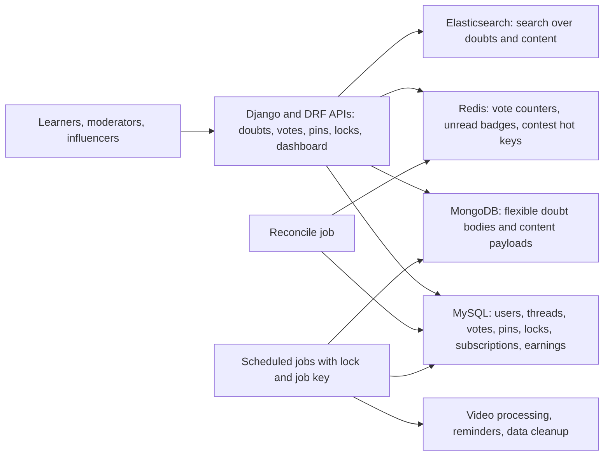
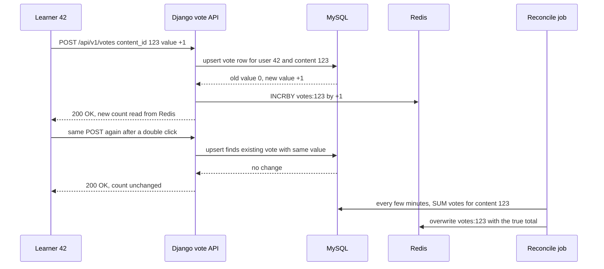

# 08. GeeksforGeeks: Courses Platform and Influencer Dashboard

<div class="callout note">
<b>How to use this chapter</b>
<ul>
<li><b>What it covers:</b> my first role, Software Development Engineer at GeeksforGeeks (Noida, August 2021 to November 2022). The work covers the doubt-support platform migration from PHP to Django, the voting, pinning and locking APIs, why MySQL, MongoDB, Redis and Elasticsearch were each used, the influencer analytics and earnings dashboard, and the scheduled background workflows.</li>
<li><b>When to read it:</b> before interviews that ask about early-career ownership, "a migration", "designing a voting or like system", "hot rows", "cron reliability", or "Django vs FastAPI".</li>
<li><b>What to memorise:</b> 10K+ daily queries, 10x spikes during live coding contests, a 20% lift in premium subscriptions (relative, attributed by the growth team), course sales up 30% (business attribution), engineering operational efficiency up 70%.</li>
<li><b>Tags used here:</b> HISTORICAL means it comes from my past work records and resume. ESTIMATED means it is arithmetic I can show. "Illustrative" means made-up sample data to explain a mechanism, not a remembered figure.</li>
</ul>
</div>

Related pages: [Start here](00_START_HERE.md) · [Every number explained](02_numbers_explained.md) · [Tech glossary](09_tech_glossary.md) · [Core concepts](10_core_concepts_explained.md) · [STAR stories](11_star_stories.md) · [Previous chapter: Masters India](07_masters_india.md). Older source packs: [Masters and GFG interview packs](../prep/23c_masters_gfg_interview_packs.md), [Masters and GFG deep dive](../prep/12_masters_gfg_deep_dive.md), [tables and why each tech](../prep/34_er_tables_tech_why.md), [schemas and APIs](../prep/35_table_schemas_api_design.md).

---

## 2. The one-minute version

> "My first job was at GeeksforGeeks, the computer-science learning platform. I worked on the courses platform. The doubt-support system, where learners post questions on courses and articles, ran on a fragile PHP backend. It struggled with 10K+ daily queries and with traffic that jumped about ten times during live coding contests. I migrated that backend to Django and built the REST APIs for voting, pinning and locking threads, using MySQL as the source of truth, Redis for hot counters, MongoDB for flexible content and Elasticsearch for search. The growth team tied those features to a 20% lift in premium subscriptions.
>
> I also built an analytics and earnings dashboard for influencers who promote our courses with affiliate coupon codes, which the business team credited with a 30% rise in course sales. And I designed scheduled background jobs for video processing, user reminders and data cleanup, which cut manual operations work by about 70%.
>
> It's where I learned the basics I used later: unique constraints for idempotency, keeping hot counters off the database, and making scheduled jobs safe to re-run."

---

## 3. The business in plain English

**GeeksforGeeks (GFG)** is one of the biggest computer-science learning sites in India. It has free articles, practice problems, live coding contests and paid courses. Premium subscriptions and course sales are a large part of how it makes money.

**Who the users are:**

- **Learners**, who read articles, take courses and post **doubts** (questions) when they're stuck.
- **People who answer doubts**, plus moderators who keep threads tidy.
- **Influencers**, creators who promote GFG courses to their audience with their own affiliate coupon codes and earn from the sales.
- **The ops and course teams**, who handle course videos, reminders and housekeeping.

**What the doubt-support platform does:** a learner on a course or article page asks "Why does my DFS give a stack overflow on this input?" Others reply. Good answers get **upvoted** so they rise. A moderator or instructor can **pin** the best thread to the top, and **lock** a thread to stop new replies, for example once it is resolved or off-topic.

**What hurt before:**

- The backend was **legacy PHP**. It was hard to change safely and lacked clean transactions and request validation.
- During **live coding contests** traffic jumped about **10 times**, and the doubt pages became slow and unreliable exactly when learners needed them most.
- Popular doubts got many votes at once, and updating one counter row in the database for every vote caused lock contention, the "hot row" problem explained below.
- Ops staff did repetitive work by hand: moving videos through processing, sending reminders, cleaning up old recordings and data.
- Influencers had no clear view of how their coupon codes were converting or what they had earned.

**Why the company paid for this:** a reliable doubt system is a selling point of premium plans, so if it breaks during a contest, learners have a reason not to pay. A good influencer dashboard keeps partners motivated to promote courses. And automating ops work frees people for higher-value tasks.

---

## 4. Words you need

| Term | Plain meaning |
|---|---|
| **Doubt** | GFG's word for a learner's question on a course or article. A "doubt thread" is the question plus its replies. |
| **PHP** | An older web scripting language. The legacy doubt backend was written in it. |
| **Django** | A "batteries included" Python web framework. It comes with an ORM, admin panel, authentication, forms and migrations. Like buying a furnished flat instead of an empty one. |
| **DRF (Django REST Framework)** | An add-on to Django for building REST APIs: serializers (validate input, shape output), viewsets and permissions. |
| **ORM** | Object-Relational Mapper. Lets you work with database rows as Python objects (`Vote.objects.filter(...)`) instead of writing raw SQL every time. |
| **REST API** | A web API where URLs name things (`/api/v1/votes`) and HTTP verbs act on them (POST to create, DELETE to remove). |
| **MySQL** | A popular relational database with tables, rows, joins and transactions. Used here as the source of truth. |
| **MongoDB** | A document database. It stores JSON-like documents whose fields can vary from one document to the next. |
| **Redis** | An in-memory key-value store. Very fast. Used for counters and caches. |
| **Elasticsearch** | A search engine. It builds an inverted index (word to list of documents) so full-text search is fast. Like the index at the back of a textbook. |
| **Unique constraint** | A database rule that a combination of columns can appear only once. A second insert with the same values is rejected. |
| **Idempotent** | Doing it twice has the same effect as doing it once. Pressing "upvote" twice should not count two votes. |
| **Hot row** | One database row that many requests try to update at the same moment. Each update takes a lock on the row, so they queue up. Like one checkout counter with a hundred people. |
| **Reconcile** | Periodically recompute the true value from the source of truth and fix any drift in the fast copy. |
| **Cron** | A scheduler that runs a job at fixed times, for example "every night at 2 AM". |
| **Lock or lease (for jobs)** | A short-lived "I'm running this" marker, so two servers don't run the same scheduled job at once. A lease expires on its own if the holder crashes. |
| **Idempotent job key** | A unique ID for one run of one job, such as `reminder:course_42:2022-06-10`, so a re-run can see "already done" and skip. |
| **Affiliate coupon** | A discount code tied to a specific influencer. A purchase using that code is credited to them, and they earn a share. |
| **Conversion** | A visitor actually buying. A "coupon conversion" is a purchase that used the code. |
| **Attribution** | Deciding which cause gets credit for a business result. Here the growth and business teams did the attribution, not me. |

---

## 5. Architecture



*What to notice:* MySQL is the single source of truth. Redis holds fast, possibly slightly stale copies that the reconcile job corrects. The scheduled jobs are separate from the request path.

**Walking through it box by box:**

- **Learners, moderators, influencers.** They use the website and app. All requests go to Django.
- **Django and DRF APIs.** These replaced the PHP backend. Serializers validate every request. Writes run inside database transactions.
- **MySQL.** Relational data where correctness matters: users, doubt threads and replies, votes with a unique `(user_id, content_id)` rule, pins, locks, subscriptions, and influencer transactions and earnings.
- **Redis.** Fast counters that change constantly: vote totals for display, unread badges, and hot keys that get hammered during contests.
- **MongoDB.** Content whose shape varies, such as doubt bodies with code blocks or attachments, and other semi-structured payloads.
- **Elasticsearch.** Full-text search, so a learner can search "segmentation fault in recursion" and find existing doubts.
- **Reconcile job.** Periodically recomputes vote totals from MySQL and corrects Redis and the stored count.
- **Scheduled jobs.** Video processing handoffs, user reminders and data cleanup. Each takes a lock so only one server runs it, and records a job key so a re-run doesn't repeat work.

---

## 6. One request, step by step: an upvote during a contest

**Sample data (illustrative):** learner `user_id = 42` upvotes doubt `content_id = 123`, "Why does my DFS overflow the stack?", during a live contest. Hundreds of others are voting on the same doubt in the same few minutes.



*What to notice:* each vote writes its own row (user 42's row for doubt 123), so votes don't fight over one shared row. The shared total lives in Redis. The second click is a no-op because of the unique constraint. The reconcile job is the safety net that keeps Redis honest.

**The same flow in words:**

1. Learner 42 clicks upvote. Django validates the request with a DRF serializer.
2. Django writes the vote into the `votes` table. A unique constraint on `(user_id, content_id)` means user 42 can have only one vote row for doubt 123.
3. If the vote is new or changed, Django adjusts the Redis counter by the difference: +1 for a new upvote, −2 for changing an upvote into a downvote.
4. The page shows the new count from Redis immediately.
5. A double click sends the same request again. The row already holds +1, so nothing changes and the count stays right.
6. Every few minutes the reconcile job sums the real votes in MySQL and overwrites the Redis value and the stored count. Any drift (say Redis was flushed, or an increment was lost) is fixed.

---

## 7. Each resume bullet decoded

### Bullet 1: the Django migration and the voting, pinning and locking APIs

> "Stabilized the doubt-support platform to handle **10K+** daily queries and **10x** traffic spikes during live coding contests by migrating the backend to **Django**. Engineered high-throughput REST APIs for voting, pinning, and locking threads utilizing MySQL, MongoDB, Redis, and Elasticsearch, driving a **20%** lift in premium subscriptions."

#### In plain words

I moved the doubt-support backend from old PHP code to Django, so it stayed reliable on normal days and during contest spikes. I built the APIs that let users vote on answers, let moderators pin and lock threads, and I chose which data store held what. The growth team linked these features to a 20% rise in premium subscriptions.

#### What the load actually means

- **10K+ daily queries.** 10,000 ÷ 86,400 seconds = about **0.12 per second**, roughly one every 9 seconds on average. ESTIMATED arithmetic. That is well under 1 request per second.
- **10x contest spikes.** Even ten times the average is only around 1 per second if spread evenly. But contest traffic is not even. It bunches into short windows, and every posted doubt brings many more reads (page views, vote counts, searches) than writes.

So the honest story is not "massive throughput". The PHP backend was fragile under bursts: no clean transactions, little request validation, slow unindexed paths, and hot rows on popular doubts. The fix was **correctness and burst safety**, not raw scale.

<div class="callout note">
<b>Say this carefully.</b> "Order of ten thousand daily queries, with roughly ten times that during contests." Don't call it 100K a day (an older resume said that) or 1K a day (an older, narrower metric). Don't compare it to Uber or Impact Analytics scale. The point is reliability under bursts.
</div>

#### How it works: the migration and what Django bought

We migrated **page by page behind the same URLs**, so users never saw a switch-over day. The same gradual idea came back later at Masters India. Django and DRF helped in four concrete ways:

1. **Transactions.** `transaction.atomic()` wraps a write so it either fully happens or fully doesn't. For example, creating a reply and bumping the unread counter together.
2. **Request validation.** DRF serializers reject bad input (missing fields, wrong types, a vote value other than +1 or −1) before it reaches the database.
3. **Read and write separation.** Read views (list doubts, show counts) were kept apart from write endpoints, so reads could lean on cache and writes stayed simple and transactional.
4. **Process discipline.** Staging, code review and migrations under version control, which the PHP stack lacked.

**Caching** with Redis took the repeated contest reads (vote counts, unread badges, hot doubt pages) off MySQL. **Database constraints** made the data correct even under races. A double-submitted vote cannot create two rows.

#### How it works: voting with a unique constraint and Redis counters

Logical schema (from my notes, LOGICAL and HISTORICAL, not copied from code):

```sql
CREATE TABLE votes (
  id          BIGINT PRIMARY KEY AUTO_INCREMENT,
  user_id     BIGINT NOT NULL,
  content_id  BIGINT NOT NULL,
  value       TINYINT NOT NULL,          -- +1 or -1
  created_at  DATETIME NOT NULL,
  UNIQUE KEY uq_vote (user_id, content_id)
);
```

The API upserts the row:

```sql
INSERT INTO votes (user_id, content_id, value, created_at)
VALUES (42, 123, 1, NOW())
ON DUPLICATE KEY UPDATE value = VALUES(value);
```

Illustrative Django view logic:

```python
from django.db import transaction

def cast_vote(user_id: int, content_id: int, value: int) -> int:
    with transaction.atomic():
        vote = (Vote.objects.select_for_update()
                .filter(user_id=user_id, content_id=content_id).first())
        old = vote.value if vote else 0
        if old == value:
            return int(redis.get(f"votes:{content_id}") or 0)   # same vote again: no-op
        Vote.objects.update_or_create(
            user_id=user_id, content_id=content_id, defaults={"value": value})
    return redis.incrby(f"votes:{content_id}", value - old)      # apply only the change
```

**Why this avoids the hot row.** The naive design runs `UPDATE content SET vote_count = vote_count + 1 WHERE id = 123` on every vote. Every one of those updates locks the same row, so 300 votes in a few minutes on a popular doubt means 300 transactions queuing on one lock. With our design, each vote touches its own `(user_id, content_id)` row, so there is no contention. The shared total is a Redis `INCRBY`, which is atomic and takes microseconds.

**Worked example (illustrative):**

| Time | Event | votes row for (42, 123) | Redis `votes:123` |
|---|---|---|---|
| 10:00:01 | User 42 upvotes | value = +1 | 87 → 88 |
| 10:00:01 | Double click, same upvote | unchanged | 88 |
| 10:03:10 | User 42 switches to downvote | value = −1 | 88 → 86 (change of −2) |
| 10:05:00 | Redis node restarts, key lost | unchanged | missing |
| 10:05:00 | Reconcile runs: `SUM(value)` = 86 | unchanged | set to 86 |

The reconcile query:

```sql
SELECT content_id, SUM(value) AS total
FROM votes
WHERE content_id IN (/* doubts with recent activity */)
GROUP BY content_id;
```

The job writes each total back to `content.vote_count` in MySQL and to Redis.

#### How it works: pinning and locking

- **Pinning.** A pin record marks a thread as pinned within its context (a course or an article), with an ordering column so pinned threads show in a set order at the top. A unique constraint means pinning the same thread twice is a no-op, which is the same idempotency idea as votes.
- **Locking.** A lock record holds `content_id`, `locked_by`, `reason` and an optional `expires_at`. The "post reply" API checks for an active lock and refuses new replies on a locked thread. Moderation actions sit behind permission checks, so only moderators or instructors can pin or lock.

Logical API surface (from my notes, illustrative):

```text
POST   /api/v1/votes               {content_id, value}   idempotent upsert
DELETE /api/v1/votes/{content_id}                         remove my vote
POST   /api/v1/pins                {content_id}           moderator only
POST   /api/v1/content/{id}/lock   {reason}               moderator only
GET    /api/v1/search?q=...                               Elasticsearch
```

#### Why each store: MySQL, MongoDB, Redis, Elasticsearch

| Store | What lived there | Why this store |
|---|---|---|
| **MySQL** | Users, threads and replies, votes, pins, locks, subscriptions, influencer transactions | Relational data that must be correct: unique constraints, joins, transactions. The source of truth. |
| **MongoDB** | Flexible doubt bodies and content payloads (code blocks, attachments, varying fields) | The shape varies from document to document. No schema migration for every new field. |
| **Redis** | Vote counters, unread badges, contest hot keys | Thousands of tiny reads and increments a minute. Memory-speed and atomic `INCR`. |
| **Elasticsearch** | Search index over doubts and content | Full-text search with relevance ranking. SQL `LIKE '%stack overflow%'` can't use a normal index and gets slow. |

One-liner: "MySQL for truth, Redis for hot counters, MongoDB where the document shape varied, Elasticsearch for search."

#### The 20% premium lift

- **What it measures:** growth in premium subscriptions after these features shipped. Some doubt-support interactions were part of the premium offering.
- **Relative, not absolute:** a 20% lift means, for example, 1,000 new premium subscriptions a month becoming 1,200 (illustrative numbers). It does **not** mean 20% of all users became premium.
- **Who attributed it:** the growth team. I owned the APIs and their reliability.
- **How to say it:** "The growth team attributed about a 20% relative lift in premium subscriptions to these features. I owned the engineering behind them."

<div class="callout warn">
<b>Number conflict to know about.</b> Older prep notes said "15 to 20%". The current resume says <b>20%</b>. Use 20%, framed as a relative lift attributed by the growth team.
</div>

#### Why this design

- A **unique constraint** gives correctness even under races and double clicks, enforced by the database rather than by hopeful app code.
- **Redis plus reconcile** removes the hot-row problem without giving up the truth in MySQL.
- **Django** fit a 2021 content-and-community product: admin panel, auth, ORM and migrations out of the box, so the team shipped features fast.

#### Alternatives and why not

| Alternative | Why not |
|---|---|
| Update a counter column in MySQL on every vote | Hot-row lock contention on popular doubts, worst during contests. |
| Counters only in Redis, no vote rows | Fast but not durable or auditable. You can't stop double votes per user or rebuild after a Redis flush. |
| Check "has this user voted?" in app code, no constraint | Two simultaneous requests can both pass the check. Only a database constraint is race-proof. |
| Everything in MongoDB | Votes, subscriptions and permissions are relational and need constraints and transactions. |
| Search with SQL `LIKE` | Slow and no relevance ranking. |
| Stay on PHP | The reliability problems were in the code structure, not just the servers. |

#### Trade-off

Displayed counts can be a few minutes stale or slightly off until the reconcile runs. That's fine for a vote badge. It would not be fine for money. Four data stores also mean more to run and keep consistent.

#### Questions they will ask

**"How do you make a vote API idempotent?"**
With a unique constraint on user ID and content ID in the votes table, so a user can only ever have one vote row per doubt. The API upserts that row. If the value hasn't changed, it's a no-op. A double click or a client retry can never count twice, and the database enforces it even when two requests race.

**"How did you avoid hot rows on popular doubts?"**
We stopped updating a shared counter row on every vote. Each vote writes its own row, keyed by user and content, so there's no contention. The display total lives in Redis and is updated with an atomic increment. A reconcile job sums the real votes from MySQL every few minutes and corrects Redis, so MySQL stays the source of truth.
*Follow-up they may ask:* "What if Redis loses the key?" The next reconcile rebuilds it from the vote rows, and until then the API can fall back to the stored count.

**"10K queries a day isn't much. What was hard?"**
You're right that the average is well under one request per second. What was hard was bursts and fragility. Contest traffic jumped about tenfold in short windows, the PHP code had no clean transactions or validation, and popular doubts created hot rows. The Django migration, Redis counters and database constraints made it hold up during those bursts.

**"Why four data stores? Isn't that over-engineering?"**
Each one did a job the others do badly. MySQL held relational truth with constraints. Redis handled very frequent tiny counters. MongoDB held content whose shape varied. Elasticsearch did full-text search. If I had to cut one today, I'd look hard at whether MongoDB's role could move into MySQL JSON columns.

---

### Bullet 2: the influencer dashboard and scheduled workflows

> "Accelerated platform course sales by **30%** by launching an influencer analytics and earnings dashboard to dynamically track transactions and affiliate coupon conversions. Increased engineering operational efficiency by **70%** by designing asynchronous scheduled workflows for automated video processing, user reminders, and data cleanup."

This bullet has two separate pieces of work. Keep them apart when you talk.

#### Part A: the influencer analytics and earnings dashboard

**In plain words:** influencers promote GFG courses with their own coupon codes. I built a dashboard where each influencer could see their transactions, how many purchases used their code, and what they had earned.

**How it works:**

- Every course purchase that used a coupon was recorded in MySQL with the coupon code, linked to the influencer account.
- The dashboard showed **transactions**, **coupon conversions** and **earnings**, with filters and CSV export (from my older resume notes).
- **Near-real-time counters** in Redis gave a fresh "today so far" view. **Daily rollups** by a scheduled job built the historical charts without scanning raw transactions on every page load.

Logical tables (illustrative):

```text
influencer_account (id, name, coupon_code)
earning_txn        (id, influencer_id, order_id, course_id, amount, earning, created_at)
daily_rollup       (influencer_id, day, orders, revenue, earning)
```

**Worked example (illustrative):** influencer Priya has coupon `PRIYA10`. On Monday, 40 course orders use `PRIYA10`. Each order writes an `earning_txn` row, and Redis bumps `inf:priya:today:orders`. Priya opens her dashboard at 3 PM and sees "40 orders today" from Redis. At night the rollup job writes Monday's totals into `daily_rollup`, and her weekly chart reads from that table. The earning per order follows whatever commission her agreement set. I don't need to quote a rate.

**The 30% course sales number:**

- **What it measures:** growth in course sales after the dashboard launched.
- **Who attributed it:** the business team. The likely mechanism is that influencers who can see their conversions and earnings promote more and adjust what works.
- **How to say it:** "The business team credited the dashboard with about a 30% rise in course sales. I built the dashboard. They did the attribution."
- **What not to say:** "I increased sales by 30%" as if engineering alone caused it.

#### Part B: asynchronous scheduled workflows

**In plain words:** jobs that used to need a person, such as moving videos through processing, sending reminders before classes, or deleting old recordings and stale data, now ran automatically on a schedule, safely.

**The jobs (from the PDF):**

1. **Video processing:** hand off newly uploaded course videos to processing and track their status.
2. **User reminders:** send reminders to learners, for example before a live class.
3. **Data cleanup:** remove expired cloud recordings and stale data.

**The two reliability rules:**

- **A lock so only one server runs a job.** If cron runs on two hosts for redundancy, both wake up at 2 AM. Without a lock, both send the same 5,000 reminder emails. A short-lived lock (a Redis `SET NX` with expiry, or a MySQL advisory lock) means the second host sees "someone has it" and exits. Because the lock expires, a crashed holder doesn't block the job forever.
- **An idempotent job key so re-runs are safe.** Each unit of work gets a key like `reminder:{user_id}:{class_id}:{type}` or `cleanup:{date}`. Before doing the work, the job checks whether that key is already marked done. If a job crashes halfway and re-runs, it skips what's already finished.

Illustrative code:

```python
import socket

HOST = socket.gethostname()

def run_once(job_name: str, run_key: str, work) -> None:
    lock = f"cron:lock:{job_name}"
    if not redis.set(lock, HOST, nx=True, ex=3600):    # someone else is running it
        return
    try:
        if JobRun.objects.filter(job_key=run_key, status="done").exists():
            return                                      # already done, safe re-run
        work()
        JobRun.objects.update_or_create(job_key=run_key, defaults={"status": "done"})
    finally:
        redis.delete(lock)

def send_class_reminders(class_id: int) -> None:
    for user_id in enrolled_user_ids(class_id):
        key = f"reminder:{user_id}:{class_id}:1h_before"
        if not SentReminder.objects.filter(key=key).exists():
            send_email(user_id, class_id)
            SentReminder.objects.create(key=key)
```

Each job also wrote structured success and failure logs, and retried or set aside partial batches instead of failing the whole run.

**Worked example (illustrative):** the reminder job for class 77 has 2,000 enrolled learners. It crashes after 1,200 emails. On re-run, the first 1,200 keys are already in `SentReminder`, so it sends only the remaining 800. Nobody gets two emails.

**The 70% ops efficiency number:**

- **What it measures:** time saved on the manual video, reminder and cleanup workflows the team used to do by hand (HISTORICAL).
- **How to picture it (illustrative, not a remembered figure):** if those tasks took 10 hours of someone's week, they now take about 3.
- **How to say it:** "Automating video handoffs, reminders and cleanup cut the manual effort on those workflows by about 70%."

#### Why this design

- The dashboard used **Redis for "today" and rollups for history**, so the page stayed fast without scanning every transaction each time.
- Scheduled jobs used **locks plus idempotent keys** because cron is simple and good enough for daily or hourly work, as long as you make it safe to run twice and impossible to run concurrently.

#### Alternatives and why not

| Alternative | Why not |
|---|---|
| Compute dashboard numbers from raw transactions on every page load | Slow, and it gets slower every month as transactions grow. |
| Plain cron with no lock | Two hosts double-run jobs. Duplicate reminder emails. |
| Plain cron with no job keys | A crash halfway means a re-run repeats work or skips it inconsistently. |
| A full workflow engine | Too heavy for a handful of daily and hourly jobs at that stage. |

#### Trade-off

Rollups mean historical charts are up to a day behind. Locks with expiry need the expiry set longer than the job's normal runtime, or a slow run could lose its lock while still working.

#### Questions they will ask

**"How did you stop a cron job from running twice?"**
Two layers. A short-lived lock in Redis, or a database advisory lock, so only one host runs the job at a time, with an expiry so a crashed host doesn't block it forever. Then an idempotent key per unit of work, like one key per user, class and reminder type, so a re-run after a crash skips what was already done. For example, if the reminder job died after 1,200 of 2,000 emails, the re-run only sent the remaining 800.

**"Did your dashboard really increase sales by 30%?"**
The business team attributed a 30% rise in course sales to the influencer dashboard. I owned building it: tracking transactions and coupon conversions, near-real-time counters in Redis and daily rollups for history. The causal link is their analysis, and the likely mechanism is that influencers who can see what converts promote more and better.

**"What made it 'asynchronous'?"**
None of this work ran inside a user's request. Video handoffs, reminders and cleanup ran as scheduled background jobs, so users never waited on them and a slow job never slowed the site.

---

## 8. Tech used in this project and why

| Tech | What it is in one line | Why here | Alternative considered |
|---|---|---|---|
| Python | General-purpose language | Team language. Django ecosystem | PHP (the legacy) |
| Django + DRF | Batteries-included web framework plus REST toolkit | ORM, admin, auth, migrations, serializers. Fast feature delivery for a content product | Staying on PHP, Flask (more assembly needed) |
| MySQL | Relational database | Source of truth. Unique constraints and transactions for votes, subscriptions and earnings | MongoDB for everything |
| MongoDB | Document database | Doubt bodies and content with varying shape | MySQL JSON columns |
| Redis | In-memory key-value store | Vote counters, unread badges, contest hot keys, dashboard "today" counters, job locks | Updating MySQL counters on every event |
| Elasticsearch | Full-text search engine | Search over doubts and content with relevance | SQL `LIKE` |

Tech line on the PDF: Python, Django, MySQL, MongoDB, Redis, Elasticsearch. Celery is **not** on the GFG line, so don't describe the scheduled jobs as Celery here.

**Why Django here but FastAPI later at Masters India?** In 2021 this was a content and community product, where Django's admin, auth and ORM saved a lot of time. At Masters India the core problem was async calls to a slow government API, which is what FastAPI is built for. Different job, different tool.

---

## 9. Hard problems and failure stories

GeeksforGeeks was early career, and my notes describe these as design problems the system was built around, not dated incidents. Tell them that way.

### Problem 1: hot rows on popular doubts

- **What hurt:** during contests a popular doubt got many votes in minutes. Updating one counter row per vote made those writes queue on a single row lock.
- **How it was seen:** vote and doubt pages slowed down during contests.
- **Fix:** a vote row per user and content with a unique constraint, a Redis counter for display, and a periodic reconcile from MySQL.
- **What I learned:** separate "what is true" (MySQL rows) from "what is fast to show" (Redis), and always have a job that brings them back in line.

### Problem 2: counter drift

- **What can go wrong:** Redis restarts, an increment is lost, or a bug double-applies a change. The displayed count drifts from reality.
- **Fix:** the reconcile job recomputes `SUM(value)` from the vote rows and overwrites Redis and the stored count.
- **What I learned:** a cache you can't rebuild from the source of truth is a liability.

### Problem 3: jobs that double-run or half-run

- **What can go wrong:** cron on two hosts sends duplicate reminders. A crash midway leaves cleanup half-done.
- **Fix:** a lock with expiry so only one host runs a job, an idempotent key per unit of work, and structured success and failure logs.
- **What I learned:** every scheduled job should be safe to run twice. I carried this straight into the idempotency design at Masters India.

### What I would do differently today

- **Votes as events.** Write each vote as an event to a queue and update counters from that stream. Totals become rebuildable by replay, and the reconcile job becomes a check instead of a fix. I learned this pattern later with Kafka at Masters India.
- **Idempotency by default.** Give every scheduled job and every reminder an idempotent key from day one, through a shared helper, not as something remembered per job.
- **Contest-day targets.** Agree explicit latency targets for contest windows and alert on them, instead of finding out from user complaints.
- **Fewer stores if possible.** Re-check whether MongoDB's role could live in MySQL JSON columns, to run one less system.

---

## 10. Say this / don't say this

<div class="callout warn">
<b>Say this</b>
<ul>
<li>"10K+ daily queries, with roughly 10 times that during live coding contests. That's well under one request per second on average, so the problem was bursts and fragility, not raw scale."</li>
<li>"A 20% lift in premium subscriptions, relative, attributed by the growth team. I owned the APIs."</li>
<li>"The business team credited the influencer dashboard with a 30% rise in course sales."</li>
<li>"Automated video handoffs, reminders and cleanup cut manual ops effort on those workflows by about 70%."</li>
<li>"Unique constraint for correctness, Redis for speed, reconcile for truth."</li>
</ul>
<b>Don't say this</b>
<ul>
<li>"100K daily queries" or "1K daily queries" (older resume figures). Use 10K+.</li>
<li>"15 to 20% premium lift" (older prep). The current PDF says 20%.</li>
<li>"I increased sales by 30%" as if engineering alone caused it.</li>
<li>Celery, Kafka or FastAPI at GeeksforGeeks. They are not on this role's tech line.</li>
<li>Comparing GFG load to Uber or Impact Analytics scale.</li>
<li>"SMTP email sends 50% faster" as a resume claim. That was on an older resume and is not on the current PDF. If an interviewer brings it up, explain it as connection reuse (keep one SMTP connection open across a batch instead of a new TCP and TLS handshake per email), framed as an older detail.</li>
<li>Unread-count badges as a resume bullet. It's a prep design question (Redis counters with a durable MySQL row), not a PDF bullet.</li>
</ul>
</div>

---

## 11. Practice drill

1. **What was the doubt-support platform?**
The Q&A layer on GeeksforGeeks courses and articles. Learners post doubts, others reply, good answers are upvoted, and moderators can pin or lock threads.

2. **Why migrate from PHP to Django?**
The PHP backend was fragile under contest bursts. It lacked clean transactions and request validation and was hard to change safely. Django and DRF gave us transactions, serializers for validation, an ORM with migrations, and faster feature work. We migrated page by page behind the same URLs.

3. **What does 10K+ daily queries mean in requests per second?**
10,000 divided by 86,400 is about 0.12 per second, so well under one. Contest spikes were about 10 times normal and bunched into short windows, so the challenge was bursts.

4. **How is a vote idempotent?**
A unique constraint on user ID and content ID means one vote row per user per doubt. The API upserts that row, so a repeat with the same value changes nothing and a changed vote just updates the value.

5. **What's a hot row and how did you avoid it?**
A single row many requests update at once, so they queue on its lock. We wrote each vote to its own row and kept the shared total in Redis with atomic increments, then reconciled to MySQL periodically.

6. **What if Redis and MySQL disagree?**
MySQL wins. The reconcile job sums the vote rows and overwrites the Redis value and the stored count. A few minutes of staleness on a vote badge is acceptable.

7. **What's the difference between pinning and locking?**
Pinning puts a thread at the top of its course or article, in a set order. Locking stops new replies on a thread. Both are moderator-only actions behind permission checks.

8. **Why MongoDB and Elasticsearch as well as MySQL?**
MongoDB held content whose shape varied, like doubt bodies with code or attachments. Elasticsearch gave fast full-text search with relevance ranking, which SQL `LIKE` can't do well. MySQL stayed the source of truth.

9. **What did the influencer dashboard show?**
Each influencer's transactions, coupon conversions and earnings. Redis counters gave a near-real-time "today" view, and daily rollups fed the history charts.

10. **How do you talk about the 30% and 20% numbers?**
As business results attributed by the business and growth teams. The 20% is a relative lift in premium subscriptions. I owned the engineering and I don't claim the causal analysis.

11. **How did you make scheduled jobs safe?**
A lock with expiry so only one host runs a job at a time, and an idempotent key per unit of work so a re-run skips finished work. Plus success and failure logs and retries for partial batches.

12. **Why Django here and FastAPI at Masters India?**
Django suited a content product that needed admin, auth and ORM quickly. FastAPI suited Masters India's async calls to a slow government API.

13. **What would you do differently today?**
I'd put vote events on a queue and build counters from that event stream, so totals are rebuildable by replay rather than by a periodic sum. I'd make idempotent job keys the default for every scheduled job instead of adding them job by job. And I'd set clear latency targets for contest days and alert on them. The Django migration and the vote model were the right call for 2021.

---

## 12. 3-minute whiteboard script

**First (about 45 seconds): the product and the problem.**
Draw "Learners" pointing to "Doubt pages". Write "10K+ a day, 10x in contests" beside it.
Say: "At GeeksforGeeks, learners post doubts on courses and articles. The backend was legacy PHP. It was fragile under contest spikes of about ten times normal. The daily average is well under one request per second, so the problem was bursts and correctness, not raw scale. I migrated it to Django page by page behind the same URLs."

**Second (about 75 seconds): the vote design.**
Draw "Django API" with arrows to "MySQL", "Redis", "MongoDB" and "Elasticsearch". Under MySQL write `votes UNIQUE(user_id, content_id)`. Under Redis write `votes:123 INCRBY`. Draw a "Reconcile" box with arrows from MySQL to Redis.
Say: "Each vote is its own row with a unique constraint on user and content, so double clicks are idempotent and there's no single hot row. The display total is a Redis counter. A reconcile job sums the real votes and corrects Redis, so MySQL stays the truth. Pinning and locking follow the same pattern: constraint-backed rows behind moderator permissions. MongoDB holds content with varying shapes and Elasticsearch powers search. The growth team tied these features to a 20% relative lift in premium subscriptions."

**Third (about 45 seconds): dashboard and jobs.**
Draw "Influencer dashboard" reading from "Redis today counters" and "Daily rollups". Separately draw "Scheduled jobs" with "lock + job key" written on the arrow to "Video, reminders, cleanup".
Say: "I built an influencer dashboard for transactions, coupon conversions and earnings, which the business credited with 30% more course sales. And I built scheduled jobs for video processing, reminders and cleanup, each with a lock so only one host runs it and an idempotent key so re-runs are safe. That cut manual ops effort by about 70%."

**Close (about 15 seconds): the lesson.**
Say: "This is where I learned constraints for idempotency, hot counters off the database, and safe re-runs. I used all three at a much bigger scale at Masters India."
