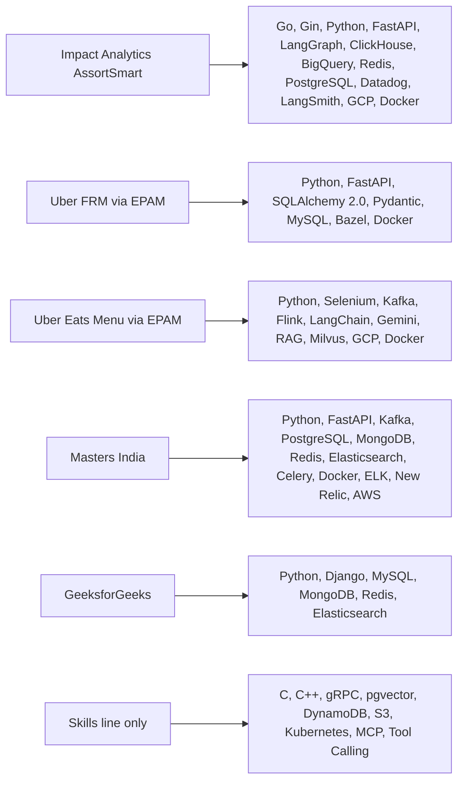

# Tech Glossary: every technology on my resume, explained

<div class="callout note">
<b>How to use this page</b>
<ul>
<li>It covers every technology on the PyGo resume (<code>Tarun_Mittal_SSE_5yr.pdf</code>): the Skills line plus each project's Tech line.</li>
<li>Read it the week before interviews, and again the night before a round that names a specific tool in the job description.</li>
<li>Memorise three things per entry: the one-line definition, where I used it (or that it is skills-level), and one "why this and not the alternative" sentence.</li>
<li>The project stories live in the chapters. This page explains the tools. Jump to <a href="03_ia_core_platform.md">IA core platform</a>, <a href="04_ia_agentic_ai.md">IA agentic AI</a>, <a href="05_uber_frm.md">Uber FRM</a>, <a href="06_uber_menu_and_anz.md">Uber Menu and ANZ</a>, <a href="07_masters_india.md">Masters India</a>, <a href="08_geeksforgeeks.md">GeeksforGeeks</a> and <a href="02_numbers_explained.md">numbers explained</a> for the full stories.</li>
</ul>
</div>

## How to read the labels

Every entry has a **depth** label. It tells you how strongly you may claim the technology.

- **Production** means the technology appears in a resume bullet or a project Tech line, and I did real work with it in a shipped system. You can go deep.
- **Project** means it is on a project Tech line and I used it there, but no bullet is about it. Speak about it confidently but keep claims qualitative. Do not invent numbers.
- **Skills-level** means it is on the Skills line as literacy. I can explain how it works and when I would pick it. I do not claim production ownership. If asked "did you run this in production?", the honest answer is "No, here is what I know and where I would use it."

Numbers also carry tags in the project chapters. **MEASURED** means there is a log, doc or code behind it. **ESTIMATED** means arithmetic I can show. **HISTORICAL** means it comes from my past work records. **TARGET** means a design goal ("targeting"). On this page I only repeat numbers that are already on the resume or in the locked facts.

<div class="callout warn">
<b>Code snippets on this page are teaching sketches.</b> They show how the technology works in general. They are not copies of company code. When you speak, describe what we built in words, and use the snippet only to show you understand the mechanism.
</div>

## Where each technology lives

The picture below is the fastest way to remember which tools belong to which job. Notice that Kafka and Flink sit only on Uber Menu (and Kafka on Masters), never on Impact Analytics, and that the last box is skills-level only.



## Table of contents

1. **Languages:** [Python](#python) · [Go](#go) · [SQL](#sql) · [C and C++](#c-cpp)
2. **Backend and APIs:** [FastAPI](#fastapi) · [Gin](#gin) · [Django](#django) · [REST](#rest) · [gRPC](#grpc) · [Pydantic](#pydantic) · [Celery](#celery) · [asyncio](#asyncio) · [SQLAlchemy 2.0](#sqlalchemy) · [Google Wire](#wire) · [h2c and HTTP/2](#h2c) · [WebSocket](#websocket)
3. **Authentication and identity:** [JWT](#jwt) · [Firebase Admin and Google OIDC](#firebase-oidc)
4. **Generative AI:** [LangGraph](#langgraph) · [LangChain](#langchain) · [RAG](#rag) · [Milvus](#milvus) · [pgvector](#pgvector) · [LLM Agents (OpenAI, Gemini, Claude)](#llm-agents) · [Tool Calling](#tool-calling) · [MCP](#mcp) · [Prompt Engineering](#prompt-engineering) · [LangSmith](#langsmith) · [Offline Evaluation](#offline-evaluation)
5. **Data and streaming:** [Apache Kafka](#kafka) · [Apache Flink](#flink) · [ClickHouse](#clickhouse) · [BigQuery](#bigquery) · [ETL Pipelines](#etl)
6. **Databases and storage:** [PostgreSQL](#postgresql) · [MySQL and Uber SOADB](#mysql) · [Redis](#redis) · [MongoDB](#mongodb) · [Elasticsearch](#elasticsearch) · [DynamoDB](#dynamodb) · [S3](#s3)
7. **Cloud and DevOps:** [GCP](#gcp) · [AWS](#aws) · [Docker](#docker) · [Kubernetes](#kubernetes) · [Bazel](#bazel) · [CI/CD](#cicd)
8. **Observability:** [Datadog](#datadog) · [ELK](#elk) · [New Relic](#newrelic)
9. **Browser automation:** [Selenium](#selenium)
10. [Honesty box for the whole glossary](#honesty-box)

The Architecture and Core Concepts line (distributed systems, caching, sharding, idempotency and so on) is explained in [core concepts explained](10_core_concepts_explained.md).

## Summary table

| Tech | One-line definition | Where I used it | Depth |
|---|---|---|---|
| Python | General-purpose language, strongest AI and web ecosystem | IA agent plane, FRM, Menu, Masters, GFG | Production |
| Go | Compiled language built for cheap concurrency | IA Gin platform, formula parser, ClickHouse data pump | Production |
| SQL | Language for querying relational and analytical databases | Every project | Production |
| C, C++ | Low-level compiled languages with manual memory | None | Skills-level |
| FastAPI | Typed, async Python web framework | FRM 36 endpoints, Masters microservices, IA agent plane and Ask Iris | Production |
| Gin | Fast HTTP router and middleware framework for Go | IA multi-tenant platform, 10k peak RPS | Production |
| Django | Batteries-included Python web framework | GFG doubt-support platform | Production |
| REST | Resource-based API style over HTTP | FRM, Masters, GFG, IA | Production |
| gRPC | Contract-first RPC over HTTP/2 with protobuf | None | Skills-level |
| Pydantic | Data validation from Python type hints | FRM Tech line, inside every FastAPI service | Project |
| Celery | Python distributed task queue | Masters India Tech line | Project |
| asyncio | Python's single-thread event loop for concurrent I/O | Masters IRP calls, IA batch LLM calls | Production |
| SQLAlchemy 2.0 | Typed Python ORM and SQL toolkit | FRM ORM migration, led 3 engineers | Production |
| Google Wire | Compile-time dependency injection for Go | IA Go/Gin platform | Production |
| h2c and HTTP/2 | HTTP/2 multiplexing, without TLS in the h2c case | IA Go edge, no reverse proxy | Production |
| WebSocket | Long-lived two-way connection upgraded from HTTP | Ask Iris copilot | Production |
| JWT | Signed token that carries identity claims | IA auth waterfall, Ask Iris handshake | Production |
| Firebase Admin, Google OIDC | Server-side verification of Google-issued identity tokens | IA auth waterfall | Production |
| LangGraph | Library for LLM workflows as stateful graphs with loops | Ask Iris supervisor and 3-attempt evaluator | Production |
| LangChain | Building blocks for LLM apps (prompts, retrievers, parsers) | Uber Menu RAG | Production |
| RAG | Retrieve relevant context, then let the LLM generate | Uber Menu extraction, 98% offline | Production |
| Milvus | Open-source vector database | Uber Menu only | Production |
| pgvector | Vector search extension for PostgreSQL | None | Skills-level |
| LLM Agents | LLMs used as multi-step decision makers with state | IA lenses and Ask Iris, Menu Gemini 2.5 Pro | Production (Claude is skills-level) |
| Tool Calling | LLM asks your code to run a named function with JSON args | Verbal design depth only | Skills-level |
| MCP | Open protocol for plugging tools and data into AI apps | None | Skills-level |
| Prompt Engineering | Designing instructions so LLM output is reliable | IA lenses, Menu extraction | Production |
| LangSmith | Tracing and evaluation platform for LLM apps | Ask Iris only | Production |
| Offline Evaluation | Scoring a model on a fixed labelled set before release | IA 300-case gate and gold-200 bench, Menu 98% | Production |
| Apache Kafka | Partitioned, replayable event log | Uber Menu, Masters India | Production |
| Apache Flink | Stateful stream processor | Uber Menu only | Production |
| ClickHouse | Columnar analytical database | IA rollups, 2.11B master, data pump | Production |
| BigQuery | Google's serverless data warehouse | IA Tech line, upstream warehouse | Project |
| ETL Pipelines | Extract, transform, load data between systems | FRM, Menu, Masters, IA rollups | Production |
| PostgreSQL | Open-source ACID relational database | IA identity and roles, Masters quarter shards | Production |
| MySQL and SOADB | Relational database, and Uber's service-owned MySQL standard | FRM 8-table schema, GFG | Production |
| Redis | In-memory key-value store used as a cache | IA auth cache, Masters cache-aside, GFG | Production |
| MongoDB | Document database with flexible schema | Masters, GFG | Production |
| Elasticsearch | Search engine built on an inverted index | Masters (ELK logs), GFG (search) | Production |
| DynamoDB | AWS managed key-value database | None | Skills-level |
| S3 | AWS object storage | No bullet names it | Skills-level |
| GCP | Google Cloud Platform | IA, Uber Menu | Production |
| AWS | Amazon Web Services | Masters India | Production |
| Docker | Packages an app and its dependencies into a container | IA, FRM, Menu, Masters | Production |
| Kubernetes | Container orchestrator | None, no cluster operations claim | Skills-level |
| Bazel | Hermetic, cached build system from Google | FRM stacked PRs and test targets | Production |
| CI/CD | Automated build, test and release pipeline | Masters 98% deploys, IA 80% gate, FRM Bazel | Production |
| Datadog | Monitoring and distributed tracing SaaS | IA Go edge | Production |
| ELK | Elasticsearch, Logstash, Kibana for logs | Masters India triage | Production |
| New Relic | Application performance monitoring SaaS | Masters India tracing | Production |
| Selenium | Browser automation | Uber Menu scraping fleet, 95%+ | Production |

---

# 1. Languages

<a id="python"></a>
### Python

**Depth:** Production. It is my main language across five of my six projects.

**What it is.** Python is a general-purpose programming language known for readable code and a huge library ecosystem. It is the default language for AI work because almost every model provider and AI framework ships a Python library first. Think of it as a well-stocked kitchen: not the fastest stove, but every ingredient and tool is already on the shelf.

**How it works (what interviewers probe).**
- **The GIL (Global Interpreter Lock).** Only one thread runs Python bytecode at a time inside one process. That hurts CPU-heavy work but barely matters for I/O-heavy work like calling APIs or databases, because threads release the lock while they wait. For CPU-heavy work you use multiple processes.
- **asyncio** lets one thread juggle thousands of waiting network calls (see [asyncio](#asyncio)).
- **Type hints** do nothing at runtime by themselves, but tools like Pydantic and FastAPI read them to validate data.
- **Packaging and environments** (virtualenv, pip, lock files) keep dependencies reproducible.

```python
# I/O-bound work: threads or asyncio are fine despite the GIL.
# CPU-bound work: use processes.
from concurrent.futures import ProcessPoolExecutor

def score(article):            # pure CPU math
    return article["sell_through"] * 0.5 + article["rate_of_sale"] * 0.5

with ProcessPoolExecutor() as pool:
    scores = list(pool.map(score, articles))
```

**Where I used it.**
- **Impact Analytics (AssortSmart):** the agent plane. Keep/Drop, Missed Opportunities and Top Style batch scoring, and the Ask Iris copilot (FastAPI plus LangGraph).
- **Uber FRM (via EPAM):** the scoping backend, 36 FastAPI endpoints on SQLAlchemy 2.0 and MySQL.
- **Uber Eats Menu (via EPAM):** the Selenium fleet and the LangChain RAG extraction pipeline.
- **Masters India:** the FastAPI microservices that replaced the PHP monolith.
- **GeeksforGeeks:** the Django backend.

**Why it was chosen there.** On the AI side, the LLM and agent libraries are Python-first, so fighting that would cost time. On FRM, Python services were the team norm. At Masters, FastAPI gave typed, async APIs that were quick to build next to the old PHP.

**Alternatives and when I'd pick them.** I pick Go when the job is a high-traffic edge or a raw-throughput tool, which is exactly why the IA HTTP platform and the ClickHouse data pump are in Go. I'd pick Java in a JVM-standard company.

**Likely interview questions.**
- *"Does the GIL make Python bad for backends?"* Not for most backends. Most backend time is spent waiting on databases and other services, and threads or asyncio release the GIL while waiting. When I have truly CPU-heavy work I move it to processes or to a compiled language. At Impact Analytics we did both: Python for the agent plane, Go for the high-RPS edge.
- *"When would you move a Python path to Go?"* When the path is hot, latency-sensitive and mostly plumbing, not AI logic. Our 10k peak RPS edge is Go. The LLM orchestration stays in Python because that is where the libraries are.

**Numbers tied to it.** None on its own. The Python projects carry the numbers (for example from 14 days to 3 days on FRM, from 24 hours to 2 hours on Menu, from 1.2s to 300ms p95 at Masters).

---

<a id="go"></a>
### Go

**Depth:** Production. Impact Analytics.

**What it is.** Go (also called Golang) is a compiled, statically typed language from Google. It produces a single binary, starts fast, and makes running thousands of tasks at once cheap. Think of it as a lean delivery van: small, quick to start, and able to carry many parcels at the same time.

**How it works.**
- **Goroutines** are very light threads managed by the Go runtime. You can start tens of thousands of them.
- **Channels** pass data safely between goroutines, so you share memory by communicating.
- **context.Context** carries deadlines and cancellation through every call. This is how "nested timeouts" work: a request deadline is passed down, and each database call gets an even shorter one.
- **Static binary and garbage collector.** Easy to ship in a small container, with predictable latency for most web workloads.
- **Interfaces are implicit.** A type satisfies an interface just by having the methods, which keeps code testable.

```go
// Double buffering: read the next batch while the previous one is being sent.
batches := make(chan [][]any, 1)   // buffer of one = one batch in flight

go func() {                        // reader goroutine
    for b := readNext(500_000); b != nil; b = readNext(500_000) {
        batches <- b               // blocks only if the sender is still busy
    }
    close(batches)
}()

for b := range batches {           // sender loop
    send(ctx, b)                   // INSERT into target cluster
}
```

**Where I used it.** All at Impact Analytics:
- **C1:** the multi-tenant Go/Gin platform at 10k peak RPS, with Google Wire, native h2c, nested timeouts and Datadog tracing.
- **C2:** the KPI formula tokenizer and parser that turns operator-written formulas into parameterized ClickHouse SQL.
- **C5:** the custom Go native-TLS data pump that copied ClickHouse rollups between Cloud clusters at about 344k rows per second, in 500k-row double-buffered batches.

**Why it was chosen there.** The platform edge needs predictable latency under load and cheap concurrency. The data pump needs tight control over memory and buffers. Both are Go's sweet spot.

**Alternatives and when I'd pick them.** Python FastAPI when the work is AI orchestration or ORM-heavy business logic (that is our agent plane). Java when the company standard is the JVM. Rust only if I needed zero garbage-collection pauses, which we did not.

**Likely interview questions.**
- *"Why Go for the edge and Python for the agents?"* Each language does what it is best at. The edge is plumbing at 10k peak RPS, so I want goroutines and predictable latency. The agent plane needs LangGraph and the model SDKs, which are Python-first. Business rules and authorization stay in one place so the two do not diverge.
- *"How did you get about 344k rows per second in Go?"* Two season streams ran in parallel, each about 150k to 190k rows per second. Each used 500k-row columnar batches and double buffering, so reading the next batch overlapped with sending the previous one. It is ingest rate, not requests per second.
- *"How do you avoid goroutine leaks?"* Every goroutine gets a context it listens to, and every channel has a clear owner who closes it. I also bound concurrency with worker pools instead of starting one goroutine per item.

**Numbers tied to it.** 10k peak RPS (C1). About 344k rows per second combined, 500k-row batches, partitions up to 4.09B rows (C5). Say "344 thousand rows per second", never "344k RPS".

---

<a id="sql"></a>
### SQL

**Depth:** Production. Every project.

**What it is.** SQL (Structured Query Language) is the language you use to ask databases questions and change data. You describe *what* you want, and the database figures out *how* to get it. Think of it as ordering at a restaurant: you name the dish, the kitchen decides the steps.

**How it works.**
- **Joins** combine tables on a key. Duplicate column names across joined tables are a classic trap.
- **Indexes** let the database jump to rows instead of scanning everything. `EXPLAIN` shows whether an index is used.
- **Transactions** group several changes so they all happen or none happen (atomicity).
- **GROUP BY and aggregations** summarise data. In analytical databases, aggregations are where memory blows up.
- **Parameterized queries** keep user input separate from SQL text, which blocks SQL injection.

```sql
-- The FRM column-aliasing trap, and the fix.
-- Bad: both tables have "uuid", the driver may map the wrong one.
SELECT * FROM balance_sheet bs JOIN level_mapping lm ON bs.level_id = lm.uuid;

-- Good: explicit, labelled columns.
SELECT bs.uuid AS line_uuid, lm.uuid AS level_uuid, bs.amount
FROM balance_sheet bs JOIN level_mapping lm ON bs.level_id = lm.uuid;
```

**Where I used it.**
- **Uber FRM:** MySQL schema, reporting SQL allowlists, and the column-aliasing bug fix (duplicate column names in joined raw SQL silently mapped rows to the wrong uuid).
- **Impact Analytics:** ClickHouse SQL for six rollup tables, temporal-chunked `INSERT SELECT`, and the formula parser that emits parameterized SQL fragments.
- **Masters India:** PostgreSQL query and index fixes that were part of the p95 latency win.
- **GeeksforGeeks:** MySQL for users, votes and subscriptions.

**Why it matters.** Every one of my performance stories ends up in SQL: an index, a rollup, a smaller GROUP BY, or a labelled join.

**Alternatives.** None really. Even NoSQL and stream tools now offer SQL-like layers. The real choice is which engine runs your SQL.

**Likely interview questions.**
- *"Tell me about a SQL bug you fixed."* On FRM, joined raw SQL had duplicate column names, so rows were silently mapped to the wrong uuid. Nothing crashed, the numbers were just wrong. We fixed it with aliased selects and explicit labels, and the SQLAlchemy 2.0 migration removed that class of bug.
- *"How do you find a slow query?"* I run EXPLAIN, check whether the expected index is used, and check how many rows are read versus returned. If an analytical query must scan huge data on every request, I pre-aggregate instead, which is what the ClickHouse rollups do.

**Numbers tied to it.** 19M raw GL rows migrated off Sheets (FRM). From 189 seconds to 12 seconds on a 250M-row harness (IA).

---

<a id="c-cpp"></a>
### C and C++

**Depth:** Skills-level. Literacy, no production ownership claim.

**What it is.** C is a low-level language that gives you direct control over memory. C++ adds classes, templates and a large standard library on top. They are what operating systems, databases and game engines are written in. ClickHouse, for example, is written in C++. Think of them as driving a manual car: more control, and more ways to stall.

**How it works.**
- **Manual memory.** In C you `malloc` and `free` yourself. Forgetting `free` leaks memory. Freeing twice crashes.
- **Pointers** hold memory addresses. Bugs here cause crashes and security holes.
- **RAII in C++.** Objects clean up their resources in their destructor, and smart pointers (`std::unique_ptr`) automate freeing.
- **Undefined behaviour.** Some mistakes, like reading past an array, have no defined result. The program may seem fine and then fail later.

```cpp
#include <memory>
#include <vector>
std::unique_ptr<std::vector<int>> v = std::make_unique<std::vector<int>>(1000);
// No delete needed. Memory is freed when v goes out of scope (RAII).
```

**Where I used it.** Skills-level only. I list them for systems literacy and data-structures work. I do not claim production C or C++ services.

**Why it is on the resume.** It signals I understand what Go and Python hide from me: stack versus heap, memory layout, and why garbage collection costs something.

**Alternatives.** For new systems work I would pick Go (simpler, garbage collected) or Rust (memory safety without garbage collection).

**Likely interview questions.**
- *"Have you written production C++?"* No. I list C and C++ as systems literacy. My production work is Python and Go. I understand manual memory, pointers and RAII, which helps me reason about things like ClickHouse memory limits.
- *"Go garbage collection versus C++ manual memory?"* Go trades a small, mostly predictable pause cost for safety and speed of development. C++ gives full control, but every allocation is your responsibility.

**Numbers tied to it.** None.

---

# 2. Backend and APIs

<a id="fastapi"></a>
### FastAPI

**Depth:** Production. Uber FRM, Masters India, Impact Analytics.

**What it is.** FastAPI is a Python web framework for building APIs. You write normal Python functions with type hints, and FastAPI turns them into validated HTTP endpoints with automatic API docs. Think of it as a receptionist who checks every form against a template before passing it inside.

**How it works.**
- **ASGI (Asynchronous Server Gateway Interface).** FastAPI runs on an async server such as Uvicorn, so `async def` endpoints can wait on I/O without blocking other requests.
- **Pydantic models** validate request bodies and shape responses. Bad input returns a clear 422 error before your code runs.
- **Dependency injection** with `Depends()` supplies things like the database session or the current user to each endpoint.
- **OpenAPI docs** are generated automatically from the code.
- **The classic trap.** A blocking call (a sync database driver, `time.sleep`, `requests.get`) inside an `async def` route freezes the whole event loop.

```python
from fastapi import FastAPI, Depends
from pydantic import BaseModel

app = FastAPI()

class ScopingUpdate(BaseModel):
    line_id: str
    status: str          # Draft, Review, ReOpen, Closed
    version: int         # for optimistic locking

@app.put("/scoping/lines/{line_id}")
async def update_line(line_id: str, body: ScopingUpdate, svc=Depends(get_service)):
    return await svc.update_status(line_id, body)   # handler -> service -> repository
```

**Where I used it.**
- **Uber FRM:** 36 FastAPI endpoints automating financial math and the nested 4-level FSLI (Financial Statement Line Item) hierarchy, layered as handler, service and repository on SQLAlchemy 2.0 and MySQL.
- **Masters India:** led the migration of a PHP monolith to FastAPI microservices using the strangler pattern with a canary per route. p95 latency went from 1.2s to 300ms and throughput from 700 to 4,000 requests per minute.
- **Impact Analytics:** the Python agent plane, including the Ask Iris WebSocket copilot.

**Why it was chosen there.** Typed request models catch bad data at the door, which matters for finance (FRM) and tax (Masters) data. Native async let Masters wait on slow government IRP (Invoice Registration Portal) calls without pinning a worker per request.

**Alternatives and when I'd pick them.** Django plus Django REST Framework when I want an admin panel, auth and ORM out of the box (that is what GeeksforGeeks used). Flask for a tiny service. Go Gin for a high-RPS edge.

**Likely interview questions.**
- *"Why FastAPI over Django or Flask?"* FastAPI gives typed validation and async I/O by default, which fit API-only services that spend most of their time waiting on other systems. Django is better when you want the full batteries: admin, auth, ORM and templates. For Masters we wanted small async services we could cut over route by route.
- *"How did FastAPI help bring p95 from 1.2 seconds to 300 milliseconds?"* The framework alone did not do it. The win came from async I/O for IRP calls, connection pooling, query and index fixes, and Redis for hot reads. FastAPI made the async part natural.
- *"What is the most common FastAPI mistake?"* Calling blocking code inside an async route. It freezes the event loop for every user. Either use an async driver, or declare the route with plain `def` so FastAPI runs it in a thread pool.

**Numbers tied to it.** 36 endpoints (FRM). From 1.2 seconds to 300 milliseconds p95 (a 75% cut) across 1,500+ enterprise clients, and from 700 to 4,000 requests per minute (about 12 to about 67 requests per second) at Masters.

---

<a id="gin"></a>
### Gin

**Depth:** Production. Impact Analytics C1.

**What it is.** Gin is a lightweight HTTP framework for Go. It gives you a fast router (which URL goes to which function) and a middleware chain (code that runs before and after every request). Think of airport security: every passenger walks through the same checkpoints (identity, bag scan, boarding pass) before reaching the gate.

**How it works.**
- **Router.** A radix-tree router matches paths like `/v1/plans/:id` very quickly.
- **Middleware chain.** Functions such as auth, tracing, panic recovery and timeouts wrap every handler. Order matters: tracing should start before auth so failed logins are still traced.
- **gin.Context** carries the request, response writer, and values set by middleware (like the tenant id).
- **Binding and validation** parse JSON into Go structs with validation tags.

```go
r := gin.New()
r.Use(gin.Recovery(), tracing(), authWaterfall(), tenantScope())

r.GET("/v1/plans/:id/pivot", func(c *gin.Context) {
    ctx, cancel := context.WithTimeout(c.Request.Context(), 15*time.Second)
    defer cancel()
    res, err := pivots.Run(ctx, c.GetString("tenant"), c.Param("id"))
    if err != nil { c.JSON(504, gin.H{"error": "timeout"}); return }
    c.JSON(200, res)
})
```

**Where I used it.** Impact Analytics C1: a multi-tenant Go/Gin platform scaling to 10k peak RPS, wired with Google Wire, served as a self-protecting HTTP edge with native h2c, nested timeouts and Datadog distributed tracing. The KPI formula parser (C2) and the access-control layer (C3) sit behind it.

**Why it was chosen there.** Gin is thin. It does not hide `net/http`, so we could own timeouts and HTTP/2 directly in the process. Its middleware model made tenant scoping and auth one shared surface for every route.

**Alternatives.** Plain `net/http` with `chi` if you want even less framework. Echo or Fiber are similar. A Python edge would cost more CPU per request at the same traffic.

**Likely interview questions.**
- *"How does your middleware enforce tenancy?"* The auth middleware resolves the caller and their role, and a tenant-scope middleware puts the tenant and hierarchy scope on the context. Handlers never read the tenant from the request body. Every downstream query uses the scope from the context.
- *"What does 'self-protecting edge' mean?"* The Go process itself owns the protections a reverse proxy usually adds: server read and write timeouts, per-request deadlines, and tracing. One fewer hop and one fewer system to operate. I do not claim a specific SLA.

**Numbers tied to it.** 10k peak RPS.

---

<a id="django"></a>
### Django

**Depth:** Production. GeeksforGeeks.

**What it is.** Django is a "batteries-included" Python web framework. It ships with an ORM, database migrations, authentication, an admin panel and security defaults. Think of it as a furnished apartment: you move in and start living, instead of buying furniture first.

**How it works.**
- **MVT (Model, View, Template).** Models define tables, views handle requests, templates render HTML. For APIs, Django REST Framework adds serializers and viewsets.
- **ORM and migrations.** You change a model class, run `makemigrations`, and Django writes the schema change.
- **Middleware** for sessions, CSRF protection and auth.
- **The N+1 trap.** Looping over objects and touching a related field fires one query per row. `select_related` and `prefetch_related` fix it.

```python
# One query instead of N+1 when listing doubts with their authors.
doubts = Doubt.objects.select_related("author").filter(is_locked=False)[:50]
```

**Where I used it.** GeeksforGeeks: I migrated the doubt-support backend from PHP to Django and built REST APIs for voting, pinning and locking threads on MySQL, MongoDB, Redis and Elasticsearch. It handled 10K+ daily queries and 10x traffic spikes during live coding contests.

**Why it was chosen there.** The team already used Python, and Django gave auth, admin and ORM immediately, so we could ship features fast while moving off PHP.

**Alternatives.** FastAPI for API-only async services (what I later used at Masters and Uber). Flask for very small apps.

**Likely interview questions.**
- *"How did the Django backend survive 10x contest spikes?"* The relational truth stayed in MySQL, but hot reads and counters went through Redis so a spike did not turn into a flood of row updates. Search moved to Elasticsearch instead of SQL `LIKE`. The Django layer stayed thin.
- *"Django or FastAPI?"* Django when I want the full product toolkit (admin, auth, ORM). FastAPI when I am building typed, async, API-only services.

**Numbers tied to it.** 10K+ daily queries, 10x traffic spikes, 20% lift in premium subscriptions (relative, attributed by the growth team).

---

<a id="rest"></a>
### REST

**Depth:** Production. FRM, Masters, GFG, IA.

**What it is.** REST (Representational State Transfer) is a style for designing APIs over HTTP. Everything is a *resource* with a URL, and you act on it with standard verbs: GET reads, POST creates, PUT replaces, PATCH updates part, DELETE removes. Think of a library with labelled shelves: the shelf address tells you *what*, the verb tells you *what to do*.

**How it works.**
- **Resources and verbs.** `GET /invoices/123`, `POST /imports`.
- **Status codes.** 200 OK, 201 Created, 400 bad input, 401 not logged in, 403 not allowed, 404 not found, 409 conflict, 429 too many requests, 5xx server error.
- **Idempotency.** GET, PUT and DELETE should be safe to repeat. POST is not, unless you add an idempotency key.
- **Versioning and pagination.** `/v1/...` paths, and cursor-based pages for big lists.
- **Statelessness.** Each request carries its own auth (for example a JWT), so any server can handle it.

```http
PUT /v1/scoping/lines/abc123
If-Match: "version-7"
Content-Type: application/json

{"status": "Review"}
```
A 409 Conflict comes back if someone else already moved the line to version 8. That is optimistic locking expressed in REST.

**Where I used it.** FRM's 36 FastAPI endpoints, the Masters India microservices, the GeeksforGeeks voting, pinning and locking APIs in Django, and the IA Go/Gin platform.

**Why it was chosen.** It is the default for browser and service clients, and every tool (gateways, tracing, caches) understands it.

**Alternatives.** gRPC for internal service-to-service calls where strict contracts and streaming matter. WebSocket for live two-way chat (Ask Iris). GraphQL when many clients need different shapes of the same data.

**Likely interview questions.**
- *"PUT versus PATCH?"* PUT replaces the whole resource and is idempotent. PATCH changes some fields and may or may not be idempotent depending on the operation.
- *"How do you make a POST safe to retry?"* The client sends an idempotency key, and the server stores it with a unique constraint. A retry with the same key returns the first result instead of doing the work twice. At Masters the bulk path used a key like client plus file hash plus batch index.

**Numbers tied to it.** 36 endpoints (FRM). If asked for the split: about 31 functional routes in the scoping service handler plus the collaboration-service APIs (comments and notifications) from the technical design doc.

---

<a id="grpc"></a>
### gRPC

**Depth:** Skills-level. Literacy, no production ownership claim.

**What it is.** gRPC is a way for services to call each other's functions over the network as if they were local. You define the contract in a `.proto` file, and code is generated for both sides. Messages are encoded with Protocol Buffers, a compact binary format, and sent over HTTP/2. Think of a phone call where both sides read from the same printed script.

**How it works.**
- **Contract first.** The `.proto` file defines services and message types. Code generators produce client and server stubs in many languages.
- **HTTP/2 transport.** Many calls share one connection (multiplexing). See [h2c and HTTP/2](#h2c).
- **Four call types.** Unary (one request, one response), server streaming, client streaming and bidirectional streaming.
- **Deadlines** travel with each call, and errors use standard status codes.
- **Backward compatibility.** You never reuse field numbers, so old and new clients can coexist.

```proto
service Scoring {
  rpc ScoreBatch (ScoreRequest) returns (ScoreResponse);
}
message ScoreRequest { repeated string article_ids = 1; string config_hash = 2; }
```

**Where I used it.** Skills-level only. My production APIs are REST and WebSocket. The IA Go edge does serve HTTP/2 over h2c, which is the same transport family gRPC uses, but I did not ship gRPC services.

**When I'd pick it.** For internal, high-volume service-to-service calls in a polyglot system, where strict contracts and streaming help. I would keep REST at the public edge for browsers.

**Likely interview questions.**
- *"REST or gRPC?"* REST for public and browser-facing APIs, because every tool understands JSON over HTTP. gRPC for internal calls where I want generated clients, strict schemas, streaming and lower payload size. I have shipped REST in production and know gRPC at the design level.
- *"How does gRPC handle versioning?"* By field numbers in Protocol Buffers. You add new fields with new numbers and never reuse old ones, so old clients just ignore what they do not know.

**Numbers tied to it.** None.

---

<a id="pydantic"></a>
### Pydantic

**Depth:** Project. On the FRM Tech line and inside every FastAPI service.

**What it is.** Pydantic is a Python library that validates data using type hints. You declare a model class, and Pydantic checks and converts incoming data to match it, or raises a clear error. Think of a customs officer who checks every bag against the declared manifest.

**How it works.**
- **BaseModel.** Fields are declared with types and optional constraints.
- **Coercion versus strict mode.** By default `"5"` can become `5`. Strict mode refuses that.
- **Validators** add custom rules (for example, a quarter string must look like `2025Q4`).
- **Serialisation and JSON Schema.** `model_dump()` and `model_json_schema()` turn models into dicts and schemas. FastAPI uses this for docs.
- **Version 2** has a Rust core, so validation is much faster than version 1.

```python
from pydantic import BaseModel, Field, field_validator

class Threshold(BaseModel):
    legal_entity: str
    significance_pct: float = Field(ge=0, le=100)

    @field_validator("legal_entity")
    @classmethod
    def not_blank(cls, v): 
        if not v.strip(): raise ValueError("legal_entity required")
        return v
```

**Where I used it.** Uber FRM (it is on the Tech line) as the request and response models of the FastAPI endpoints. FastAPI is built on Pydantic, so my Masters and IA FastAPI services use it too. No resume bullet is about Pydantic itself.

**Why it was chosen.** It comes with FastAPI and makes bad input fail at the door with a precise message.

**Alternatives.** `dataclasses` with manual checks, `attrs`, or Marshmallow. In Go you use struct tags with a validator library.

**Likely interview questions.**
- *"Pydantic models or ORM models in your API?"* Separate them. ORM models describe tables. Pydantic models describe the API contract. Keeping them apart stops a schema change from silently changing the public API, and the reverse.
- *"What goes wrong with Pydantic?"* Drift. The API model and the database schema slowly disagree. Tests that round-trip real rows through the API catch it.

**Numbers tied to it.** None.

---

<a id="celery"></a>
### Celery

**Depth:** Project. On the Masters India Tech line.

**What it is.** Celery is a Python task queue. Your web app drops a "job ticket" on a broker (usually Redis or RabbitMQ), and separate worker processes pick it up and do the work in the background. Think of a restaurant ticket rail: the waiter clips the order, the cooks pull tickets when they are free.

**How it works.**
- **Broker, workers, result backend.** The broker holds tasks. Workers run them. Results can be stored if needed.
- **Retries with backoff.** `autoretry_for`, `retry_backoff` and `max_retries` give bounded retries.
- **Acknowledgement timing.** `acks_late=True` means a task is only removed after it finishes, so a crashed worker's task is redelivered. That makes tasks run at least once, so they must be idempotent.
- **Rate limits** per task type, useful against a slow external system.
- **Celery Beat** runs tasks on a schedule, like cron.

```python
@app.task(bind=True, acks_late=True, autoretry_for=(IRPTimeout,),
          retry_backoff=True, max_retries=5, rate_limit="50/s")
def submit_invoice(self, idem_key, payload):
    if already_registered(idem_key):      # idempotency check first
        return "skipped"
    register_with_irp(payload)
```

**Where I used it.** Masters India, as background workers next to the Kafka consumers in the e-invoicing platform, with task rate limits against the government portals. No bullet is about Celery itself. GeeksforGeeks also had asynchronous scheduled workflows (video processing, reminders, data cleanup), but my prep describes those as scheduled jobs, and Celery is not on the GFG Tech line, so I do not claim Celery there.

**Why it was chosen.** It is the standard Python way to move slow work off the request path and to rate-limit calls to fragile external systems.

**Alternatives and when I'd pick them.** Kafka when I need a replayable, ordered log that several consumers read (Masters used Kafka for the bulk pipeline for exactly that reason). Plain cron for simple schedules. Temporal or Airflow for long, multi-step workflows with visual state.

**Likely interview questions.**
- *"Celery or Kafka?"* Celery is a job queue: "please do this task once". Kafka is a durable log: "here is what happened, anyone may read it, and you can rewind". For bulk IRP submissions we needed ordering per taxpayer and replay, so that rode Kafka. Celery fits individual background jobs.
- *"How do you make Celery tasks safe?"* Assume every task can run twice. Check an idempotency key before doing anything with side effects, and keep retries bounded with backoff.

**Numbers tied to it.** None directly.

---

<a id="asyncio"></a>
### asyncio

**Depth:** Production. Masters India and Impact Analytics.

**What it is.** asyncio is Python's built-in way to run many I/O tasks at once on a single thread. While one task waits for the network, the event loop runs another. Think of one chef with several pots on the stove, stirring whichever one needs attention instead of staring at a single pot.

**How it works.**
- **Event loop and coroutines.** `async def` functions are coroutines. `await` hands control back to the loop while waiting.
- **`asyncio.gather`** runs many coroutines concurrently.
- **`asyncio.Semaphore`** caps how many run at once, which protects a provider's rate limit or a connection pool.
- **`asyncio.wait_for`** puts a hard timeout on any await.
- **Never block the loop.** One `time.sleep` or sync database call stalls everything.

```python
sem = asyncio.Semaphore(20)                       # bounded concurrency

async def score_batch(batch):
    async with sem:
        try:
            return await asyncio.wait_for(call_llm(batch), timeout=60)
        except asyncio.TimeoutError:
            return deterministic_fallback(batch)  # graceful fallback

results = await asyncio.gather(*(score_batch(b) for b in batches))
```

**Where I used it.**
- **Masters India:** async I/O for calls to the government IRP portal was one of the four causes of the p95 latency drop, along with connection pooling, query and index fixes, and Redis.
- **Impact Analytics:** the AI scoring batches run asynchronously with hard timeouts, and fall back to the deterministic score when the LLM times out (A2). "Async" here describes how batches run. The LLM never gets a database tool.

**Why it was chosen.** Both workloads are mostly waiting on slow external systems (a government portal, an LLM provider). Threads per request would waste memory. asyncio waits cheaply.

**Alternatives.** Thread pools for libraries that are not async. Multiprocessing for CPU-heavy work. Go goroutines when the whole service can be in Go.

**Likely interview questions.**
- *"asyncio or threads?"* asyncio for many concurrent network waits with libraries that support it, because it is cheap and explicit. Threads when the library is blocking. Processes when the work is CPU-bound because of the GIL.
- *"How do you stop asyncio from hammering a rate-limited provider?"* A semaphore caps concurrency, every call has a timeout, and retries use backoff. In AssortSmart, the orchestration registry adds a circuit breaker on top that trips after about 5 consecutive failures.

**Numbers tied to it.** From 1.2 seconds to 300 milliseconds p95 at Masters (async I/O is one contributor, not the only one).

---

<a id="sqlalchemy"></a>
### SQLAlchemy 2.0

**Depth:** Production. Uber FRM F3.

**What it is.** SQLAlchemy is Python's most widely used ORM (Object Relational Mapper) and SQL toolkit. An ORM lets you work with database rows as Python objects. Version 2.0 introduced a typed, explicit style. Think of a translator who sits between Python and the database and always says exactly which column each word refers to.

**How it works.**
- **Typed models.** `Mapped[int]` and `mapped_column()` declare columns with types that editors and type checkers understand.
- **`select()` API.** Queries are built as explicit statements (`select(User).where(...)`) instead of the older implicit `session.query` style.
- **Session as a unit of work.** Changes are collected and flushed in one transaction.
- **Explicit labels.** `.label("line_uuid")` names every column you select, which removes duplicate-name mistakes.
- **Relationship loading.** `selectinload` and `joinedload` avoid N+1 queries.

```python
from sqlalchemy import select
from sqlalchemy.orm import Mapped, mapped_column, DeclarativeBase

class Base(DeclarativeBase): ...

class BalanceSheet(Base):
    __tablename__ = "balance_sheet"
    uuid: Mapped[str] = mapped_column(primary_key=True)
    level_id: Mapped[str]
    amount: Mapped[float]

stmt = (select(BalanceSheet.uuid.label("line_uuid"),
               LevelMapping.uuid.label("level_uuid"))
        .join(LevelMapping, BalanceSheet.level_id == LevelMapping.uuid))
```

**Where I used it.** Uber FRM: I led 3 engineers on a core SQLAlchemy 2.0 ORM migration that eliminated latent column-aliasing bugs and raised module statement coverage to 100%. Releases were zero-downtime through stacked Bazel PRs. In the scoping service code there are 11 ORM models (verbal depth), while the PDF's 8-table schema refers to the normalized SOADB design in bullet F2.

**Why it was chosen.** The old code had raw SQL joins where duplicate column names silently mapped rows to the wrong uuid. Typed models and labelled selects make that mistake visible, and they make the code testable to 100% statement coverage.

**Alternatives.** Raw SQL everywhere (fast but error-prone for joins), Django ORM (tied to Django), or a query builder only (SQLAlchemy Core). For very hot reporting queries I would still use reviewed raw SQL, which is why FRM kept reporting SQL allowlists.

**Likely interview questions.**
- *"Why migrate to SQLAlchemy 2.0?"* To kill a class of silent bugs. Raw joins with duplicate column names were mapping rows to the wrong uuid. The 2.0 style forces explicit columns and labels, and typed models make reviews and tests catch mistakes early.
- *"How did you avoid downtime during the migration?"* We shipped it as stacked Bazel PRs, one slice at a time, each with full tests. Each PR changed one repository layer, so it could be reviewed and rolled back alone.
- *"What did leading 3 engineers mean?"* I was the tech lead of an EPAM pod: I split the work by layer, reviewed PRs and owned the design. I was not their people manager.

**Numbers tied to it.** Led 3 engineers. 100% module statement coverage. 1,100+ tests is verbal, off the PDF.

---

<a id="wire"></a>
### Google Wire

**Depth:** Production. Impact Analytics C1.

**What it is.** Wire is a code generator for Go that does dependency injection at compile time. Dependency injection means a component receives the things it needs (database client, config, logger) instead of creating them. Wire reads your "provider" functions and writes the plain Go code that wires everything together. Think of an electrician who checks the whole wiring diagram before switching on the power, instead of discovering a missing wire when a light fails.

**How it works.**
- **Providers** are ordinary functions that build one thing, like `NewClickHouse(cfg) (*CH, error)`.
- **Injectors** declare what you want to build, using `wire.Build(...)`.
- **Code generation.** Running `wire` produces `wire_gen.go` with normal function calls.
- **Errors at build time.** A missing or duplicate provider fails compilation, not a live request.
- **No runtime reflection,** so there is no startup surprise and no hidden cost.

```go
//go:build wireinject
func InitServer(cfg Config) (*Server, error) {
    wire.Build(NewClickHouse, NewPostgres, NewRedis, NewAuth, NewPivotService, NewServer)
    return nil, nil
}
// `wire` generates the real InitServer with explicit calls in the right order.
```

**Where I used it.** Impact Analytics C1, for compile-time dependency injection in the multi-tenant Go/Gin platform.

**Why it was chosen.** A platform with many services, stores and middlewares has a large dependency graph. Wire makes mistakes in that graph fail at build time, and the generated code is readable.

**Alternatives.** Uber Fx or Dig (runtime injection using reflection, more flexible, errors appear at startup). Manual wiring in `main.go` for small services.

**Likely interview questions.**
- *"Why Wire over Fx?"* Compile time. Wire generates Go code, so a wiring mistake fails the build instead of a startup or a request. There is no reflection at runtime. Fx gives lifecycle hooks and more flexibility, but we preferred explicit, generated code.
- *"Isn't dependency injection overkill in Go?"* For a tiny service, yes. For a platform with many stores, auth layers and middlewares, it keeps construction in one place and makes tests easy, because you can inject fakes.

**Numbers tied to it.** None directly. It is part of the 10k peak RPS platform.

---

<a id="h2c"></a>
### h2c and HTTP/2

**Depth:** Production. Impact Analytics C1.

**What it is.** HTTP/2 is the second major version of the web's protocol. It sends many requests over one connection at the same time instead of opening a connection per request. **h2c** means "HTTP/2 cleartext", which is HTTP/2 without TLS encryption on that hop. Think of one phone line carrying many conversations at once, with each conversation labelled so they do not mix.

**How it works.**
- **Multiplexing.** Many streams share one TCP connection, so one slow response does not block the others at the HTTP layer.
- **Binary framing and header compression (HPACK).** Smaller and faster to parse than HTTP/1.1 text.
- **h2c** is used when TLS is handled elsewhere, for example by a cloud load balancer in front, or on internal hops. In Go you wrap the handler with `h2c.NewHandler`.
- **Nested timeouts.** The server sets read, write and idle timeouts. Each request gets a deadline. Each downstream call gets a shorter deadline inside it.

```go
h2s := &http2.Server{}
srv := &http.Server{
    Addr:              ":8080",
    Handler:           h2c.NewHandler(router, h2s),   // HTTP/2 without TLS
    ReadHeaderTimeout: 5 * time.Second,               // outer timeouts
    ReadTimeout:       30 * time.Second,
    WriteTimeout:      60 * time.Second,
    IdleTimeout:       120 * time.Second,
}
// Inner timeouts: context.WithTimeout per request, shorter ones per query.
```

**Where I used it.** Impact Analytics C1: the Go/Gin platform was deployed as a self-protecting HTTP edge without a reverse proxy, using native h2c and nested timeouts.

**Why it was chosen there.** Running HTTP/2 natively in the process gives multiplexing without an extra proxy hop, and keeping timeouts in the process means the service protects itself rather than relying on another layer.

**Alternatives.** Put Nginx or Envoy in front to handle HTTP/2, TLS and timeouts. That is a fine choice in many companies. It adds a hop and another system to run.

**Likely interview questions.**
- *"Why h2c and not TLS?"* h2c is the normal choice when TLS is terminated by something in front of the process, such as a cloud load balancer, or on internal traffic. If they ask exactly where TLS ends in our deployment, answer only from what you know of the setup and do not guess.
- *"What are nested timeouts?"* Timeouts at every layer, each shorter than the one outside it. The server's write timeout is the outer wall, the request context deadline is inside it, and each ClickHouse or Postgres query gets a shorter deadline still. A slow query fails cleanly instead of holding a connection forever.

**Numbers tied to it.** Part of the 10k peak RPS platform. No SLA is claimed.

---

<a id="websocket"></a>
### WebSocket

**Depth:** Production. Impact Analytics A4 (Ask Iris).

**What it is.** A WebSocket is a long-lived, two-way connection between a browser and a server. It starts as a normal HTTP request that asks to "upgrade", and after that both sides can send messages at any time. Think of the difference between sending letters (HTTP request and response) and keeping a phone line open.

**How it works.**
- **Upgrade handshake.** The client sends `Upgrade: websocket`. The server replies `101 Switching Protocols`.
- **Auth happens at the handshake.** Browsers cannot always set custom headers on WebSocket calls, so a token is often passed in `Authorization: Bearer` or as a `?token=` query parameter.
- **Per-connection state.** The server can keep session data for the life of the connection, which is powerful and risky.
- **Heartbeats** (ping and pong) detect dead connections.
- **Scaling.** Connections are sticky to one server, so you plan load balancing and reconnects.

```python
@app.websocket("/ask-iris")
async def ask_iris(ws: WebSocket):
    claims = verify_jwt(ws.headers.get("authorization") or ws.query_params.get("token"))
    plan_scope = resolve_hierarchy(claims)       # frozen for this connection
    await ws.accept()
    while True:
        question = await ws.receive_text()
        answer = await graph.ainvoke({"q": question, "scope": plan_scope})
        await ws.send_json(answer)
```

**Where I used it.** Impact Analytics A4: Ask Iris, a JWT-secured WebSocket copilot that lets planners query KPIs and inspect AI decisions. The hierarchy access (`plan_scope`) is frozen at the socket handshake so a later message cannot move into another tenant's data.

**Why it was chosen.** A chat copilot is conversational. The planner asks follow-ups, and the server streams progress back. An open connection fits better than repeated polling.

**Alternatives.** Server-Sent Events (one-way streaming from server, simpler, works through more proxies). Plain HTTP with polling for low-frequency updates.

**Likely interview questions.**
- *"Why freeze scope at the handshake?"* Because chat is an attack surface. If scope could be changed by a later message, a prompt or a crafted payload could pivot into another tenant's hierarchy. Binding it once from the verified JWT means every step in the session inherits the same scope.
- *"How do you authenticate a WebSocket?"* Verify the JWT during the upgrade, before accepting the connection. Reject with an error if it is missing or invalid. Never trust identity sent inside a later chat message.
- *"WebSocket or SSE?"* SSE if I only need to stream from server to client. WebSocket when both sides send messages during a session, which is how a copilot conversation works.

**Numbers tied to it.** None. Ask Iris is a shipped capability. Do not invent usage or SLA numbers.

---

# 3. Authentication and identity

<a id="jwt"></a>
### JWT

**Depth:** Production. Impact Analytics C3 and A4.

**What it is.** A JWT (JSON Web Token) is a small signed string that says who you are and what you can do. The server that issued it signs it, and any server that knows the signing key can check it without calling anyone. Think of a festival wristband: the organiser stamps it once, and every gate guard checks the stamp instead of phoning the office.

**How it works.**
- **Three parts:** `header.payload.signature`, each Base64URL-encoded. The payload holds *claims* such as `sub` (user), `exp` (expiry), `iss` (issuer), `aud` (audience).
- **Signature check.** With RS256 the issuer signs with a private key and you verify with its public key, often fetched from a JWKS (JSON Web Key Set) URL.
- **Always check** signature, expiry, issuer and audience. Never accept `alg: none`.
- **Stateless trade-off.** No database lookup per request, but you cannot easily revoke a token before it expires. Short expiry plus refresh tokens is the usual answer.
- **Not encrypted.** Anyone can read the payload. Never put secrets in it.

```text
eyJhbGciOiJSUzI1NiJ9 . eyJzdWIiOiJ1XzQyIiwidGVuYW50IjoicmV0YWlsZXJfMSIsImV4cCI6MTcyMH0 . <signature>
   header (alg)          payload: {"sub":"u_42","tenant":"retailer_1","exp":1720...}
```

**Where I used it.**
- **Impact Analytics C3:** JWT and Google OIDC are steps in the Redis-fronted auth waterfall that protects the multi-tenant platform.
- **Impact Analytics A4:** Ask Iris verifies a JWT on the WebSocket handshake and freezes the planner's hierarchy scope from it.
- My Masters India prep also describes short-lived JWT access tokens with refresh for the microservices. That is verbal background, not a resume bullet.

**Why it was chosen.** A stateless token lets the Go edge and the Python agent plane verify the same identity without a shared session store.

**Alternatives.** Opaque session tokens with a server-side session store (easy revocation, extra lookup). mTLS for service-to-service identity.

**Likely interview questions.**
- *"How do you revoke a JWT?"* Keep access tokens short-lived and refresh them. For urgent revocation keep a small deny-list in Redis that is checked on each request. That trades a little statelessness for control.
- *"Why take the tenant from the JWT and not the request body?"* Because the body is controlled by the caller. The JWT is signed. Binding tenant and hierarchy scope from the verified token is the base of our cross-tenant isolation.

**Numbers tied to it.** None.

---

<a id="firebase-oidc"></a>
### Firebase Admin and Google OIDC

**Depth:** Production. Impact Analytics C3.

**What it is.** **OIDC (OpenID Connect)** is a standard identity layer on top of OAuth 2.0. When a user signs in with Google, Google issues an *ID token*, which is a JWT that says who the user is. **Firebase Admin** is Google's server SDK that, among other things, verifies tokens issued by Firebase Authentication. Think of two passport offices whose stamps you trust: you check the most common one first, then the other.

**How it works.**
- **Verification.** Check the token's signature against Google's published public keys, then check issuer, audience and expiry.
- **Waterfall.** Try one verifier, and if the token is not that kind, try the next. A clear order keeps behaviour predictable.
- **Caching.** Verifying signatures and resolving roles on every request is wasteful, so verified results are cached in Redis for a short time.
- **Fail closed.** If a step fails or the cache misses, fall through to the source of truth. Never treat "could not check" as "allowed".
- **API keys** for machine clients are compared in constant time, so the time taken does not leak how many characters matched.

```go
// Constant-time API key compare: same cost whether 1 or 31 chars match.
func validKey(given, stored []byte) bool {
    return subtle.ConstantTimeCompare(given, stored) == 1
}
```

**Where I used it.** Impact Analytics C3: multi-tenant data isolation and UAM-scoped (User Access Management) hierarchy access control across PostgreSQL and ClickHouse. The auth path is a Redis-fronted waterfall: Firebase Admin first, then JWT or Google OIDC, with constant-time API key comparison and Postgres-backed role resolution.

**Why it was chosen.** Users arrive with Google-issued identities, so verifying them directly with Google's tooling is safer than building our own login. Redis in front keeps that check off the hot path.

**Alternatives.** A dedicated identity provider such as Auth0 or Okta. A homegrown login system (rejected, too risky).

**Likely interview questions.**
- *"Walk me through the auth waterfall."* A request arrives at the Go edge. We check Redis for a recently verified identity. On a miss we try Firebase Admin verification, then JWT or Google OIDC verification. Once identity is known, roles come from Postgres. Machine clients use API keys compared in constant time.
- *"What if Redis is down?"* Redis is only a cache. A miss or outage falls through to the real verification and to Postgres. It never degrades to "open".
- *"Why constant-time comparison?"* A normal string compare stops at the first wrong character, so response time leaks how much of the key was right. Constant-time compare always does the same work.
- *"Is this encryption?"* No. Isolation is access control and tenant scoping. Do not describe it as an encryption product.

**Numbers tied to it.** None. Keep latency qualitative ("Redis-fronted").

---

# 4. Generative AI

<div class="callout warn">
<b>Placement rules for this section.</b> LangGraph and LangSmith belong to Ask Iris. Milvus, LangChain RAG and Gemini 2.5 Pro belong to Uber Menu. Keep/Drop is a fixed-order batch (peer, decider, lenses, blend, explain) with structured LLM invokes, not an LLM-driven orchestrator. MCP and Tool Calling are skills-level. There are no human review queues on IA.
</div>

<a id="langgraph"></a>
### LangGraph

**Depth:** Production. Impact Analytics A4 (Ask Iris).

**What it is.** LangGraph is a library from the LangChain team for building LLM workflows as a graph. Each node is a step (call a model, run a check, fetch data), and edges decide which step comes next, including loops back to earlier steps. A shared *state* object travels through the graph. Think of a flowchart the AI walks through, with a referee who can send it back to redo a step, but only a fixed number of times.

**How it works.**
- **State.** A typed dictionary (question, scope, draft answer, attempt count) passed to every node.
- **Nodes and conditional edges.** A routing function looks at the state and picks the next node.
- **Cycles with caps.** Loops are allowed, so you must cap them with an attempt counter and the graph's recursion limit.
- **Supervisor pattern.** One node decides which worker should handle the request, and the workers report back.
- **Checkpointers** can persist state between steps so a conversation can resume.

```python
MAX_ATTEMPTS = 3

def route_after_eval(state):
    if state["passed"] or state["attempts"] >= MAX_ATTEMPTS:
        return "respond"              # stop: good answer, or out of attempts
    return "supervisor"               # try again

g = StateGraph(IrisState)
g.add_node("supervisor", supervisor)  # picks a worker
g.add_node("kpi_worker", kpi_worker)
g.add_node("evaluator", evaluator)    # checks the draft, bumps attempts
g.add_node("respond", respond)
g.add_conditional_edges("evaluator", route_after_eval)
```

**Where I used it.** Impact Analytics A4: Ask Iris runs a LangGraph supervisor with a 3-attempt evaluator loop (`MAX_ATTEMPTS = 3`) to prevent infinite LLM loops, with LangSmith for observability and hierarchy scope frozen at the socket handshake. LangGraph is on the IA Tech line because of this. The Keep/Drop batch does *not* use an LLM orchestrator. Its order is fixed in code.

**Why it was chosen.** A copilot needs explicit control flow: route, answer, check, maybe retry, stop. LangGraph makes the loop and its cap visible in code, instead of hiding them in a prompt.

**Alternatives.** Plain LangChain chains (fine for straight-line flows with no loops). A hand-written state machine (full control, more code). Multi-agent frameworks such as CrewAI or AutoGen (more autonomy, less control).

**Likely interview questions.**
- *"How do you stop an agent from looping forever?"* Two caps. The evaluator loop has `MAX_ATTEMPTS = 3`, after which the graph returns a graceful answer instead of trying again. The graph also has a recursion limit as a backstop. Fail closed, never one more hop.
- *"Why a supervisor and an evaluator?"* The supervisor decides which worker should answer. The evaluator checks the draft before the planner sees it. Separating them means a bad draft gets a bounded second chance instead of reaching the user.
- *"Why not LangGraph for Keep/Drop too?"* Keep/Drop is a batch with a known order: peer, decider, lenses, blend, explain. There is nothing for an LLM to decide about the order, so a fixed pipeline is simpler, cheaper and easier to resume.

**Numbers tied to it.** 3-attempt evaluator loop. No usage or SLA numbers for Ask Iris.

---

<a id="langchain"></a>
### LangChain

**Depth:** Production. Uber Menu M1.

**What it is.** LangChain is a Python (and JavaScript) framework of building blocks for LLM applications: prompt templates, wrappers around model providers, document loaders, text splitters, vector store connectors, retrievers and output parsers. Think of a Lego kit for LLM apps. You still design the model, but the bricks snap together.

**How it works.**
- **Model wrappers** give one interface over OpenAI, Gemini, Claude and others.
- **Loaders and splitters** turn PDFs and pages into chunks.
- **Vector store integrations** (Milvus, pgvector and many more) plus **retrievers** fetch the most similar chunks.
- **Output parsers** and structured output turn model text into typed objects.
- **LCEL (LangChain Expression Language)** pipes these together: `prompt | model | parser`.

```python
retriever = milvus_store.as_retriever(search_kwargs={"k": 5})
chain = (
    {"examples": retriever, "menu_text": RunnablePassthrough()}
    | extraction_prompt          # "extract into this catalog schema..."
    | gemini_2_5_pro
    | catalog_schema_parser      # reject anything that does not fit the schema
)
items = chain.invoke(raw_menu_text)
```

**Where I used it.** Uber Menu M1: unstructured, multilingual menu PDFs were converted into a strict catalog schema at 98% field fidelity (offline evaluation), using a Gemini 2.5 Pro plus LangChain RAG pipeline over Milvus vector embeddings. I also hold the LangChain Academy certificate.

**Why it was chosen.** It already had the connectors we needed (Gemini, Milvus, PDF loaders, parsers), so the team could focus on the extraction logic and validation.

**Alternatives.** LlamaIndex (strong for retrieval-heavy apps). Calling the provider SDKs directly (less abstraction, more glue code). LangGraph when the flow needs loops and state.

**Likely interview questions.**
- *"LangChain or LangGraph?"* LangChain for straight pipelines like retrieve, prompt, generate, parse. LangGraph when you need loops, branching and state, like the Ask Iris supervisor and evaluator. They are from the same team and work together.
- *"Isn't LangChain too much abstraction?"* It can be. I use it for connectors and parsers where it saves real code, and keep the business rules, like the schema gate, in my own code where I can test them.

**Numbers tied to it.** 98% field fidelity (offline evaluation). 30K+ menus per month. From 24 hours to 2 hours onboarding.

---

<a id="rag"></a>
### RAG (Retrieval-Augmented Generation)

**Depth:** Production. Uber Menu M1.

**What it is.** RAG means you first *retrieve* relevant information, then give it to the LLM along with the question so it *generates* an answer grounded in that information. Think of an open-book exam: the student (the model) is smart, but you hand them the right pages before they write.

**How it works.**
- **Chunk.** Split source documents into pieces small enough to embed and fit in a prompt.
- **Embed.** Turn each chunk into a vector (a list of numbers) that captures its meaning. Similar meaning means nearby vectors.
- **Store and retrieve.** Save vectors in a vector database. At query time, embed the input and fetch the top-k nearest chunks.
- **Augment and generate.** Put the retrieved chunks into the prompt and call the model.
- **Validate.** Check the output against a schema or rules before trusting it. For extraction this gate matters as much as retrieval.

```text
New menu PDF (Italian, scanned)
  1. extract text and split into sections
  2. embed sections, search Milvus for similar menus already labelled in the catalog
  3. prompt Gemini 2.5 Pro: "Here are 5 labelled examples. Extract items, prices,
     modifiers from this menu into the catalog schema."
  4. validate the JSON against the strict catalog schema, reject or retry failures
  5. upsert into the catalog
```

**Where I used it.** Uber Menu M1: Gemini 2.5 Pro plus LangChain RAG over Milvus embeddings, converting unstructured multilingual PDFs into a strict catalog schema at 98% field fidelity on offline evaluation.

**Why it was chosen.** Menus vary wildly in layout and language, so regex and template rules break. Showing the model similar menus that were already labelled correctly gives it a pattern to follow, and the schema gate catches what it still gets wrong.

**Alternatives.** Pure OCR plus rules (brittle on new layouts). Fine-tuning a model (more expensive to keep up to date, and not on my resume). Long-context prompting without retrieval (costs more tokens and gives no examples).

**Likely interview questions.**
- *"How did you evaluate the RAG pipeline?"* Offline, against labelled menus. We compared each extracted field to the correct value and measured field fidelity, which reached 98%. That is an offline number, not a live production SLA.
- *"RAG or fine-tuning?"* RAG when knowledge or examples change often and you want to update without retraining. Fine-tuning when you need a new style or skill baked into the model. For menus, adding new labelled examples to the index was cheaper than retraining.
- *"What breaks RAG?"* Stale or bad embeddings, retrieving the wrong examples, and trusting output without validation. The schema gate is the safety net.

**Numbers tied to it.** 98% field fidelity (offline). $600K per year saved: about $2 per menu in third-party or manual cost, times 30K menus, times 12 months, is $720K, floored to $600K to be conservative.

---

<a id="milvus"></a>
### Milvus

**Depth:** Production. Uber Menu only.

**What it is.** Milvus is an open-source vector database. It stores embeddings (vectors) and finds the ones most similar to a query vector very quickly, even with very large collections. Think of a library sorted by meaning instead of by title: books about "pasta prices" sit near "Italian menu", even if they share no words.

**How it works.**
- **Collections** hold vectors plus scalar metadata (for example `menu_id`, language, cuisine).
- **ANN (Approximate Nearest Neighbour) indexes.** HNSW (a layered graph you hop through) or IVF (cluster vectors, then only search the nearest clusters). They trade a tiny bit of accuracy for huge speed.
- **Similarity metrics.** Cosine, inner product or L2 (Euclidean) distance.
- **Filtered search.** Combine "nearest vectors" with metadata filters like `language == "it"`.
- **Freshness.** New vectors must be inserted and indexed before they can be found.

```python
results = collection.search(
    data=[embed(menu_section)],
    anns_field="embedding",
    param={"metric_type": "COSINE", "params": {"ef": 64}},   # HNSW search width
    limit=5,
    expr='language == "it"',
    output_fields=["menu_id"],
)
```

**Where I used it.** Uber Menu M1 only. It stored embeddings of labelled menus for the LangChain RAG pipeline with Gemini 2.5 Pro. Milvus is not part of Impact Analytics.

**Why it was chosen.** A dedicated vector database built for similarity search at scale, with metadata filtering, fit a large, growing collection of menu examples.

**Alternatives and when I'd pick them.** pgvector when the data already lives in Postgres and the collection is moderate in size. Elasticsearch or OpenSearch k-NN if a search cluster already exists. A managed vector service if the team does not want to run infrastructure.

**Likely interview questions.**
- *"HNSW or IVF?"* HNSW gives fast, accurate search at the cost of more memory. IVF uses less memory and builds faster but needs tuning of how many clusters to probe. For interactive retrieval I would start with HNSW.
- *"Why Milvus and not pgvector?"* Menu examples were a dedicated, large similarity workload, not data that needed to join with relational tables. A purpose-built vector database fit better. If it had been a small set living next to Postgres data, pgvector would have been simpler.

**Numbers tied to it.** Part of the 98% offline field fidelity pipeline.

---

<a id="pgvector"></a>
### pgvector

**Depth:** Skills-level. Literacy, no production ownership claim.

**What it is.** pgvector is an extension that adds a vector column type and similarity search to PostgreSQL. It lets you keep embeddings next to your normal relational data. Think of adding a "sort by meaning" drawer to a filing cabinet you already own.

**How it works.**
- **`vector(n)` type** for an n-dimensional embedding.
- **Distance operators.** `<->` for L2, `<=>` for cosine distance, `<#>` for negative inner product.
- **Indexes.** HNSW or IVFFlat for approximate nearest-neighbour search.
- **SQL joins and transactions** work with vectors like any other column, which is the main advantage.

```sql
CREATE EXTENSION vector;
CREATE TABLE docs (id bigserial PRIMARY KEY, tenant_id text, body text, embedding vector(768));
CREATE INDEX ON docs USING hnsw (embedding vector_cosine_ops);

SELECT id, body FROM docs
WHERE tenant_id = 'retailer_1'
ORDER BY embedding <=> $1
LIMIT 5;
```

**Where I used it.** Skills-level only. Not used in production on any of my projects.

**When I'd pick it.** When the app already runs on Postgres, the vector count is moderate, and I want to filter and join vectors with relational data in one transaction. I would move to a dedicated store like Milvus when the vector workload becomes large and separate.

**Likely interview questions.**
- *"pgvector or a dedicated vector DB?"* pgvector when vectors live next to relational data and the scale is moderate, because one database is simpler to run and you get joins and transactions. A dedicated database like Milvus, which I used at Uber Menu, when similarity search is a big, separate workload.
- *"Have you run pgvector in production?"* No. It is on my skills line as literacy. My production vector work is Milvus on Uber Menu.

**Numbers tied to it.** None.

---

<a id="llm-agents"></a>
### LLM Agents (OpenAI, Gemini, Claude)

**Depth:** Production for the IA lenses, Ask Iris and Menu Gemini 2.5 Pro. Claude is skills-level (no bullet ties it to a project).

**What it is.** An LLM (Large Language Model) is a model that reads and writes text. An *LLM agent* uses the model as a decision maker inside a program: it reads state, decides a step, and the program carries it out, sometimes in a loop. A *structured LLM invoke* is simpler: one call that must return a fixed JSON shape. OpenAI (GPT models), Google (Gemini) and Anthropic (Claude) are the main providers. Think of a very capable intern: great at judgement and language, not reliable at arithmetic, and must be supervised.

**How it works.**
- **Structured outputs.** Ask for JSON that matches a schema and validate it. Never parse free text if you can avoid it.
- **Non-determinism.** The same input can give different outputs, so you evaluate on sets of cases, not one example.
- **Cost and latency** scale with tokens. Batching and smaller models matter at volume.
- **Failure handling.** Provider timeouts and rate limits are normal. Hard timeouts, circuit breakers and fallbacks are required.
- **Keep math out of the model.** Compute numbers deterministically and let the model judge patterns.

```python
s_det   = deterministic_score(sell_through, rate_of_sale)   # pure KPI math
s_agent = decider(lens_scores)                               # 7 structured LLM lenses
s_final = 0.4 * s_det + 0.6 * s_agent
decision = "KEEP" if s_final >= 0.55 else "DROP"
```

**Where I used it.**
- **Impact Analytics A1:** a multi-pipeline AI merchandise decision engine (Keep/Drop, Missed Opportunities, Top Style) evaluating 348k article-seasons, 88k items per pass, blending deterministic KPI math with structured LLM invokes across 7 AI lenses. An article-season is one product in one selling season.
- **Impact Analytics A2 and A3:** the LLM never queries the 2.11B-row ClickHouse master. It gets JSON context. Timeouts fall back to the deterministic baseline, and a shared orchestration registry adds hard timeouts, circuit breakers, checkpoints and a frozen config hash.
- **Impact Analytics A4:** Ask Iris, the LangGraph copilot.
- **Impact Analytics A5:** model choice by benchmark. The model names (OpenAI models) are not on the PDF.
- **Uber Menu M1:** Gemini 2.5 Pro for menu extraction.
- **Claude:** listed as provider literacy. No resume bullet uses it. If asked, keep it general.

**Why it was chosen.** LLMs are good at qualitative judgement (is this style trending, does this item fit the range) and at reading messy menus. They are bad at arithmetic and expensive at volume, which is why the design wraps them in deterministic math, schemas, timeouts and fallbacks.

**Alternatives.** Pure rules (cheap and predictable, but miss patterns). Classical ML models (good when you have lots of labelled data for one task). For Keep/Drop we kept the rule, the deterministic score, as both a baseline and a fallback.

**Likely interview questions.**
- *"Why not let the LLM calculate KPIs?"* Security, speed and correctness. A scoring agent with a code or SQL tool at 88k items is a latency and injection risk. We pre-compute KPIs and pass JSON, so the math does not depend on the model.
- *"What happens when the provider times out mid-run?"* The batch hits its hard timeout and falls back to the deterministic score. After about 5 consecutive failures the circuit breaker trips. Checkpoints (`det.json`, `agent_progress.json`, `--resume`) let the run continue without redoing deterministic scoring.
- *"How did you pick the model?"* By benchmark against the deterministic baseline. On a gold-200 set, the chosen model was 73% cheaper at 100% coverage. The blended LLM scored about 63%, below the 74% deterministic baseline, so we froze the blend weights instead of retuning them.

**Numbers tied to it.** 348k article-seasons, 88k per pass, 7 lenses, blend 0.4 and 0.6, keep threshold 0.55, 2.11B-row master, 73% lower cost at 100% coverage, 74% baseline. Do not say 348k is the 1.6M catalog. The $100 per pass token spend is true but off the PDF.

---

<a id="tool-calling"></a>
### Tool Calling

**Depth:** Skills-level. My deepest tool design is verbal only (the Cluster Recommendation Copilot design), not a PDF bullet.

**What it is.** Tool calling (also called function calling) lets an LLM ask your program to run a named function. You describe each tool with a name and a JSON schema for its arguments. The model replies with "call `get_kpis` with these arguments", your code decides whether to run it, runs it, and passes the result back. Think of the model filling in a request slip, and a clerk (your code) deciding whether to act on it.

**How it works.**
- **Tool schema.** Name, description and JSON Schema for arguments.
- **Validate arguments.** Models can invent arguments. Validate types, ranges and scope before running anything.
- **Allowlist and read-only by default.** Only expose the tools you want, and keep writes behind product APIs and explicit checks.
- **Scope inheritance.** Tools take tenant and permission scope from the session, never from model-written arguments.
- **Budgets.** Cap tool calls per turn and total, or a loop can burn money.

```json
{
  "name": "get_store_kpis",
  "description": "Read-only KPIs for stores in the caller's plan scope",
  "parameters": {
    "type": "object",
    "properties": { "store_ids": {"type": "array", "items": {"type": "string"}, "maxItems": 50},
                    "season_code": {"type": "string"} },
    "required": ["season_code"]
  }
}
```

**Where I used it.** Skills-level. The design I can talk through in depth is the Cluster Recommendation Copilot design at Impact Analytics (14 tools), which is verbal only and not on the resume. The related design choice that *is* on the PDF goes the other way: in Keep/Drop scoring the LLM gets no SQL tool at all, and context arrives as JSON (A2).

**When I'd pick it.** When an assistant needs live data or actions it cannot know from the prompt, like looking up KPIs. I would not give a scoring model at batch scale any tools, because pre-computed JSON is cheaper, safer and deterministic.

**Likely interview questions.**
- *"Tool calling versus letting the model write SQL?"* Typed tools are a narrow, validated interface. Free-form SQL is an open door: runaway queries, wrong joins and injection. That is why our Keep/Drop scoring LLM never gets a SQL tool against the 2.11B-row master.
- *"What if the model ignores the read-only instruction?"* The instruction is not the control. The control is that the only tools exposed are read-only functions, scoped from the verified session.

**Numbers tied to it.** None on the PDF. The 14 tools figure is verbal design depth only.

---

<a id="mcp"></a>
### MCP (Model Context Protocol)

**Depth:** Skills-level. Not an IA PDF bullet.

**What it is.** MCP is an open protocol, introduced by Anthropic, that standardises how AI applications connect to tools and data. Instead of writing custom glue for every tool in every app, a tool is wrapped once as an *MCP server*, and any MCP-capable *host* (an AI app or IDE) can use it. Think of USB-C for AI tools: one plug shape, many devices.

**How it works.**
- **Host, client, server.** The host is the AI app. It runs an MCP client per connection. Each server exposes capabilities.
- **Three kinds of capability.** *Tools* (functions the model can call), *resources* (data the app can read) and *prompts* (reusable templates).
- **JSON-RPC messages** over stdio (local process) or HTTP (remote).
- **Discovery.** The client asks the server what tools it has, with their schemas, then the model can call them through tool calling.
- **Security is still yours.** The server must enforce auth and scope. MCP standardises the plug, not the permissions.

```text
AI host (chat app)  --list_tools-->  MCP server "planning-data"
                    <--[get_store_kpis, get_cluster_summary]--
model decides to call get_store_kpis(season_code="S7")
host --call_tool--> server checks session scope --> returns JSON --> model
```

**Where I used it.** Skills-level only. I understand the protocol and how it relates to tool calling. It is not part of any resume bullet.

**When I'd pick it.** When several AI hosts (a chat app, an IDE, an internal assistant) should share the same tools without re-implementing them. For one app with a handful of tools, plain provider tool calling is simpler.

**Likely interview questions.**
- *"MCP versus plain function calling?"* Function calling is how one model asks one app to run a function. MCP is a standard way to package and serve those tools so many apps can discover and use them. MCP uses tool calling underneath.
- *"Did you ship MCP at Impact Analytics?"* It is on my skills line as literacy. My shipped IA AI work is the Keep/Drop engine and Ask Iris. I can talk through a tool design in depth, but I present it as design, not a resume claim.

**Numbers tied to it.** None.

---

<a id="prompt-engineering"></a>
### Prompt Engineering

**Depth:** Production. Impact Analytics lenses and Uber Menu extraction.

**What it is.** Prompt engineering is designing the instructions, examples and output format you give an LLM so that its answers are reliable and checkable. It is closer to writing a precise spec for a contractor than to "clever wording". Think of a well-written exam question: clear task, clear format, worked example, no room for guessing what you meant.

**How it works.**
- **System versus user content.** Stable rules and role go in the system prompt. Per-item data goes in the user content.
- **Structured output.** Ask for JSON that matches a schema, and validate it.
- **Few-shot examples.** Show the model correct examples. In RAG, retrieval picks the examples for you.
- **Version prompts like code.** A prompt change can change results, so it must be tracked, tested and tied to outputs.
- **Evaluate, do not eyeball.** Run every prompt change against a fixed case set.

```text
SYSTEM: You are the "sell-through momentum" lens for retail assortment planning.
        Use only the JSON provided. Do not compute new KPIs.
        Return {"score": number 0..1, "reason": string under 40 words}.
USER:   {"article":"A-1932","season":"S7","sell_through":0.71,"rate_of_sale":3.2,
         "peer_median_sell_through":0.55}
```

**Where I used it.**
- **Impact Analytics A1 and A3:** structured prompts for the 7 AI lenses. Prompts are part of the frozen config hash (SHA-256 of guardrails, params, prompts and catalog) stamped on every output row, so any result can be traced to the exact prompt version.
- **Uber Menu M1:** extraction prompts that force output into the strict catalog schema, with retrieved examples from Milvus.

**Why it matters.** At 88k items per pass, a vague prompt does not produce one bad answer, it produces thousands. Schema-shaped prompts plus validation keep output machine-checkable.

**Alternatives.** Fine-tuning (bakes behaviour into weights, more cost and slower to change). Smaller task-specific models.

**Likely interview questions.**
- *"How do you version prompts?"* Prompts are part of the frozen config. We hash guardrails, parameters, prompts and catalog together into a config hash and stamp it on every output row. If results change, we can see whether the prompt changed.
- *"Prompt engineering or fine-tuning?"* Prompting first, because it is cheap to change and to test against an offline set. Fine-tuning when you have lots of labelled data and need behaviour prompts cannot reach. I do not claim fine-tuning on my resume.

**Numbers tied to it.** 7 lenses. 98% field fidelity on Menu (offline).

---

<a id="langsmith"></a>
### LangSmith

**Depth:** Production. Impact Analytics A4 (Ask Iris only).

**What it is.** LangSmith is LangChain's platform for tracing, debugging and evaluating LLM applications. Every run is recorded as a tree of steps with inputs, outputs, tokens and timing. Think of a flight recorder for your AI: after a bad answer you can replay exactly what each step saw and said.

**How it works.**
- **Traces and run trees.** Each graph node, model call and tool call is a child run with its own input and output.
- **Tokens, latency and errors** per step.
- **Datasets and evaluations.** Save real examples and re-run them after a change.
- **Tags and metadata** (for example the graph version) to filter runs.
- **Low setup.** For LangChain and LangGraph apps it is mostly environment variables.

```bash
export LANGSMITH_TRACING=true
export LANGSMITH_PROJECT=ask-iris
# Every LangGraph run is now traced: supervisor -> worker -> evaluator (attempt 1..3)
```

**Where I used it.** Impact Analytics A4: LangSmith provides observability for the Ask Iris LangGraph supervisor and evaluator loop. It is *not* used on the Keep/Drop batch. Keep/Drop uses custom JSON telemetry per run (tokens, USD cost, step duration, batch fallbacks). The Go platform uses Datadog.

**Why it was chosen.** When a copilot answer is wrong, you need to see which node produced it and what context it had. A generic APM trace shows the HTTP call, not the reasoning steps.

**Alternatives.** Langfuse or Arize Phoenix (similar, some self-hostable). Custom logging (what Keep/Drop does, because it is a batch with its own run files).

**Likely interview questions.**
- *"Why LangSmith and Datadog both?"* They answer different questions. Datadog tells me the Go edge is slow or erroring. LangSmith tells me which step in the Ask Iris graph gave a bad answer and why.
- *"Why not LangSmith for Keep/Drop?"* Keep/Drop is a batch job with checkpoint files and per-row config hashes. Custom JSON telemetry tied to each run was simpler and keeps cost and fallback numbers next to the outputs.

**Numbers tied to it.** None. Do not claim usage numbers for Ask Iris.

---

<a id="offline-evaluation"></a>
### Offline Evaluation

**Depth:** Production. Impact Analytics A5 and Uber Menu M1.

**What it is.** Offline evaluation means testing a model or pipeline against a fixed set of labelled cases *before* it reaches users, and scoring it with clear metrics. Think of a mock exam with an answer key: you only let the student sit the real exam if they pass the mock.

**How it works.**
- **Golden set.** Cases with known correct answers, kept fixed so scores are comparable over time.
- **Metrics.** Accuracy, field fidelity, coverage (how many cases got a complete answer), cost.
- **Baselines.** Compare against the cheapest reasonable rule. If the model cannot beat it, do not ship it.
- **CI gate.** The pipeline fails if the score drops under a threshold.
- **Limits.** Offline is not live. A proxy set may not match every tenant, and leakage (training on test cases) inflates scores.

```json
{ "suite": "keep_drop_proxy", "cases": 300, "gold_min_accuracy": 0.8 }
```
If accuracy on the 300 cases is under 0.8, the CI job fails and the change cannot be promoted.

**Where I used it.**
- **Impact Analytics A5:** a 300-case proxy evaluation harness with an 80% accuracy CI gate (a promotion gate). Separately, a gold-200 benchmark compared models: the chosen model was 73% cheaper in live execution cost at 100% coverage (200 out of 200 complete). The deterministic baseline scored 74% on that set (production threshold 0.65). The blended LLM scored about 63%, under the baseline, so we froze the blend weights instead of retuning them.
- **Uber Menu M1:** 98% field fidelity on offline evaluation of extracted menus.

**Why it matters.** LLM output is non-deterministic, so the only honest way to know if a change helps is to score it on the same cases every time, and to compare it with a free rule.

**Alternatives.** Online A/B tests (real users, slower and riskier). LLM-as-judge scoring (scales, but needs its own checks). Offline evaluation is the gate. Online monitoring confirms.

**Likely interview questions.**
- *"Does 80% mean the system is 80% accurate for all customers?"* No. 80% is the CI promotion gate on a 300-case proxy set. A change cannot be promoted unless it clears it. It is not a live accuracy claim for every tenant.
- *"Where do 73% and 74% come from?"* From a separate gold-200 benchmark, not the 300-case file. 73% is the cost reduction of the chosen model at 100% coverage. 74% is the deterministic baseline on that set.
- *"What did you do when the LLM lost to the baseline?"* We froze the blend weights at 0.4 deterministic and 0.6 agent. We do not retune weights on a small proxy set to make a model look better than a free rule.

**Numbers tied to it.** 300 cases, 80% gate, 73% lower cost at 100% coverage, 74% baseline, about 63% blended (IA). 98% field fidelity (Menu). Never fuse the 300-case gate with the gold-200 numbers.

---

# 5. Data and streaming

<div class="callout warn">
<b>Two different data stories.</b> Kafka plus Flink is Uber Menu streaming. ClickHouse plus BigQuery is Impact Analytics analytics. Masters India used Kafka without Flink. Never draw Kafka feeding ClickHouse at Impact Analytics.
</div>

<a id="kafka"></a>
### Apache Kafka

**Depth:** Production. Uber Menu M2 and Masters India MI2. Never Impact Analytics.

**What it is.** Kafka is a distributed, durable, append-only log. Producers write events to *topics*, and consumers read them at their own pace. Events are kept for a retention period, so consumers can re-read from any point. Think of a conveyor belt with numbered trays that keeps every tray for days: any team can read the belt, and anyone can rewind to tray 4,000 and replay.

**How it works.**
- **Topics and partitions.** A topic is split into partitions for parallelism. Order is guaranteed only *within* a partition.
- **Keys.** Events with the same key go to the same partition, so per-key order holds (per vendor menu, per taxpayer).
- **Consumer groups and offsets.** Each group tracks how far it has read. Several groups can read the same topic independently.
- **Retention and replay.** Rewind offsets to reprocess after a bug.
- **Delivery semantics.** In practice you get at-least-once delivery, so consumers must be idempotent. Poison messages go to a dead-letter queue (DLQ) after bounded retries.

```python
producer.send(
    "einvoice.bulk",
    key=client_gstin.encode(),               # same taxpayer -> same partition -> ordered
    value=json.dumps({"idem_key": f"{client}:{file_hash}:{batch_index}",
                      "invoices": chunk}).encode(),
)
# Consumer: if idem_key already registered -> skip. If it fails N times -> DLQ.
```

**Where I used it.**
- **Uber Menu M2:** the ingestion bus after the Selenium fleet, feeding Apache Flink for stateful keyed deduplication (keyed by vendor and menu, using a content hash), schema normalization and exactly-once catalog upserts.
- **Masters India MI2:** the event bus for a high-concurrency bulk e-invoicing pipeline handling 1M+ daily government submissions, with idempotent processing for 100K+ concurrent imports (idempotency key like client plus file hash plus batch index), dead-letter queues and bounded retries against volatile IRP portals.
- Masters Kafka and Menu Kafka are different products at different companies.

**Why it was chosen there.**
- **Menu:** scrapers are bursty and flaky. Kafka lets a scrape succeed even when the catalog or RAG step is slow, gives replay after a bad parser deploy, keeps per-vendor order, and fans out to several consumers.
- **Masters:** filing deadlines create spikes, a 100K-invoice import cannot be one synchronous request, and double-registering an invoice with the government is not reversible. Kafka absorbs spikes and replays safely with idempotency keys.

**Alternatives and when I'd pick them.** RabbitMQ or SQS for simple job dispatch without replay. Celery for background tasks. Kafka when I need a replayable, partitioned, multi-consumer log with per-key order.

**Likely interview questions.**
- *"Do you really get exactly-once?"* End to end, exactly-once is mostly a slogan. In practice it is at-least-once delivery plus idempotent writes. On Menu the catalog upsert is keyed, so a replay overwrites the same row. On Masters the idempotency key with a unique constraint stops a second IRP registration. I never claim zero message loss or two-phase commit across third parties.
- *"Isn't 30K menus a month too small for Kafka?"* The average rate is modest, and I agree. Kafka is there for its properties, not raw volume: replay after a bad parser, decoupling flaky scrapers from slow downstream steps, per-vendor order and fan-out.
- *"Why no Flink at Masters?"* Masters did not need stateful windowing or late-event deduplication. Idempotent consumers and PostgreSQL were enough. Menu needed keyed state for duplicate and late pages.

**Numbers tied to it.** Masters: 1M+ daily submissions, about 12 TPS average (1,000,000 divided by 86,400), peaks ESTIMATED at 8 to 10 times that around filing deadlines, 100K+ concurrent imports. Menu: 30K+ menus per month. A peak of about 200 to 500 events per second on Menu is an ESTIMATE for prep only, do not volunteer it.

---

<a id="flink"></a>
### Apache Flink

**Depth:** Production. Uber Menu M2 only.

**What it is.** Flink is a stream processor. It reads events continuously (here from Kafka), keeps *state* per key, and processes each event as it arrives instead of waiting for a nightly batch. Think of a sorting clerk standing at the conveyor belt who remembers every tray he has already seen and throws away duplicates.

**How it works.**
- **Keyed streams and keyed state.** `keyBy(vendor_menu_id)` sends all events for one key to the same task, which keeps a small memory (for example "last content hash seen") for that key.
- **Event time and watermarks.** Events can arrive late or out of order. A watermark says "I have probably seen everything up to time T", which bounds how long you wait.
- **Checkpoints.** Flink periodically snapshots all state and Kafka offsets together. After a crash it restores and replays from there.
- **Exactly-once state, idempotent sink.** Checkpoints give exactly-once *state*. The external write (the catalog) must still be idempotent.
- **State TTL** expires old keys so state does not grow forever.

```python
# Pseudocode for keyed deduplication
class DedupeMenu(KeyedProcessFunction):            # keyed by vendor/menu id
    def process_element(self, event, ctx):
        last = self.last_hash.value()               # per-key state
        if last == event.content_hash:
            return                                  # duplicate page, drop it
        self.last_hash.update(event.content_hash)
        yield normalize_to_catalog_schema(event)    # then idempotent upsert
```

**Where I used it.** Uber Menu M2 only: a large-scale ingestion and processing pipeline on Kafka and Apache Flink with stateful keyed deduplication (keyed by vendor and menu, content hash), schema normalization and exactly-once catalog upserts. Not at Masters, not at Impact Analytics.

**Why it was chosen there.** Scrapes are bursty and retried, so the same menu can arrive several times or late. Flink's keyed state drops duplicates, event time handles late pages, and continuous processing kept catalog freshness in hours instead of a day.

**Alternatives and when I'd pick them.** Plain Kafka consumers for stateless transforms. Spark for big historical backfills (verbal only, not on my resume). Kafka Streams if everything stays inside Kafka and in the JVM.

**Likely interview questions.**
- *"Why Flink and not plain consumers?"* Plain consumers are fine for fire-and-forget transforms. We needed per-vendor state for deduplication, event time for late pages, and one job that validates, deduplicates and normalizes before the upsert. That is Flink's sweet spot.
- *"Why not Spark?"* Spark Structured Streaming works in micro-batches and is heavier for per-key state on a freshness-sensitive path. I would use Spark for large backfills. It is not on my resume.
- *"A bad parser shipped. How do you recover?"* Stop the job, fix the code, rewind Kafka offsets to before the bad deploy and reprocess. Because the catalog upsert is idempotent, replaying overwrites rows instead of duplicating them.

**Numbers tied to it.** Extraction success 95%+ (from an estimated 60 to 65%), 30K+ menus per month, onboarding from 24 hours to 2 hours. No measured Flink throughput is claimed.

---

<a id="clickhouse"></a>
### ClickHouse

**Depth:** Production. Impact Analytics A2, C2, C3, C4, C5. My deepest data technology.

**What it is.** ClickHouse is a columnar OLAP (Online Analytical Processing) database built for fast aggregations over billions of rows. Normal databases store data row by row. ClickHouse stores each column separately, so summing one column reads only that column, and similar values compress very well. Think of a spreadsheet stored by columns: to total the "revenue" column you lift out one strip of paper instead of reading every row.

**How it works (the big ideas).**
- **Columnar storage and compression.** Queries read only the columns they touch.
- **The MergeTree family** of table engines (explained below).
- **Partitions** for managing data in big chunks.
- **Mutations are expensive.** `ALTER TABLE ... UPDATE` rewrites data in the background. ClickHouse prefers inserts over in-place updates.
- **Aggregation memory.** A big `GROUP BY` holds its state in RAM. Without limits and spill-to-disk, it can run out of memory.

#### MergeTree

**What it is.** MergeTree is ClickHouse's main table engine. Each insert writes a sorted, immutable chunk called a *part*. Background merges combine small parts into bigger ones. Think of a stack of sorted index cards: you drop new sorted bundles on top, and an assistant periodically merges bundles into bigger sorted bundles.

- **`ORDER BY`** sets the sort key, which is also the *sparse primary index*. It stores one index entry per block of rows (a *granule*, 8,192 rows by default), so it is tiny and lets ClickHouse skip blocks that cannot match.
- **`PARTITION BY`** groups parts by a value, like season.
- Big batched inserts are good. Many tiny inserts create too many parts.

```sql
CREATE TABLE product_season (
    season_code   UInt16,
    product_id    String,
    store_count   UInt32,
    revenue       Float64,
    units_sold    Float64
) ENGINE = MergeTree
PARTITION BY season_code
ORDER BY (product_id);
```

#### ReplacingMergeTree

**What it is.** ReplacingMergeTree is a MergeTree variant that keeps only the newest version of rows with the same sort key. Duplicates are removed during background merges, not at insert time. Think of a notebook where you never erase: you write the new value below the old one, and a cleaner later crosses out the old lines.

- A **version column** decides which row wins.
- **Until a merge runs, duplicates can still be visible.** Correct reads use `argMax(value, version)`, `LIMIT 1 BY key`, or `FINAL` (slower).
- This makes retries safe: writing the same article twice just leaves the newer version.

```sql
CREATE TABLE keep_drop_score (
    article_id String, season_code UInt16,
    s_final Float64, decision String, config_hash String,
    version UInt64
) ENGINE = ReplacingMergeTree(version)
ORDER BY (season_code, article_id);

-- Read the latest decision per article without waiting for merges
SELECT article_id, argMax(decision, version) AS decision
FROM keep_drop_score WHERE season_code = 7 GROUP BY article_id;
```

#### Partitions

**What they are.** A partition is a big, separately managed slice of a table, chosen by `PARTITION BY`. You can drop, replace or move a whole partition as one operation, and queries that filter on the partition key skip other partitions entirely. Think of a filing cabinet with one drawer per season: you can empty or refill one drawer without touching the others.

- **Partition pruning.** `WHERE season_code = 7` reads only drawer 7.
- **`ALTER TABLE ... DROP PARTITION 7`** removes a season instantly. That is how a half-copied season was cleaned before recopying.
- **Keep the count moderate.** Too many partitions means too many parts.

#### Native protocol

**What it is.** ClickHouse speaks two protocols. HTTP (port 8123, or 8443 with TLS) is easy to use from anything. The *native protocol* (port 9000, or 9440 with TLS) is a binary, columnar protocol used by ClickHouse's own client and drivers such as `clickhouse-go`. It is faster for bulk data because blocks of columns travel as-is. Think of shipping goods in sealed pallets instead of unpacking them into individual parcels.

```go
batch, _ := conn.PrepareBatch(ctx, "INSERT INTO attr_weekly")
for _, row := range rows {          // in practice: columnar appends, 500k rows per batch
    batch.Append(row...)
}
batch.Send()                         // one columnar block over native TLS (port 9440)
```

**Where I used it.** All at Impact Analytics:
- **A2:** decoupled AI inference from a 2.11B-row ClickHouse master by serving context as JSON payloads instead of letting the LLM query the database. Writes are eventually consistent through ReplacingMergeTree, with graceful fallback to deterministic baselines on LLM timeouts.
- **C2:** the Go formula parser compiles operator-written KPI formulas into parameterized ClickHouse SQL fragments, with division-by-zero protection by wrapping each expression in `ifNotFinite(toFloat64(expr), 0)`.
- **C3:** multi-tenant isolation and UAM-scoped hierarchy access across PostgreSQL and ClickHouse.
- **C4:** planner pivots 15.5 times faster, from 189 seconds to 12 seconds on a 250M-row harness, through a pre-aggregation layer of six MergeTree rollup tables (product, store and attribute, each at season and weekly grain, all `PARTITION BY season_code`). Separately, prevented 170GB out-of-memory crashes on weekly rollup builds by slicing `INSERT SELECT` into temporal chunks (one fiscal week per insert) with memory and disk-spill caps.
- **C5:** migrated rollups across ClickHouse Cloud clusters at about 344k rows per second with a custom Go native-TLS data pump, because cross-cluster IP allowlists blocked cluster-to-cluster copy. Partitions went up to 4.09B rows, with 500k-row double-buffered batches. Ghost rows were prevented with TSV ledgers (the weekly loader's skip file), copier checkpoint files (`migrate-checkpoints/<table>.done`) and partition rollbacks (DROP PARTITION, then recopy that season).

```sql
-- C2: how one operator formula compiles safely
-- operator writes:   sales / units
-- parser emits:      ifNotFinite(toFloat64(sum(net_sales) / sum(units_sold)), 0)

-- C4: weekly build, one fiscal week per INSERT, with caps (verbal knobs)
INSERT INTO product_weekly
SELECT ... FROM daily_facts
WHERE season_code = 7 AND fiscal_year_week = 202614
GROUP BY ...
SETTINGS max_memory_usage = 55000000000,                    -- about 55 GB cap
         max_bytes_before_external_group_by = 16000000000,  -- spill after about 16 GB
         max_threads = 8;
```

**Why it was chosen there.** Planner pivots were slow on PostgreSQL. Proof-of-concept tests compared Postgres and ClickHouse, and ClickHouse won the large analytical reads. Postgres kept the thin metadata, UAM and roles.

**Alternatives and when I'd pick them.** PostgreSQL for transactional data and small analytics. BigQuery for warehouse-scale batch analytics where per-query latency matters less. Apache Druid or Pinot are other real-time OLAP options.

**Likely interview questions.**
- *"Why ReplacingMergeTree instead of plain MergeTree?"* Retries and overlapping batches can write the same article twice. ReplacingMergeTree keeps the latest version per key in the background, and we read with `argMax` so results are correct even before merges finish. That gives eventually consistent, retry-safe writes.
- *"Why did weekly builds run out of memory?"* ClickHouse holds aggregation state in RAM. A whole-season weekly `GROUP BY` needed about 170GB and failed even at 80GB and 200GB caps. I profiled per grain: a product week was about 11GB and an attribute week over 40GB. So the unit of work became one fiscal week, with a 55GB memory cap, 16GB spill, 8 threads and 4 weeks in flight.
- *"Did fixing the OOM make pivots 15.5 times faster?"* No, they are separate. 15.5 times is query time on a 250M-row harness. The 170GB OOM was load time on weekly builds. Not cause and effect.
- *"Is 344k rows per second requests per second?"* No. It is ingest rate over the native protocol: two season streams of about 150k to 190k rows per second each, combined about 344k. The largest object was 4.09B rows, and that copy was measured in flight, not a finished cutover.
- *"Is the partition rollback an atomic swap?"* No. It is DROP PARTITION, then recopy the season. Readers could see a partial season during that time. A REPLACE PARTITION incremental design was written but not executed.

**Numbers tied to it.** 2.11B-row master (A2). 15.5 times, from 189 seconds to 12 seconds (12.3 rounded) on 250M rows (C4). 170GB OOM (C4). About 344k rows per second, 4.09B rows (2,779,317,472 plus 1,311,108,195), 500k-row batches (C5). Never say sub-second pivots.

---

<a id="bigquery"></a>
### BigQuery

**Depth:** Project. On the Impact Analytics Tech line. No bullet is about it.

**What it is.** BigQuery is Google Cloud's serverless data warehouse. You load huge tables and run SQL without managing servers. It is columnar like ClickHouse but tuned for big batch analytics, and you usually pay by bytes scanned. Think of a giant public library where you pay per page you read: perfect for deep research, not for flipping through the same page every few seconds.

**How it works.**
- **Serverless.** Google allocates compute per query.
- **Columnar storage,** so selecting fewer columns costs less.
- **Partitioned and clustered tables** cut how much data a query scans.
- **Pricing by bytes scanned** (on-demand) or by reserved capacity.
- **Built for batch analytics,** not for low-latency, high-frequency interactive queries.

```sql
SELECT season_code, SUM(net_sales) AS revenue
FROM `project.retail.daily_sales`
WHERE sale_date BETWEEN '2025-01-01' AND '2025-06-30'   -- partition filter cuts cost
GROUP BY season_code;
```

**Where I used it.** Impact Analytics: BigQuery is on the Tech line as the company's upstream historical warehouse, which feeds data toward ClickHouse. ClickHouse is where planners and agents read at runtime.

**Why it was chosen.** It is the company's existing source of historical truth on GCP.

**Alternatives.** Snowflake or Redshift on other clouds. ClickHouse when you need predictable latency on repeated interactive queries, which is why planner reads moved there.

**Likely interview questions.**
- *"Why not serve planners straight from BigQuery?"* BigQuery is excellent for warehouse-scale batch analytics, but interactive pivots that run again and again need predictable latency and a cost model that does not charge per scan. Pre-aggregated ClickHouse rollups fit that better. Keep the answer qualitative, there is no BigQuery latency number on the resume.

**Numbers tied to it.** None.

---

<a id="etl"></a>
### ETL Pipelines

**Depth:** Production. Uber FRM, Uber Menu, Masters India, Impact Analytics.

**What it is.** ETL means Extract, Transform, Load: pull data from a source, clean and reshape it, and write it to a target. ELT is the same idea but you load first and transform inside the target database. Think of a water treatment plant: take water from the river, filter it, and pipe it to homes.

**How it works.**
- **Batch or streaming.** Nightly or chunked jobs versus continuous processing (Kafka plus Flink).
- **Idempotent reruns.** Running a step twice must give the same result. Natural keys, upserts and "drop partition then reload" achieve that.
- **Checkpoints and ledgers.** Record which chunks finished so a restart skips them.
- **Data quality checks.** Row counts, sums and schema checks between source and target.
- **Locking and contention.** Loads that update shared tables can block users, so schema and transaction design matter.

```text
FRM example
Extract:   raw GL (general ledger) rows that used to live in Google Sheets
Transform: map accounts to the 4-level FSLI hierarchy (L1-L4), annualize by quarter,
           compute significance against materiality
Load:      upsert into MySQL tables keyed by SHA-256 natural keys, in one transaction
```

**Where I used it.**
- **Uber FRM F1 and F2:** the Sheets-to-MySQL migration across 19M raw GL rows, and resolving ETL lock contention during financial close with an 8-table normalized schema, optimistic row-locking and atomic cross-table syncs. The HFM (Oracle Hyperion) extract was a shared pipeline responsibility.
- **Uber Menu M2:** the Kafka plus Flink ingestion and processing pipeline.
- **Masters India MI2:** the bulk e-invoicing import pipeline.
- **Impact Analytics C4 and C5:** rollup builds with temporal-chunked `INSERT SELECT`, and the cross-cluster copy with ledgers and checkpoints.

**Why it matters.** My ETL stories are about correctness and restartability, not just speed: no duplicate audit rows, no ghost rows after a crash, no lock fights during close.

**Alternatives.** Orchestrators like Airflow or Temporal for scheduling and retries. At Impact Analytics we chose application-native checkpoints because resume logic was tied to ClickHouse inserts and config hashing, so extra infrastructure was not justified.

**Likely interview questions.**
- *"How do you make an ETL rerun safe?"* Every write is keyed so it can be repeated: SHA-256 natural keys on FRM, idempotency keys at Masters, ReplacingMergeTree and partition reloads at Impact Analytics. A ledger records finished chunks, and an unfinished chunk is cleaned and redone, not appended to.
- *"What was the FRM lock contention?"* During financial close, the ETL load and finance users were touching the same data. Normalizing into 8 tables, using optimistic row-locking (a version check on update) and doing cross-table syncs in one transaction removed the contention.

**Numbers tied to it.** 19M raw GL rows (FRM). From 14 days to 3 days reconciliation (FRM). 1M+ daily submissions (Masters).

---

# 6. Databases and storage

<a id="postgresql"></a>
### PostgreSQL

**Depth:** Production. Impact Analytics C3 and Masters India MI2.

**What it is.** PostgreSQL (Postgres) is an open-source relational database known for correctness, rich SQL and extensions. It is the default choice for transactional data, where every change must be safe and consistent. Think of a meticulous accountant's ledger: every entry balanced, nothing half-written.

**How it works.**
- **ACID transactions.** Atomic, Consistent, Isolated, Durable. A transaction fully happens or not at all.
- **MVCC (Multi-Version Concurrency Control).** Readers see a snapshot and do not block writers. Old row versions are cleaned by VACUUM.
- **Indexes.** B-tree for equality and ranges, GIN for JSONB and full-text, partial indexes for hot subsets.
- **Partitioning and sharding.** Declarative partitioning splits a table by range or list. Sharding spreads data across separate databases or nodes.
- **Connection pooling.** Postgres uses a process per connection, so poolers like PgBouncer protect it under load.

```sql
-- Range partitioning by tax quarter (illustrates the idea behind quarter sharding)
CREATE TABLE invoice_header (
  invoice_id text, client_gstin text, invoice_date date, period_quarter text
) PARTITION BY LIST (period_quarter);

CREATE TABLE invoice_header_2024q1 PARTITION OF invoice_header FOR VALUES IN ('2024Q1');
CREATE TABLE invoice_header_2024q2 PARTITION OF invoice_header FOR VALUES IN ('2024Q2');
```

**Where I used it.**
- **Impact Analytics C3:** the thin transactional layer for tenant metadata, UAM and roles. Role resolution in the auth waterfall is Postgres-backed. Planner facts moved to ClickHouse after proof-of-concept tests showed Postgres was too slow for large pivots.
- **Masters India MI2:** PostgreSQL horizontally sharded by tax quarter for the bulk e-invoicing pipeline. Routing derives the quarter from the invoice date.

**Why it was chosen there.** Identity, roles and invoices need real ACID guarantees. GST work is quarter-scoped, so sharding by quarter keeps the hot current-quarter writes separate from cold history.

**Alternatives.** MySQL (similar role, chosen where it is the company standard, as at Uber). ClickHouse for big analytical reads. MongoDB when the document shape varies a lot.

**Likely interview questions.**
- *"Why shard by tax quarter?"* GST filings are quarter-scoped, so most reads and writes hit the current quarter. Sharding by quarter isolates hot writes, keeps indexes small, and lets old quarters be archived without touching live traffic. The risk is cross-quarter queries, which become fan-out reads.
- *"Why keep Postgres at Impact Analytics if ClickHouse is faster?"* ClickHouse is fast for aggregations but weak at small transactional updates. Users, tenants, roles and access rules need ACID, so Postgres keeps them and ClickHouse holds the facts.
- *"How does MVCC work?"* Each update writes a new row version. Each transaction sees the versions that were committed when its snapshot started. So readers never block writers, and VACUUM later removes versions nobody can see.

**Numbers tied to it.** 1M+ daily submissions, 100K+ concurrent imports (Masters). From 189 seconds to 12 seconds once pivots moved off Postgres to ClickHouse rollups (IA, a ClickHouse number).

---

<a id="mysql"></a>
### MySQL and Uber SOADB

**Depth:** Production. Uber FRM F1, F2, F3 and GeeksforGeeks.

**What it is.** MySQL is a widely used open-source relational database. Its main storage engine, InnoDB, gives transactions, row-level locks and MVCC. **SOADB** is Uber's service-owned MySQL standard: each service owns its own MySQL database under a common platform. Think of MySQL as a well-organised shared office, and SOADB as each team getting its own office on the same managed floor.

**How it works.**
- **InnoDB row locks.** Updates lock only the rows they touch, but long transactions still block others.
- **Optimistic locking.** Instead of locking up front, each row carries a version. An update only succeeds if the version is unchanged. Otherwise the user is told someone else edited first.
- **Unique constraints and natural keys** stop duplicates at the database level.
- **Transactions across tables** keep related changes in sync.
- **Normalization** splits data into tables with one job each, so updates touch less and conflict less.

```sql
-- Optimistic row-locking: succeed only if nobody changed the row since I read it
UPDATE scoping_assessments
SET status = 'Review', version = version + 1
WHERE uuid = :uuid AND version = :version_i_read;
-- 0 rows updated means conflict: reload and retry, or tell the user.
```

```python
# Deterministic SHA-256 natural key: the same question on the same page always gets the same id
uuid = hashlib.sha256((question_text + normalize(page_name)).encode()).hexdigest()
```

**Where I used it.**
- **Uber FRM F1:** the Sheets-to-MySQL migration across 19M raw GL rows, behind 36 FastAPI endpoints.
- **Uber FRM F2:** an 8-table normalized MySQL schema on Uber's SOADB with a polymorphic review-status model (one status model reused across screens: Draft, Review, ReOpen, Closed), optimistic row-locking, atomic cross-table syncs and SHA-256 natural keys to stop duplicates across quarterly audit trails.
- **Uber FRM F3:** the SQLAlchemy 2.0 migration on top of it.
- **GeeksforGeeks:** MySQL as the relational store for users, votes and subscriptions.
- **Verbal depth for FRM:** there are 11 ORM models in the scoping service code, while the PDF's "8-table schema" is the normalized design in F2. If asked, say both clearly.

**Why it was chosen there.** At Uber, SOADB is the standard store for services, so MySQL was the natural system of record once data moved off Sheets. Optimistic locking fits finance review work, where conflicts are rare but must never silently overwrite.

**Alternatives.** Pessimistic locking (`SELECT ... FOR UPDATE`) when conflicts are frequent. PostgreSQL in companies where it is the standard. A warehouse alone was rejected, because finance needed transactional edits and an audit trail.

**Likely interview questions.**
- *"Optimistic or pessimistic locking?"* Optimistic when conflicts are rare and you do not want users holding locks, which fits finance reviewers working on different lines. Pessimistic when many writers fight over the same row. With optimistic locking, a stale update fails cleanly and the user reloads.
- *"Why SHA-256 natural keys?"* So the same logical record always gets the same id, quarter after quarter. A re-import cannot create a duplicate because the key collides with the unique constraint. Example: uuid equals SHA-256 of the question text plus the normalized page name.
- *"What is a polymorphic review-status model?"* One status table and state machine (Draft, Review, ReOpen, Closed) reused across all 8 screens, instead of a separate status column with different rules on every screen.

**Numbers tied to it.** 8 tables, 19M raw GL rows, $340M materiality threshold, reconciliation from 14 days to 3 days (a 70% cut).

---

<a id="redis"></a>
### Redis

**Depth:** Production. Impact Analytics C3, Masters India MI3, GeeksforGeeks.

**What it is.** Redis is an in-memory key-value store. It is extremely fast because data lives in RAM, and it supports rich types like counters, lists, sets and sorted sets, each with an optional expiry (TTL). Think of sticky notes on your monitor: instant to read, but you would not keep your only copy of a contract there.

**How it works.**
- **Cache-aside.** The app checks Redis first. On a miss it reads the database, then writes the result to Redis with a TTL.
- **TTL and invalidation.** Expire keys after a time, or delete them when the source changes.
- **Stampede protection.** When a hot key expires, thousands of requests can hit the database at once. A short lock or jittered TTL prevents that.
- **Atomic operations** like `INCR` make counters safe under concurrency.
- **Not the source of truth.** If Redis is lost, the app must still work from the database.

```python
def get_client_config(gstin):
    cached = r.get(f"cfg:{gstin}")
    if cached:
        return json.loads(cached)
    cfg = db.fetch_client_config(gstin)              # miss: read the source of truth
    r.setex(f"cfg:{gstin}", 300, json.dumps(cfg))    # cache for 5 minutes
    return cfg
```

**Where I used it.**
- **Impact Analytics C3:** Redis fronts the auth waterfall so verified identities are not re-checked against Firebase or OIDC on every request. A miss falls through to real verification and Postgres. It never fails open.
- **Masters India MI3:** a Redis cache-aside layer that, together with ELK and New Relic work, lowered database read load by 30%. Redis was also part of the p95 latency win.
- **GeeksforGeeks:** caching and hot counters for the doubt-support platform during contest spikes.

**Why it was chosen there.** The same data (verified tokens, client config) was read on almost every request. Caching it in memory removed repeated database reads.

**Alternatives.** An in-process cache (fastest, but each server has its own copy). Memcached (simpler, fewer data types). A CDN for public static content.

**Likely interview questions.**
- *"How do you handle cache invalidation?"* Short TTLs for data that can be slightly stale, and explicit deletes on write for data that cannot. The database stays the source of truth, so a wrong cache entry expires instead of living forever.
- *"What if Redis goes down?"* Requests fall through to the database. Load goes up, but correctness holds. For auth we never treat a Redis failure as permission.
- *"What is a cache stampede?"* A hot key expires and every request misses at once, hammering the database. Fixes are a lock so only one request refills the key, jittered TTLs, or refreshing before expiry.

**Numbers tied to it.** Database read load cut by 30% (Masters, together with the tracing work in the same bullet).

---

<a id="mongodb"></a>
### MongoDB

**Depth:** Production. Masters India and GeeksforGeeks (both Tech lines, named in the GFG bullet).

**What it is.** MongoDB is a document database. Each record is a JSON-like document (stored as BSON), and documents in one collection can have different fields. Think of a drawer of folders where each folder can hold a differently shaped form, instead of a spreadsheet where every row must have the same columns.

**How it works.**
- **Documents and collections.** Nested objects and arrays are first-class.
- **Flexible schema.** No migration needed to add a field, so you must validate shape in code or with schema validation rules.
- **Indexes** on fields you query, including compound and multikey (array) indexes.
- **Aggregation pipeline** for group, filter and reshape steps.
- **Replica sets** for high availability, **sharding** for scale.

```javascript
db.irp_responses.insertOne({
  invoice_id: "INV-88231",
  client_gstin: "29ABCDE1234F1Z5",
  irn: "a1b2c3...",
  signed_qr: "...",
  raw_response: { /* shape varies by portal version */ }
})
db.irp_responses.createIndex({ invoice_id: 1 }, { unique: true })
```

**Where I used it.**
- **Masters India:** a document store for flexible or semi-structured payloads, such as snapshots of signed IRP responses and job metadata, next to PostgreSQL as the system of record for invoices. If asked for exact collections, only name ones you can draw.
- **GeeksforGeeks:** flexible documents for community and content shapes that did not fit cleanly in MySQL, alongside MySQL as the relational store.

**Why it was chosen there.** Government portal responses and community content change shape. Forcing them into rigid relational columns would mean a migration for every new field.

**Alternatives.** PostgreSQL JSONB columns (one database, transactions, good enough for many cases). DynamoDB for a fully managed key-value workload on AWS.

**Likely interview questions.**
- *"MongoDB or Postgres JSONB?"* JSONB if the data is mostly relational with a few flexible fields, because you keep joins and transactions in one database. MongoDB when the flexible documents are the main workload and you want document-native indexing and scaling.
- *"How do you keep a schemaless store clean?"* Validate in code, add database-level schema validation rules for required fields, and version the document shape.

**Numbers tied to it.** None directly.

---

<a id="elasticsearch"></a>
### Elasticsearch

**Depth:** Production. Masters India (as part of ELK) and GeeksforGeeks (search).

**What it is.** Elasticsearch is a distributed search and analytics engine built on Apache Lucene. It is excellent at full-text search ("find posts that mention binary search trees") and at searching huge volumes of logs. Think of the index at the back of a book: for every word, a list of the pages where it appears.

**How it works.**
- **Inverted index.** Maps each term to the documents containing it, which makes text search fast.
- **Analyzers.** Tokenize, lowercase and stem text so "Running" matches "run".
- **Relevance scoring** (BM25 by default) ranks results.
- **Shards and replicas.** Indexes are split into shards across nodes, with replicas for availability.
- **Near-real-time.** New documents become searchable after a refresh, usually about a second.

```json
GET /doubts/_search
{
  "query": { "multi_match": { "query": "binary search tree", "fields": ["title^2", "body"] } },
  "size": 20
}
```

**Where I used it.**
- **Masters India MI3:** Elasticsearch as the storage and search layer of the ELK stack for centralized, structured logs with correlation IDs.
- **GeeksforGeeks G1:** full-text search and retrieval over doubts and posts, beyond what SQL `LIKE` can do.

**Why it was chosen there.** Searching text and logs at scale is what an inverted index is for. SQL `LIKE '%term%'` cannot use normal indexes and does not rank by relevance.

**Alternatives.** OpenSearch (the open-source fork). Postgres full-text search for small datasets. Loki or a cloud log service for logs only.

**Likely interview questions.**
- *"Why not just SQL LIKE?"* A leading-wildcard LIKE scans every row and cannot rank results. Elasticsearch's inverted index finds matching documents directly, handles word forms through analyzers, and ranks by relevance.
- *"Would you use Elasticsearch as your primary database?"* No. It is a search index. The source of truth stays in MySQL or Postgres, and Elasticsearch is rebuilt from it if needed.

**Numbers tied to it.** Incident triage cut by 70% at Masters (ELK is part of that, see [ELK](#elk)).

---

<a id="dynamodb"></a>
### DynamoDB

**Depth:** Skills-level. Literacy, no production ownership claim.

**What it is.** DynamoDB is AWS's fully managed key-value and document database. You do not manage servers, it scales almost without limit, and you pay for reads and writes. The price is that you must design around your access patterns up front. Think of a giant coat-check: hand over the ticket number and you get the coat instantly, but you cannot ask "show me all blue coats" unless you planned for it.

**How it works.**
- **Partition key and sort key.** The partition key decides which storage partition holds an item. The sort key orders items within it.
- **Access-pattern-first design.** Often a single table holds several entity types with carefully designed keys.
- **Global Secondary Indexes (GSIs)** support additional query patterns.
- **Consistency.** Reads are eventually consistent by default, strongly consistent on request.
- **Hot partitions.** One very popular key can be throttled, so keys must spread load.

```text
PK = "TENANT#retailer_1"   SK = "PLAN#2025S7"          -> plan metadata
PK = "TENANT#retailer_1"   SK = "PLAN#2025S7#USER#u42"  -> a user's access to that plan
Query: PK = "TENANT#retailer_1" AND begins_with(SK, "PLAN#2025S7")
```

**Where I used it.** Skills-level only. Not used in production on any of my projects.

**When I'd pick it.** For AWS workloads with simple, known access patterns, very high scale and no appetite for running a database, for example sessions, idempotency keys or user profiles. I would not pick it for ad-hoc analytics or complex joins.

**Likely interview questions.**
- *"DynamoDB or Postgres?"* DynamoDB when access patterns are simple and known, scale is huge, and I want zero operations. Postgres when I need joins, flexible queries and transactions across many entities.
- *"Have you used DynamoDB in production?"* No. It is on my skills line as literacy. My production NoSQL experience is MongoDB at Masters India and GeeksforGeeks.

**Numbers tied to it.** None.

---

<a id="s3"></a>
### S3

**Depth:** Skills-level on this resume. No bullet names it.

**What it is.** Amazon S3 (Simple Storage Service) is AWS's object storage. You store files ("objects") of any size in "buckets", addressed by a key, and AWS handles durability and scale. Think of an infinite, very reliable warehouse of labelled boxes. You cannot edit a box in place, you replace it.

**How it works.**
- **Buckets and keys.** `s3://bucket/path/to/file.json`. The "folders" are just key prefixes.
- **Strong read-after-write consistency** for new and overwritten objects.
- **Storage classes and lifecycle rules** move old data to cheaper tiers automatically.
- **Presigned URLs** give temporary access without sharing credentials.
- **Access control** through IAM policies and bucket policies. Buckets should be private by default.

```python
s3.put_object(Bucket="raw-payloads", Key=f"menus/{vendor_id}/{content_hash}.pdf", Body=pdf_bytes)
url = s3.generate_presigned_url("get_object",
        Params={"Bucket": "raw-payloads", "Key": key}, ExpiresIn=900)
```

**Where I used it.** Skills-level. Masters India ran on AWS, but no resume bullet names S3, so I do not claim specific S3 usage. The object-storage idea does appear in my Menu design notes (keeping raw scraped payloads so a parser fix can be replayed without re-scraping), but Menu ran on GCP, so that was not S3.

**When I'd pick it.** For raw files, backups, data lake storage, exports and model artifacts on AWS. On GCP the equivalent is Cloud Storage.

**Likely interview questions.**
- *"Why keep raw payloads in object storage?"* So you can reprocess after a bug without re-fetching from the source. Object storage is cheap, durable and fits large files.
- *"How do you secure a bucket?"* Block public access, grant least-privilege IAM roles, use presigned URLs for temporary sharing, and turn on encryption and access logging.

**Numbers tied to it.** None.

---

# 7. Cloud and DevOps

<a id="gcp"></a>
### GCP (Google Cloud Platform)

**Depth:** Production. Impact Analytics and Uber Menu (both Tech lines).

**What it is.** GCP is Google's public cloud: rented compute, storage, databases, networking and managed services such as BigQuery. Think of renting fully equipped workshop space instead of building your own factory.

**How it works (what interviewers usually probe).**
- **Projects** group resources and billing.
- **IAM and service accounts.** Workloads run as service accounts with least-privilege roles, not as people.
- **Regions and zones** for latency and availability.
- **Managed services** (BigQuery, Cloud Storage, managed databases, container platforms) trade control for less operations work.

```bash
gcloud projects list
gcloud iam service-accounts list --project my-project
# Least privilege: give the scraper only the roles it needs
```

**Where I used it.** Impact Analytics (the platform and agent plane run on GCP, with BigQuery as the upstream warehouse) and Uber Menu (the scraping and RAG pipeline with Gemini 2.5 Pro). If asked which specific GCP services you ran, only name ones you actually touched.

**Why it was chosen.** It was where the workloads already lived at each company. It was not my decision to pick a cloud.

**Alternatives.** AWS (what Masters used) or Azure. The concepts carry over.

**Likely interview questions.**
- *"GCP or AWS?"* I have worked on both: GCP at Impact Analytics and Uber Menu, AWS at Masters India. The core ideas (IAM, regions, managed databases, object storage) map one to one. The choice is usually driven by where the company already is.

**Numbers tied to it.** None.

---

<a id="aws"></a>
### AWS (Amazon Web Services)

**Depth:** Production. Masters India (Tech line).

**What it is.** AWS is Amazon's public cloud and the largest one. It offers compute (EC2), object storage (S3), managed databases (RDS, DynamoDB), networking, and hundreds of other services. Same workshop analogy as GCP, a different landlord.

**How it works.**
- **Accounts and IAM roles** with least privilege.
- **VPCs** (Virtual Private Clouds) isolate networks.
- **Regions and Availability Zones.** Spread across zones for resilience.
- **Managed services** reduce operations work at the cost of some control.

**Where I used it.** Masters India: the GST compliance and e-invoicing platform ran on AWS. If asked which specific services, only name what you actually touched. Do not invent a list.

**Why it was chosen.** It was the company's existing cloud.

**Alternatives.** GCP or Azure.

**Likely interview questions.**
- *"What did you run on AWS?"* The Masters India FastAPI microservices and the bulk e-invoicing pipeline with Kafka, PostgreSQL, Redis, MongoDB and the ELK stack. Keep service names to what you personally operated.

**Numbers tied to it.** The Masters numbers ran on AWS: from 1.2 seconds to 300 milliseconds p95, from 700 to 4,000 requests per minute, 1M+ daily submissions, 98% deployment success.

---

<a id="docker"></a>
### Docker

**Depth:** Production. Impact Analytics, Uber FRM, Uber Menu, Masters India (all Tech lines).

**What it is.** Docker packages an application with everything it needs (runtime, libraries, config) into an *image*, which runs as an isolated *container* on any machine. Think of a shipping container: whatever is inside, every crane and ship handles it the same way.

**How it works.**
- **Images are layered.** Each Dockerfile step adds a cached layer, so ordering steps well makes builds fast.
- **Containers versus virtual machines.** Containers share the host kernel, so they start in seconds and use less memory.
- **Multi-stage builds** compile in one stage and copy only the result into a small runtime image.
- **Registries** store and version images.
- **Immutable deploys.** You ship a new image, not edits to a running server.

```dockerfile
FROM golang:1.22 AS build
WORKDIR /src
COPY go.mod go.sum ./
RUN go mod download                 # cached unless dependencies change
COPY . .
RUN CGO_ENABLED=0 go build -o /app ./cmd/server

FROM gcr.io/distroless/static
COPY --from=build /app /app
ENTRYPOINT ["/app"]
```

**Where I used it.** Every recent project: the IA Go platform and Python agent plane, the FRM scoping service, the Menu scrapers and pipeline workers, and the Masters microservices.

**Why it was chosen.** Reproducible builds and the same artifact from laptop to production.

**Alternatives.** Plain virtual machines with configuration management. Buildpacks to skip writing Dockerfiles.

**Likely interview questions.**
- *"Container or VM?"* A container shares the host kernel, so it is lighter and starts faster. A VM has its own kernel, so isolation is stronger. Most services run in containers, often on VMs underneath.
- *"How do you keep images small and secure?"* Multi-stage builds, a minimal base image, no secrets baked in, and pinned dependency versions.

**Numbers tied to it.** None directly.

---

<a id="kubernetes"></a>
### Kubernetes

**Depth:** Skills-level. Literacy, no cluster operations claim.

**What it is.** Kubernetes (K8s) is a system that runs and manages containers across many machines. You declare what you want ("3 copies of this service, restart if unhealthy") and Kubernetes keeps reality matching that. Think of a harbour master who keeps the right number of ships at each dock and replaces any that sink.

**How it works.**
- **Pods** are the smallest unit, usually one container.
- **Deployments** keep N replicas running and roll out new versions gradually.
- **Services** give a stable address in front of changing pods.
- **Probes.** Liveness restarts a stuck container. Readiness keeps traffic away until it is ready.
- **Horizontal Pod Autoscaler (HPA)** adds or removes replicas based on load.

```yaml
apiVersion: apps/v1
kind: Deployment
metadata: { name: api }
spec:
  replicas: 3
  template:
    spec:
      containers:
        - name: api
          image: registry/api:1.4.2
          readinessProbe: { httpGet: { path: /healthz, port: 8080 } }
```

**Where I used it.** Skills-level only. I understand how services are deployed and scaled on it, but I do not claim operating Kubernetes clusters, and it is not part of any Impact Analytics bullet.

**When I'd pick it.** Many services, a platform team to run it, and a need for standard rollouts and autoscaling. For a few services, a managed container platform is often simpler.

**Likely interview questions.**
- *"Have you run Kubernetes in production?"* I have deployed and debugged containerized services, and I understand pods, deployments, services, probes and autoscaling. I have not operated clusters myself, so I list it as literacy.
- *"Liveness versus readiness probe?"* Liveness answers "should this container be restarted?". Readiness answers "should this container get traffic right now?". Mixing them up causes restart loops during slow startups.

**Numbers tied to it.** None.

---

<a id="bazel"></a>
### Bazel

**Depth:** Production. Uber FRM F3.

**What it is.** Bazel is Google's open-source build and test system, used for large monorepos. It builds only what changed, caches results, and runs builds in a hermetic (sealed, reproducible) way. Think of a kitchen that remembers every dish it ever cooked from the same ingredients, and only cooks again when an ingredient changes.

**How it works.**
- **BUILD files** declare targets (libraries, binaries, tests) and their dependencies.
- **Dependency graph.** Bazel knows exactly what depends on what, so it rebuilds and retests only affected targets.
- **Hermetic builds.** Same inputs produce the same outputs, so remote caching works.
- **Test targets** can be run for exactly the code a PR touched.

```python
# BUILD
py_library(name = "scoping_repo", srcs = ["repository.py"], deps = [":models"])
py_test(name = "scoping_repo_test", srcs = ["repository_test.py"], deps = [":scoping_repo"])
```

**Where I used it.** Uber FRM F3: zero-downtime releases through stacked Bazel PRs during the SQLAlchemy 2.0 migration, with Bazel test targets gating merges. The FRM test suite was 1,100+ tests (verbal).

**Why it was chosen.** It is Uber's monorepo build system, so it was the platform we built on.

**Alternatives.** Language-native tools (pip and pytest, Go modules, Maven or Gradle) for single-language repos. Pants or Buck for other monorepos.

**Likely interview questions.**
- *"What are stacked PRs?"* A big change split into a chain of small PRs, each building on the previous one. Each is reviewed, tested and merged on its own, so nothing lands as a risky big bang. With Bazel each PR runs only the affected test targets.
- *"Why is Bazel fast on a huge repo?"* It knows the exact dependency graph and caches every result, so a change only rebuilds and retests what depends on it.

**Numbers tied to it.** 100% module statement coverage on the migrated module (F3).

---

<a id="cicd"></a>
### CI/CD

**Depth:** Production. Masters India MI3, Impact Analytics A5, Uber FRM F3.

**What it is.** CI (Continuous Integration) means every change is automatically built and tested when it is pushed. CD (Continuous Delivery or Deployment) means passing changes are automatically released, often gradually. Think of a factory line with quality checkpoints: a part only moves forward if it passes each inspection.

**How it works.**
- **Pipeline stages:** lint, unit tests, integration tests, build image, deploy.
- **Gates** stop a release on failed tests, low coverage, or a failed evaluation threshold.
- **Progressive delivery:** canary releases send a small share of traffic to the new version first.
- **Rollback** must be fast and boring.
- **Coverage** is a signal, not a goal on its own. Tests must check behaviour.

```yaml
# Illustrative CI step: an evaluation gate for an AI pipeline
- name: offline-eval-gate
  run: python run_eval.py --suite cases.json --min-accuracy 0.8
  # fails the job, and blocks promotion, if accuracy on the 300 cases is under 80%
```

**Where I used it.**
- **Masters India MI3:** drove test coverage from 35% to 82% and achieved a 98% deployment success rate across the microservices. The PHP-to-FastAPI migration used a canary per route.
- **Impact Analytics A5:** the 80% accuracy CI gate on the 300-case proxy harness, which blocks promotion of a worse model or prompt.
- **Uber FRM F3:** stacked Bazel PRs with test gates, 100% module statement coverage, reporting SQL allowlists and automated FSM (finite state machine) gates with 50% delta-variance checks for SOX compliance.

**Why it matters.** Each of these is a guardrail: code cannot ship if tests, coverage, evaluation or compliance checks fail.

**Alternatives.** Manual release checklists (slow and error-prone). The specific CI tool matters less than the gates in it.

**Likely interview questions.**
- *"What does 98% deployment success mean?"* 98% of deployments across the microservices went out successfully. If pressed on the exact definition or denominator, keep it qualitative and do not invent one.
- *"How do you gate an AI change in CI?"* Run it against a fixed offline set and fail the build under a threshold. Ours was 80% accuracy on a 300-case proxy set. That is a promotion gate, not a live accuracy claim.

**Numbers tied to it.** 35% to 82% coverage and 98% deployment success (Masters). 80% CI gate on 300 cases (IA). 100% module statement coverage and 50% delta-variance checks (FRM).

---

# 8. Observability

<a id="datadog"></a>
### Datadog

**Depth:** Production. Impact Analytics C1.

**What it is.** Datadog is a monitoring platform as a service. It collects metrics, logs and distributed traces from your services and shows them in dashboards with alerts. Think of a hospital patient monitor for your servers: heart rate, blood pressure and alarms in one screen.

**How it works.**
- **Distributed tracing.** A trace follows one request across services. Each step is a *span* with timing, and spans share a trace id passed in headers.
- **APM (Application Performance Monitoring)** shows latency, error rate and throughput per endpoint.
- **Metrics and monitors** for alerting on thresholds.
- **Logs** linked to traces through the trace id.

```go
span, ctx := tracer.StartSpanFromContext(ctx, "clickhouse.pivot",
    tracer.Tag("tenant", tenantID), tracer.Tag("rollup", "product_season"))
defer span.Finish()
rows, err := ch.Query(ctx, sql, args...)
```

**Where I used it.** Impact Analytics C1: Datadog distributed tracing on the Go/Gin platform edge.

**Why it was chosen.** At 10k peak RPS with nested timeouts, you need to see which step of a slow request took the time: auth, Postgres, ClickHouse or the handler.

**Alternatives.** New Relic (used at Masters), open-source Prometheus, Grafana and Jaeger, or OpenTelemetry as a vendor-neutral layer. LangSmith for the AI steps.

**Likely interview questions.**
- *"How do you debug a slow request?"* Open the trace, see which span is long, then check that span's tags and linked logs. If it is a ClickHouse span, check the query and whether it hit a rollup or raw facts.
- *"Datadog or LangSmith?"* Datadog for the platform: HTTP latency, errors, database spans. LangSmith for the agent: which graph node produced which answer. Different questions, different tools.

**Numbers tied to it.** Part of the 10k peak RPS platform.

---

<a id="elk"></a>
### ELK (Elasticsearch, Logstash, Kibana)

**Depth:** Production. Masters India MI3.

**What it is.** ELK is a log stack. **Logstash** (or a lighter shipper like Beats) collects and parses logs, **Elasticsearch** stores and indexes them, and **Kibana** is the UI to search and chart them. Think of a central post office for logs: every service mails its logs in, they are sorted, and you can search any letter instantly.

**How it works.**
- **Structured JSON logs** with consistent fields (service, level, request id).
- **Correlation IDs.** One id is passed through the API and the Kafka consumers, so a single search shows the whole story of one request.
- **Index lifecycle** keeps recent logs fast and expires old ones.
- **Kibana queries and dashboards** for triage.

```json
{"ts":"2024-03-31T23:58:02Z","service":"irp-consumer","level":"ERROR",
 "request_id":"req-7f3a","client_gstin":"29ABCDE1234F1Z5","msg":"IRP timeout, retry 2 of 5"}
```
In Kibana, `request_id:"req-7f3a"` shows the API call, the Kafka hop and every retry in one view.

**Where I used it.** Masters India MI3: instrumented ELK and New Relic distributed tracing, alongside a Redis caching layer, which cut incident triage time by 70% and database read load by 30%.

**Why it was chosen.** Before it, triage meant logging into servers and grepping. Central, searchable, correlated logs turned that into one query.

**Alternatives.** OpenSearch, Grafana Loki, or a cloud logging service.

**Likely interview questions.**
- *"How did ELK cut triage time?"* By making logs central, structured and correlated. One request id took you from the API call to the consumer and the retries in a single search, instead of hopping between servers. The 70% cut is ESTIMATED, roughly from about 30 minutes to under 10.

**Numbers tied to it.** Incident triage cut by 70% (ESTIMATED, about 30 minutes to under 10 minutes). Database read load down 30% (shared with the Redis work).

---

<a id="newrelic"></a>
### New Relic

**Depth:** Production. Masters India MI3.

**What it is.** New Relic is an APM (Application Performance Monitoring) service. Agents inside your services report transaction timing, slow database queries, errors and distributed traces. Think of a fitness tracker for each service: it tells you which step of the workout hurts.

**How it works.**
- **Language agents** instrument web frameworks, database drivers and HTTP clients automatically.
- **Transactions and traces** show time per endpoint and per downstream call.
- **Slow query and error analytics** point at the worst offenders.
- **Alerts** on latency or error-rate thresholds.

```bash
pip install newrelic
NEW_RELIC_CONFIG_FILE=newrelic.ini newrelic-admin run-program uvicorn app:app
```

**Where I used it.** Masters India MI3: New Relic distributed tracing together with ELK, cutting incident triage time by 70%.

**Why it was chosen.** It showed *where* time went (slow IRP calls, slow queries) while ELK showed *what happened* in detail. Together they made triage fast.

**Alternatives.** Datadog (what I used at Impact Analytics), or OpenTelemetry with an open-source backend.

**Likely interview questions.**
- *"Why both ELK and New Relic?"* New Relic answers "which service and which call is slow". ELK answers "what exactly happened in this request". You use the trace to find the problem and the logs to understand it.

**Numbers tied to it.** Incident triage cut by 70% (ESTIMATED, about 30 minutes to under 10 minutes).

---

# 9. Browser automation

<a id="selenium"></a>
### Selenium

**Depth:** Production. Uber Menu M2.

**What it is.** Selenium automates a real web browser from code: open pages, click, scroll, wait for content and read the result. It is used for testing websites and for collecting data from sites that need a real browser because content loads with JavaScript. Think of robot hands on a keyboard and mouse that do exactly what a person would do, but tirelessly.

**How it works.**
- **WebDriver** controls Chrome or Firefox, often headless (no visible window).
- **Explicit waits** wait for an element to appear instead of sleeping a fixed time.
- **Selectors** (CSS or XPath) find elements. They break when the site changes.
- **Proxies and retries.** Rotating IPs through proxy pools and retrying with backoff reduce blocking.
- **Fleet operation.** Many browser workers run in parallel, with monitoring for failure rates.

```python
def fetch_menu(url, attempt=0):
    driver = new_driver(proxy=proxy_pool.next())          # dynamic proxy pool
    try:
        driver.get(url)
        WebDriverWait(driver, 20).until(EC.presence_of_element_located((By.CSS_SELECTOR, ".menu")))
        return driver.page_source
    except TimeoutException:
        if attempt < 4:
            time.sleep(min(2 ** attempt + random.random(), 30))   # adaptive backoff
            return fetch_menu(url, attempt + 1)
        raise
    finally:
        driver.quit()
```

**Where I used it.** Uber Menu M2: scaled menu extraction success to 95%+ (from an estimated 60 to 65%) by hardening a Selenium fleet with dynamic proxy pools and adaptive retries. The scraped events then flowed into Kafka and Flink.

**Why it was chosen.** Many restaurant and partner sites render menus with JavaScript, so a plain HTTP fetch returns an empty page. A real browser sees what a customer sees.

**Alternatives.** Playwright or Puppeteer (more modern browser automation). Plain HTTP requests when a site serves static HTML or an API. A partner API is always better when it exists.

**Likely interview questions.**
- *"How did you get success from about 60 to 65% up to 95%+?"* Most failures were blocks and timeouts, not code bugs. Dynamic proxy pools spread requests across IPs, adaptive retries with backoff avoided hammering a site, and explicit waits replaced fixed sleeps.
- *"How do you detect when a site changes?"* Track success rate per site. A sudden drop for one site usually means a layout change, so the selectors get fixed and the failed pages are replayed from Kafka.
- *"Why not just use APIs?"* Where a partner API existed, that is the better path. Many menus were only available on websites or as PDFs, so a browser fleet plus RAG extraction filled the gap.

**Numbers tied to it.** 95%+ extraction success (from an estimated 60 to 65%). It feeds the 24 hours to 2 hours onboarding and 30K+ menus per month story.

---

<a id="honesty-box"></a>
# Honesty box for the whole glossary

<div class="callout warn">
<b>Say this carefully.</b>
<ul>
<li><b>Skills-level only:</b> C, C++, gRPC, pgvector, DynamoDB, S3, Kubernetes, MCP, Tool Calling, and Claude as a provider. Explain how they work. Do not claim production ownership.</li>
<li><b>Tool design depth</b> (Cluster Recommendation Copilot, 14 tools) is verbal only, not a resume bullet. Hindsight is verbal only too.</li>
<li><b>Milvus</b> is Uber Menu only. <b>LangSmith</b> is Ask Iris only. <b>Kafka and Flink</b> are Uber Menu, and Kafka is also Masters India. None of the three is at Impact Analytics.</li>
<li><b>Kubernetes</b>: no "I operated clusters". <b>Spark</b> is not on the resume.</li>
<li><b>Exactly-once</b> means at-least-once delivery plus idempotent writes. Never claim zero message loss or two-phase commit across third parties.</li>
<li><b>80%</b> is a CI promotion gate on 300 cases, not live accuracy for all tenants. <b>73%</b> and <b>74%</b> come from the gold-200 bench. <b>98%</b> on Menu is offline evaluation.</li>
<li><b>15.5 times</b> is query time. <b>170GB OOM</b> is load time. They are not cause and effect. Never say sub-second pivots.</li>
<li><b>344k</b> is rows per second, not requests per second. The <b>4.09B</b> copy was measured in flight, not a finished cutover. Partition rollback is DROP PARTITION then recopy, not an atomic swap with live readers.</li>
<li>Isolation at Impact Analytics is access control and tenant scoping, not encryption.</li>
<li>Uber work is always "Uber via EPAM". "Led 3 engineers" is FRM. "Mentored 2 engineers" is Masters India. Do not merge them.</li>
<li>Never share cluster hosts, passwords or environment values, and never suggest open-sourcing the ClickHouse copier.</li>
</ul>
</div>

**Related pages:** [start here](00_START_HERE.md) · [numbers explained](02_numbers_explained.md) · [IA core platform](03_ia_core_platform.md) · [IA agentic AI](04_ia_agentic_ai.md) · [Uber FRM](05_uber_frm.md) · [Uber Menu and ANZ](06_uber_menu_and_anz.md) · [Masters India](07_masters_india.md) · [GeeksforGeeks](08_geeksforgeeks.md) · [core concepts explained](10_core_concepts_explained.md) · [STAR stories](11_star_stories.md)
