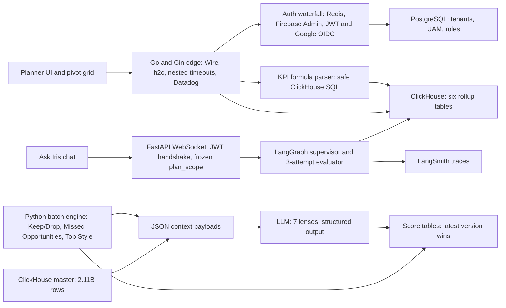
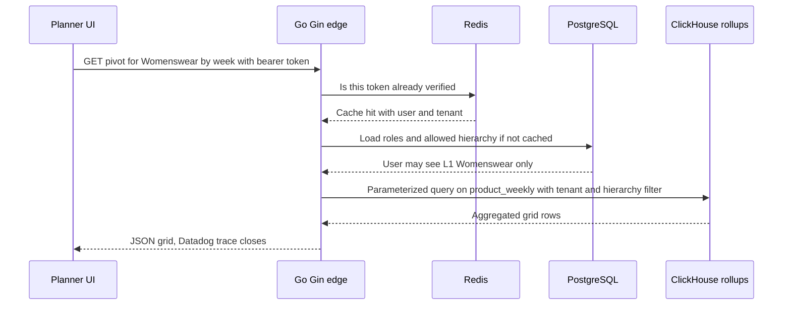
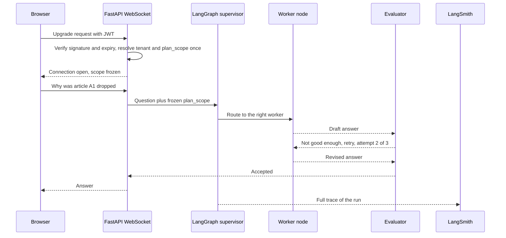
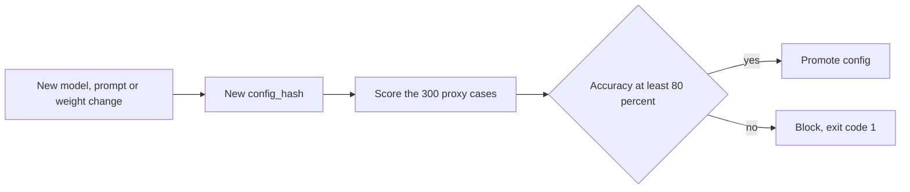
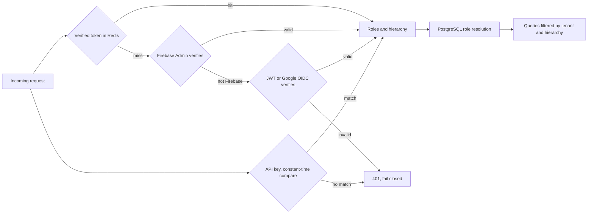
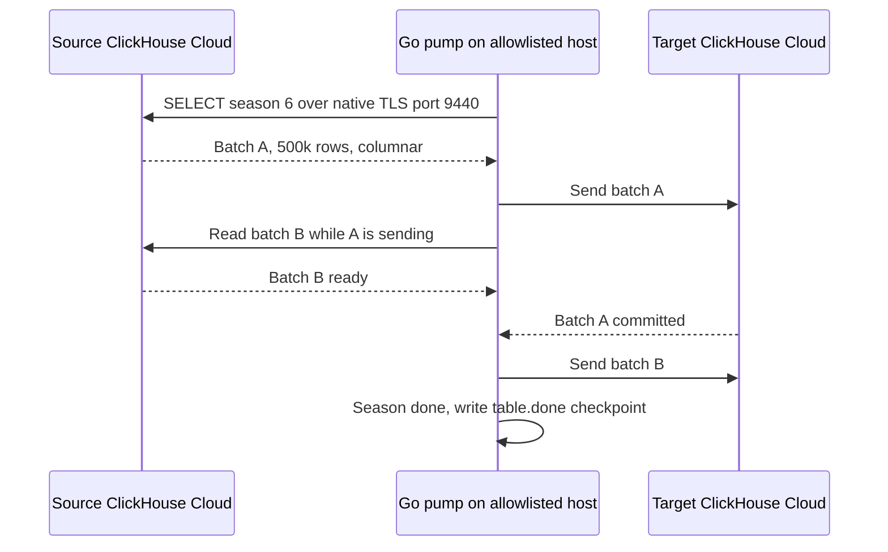

# Impact Analytics: AssortSmart deep dive (Final PyGo + AI)

<div class="callout highlight">
<b>How to use this page</b>
<ul>
<li><b>What it covers:</b> everything behind the ten Impact Analytics bullets on <code>Tarun_Mittal_SSE_5yr.pdf</code>. That means the business, the words, the architecture, how each mechanism works, why it was designed that way, and what every number means.</li>
<li><b>When to read it:</b> first, before the interview pack (<a href="23a_ia_interview_pack.md">23a</a>) and the bullet defense (<a href="43_ia_bullet_defense.md">43</a>). Those two assume you understand this page.</li>
<li><b>What to memorise:</b> the one-minute version, the ten "Numbers explained" cards, the "Say this / don't say this" box, and the 3-minute whiteboard script at the end.</li>
</ul>
</div>

<div class="callout note">
<b>How to read the tags on this page.</b>
<b>MEASURED</b> means there is a log, a benchmark report, a config file or code behind it.
<b>ESTIMATED</b> means it is arithmetic I can show on a whiteboard.
<b>TARGET</b> means a design goal, so say "targeting", never "achieved".
<b>HISTORICAL</b> means it comes from my past work records.
<b>VERBAL</b> means it is true but not printed on the PDF, so use it only when they dig.
</div>

<div class="callout warn">
<b>Never break these.</b>
The 300-case harness and the 80% bar are a <b>CI promotion gate</b>. They do not mean "all tenants are live at 80% accuracy".
The 73% cost cut and 100% coverage come from a <b>separate gold-200 benchmark</b>, not the 300-case file.
Ask Iris is <b>shipped</b> as a capability. There are no SLA or usage numbers, so do not invent them.
On the PDF: 10k peak RPS, 2.11B-row master, six rollup tables, 170GB OOM, about 344k rows/s, 4.09B rows, 348k article-seasons, 88k items per pass.
Off the PDF but true (VERBAL): $100 token spend per pass, the 1.6M article-season catalog, 100% Go statement coverage with 1,200+ tests, and the 55 GB / 16 GB OOM settings.
Cluster Recommendation Copilot and Hindsight are <b>verbal only</b>.
No Kafka, Flink, CDC, Kubernetes operations, Milvus, HITL review queues or sub-second ClickHouse claims on Impact Analytics. Kafka and Flink belong to Uber Menu.
Uber work was <b>via EPAM</b>. ANZ 99.9% is <b>HISTORICAL</b> Mobility work. Menu 98% is an <b>offline evaluation</b>.
</div>

**Stack in one line.** The agent plane is Python, FastAPI and LangGraph. The platform APIs are Go with the Gin framework. The data lives in ClickHouse (analytics), PostgreSQL (metadata, users and roles) and Redis (cache). Tracing is Datadog for the Go side and LangSmith for Ask Iris.

**Canonical sources.** Resume wording: [`docs/ASSORTSMART_TAB_RESUME.md`](../../docs/ASSORTSMART_TAB_RESUME.md). Keep/Drop pipeline reference: [`../docs/assort_kd_flow/PIPELINE.md`](../docs/assort_kd_flow/PIPELINE.md). ClickHouse rollups and the copier: [`42_clickhouse_rollup_migration.md`](42_clickhouse_rollup_migration.md). Postgres vs ClickHouse POC: [`19_ia_ch_pg_poc_source.md`](19_ia_ch_pg_poc_source.md) and [`21_ia_pivot_benchmark_source.md`](21_ia_pivot_benchmark_source.md).

---

## 1. The one-minute version (say this out loud)

"At Impact Analytics I'm a Senior Software Engineer on AssortSmart, a merchandise planning product for retailers. My work splits into two halves.

On the AI side, I built a decision engine that tells planners which products to keep or drop next season. It has evaluated 348k article-seasons, it processes 88k items per pass, and it blends hard KPI math with structured LLM calls across seven analytical lenses. The LLM never touches the 2.11-billion-row ClickHouse master directly. It only sees JSON we prepare, and if it times out we fall back to the deterministic score. I also shipped Ask Iris, a chat copilot over a JWT-secured WebSocket, built on a LangGraph supervisor with a three-attempt evaluator loop. Every model change has to pass an 80% accuracy CI gate on a 300-case evaluation set.

On the platform side, I built the multi-tenant Go and Gin API layer that handles 10k peak requests per second. I built ClickHouse rollups that took a planner pivot from 189 seconds to 12 seconds on a 250-million-row harness, and I fixed a 170 GB out-of-memory failure in the weekly rollup builds. I also wrote a Go data pump that copied rollups between ClickHouse Cloud clusters at about 344k rows per second."

**30-second version.** "I work on AssortSmart, retail assortment planning. I own a Go and Gin platform at 10k peak RPS and the ClickHouse layer under it, which took pivots from 189 seconds to 12 seconds. I also own the AI decision engine that scores keep or drop for 348k article-seasons, plus the Ask Iris copilot. The theme is the same on both sides: make it fast, make it safe for many tenants, and never let an LLM be the only thing standing between a planner and a wrong number."

---

## 2. The business in plain English

**Who the users are.** AssortSmart is a SaaS product sold to retailers. The daily users are **merchandise planners**. A planner owns a slice of the catalog, for example "Womenswear tops" across a set of stores. Every season they decide which products to carry forward, which to drop, and where there are gaps to fill.

**What they do.** Planners live in a **pivot grid**. That is a spreadsheet-like screen where rows are products or categories, columns are weeks, stores or channels, and each cell is a measure such as units sold, revenue, margin or sell-through. They slice, filter and drill all day.

**What hurt before.** Two things hurt. First, the grids were slow. When the data grew into hundreds of millions of rows, a heavy pivot on PostgreSQL could take minutes, which makes interactive planning impossible. Second, the keep or drop decision was manual and coarse. A planner with thousands of articles cannot look at size curves, colour cannibalisation, discount dependency and trend for every single one.

**Why the company paid for this.** A retailer that keeps a dying product ties up stock and ends up marking it down. A retailer that drops a product that would have sold loses revenue. Faster grids mean planners can actually explore the data. A trustworthy AI recommendation, with an explanation and a safe fallback, means they can cover the whole catalog instead of only the top sellers.

**Background you can mention (VERBAL).** Planner pivots were slow on PostgreSQL. We ran proof-of-concept benchmarks that compared Postgres and ClickHouse on row-identical data. ClickHouse won the large analytical reads. Postgres kept the thin metadata, the user access management data and the roles, and it still wins single-cell edits.

---

## 3. Words you need

Read this once. Every term below appears later on the page.

**Retail and product words**

- **Article.** One sellable product, such as "linen shirt, blue". Think of it as one row in the retailer's product catalog.
- **Article-season.** One article in one selling season, for example "linen shirt, blue, Summer 2025". It is the unit the engine scores, because the same shirt can be a hit one season and a dud the next. Think of a report card per student per school year.
- **Sell-through.** The share of available stock that actually sold. If a store had 100 units and sold 84, sell-through is 84%. High sell-through means demand was strong relative to stock. In the pipeline it is `100 × sold / (sold + units left at the end)`.
- **Rate of sale (ROS).** How many units an article sells per store per week while it is on sale. A ROS of 1.2 means "about 1.2 units per selling store-week".
- **Keep/Drop.** The core decision: carry this article into next season, or drop it.
- **Missed Opportunities and Top Style.** Two sibling pipelines. Missed Opportunities looks for products that should have been carried or stocked more. Top Style picks the top performers and writes a short tagline for each.
- **Product hierarchy (L0 to L4).** The category tree, for example Department, Class, Subclass. Planners are usually allowed to see only some branches.
- **Tenant.** One retailer customer on the shared platform. **Multi-tenant** means many retailers share the same services and databases, so isolation between them is critical. Think of an apartment building with one set of pipes and a lock on every door.
- **UAM (User Access Management).** The system that says which user may see which tenant, hierarchy branch and stores.

**AI words**

- **LLM (Large Language Model).** A model such as GPT that reads text and writes text.
- **Structured LLM invoke.** An LLM call where the output must match a strict JSON schema, for example `{"article": "A1", "score": 0.72, "confidence": 0.6}`. It is like a form with fixed boxes instead of a blank page.
- **Lens.** One focused analytical question the LLM answers about an article, such as "is weekly demand accelerating or dying?". Think of a panel of specialist doctors, each checking one organ. There are 7 active lenses.
- **Deterministic score (s_det).** A score computed by plain code from sell-through and rate of sale. Same input, same output, every time.
- **Agent score (s_agent).** A score built from the lens outputs, combined by a step called the **decider**.
- **Blend (s_final).** The final score: `s_final = 0.4 × s_det + 0.6 × s_agent`. Keep if `s_final` is at least 0.55.
- **LangGraph.** A Python library for building LLM workflows as a graph of steps (nodes) with edges between them, including loops. Think of a flowchart that can actually run.
- **LangGraph supervisor.** A node in the graph whose only job is routing. It reads the user's question and decides which worker node should handle it. Think of a hospital triage nurse.
- **Evaluator loop.** After a worker produces an answer, an evaluator step checks it. If it fails, the worker tries again, up to a fixed number of attempts. In Ask Iris, `MAX_ATTEMPTS = 3`. Think of a teacher who hands back homework at most three times and then accepts the best effort with a note.
- **LangSmith.** A tracing tool for LLM apps. It records every step, prompt, tool call, token count and latency of a run so you can debug it later.
- **Proxy evaluation harness.** A fixed set of test cases with known right answers that we run every model or prompt change against. "Proxy" because the labels come from what actually happened next season, not from a planner labelling them by hand.
- **CI gate.** An automated check in the build pipeline that blocks a change from being promoted if it fails. Ours requires at least 80% accuracy on the 300-case set.

**Reliability words**

- **Hard timeout.** A deadline after which a call is abandoned, no matter what.
- **Circuit breaker.** A guard that stops calling a failing dependency after too many failures in a row. It works like the breaker in your house: when there is a short, it trips and cuts power instead of letting the wires burn. Ours trips after about 5 consecutive failures or when too large a fraction of calls fail.
- **Checkpoint.** A saved progress marker so a crashed job can resume instead of starting over. Think of a save point in a video game.
- **config_hash.** A SHA-256 fingerprint of the frozen configuration: guardrails, parameters, prompts and catalog. **SHA-256** is a function that turns any input into a fixed 64-character fingerprint, and any tiny change in the input gives a completely different fingerprint. Stamping it on every output row is like printing the recipe card ID on every plate that leaves a kitchen.
- **Telemetry.** Numbers a system emits about itself. Ours is custom JSON with tokens, USD cost, step duration and batch fallbacks.

**Platform words**

- **Go and Gin.** Go is a compiled language from Google that is good at concurrent network services. Gin is a lightweight Go HTTP framework that handles routing and middleware.
- **Dependency injection (DI).** Instead of each component creating its own database client or cache, the components receive them from outside. It is like a restaurant where the kitchen hands each cook their tools instead of every cook buying their own.
- **Google Wire.** A Go tool that does dependency injection at **compile time**. It generates plain Go code that wires everything together, so a missing dependency is a build error instead of a crash at runtime.
- **Reverse proxy.** A server such as Nginx or Envoy that sits in front of your app and handles TLS, timeouts and limits for it. We deliberately did not use one in front of the Go edge.
- **h2c.** HTTP/2 over cleartext, meaning HTTP/2 without TLS on that hop. HTTP/2 lets many requests share one connection at the same time (multiplexing). It is like one phone line carrying many conversations instead of one call per line.
- **Nested timeouts.** Timeouts that fit inside each other. The server has an outer deadline, each request handler has a smaller budget, and each database call inside the handler has a smaller one still. Think of Russian dolls.
- **Distributed tracing.** Following one request across every service and database call it touches, with timing for each hop. Datadog is the tool we use for this on the Go side.
- **JWT (JSON Web Token).** A signed token that says who you are and what you can do, for example `{"sub": "user42", "tenant": "t7", "exp": 1760000000}` plus a signature. The server checks the signature and expiry without calling anyone. Think of a stamped wristband at a concert.
- **OIDC (OpenID Connect).** A standard login layer on top of OAuth 2.0. "Sign in with Google" is OIDC. Google returns a signed ID token that we can verify.
- **Firebase Admin.** Google's server-side SDK for verifying Firebase-issued login tokens.
- **Constant-time compare.** A way to compare two secrets that always takes the same time whether the first character or the last character differs. A normal `==` stops at the first mismatch, which leaks timing information an attacker can measure. Think of a bouncer who always reads your whole ID card, even when the first letter is already wrong.
- **WebSocket and the handshake.** A WebSocket is a long-lived two-way connection between browser and server, ideal for chat. It starts with an ordinary HTTP request asking to "upgrade" the connection. That first exchange is the **handshake**, and it is the natural moment to check the JWT and fix the user's permissions for the rest of the session.

**Data words**

- **ClickHouse.** A **columnar** analytical database. It stores each column separately and compressed, so a query that sums 3 columns out of 100 reads only those 3. Think of a library that shelves every chapter 1 together, every chapter 2 together, and so on, so "read all the chapter 3s" is fast.
- **MergeTree.** ClickHouse's main table engine. Each insert writes an immutable, sorted chunk called a **part**, and a background process merges parts into bigger ones. Think of sorted stacks of index cards that a clerk keeps merging into fewer, larger sorted stacks.
- **ReplacingMergeTree (RMT).** A MergeTree variant that keeps only the newest version of rows with the same key. Think of a notebook where you never erase. You just write the new value below, and a cleaner later crosses out the old lines. Until the cleaner comes, a reader can see both lines, so readers ask for "the latest one" explicitly.
- **Partition.** A physical slice of a table, for example all rows for one season. Our rollups use `PARTITION BY season_code`. Think of one drawer per season in a filing cabinet.
- **DROP PARTITION.** A ClickHouse command that deletes one whole partition at once. It is like pulling out one drawer and emptying it.
- **Rollup (pre-aggregation).** A table that stores already-summed results, for example weekly totals per product instead of every daily sale per store. Think of a monthly bank statement instead of every single card swipe.
- **INSERT SELECT.** A SQL statement that reads from one table, transforms the rows, and writes them into another in one go. Our rollups are built this way.
- **OOM (out of memory).** The process needs more RAM than it is allowed, so it is killed or the query fails. In ClickHouse the error is `MEMORY_LIMIT_EXCEEDED`.
- **Spill (external GROUP BY).** When an aggregation gets too big for memory, ClickHouse writes part of its working state to disk and continues. It is like moving overflow paperwork from your desk to the floor so you can keep working.
- **Native protocol.** ClickHouse's own binary TCP protocol, which moves data as columnar blocks. Port 9440 is native protocol over TLS. It is faster and leaner than the HTTP interface for bulk moves.
- **TLS.** The encryption layer used by HTTPS.
- **IP allowlist.** A list of network addresses allowed to connect to a server. Anything else is refused.
- **Double buffering.** Using two buffers so that while one batch is being sent, the next is already being read. Think of two trays in a kitchen. While one tray is being served, the next one is being filled.
- **Ghost rows.** Rows from a failed, partial write that are still sitting in the target table and make it look complete when it is not.
- **Ledger (checkpoint file).** A small file that records which units of work finished, so a restart knows what to skip.
- **BigQuery.** Google's serverless data warehouse. Good for large batch analytics. Its latency depends on shared compute slots, which makes it less predictable for interactive screens.

---

## 4. Architecture



*What to notice: there are two front doors (the Go edge for grids, the WebSocket for chat), and the LLM in the batch engine only ever receives JSON. There is no arrow from the LLM to the master table.*

**Walking the boxes.** A planner opens a pivot grid in the UI. The request hits the **Go and Gin edge** directly, with no reverse proxy in front. The edge authenticates through the **auth waterfall**, which checks Redis first and only then calls Firebase Admin or verifies a JWT or Google OIDC token. Roles and the user's allowed hierarchy come from **PostgreSQL**. If the grid has custom KPIs, the **formula parser** turns the operator's formula into a safe ClickHouse SQL fragment. The query then reads from one of the **six rollup tables** instead of raw daily data. Datadog traces the whole path.

The batch side runs separately. The **Python batch engine** reads the features it needs from ClickHouse, packs them into **JSON payloads**, and sends them to the LLM for the seven lenses. The scores come back as structured JSON, get blended with the deterministic score, and land in score tables where the newest version of each row wins.

**Ask Iris** is the chat door. The browser opens a WebSocket to a FastAPI service. The JWT is checked once at the handshake, the user's hierarchy scope is frozen for the session, and every question goes through a LangGraph supervisor and an evaluator loop capped at three attempts. LangSmith records each run.

---

## 5. One job, step by step

### 5a. One article through Keep/Drop (worked example)

Take one article-season: a cotton tee in one season. The numbers below come from the worked example in the pipeline reference.

1. **Features.** The engine reads the weekly rollup for this article and computes sell-through = 84% and rate of sale = 1.168 units per selling store-week.
2. **Deterministic score.** Each KPI is mapped to a 0 to 1 scale with a piecewise ramp. Sell-through 84 maps to about 0.583. ROS 1.168 maps to about 0.734. With weights 0.55 and 0.45, `s_det = 0.55 × 0.583 + 0.45 × 0.734 ≈ 0.65`. That is a "keep" on rules alone, because the deterministic threshold is 0.65.
3. **Lens gate.** A cheap Python check decides which lenses even make sense. The tee comes in several sizes and two colours and sold for 12 weeks, so size_curve, colour_cannibalization and trend_velocity are eligible. A single-size, single-colour sock that sold for 2 weeks would get only margin_resilience.
4. **Batch to the LLM.** The article joins a batch of up to 64 articles. The batch goes through a fixed order: peer benchmark, then decider, then lenses, then blend, then explanation. There is no LLM orchestrator choosing the order.
5. **Lens results.** Each lens returns structured JSON per article, such as a score, an outcome, a confidence and reason codes.
6. **s_agent.** The decider's weighted mixes of lenses are averaged into `s_agent`, say 0.711.
7. **Blend.** For the tee, `s_final = 0.4 × 0.65 + 0.6 × 0.711 ≈ 0.687`. That is above 0.55, so the outcome is keep.
8. **Explain.** A short planner-facing explanation is generated, with a template fallback if the LLM call fails.
9. **Stamp and write.** The row is stamped with `config_hash` and a timestamp and written out. If the same article is written twice, the latest version wins on read.

```text
article      season  sell_thru  ros    s_det  s_agent  s_final  outcome  config_hash
TEE-0412     S74     84.0       1.168  0.650  0.711    0.687    keep     9f2c...e1
```

*What to notice: the money math (sell-through, ROS, s_det) never depends on the LLM. The LLM adds judgement on top, and the blend keeps the rule score as an anchor. The sample row is illustrative.*

### 5b. One planner pivot request



*What to notice: the hierarchy filter is added by the server from the user's permissions, never from the request body, and the query reads a rollup instead of raw daily facts.*

---

## 6. Agentic Flows & Orchestration, bullet by bullet

### A1. The multi-pipeline decision engine

> **PDF:** Architected a multi-pipeline AI merchandise decision engine (Keep/Drop, Missed Opportunities, Top Style) evaluating 348k article-seasons. Optimized inference at scale, processing 88k items per pass, by blending deterministic KPI math with structured LLM invokes across 7 AI lenses.

**In plain words.** I built a batch system with three named pipelines, not one chatbot. For each product in each season it computes the hard numbers in code, then asks an LLM seven focused questions through structured calls, and combines both into a recommendation.

**How it works.**

- **Deterministic layer.** Python computes KPIs (sell-through, rate of sale) once, in one shared math module, so the number a planner sees and the number a test checks can never drift apart. This produces `s_det`.
- **The 7 active lenses.** trend_velocity (is demand accelerating or dying), size_curve (is the size distribution healthy), colour_cannibalization (do sibling colours steal demand), channel_divergence (online vs store), multi_season_consistency (repeat performer or one-off), discount_dependency (does it only sell on markdown), and margin_resilience (margin quality, which can never force a Drop on its own). An eighth, spatial_variance, exists but is switched off.
- **Gate first.** A cheap Python prefilter decides which lenses apply to each article, so we never pay for a size-curve call on a one-size product.
- **Fixed batch order.** peer benchmark, then decider, then lenses, then blend, then explanation. Batches are up to 64 articles per LLM call.
- **Blend.** `s_final = 0.4 × s_det + 0.6 × s_agent`, keep if `s_final ≥ 0.55`.

```python
# Illustrative sketch of the blend, not the production file
def s_final(s_det: float, s_agent: float, w_det=0.4, w_agent=0.6) -> float:
    total = w_det + w_agent
    return (w_det * s_det + w_agent * s_agent) / total

outcome = "keep" if s_final(0.737, 0.711) >= 0.55 else "drop"   # 0.721 -> keep
```

**Why this design.** LLMs are bad at arithmetic and good at pattern judgement. Keeping KPI math in code keeps it financially correct and auditable. The lenses do the qualitative work a planner would do by eye, such as "this colour is eating its sibling's sales".

**Alternatives and why not.**
- *Let the LLM compute KPIs with a Python or SQL tool.* Slower, non-deterministic, and a security surface at 88k items. Pre-computing is cheaper and exact.
- *One big prompt per article.* Harder to evaluate and debug. Seven narrow lenses each have a rubric, required evidence and forbidden moves, so a bad lens can be fixed alone.
- *Rules only.* Rules are coarse and tend to over-keep. The lens layer refines borderline cases.

**Trade-off.** More LLM calls per article than a single prompt, and more prompt files to version. The gate and 64-article batching keep that cost bounded.

**What I'd do differently.** Invest earlier in planner-labelled gold data, because proxy labels measure "did demand hold up", not "was this the right range decision".

**The numbers.** See cards N1 and N2 in section 8.

### A2. JSON payloads instead of database access, with a safe fallback

> **PDF:** Decoupled AI inference from a 2.11B-row ClickHouse master by asynchronously serving context via JSON payloads rather than direct database querying. Engineered an eventually consistent write pattern via ReplacingMergeTree that guaranteed system availability by gracefully falling back to deterministic baselines during LLM timeouts.

**In plain words.** The LLM never gets a database tool. We run the queries ourselves, pack exactly what each lens needs into JSON, and send that. Results are written so that duplicates are harmless. If the LLM is slow or down, the article still has its rule-based score, so the run never stalls.

**How it works.**

1. Feature SQL aggregates the weekly table into one row per article. A compact step trims it to only the fields a lens needs, and only the last 12 weeks for time-series lenses, to keep prompts small.
2. The JSON goes to the LLM. The response must match a schema.
3. Every call has a hard timeout. The pipeline reference scales it with batch size: `timeout = min(600, 60 + 8 × articles)` seconds, so a 64-article batch gets 572 seconds.
4. On timeout or error, that batch is marked as a fallback. The deterministic score was already computed first, so the article keeps its baseline instead of blocking the other 88k items.
5. Writes go to ReplacingMergeTree tables keyed by article and season, versioned by a timestamp. A retry that lands twice is harmless, because readers always take the latest version.

```json
{
  "article": "TEE-0412",
  "season": 74,
  "kpis": {"sell_thru_eop_pct": 84.0, "ros": 1.168},
  "week_series": [{"w": 1, "qty": 210, "disc": 0.0}, {"w": 2, "qty": 238, "disc": 0.0}],
  "size_count": 5,
  "style_color_count": 2
}
```

```sql
-- Illustrative ReplacingMergeTree score table and the "latest wins" read
CREATE TABLE reco_final_score
(
  season_code Int64, article String,
  s_det Float64, s_agent Float64, s_final Float64,
  outcome Enum8('keep' = 1, 'drop' = 2),
  config_hash FixedString(64), computed_at DateTime64(3)
)
ENGINE = ReplacingMergeTree(computed_at)
ORDER BY (season_code, article);

SELECT article, argMax(outcome, computed_at) AS outcome
FROM reco_final_score
WHERE season_code = 74
GROUP BY article;
```

*`argMax(outcome, computed_at)` means "give me the outcome from the row with the newest computed_at". It is the reader's way of crossing out old notebook lines without waiting for the background cleaner.*

**Why this design.** Letting an LLM issue SQL against a 2.11B-row production table invites runaway queries, connection-pool exhaustion and prompt-injection risk. A hallucinated query must never be able to scan or write the master. JSON in and engine writes out is the isolation invariant.

**Alternatives and why not.**
- *Give the agent a SQL tool.* Rejected for the safety reasons above, and because cost and latency become unpredictable.
- *Plain MergeTree plus delete-then-insert on retry.* Deletes in ClickHouse are heavy mutations. Append-and-latest-wins is cheaper and survives overlapping retries.
- *Block the run until the LLM answers.* One provider 504 would stall a whole pass.

**Trade-off.** Eventually consistent means that for a short while two versions of a row can exist. Readers must use `argMax` or `LIMIT 1 BY` instead of assuming one row per key. We do not depend on `OPTIMIZE FINAL` at runtime. Packing JSON is also an extra hop.

**Say this carefully.** "Async" on the PDF describes how the batches run. It does not mean the LLM queries ClickHouse in the background. On the Keep/Drop path specifically, the scoring engines write staging CSVs first and an operator step publishes them to ClickHouse, so a bad config is visible in a CSV diff before planners ever see it. I did not author the `pg2ch_cdc` sync pipeline (that was Ashvin Sharma).

**What I'd do differently.** Make the versioned-table strategy uniform across every score table from day one, so readers never need a dedupe view as a stopgap.

### A3. The shared orchestration registry

> **PDF:** Engineered a shared orchestration registry to guarantee 88k-article batch runs survive provider failures by implementing hard timeouts, circuit breakers, and durable checkpoints that bypass redundant deterministic scoring. Ensured full observability by stamping every output row with a frozen config hash and custom JSON telemetry tracking tokens, USD cost, step duration, and batch fallbacks.

**In plain words.** All three pipelines run on one shared harness. It freezes the config, runs LLM batches with deadlines, stops calling a provider that keeps failing, saves progress so a crash resumes instead of restarting, and records exactly what each run cost and which config produced each row.

**How it works.**

- **Hard timeouts** on every LLM batch, as described in A2.
- **Circuit breaker.** A deterministic run controller, not an agent, trips the step when the failure streak reaches about 5 in a row or the failure fraction passes a threshold (0.25 in the pipeline config). CLI exit code 4 means "circuit open".
- **Durable checkpoints.** Deterministic results land first in `det.json`. As LLM chunks finish, per-article progress is appended to `agent_progress.json`. Running with `--resume` reloads the deterministic results, skips finished articles and continues the LLM phase. That is what "bypass redundant deterministic scoring" means.
- **config_hash.** A SHA-256 of the frozen guardrails, parameters, prompts and catalog. Because prompt text is inside the hash, editing one word of a prompt produces a new hash.
- **JSON telemetry.** Per run: tokens, USD cost, step duration and batch fallbacks.

```python
# Illustrative sketch of the breaker and the config hash
import hashlib, json

class CircuitBreaker:
    def __init__(self, max_consecutive=5, max_fail_fraction=0.25):
        self.streak = self.fails = self.calls = 0
        self.max_consecutive, self.max_fail_fraction = max_consecutive, max_fail_fraction

    def record(self, ok: bool) -> None:
        self.calls += 1
        self.streak = 0 if ok else self.streak + 1
        self.fails += 0 if ok else 1
        if self.streak >= self.max_consecutive or self.fails / self.calls > self.max_fail_fraction:
            raise RuntimeError("circuit open")

def config_hash(guardrails, params, prompts, catalog) -> str:
    blob = json.dumps([guardrails, params, prompts, catalog], sort_keys=True)
    return hashlib.sha256(blob.encode()).hexdigest()   # 64 hex characters
```

```text
Run 1 crashes at article 61,200 of 88,000
det.json              -> all 88,000 deterministic scores, saved first
agent_progress.json   -> 61,200 articles done
Run 2 with --resume   -> loads det.json, skips 61,200, scores the remaining 26,800
```

*The example run sizes are illustrative. The mechanism is real.*

**Why this design.** A provider 502 or 504 halfway through 88k items must not force a full recompute. And when a planner asks "why did this article get dropped?", we need to know exactly which prompts and parameters produced that row. The config hash answers that.

**Alternatives and why not.**
- *Airflow or Temporal.* Both are good orchestrators. This workload needed resume logic that is tightly coupled to ClickHouse inserts, config hashing and per-run token and USD accounting. We already owned a batch CLI and an HTTP start path, so adding a heavy external orchestrator was extra infrastructure that was not justified.
- *Retry everything forever.* Wastes money and hides a dead provider. The breaker fails fast.
- *Store a run UUID instead of a config hash.* A UUID tells you which run, not which config. Two runs with the same config share a hash, which is what you want for comparisons.

**Trade-off.** We own the orchestration code, so we own its bugs. There is no built-in UI like Airflow's.

**Say this carefully.** There is no LLM orchestrator in Keep/Drop. The batch order is fixed in code. There are no human review (HITL) queues. Offline evals replaced the earlier critic and evaluator agents in Keep/Drop. LangSmith is not on this bullet. LangSmith is for Ask Iris. Do not call the breaker "Netflix Hystrix".

**What I'd do differently.** Turn the run ledger and CSV telemetry on by default from the start, so every run has a cost trail without a flag.

### A4. Ask Iris, the planner copilot

> **PDF:** Shipped "Ask Iris," a JWT-secured WebSocket copilot enabling planners to interactively query KPIs and inspect AI decisions on a multi-billion-row database. Prevented infinite LLM loops and multi-tenant data leaks by orchestrating a LangGraph supervisor with a 3-attempt evaluator loop, utilizing LangSmith for observability, and strictly freezing hierarchy access on the initial socket handshake.

**In plain words.** Ask Iris is a chat assistant inside AssortSmart. A planner can ask "what was sell-through for linen shirts last season?" or "why did the engine drop this article?". It runs over a WebSocket, checks the user's identity once when the connection opens, locks their permissions for the whole session, and cannot loop forever.

**How it works.**



*What to notice: the scope is decided once at the top and never re-read from chat messages. The retry loop has a hard ceiling.*

1. **Handshake.** The JWT arrives as `Authorization: Bearer ...` or a `?token=` query parameter. The server verifies it, resolves the tenant and hierarchy, and stores `plan_scope` on the session. It is never changed afterwards.
2. **Supervisor.** Each question goes to a LangGraph supervisor that routes to the right worker.
3. **Evaluator loop.** The evaluator checks the worker's answer. On failure it retries, up to `MAX_ATTEMPTS = 3`. A recursion limit on the graph is a second safety net. After that it fails closed with a graceful message instead of another tool hop.
4. **Scope inheritance.** Every tool call inherits the frozen `plan_scope`. A later chat message saying "now show me the other retailer" cannot widen it.
5. **LangSmith** records every run: prompts, tool calls, tokens and latency.

```python
# Illustrative sketch of the handshake freeze and the attempt cap
MAX_ATTEMPTS = 3

@app.websocket("/iris")
async def iris(ws: WebSocket):
    claims = verify_jwt(token_from(ws))              # reject before accept if invalid
    session = Session(plan_scope=resolve_scope(claims))   # frozen for the session
    await ws.accept()
    async for msg in ws.iter_text():
        for attempt in range(1, MAX_ATTEMPTS + 1):
            draft = await graph.ainvoke({"q": msg, "scope": session.plan_scope})
            if evaluator_ok(draft):
                break
        await ws.send_text(draft["answer"])
```

**Why this design.** A chat session is both a tenant-leak surface and a token-burning surface. If scope can be changed mid-conversation, one clever prompt can pivot into another tenant's data. If the agent can retry forever, one confusing question can burn money in a loop.

**Alternatives and why not.**
- *Check permissions on every message.* Works, but it means scope can depend on message content. Freezing at the handshake makes it structurally impossible to widen scope later.
- *Plain HTTP request and response.* Chat with streaming and back-and-forth is more natural over a WebSocket, and the handshake gives one clear auth moment.
- *Uncapped agent loop.* Rejected because of the cost and runaway risk.

**Trade-off.** If a user's permissions change mid-session, the session keeps the old scope until they reconnect. A cap of 3 attempts means some hard questions get a "best effort" answer instead of a perfect one.

**Say this carefully.** Ask Iris is shipped as a capability. I have no SLA, questions-per-week or "every planner uses it daily" numbers, so I don't quote any. "Generate dynamic charts" was dropped from the PDF, so don't claim it. No human review queue.

**What I'd do differently.** Instrument usage from day one so I could quote adoption numbers honestly.

### A5. The evaluation harness, the CI gate and the cost cut

> **PDF:** Built a 300-case proxy evaluation harness and an 80% accuracy CI gate to enforce strict deployment guardrails. Reduced live execution costs by 73% at 100% coverage by benchmarking models against a 74% deterministic baseline, strategically freezing final decision weights when the LLM underperformed the baseline.

**In plain words.** Before any model, prompt or weight change goes live, it must score at least 80% on a fixed set of 300 test cases. Separately, I benchmarked candidate models on a 200-case gold set and picked one that was 73% cheaper while completing every case. When the blended LLM score did worse than the plain rule score on that set, I froze the blend weights instead of tuning them to a small sample.

**Two different test sets. Never fuse them.**

| Set | Size | What it is used for | Key numbers |
|---|---|---|---|
| Proxy gold (`cases.json`) | 300 cases, 150 keep and 150 drop | CI promotion gate | gate `gold_min_accuracy = 0.8` |
| Gold-200 benchmark | 200 cases | Model selection and baseline | 73% cheaper, 200 of 200 complete, deterministic 74%, blend about 63% |

**How the 300-case proxy set is built.** The pipeline scores season A. The labels come only from season B, the next season, which the pipeline never sees. An article is labelled DROP if its season-B sell-through and rate of sale are both weak, and KEEP if both are strong. Everything in between is skipped on purpose. Two traps are designed out. *Circularity*: labelling on season-A numbers would grade the pipeline against its own inputs. *Treatment leakage*: an article a planner already dropped sells zero next season by construction, so the builder requires the article to have been stocked for enough store-weeks in season B.



*What to notice: the gate refuses a bad config. Failing the gate is the system working, not breaking.*

**How the 73% was found.** On the gold-200 set we compared candidate models. `gpt-5.6-luna` completed 200 of 200 cases with 100% lens coverage and cost 73% less than `gpt-5.4-mini`. A nano-tier model was slightly cheaper but left pending rows, so completion reliability won. The model names are not on the PDF.

**Why the weights were frozen.** On that same 200 set, the deterministic rule at the production threshold of 0.65 scored 74%. The blended LLM scored about 63%, below the free rule. The tempting move is to retune the 0.4 and 0.6 weights until the number looks better. On a 200-case proxy set that is overfitting. We held the weights frozen and treated the gap as a signal to improve lenses and labels.

**Why this design.** LLMs are non-deterministic and the output is money. Evals tell you whether a change made decisions better, not just different. A free rule is the honest baseline: if a paid model cannot beat it, the model has not earned more weight.

**Alternatives and why not.**
- *Online critic or evaluator agents in the batch.* Earlier designs had them. They mostly moved confidence and rarely changed the decision, so offline evals replaced them.
- *Human review queues.* Not in this system. Do not claim them.
- *Accuracy only.* Accuracy alone hides over-keeping. A mostly-keep set can clear 80% while missing half the drops. The config supports a drop-recall gate for that reason.

**Trade-off.** Proxy labels are weaker than planner labels. A strict gate can block a change that a planner would have liked. Both are acceptable costs for not shipping a regression.

**Know this, don't volunteer it (VERBAL).** The pipeline's documented weakness is over-keeping: on an early run against older decisions it caught very few true drops, which is why drop recall matters more than raw accuracy. If they dig into failure modes, this is an honest, strong answer.

**What I'd do differently.** Raise the drop-recall gate above zero early, and move to planner-labelled gold as soon as labels exist.

---

## 7. Core Infrastructure & Pipeline, bullet by bullet

### C1. The Go and Gin platform at 10k peak RPS

> **PDF:** Architected a multi-tenant Go/Gin platform scaling to 10k peak RPS, utilizing Google Wire for compile-time DI. Deployed as a self-protecting HTTP edge without a reverse proxy, guaranteeing high availability through native h2c, nested timeouts, and Datadog distributed tracing.

**In plain words.** The API layer that the planner UI talks to is a Go service. It is the first thing a request hits, with no Nginx or Envoy in front, so the service itself has to protect itself with limits, deadlines and graceful shutdown.

**How it works.**

- **Wire** generates the wiring code at build time.
- **h2c** serves HTTP/2 without TLS on the internal hop, so many requests multiplex over few connections.
- **Nested timeouts**: server read and write deadlines on the outside, a per-request context budget inside, and a smaller budget again for each ClickHouse or Postgres call.
- **Self-protection**: a request body size cap, and a SIGTERM drain so in-flight requests finish before a deploy kills the process.
- **Datadog tracing** across handler, cache and database spans. Structured JSON logs carry tenant_id, trace_id and service.

```go
// Illustrative sketch: Wire, h2c and nested timeouts
func InitServer() (*http.Server, error) {
	wire.Build(NewConfig, NewRedis, NewPostgres, NewClickHouse, NewAuth, NewRouter, NewServer)
	return nil, nil // wire_gen.go replaces this at build time
}

func NewServer(r *gin.Engine) *http.Server {
	return &http.Server{
		Handler:           h2c.NewHandler(r, &http2.Server{}),
		ReadHeaderTimeout: 5 * time.Second,  // outer doll
		WriteTimeout:      30 * time.Second,
	}
}

func pivot(c *gin.Context) {
	ctx, cancel := context.WithTimeout(c.Request.Context(), 20*time.Second) // middle doll
	defer cancel()
	qctx, qcancel := context.WithTimeout(ctx, 15*time.Second) // inner doll: the ClickHouse call
	defer qcancel()
	rows, err := ch.Query(qctx, sql, args...)
	// ...
}
```

*The timeout values are illustrative. The pattern is the point: each inner deadline is shorter than the one around it, so a slow query fails cleanly before the server gives up on the connection.*

**Why this design.** Compile-time DI means wiring mistakes fail the build, not a request at 2 a.m., and there is no reflection at runtime. Without a reverse proxy there is one less network hop and one less piece of infrastructure, and the process itself owns h2c, deadlines and traces, so behaviour is visible in one place.

**Alternatives and why not.**
- *Uber Fx or Dig.* Runtime DI using reflection. Errors show up at startup or at runtime instead of at build time.
- *Nginx or Envoy in front.* Totally valid. It adds a hop and a config surface, and splits timeout logic across two systems.
- *HTTP/1.1 only.* Works, but needs more connections for the same concurrency.

**Trade-off.** The service owns limits, caps and graceful shutdown itself. If you get one wrong there is no proxy to catch it.

**Say this carefully.** 10k peak RPS is the figure from the AssortSmart platform record on the PDF. I don't attach an uptime percentage, a 99.9% SLA or a tenant count to it. I don't claim Kubernetes cluster operations. Don't claim Datadog trace-ID injection into logs unless you're sure.

**What I'd do differently.** If the platform went multi-region, I'd revisit a managed load balancer at the edge, because cross-region routing is not something the app process should own.

### C2. The KPI configurator and formula parser

> **PDF:** Eliminated deployment bottlenecks by architecting a dynamic KPI configurator and custom formula parser. Engineered a real-time compilation layer that tokenizes operator-authored math into parameterized ClickHouse SQL fragments with native division-by-zero protection, decoupling business logic from code releases.

**In plain words.** Merchandising teams constantly want new KPIs, like "sell-through excluding markdown weeks". Before, each new formula meant a code change and a release. Now an operator types the formula, and a Go parser turns it into safe ClickHouse SQL on the fly.

**How it works.**

1. **Tokenize.** Split the text into tokens: names, numbers, operators, parentheses, function names.
2. **Parse.** Build a tree and check the grammar.
3. **Resolve names.** Logical names such as `units_sold` map to physical columns or expressions through a catalog. An unknown name is an error.
4. **Allowlist functions.** Only approved functions are accepted.
5. **Parameterize.** Literal constants become bound parameters, never string-concatenated.
6. **Wrap.** The final expression is wrapped as `ifNotFinite(toFloat64(<expr>), 0)` so a division by zero returns 0 instead of Infinity or NaN.
7. **Fail closed.** Any unknown token, function or name rejects the whole formula.

```text
Operator types:   sell_through = units_sold / (units_sold + eop_units) * 100
Tokens:           IDENT  /  (  IDENT  +  IDENT  )  *  NUMBER
Generated SQL:    ifNotFinite(toFloat64(sum(qty) / (sum(qty) + sum(eop_units)) * {p1:Float64}), 0)
Params:           p1 = 100

Operator types:   units_sold; DROP TABLE x
Result:           rejected, unknown token ";"   (fail closed)
```

*`ifNotFinite(x, 0)` is a ClickHouse function that returns 0 when x is Infinity or NaN. It is the "native division-by-zero protection" on the PDF.*

**Why this design.** It decouples business formulas from code releases. A merchandising change no longer waits for an engineering sprint, and one bad formula cannot inject SQL or poison the planner's JSON with NaN.

**Alternatives and why not.**
- *Let operators paste SQL.* An injection risk and a support nightmare.
- *Hardcode every KPI in Go.* Safe but slow to change. It was the bottleneck we removed.
- *Evaluate formulas in Go after fetching raw rows.* Pulls far too much data out of ClickHouse. Pushing the math into SQL keeps the aggregation where the data is.

**Trade-off.** We own a small language. The grammar has to stay small and well tested, and error messages have to be good enough for non-engineers.

**Say this carefully.** Operators cannot paste arbitrary SQL. If they push on implementation, the guard is parse plus allowlist plus catalog resolution plus `ifNotFinite`. It is not a generic prepared statement around free-form SQL.

### C3. Multi-tenant isolation and the auth waterfall

> **PDF:** Guaranteed strict multi-tenant data isolation and UAM-scoped hierarchy access control across PostgreSQL and ClickHouse. Redis-fronted Firebase Admin to JWT/Google OIDC waterfall, constant-time API keys, Postgres-backed role resolution.

**In plain words.** Every request proves who it is through one of several login methods, tried in order, with Redis caching the answer so we don't re-verify on every call. Then Postgres says which tenant, roles and hierarchy branches that user may see, and every query to Postgres or ClickHouse is filtered to exactly that.

**How it works.**



*What to notice: a Redis miss falls through to real verification. It never "fails open" and lets the request in.*

```go
// Constant-time API key check (standard library)
import "crypto/subtle"

func keyMatches(given, stored []byte) bool {
	return subtle.ConstantTimeCompare(given, stored) == 1
}
```

**Example.** A planner's role says L1 = Womenswear, stores in region North. The server adds `tenant_id = 't7' AND l1_name IN ('Womenswear')` as bound parameters to every ClickHouse query, using the same tenant ID that Postgres uses for identity. The request body can never widen that.

**Why this design.** Customers authenticate in different ways, so a waterfall supports all of them in one place. Redis keeps auth latency low without calling Firebase or Google on every API call. Constant-time compare closes a timing side channel on API keys. Postgres is the natural home for roles because they are small, relational and edited transactionally.

**Alternatives and why not.**
- *Separate databases per tenant.* Strongest isolation but heavy to operate for many tenants and wasteful for small ones.
- *ClickHouse row policies alone.* Useful, but the app still has to know the user's hierarchy, which lives in Postgres.
- *No cache.* Every request would pay a network call to the identity provider.

**Trade-off.** Cached auth means a revoked token can live until its cache entry expires, so cache lifetimes have to be short.

**Say this carefully.** This is access control and data isolation. It is not encryption and not a privacy program. Keep the Redis speed-up qualitative ("Redis-fronted"). Don't quote a sub-millisecond SLA. Milvus is Uber Menu, not this bullet.

### C4. ClickHouse rollups: 189 seconds to 12 seconds, and the 170 GB OOM

> **PDF:** Reduced planner pivot latency by 15.5× (189s to 12s on 250M-row operations) by building a ClickHouse pre-aggregation layer for season and weekly rollups. Prevented 170GB OOM crashes by slicing batch inserts into temporal chunks and enforcing strict distributed memory and disk-spill caps.

This bullet is two different stories. Say so unprompted.

**Story one: query time (the 15.5×).**

*In plain words.* Planners cannot run a GROUP BY over raw daily sales for every store on every chart. We pay the cost once at load time and serve pivots from pre-aggregated rollup tables in ClickHouse.

*The six rollup tables.* All are MergeTree and all are `PARTITION BY season_code`.

| Grain | Product (keeps SKU dimensions) | Store (no SKU, two-pass totals) | Attribute (unpivoted, about 5× product weekly) |
|---|---|---|---|
| Season | product_season | store_season | attr_season |
| Weekly | product_weekly | store_weekly | attr_weekly |

The product tables keep SKU-level dimensions. The store tables drop SKU detail and re-weight so store totals equal the sum of SKUs. The attribute tables "unpivot" attributes such as fabric or fit into rows, which is why attr_weekly is the largest object. We validate that product, store and attribute totals match at the same filters.

```sql
-- Illustrative shape of one rollup table
CREATE TABLE product_weekly
(
  season_code Int64, fiscal_year_week Int32, article String,
  l1_name String, l2_name String,
  qty Float64, revenue Float64, margin Float64
)
ENGINE = MergeTree
PARTITION BY season_code
ORDER BY (l1_name, l2_name, article, fiscal_year_week);
```

*What the 189 seconds and 12 seconds actually are.* They come from a controlled proof-of-concept harness at 250 million rows. The same heavy pivot (a grid with contribution percentage and an option count, joined across hierarchy, cluster and calendar) ran on row-identical data in both engines. PostgreSQL took 189 seconds and spilled 42 GB of sort files to disk. ClickHouse took 12.3 seconds, which the PDF rounds to 12. The hardware favoured Postgres: Postgres ran on a 48 GB host while ClickHouse was boxed in a 10-CPU, 3.3 GB Docker VM, and ClickHouse still won. That measured gap is why planner pivots moved to ClickHouse, and the rollup layer is how that read path is served.

*The honest caveat (VERBAL).* Most of the 13 to 15× gap comes from one thing. Postgres cannot parallelise a grouped `COUNT(DISTINCT)` (the option count), while ClickHouse runs it in parallel. Strip the distinct count and ClickHouse's lead on typical aggregates is about 2 to 3×. Our grid includes the option count, so the larger figure applies to it. Know this. It makes you sound careful, not weak.

**Story two: load time (the 170 GB OOM).**

*In plain words.* Building the weekly rollups for a whole season in one `INSERT SELECT` needed about 170 GB of memory for the aggregation state, and ClickHouse killed the query. I changed the unit of work from "one season" to "one fiscal week" and added hard memory and disk-spill caps.

*Why it used so much memory.* ClickHouse keeps an in-memory state for every group while it aggregates. A weekly rollup has many groups (article × store × week) and about 110 `any()` states plus `argMax` and `argMin` over wide strings. For a whole season that state was estimated around 170 GB. It failed with `MEMORY_LIMIT_EXCEEDED` even at 80 GB and again at 200 GB caps. The replica has about 59 cores and 234 to 236 GiB of RAM.

*How I debugged it.* I profiled by grain instead of raising memory. One product week peaked around 11 GB. One attribute week peaked above 40 GB, so even a 40 GB cap was too low for attribute weeks.

*The fix (VERBAL knobs).* One fiscal week per INSERT. A 55 GB memory cap. 16 GB before spilling to disk. 8 threads. 4 weeks in flight at once. Don't raise season parallelism and week parallelism together on the same box.

```sql
-- Illustrative: one fiscal week per insert, with memory and spill caps
INSERT INTO attr_weekly
SELECT season_code, fiscal_year_week, article, attr_name, attr_value,
       sum(qty) AS qty, sum(revenue) AS revenue
FROM daily_facts ARRAY JOIN attr_pairs
WHERE season_code = 7 AND fiscal_year_week = 202614
GROUP BY season_code, fiscal_year_week, article, attr_name, attr_value
SETTINGS max_memory_usage = 55000000000,
         max_bytes_before_external_group_by = 16000000000,
         max_threads = 8;
```

*The trap.* "So fixing the OOM is why pivots got 15.5× faster?" No. The OOM fix is load time. The 15.5× is query time on a different harness. They are not cause and effect.

**Why this design.** Pay once at load, read cheaply many times. Partitioning by season lets a planner's query read only the season it needs. Week slicing keeps memory bounded and predictable.

**Alternatives and why not.**
- *Query daily facts on every request.* Too slow at this scale.
- *`FINAL` on ReplacingMergeTree at read time.* It does not use projections and adds a read tax.
- *Just buy more RAM.* It failed at 200 GB anyway. The unit of work was the problem.
- *Materialized views per event.* Possible, but our sources arrive in batches and the incremental design was not executed.

**Trade-off.** More, smaller inserts take longer end to end and need tracking so you know which weeks are done (see the TSV ledger in C5).

**Say this carefully.** No sub-second pivot claims. 189 seconds to 12 seconds is a measured POC result on a 250M-row harness, not a production p95. 4.09B belongs to C5, not this bullet.

**What I'd do differently.** Profile memory per unit of work before the first full-season run, not after the first OOM.

### C5. The Go native-TLS data pump

> **PDF:** Migrated ClickHouse rollups across Cloud clusters at ~344k rows/s by writing a custom Go native-TLS data pump to bypass strict cross-cluster IP allowlist restrictions. Processed partitions up to 4.09B rows using 500k-row double-buffered batches, and eliminated partial-commit ghost rows using TSV ledgers and atomic partition rollbacks.

**In plain words.** We needed to copy the rollup tables from one ClickHouse Cloud cluster to another. The clusters could not talk to each other directly because of IP allowlists, but an allowlisted operator machine could reach both. So I wrote a Go program that reads from the source and writes to the target over ClickHouse's native protocol, in big columnar batches, with careful bookkeeping so a crash never leaves half-copied data looking complete.

**How it works.**



*What to notice: reading the next batch overlaps sending the previous one. That overlap is double buffering, and it is where the throughput comes from.*

1. **Unit of work = one season partition.** Each worker copies one season with its own source and target connections. `-workers N` copies N seasons in parallel.
2. **Columnar batches of 500,000 rows.** Values go into typed column buffers and are sent as one block. There is no per-row reflection.
3. **Double buffering.** Two buffer sets. While batch A is sending, batch B is being read. This also fixed an earlier problem where an idle SELECT stream over HTTP hit an unexpected EOF while waiting for an INSERT to finish.
4. **Never retry a spent batch.** A batch whose send failed may be partly committed. Retrying it can duplicate rows. Instead, restart the whole season.
5. **Checkpoints.** The copier writes `migrate-checkpoints/<table>.done` per finished season. SIGINT finishes the in-flight batch but does not checkpoint that season. A per-table file lock stops two terminals copying the same table.
6. **Partition rollback.** If a season was not checkpointed and the target already has rows for it, run `DROP PARTITION` for that season and recopy it from scratch.

```go
// Illustrative double-buffer loop
const batchSize = 500_000
bufs := [2]*Batch{newBatch(), newBatch()}
cur := 0
sendDone := make(chan error, 1)
sendDone <- nil
for rows.Next() {
	bufs[cur].Append(rows)
	if bufs[cur].Len() == batchSize {
		if err := <-sendDone; err != nil { return err } // previous send must finish
		b := bufs[cur]
		go func() { sendDone <- b.Send() }()          // send A while we fill B
		cur ^= 1
		bufs[cur].Reset()
	}
}
```

```sql
-- Restart an incomplete season
ALTER TABLE attr_weekly DROP PARTITION 7;
-- then recopy season 7 from the source
```

**What the TSV ledger is.** It belongs to the weekly *loader*, not the copier. A failed weekly HTTP INSERT can still commit some blocks. Once, a half-loaded partition of 64.1M rows passed a "skip if the partition has rows" check. The fix: the loader keeps a TSV file of finished `(kind, season_code)` units, confirms each insert in `system.query_log` (QueryFinish) instead of trusting the HTTP client's exit code, and if a unit is missing from the ledger it drops that season's partition and rebuilds. Lesson: `count() > 0` is not proof of success.

**Why this design.** Cluster-to-cluster copy was blocked by allowlists. The operator IP was allowed. The native protocol moves columnar blocks efficiently. Season partitions are a natural restart unit.

**Alternatives and why not.**
- *Server-to-server `INSERT SELECT` from a remote table function.* The right answer if the clusters can be allowlisted to each other. They could not. (The PDF does not name the remote function. You can explain the allowlist workaround if asked why a laptop-class pump.)
- *Export to object storage and re-import.* Valid, and a good production choice. More moving parts for this one-time move.
- *HTTP interface.* Slower for bulk data and caused the idle-stream EOF.

**Trade-off and biggest risk.** There is no atomic swap. If the pump crashes mid-season, the target has a truncated season until DROP and recopy, and target readers could see partial data during that window. An incremental design using `REPLACE PARTITION` from scratch tables (a true swap) was written but not executed.

**Say this carefully.** 344k is rows per second of data ingest, not HTTP requests per second or transactions per second. 4.09B was measured in flight, so do not say the cutover finished. "Atomic partition rollback" on the PDF means DROP PARTITION then recopy, not an atomic swap with live readers. Never suggest open-sourcing the copier. Never share cluster hosts or passwords.

**What I'd do differently.** For a production cutover, get the clusters allowlisted to each other or go through object storage, and run the `REPLACE PARTITION` swap design so readers never see a partial season.

---

## 8. Numbers explained

Each card answers: what it measures, how it was derived, why it mattered, how to say it, and what not to say.

**N1. 348k article-seasons (MEASURED, on PDF)**
- *Measures:* the number of article-season combinations the decision engine has evaluated.
- *Derived from:* the scored Keep/Drop volume in the score tables.
- *Why it mattered:* it shows the engine runs across the real catalog, not a demo slice.
- *Say:* "The engine has evaluated 348 thousand article-seasons."
- *Don't say:* that it equals the 1.6M catalog. 1.6M (VERBAL) is the full product × season catalog. They are different numbers.

**N2. 88k items per pass and 7 lenses (MEASURED, on PDF), plus $100 per pass (VERBAL)**
- *Measures:* how many articles one batch run processes, and how many analytical lenses can fire per article.
- *Derived from:* the size of one batch run. Token spend per pass was about $100 (VERBAL, off the PDF).
- *Why it mattered:* it shows the cost and rate-limit design works at real scale.
- *Say:* "One pass processes about 88 thousand items, across seven lenses." Only mention the $100 if they ask about cost.
- *Don't say:* that every lens fires on every article (the gate skips lenses without data). Don't invent how many passes make up 348k.

**N3. 2.11B-row master (MEASURED, on PDF)**
- *Measures:* the size of the ClickHouse fact table the agents are kept away from.
- *Why it mattered:* at this size, one bad LLM-written query could hurt every tenant. It justifies the JSON-only design.
- *Say:* "a 2.11-billion-row ClickHouse master."
- *Don't say:* that the 4.09B copy figure or the 250M harness is the same table.

**N4. 80% gate on 300 cases (MEASURED config, on PDF)**
- *Measures:* the minimum accuracy (`gold_min_accuracy = 0.8`) a config must hit on the 300-case proxy set to be promoted.
- *Why it mattered:* it turns "the model seems better" into a pass or fail check.
- *Say:* "an 80% accuracy CI gate on a 300-case proxy set."
- *Don't say:* "the agent is 80% accurate in production" or "all tenants are live at 80%".

**N5. 73% cheaper at 100% coverage (MEASURED, gold-200 bench)**
- *Measures:* the cost reduction of the chosen model versus the previous one, at full completion.
- *Derived from:* the gold-200 benchmark. The chosen model's run cost about 27% of the previous model's run on the same 200 cases, and it completed 200 of 200.
- *Why it mattered:* it cut live execution cost without losing coverage. The cheaper nano option left pending rows.
- *Say:* "I cut live execution cost by 73% at full coverage by benchmarking models on a 200-case gold set."
- *Don't say:* that the 300-case file measured it. Don't put model names forward as PDF claims.

**N6. 74% deterministic baseline (MEASURED, gold-200 bench)**
- *Measures:* the accuracy of the rule-only score at the production threshold of 0.65 on the 200-case set.
- *Why it mattered:* the blended LLM scored about 63%, below the free rule, so blend weights were frozen.
- *Say:* "The rule baseline was 74%. When the LLM blend came in below it, I froze the weights instead of overfitting."
- *Don't say:* that 74% and 80% come from the same set.

**N7. 10k peak RPS (on PDF)**
- *Measures:* peak requests per second handled by the Go edge.
- *Why it mattered:* it is the load the self-protecting edge was built for.
- *Say:* "a Go and Gin platform at 10k peak requests per second."
- *Don't say:* an uptime percentage, an SLA, or a tenant count. Don't confuse it with 344k rows per second.

**N8. 15.5×, 189 seconds to 12 seconds, 250M rows (MEASURED POC, on PDF)**
- *Measures:* wall-clock time of the heavy planner pivot at 250 million rows, Postgres versus ClickHouse.
- *Derived from:* 189,408 ms ÷ 12,256 ms = 15.45, rounded to 15.5×. The PDF rounds 12.3 s to 12 s.
- *Why it mattered:* 3 minutes is unusable for an interactive grid. 12 seconds is workable, and the rollups make the production path lighter still.
- *Say:* "from 189 seconds to 12 seconds on a 250-million-row harness, about 15.5 times faster."
- *Don't say:* "sub-second", "production p95", or that the OOM fix caused it.

**N9. 170 GB OOM (MEASURED, on PDF), plus 55 GB, 16 GB and one fiscal week (VERBAL)**
- *Measures:* the estimated aggregation memory for a whole-season weekly rollup insert, which crashed.
- *Derived from:* query memory profiling. It failed at 80 GB and 200 GB caps. One product week is about 11 GB, one attribute week is over 40 GB.
- *Why it mattered:* without the fix, weekly grain could not exist, and planners need weekly views.
- *Say:* "A whole-season weekly build needed about 170 GB and crashed, so I sliced it to one fiscal week per insert with memory and spill caps."
- *Don't say:* that this made pivots faster.

**N10. About 344k rows/s, 4.09B rows, 500k-row batches (MEASURED, on PDF)**
- *Measures:* combined copy rate of two season streams, the largest object timed, and the batch size.
- *Derived from:* live copy logs. Each stream ran at about 150k to 190k rows per second, about 344k combined at a snapshot. 4.09B = 2,779,317,472 + 1,311,108,195 rows of attr_weekly across two seasons. (For scale, product_weekly for the same seasons is about 839M rows.)
- *Why it mattered:* billion-row seasons could move in a reasonable time without allowlist changes.
- *Say:* "about 344 thousand rows per second combined, measured on a 4.09-billion-row attribute weekly set."
- *Don't say:* "344k TPS" or "RPS", "I migrated 4.09 billion rows" as a finished job, or "atomic swap".

---

## 9. ClickHouse vs PostgreSQL vs BigQuery and Snowflake

The proof-of-concept verdict was **hybrid, per surface**, not a wholesale swap.

| Store | What it does here | Why not the other |
|---|---|---|
| PostgreSQL | Tenants, roles, UAM, plan state, single-cell edits | A row store falls over on multi-column planner pivots at scale (189 seconds at 250M) |
| ClickHouse | Pivots, rollups, the 2.11B fact, score tables | Weak at keyed UPDATE. Use insert-only patterns and ReplacingMergeTree |
| BigQuery or Snowflake | Warehouse of record and batch analytics | Shared-slot latency varies with org-wide load, and per-query cost adds up for an interactive UI |

PostgreSQL still wins writes. In the POC a single-cell edit was under a millisecond on Postgres and flat with scale, while ClickHouse needs to create a new part for each edit. That is why planner write-back stays on Postgres and analytical reads go to ClickHouse. For BigQuery, older prep quoted 1 to 20+ seconds of slot-dependent variance. Keep that qualitative unless you have the log. Dedicated ClickHouse gives predictable latency, which is what interactive and agentic screens need.

**Say this carefully.** I did not author `pg2ch_cdc` (Ashvin Sharma did). Any dual-write or change-data-capture discussion is design talk, not my shipped work.

---

## 10. Tech used in this project and why

| Tech | What it is | Why here | Alternative considered |
|---|---|---|---|
| Go + Gin | Compiled language plus a lightweight HTTP framework | Concurrency, low memory, fast edge | Python for the edge (kept Python for the agent plane) |
| Google Wire | Compile-time DI code generator | Wiring errors fail the build | Uber Fx or Dig (runtime reflection) |
| Python + FastAPI | Async Python web framework | LLM ecosystem lives in Python, WebSockets built in | Go for agents (weaker LLM tooling) |
| LangGraph | Graph-based LLM workflow library | Supervisor routing and capped loops for Ask Iris | Hand-rolled loops |
| LangSmith | LLM tracing | See every Ask Iris step, prompt and token | Logs only |
| ClickHouse | Columnar analytical database | Large pivots, rollups, billions of rows | Postgres (slow reads), BigQuery (variable latency) |
| PostgreSQL | Relational database | Roles, UAM, plan state, edits | ClickHouse (bad at keyed updates) |
| Redis | In-memory key-value cache | Auth cache in front of identity providers | No cache |
| BigQuery | Serverless warehouse | Upstream warehouse data | n/a |
| Datadog | Monitoring and tracing | Distributed traces on the Go side | Self-hosted tracing |
| GCP + Docker | Cloud and containers | Where the platform runs | n/a |

---

## 11. Hard problems and failure stories

1. **The 170 GB weekly OOM.** *What broke:* whole-season weekly INSERT SELECT died at 80 GB and 200 GB caps. *How found:* `MEMORY_LIMIT_EXCEEDED` on the build. *Fix:* profile by grain, one fiscal week per insert, 55 GB cap, 16 GB spill, 8 threads, 4 weeks in flight. *Lesson:* shrink the unit of work before you buy RAM.
2. **The half-loaded partition that looked complete.** *What broke:* a failed HTTP insert had committed 64.1M rows, and "skip if the partition has rows" skipped it. *Fix:* TSV ledger of finished units, completion checked in `system.query_log`, DROP PARTITION and rebuild for anything missing. *Lesson:* `count() > 0` is not success.
3. **HTTP client timeout after a server commit.** The client said "failed", the server had actually finished. *Fix:* trust `system.query_log`, not the client exit code.
4. **SELECT stream EOF during a long INSERT.** *Fix:* double buffering and the native protocol.
5. **Oversubscribed copy workers.** Memory and thread caps are per process, so two terminals each running two workers double the budget. *Fix:* budget per process explicitly.
6. **Empty inventory columns making every article look like 100% sell-through (VERBAL, pipeline).** In one tenant feed the end-of-period inventory columns were all zero. *Fix:* use ending on-hand stock as the residual, plus a signal-quality gate that disables a broken KPI for a run instead of letting it dominate.
7. **The LLM blend losing to the free rule.** About 63% versus 74% on the gold-200 set. *Fix:* freeze weights, don't overfit, improve lenses and labels.

---

## 12. Verbal only, not on the PDF

### Cluster Recommendation Copilot (was a prior PDF bullet)

> Building the Cluster Recommendation Copilot for AssortSmart: a LangGraph agent with 14 audited tools, a deterministic clustering engine and human gates. Targets: under 1 hour (from days), at least 20 configs (from 1), failures under 2% (from a measured 8.5% = 37/437). Phase 1 design PASS, load test pending. FastAPI and LangGraph chat, with a Go layer for Hindsight, Clustering and Strategy.

Everything with "target" is TARGET, not achieved. 8.5% is MEASURED (37 of 437). Use it only if they ask about tool design or MCP-style tool calling, and say it is design-stage work that is not on the resume. If they drill deeper, use the bannered verbal-only Q&A in [`01_ia_deep_dive.md`](../campaign_extras/interview_prep/projects/01_ia_deep_dive.md).

### Hindsight

A prior-season decision layer: carry-forward, Keep/Shop/Drop narration, no-code catalogs. Not on the PDF. Defense notes: [`01b_hindsight_defense.md`](../campaign_extras/interview_prep/projects/01b_hindsight_defense.md). Architecture sketch: [`01_ia_assortsmart_hindsight.md`](../campaign_extras/interview_prep/architecture/01_ia_assortsmart_hindsight.md).

### CI quality bar (LinkedIn and verbal)

A 100.0% statement-coverage gate (with race detection and atomic coverage mode) across 1,200+ Go tests, golangci-lint, SAST and SBOM. If they ask for the exact measured figure, be upfront that one coverage profile measured 99.93%. Off this PDF.

### Other off-PDF depth

63/8 DDL and the line-plan explosion from about 12B to about 25M rows are interview depth only. Kafka backpressure and Flink credit-based flow control belong to the Uber Menu story, not here.

---

## 13. Say this / don't say this

<div class="callout warn">
<b>Say:</b> "80% is our CI promotion gate." "73% came from the gold-200 model benchmark." "344k is rows per second of ingest." "We measured on a 4.09B-row set while the copy was in flight." "Partition rollback means DROP PARTITION then recopy." "15.5× is query time, the 170 GB fix is load time." "Ask Iris is shipped as a capability." "The LLM never gets a SQL tool."<br><br>
<b>Don't say:</b> all tenants live at 80% · 73% measured on the 300-case file · HITL or human review queues · Kafka, Flink, CDC or Kubernetes operations on Impact Analytics · sub-second ClickHouse · an Ask Iris SLA or usage number · "I built pg2ch_cdc" · "atomic swap" · "finished the 4.09B cutover" · open-sourcing the copier · Spark, Pinot or Terraform on this project · LangSmith on the Keep/Drop batch · Cluster Copilot or Hindsight as resume bullets · $100 per pass or 1.6M as PDF numbers.
</div>

---

## 14. Practice drill

1. **What is an article-season?** One product in one selling season. It's the unit we score, because the same product can be a hit one season and a dud the next.
2. **Why not let the LLM compute KPIs?** LLMs are unreliable at arithmetic, and a code or SQL tool at 88k items is a latency and injection surface. We compute KPIs in code and pass JSON.
3. **What does ReplacingMergeTree buy you?** Retries and overlapping writes become harmless. The newest version per key wins, and readers ask for the latest with argMax.
4. **What happens on an LLM timeout?** The batch is abandoned at its deadline and the article keeps its deterministic baseline score. The run continues.
5. **What does `--resume` skip?** Deterministic scoring and any article whose LLM work already finished.
6. **What is in the config hash?** A SHA-256 of guardrails, parameters, prompts and catalog. Change one prompt word and the hash changes.
7. **How does Ask Iris stop tenant leaks?** Scope is resolved from the JWT once at the handshake and frozen. Every tool call inherits it.
8. **How does it stop infinite loops?** The evaluator loop is capped at three attempts, with a graph recursion limit behind it.
9. **Is 80% production accuracy?** No. It's the promotion gate on a 300-case proxy set.
10. **Why freeze the blend weights?** The blend scored about 63% versus 74% for the rule. Retuning on 200 cases would be overfitting.
11. **Why no reverse proxy?** One less hop and one place that owns h2c, timeouts and traces. The process protects itself.
12. **How does the KPI parser stop SQL injection?** Tokenize, parse, allowlist functions, resolve names through a catalog, bind constants, fail closed on anything unknown.
13. **Why did the weekly build OOM?** ClickHouse holds group state in RAM, and a whole season at weekly grain was about 170 GB. One fiscal week per insert fixed it.
14. **Is 344k requests per second?** No, rows per second of native-protocol ingest, two streams combined.
15. **Did the 4.09B copy finish?** I measured on it while it was in flight. I say "measured on", not "migrated".

---

## 15. 3-minute whiteboard script

**First (45 seconds): draw the two front doors.** Box for the planner UI, arrow to "Go/Gin edge", arrow to "ClickHouse six rollups". Second box for "Ask Iris", arrow to "FastAPI WebSocket", arrow to "LangGraph supervisor". Say: "Grids go through a Go edge at 10k peak RPS. Chat goes through a WebSocket that freezes scope at the handshake."

**Second (45 seconds): draw security and data under the edge.** Redis, then Firebase, then JWT and OIDC as a waterfall, then Postgres roles. Say: "Every query is filtered by tenant and hierarchy from Postgres, on both databases. Custom KPIs go through a parser that wraps everything in ifNotFinite."

**Third (45 seconds): draw the batch engine.** Master table (2.11B) on the left, a JSON box in the middle, the LLM with 7 lenses on the right, and a score table with "latest wins". Write `0.4 × s_det + 0.6 × s_agent ≥ 0.55`. Say: "The LLM only sees JSON. On a timeout the rule score stands. Checkpoints and a circuit breaker keep 88k-item runs alive, and every row carries a config hash."

**Fourth (45 seconds): draw the two numbers that get confused.** Left side "query time: 189 s to 12 s on 250M". Right side "load time: 170 GB OOM, fixed by one week per insert". Below, a small pump between two clusters: "344k rows/s, 500k batches, double buffered, DROP PARTITION to restart". Close with: "And nothing ships unless it clears the 80% gate."

---

## 16. Senior Q&A (quick answers)

**Q: Walk me through AssortSmart.**
It's retail assortment planning, and my work has two chapters. The platform chapter is a Go and Gin API at 10k peak RPS over ClickHouse rollups that took pivots from 189 seconds to 12 seconds. The agentic chapter is the Keep/Drop engine, the Ask Iris copilot and the evaluation gate. The write and platform plane is Go, and the agent plane is Python.

**Q: Where did you work with millions or billions of rows?**
The 2.11B-row fact table, the six ClickHouse rollup tables, the 250M-row pivot harness, and the 4.09B-row attribute weekly set I measured the copier on. All of that is on the PDF. The 1M+ per day number on my resume is Masters India, a different product.

**Q: Is the agent in production?**
Ask Iris is shipped as a capability. For the decision engine, the 80% gate is how we refuse a bad config. I won't claim every tenant runs every promoted agent config.

**Q: Did you use Spark here?**
No. Spark isn't on my resume. The streaming work with Kafka and Flink was Uber Menu, not Impact Analytics.

**Related:** [Interview pack (23a)](23a_ia_interview_pack.md) · [Bullet defense (43)](43_ia_bullet_defense.md) · [ClickHouse rollups and copier (42)](42_clickhouse_rollup_migration.md) · [Ground truth](GROUND_TRUTH.md) · [Keep/Drop pipeline](../docs/assort_kd_flow/PIPELINE.md)
