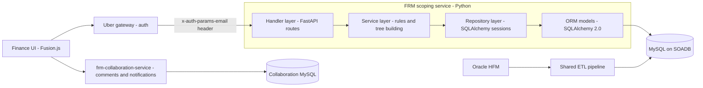
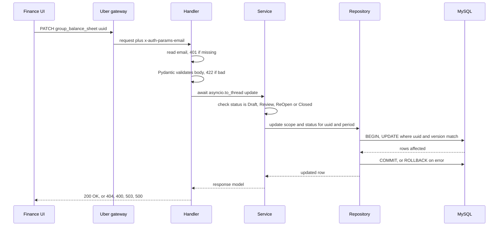
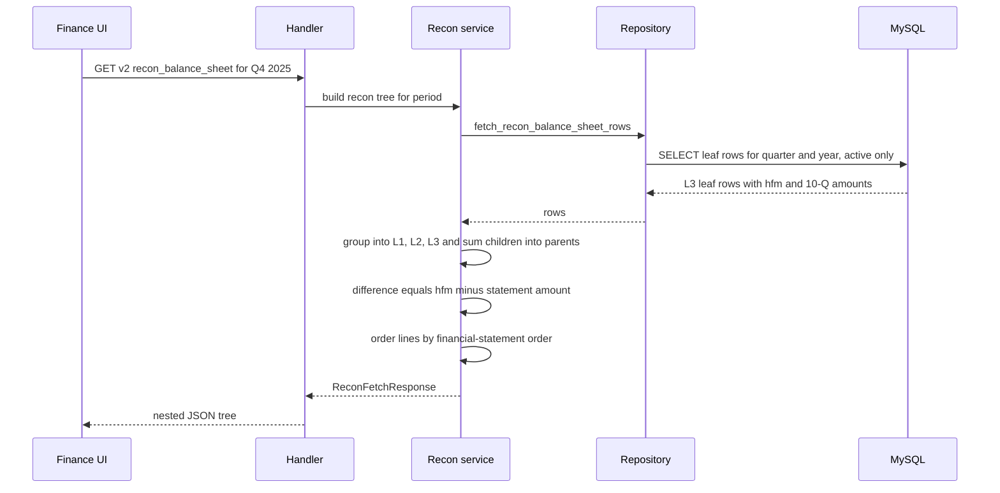
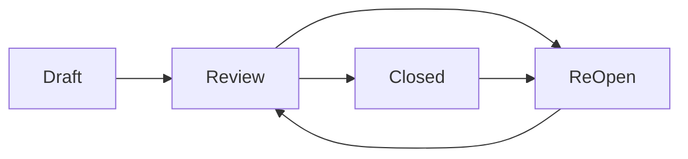

# 11. Uber FRM Risk Scoping Platform: Deep Dive

> **Start here for interviews:** [`23b_uber_interview_packs.md`](23b_uber_interview_packs.md) § Uber FRM. Numbers live in [`18_resume_number_catalog.md`](18_resume_number_catalog.md) and [`GROUND_TRUTH.md`](GROUND_TRUTH.md). Some older lines in the interview pack still say "30+ APIs" and "do not say 36 or 19M". That guidance is obsolete. This page wins.

<div class="callout highlight">
<b>How to use this page</b>
<ul>
<li><b>What it covers:</b> the Uber FRM (Financial Risk Management) Scoping Platform, end to end. The finance ideas from zero, the architecture, the real schema and routes, the reconciliation migration, the column-aliasing bug, transactions, tests, and every number on the three resume bullets.</li>
<li><b>When to read it:</b> the night before any interview where the Uber line on the resume will come up, and again right before a system design or "walk me through a project" round.</li>
<li><b>What to memorise:</b> the one-minute version (Part 0), the finance words (Part 1), the architecture drawing (Part 2), the five numbers and how to say them (Part 6 to Part 8), and the column-aliasing bug story (Part 8.2).</li>
<li><b>What to skip on a first read:</b> the full route list (Part 5) and the mock interview (Part 17). Come back to those for drilling.</li>
</ul>
</div>

**What the tags mean.** You will see four tags on facts in this page.

- **MEASURED** means there is a log, a design document, a CSV, or code that shows it.
- **TARGET** means a design goal. If a fact carries this tag, you say "we were targeting".
- **ESTIMATED** means arithmetic I can show on a whiteboard. You say "roughly, derived from...".
- **HISTORICAL** means it comes from my past work records.
- **PDF** means the number is printed on the current resume. You defend it as written.

**Role framing.** Software Development Engineer 2 at Uber Finance, **via EPAM Systems**, July 2024 to May 2026, Bangalore. Always say "Uber via EPAM". The work lived in Uber's internal monorepo, which uses Bazel (the build tool), Fusion.js (the frontend framework), SOADB (Uber's standard for service-owned MySQL), and langfx (Uber's internal FastAPI framework).

**Where the facts come from.** Every number here traces to `GROUND_TRUTH.md`, to the current resume PDF (`Tarun_Mittal_SSE_5yr.pdf`), or to the code in `KNOWLEDGE-MATERIAL/UBER-WORK/FRM PROJECT/frm_scoping_service/`. Nothing on this page is invented. Where an example uses made-up sample numbers to teach a formula, it says "illustrative".

---

## Part 0. The resume bullets and the one-minute version

### 0.1 The exact bullets on the PDF (Python and Go track)

These are quoted word for word from the current resume. Canonical copy: `docs/ASSORTSMART_TAB_RESUME.md` and `sections/experience_rest.tex`.

> **Financial Risk Management (FRM) Scoping Platform**
>
> 1. Owned the Financial Risk Management scoping backend, reducing quarterly reconciliation time by **70%** (from **14 days to 3 days**) against a **$340M** materiality threshold. Engineered the Sheets-to-MySQL migration across **19M** raw GL rows, shipping **36 FastAPI** endpoints to automate custom financial math and a nested 4-level FSLI (L1–L4) hierarchy with dynamic quarter-annualization.
> 2. Resolved ETL pipeline lock contention during financial close by designing an 8-table normalized MySQL schema on Uber's SOADB featuring a polymorphic review-status model. Guaranteed real-time, multi-user collaboration integrity by implementing optimistic row-locking, atomic cross-table syncs, and deterministic SHA-256 natural-key hashing to eliminate data duplication across quarterly audit trails.
> 3. Led **3 engineers** in a core SQLAlchemy 2.0 ORM migration that eliminated latent column-aliasing bugs and raised module statement coverage to **100%**. Orchestrated zero-downtime releases via stacked Bazel PRs, embedding reporting SQL allowlists and automated FSM gates with **50%** delta-variance checks to enforce SOX compliance.
> 4. **Tech:** Python, FastAPI, SQLAlchemy 2.0, Pydantic, MySQL, Bazel, Docker.

The Java tracks say "36 Spring Boot endpoints" and "Spring Data JPA / Hibernate migration" instead. The architecture and the numbers are the same. On this track the real implementation language is Python, so you can speak about it natively.

### 0.2 The one-minute version (say this out loud)

"At Uber, via EPAM, I owned the backend for the Financial Risk Management scoping platform in Uber Finance. Every quarter, during the financial close, Finance has to decide which line items and which legal entities are significant enough to be tested by the external auditor, PwC. That used to live in a large Google Sheets workbook with manual formulas and no audit trail. I moved it onto a FastAPI and MySQL service: we migrated about 19 million raw general-ledger rows off Sheets, shipped 36 endpoints that do the financial math over a four-level line-item hierarchy, and the quarterly reconciliation went from 14 days to 3 days, against a $340 million materiality threshold. I designed the normalized schema on Uber's service-owned MySQL, with optimistic row-locking and SHA-256 natural keys so quarterly audit trails never duplicate. And I led three engineers through a SQLAlchemy 2.0 migration that removed a nasty column-aliasing bug and took the module to 100% statement coverage, with SOX-style review gates in the workflow."

**Follow-up they may ask:** "What was the hardest part?" Go to the column-aliasing bug in Part 8.2.

---

## Part 1. The business in plain English (finance from zero)

Uber is a public company. Every quarter it must publish financial statements, and an external auditor (PwC) must be able to test them. Before PwC tests anything, Uber's own Finance team has to decide **what is worth testing**. That decision is called **scoping**. It is like deciding which rooms of a huge house a home inspector should look at closely: you cannot inspect every drawer, so you pick the rooms where a problem would actually matter.

The FRM team (Financial Risk Management, inside Uber Finance) runs scoping once a quarter. The output is the evidence PwC uses to build its **audit work papers**. If scoping is too narrow, real risk is missed. If it is too broad, thousands of audit hours are wasted. Because the result feeds an audited, SEC-filed report, every decision must be reproducible and traceable.

Before this platform, scoping was a manual Google Sheets workbook (the legacy "DSW version"). It had formulas, manual parent-child mapping of line items, no collaboration, no history and no audit trail. The technical design doc (TDD) framed the problem like this: "flat-file storage prevents the system from handling complex recursive financial hierarchies, leading to manual mapping errors and lack of real-time data visibility." The TDD (`FRM _ Scoping Tool - Technical Design Doc .docx`) was authored by Priyadharshini Govindan, reviewed by Ramesh Raju, and started on 2 February 2026.

### 1.1 Words you need (finance)

Learn these in order. Each builds on the one before.

**Financial close.** The period at the end of each quarter when Finance finalises the numbers. Think of it as "closing the books": every transaction is recorded, checked, and summed so the company can say "this is what we earned and what we own". It is deadline-driven and stressful, because the filing date is fixed.

**GL (General Ledger).** The master record of every account and its balance. Every transaction ends up as a debit or credit to some GL account, such as "Cash at Bank X" or "Revenue from Rides in Brazil". A **raw GL row** is one line of that ledger extract: an account, an entity, a period, and an amount. Analogy: the GL is the company's full bank statement, for every bank account it has, all in one place.

**Legal entity.** Uber is not one company. It is hundreds of legal companies in different countries, all owned by the parent. Each one keeps its own books. The per-quarter GL extracts in this project covered roughly **400 entities** (MEASURED).

**HFM (Oracle Hyperion Financial Management).** The consolidation system. Each entity's trial balance (a list of its account balances) is loaded into HFM. HFM converts currencies, removes intercompany transactions (for example, when Uber India pays Uber Netherlands, that is not real revenue for the group), applies minority-interest and equity adjustments, and produces the consolidated group numbers. HFM is the internal source of truth.

**10-Q.** The quarterly report a US public company files with the SEC (Securities and Exchange Commission). Its numbers are the publicly attested truth. The year-end version is called the 10-K. If HFM's numbers do not tie to the 10-Q, something is wrong and must be explained.

**Reconciliation (recon).** Putting two sources of the same number side by side and explaining every difference. Here it means checking HFM amounts against the filed 10-Q amounts, line by line. Analogy: matching your own expense log against your bank statement.

**FSLI (Financial Statement Line Item).** One line on the balance sheet or income statement, such as "Cash and cash equivalents", "Accounts receivable" or "Revenue".

**Balance sheet vs income statement.** The **balance sheet** is a snapshot on one day: what the company owns (assets) and owes (liabilities). The **income statement** is a movie over a period: what it earned (revenue) and spent (expenses). This difference matters for annualization (see below).

**FSLI hierarchy (L1 to L4).** Line items nest like folders. Level 1 is the broadest bucket and Level 4 is the most detailed. An illustrative example:

```text
L1  Assets
└── L2  Current assets
    └── L3  Cash and cash equivalents
        └── L4  Cash held in operating bank accounts
```

Parent amounts are the sum of their children. That one rule (parent equals the sum of its children) is the most important correctness invariant in the whole system.

**Materiality.** The dollar size of a mistake that would change the decision of someone reading the financial statements. Below it, an error does not matter to an investor. Above it, it does. Auditors usually set it top-down as a percentage of a key figure such as pre-tax income, revenue or total assets (that is the general practice; I do not claim to know how Uber's figure was derived). On the Q4 2025 close, group materiality was **$340M** (MEASURED, from the metrics table and CSVs).

A worked example with **illustrative** numbers:

| FSLI | HFM amount | Compared to $340M | Quantitative material? |
|---|---|---|---|
| Cash and cash equivalents | $4,000M | 4,000 > 340 | YES |
| Accounts receivable | $900M | 900 > 340 | YES |
| Prepaid expenses | $120M | 120 < 340 | NO |

The system also stores a **group multiple** for each line (the `group_multiple` column). It tells you how many times materiality a line is. For cash in the example: 4,000 ÷ 340 ≈ 11.8 times materiality. A big multiple means the line is clearly in scope.

**Quantitative vs qualitative material.** "Quantitative" means the size test above: YES if HFM amount is greater than materiality. "Qualitative" means a human judgement captured as a yes/no answer to a scoping question, for example "Is this account exposed to fraud risk or significant estimates?". A small line can still matter for a non-size reason.

**Overall significance.** The rule in the code is simple: a line is **Significant if quantitative OR qualitative is YES**. The function that implements it is `conclusion_overall_significance_from_balance_sheet_materials`. In the example, prepaid expenses fail the size test, but if the qualitative answer is YES, the line is still Significant.

**Group scoping vs component scoping.** **Group scoping** looks at the consolidated Uber statements, line by line, and asks "is this FSLI significant to the group as a whole?". **Component scoping** drills down to the individual entities (components) under each FSLI and asks "which of these entities do we actually test?". Group is the top of the tree, component is the leaves. Analogy: group scoping picks which rooms to inspect, component scoping picks which cupboards inside those rooms.

**The 5% rule (Financially Significant Component).** From `Scoping Features.docx`: a component is a **Financially Significant Component** if its **Total Revenue % > 5%** OR its **|Total Assets %| > 5%**. The vertical bars mean absolute value, because an entity can have negative net assets and still be significant. Illustrative example:

| Entity | Revenue share | Assets share | Significant? |
|---|---|---|---|
| Entity A | 7.0% | 2.0% | YES, revenue > 5% |
| Entity B | 1.0% | −6.0% | YES, absolute assets 6% > 5% |
| Entity C | 0.4% | 0.8% | NO, unless in scope for another reason |

The 5% benchmarks are not hard-coded. They are stored as configurable metrics (`assets_benchmark`, `revenue_benchmark`) and recomputed through `PUT /update_benchmark_thresholds`. The threshold screen also tracks `significant_due_to_risk` and `inscope_due_to_coverage`, so an entity can be in scope for reasons other than size.

**Residual risk.** After you have put the significant components in scope, how much of each line is still uncovered, and does it still matter? Per leaf line, from the `Scoping Features.docx` calculation matrix:

- Residual Balances = HFM Amount − Total in Scope
- Residual Multiples = Residual Balances ÷ Materiality

Illustrative example: an FSLI has an HFM amount of $1,000M. The in-scope components cover $800M. Residual balance is $200M. Residual multiple is 200 ÷ 340 ≈ 0.59. The screen flags lines where residual is **more than 50% of materiality**, and lines that cross a percentage-change threshold. 50% of $340M is $170M. Our $200M is above $170M, so it gets flagged and a manager must look at it.

That arithmetic is exactly why the **residual threshold on the Q4 2025 close was $170M** (MEASURED). It is half of $340M. Scoping is not only "pick the big lines". It is also proving that what you did not pick is small enough to ignore.

**EMI (Equity Method Investments).** Minority stakes Uber accounts for under the equity method. Uber owns a percentage of another company but does not consolidate it line by line. Instead it records its share of that company's profit or loss. These are scoped separately on the EMI screen, with one grid column per investee and fields like ownership percentage, asset balance, preliminary income or loss on the investment, the investee's auditor, and its financial reporting framework.

**SOX (Sarbanes-Oxley Act, 2002).** A US law passed after the Enron and WorldCom scandals. Section 404 requires public companies to maintain, document and test internal controls over financial reporting. In practice this means: every important number must be traceable, every change must be attributable to a person, and every review step must be evidenced. A Google Sheet that anyone can overwrite is a weak control. A system with status workflows and audit columns is a strong one.

**PwC.** PricewaterhouseCoopers, one of the "Big Four" audit firms and Uber's external auditor. PwC consumes the scoping output to decide what to test. That is why the output had to be trustworthy and explainable.

**Quarter-annualization.** Income statement numbers accumulate during the year. A Q2 year-to-date revenue figure covers only six months, so comparing it to an annual threshold is unfair. Annualizing scales it to a full-year equivalent. The general idea, with illustrative numbers: Q2 year-to-date revenue of $500M covers 2 quarters, so the annualized figure is 500 × 4 ÷ 2 = $1,000M. Balance sheet numbers are snapshots on a date, so they are not annualized in the same way. "Dynamic" on the resume means the system picks the multiplier from the fiscal quarter of the request instead of a hard-coded constant. Every table carries `fiscal_quarter` and `fiscal_year`, and the fact tables also carry `hfm_amount_previous_year` for year-over-year comparisons. Say this carefully: if asked for the exact formula in code, explain it at this level ("we scale year-to-date amounts to an annual equivalent based on the quarter") and keep it qualitative beyond that.

### 1.2 The 8 screens

The product has 8 screens (MEASURED, from the TDD and `Scoping Features.docx`). This is verbal depth. It is not on the PDF.

| Screen | What a Finance user does there |
|---|---|
| Reconciliation | Ties HFM amounts to the filed 10-Q, line by line |
| Materiality | Sets and edits the $340M threshold and the benchmarks |
| EMI Scoping | Scopes Equity Method Investments, one column per investee |
| Group Scoping | Applies the quantitative-OR-qualitative rule at the consolidated level |
| Threshold Setup | Manages legal-entity significance with the 5% rule |
| Component Scoping | Drills into entities under each FSLI and decides which are tested |
| Residual Risk | Computes residual balance and multiple, flags anything above 50% of materiality |
| Summary | Rolls up coverage for sign-off |

Group, Component, Residual, Threshold and EMI carry real rule logic. Reconciliation carries the tie-out. Materiality and Summary are lighter but still write-through. I owned the backend for these screens. I did not own the React/Fusion.js UI, so do not claim it.

**On the Q4 2025 sample** (MEASURED): about 26 balance-sheet FSLIs and about 29 income-statement FSLIs, so about 55 line items, against 14 entities in that scoping sample. The full per-quarter GL extracts are bigger, at roughly 1.7K to 1.8K accounts and about 400 entities. Present these as "on the Q4 2025 close", not as fixed constants.

---

## Part 2. Architecture

In plain words: Finance users work in a web UI. Every request passes through Uber's gateway, which authenticates the user and adds their email to a header. The request lands on the FastAPI scoping service, which is split into four layers. The bottom layer talks to a MySQL database that follows Uber's SOADB standard. Separately, a shared ETL pipeline loads HFM data into the same MySQL tables. Comments and notifications live in a separate collaboration service.

### 2.1 Words you need (tech)

**FastAPI.** A Python web framework for building HTTP APIs. You write a Python function with typed arguments, and FastAPI turns it into an endpoint, validates the input, and generates API documentation automatically. Analogy: a receptionist who checks every form is filled in correctly before passing it on.

**Pydantic.** The Python library FastAPI uses for data validation. You declare a class with typed fields, and Pydantic rejects any input that does not match (FastAPI returns HTTP 422 Unprocessable Entity). It is a strict customs officer for data.

**ORM (Object-Relational Mapper).** A library that lets you work with database rows as Python objects instead of writing raw SQL strings. Analogy: a translator between Python and SQL.

**SQLAlchemy 2.0.** The most widely used Python ORM. Version 2.0 introduced typed models (`Mapped[...]` and `mapped_column(...)`), a unified `select()` query style replacing the old `Query` API, and stricter session handling. More detail in Part 8.

**MySQL and InnoDB.** MySQL is a relational database. InnoDB is its default storage engine, which gives ACID transactions (all-or-nothing writes that stay consistent and durable) and row-level locking.

**SOADB.** Uber's standard for service-owned MySQL. Each service owns its own database, provisioned and operated the Uber way. Choosing it was a platform decision, not a whim.

**ETL (Extract, Transform, Load).** A job that pulls data out of one system (extract), cleans and reshapes it (transform), and writes it into another (load). Here: HFM to MySQL.

**Bazel.** Google's open-source build system, used across Uber's monorepo. Every package declares its sources, dependencies and tests in a `BUILD.bazel` file. Bazel only rebuilds and retests what changed. Analogy: a very strict, very fast kitchen that only re-cooks the dishes whose ingredients changed.

**Docker.** Packages the service and its dependencies into a container image so it runs the same way on a laptop, in CI and in production.

### 2.2 The architecture diagram

What to notice: the scoping service is the only thing that writes scoping decisions, the ETL only loads source data, and the collaboration service is a separate box I did not build.



**Walking through it box by box.**

1. **Finance UI.** A Fusion.js web app (`/risk-scoping/reconciliation` and the other screens). It uses TanStack Query for client-side caching and Base Web virtual scrolling to render thousands of FSLI rows. That is frontend, not mine.
2. **Uber gateway.** Authenticates the user and injects an `x-auth-params-email` header. The service never sees a password.
3. **Handler layer** (`handler/scoping_handler.py`). Thin. It only does HTTP: read the auth header, validate query parameters, call a service, map errors to status codes.
4. **Service layer.** Owns the business logic: the significance rules, the 5% rule, residual math, building the L1 to L4 tree, summing children into parents.
5. **Repository layer.** Owns every database session and every query. Opens a session, commits on success, rolls back on any exception, closes in a `finally`.
6. **ORM models.** 11 SQLAlchemy 2.0 models (Part 4).
7. **MySQL on SOADB.** The single source of truth for scoping data, keyed by fiscal quarter and year.
8. **Oracle HFM and the ETL.** Scheduled Python jobs extract balances and entity data from HFM, resolve the recursive parent-child hierarchy into `level_mapping`, and load fact rows. Say this carefully: the ETL was a shared pipeline responsibility. "The service consumes HFM-loaded MySQL tables. I owned the scoping APIs and the recon migration."
9. **Collaboration service.** Comments and Slack-style notifications live in a separate `frm-collaboration-service` with its own MySQL. I did not build it.

---

## Part 3. One request, step by step

### 3.1 A manager marks a balance-sheet line "In Scope" and sends it for review

Sample request (illustrative values):

```http
PATCH /frm-scoping/group_balance_sheet/7f3c9a...e21
x-auth-params-email: manager@uber.com
Content-Type: application/json

{ "conclusion_scope": "In Scope", "group_status": "Review" }
```

What to notice in the diagram: the handler never touches the database, the blocking database call runs on a worker thread, and the whole write is one transaction that either commits or rolls back.



Step by step in words:

1. The gateway has already authenticated the manager. It forwards the request with the email header.
2. The handler calls `_get_auth_email(request)`. If the header is missing it returns **401**. The email becomes `updated_by` on the row, which is the audit trail SOX needs.
3. Pydantic checks the body. A bad status value or wrong type returns **422**.
4. Because SQLAlchemy here is synchronous, the handler offloads the work with `await asyncio.to_thread(...)`. The event loop stays free to serve other requests.
5. The service checks the status is one of the allowed four: **Draft, Review, ReOpen, Closed**.
6. The repository opens a read-write session, runs the update keyed by `uuid` and the fiscal period, commits, and closes.
7. Errors map to HTTP codes: a "not found" `ValueError` becomes **404**, other validation becomes **400 or 422**, a `RuntimeError` (for example Google Sheets unavailable on the v1 path) becomes **503**, anything else becomes **500**.

### 3.2 A reconciliation read on the v2 (MySQL) path



A sample leaf row and what the service makes of it (**illustrative** numbers, in millions):

| L1 | L2 | L3 | HFM | 10-Q | Difference |
|---|---|---|---|---|---|
| Assets | Current assets | Cash and cash equivalents | 4,012.4 | 4,012.4 | 0.0 |
| Assets | Current assets | Accounts receivable | 3,120.0 | 3,118.0 | 2.0 |

The first line ties. The second line has a $2M break that someone must explain before scoping proceeds. Negative amounts render in parentheses, for example `($8)`, the way finance people expect.

---

## Part 4. The real database schema

In plain words: the database stores every scoping fact once, keyed by fiscal quarter and year, with a stable ID for every line. That stable ID is what Sheets never had. It is what lets people comment on a line, track it across quarters, and audit who changed it.

### 4.1 The "8 tables" on the PDF vs "11 models" in the code

The PDF says an **8-table normalized MySQL schema**. The scoping service code has **11 SQLAlchemy 2.0 models**. Both are true. They count different things.

**How to say it if asked:** "The normalized core is 8 scoping tables. On top of that the service has the two recon v2 tables and a key-value metrics helper, so 11 ORM models in the code." One clean way the numbers add up: the 8 core tables are `balance_sheet`, `income_statement`, `component_entity`, `level_mapping`, `scoping_questions`, `scoping_assessments`, `threshold_table_v2` and `emi_data`. The other 3 are `recon_balance_sheet`, `recon_income_statement` and the `frm_metrics_table` helper. The full physical `schema.uql` has 16 or more tables because the collaboration service, comments and notifications live there too. Never say "the whole database is 11 tables".

### 4.2 Conventions on every model

- All models use SQLAlchemy 2.0 `Mapped[...]` and `mapped_column(...)` typing on a shared `DeclarativeBase` (`database/models/base.py`).
- Every table carries `fiscal_quarter` (String(4)) and `fiscal_year` (String(8)) as the period key, plus audit columns `created_at`, `created_by`, `updated_at`, `updated_by`.
- There are **no database-level foreign keys** in the ORM. Relationships are logical, joined on `level_id` and the fiscal period. This matters for the column-aliasing bug in Part 8.2.
- Money is stored as `DECIMAL(18,2)` and percentages as `DECIMAL(5,2)`. Money must be exact, so the database uses `DECIMAL` / `Numeric` and Python uses `Decimal`. `_to_float` only converts at the display and aggregation edge. `(5,2)` fits percentages up to 999.99%.

### 4.3 The 11 models

| # | Python model | Table name | Purpose | Key columns |
|---|---|---|---|---|
| 1 | `BalanceSheet` | `balance_sheet` | Group and component balance-sheet scoping facts | `uuid` (PK), `level_id`, `level_1..level_4`, `hfm_amount`, `hfm_amount_previous_year`, `percentage_of_total`, `group_multiple`, `quantitative_material`, `qualitative_material`, `conclusion_overall_significance`, `conclusion_scope`, `total_inscope`, `residual_balances`, `residual_multiples`, `group_status`, `component_status`, `residual_status`, `is_level_active` |
| 2 | `IncomeStatement` | `income_statement` | Group and component income-statement scoping facts | Same shape as `balance_sheet`. Also has classmethods `fetch_for_period`, `uuid_exists`, `get_qualitative_and_conclusion`, `update_scope_and_status` (ORM-side query helpers) |
| 3 | `EmiData` | `emi_data` | EMI grid, one row per investee column | `uuid` (PK), `investee`, `investee_entity`, `uber_investor_entity`, `uber_ownership_equity_interest_percentage`, `asset_balance`, `preliminary_income_loss_on_investments`, `auditor`, `financial_reporting_framework`, `significant_emi`, `is_active`. A `@validates` hook strips whitespace on every string column |
| 4 | `ScopingMetrics` | `frm_metrics_table` | Key-value metrics such as materiality and benchmarks | `uuid` (PK), `metric_key`, `metric_value` (String(512)), `unit`, `is_active` |
| 5 | `ScopingQuestion` | `scoping_questions` | Default qualitative questions per page | `uuid` (PK, SHA-256 of `question_text` + normalized `page_name`), `question_text` (Text), `page_name`, `is_active` |
| 6 | `ScopingAssessment` | `scoping_assessments` | Per-line answers to questions | `uuid` (PK), `question_id`, `line_id`, `answer_text` (Text) |
| 7 | `ThresholdSetup` | `threshold_table_v2` | Legal-entity threshold significance | `uuid` (PK), `legal_entity`, `total_assets`, `total_assets_percentage`, `total_revenue`, `total_revenue_percentage`, `financially_significant_component`, `significant_due_to_risk`, `inscope_due_to_coverage`, `conclusion`, `review_status` |
| 8 | `LevelMapping` | `level_mapping` | Maps the FSLI text hierarchy to a stable `level_id` | `uuid` (PK, the join target), `level1..level4`, `is_active` |
| 9 | `ComponentEntityRow` | `component_entity` | Per-component HFM amounts by `level_id` | `uuid` (PK), `level_id`, `scoping_component`, `amount` |
| 10 | `ReconBalanceSheet` | `recon_balance_sheet` | Recon v2 balance-sheet leaf rows | `uuid` (PK), `level_id`, `level_1..level_3`, `hfm_amount`, `hfm_amount_in_millions`, `financial_statement_amount_in_millions`, `difference`, `is_level_active` |
| 11 | `ReconIncomeStatement` | `recon_income_statement` | Recon v2 income-statement leaf rows | Same shape as `recon_balance_sheet` |

**Table-name traps to say out loud correctly.** The threshold table is physically `threshold_table_v2` (the class is `ThresholdSetup`). The materiality and metrics store is `frm_metrics_table` (the class is `ScopingMetrics`). Materiality itself is a row with `metric_key = "materiality"`. It is data, not a constant in code.

### 4.4 How the tables connect

What to notice: everything hangs off `level_mapping`, and every join also matches the fiscal period. These are logical joins, not foreign-key constraints.

```text
                         level_mapping (level_id = uuid)
                         level1 / level2 / level3 / level4
                                    ^        ^
             join on level_id +     |        |     join on level_id +
             fiscal_quarter/year    |        |     fiscal_quarter/year
                                    |        |
        +---------------------------+        +--------------------------+
        |                                                               |
   balance_sheet (uuid PK, level_id)                        component_entity (uuid PK, level_id,
   income_statement (uuid PK, level_id)                        scoping_component, amount)
        |   level_1..level_4, hfm_amount,
        |   quantitative/qualitative_material,
        |   conclusion_*, residual_*, *_status
        |
        | line_id = balance_sheet.uuid / income_statement.uuid
        v
   scoping_assessments (uuid PK, question_id, line_id, answer_text)
        |
        | question_id = scoping_questions.uuid
        v
   scoping_questions (uuid PK, question_text, page_name)

   frm_metrics_table        threshold_table_v2         emi_data
   (materiality,            (legal_entity,             (one row per
    assets/revenue           5% significance,           investee column)
    benchmarks)              conclusion)

   recon_balance_sheet / recon_income_statement  (v2 recon leaves,
      level_1..level_3, hfm vs financial_statement amount, difference)
```

The spine is `level_mapping`. The fact tables (`balance_sheet`, `income_statement`) and `component_entity` all carry a `level_id` that equals `level_mapping.uuid`. Joins always also match `fiscal_quarter`, `fiscal_year` and the active flags (`lm.is_active = 'true'`, `is_level_active = 'true'`). `scoping_assessments.line_id` points at a fact row `uuid`. `scoping_assessments.question_id` points at `scoping_questions.uuid`.

**Why store `level_id` instead of the hierarchy text?** If Finance renames a parent node, only one `level_mapping` row changes. Thousands of fact rows do not have to be rewritten. **Why always join on the period too?** The same logical FSLI exists once per quarter. Joining on `level_id` alone would fan out across every quarter and multiply amounts.

A worked example of the join (illustrative IDs):

```sql
SELECT i.uuid AS fsli_id, lm.level1, lm.level2, lm.level3, i.hfm_amount
FROM balance_sheet AS i
JOIN level_mapping AS lm
  ON i.level_id = lm.uuid
 AND i.fiscal_quarter = lm.fiscal_quarter
 AND i.fiscal_year = lm.fiscal_year
WHERE i.fiscal_quarter = 'Q4' AND i.fiscal_year = '2025'
  AND lm.is_active = 'true' AND i.is_level_active = 'true';
```

Notice the `AS fsli_id` label. Without labels, both tables have a column called `uuid`, and that is exactly the bug in Part 8.2.

---

## Part 5. The API surface

In plain words: one FastAPI router exposes every scoping screen's reads and writes under the `/frm-scoping` prefix. Reads build trees and run the rules. Writes change a scope decision, a status, a threshold or an answer, and always record who did it.

### 5.1 The 36 endpoints

The PDF says **36 FastAPI endpoints**. Defend that number. **How to say it:** "36 endpoints across the scoping backend."

**Deeper detail if they drill in.** In `handler/scoping_handler.py`, `setup_routes()` makes 32 `add_api_route(...)` registrations on one `APIRouter(prefix="/frm-scoping", tags=["FRM Scoping Tool"])`. One of them is `/health`, so there are **31 functional routes in the scoping service handler**. The other APIs that make up 36 are the **collaboration-service APIs for comments and notifications** specified in the TDD. Say this carefully: the collaboration and Slack notification service itself was a separate service, and I do not claim I built it.

**Older prep said** "say 30+, never say 36". That guidance is obsolete. The current resume says 36 and the breakdown above is how it adds up.

### 5.2 Route groups (all under `/frm-scoping`)

- **Health and smoke:** `GET /health`, `POST /scoping` (a welcome echo).
- **Reconciliation v1 (Sheets-backed):** `GET /recon_balance_sheet`, `GET /recon_income_statement`, served by `RiskScopingService`.
- **Reconciliation v2 (MySQL-backed):** `GET /v2/recon_balance_sheet`, `GET /v2/recon_income_statement`, served by `NewReconBalanceSheetService` and `NewReconIncomeStatementService`. This is the migration I owned.
- **Group scoping:** `GET /group_balance_sheet`, `PATCH /group_balance_sheet/{balance_sheet_uuid}`, `GET /group_income_statement`, `PATCH /group_income_statement/{income_statement_uuid}`. The PATCH updates `conclusion_scope` and/or `group_status`. Allowed statuses are Draft, Review, ReOpen and Closed.
- **Component scoping:** `GET /bs_components`, `GET /is_components`, and the cascading filter option endpoints `GET /bs_component_filters` and `GET /is_component_filters`, which return the distinct `level_1..level_4` options.
- **Residual risk:** `GET /residual_risk?fsli_type=bs|is`.
- **EMI:** `GET /emi_scoping` (the v1 comparison view), `GET /emi_data` (the MySQL grid), `PATCH /emi_data/{uuid}`.
- **Metrics, materiality and thresholds:** `POST /add_scoping_metrics`, `GET /scoping_metrics`, `PUT /update_benchmark_thresholds`, `GET` and `PUT /materiality`, `GET` and `PUT /active-page-number`, `GET /threshold-setup`, `PATCH /threshold-setup/{uuid}`.
- **Scoping questions and assessments:** `POST /scoping_questions/bulk`, `GET /scoping_questions`, `POST /scoping_assessments`, `GET /scoping_assessments`, `PATCH /scoping_assessments/{assessment_uuid}`.

None of these are padding. The PATCH and PUT routes carry distinct business logic such as status transitions and benchmark recomputation.

### 5.3 Cross-cutting details worth mentioning

- **Auth.** Every write path calls `_get_auth_email(request)`, which reads `x-auth-params-email` and raises 401 if it is missing. That email is stored as `created_by` / `updated_by`. The gateway injects the header only after authenticating the user, so the service trusts the edge and its own job is identity capture for the audit trail.
- **Async offload.** Database calls use synchronous SQLAlchemy. The FastAPI handler stays `async` and pushes blocking work onto a thread with `await asyncio.to_thread(...)`. Analogy: the waiter takes the order and hands it to the kitchen instead of standing at the stove.
- **Lazy service initialisation.** `ScopingHandler` defers constructing the heavy SQLAlchemy-backed services (`GroupBalanceSheetService` and others) until an endpoint actually needs them. App startup and `/openapi.json` stay fast.
- **Error contract.** A "not found" `ValueError` maps to 404. Other validation maps to 400 or 422. `RuntimeError` (Sheets unavailable) maps to 503. Everything else maps to 500. A Pydantic `ValidationError` on query parameters is re-raised as 422 via `jsonable_encoder(e.errors())`.

---

## Part 6. Bullet 1 decoded: ownership, 70%, $340M, 19M, 36, L1 to L4

> Owned the Financial Risk Management scoping backend, reducing quarterly reconciliation time by **70%** (from **14 days to 3 days**) against a **$340M** materiality threshold. Engineered the Sheets-to-MySQL migration across **19M** raw GL rows, shipping **36 FastAPI** endpoints to automate custom financial math and a nested 4-level FSLI (L1–L4) hierarchy with dynamic quarter-annualization.

**In plain words.** I owned the backend of the scoping platform. It cut the quarterly reconciliation from two weeks to three days. It moved the raw ledger data out of spreadsheets into a real database, and exposed the scoping math (materiality, 5% rule, residual risk, annualization) through 36 endpoints over a four-level line-item tree.

**How it works.** The ETL loads HFM data into MySQL. The service builds the L1 to L4 tree from `level_mapping`, sums children into parents, runs the significance rules against the materiality row in `frm_metrics_table`, and serves the screens. Users change scope decisions and statuses through PATCH endpoints, and every change is recorded with who did it and when.

**Why this design.** The core problem with Sheets was not speed. It was that there was no stable ID per line, no concurrency control, no history and no single source of truth. A relational schema keyed by period with stable line IDs fixes all four at once.

**Alternatives and why not.**
- *Keep Sheets and add scripts.* Still no stable IDs, still no concurrency control, still no audit trail. Weak SOX control.
- *A data warehouse such as BigQuery.* Good for big analytical reads, but this workflow is many small transactional edits by managers during close. A row store with ACID transactions fits better.
- *Recursive SQL for the hierarchy.* Possible, but resolving the hierarchy once in the ETL into stable `level_id`s is simpler and faster for this data size.

**Trade-off.** Materialising the hierarchy means the ETL must be correct, and a bad load can silently drop or duplicate a line. We defended that with the parent-equals-sum-of-children check and active-flag discipline.

**What I'd do differently.** Add automated reconciliation alerts on the ETL load itself (row counts and control totals per period), instead of relying on the screens to reveal breaks.

### 6.1 The numbers

**70% (from 14 days to 3 days).** PDF.
- *What it measures:* the time Finance spends on the quarterly reconciliation and data-ingestion work for scoping.
- *How it was derived:* the technical design doc framed the cut in section 3.1: "Achieve a 70% reduction in time spent on manual data ingestion and reconciliation through automated ETL pipelines." The platform delivered that for the close, from about 14 days to about 3 days.
- *If someone does the arithmetic:* (14 − 3) ÷ 14 is about 79%, so 70% is the conservative headline. The earlier estimate of 3 to 4 days gives 71% to 79%. Either way, 70% is a floor and not a stretch.
- *Why it mattered:* close is deadline-bound. Eleven days back means Finance can spend its time on judgement, not copying numbers, and PwC gets evidence earlier.
- *How to say it:* "Quarterly reconciliation went from 14 days to 3 days, about a 70% cut."
- *If pressed:* "The technical design doc framed that cut, and that's what the platform delivered for the close."
- *What NOT to say:* do not walk it back unprompted, and do not call it a "target" yourself. **Older prep** tagged 70% as TARGET. The current resume states it as the outcome, so defend the resume.

**$340M materiality.** PDF, MEASURED.
- *What it measures:* the group materiality threshold on the Q4 2025 close.
- *Where it lives:* a row in `frm_metrics_table` with `metric_key = "materiality"`, editable on the Materiality screen.
- *Why it mattered:* every quantitative significance decision compares against it, and the $170M residual threshold is half of it.
- *How to say it:* "Against a $340 million materiality threshold on the Q4 2025 close."
- *What NOT to say:* do not present it as a fixed constant for all quarters, and do not claim to know how the auditors derived it.

**19M raw GL rows.** PDF.
- *What it measures:* the raw general-ledger rows migrated off Google Sheets into MySQL.
- *How to say it:* "We migrated about 19 million raw GL rows off Sheets into MySQL."
- *Deeper detail if they drill in:* individual quarterly GL extracts were about 38K to 95K rows each (MEASURED from the Q4 2025 CSVs, with dumps of about 76K, 38K and 95K), across roughly 1.7K to 1.8K accounts and about 400 entities.
- *If they ask "so is this big data?":* "No, and that's not where the value was. MySQL handles this volume comfortably. The hard part was correctness, the hierarchy, and auditability for a PwC-audited process."
- *What NOT to say:* do not invent a breakdown of where 19M comes from beyond "raw GL rows migrated off Sheets". **Older prep** said "do not claim 19M". That is obsolete.

**36 FastAPI endpoints.** PDF. See Part 5.1 for the breakdown (31 functional routes in the scoping handler plus the collaboration-service APIs).

**L1 to L4 FSLI hierarchy.** PDF. Four nested levels of line items. The fact tables carry `level_1..level_4`, and `level_mapping` holds `level1..level4`. Recon v2 builds an L1 to L2 to L3 tree, because reconciliation against the 10-Q happens at L3.

**Dynamic quarter-annualization.** PDF. See the definition in Part 1.1. Say it as "the system scales year-to-date amounts to an annual equivalent based on the quarter, so thresholds compare like with like".

### 6.2 Questions they will ask (bullet 1)

**"Did the 70% actually happen, or was it a goal?"**
"It's the outcome on the resume: the quarterly reconciliation went from about 14 days to about 3. The technical design doc framed that cut up front, and that's what the platform delivered for the close. The saving came from not copying HFM numbers into Sheets by hand, not re-mapping parents and children manually, and having every line carry a stable ID so comments and reviews happen in one place."

**"19 million rows in MySQL, how did you make that fast?"**
"Honestly, volume wasn't the hard part. Each quarterly extract is tens of thousands of rows, and MySQL with the right composite indexes on the fiscal period handles that comfortably. The hard part was correctness: getting the four-level tree right, making sure parents equal the sum of their children, and making every change auditable. That's where the engineering went."

**"What does 'custom financial math' mean concretely?"**
"Four things. The quantitative-or-qualitative significance rule against materiality. The 5% revenue-or-assets rule for components. Residual balance and residual multiple, flagged above half of materiality. And annualizing year-to-date amounts by quarter. All deterministic, all reproducible, all stored with the period so PwC can re-derive them."

---

## Part 7. Bullet 2 decoded: schema, review status, locking, atomic syncs, SHA-256

> Resolved ETL pipeline lock contention during financial close by designing an 8-table normalized MySQL schema on Uber's SOADB featuring a polymorphic review-status model. Guaranteed real-time, multi-user collaboration integrity by implementing optimistic row-locking, atomic cross-table syncs, and deterministic SHA-256 natural-key hashing to eliminate data duplication across quarterly audit trails.

**In plain words.** During close, the data loads and the people editing were getting in each other's way. I designed a clean relational schema so loads and edits touch well-separated data in short transactions. One review-status model is reused across every screen. Edits never silently overwrite each other. Writes that span two tables happen together or not at all. And the same question or line always gets the same ID, so quarters never duplicate.

### 7.1 ETL lock contention and the normalized schema

**Lock contention, defined.** When two processes want to change the same data at the same time, one has to wait. If a bulk load holds locks for a long time while users are editing, users stall or time out. Analogy: one person hogging a shared document while everyone else waits to type.

**Normalized schema, defined.** Each fact is stored once, in the table where it belongs, and other tables refer to it by ID. The hierarchy text lives once in `level_mapping`. Facts reference it by `level_id`. Answers live in `scoping_assessments` and point at lines by `line_id`.

**How the design removes contention.** The ETL loads source facts by period. User edits are small, keyed by primary key (`uuid`), and touch decision and status columns in short transactions. InnoDB locks individual rows, not whole tables, so a manager editing one line does not block the load of another period. Optimistic locking (below) means no lock is held while a human is thinking.

**How to say it:** "During close, the ETL loads and analysts' edits were fighting over the same data. I normalised the schema on SOADB so loads and edits are separated, every edit is a short primary-key-keyed transaction, and concurrency is optimistic, so nobody holds a lock while they think." Say this carefully: if they ask for the exact incident timeline or lock-wait numbers, keep it qualitative. There are no measured lock-wait figures in my notes.

### 7.2 The polymorphic review-status model

**What "polymorphic" means here.** One status model reused across many screens and record types. The same four states (**Draft, Review, ReOpen, Closed**) apply whether the row is a group balance-sheet line (`group_status`), a component (`component_status`), a residual-risk line (`residual_status`) or a threshold entity (`review_status`). Analogy: every form in an office uses the same "Draft, Submitted, Returned, Approved" stamp, whatever the form is about.

**Why.** One set of rules, one set of tests, one UI badge, one audit story for PwC. Without it, every screen invents its own workflow and the SOX evidence gets messy.

**A typical lifecycle:**



What to notice: Closed is not a dead end. A reviewer can reopen a line, and it must go back through Review. Say this carefully: the four allowed states are in the code. If they ask for the exact transition table, describe this lifecycle and keep it qualitative.

### 7.3 Optimistic row-locking (worked SQL)

**What it is.** A way to stop two people from overwriting each other without holding database locks. Each row carries a version. When you save, you say "update this row, but only if it is still the version I read". If someone else saved first, the version has moved on, your update matches zero rows, and you know you must reload. Analogy: a library card that says "edition 7". If the shelf now has edition 8, your edits to edition 7 are rejected.

**Pessimistic locking, for contrast.** `SELECT ... FOR UPDATE` locks the row until you commit. That is fine for a machine that commits in milliseconds. It is terrible for a human who opens a row and goes to lunch.

**Worked example.** Two managers, Asha and Ben, both open the same Cash line at version 7.

```sql
-- Both read the row
SELECT uuid, conclusion_scope, group_status, version
FROM balance_sheet
WHERE uuid = '7f3c...e21' AND fiscal_quarter = 'Q4' AND fiscal_year = '2025';
-- returns: version = 7

-- Asha saves first
UPDATE balance_sheet
SET conclusion_scope = 'In Scope', group_status = 'Review',
    version = version + 1, updated_by = 'asha@uber.com', updated_at = NOW()
WHERE uuid = '7f3c...e21' AND version = 7;
-- 1 row affected, version is now 8

-- Ben saves a moment later, still holding version 7
UPDATE balance_sheet
SET conclusion_scope = 'Out of Scope', group_status = 'Review',
    version = version + 1, updated_by = 'ben@uber.com', updated_at = NOW()
WHERE uuid = '7f3c...e21' AND version = 7;
-- 0 rows affected: Ben's save is rejected, he reloads and sees Asha's change
```

The application checks the rows-affected count. Zero means "someone changed this since you read it". The same zero-rows-affected check is what the assessment sync in Part 7.4 uses to decide to roll back.

**Why optimistic here.** Conflicts are rare (a handful of managers, each mostly on their own lines), edits are slow human actions, and the cost of a rare retry is tiny. Optimistic concurrency is the standard choice in exactly that situation.

**Alternatives and why not.** Pessimistic `FOR UPDATE` locks would block the ETL and other editors while a human thinks. Last-write-wins (no check) silently loses an auditor-relevant decision, which is unacceptable under SOX.

**How to say it:** "We used optimistic row-locking: every update carries the version it read, and the update only applies if the version still matches. If it doesn't, the user reloads and sees the other person's change. No locks are held while people think."

**Deeper detail and care.** The TDD specified Optimistic Concurrency Control with version numbers ("check that no other manager modified a record since it was fetched"). The separate `frm-collaboration-service` applies the same check on its own MySQL for comments. Real-time refresh on screen comes from the frontend (TanStack Query polling, a "WebSocket-lite" model). Say this carefully: the SQL above shows the pattern. If they ask for exact column names or the exact HTTP status on conflict, describe the mechanism and keep the specifics qualitative. Do not claim you built WebSocket sync or the collaboration service.

### 7.4 Atomic cross-table syncs

**What it is.** When one user action must change two tables, both changes happen in one transaction. Either both commit or neither does. Analogy: a bank transfer where money leaves one account and arrives in the other, never only one half.

**Three real examples in the code.**

1. **Benchmark update.** `PUT /update_benchmark_thresholds` updates both `assets_benchmark` and `revenue_benchmark` and commits once. If either row is missing it raises `ValueError` and nothing is saved.
2. **EMI Total mirror.** Patching the EMI "Total" column also mirrors the amount into `balance_sheet` / `income_statement` in the same transaction before commit.
3. **Assessment with sync.** A `scoping_assessments` write with `sync_required` updates the mapped line table and the assessment together. If the line sync affects zero rows, the whole thing rolls back.

The repository pattern that makes this safe:

```python
def update_benchmarks(assets_pct: Decimal, revenue_pct: Decimal, email: str) -> None:
    session = db.get_read_write()
    try:
        assets = _active_metric(session, "assets_benchmark")
        revenue = _active_metric(session, "revenue_benchmark")
        if assets is None or revenue is None:
            raise ValueError("benchmark metric not found")
        assets.metric_value, assets.updated_by = str(assets_pct), email
        revenue.metric_value, revenue.updated_by = str(revenue_pct), email
        session.commit()
    except Exception:
        session.rollback()
        raise
    finally:
        session.close()
```

This snippet is a simplified sketch of the real shape (open with `get_read_write()`, commit on success, roll back on any exception, close in `finally`). Function and helper names are illustrative.

### 7.5 Deterministic SHA-256 natural keys

**Definitions.** A **surrogate key** is a meaningless ID, such as a random UUID or an auto-increment number. A **natural key** is derived from the data itself. **SHA-256** is a cryptographic hash function: feed it any text and it returns a fixed 64-character hex string. The same input always gives the same output, and different inputs practically never collide. Analogy: a fingerprint of the text.

**The real use.** `scoping_questions.uuid` is the SHA-256 of `question_text` plus the normalized `page_name`. The bulk endpoint `POST /scoping_questions/bulk` upserts on that key.

```python
import hashlib

def question_uuid(question_text: str, page_name: str) -> str:
    normalized_page = page_name.strip().lower()
    return hashlib.sha256(f"{question_text}{normalized_page}".encode("utf-8")).hexdigest()

question_uuid("Is this account exposed to fraud risk?", " Group Scoping ")
question_uuid("Is this account exposed to fraud risk?", "group scoping")
# both return the same 64-character hex string
```

This is a sketch. The exact normalization in code is "question text plus normalized page name". If asked for more, say exactly that.

**Why it eliminates duplication.** Every quarter, the default questions are re-injected. With random UUIDs, re-running the seed would create a second copy of every question, and assessments would split across duplicates. With a deterministic key, re-injecting the same payload produces the same IDs, so the upsert updates in place. The audit trail for "question X on page Y" stays one row across quarters.

**Alternatives and why not.**
- *Random UUID plus a unique index on (question_text, page_name).* Works, but long `Text` columns are awkward to index in MySQL, and a 64-character hash is a compact, fixed-width key.
- *Auto-increment IDs.* Different on every environment and every reload, so staging and production IDs never match.

**Trade-off.** If the question text changes, even by a typo fix, it becomes a new key. That is acceptable and arguably correct for an audit trail (a changed question is a different question), but it must be understood.

**A general design point worth saying.** When you hash concatenated fields, put a delimiter between them so `"ab" + "c"` and `"a" + "bc"` cannot produce the same input. Normalise casing and whitespace before hashing so cosmetic differences do not create new keys.

### 7.6 Questions they will ask (bullet 2)

**"What do you mean by lock contention, and how does a schema fix it?"**
"During close, bulk loads from HFM and managers' edits were hitting the same data at the same time, so people were waiting on each other. The schema fixes it by separating what the ETL writes from what users edit, keying every edit by primary key in a short transaction, and using optimistic locking so no one holds a lock while they think. InnoDB locks rows, not tables, so editing one line doesn't block anything else."

**"Why optimistic and not pessimistic locking?"**
"Because the editors are humans and conflicts are rare. A pessimistic lock would sit on a row while someone reads the numbers, and block everyone else including the ETL. With optimistic locking, the update says 'only if it's still version 7'. If someone beat you, zero rows change, you reload and see their edit. Cheap in the common case, safe in the rare case."

**"Why SHA-256 for a key? Isn't that overkill?"**
"The point isn't security, it's determinism. The same question on the same page must get the same ID every quarter, so re-seeding questions updates in place instead of duplicating. Any stable hash would work. SHA-256 is standard, fixed-width and collision-safe, so there's nothing to argue about."

**"What does 'polymorphic review status' mean?"**
"One status model, Draft, Review, ReOpen and Closed, reused across every screen: group lines, components, residual lines and threshold entities. One set of rules, one set of tests, one consistent audit story for PwC."

---

## Part 8. Bullet 3 decoded: leading 3, SQLAlchemy 2.0, column aliasing, 100%, Bazel, allowlists, FSM gates

> Led **3 engineers** in a core SQLAlchemy 2.0 ORM migration that eliminated latent column-aliasing bugs and raised module statement coverage to **100%**. Orchestrated zero-downtime releases via stacked Bazel PRs, embedding reporting SQL allowlists and automated FSM gates with **50%** delta-variance checks to enforce SOX compliance.

**In plain words.** I led a small pod moving the data layer from raw SQL strings to typed SQLAlchemy 2.0 queries. That removed a whole class of bugs where joined columns with the same name overwrote each other. We tested the migrated module until every line ran under a test. We shipped it in small, stacked pull requests with no downtime. Reporting queries could only touch approved tables and columns, and the review workflow automatically flagged big swings in numbers before anything could be signed off.

### 8.1 What SQLAlchemy 2.0 actually changed for us

- **Typed models.** Every model uses `Mapped[...]` and `mapped_column(...)` on a shared `DeclarativeBase`. The type checker can see attribute types, so a typo or a wrong type fails before runtime.
- **`select()` instead of legacy `Query` and raw `text()` SQL.** Queries are built from model attributes. With `aliased()` models and `.label()` on every column, result keys are unique by construction. This is the mechanism that killed the column-aliasing bug.
- **Standardised session handling.** Repositories open with `get_read_write()`, commit on success, roll back on any exception, close in `finally`.

Small before-and-after:

```python
# Before: raw SQL, result keys come from whatever the SELECT happens to project
result = session.execute(text(sql), bind)

# After: SQLAlchemy 2.0 select on typed, aliased models with explicit labels
i = aliased(BalanceSheet, name="i")
stmt = select(i.uuid.label("fsli_id"), i.hfm_amount.label("hfm_amount")).where(
    i.fiscal_quarter == quarter, i.fiscal_year == year
)
```

### 8.2 The column-aliasing bug (tell this precisely)

**The story in one breath.** Joined tables both had a column called `uuid`. The code turned result rows into dictionaries by zipping column names with values. Python dictionaries keep the last value for a repeated key, so the row silently took the wrong table's ID. Edits and comments then pointed at the wrong line.

**The legacy read path.** Still visible in `_fetch_fiscal_period_rows` and the component readers:

```python
result = session.execute(text(sql), bind)
keys = list(result.keys())
rows = [dict(zip(keys, tuple(r))) for r in result.fetchall()]
```

`dict(zip(result.keys(), row))` is only safe if `result.keys()` is unique. The moment you **join two tables that share column names**, it stops being safe. The component and scoping aggregate joins the fact table (`balance_sheet` or `income_statement`, aliased `i`) to `level_mapping` (aliased `lm`). Both sides carry `uuid`, `level_id`, `fiscal_quarter`, `fiscal_year` and level columns. When such a join projects `i.uuid` and `lm.uuid` (or `i.fiscal_quarter` and `lm.fiscal_quarter`) without distinct labels, the driver returns two columns literally named `uuid`.

**A tiny worked example** (illustrative IDs):

```python
keys = ["uuid", "level_id", "hfm_amount", "uuid"]   # i.uuid, i.level_id, i.hfm_amount, lm.uuid
row  = ("bs-111", "lm-999", 4000.00, "lm-999")
dict(zip(keys, row))
# {'uuid': 'lm-999', 'level_id': 'lm-999', 'hfm_amount': 4000.0}
# The fact row's own id 'bs-111' is gone. Nothing raised an error.
```

**The symptom.** Rows looked correct on screen (the amounts and labels were right) but were keyed off the wrong identifier. PATCH-by-uuid and comment mapping pointed at the wrong line. It surfaced when an edit to one recon line appeared to affect a different line.

**The fix.** In `_component_scoping_rows_select`, and the pattern I carried into recon: move from raw SQL to a SQLAlchemy `select()` on `aliased()` models, and give **every projected column an explicit `.label()`** so `result.keys()` is unambiguous.

```python
i = aliased(fact_model, name="i")
lm = aliased(LevelMapping, name="lm")
select(
    func.min(i.uuid).label("fsli_id"),                 # fact identity, uniquely named
    func.min(i.level_id).label("level_id"),
    func.max(lm.uuid).label("level_mapping_uuid"),     # mapping identity, separately named
    lm.level1.label("level_1"),
    func.max(lm.fiscal_quarter).label("level_mapping_fiscal_quarter"),
    ...
)
```

Now `dict(zip(result.keys(), row))` cannot collide, and `_finalize_component_scoping_row` deterministically maps `fsli_id` back onto `uuid`.

**The general lesson.** When you map rows by `result.keys()`, duplicate column names across joined tables cause silent last-write-wins overwrites. Labelling every column, or using ORM entity rows or `RowMapping`, removes the ambiguity. "Latent" on the resume means exactly this: the bug produced no error, only wrong identity.

**Why it was dangerous here.** L1 and L2 amounts are sums of children. A mis-mapped or duplicated leaf double-counts and inflates a parent, and that number flows into audit evidence for an SEC filing.

### 8.3 100% module statement coverage

**Statement coverage, defined.** The percentage of executable lines that run at least once during the test suite. 100% means every line in the module was executed by some test. It does not prove every input is handled correctly, but it means no line is untested.

**How to say it:** "The migrated module is at 100% statement coverage." The word "module" matters. Do not say "the whole service is at 100%".

**Deeper detail if they drill in.**
- The service has **1,100+ tests** (verbal). A grep of `def test_` across about 65 test files returns roughly **1,288** test functions, so 1,100+ is a deliberately conservative claim.
- `handler/tests/test_scoping_handler.py` alone has about **112** test functions, using FastAPI's `TestClient` with `AsyncMock`, `MagicMock` and `patch`.
- `test_scoping_handler_auth.py` covers the 401-on-missing-header path.

**Older prep said** "coverage is unverified, do not quote a number". The current resume states 100% module statement coverage on the SQLAlchemy 2.0 migration. Defend it as module-scoped.

**What NOT to say.** Do not mix this up with the Masters India coverage (35% to 82%) or the Impact Analytics Go coverage (100% with 1,200+ tests, which is LinkedIn and verbal only). Three different projects, three different facts.

### 8.4 Zero-downtime releases via stacked Bazel PRs

**Stacked PRs, defined.** A chain of small pull requests where each one builds on the previous one. For example: models first, then Pydantic schemas, then repository readers, then the service, then the handler routes. Each is small enough to review properly, and each must pass its Bazel test targets before it merges. Analogy: building a staircase one step at a time, checking each step holds weight before adding the next.

**Why zero downtime.** Every change was additive. New tables and new `/v2` endpoints went in alongside the old ones. Nothing the live UI depended on was removed until the new path was verified. The recon migration is the clean example (Part 9): 18 files across five layers, with v1 untouched.

**The Bazel setup.** Each package has a `tests/BUILD.bazel` declaring an `uber_py_test` target named `py_default_test`, `python_version = "3.11"`, listing its sources and dependencies (the package library plus `@third_party_python_base//pytest`, `//fastapi` and so on). The app itself is a `py_binary` (`frm_scoping_service`) over a `py_library`. CI runs the five layer targets (database, schema, repository, service, handler), as listed in `RECON_API_MIGRATION.md`. All must pass to merge.

### 8.5 Reporting SQL allowlists

**Allowlist, defined.** A fixed list of things that are permitted. Anything not on the list is rejected. Analogy: a guest list at a door. You do not check for troublemakers, you only let in names on the list.

**What it means here.** Reporting reads can only reach approved tables, columns and options. User input chooses from a fixed set. It never becomes raw SQL text. Concrete examples in the code: `fsli_type=bs|is` on `/residual_risk` selects one of two known fact models, the cascading filter endpoints return only the distinct `level_1..level_4` values that exist, and the financial-statement display order comes from fixed dictionaries (`_BS_FSLI_ORDER`, `_IS_FSLI_ORDER`).

**Why it matters for SOX.** Reports that feed audit evidence must be reproducible. If any user could shape arbitrary SQL, two people could get two different "truths" for the same period, and SQL injection becomes possible.

Say this carefully: if they ask for the exact allowlist implementation beyond these examples, describe the principle (fixed sets, no user-built SQL) and keep it qualitative.

### 8.6 Automated FSM gates with 50% delta-variance checks

**FSM (Finite State Machine), defined.** A model where something can only be in one of a fixed set of states and can only move between them along allowed transitions. Here the states are the review statuses (Draft, Review, ReOpen, Closed). Analogy: a traffic light can go green to amber to red, never green straight to red.

**Delta-variance, defined.** How much a number changed, as a percentage, compared with a reference. For example, this period against the prior year (the fact tables carry `hfm_amount_previous_year`), or residual balance against materiality.

**What the gate does, in plain words.** Lines whose numbers move by more than 50% are automatically flagged in the workflow, so they get human attention before they can be signed off. The workflow, not memory or goodwill, enforces that big swings are reviewed. That is a SOX control: it is automatic, consistent and leaves evidence.

**The real thresholds you can cite.** From the `Scoping Features.docx` calculation matrix, the residual-risk flags are "**> 50% Materiality**" and "**> % threshold change**". 50% of $340M is the $170M residual threshold on the Q4 2025 close.

**How to say it:** "The review workflow is a small state machine, Draft, Review, ReOpen, Closed, and it has automated gates: anything with a delta over 50% gets flagged for review before it can move to Closed. That's a SOX control, automatic and evidenced."

Say this carefully: if they ask for the exact transition rules or how every variance is computed, explain the principle and the residual flags above, and keep the rest qualitative.

### 8.7 Leading the pod of 3

Headcount is confirmed in GROUND_TRUTH: **led 3 engineers**. I was the **tech lead of an EPAM pod** inside Uber Finance, not a people manager. Do not merge this with "mentored 2 engineers" at Masters India. Those are different jobs and different people.

What "led" concretely meant, tied to artifacts:

- **Task breakdown by layer.** I sliced work along the handler, service, repository and model boundary so two engineers could build the same feature without colliding. One would take the Pydantic schema and handler, another the repository and ORM. The recon migration is the clean example: 18 files cleanly split across five layers.
- **Layered architecture conventions.** I set and enforced conventions that show up consistently across the codebase. Handlers stay thin and only do HTTP, auth and error mapping. Services own orchestration and tree building. Repositories own all SQLAlchemy and the session lifecycle. Models hold column definitions plus period-scoped query classmethods. These came out of the backend team syncs (`Notes - FRM CT Backend Team Sync.docx` in the KT docs).
- **Code review gates.** Every PR had to add or update tests in the matching `tests/` folder and pass the Bazel `uber_py_test` targets before merge. That is why the suite grew past 1,100 tests.
- **Consistency reviews.** I pushed patterns like "every write path reads `x-auth-params-email` and records `updated_by`", "no bare `except` that swallows, always log with `exc_info` and re-map to an HTTPException", and "offload blocking database work with `asyncio.to_thread`". The uniformity across many files is the evidence these were enforced standards and not one person's style.

**Behavioural answer shape (STAR).**
- *Situation:* a manual Sheets close under PwC deadline pressure.
- *Task:* stand up the platform and keep three engineers unblocked.
- *Action:* layered decomposition, review discipline, test gates, the SQLAlchemy 2.0 migration.
- *Result:* 8 screens shipped, recon migrated, reconciliation from 14 days to 3 days, module at 100% statement coverage.

### 8.8 Questions they will ask (bullet 3)

**"What did leading three engineers actually look like?"**
"I was the tech lead of a three-person EPAM pod, not their people manager. I split work along our layers so two people could build one feature without merge collisions. I set the conventions: thin handlers, services own logic, repositories own every session. And I ran the review gate: no PR merged without tests and green Bazel targets. You can see the conventions applied uniformly across the code, which is how you know they were enforced."

**"What is a column-aliasing bug?"**
"Two joined tables both had a column called uuid. Our code turned rows into dictionaries by zipping column names with values, and a Python dict keeps the last duplicate key. So rows silently took the level-mapping ID instead of their own. The amounts looked right, but edits and comments landed on the wrong line. We fixed it by moving to SQLAlchemy 2.0 select statements on aliased models with an explicit label on every column, so keys can't collide."

**"100% coverage sounds like vanity. What did it buy you?"**
"It's module-scoped: the migrated data-access module. For a migration that touched identity and joins, every line running under a test was the point, because the bug we were removing produced no error, only wrong IDs. The tests assert identity and shape, not just that the code ran. And the layering made it cheap: handlers are tested against mocked services, services against mocked repositories."

---

## Part 9. The recon v1 to v2 migration (the story I own)

In plain words: reconciliation used to read from a Google Sheet. I moved it to MySQL by building a second, parallel set of endpoints, comparing them side by side, and only then pointing the UI at the new ones. The old ones stayed as a fallback.

Source: `RECON_API_MIGRATION.md` (branch `tmitta1/recon-income-api-migration`, dated 2026-05-06, 2 commits, **18 files changed, 1,268 insertions, 4 deletions**), plus `service/recon_service.py` and the repository. MEASURED.

### 9.1 Why

The v1 reconciliation endpoints were **Google Sheets backed**. The L3 line data lived only in a sheet and "lacks direct storage in the database" (`Scoping Features.docx`). That meant you could not attach comments to a specific recon line (no stable line-item ID), you could not track it by quarter and year, and the numbers were not part of the relational source of truth. The fix, per the TDD's single-source-of-truth goal, was to persist recon L3 data in MySQL (`recon_balance_sheet`, `recon_income_statement`) keyed by quarter and year.

### 9.2 How (the safe migration pattern)

1. **Add v2 alongside v1, do not replace.** New endpoints `GET /v2/recon_balance_sheet` and `GET /v2/recon_income_statement` were added. The v1 `GET /recon_balance_sheet` and `GET /recon_income_statement` stayed untouched. Both run at the same time. This is called a **parallel run**.
2. **New layers top to bottom.** Two ORM models. Pydantic response schemas (`ReconLevel3Item`, `ReconLevel2Node`, `ReconLevel1Node`, `ReconFetchResponse`). Repository readers (`fetch_recon_balance_sheet_rows`, `fetch_recon_income_statement_rows`). A service (`recon_service.py`) that builds the L1 to L2 to L3 nested tree and sums children up to parents.
3. **Comparison and validation.** v2 returns the HFM amount, the filed financial-statement amount and the difference per line: `difference = hfm_amount_in_millions - financial_statement_amount_in_millions`, with a null fallback that recomputes it. QA compared v1 (Sheets) and v2 (MySQL) responses for the same period side by side. The test plan in `RECON_API_MIGRATION.md` covered happy paths, an empty period returning `level_1_fslis: []`, missing parameters returning 422, and a v1 regression check that the old shape (`headers`, `data`, `analytics`) is unchanged.
4. **FSLI display ordering.** Financial-statement order is hard-coded in the `_BS_FSLI_ORDER` and `_IS_FSLI_ORDER` dictionaries keyed by parent-path tuples. Unknown FSLIs are appended at the end rather than dropped, so new source data cannot break the API. Negative amounts render in parentheses, for example `($8)`.
5. **Cutover.** The UI (`/risk-scoping/reconciliation`) was pointed at v2 once verified in the staging environment. v1 stayed as a fallback and for regression safety.

A sketch of the v2 response shape (illustrative values):

```json
{
  "level_1_fslis": [
    {
      "name": "Assets",
      "hfm_amount_in_millions": 7132.4,
      "level_2": [
        {
          "name": "Current assets",
          "level_3": [
            { "uuid": "rb-01", "name": "Cash and cash equivalents",
              "hfm_amount_in_millions": 4012.4,
              "financial_statement_amount_in_millions": 4012.4, "difference": 0.0 },
            { "uuid": "rb-02", "name": "Accounts receivable",
              "hfm_amount_in_millions": 3120.0,
              "financial_statement_amount_in_millions": 3118.0, "difference": 2.0 }
          ]
        }
      ]
    }
  ]
}
```

Notice that the L1 amount (7,132.4) equals the sum of its L3 children (4,012.4 + 3,120.0). That is the invariant the test plan checks.

### 9.3 Design decision summary

- **What:** a parallel v2 path on MySQL, then cutover, with v1 kept as fallback.
- **Why:** recon needed stable line IDs for comments and audit, period keys, and one source of truth.
- **How:** additive layers, side-by-side comparison, invariant checks, UI switch after staging verification.
- **Alternatives and why not:** an in-place rewrite of v1 would have risked the live close with no fallback. A big-bang data copy with no comparison would have hidden discrepancies.
- **Trade-off:** two code paths to maintain for a while, and some duplicated logic.
- **What I'd do differently:** add an automated diff job that compares v1 and v2 outputs every period, instead of relying on QA comparing them by hand.

### 9.4 What could still go wrong (say this proactively)

- **Aggregation vs identity.** Because L1 and L2 amounts are sums of children, a duplicated or mis-mapped leaf double-counts. That is why the test plan checks that a parent equals the sum of its children.
- **Active-flag drift.** Joins require `is_active = 'true'` and `is_level_active = 'true'`. If the ETL loads rows with the wrong flag, the line vanishes from the tree with no error.
- **Currency parsing.** Amounts arrive as display strings in places (`parse_currency_display_to_float`). A malformed string silently becomes 0.0.
- **Hard-coded FSLI order** is brittle if Finance renames a line. Unknowns fall to the bottom rather than erroring, which is safe but can look "out of order".

---

## Part 10. Transactions, idempotency, auth and testing

### 10.1 Transactions

Every repository function opens a session via `db.get_read_write()`, does its work, calls `commit()` on success, `rollback()` on any exception, and `close()` in a `finally`. Multi-step writes happen in one session so they are atomic. See the three examples in Part 7.4.

### 10.2 Idempotency

**Idempotent, defined.** Doing the same operation twice gives the same result as doing it once. Analogy: pressing a lift call button five times still calls one lift.

- **GETs** are naturally idempotent.
- **PATCH and PUT** are idempotent by design: they set explicit column values by primary key (`uuid`), so replaying the same PATCH yields the same state.
- **`scoping_questions` bulk** uses the deterministic SHA-256 key and upserts, so re-injecting the same payload updates in place.
- **`scoping_assessments`** are "create once, then update" per line (from `Scoping Features.docx`).
- **Not strictly idempotent:** `POST /add_scoping_metrics` appends. That is acceptable because metrics are versioned by `is_active` and timestamp.

### 10.3 Auth

There is no password logic in the service. The gateway authenticates the user and injects `x-auth-params-email`. `_get_auth_email(request)` reads it, returns 401 if missing, and the email is persisted as `created_by` / `updated_by` on every mutation. Authorization (who may edit which entity) was enforced upstream, which is a fair limitation to call out. If I were hardening it standalone, I would add role checks in a FastAPI dependency and verify a signed token rather than trusting a plain header.

### 10.4 Testing

- **Handler tests** use FastAPI's `TestClient` plus `unittest.mock` (`AsyncMock`, `MagicMock`, `patch`). `ScopingHandler(...)` accepts optional service instances in its constructor precisely so tests can inject fakes. Tests also `patch` repository-level functions (for example `...recon_service.fetch_recon_balance_sheet_rows`) so no database is touched.
- **What they assert:** status codes, response shapes, the 401-on-missing-header path, and the error-to-status mapping.
- **Why layering makes it cheap:** dependencies point one direction, so a handler is tested against a mocked service and a service against a mocked repository, with zero database.

A small example of the style (simplified):

```python
def test_patch_group_bs_requires_auth_header():
    client = TestClient(app_with(ScopingHandler(group_bs_service=MagicMock())))
    resp = client.patch("/frm-scoping/group_balance_sheet/abc", json={"group_status": "Review"})
    assert resp.status_code == 401
```

### 10.5 Scaling (if asked)

It barely needs scaling at this data size. What already exists: the SQLAlchemy engine uses `pool_pre_ping=True` (it checks a pooled connection is alive before using it) and `MySQLManager` memoizes one engine per config. What I would add: read-replica routing (the internal `MySQLDatabase` already exposes a read/write split), a per-period response cache (a closed period's tree is immutable and expensive to rebuild), and composite indexes on `(fiscal_quarter, fiscal_year, level_id)`. Say this carefully: there is no Redis and no response cache in the shipped service. Those are "what I would do", not "what shipped".

---

## Part 11. Tech used in this project and why

| Tech | What it is, in one line | Why here | Alternative considered |
|---|---|---|---|
| Python | General-purpose language | Uber's internal Python service stack and Finance tooling | Java, used on Uber's other stacks |
| FastAPI | Typed async Python web framework | Uber's langfx standard, automatic validation and OpenAPI that QA and Finance used directly | Flask (no built-in validation or docs), Django (too heavy for a service) |
| Pydantic | Data validation via typed classes | Request and response contracts, automatic 422s | Hand-written validation |
| SQLAlchemy 2.0 | Python ORM with typed models and `select()` | Typed models and labelled selects fixed the aliasing bug | Raw SQL with `text()`, the thing we migrated away from |
| MySQL (SOADB) | Relational database, InnoDB engine | Uber's service-owned database standard, ACID multi-user edits | PostgreSQL (fine, but off-platform), BigQuery (analytics, not transactional edits) |
| Bazel | Monorepo build and test system | It is the Uber monorepo, and it gates merges on per-layer test targets | Not a choice, it is the environment |
| Docker | Container packaging | Same runtime in CI, staging and production | Not a choice, it is the platform |

---

## Part 12. Hard problems and failure stories

**1. The column-aliasing bug.**
- *What broke:* rows took the wrong table's `uuid` after a join, so edits and comments landed on the wrong line.
- *How found:* an edit to one recon line appeared to affect a different line.
- *How fixed:* SQLAlchemy 2.0 `select()` on `aliased()` models with `.label()` on every projected column, and `_finalize_component_scoping_row` mapping `fsli_id` back to `uuid`.
- *What I learned:* silent bugs are the dangerous ones. Never map rows by column name when names can repeat. Make identity explicit.

**2. Migrating recon without breaking the live close.**
- *What was hard:* the tree had to be identical between v1 and v2 while the underlying identity was ambiguous, under a hard close deadline.
- *How handled:* parallel run, side-by-side comparison, parent-equals-sum-of-children checks, cutover only after staging verification, v1 kept as fallback.
- *What I learned:* for anything finance-facing, additive changes and a fallback beat speed.

**3. Silent upstream data issues.**
- *The risk:* a malformed currency string parsing to 0.0, or active-flag drift making a line vanish with no error.
- *What I'd do:* validation and reconciliation alerts on the load (control totals and row counts per period) rather than trusting the upstream load.

---

## Part 13. Say this, don't say this

<div class="callout warn">
<b>Say this</b>
<ul>
<li>"Uber via EPAM." Always.</li>
<li>"Reconciliation went from 14 days to 3 days, about a 70% cut." If pressed: "The technical design doc framed that cut, and that's what the platform delivered for the close."</li>
<li>"36 endpoints." If they want the breakdown: about 31 functional routes in the scoping handler plus the collaboration-service APIs for comments and notifications.</li>
<li>"About 19 million raw GL rows migrated off Sheets." If they ask about volume per quarter: extracts of about 38K to 95K rows, and the value was correctness, hierarchy and auditability, not throughput.</li>
<li>"An 8-table normalized schema." If they ask about the code: 8 core scoping tables plus recon and helper models, so 11 ORM models.</li>
<li>"$340M materiality and $170M residual, on the Q4 2025 close."</li>
<li>"100% statement coverage on the migrated module." 1,100+ tests in the service.</li>
<li>"Tech lead of a 3-engineer EPAM pod."</li>
</ul>
<b>Don't say this</b>
<ul>
<li>Don't walk back the 70% unprompted, and don't call it a target yourself.</li>
<li>Don't invent where 19M comes from beyond "raw GL rows migrated off Sheets".</li>
<li>Don't claim you built the ETL alone. It was a shared pipeline. You owned the scoping APIs and the recon migration.</li>
<li>Don't claim you built the collaboration service, the Slack notifications, WebSocket sync or the React/Fusion.js UI.</li>
<li>Don't claim Redis, a response cache or measured p95 latency for this service. The sub-second grid is a frontend TARGET in the TDD.</li>
<li>Don't say "the whole service is at 100% coverage". Say "the module".</li>
<li>Don't mix FRM's "led 3" with Masters India's "mentored 2", or FRM coverage with Masters' 82% or Impact Analytics' Go coverage.</li>
<li>Don't call yourself a people manager.</li>
</ul>
</div>

**What older prep said and what changed.** Older versions of this page and of [`23b_uber_interview_packs.md`](23b_uber_interview_packs.md) said "say 30+ endpoints, never 36", "do not claim 19M rows", "70% is a TARGET, say targeting" and "coverage is unverified, do not quote a number". The current resume states 36 endpoints, 19M raw GL rows, 70% from 14 days to 3 days as the outcome, and 100% module statement coverage. Those older lines are obsolete. The real code-level detail they were based on (31 functional routes, per-quarter extracts of 38K to 95K rows, 1,288 test functions) is kept on this page as "deeper detail if they drill in".

**Older resume wordings.** Earlier resume versions used "30+ REST APIs powering 8 screens", "~55 line items × 14 entities" and "targeting a 70% cut (~2 weeks to ~3 to 4 days)". The 8 screens and the 55 × 14 sample (26 balance-sheet plus 29 income-statement FSLIs, 14 entities, Q4 2025) are still true verbal depth. They are just not on the current PDF.

---

## Part 14. Rapid-fire Q&A

**Q1. Why FastAPI?**
"It's Uber's internal standard for Python HTTP services, through the langfx framework, and the workload is I/O-bound API serving with heavy validation. Pydantic gives typed request validation, automatic 422s and a free OpenAPI page that Finance users and QA used directly. Handlers are async, and I offload the blocking SQLAlchemy calls with asyncio.to_thread so the event loop stays responsive."

**Q2. Why MySQL, and not Postgres or a warehouse?**
"It was Uber's SOADB standard for service-owned data, and it's also the right fit. InnoDB gives ACID transactions and row-level locks for many managers editing during close. Each quarter's extract is tens of thousands of rows and the data is highly relational, so a row store with composite indexes on the fiscal period is exactly right. A columnar warehouse would be overkill and wouldn't give transactional edit semantics."

**Q3. Why the handler, service, repository layering?**
"Separation of concerns and testability. Handlers only do HTTP: auth header, validation, error-to-status mapping. Services own the rules and tree building. Repositories own every session and all SQL. Because dependencies point one way, I test a handler with a mocked service and a service with a mocked repository, with no database. It also let three engineers work one feature across layers without merge collisions."

**Q4. How does auth work?**
"The service has no password logic. Uber's gateway authenticates the user and injects an x-auth-params-email header. The handler reads it, returns 401 if it's missing, and stores the email as created_by and updated_by on every write. So the service trusts the authenticated edge and its job is identity capture for the audit trail. Fine-grained authorization was upstream, and I'd call that out as a limitation."

**Q5. How would you scale it?**
"It barely needs it at this size, but there's a clear path. The engine already uses pool_pre_ping and is memoized per config. I'd add read-replica routing, since the internal MySQL wrapper already supports a read/write split, cache per-period responses because a closed period's tree is immutable, and add composite indexes on fiscal quarter, year and level_id. Writes are low volume, so the bottleneck is read fan-out of the trees, and caching solves that."

**Q6. How does the ETL from HFM work?**
"Scheduled Python jobs extract balances and entity data from Oracle HFM, transform them, which includes resolving the recursive parent-child hierarchy into level_mapping, and load normalized rows into the fact, component and recon tables keyed by period. The pipeline was a shared responsibility. My service consumes those tables, and I owned the scoping and recon APIs on top."

**Q7. Why not just keep Google Sheets?**
"Sheets can't model recursive hierarchies safely, has no stable per-line IDs so you can't attach comments or history, has no concurrency control so managers overwrite each other, and versions drift. For a SOX-relevant, PwC-audited process that's real risk. The relational schema gives period keys, stable IDs, an audit trail and comment mapping, which is the whole point."

**Q8. How do you handle transactions?**
"Every repository function opens a read-write session, commits on success, rolls back on any exception and closes in a finally. Multi-step writes share one session, so they're atomic. For example, the benchmark update changes both the assets and revenue benchmarks and commits once, and the EMI Total patch mirrors the amount into the balance sheet or income statement in the same transaction. The assessment sync rolls back the whole thing if the line update touches zero rows."

**Q9. Idempotency?**
"GETs are naturally idempotent. PATCH and PUT set explicit values by primary key, so replaying them gives the same state. Bulk question seeding uses a deterministic SHA-256 key and upserts, so re-injecting the same payload updates in place. The one append-only call is adding metrics, which is fine because metrics are versioned by an active flag and a timestamp."

**Q10. How did you test handlers with mocks?**
"With FastAPI's TestClient and unittest.mock. The handler's constructor takes optional service instances exactly so tests can inject fakes, and I patch repository functions so no database is touched. Tests assert status codes, response shapes, the 401 path when the auth header is missing, and the error-to-status mapping. The main handler test file alone has about 112 tests."

**Q11. What's the Bazel test setup?**
"Each package has a tests BUILD file with an uber_py_test target on Python 3.11, listing sources and dependencies like pytest and FastAPI. CI runs five layer targets: database, schema, repository, service and handler. All must pass to merge. The app itself is a py_binary over a py_library."

**Q12. What is level_id, and why join on it plus the period?**
"level_id on a fact row equals the uuid of a level_mapping row, which holds the four-level text hierarchy. Facts store the ID, not the text, so a rename doesn't rewrite every fact. Joins always also match fiscal quarter, fiscal year and the active flags, because the same logical line item exists once per period. Joining on the ID alone would fan out across quarters and multiply amounts."

**Q13. Why DECIMAL(18,2) for money and DECIMAL(5,2) for percentages?**
"Money must be exact. Floats can't represent 0.1 precisely, and rounding errors in an audited number are unacceptable. So it's DECIMAL in the database and Decimal in Python, and we only convert to float at the display edge. DECIMAL(5,2) fits any percentage up to 999.99."

**Q14. What was the hardest part?**
"Getting the recursive tree identical between the Sheets path and the MySQL path while the underlying identity was ambiguous, because of the column-aliasing bug, under a hard close deadline, without breaking the live path. The parallel run, explicit column labels, and parent-equals-sum-of-children checks are what made the cutover safe."

---

## Part 15. One-paragraph verbal summary (for "walk me through FRM")

"At Uber, via EPAM, I owned the backend for the FRM Risk Scoping platform in Uber Finance. It replaced a manual Google Sheets workflow for the quarterly scoping process, which decides which financial line items and entities are in scope for PwC's audit. We migrated about 19 million raw GL rows off Sheets into MySQL on Uber's SOADB and shipped 36 FastAPI endpoints that run the financial math over a four-level line-item hierarchy, including annualizing quarter-to-date amounts. The quarterly reconciliation went from 14 days to 3 days, against a $340 million materiality threshold on the Q4 2025 close. I designed the 8-table normalized core schema with one review-status model across screens, optimistic row-locking, atomic cross-table writes and SHA-256 natural keys so quarterly audit trails never duplicate. I personally owned moving reconciliation from Sheets-backed APIs to MySQL-backed v2 APIs with a parallel run, and I fixed a latent column-aliasing bug where joined tables silently mapped rows to the wrong ID. I led three engineers through the SQLAlchemy 2.0 migration that removed that bug class, took the module to 100% statement coverage, and shipped it through stacked Bazel PRs with no downtime."

---

## Part 16. Three-minute whiteboard script

**First (30 seconds), draw the business.** Write "HFM" on the left and "10-Q" on the right, with "Scoping" in the middle and "PwC" below it. Say: "Every quarter, Finance decides what PwC tests. That decision is scoping. The inputs are HFM's consolidated numbers, which have to tie to the 10-Q we filed."

**Second (60 seconds), draw the architecture.** Draw the Finance UI, then the gateway, then a box with four layers (handler, service, repository, models), then MySQL. Draw HFM and an ETL arrow into MySQL. Draw the collaboration service off to the side. Say: "The gateway authenticates and adds the user's email. Handlers only do HTTP. Services own the rules and the tree. Repositories own every transaction. The ETL is a shared pipeline. Comments live in a separate service I didn't build."

**Third (60 seconds), draw the data model.** Draw `level_mapping` at the top with L1 to L4. Draw `balance_sheet` and `income_statement` below it, joined on `level_id` plus fiscal quarter and year. Draw `scoping_assessments` pointing at a line and at a question. Say: "The hierarchy is resolved once into stable IDs. Facts reference the ID. Every join also matches the period. Questions have SHA-256 natural keys so quarters never duplicate. Updates are optimistic: only if the version still matches."

**Fourth (30 seconds), tell the bug and the result.** Write `keys = [uuid, ..., uuid]` and cross out the first `uuid`. Say: "Two joined tables both had uuid, and a dict keeps the last key, so rows silently took the wrong ID. We moved to SQLAlchemy 2.0 selects with a label on every column. Recon went from 14 days to 3, and the module ended at 100% statement coverage."

---

## Part 17. Mock interview: hardest questions with answers

A skeptical senior engineering manager from a fintech background. These questions are designed to expose exaggeration. Every answer is grounded in the code, the KT docs or the current resume. Anything that is design intent and not shipped scoping-service code is labelled as such.

**Q1. You wrote "36 FastAPI endpoints". That reads like padding. Prove you aren't double counting trivial routes.**
"Happy to break it down. In the scoping service handler, setup_routes registers 32 routes, and one is the health check, so 31 are functional. The rest of the 36 are the collaboration-service APIs for comments and notifications that the scoping backend integrates with, as specified in the design doc. The 31 cover recon v1 and v2, group balance sheet and income statement, component scoping and its filters, residual risk, EMI, metrics and materiality and benchmarks, threshold setup, and scoping questions and assessments. None are duplicate verbs for padding: the PATCH and PUT routes carry real logic like status transitions and benchmark recomputation. To be clear on ownership, the collaboration and Slack notification service itself was a separate service and I don't claim I built it."

**Q2. Why MySQL and not PostgreSQL? Postgres has recursive CTEs and better JSON. Defend it or admit it was handed to you.**
"Both are true: it was the platform standard and it was the right tool. Uber's SOADB standard for service-owned relational data is MySQL on InnoDB, so anything else would have meant fighting the platform for no product gain. On the merits, I didn't need recursive CTEs, because I don't resolve the hierarchy in SQL at read time. The ETL flattens the recursive tree into a stable level_id in level_mapping, and the API joins facts to that ID plus the period. Each quarter's extract is tens of thousands of rows, so MySQL is comfortable. What really matters is InnoDB's ACID multi-user edit semantics during close."

**Q3. "SQLAlchemy 2.0" is a buzzword unless you tell me what 2.0 changed for you.**
"Three concrete things. Every model is a typed Mapped and mapped_column declaration on a shared DeclarativeBase, so the type checker sees attribute types. Reads use the 2.0 select construct on aliased models instead of raw SQL or the legacy Query API, and putting a label on every projected column is exactly what killed the column-aliasing bug. And session handling got standardised: open read-write, commit, roll back on any exception, close in finally. So 2.0 isn't decoration here. It's the mechanism behind the correctness fix I'm proudest of."

**Q4. Another version of your resume says Spring Boot and Hibernate. Which is the lie?**
"Neither, and I'd say the truth up front: the actual implementation is Python, FastAPI and SQLAlchemy 2.0. The Java framing maps the same architecture onto Spring vocabulary because the patterns are one to one. The FastAPI handler layer is a Spring RestController, the service layer is a Service, the repository layer is a Spring Data JPA repository, and the SQLAlchemy models are JPA entities under Hibernate. The auth header handling is a servlet filter or HandlerInterceptor, and the Bazel test gate is the equivalent of a Maven Surefire gate. I present it as transferable architecture implemented in Python, and I never claim Hibernate code I didn't write."

**Q5. Explain materiality and FSLI like I don't have a finance degree, then tell me where they live in your system.**
"An FSLI is one line on the balance sheet or income statement, like Cash or Revenue. Materiality is the size of a mistake that would change an investor's decision. Auditors set it top-down, typically as a percentage of a key figure like pre-tax income or revenue. In my system it isn't hard-coded: it's a row in frm_metrics_table with metric_key materiality, and on the Q4 2025 close it was $340 million, with a residual threshold of $170 million, which is half of it. FSLIs are rows in balance_sheet and income_statement, about 26 and 29 on that close, each with its HFM amount and its computed significance."

**Q6. Walk me through the rule engine. What's the boolean logic that flags an item as material, and where is it in code?**
"Two independent tests per line, then an OR. Quantitative material is YES if the HFM amount is above materiality, so above $340 million. Qualitative material is a manual yes or no answer to a scoping question. Overall significance is Significant if either is YES, and that exact rule is the function conclusion_overall_significance_from_balance_sheet_materials. At the component level there's a second rule: a component is financially significant if its revenue share is above 5% or the absolute value of its assets share is above 5%. Those 5% benchmarks are configurable metrics, recomputed through the update_benchmark_thresholds endpoint. Deterministic and auditable, not a black box."

**Q7. Residual risk sounds like a made-up screen. What does it compute?**
"It answers: after everything we put in scope, how much is left uncovered, and does it still matter? Per leaf line, residual balance is HFM amount minus total in scope, and residual multiple is residual balance divided by materiality. Both come from the feature doc's calculation matrix and are stored on the fact rows. The screen flags lines where the residual is more than 50% of materiality, which on Q4 2025 is $170 million, or that cross a percentage-change threshold. It's served by the residual_risk endpoint with fsli_type bs or is. The point is proving the leftover is small enough to ignore."

**Q8. How do you model a recursive hierarchy in a database you just said has no recursive queries? That sounds contradictory.**
"I resolve the recursion once, in the ETL, not on every read. level_mapping holds the flattened level1 to level4 path and a stable uuid used as level_id. Every fact row stores that level_id instead of the text, so renaming a parent doesn't rewrite thousands of rows. At read time the service builds the L1 to L2 to L3 tree in application code and sums children into parents, and joins always also match the fiscal period and active flags. The hierarchy is recursive in shape, but materialised into stable IDs, which is faster and safer than recursive SQL at this size."

**Q9. Tell me the column-aliasing bug precisely. What broke, how did it surface, how did you find it?**
"The legacy read path built row dicts with dict of zip of result.keys and the row, from raw SQL. That's only safe if the keys are unique. The component query joins the fact table to level_mapping, and both have uuid, level_id, fiscal_quarter and fiscal_year. When the projection returned two columns literally named uuid, zip paired them positionally and the dict kept the last one, so the row silently took the level-mapping ID instead of its own. Amounts looked right, but PATCH-by-uuid and comment mapping pointed at the wrong line. It surfaced when an edit to one recon line seemed to change a different one. The fix was SQLAlchemy select on aliased models with an explicit label on every column, like fsli_id for the fact ID and level_mapping_uuid for the mapping ID, so keys can't collide."

**Q10. The 10-Q validation is the part I trust least. How exactly do HFM numbers get checked against a public filing?**
"HFM is Oracle's consolidation system. Entity trial balances are loaded, translated to dollars, intercompany is eliminated, and you get group numbers. The 10-Q is what's filed with the SEC, so it's the publicly attested truth. The recon screen puts the two side by side per line, and difference is HFM amount minus statement amount, in millions. A nonzero difference means they don't tie and someone must explain it before scoping proceeds. In v2 those leaf rows live in recon_balance_sheet and recon_income_statement keyed by quarter and year, so every break is queryable and commentable, which the Sheets version couldn't do."

**Q11. What are the 8 screens, and which carry real logic versus glorified tables?**
"Reconciliation, Materiality, EMI Scoping, Group Scoping, Threshold Setup, Component Scoping, Residual Risk and Summary. Reconciliation runs the HFM-to-10-Q tie-out. Group applies the quantitative-or-qualitative rule with the Draft, Review, ReOpen, Closed workflow. Component and Threshold apply the 5% rule. Residual computes residual balance and multiple. EMI handles equity-method investees with ownership, asset balance and preliminary income. Materiality and Summary are lighter but still write-through. So five carry real rule logic, one carries the tie-out, and two are lighter."

**Q12. Several managers edit the same close at once. How do you stop them clobbering each other? Separate what you built from what was designed.**
"We used optimistic row-locking. Each update carries the version it read and only applies if the version still matches, so if someone saved first, the update touches zero rows and the user reloads and sees their change. No locks are held while a human thinks. Underneath that, every write is keyed by uuid in a single committed transaction with rollback, and every mutation records updated_by from the auth header, so the record is consistent and attributable. What I don't claim: live on-screen refresh comes from the frontend's polling with TanStack Query, and comments and notifications are in the separate collaboration service, which applies the same version-check pattern on its own database. I didn't build WebSocket sync or that service."

**Q13. Your auth is one header. Elegant or a gaping hole?**
"It works because the gateway authenticates the user at the edge and injects that header only after authentication. The service reads it, returns 401 if it's missing, and stores the email on every write, which is exactly the audit trail a SOX-relevant tool needs. The honest limitation, which I'd raise before you do, is that this is authentication trust plus audit, not fine-grained authorization: the service doesn't decide who may edit which entity, that's upstream. Standalone, I'd add role checks in a FastAPI dependency and verify a signed token instead of trusting a plain header."

**Q14. "100% coverage" and "1,100+ tests" sound inflated. What's real and could they all be trivial?**
"The 100% is module statement coverage on the SQLAlchemy 2.0 migration, not a whole-service claim. The service has over 1,100 tests. A grep of def test_ across about 65 test files gives roughly 1,288, so I under-claim. They aren't trivial: the main handler test file has about 112 tests using TestClient with AsyncMock and patch, asserting status codes, response shapes, the 401 path and error mapping. For a migration that changed identity and joins, every line running under a test that checks identity was the point."

**Q15. Bazel for a Python service? Explain the setup and why CI actually gates anything.**
"Bazel is Uber's monorepo build system, so it's the environment, not a choice. Each package has a tests BUILD file with an uber_py_test target on Python 3.11 listing sources and deps. The app is a py_binary over a py_library. CI runs the five layer targets, database, schema, repository, service and handler, and all must pass to merge. The gate is real because my review convention was that every PR adds or updates tests in the matching folder. We shipped as stacked PRs, each small and green, and every change was additive, which is how we kept releases zero-downtime."

**Q16. "Led 3 engineers" is the easiest thing to inflate. What did leading look like, with evidence?**
"I was the tech lead of a three-engineer EPAM pod inside Uber Finance, not a people manager. Three concrete things. I sliced work along the handler, service, repository and model boundary so two people could build one feature without collisions, and the recon migration is the example: 18 files and 1,268 insertions across five layers. I set the conventions that appear uniformly in the code, like thin handlers and the updated_by pattern on every write. And I ran the review gate that required tests and green Bazel targets before merge. Those conventions came out of the backend team syncs, and their uniformity across many files is the evidence."

**Q17. Where's your caching and what are your latency numbers? Fintech grids get slow.**
"I'll be exact. Server-side, the only caching is that the SQLAlchemy engine is memoized per config with pool_pre_ping. There's no Redis and no response cache, so I won't claim one. On the frontend, the design doc uses TanStack Query caching and Base Web virtual scrolling, with a sub-second grid as a target, not a number I measured. If I added caching, it would be a per-period response cache, because a closed period's tree is immutable and expensive to rebuild, plus composite indexes on the period and level_id. That's what I'd do, not what shipped."

**Q18. Is this even a hard engineering problem, or a spreadsheet with extra steps?**
"It's deliberately not a big-data problem. We migrated about 19 million raw GL rows off Sheets, and each quarterly extract is tens of thousands of rows across about 1.7 to 1.8 thousand accounts and about 400 entities. MySQL handles that easily. The hard part is correctness, hierarchy and auditability under a hard close deadline for a PwC-audited process: parents equal to the sum of their children, a parallel migration off Sheets, and an identity bug that silently mapped rows to the wrong line. A wrong number here flows into audit evidence for an SEC filing, and a spreadsheet can't guarantee that it's trustworthy and traceable."

**Q19. If HFM doesn't tie to the 10-Q, does your system block or just display?**
"It surfaces it explicitly. The v2 recon endpoint returns the per-line difference, persisted by quarter and year, and because recon lines now have stable IDs a manager can attach a comment explaining each break. It doesn't hard-block scoping in code. The control is the review workflow: a manager must clear differences before finalizing, and the status gates flag large variances for review. So the tool enforces visibility and auditability of every break, and humans own the sign-off."

**Q20. What's most likely to silently produce a wrong scoping result, and how do you defend against it?**
"Aggregation identity errors. L1 and L2 amounts are sums of children, so one duplicated or mis-mapped leaf quietly inflates a parent, which is exactly what the column-aliasing bug could cause. My defenses are the parent-equals-sum-of-children check in the recon test plan, an explicit label on every joined column, and joins that require the active flags so stale rows drop out. The remaining risk is upstream data, like a malformed currency string parsing to zero or a wrong active flag making a line vanish. I'd harden that with validation and control-total alerts on the load rather than trusting it."

---

## Part 18. Practice drill (short answers)

1. **What is scoping?** Deciding which line items and entities the auditor tests each quarter. Too narrow misses risk, too broad wastes audit hours.
2. **What is materiality, and what was it?** The size of an error that would change an investor's decision. $340M on the Q4 2025 close.
3. **Why is the residual threshold $170M?** It is 50% of $340M, matching the "> 50% of materiality" residual flag.
4. **What makes a line significant?** Quantitative (amount above materiality) OR qualitative (a yes answer to a scoping question).
5. **What is the 5% rule?** A component is financially significant if revenue share > 5% or absolute assets share > 5%. Benchmarks are configurable.
6. **What is HFM vs the 10-Q?** HFM is the internal consolidation system. The 10-Q is the filed SEC report. Recon ties them line by line.
7. **What is quarter-annualization?** Scaling year-to-date income-statement amounts to a full-year equivalent based on the quarter.
8. **How do 36 endpoints add up?** About 31 functional routes in the scoping handler plus the collaboration-service APIs.
9. **8 tables or 11 models?** 8 core scoping tables, plus two recon tables and a metrics helper, so 11 ORM models.
10. **How does optimistic locking work?** Update with `WHERE version = <the one I read>`. Zero rows affected means someone else saved first, so reload.
11. **Why SHA-256 keys on questions?** Determinism. The same question on the same page gets the same ID every quarter, so re-seeding upserts instead of duplicating.
12. **What was the column-aliasing bug?** Duplicate `uuid` keys from a join, and a dict keeping the last one, so rows took the wrong ID. Fixed with labelled `select()` on aliased models.
13. **What does 100% refer to?** Statement coverage on the migrated module, not the whole service.
14. **What did "led 3" mean?** Tech lead of a 3-engineer EPAM pod: layer-based task split, conventions, review and test gates.
15. **What did you not build?** The HFM ETL alone, the collaboration and notification service, WebSocket sync, and the UI.

---

## Part 19. Confidence audit (current bullets)

**SOLID** means it traces to the PDF plus code or a KT artifact. **NEEDS CARE** means the claim is on the PDF and you defend it, but the wording must be precise.

**Bullet 1 (ownership, 70%, $340M, 19M, 36, L1 to L4, annualization).**
- Backend ownership: SOLID. The screens are product surface powered by these APIs. Do not claim UI ownership.
- 70% from 14 days to 3 days: on the PDF as the outcome. NEEDS CARE only in phrasing: if pressed, "the technical design doc framed that cut and that's what the platform delivered for the close". Do not walk it back unprompted.
- $340M: SOLID, MEASURED on the Q4 2025 close.
- 19M raw GL rows: on the PDF. NEEDS CARE: say "raw GL rows migrated off Sheets" and do not invent a breakdown. Per-quarter extracts are 38K to 95K rows if asked.
- 36 endpoints: on the PDF. SOLID with the breakdown (31 functional routes plus the collaboration-service APIs).
- L1 to L4 and quarter-annualization: SOLID as described. Keep the annualization formula qualitative beyond "scale year-to-date by quarter".

**Bullet 2 (8-table schema, review status, locking, syncs, SHA-256).**
- 8-table normalized schema on SOADB: SOLID, with the "8 core plus recon and helper models equals 11" explanation.
- Polymorphic review status: SOLID (four statuses reused across `group_status`, `component_status`, `residual_status`, `review_status`).
- Optimistic row-locking: on the PDF. NEEDS CARE: describe the version-check mechanism, keep exact column names and conflict status codes qualitative, and do not claim the collaboration service or WebSocket sync.
- Atomic cross-table syncs: SOLID (benchmark pair, EMI Total mirror, assessment sync with rollback on zero rows).
- SHA-256 natural keys: SOLID (`scoping_questions.uuid`).
- ETL lock contention: on the PDF. NEEDS CARE: explain the mechanism, and keep incident specifics qualitative. The ETL itself was shared.

**Bullet 3 (led 3, SQLAlchemy 2.0, aliasing, 100%, Bazel, allowlists, FSM 50%).**
- Led 3: SOLID headcount, tech lead of an EPAM pod.
- SQLAlchemy 2.0 migration and the column-aliasing fix: SOLID (code and the `.label()` pattern).
- 100% module statement coverage: on the PDF. NEEDS CARE: always say "module". 1,100+ tests verbal, about 1,288 by grep.
- Stacked Bazel PRs and zero downtime: SOLID as a practice, with the additive v1/v2 recon migration as the example.
- Reporting SQL allowlists: on the PDF. NEEDS CARE: cite the fixed-set examples (`fsli_type`, filter endpoints, FSLI order dictionaries) and keep the rest qualitative.
- FSM gates with 50% delta-variance: on the PDF. NEEDS CARE: cite the four statuses and the "> 50% Materiality" and "> % threshold change" residual flags, and keep exact transition rules qualitative.

**Cross-cutting NEEDS CARE items.**
- Real-time collaboration, WebSockets and Slack notifications: frontend and the separate `frm-collaboration-service`. Fallback: "Live refresh is the client's polling, and comments live in the collaboration service, which I didn't author. In the scoping service, writes are optimistic, per-uuid and transactional."
- Caching, Redis and p95 latency: no Redis or response cache in the shipped service, only the memoized engine with `pool_pre_ping`. The sub-second grid is a frontend TARGET in the TDD.
- ETL from HFM: shared ownership. Fallback: "The service consumes HFM-loaded MySQL tables. I owned the scoping APIs and the recon migration."
