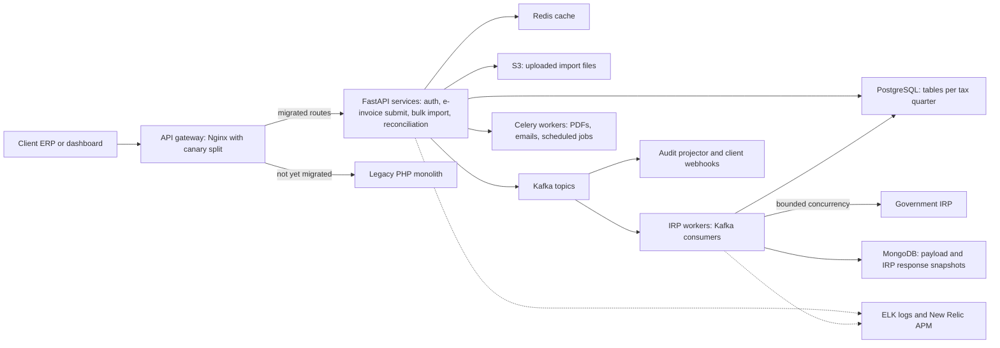
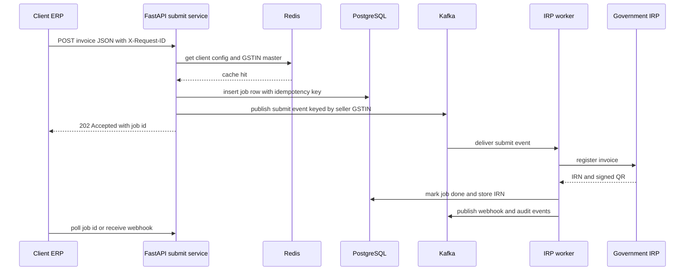
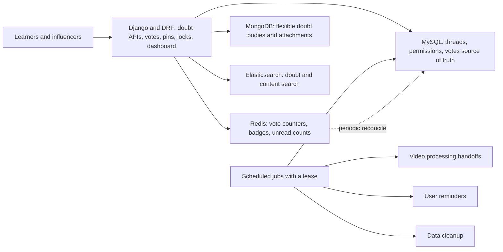

# Masters India and GeeksforGeeks Deep Dive (resume defense)

<div class="callout note">
<b>How to use this page</b>
<ul>
<li><b>What it covers:</b> the two earlier jobs on the resume. Masters India (SDE 2, Dec 2022 to Jun 2024) and GeeksforGeeks (SDE, Aug 2021 to Nov 2022). Every current PDF bullet is quoted, explained in plain English, then defended with design reasons, worked examples, numbers and practice answers.</li>
<li><b>When to read it:</b> before any round that may ask about your earlier roles, backend fundamentals (queues, caching, idempotency, migrations, observability) or Python web frameworks.</li>
<li><b>What to memorise:</b> the numbers box for each job, the Kafka vs RabbitMQ vs SQS answer, the idempotency key shape (client + file hash + batch index), the latency arithmetic (75% = (1.2 - 0.3) / 1.2) and the "Say this / don't say this" boxes.</li>
<li><b>Shorter companion:</b> the speakable interview pack is linked just below this box.</li>
</ul>
</div>

**Companion docs:** the short interview pack is [`23c_masters_gfg_interview_packs.md`](23c_masters_gfg_interview_packs.md). MongoDB and Elasticsearch detail is in [`02_mongodb_elasticsearch.md`](02_mongodb_elasticsearch.md). Every number here traces to [`GROUND_TRUTH.md`](GROUND_TRUTH.md).

**How to read the tags.** HISTORICAL means the number comes from my past work records and earlier resumes. I cannot open a dashboard today, so I state it as "what we reported". ESTIMATED means arithmetic I can show on a whiteboard, such as dividing a daily count by 86,400 seconds. MEASURED means there is a log, doc or code to point at. TARGET means a design goal, so say "targeting". Almost everything on this page is HISTORICAL or ESTIMATED, because these jobs ended in 2024 and 2022.

<div class="callout warn">
<b>Older prep vs the current PDF.</b> Older notes and resumes mention things that are not on the current PDF. Treat them like this:
<ul>
<li><b>Support tickets down 35%</b> and <b>audit-log churn down 15%</b>: older resume details, not on the current PDF. Do not lead with them. If an interviewer quotes an old resume, say "that was an earlier framing, the current one focuses on triage time and read load".</li>
<li><b>Premium subscriptions "15 to 20%"</b>: the current PDF says <b>20%</b>. Say 20%.</li>
<li><b>"2,500+ clients"</b>: dropped. Always say <b>1,500+</b>.</li>
<li><b>SMTP email sends 50% faster</b>: older GeeksforGeeks resume detail, not on the current PDF. Fine as depth if asked.</li>
<li><b>Four bullets per job</b>: older prep had four Masters bullets and four GFG bullets. The current PDF has three Masters bullets and two GFG bullets. This page follows the PDF.</li>
</ul>
</div>

---

# Part A. Masters India (SDE 2, Noida, Dec 2022 to Jun 2024)

## A1. The one-minute version (say this out loud)

"At Masters India I worked on a GST compliance and e-invoicing platform used by more than 1,500 enterprise clients in India. Clients send us their invoices. We validate them, register them with the government's Invoice Registration Portal, and hand back the legally valid e-invoice. I spearheaded the move from a legacy PHP monolith to FastAPI microservices and mentored two engineers through it. That cut p95 latency by 75%, from 1.2 seconds to 300 milliseconds, and raised throughput from 700 to 4,000 requests per minute. I also architected the bulk pipeline, built on Kafka and PostgreSQL sharded by tax quarter, which handles more than a million government submissions a day. It uses idempotency keys, dead-letter queues and bounded retries, so a flaky government portal never caused a double registration. On the operations side, ELK and New Relic tracing plus a Redis cache cut incident triage time by 70% and database read load by 30%. I also pushed test coverage from 35% to 82%, with a 98% deployment success rate."

## A2. The business in plain English

India taxes the sale of goods and services with **GST (Goods and Services Tax)**, a single national indirect tax that replaced a pile of state and central taxes in 2017. Businesses collect GST when they sell, and they claim back the GST they paid on their own purchases. That claim is called **input tax credit**. Because the credit is worth money, the government wants every business-to-business invoice to be verifiable.

That is what **e-invoicing** does. Above a turnover threshold (which the government has lowered in stages), a business must report every B2B invoice to a government system before it counts as a valid tax invoice. The government system is the **IRP (Invoice Registration Portal)**. There is more than one authorised IRP. The IRP checks the invoice and returns two things:

- An **IRN (Invoice Reference Number)**. This is a unique 64-character hash computed from the seller's GSTIN, the invoice number, the document type and the financial year. Think of it as the invoice's passport number. The same invoice always maps to the same IRN, which is why the IRP rejects a second registration of the same invoice.
- A **digitally signed QR code**. The QR code carries the key invoice details plus the government signature, so anyone can scan it and confirm the invoice is genuine.

A **GSTIN (GST Identification Number)** is the 15-character tax ID of a registered business. The first two digits are the state code, the next ten are the business's PAN (Permanent Account Number, the income-tax ID), then an entity number, a fixed letter and a check digit. Example shape: `29ABCDE1234F1Z5`. One company can hold several GSTINs, one per state it operates in.

**Who the users were.** Finance and tax teams at large Indian companies. Their ERP (accounting software) pushes invoices to us by API, or they upload big files of invoices through our dashboard. Masters India sits between the company and the government, a bit like a customs broker who knows every form and deadline.

**What hurt before.** The platform ran on a legacy PHP monolith. Older notes say it was built on Laravel, a PHP web framework. Every request held a PHP worker for its whole life, including the slow wait on the government portal. Deploys were all-or-nothing. Filing deadline days brought big spikes, and the monolith answered with queue pile-ups and timeouts. A timeout here is not cosmetic. If the invoice is not registered, the buyer cannot claim credit, and the client's finance team is on the phone.

**Why the company paid for this.** In compliance software, correctness and traceability matter more than raw speed. But speed on deadline day keeps clients, and a double registration or a lost invoice is a support crisis. The work on this page attacked both problems: speed (the migration) and safety (idempotency, retries, observability).

Here is what one invoice looks like as it arrives. This is an illustrative shape, not the real schema.

```json
{
  "client_id": 42,
  "seller_gstin": "29ABCDE1234F1Z5",
  "buyer_gstin": "07PQRSX5678K1Z2",
  "doc_type": "INV",
  "doc_no": "INV-2024-000917",
  "doc_date": "2024-01-18",
  "items": [{"hsn": "8471", "qty": 2, "unit_price": 45000, "gst_rate": 18}],
  "total_value": 106200
}
```

## A3. Words you need (Masters India)

Each term gets one plain sentence and, where it helps, an everyday analogy.

- **Monolith.** One big application that holds every feature and deploys as a single unit. Like a restaurant where one chef cooks every dish, so if the chef is stuck on one order, everyone waits.
- **Microservices.** Several small services, each owning one job (auth, invoice submit, bulk import, reconciliation), which deploy and scale on their own. Like a kitchen with stations, so a slow dessert does not block the grill.
- **FastAPI.** A modern Python web framework built on `asyncio`. It validates request bodies with Pydantic and generates OpenAPI docs automatically.
- **Pydantic.** A Python library that turns a class definition into a strict validator. If a field is missing or the wrong type, the request is rejected at the door with a clear error.
- **Async IO.** A way for one process to handle many requests at once by pausing a request while it waits on the network and serving others meanwhile. Like a waiter who takes the next table's order while the kitchen cooks, instead of standing by the stove.
- **p95 latency.** Sort all response times for a period from fastest to slowest. p95 is the time that 95% of requests beat. If p95 is 300ms, then 95 of every 100 requests finish in 300ms or less. It shows what your slow-but-normal users feel, which an average hides.
- **Strangler fig pattern.** Replace an old system piece by piece. A router sends one route at a time to the new code until the old system has nothing left to do. The name comes from the strangler fig vine, which grows around a tree until it replaces it.
- **Canary release.** Send a small slice of real traffic to the new version first, watch errors and latency, then ramp up. Miners once carried canaries to detect gas early, so the canary is your early warning.
- **Contract test.** A test that pins the exact response the old system gave and checks that the new system returns the same fields. It guarantees clients see no change during a migration.
- **Connection pooling.** Keep a set of open database or HTTP connections and reuse them, instead of opening a new one per request. Like keeping the phone line open instead of redialling for every sentence.
- **N+1 query.** A bug where code runs one query for a list and then one more query per item. 100 invoices become 101 queries. The fix is one query with a join or an `IN` list.
- **Composite index.** A database index on more than one column, such as `(client_id, invoice_date)`. It lets "this client's invoices for January" jump straight to the right rows, like a phone book sorted by surname then first name.
- **Kafka.** A distributed, durable log of messages. Producers append messages to a topic. Consumers read at their own pace and remember their position. Messages stay for a retention period even after being read, so you can replay them.
- **Partition and partition key.** A Kafka topic is split into partitions. All messages with the same key go to the same partition and stay in order. We keyed by the seller's GSTIN, so one taxpayer's events stay in order.
- **Consumer group and offset.** A consumer group is a team of consumers that share a topic's partitions. The offset is a bookmark that says how far the group has read. Different groups read the same topic independently, like two people reading the same book with their own bookmarks.
- **Celery.** A Python task queue. You call a function "later", a worker process picks it up and runs it, with built-in retry options. It is good for background jobs like PDF generation, emails and scheduled tasks.
- **Idempotency key.** A unique label for one piece of work, so doing it twice has the same effect as doing it once. Like a cheque number: the bank will not cash cheque 1047 twice. Ours was `client + fileHash + batchIndex`.
- **Exactly-once processing.** The goal that each invoice takes effect exactly one time. Networks make true exactly-once delivery very hard. In practice you get it with at-least-once delivery plus idempotency, so a duplicate delivery becomes a harmless no-op. Some people call this "effectively once".
- **DLQ (dead-letter queue).** A side queue or "parked" state where messages go after they keep failing. Like a post office's undeliverable-mail shelf: the bad letter stops blocking the line, and someone looks at it later.
- **Bounded retries.** Retry a failed call only a fixed number of times, then stop and park the work. Unbounded retries against a struggling portal just add load and never end.
- **Exponential backoff with jitter.** Wait longer after each failure (1s, 2s, 4s, 8s), and add randomness so thousands of clients do not all retry at the same instant. Like people leaving a stadium through staggered exits instead of all at once.
- **Bounded concurrency.** Cap how many calls run at the same time, for example at most N calls to the IRP in flight. It protects the downstream system and your own resources.
- **Sharding by tax quarter.** Splitting invoice data into separate tables or schemas, one per tax quarter, with the application routing each write and read to the right quarter. Like a filing cabinet with one drawer per quarter: this quarter's drawer is open all day, old drawers are rarely opened and can be archived whole.
- **Cache-aside.** The application checks the cache first. On a miss it reads the database, stores the result in the cache with an expiry, and returns it. The cache sits "aside" and the app manages it. Like checking your desk notes before walking to the library.
- **TTL (time to live) and TTL jitter.** TTL is how long a cache entry lives before it expires. TTL jitter adds a small random amount to each TTL so many keys do not expire in the same second.
- **Cache stampede (thundering herd).** When a popular key expires and hundreds of requests all miss at once and hammer the database to rebuild it.
- **SETNX lock.** Redis "SET if Not eXists". The first request to set a lock key wins and rebuilds the cache entry. Everyone else sees the lock and waits briefly or serves the slightly stale value. Like one person going to fetch the coffee for the whole table.
- **ELK.** Elasticsearch, Logstash and Kibana. Logstash (or a lightweight shipper) collects logs, Elasticsearch stores and indexes them, Kibana is the search and dashboard screen. Together they are a searchable library of every log line.
- **New Relic APM.** APM means Application Performance Monitoring. A New Relic agent runs inside the Python process and records each request's timing, database queries and outbound calls. Distributed tracing then links those timings across services into one end-to-end picture.
- **Request ID correlation.** Give every incoming request a unique ID, log it on every line, and pass it along to every downstream service, queue message and worker. Then one search for that ID shows the whole journey. Like a parcel tracking number.
- **Statement coverage.** The percentage of code statements (lines that do something) that ran at least once during the test suite. 82% means 82 of every 100 statements were exercised by tests. It does not prove the tests check the right things, only that the code ran.
- **CI/CD.** Continuous Integration and Continuous Delivery. Every change is built and tested automatically, and passing changes are deployed through an automated pipeline.
- **Deployment success rate.** The share of production deployments that went out without failing or needing a rollback.

## A4. Architecture



*What to notice: the gateway decides old vs new per route, Kafka sits between "accepted" and "sent to the government", and observability touches both the API and the workers.*

**Walking through it box by box.** A client's ERP or our dashboard calls the API gateway. During the migration the gateway (Nginx) sent each route either to the new FastAPI services or to the old PHP monolith, with a percentage split for canaries. The FastAPI services validate the request, look up hot reference data in Redis, write a job row to PostgreSQL in the table for the right tax quarter, and publish an event to Kafka. Uploaded bulk files land in S3 (AWS object storage) first. IRP workers consume from Kafka, call the government IRP with a cap on parallel calls, and write results back. MongoDB keeps snapshots of the raw invoice payload and the IRP's signed response, because those documents vary in shape. Other consumer groups on the same Kafka topics feed the audit trail and client webhooks. Celery handles background tasks like PDF generation, emails and scheduled jobs. Logs from everything flow into ELK with a request ID, and New Relic traces requests across services.

**How Kafka and Celery split, in one sentence.** Kafka carries the pipeline stages as durable, replayable events, and Celery runs the side tasks. Older notes also describe some IRP calls running through Celery workers. If asked, say "Kafka for the pipeline stages, Celery for background tasks, and the IRP callers were workers consuming those stages".

## A5. One invoice and one bulk import, step by step

### One invoice



*What to notice: the client gets a fast 202 Accepted and never waits on the government portal. The slow part happens in a worker.*

Older notes say single invoices could also be submitted synchronously when the IRP was healthy, and the long-running calls moved fully async with 202 plus polling after the early canary showed timeouts (see the failure stories in A10).

### One bulk import (sample numbers are illustrative)

1. A finance team uploads `jan_invoices.csv` with 100,000 invoices. The file goes to S3, and we compute its SHA-256 hash, for example `9f2a...`.
2. The import service splits it into chunks. With an illustrative chunk size of 1,000 rows, that is 100 chunks, numbered 0 to 99 (the batch index).
3. Each chunk gets an idempotency key such as `42:9f2a...:17` (client 42, file hash, chunk 17). Inserting that key into PostgreSQL succeeds only once.
4. Each chunk is validated: schema, GSTIN format and checksum, duplicate invoice numbers within the client's history.
5. Valid chunks are published to Kafka, keyed by seller GSTIN. Workers register them with the IRP with a cap on parallel calls and backoff on failures.
6. A chunk that keeps failing (for example the IRP keeps timing out, or a row breaks the parser) moves to dead-letter state. The other 99 chunks continue.
7. The dashboard streams progress: "97 of 100 chunks done, 2 retrying, 1 needs attention".
8. If the client uploads the same file again by mistake, the same hash produces the same keys, so nothing is registered twice.

---

## A6. Bullet MI1 decoded: PHP monolith to FastAPI, p95 1.2s to 300ms, 700 to 4,000 requests per minute

> "Reduced p95 API latency by **75%** (from **1.2s to 300ms**) across **1,500+** enterprise clients by spearheading the migration of a legacy PHP monolith to a **FastAPI** microservices architecture. Mentored two engineers through the transition, optimizing backend design to drive overall system throughput from **700 to 4,000 requests per minute**."

### In plain words

The old PHP app was slow under load because every request held a worker while it waited on the government. I led the move to FastAPI services one route at a time, so we never had a risky big-bang switch. I set the conventions and coached two engineers who each moved a service. The result was that most requests got four times faster at the slow end, and the system could take almost six times more traffic.

### How it works: the migration playbook

1. **Strangler pattern, not big bang.** New FastAPI services went behind the existing gateway one domain at a time: auth, e-invoice submit, bulk import, reconciliation. The monolith kept serving whatever was not yet migrated.
2. **Route-level canary with instant rollback.** Nginx sent a small percentage of traffic for one endpoint to the new service. We watched error rate and latency dashboards, then ramped to 100%. Rollback was a config change, not a deploy.
3. **Shared database first, split later.** During the traffic cutover, old and new code read and wrote the same database. That avoided a risky data migration at the same time as a traffic migration, and it meant there were never two sources of truth. Only after a domain's traffic was fully on FastAPI did we carve out service-owned tables.
4. **Contract tests pinned the old responses.** We recorded the monolith's responses for the top endpoints and asserted the FastAPI replacements matched field for field. Clients never saw a payload change.
5. **Async by default.** IRP calls, PDF generation, webhooks and email moved off the request thread to workers, with retries and idempotency keys.

Here is an illustrative Nginx canary. It hashes the client ID so each client consistently sees either the old or new path, which makes bug reports easier to reason about. The 5% is an example, not a remembered number.

```nginx
# Illustrative only: send ~5% of clients' e-invoice traffic to FastAPI
split_clients "${http_x_client_id}" $einvoice_upstream {
    5%   fastapi_einvoice;
    *    php_monolith;
}

location /v1/einvoice/ {
    proxy_pass http://$einvoice_upstream;
}
```

Ramping up means editing `5%` to `25%`, then `50%`, then `100%`, and reloading Nginx. Rolling back means setting it to `0%`.

And an illustrative contract test:

```python
# Recorded PHP responses live as JSON fixtures, one per endpoint and sample id
@pytest.mark.parametrize("fixture", load_php_fixtures("get_invoice"))
def test_get_invoice_matches_php(client, fixture):
    new = client.get(f"/v1/invoices/{fixture['id']}").json()
    assert new == fixture["php_response"]  # field-for-field, same types
```

### Where the latency win came from

Say this clearly: **caching alone cannot cut p95 by 75%.** The tail came down for these reasons, in order of impact.

1. **Async IO for IRP and internal fan-out calls.** In PHP, a request that waited on the IRP held a PHP-FPM worker (a PHP process) for the whole wait. With 50 workers and a slow portal, request 51 queued. In FastAPI, the request awaits the call, the process serves other requests meanwhile, and long IRP work moved to workers behind a 202.
2. **Connection pooling.** Each PHP request opened its own database connection. FastAPI services kept a pool and reused connections, which removed connect overhead and connection storms under load.
3. **Query fixes found during the rewrite.** Missing composite indexes on `(client_id, invoice_date)`, N+1 queries on list endpoints, and missing pagination.
4. **Redis for hot reads.** Client config, tax rates and auth context came from cache. This mostly helped the middle of the distribution (p50) and read-heavy endpoints.

A short way to remember it: async plus pooling plus query fixes moved the tail, and the cache moved the body.

An illustrative async call with a shared, pooled client and a hard timeout:

```python
irp_http = httpx.AsyncClient(
    timeout=httpx.Timeout(10.0),                    # older notes: we set 10s
    limits=httpx.Limits(max_connections=50),        # pool size is illustrative
)

async def call_irp(payload: dict, token: str) -> dict:
    resp = await irp_http.post(IRP_URL, json=payload,
                               headers={"Authorization": f"Bearer {token}"})
    resp.raise_for_status()
    return resp.json()
```

And the N+1 fix in SQL terms:

```sql
-- Before: one query for the list, then one query per invoice for its items
SELECT id FROM invoices WHERE client_id = 42 AND invoice_date >= '2024-01-01';
SELECT * FROM invoice_items WHERE invoice_id = 1001;  -- repeated 100 times

-- After: one query, served by an index on (client_id, invoice_date)
SELECT i.id, it.*
FROM invoices i
JOIN invoice_items it ON it.invoice_id = i.id
WHERE i.client_id = 42 AND i.invoice_date >= '2024-01-01'
ORDER BY i.invoice_date
LIMIT 100 OFFSET 0;
```

### Mentoring two engineers

Two engineers each owned the extraction of a service. I set the conventions: a router, service and repository layering, Pydantic schemas at the boundary, and shared retry and idempotency helpers. I reviewed every PR closely in the first months and paired with them on the first canary cutover. By the end, both were shipping services on their own. Note that this is **mentored 2 at Masters India**. It is different from **led 3 engineers on the Uber FRM ORM migration**. Never merge them.

### Why this design, and the alternatives

**What:** an incremental strangler migration to FastAPI microservices with per-route canaries.

**Why:** this is a compliance product with zero tolerance for a broken filing day. Per-route cutover gave us instant rollback and let us learn on low-risk routes first.

**Alternatives considered and why not:**
- *Big-bang rewrite.* One cutover day for everything. Too risky for a compliance product, and any bug hits every client at once.
- *Tune the PHP monolith in place.* We could add caching and indexes, but the core problem (a blocking worker per request during slow government calls) is architectural.
- *Django instead of FastAPI.* Django is excellent for admin-heavy, CRUD-style apps. Here the hot path was waiting on third-party government APIs, which favours async-native FastAPI. FastAPI also gives Pydantic validation at the boundary and OpenAPI docs that enterprise clients used.
- *Flask.* Light and familiar, but not async-native in the way we needed and no built-in validation.

**Trade-off:** more services means more deploys, more dashboards and more network hops. A shared database during cutover also means the services are not truly independent until the split.

**What I'd do differently:** I would put the contract-test recorder in place before the first route moved, not alongside it. I would also agree timeout budgets per route with the team before the first canary, because our first canary exposed a timeout mismatch (see A10).

### The numbers

| Number | What it measures | Tag |
|---|---|---|
| 75% p95 cut | Slow-end API response time across client-facing APIs | HISTORICAL |
| 1.2s to 300ms | The p95 before and after | HISTORICAL |
| 1,500+ | Enterprise clients using the platform | HISTORICAL |
| 700 to 4,000 requests per minute | Sustained system throughput before and after | HISTORICAL |
| 2 | Engineers I mentored | HISTORICAL |

**How 75% is derived.** (1.2 - 0.3) / 1.2 = 0.9 / 1.2 = 0.75, so 75%. Another way to say it: the slow end got four times faster (1.2 / 0.3 = 4).

**How the throughput converts.** 700 requests per minute / 60 = about 11.7, call it about 12 requests per second (RPS). 4,000 / 60 = about 66.7, call it about 67 RPS. The ratio is 4,000 / 700 = about 5.7 times. RPS on its own is not on the PDF. Use it only if asked.

**Why it mattered.** Filing-deadline days are when clients judge you. Faster, more predictable responses meant fewer timeouts and fewer angry finance teams on those days.

**How to say it.** "We cut p95 from 1.2 seconds to 300 milliseconds, a 75% drop, for 1,500-plus enterprise clients, and throughput went from 700 to 4,000 requests per minute."

**What not to say.** Do not say "2,500+ clients". Do not credit the whole p95 win to Redis. If they quote older resumes with "1,000 to 1,200 milliseconds" or "300 to 400 milliseconds", say that was the same improvement stated as a band, and the PDF uses the endpoints 1.2 seconds and 300 milliseconds.

### Questions they will ask

**"Why strangler instead of a rewrite?"**
I chose the strangler approach because this was a compliance product and a broken filing day was not acceptable. Moving one route at a time behind the gateway meant every step was small, observable and reversible with a config change. We started with lower-risk routes, built confidence, and only then moved the money paths like e-invoice submit. A big-bang rewrite would have put every client at risk on a single day.
*Follow-up they may ask:* "How did you decide the order?" Say: lower-risk, high-learning routes first, then the hot and critical paths once the conventions were proven.

**"Did you do dual writes during the migration?"**
No, we avoided dual writes on purpose. Old and new code shared one database during the traffic cutover, so there was only ever one source of truth. Once a domain's traffic was 100% on FastAPI, we moved its tables to service ownership. Dual writes create reconciliation problems, and in a tax product that is the last thing you want.

**"What exactly did 'mentored two engineers' look like?"**
Two engineers each owned extracting a service, and I owned the playbook and conventions. I set the layering (router, service, repository), Pydantic schemas at the boundary, and shared helpers for retries and idempotency. I reviewed their PRs closely early on and paired with them on the first canary cutover. By the end, both were shipping services independently.

**"Why FastAPI and not Django or Flask?"**
FastAPI because the hot path was waiting on government APIs, and async IO lets one process serve other requests during that wait. Pydantic gave strict validation at the boundary, which matters when bad data means a rejected tax document. It also generates OpenAPI docs that enterprise clients used to integrate. Django would have been fine for an admin-heavy app, and I had used it at GeeksforGeeks, but it was the wrong fit for an async fan-out workload.

---

## A7. Bullet MI2 decoded: Kafka plus PostgreSQL sharded by tax quarter, 1M+ daily submissions, 100K+ idempotent imports

> "Architected a **high-concurrency** bulk e-invoicing pipeline processing **1M+** daily government submissions by orchestrating a **Kafka** event bus and a **PostgreSQL** database horizontally sharded by tax quarter. Enforced exactly-once, **idempotent** processing for **100K+** concurrent imports with **fault-tolerant state management** via dead-letter queues and bounded retries against volatile state IRP portals."

### In plain words

Clients send invoices in huge batches, often right before a deadline, and the government portal is slow and sometimes down. I designed the pipeline so that we accept the work fast, queue it durably in Kafka, send it to the government at a safe pace, and never register the same invoice twice even when we retry. Invoice data lives in PostgreSQL split by tax quarter, so the busy current quarter stays small and fast. Anything that keeps failing is parked for a human instead of blocking everyone else.

### How it works, part 1: Kafka as the event bus

Kafka topics carried the pipeline stages: accepted import chunks, IRP submit jobs, signed-response persistence (MongoDB snapshots), client webhooks and an audit projector. The partition key was the **seller GSTIN** (sometimes GSTIN plus document type). That kept one taxpayer's submit, IRN callback and webhook in order on one partition, while different taxpayers spread across partitions and ran in parallel.

```python
# Illustrative producer using an asyncio Kafka client
await producer.send_and_wait(
    "einvoice.submit",
    key=event["seller_gstin"].encode(),        # same GSTIN -> same partition -> ordered
    value=json.dumps(event).encode(),
    headers=[("x-request-id", request_id.encode())],
)
```

Because the log is durable, we could reset a consumer group's offset and reprocess a window of messages after fixing a parser bug. Several consumer groups read the same topic independently: the IRP workers, the audit projector and metrics.

### How it works, part 2: Kafka vs RabbitMQ vs SQS

This question comes up a lot because Masters India ran on AWS, where SQS is the default answer.

| Need | Kafka | RabbitMQ | Amazon SQS |
|---|---|---|---|
| Ordering per taxpayer | Yes, per partition key | Per queue, harder to scale per key | FIFO queues per message group, with throughput limits |
| Replay after a bug | Yes, reset offsets, data is retained | Messages are gone once acked | Messages are deleted once processed |
| Several independent readers of the same events | Yes, consumer groups | Needs fanout exchanges and extra queues | Needs SNS fanout to several queues |
| Operations cost | Highest | Medium | Lowest, fully managed |

**The reasoning in prose.** We needed three things together. First, per-taxpayer ordering, so the submit, the callback and the webhook for one GSTIN never ran out of order. Second, durable replay, because GST disputes and parser bugs meant we sometimes had to reprocess a window of events, and SQS and RabbitMQ delete messages once they are acknowledged. Third, several independent readers (IRP workers, audit projector, metrics) on the same stream without fanout plumbing. RabbitMQ could have handled the task dispatch at our scale, and I say that honestly. SQS would have been the cheapest to run. We still picked Kafka because replay and multi-reader audit were first-class needs, and older notes say the team already had an asyncio Kafka client (older resumes call it AsyncIOKafka) in the FastAPI stack. The trade-off was operational cost, and correctness plus replay won.

### How it works, part 3: idempotency, the heart of the design

Registering an invoice twice with the government is not recoverable in a clean way, so every unit of work carries an idempotency key. For bulk imports the key is `client + fileHash + batchIndex`, plus the client's own invoice reference for single invoices. PostgreSQL enforces uniqueness, so the second attempt does nothing.

```sql
-- Illustrative shape, not the production schema
CREATE TABLE import_batches_q4 (
  idempotency_key TEXT PRIMARY KEY,          -- '42:9f2a...:17'
  client_id       BIGINT      NOT NULL,
  status          TEXT        NOT NULL,      -- PENDING, SUBMITTED, DONE, DEAD
  attempts        INT         NOT NULL DEFAULT 0,
  last_error      TEXT,
  created_at      TIMESTAMPTZ NOT NULL DEFAULT now()
);

INSERT INTO import_batches_q4 (idempotency_key, client_id, status)
VALUES ('42:9f2a...:17', 42, 'PENDING')
ON CONFLICT (idempotency_key) DO NOTHING
RETURNING idempotency_key;   -- no row returned means "already seen, skip"
```

On a conflict the worker looks up the existing row's status. It skips the IRP call only if the batch is already `registered`. A `PENDING` or failed batch (including a DLQ replay) retries through the same key, so the key prevents a double registration without blocking a legitimate retry.

**What "exactly-once" means here.** The PDF says exactly-once, idempotent processing. The honest engineering meaning is at-least-once delivery plus an idempotency key. Kafka or a retry may deliver the same chunk twice, and the key turns the second delivery into a no-op. The IRP is outside our database transaction, so nothing can make the network call itself happen exactly once. The key and the IRP's own duplicate check are what make the effect happen once.

### How it works, part 4: bounded retries, backoff with jitter, and the DLQ

The government IRPs are volatile: slow on deadline days, sometimes returning errors, sometimes down for a while. We split failures into two kinds:

- **Retryable** (timeouts, 5xx server errors, rate limits): retry with exponential backoff and jitter, up to a fixed limit.
- **Not retryable** (a validation error such as an invalid GSTIN or a malformed field): mark the row failed with the reason at once. Retrying a bad invoice will never fix it.

```python
# Illustrative: limits and delays are example values
MAX_ATTEMPTS, BASE, CAP = 5, 1.0, 60.0
irp_slots = asyncio.Semaphore(20)            # bounded concurrency toward the IRP

async def submit_chunk(chunk):
    for attempt in range(MAX_ATTEMPTS):
        try:
            async with irp_slots:
                return await call_irp(chunk.payload, await irp_token())
        except (httpx.TimeoutException, IRPServerError):
            delay = random.uniform(0, min(CAP, BASE * 2 ** attempt))  # full jitter
            await asyncio.sleep(delay)
        except IRPValidationError as e:
            return await mark_failed(chunk, reason=str(e))          # no retry
    await move_to_dead_letter(chunk)          # parked for operator replay
```

With the example values, the waits are random within 0 to 1s, then 0 to 2s, 0 to 4s, 0 to 8s, 0 to 16s. Five attempts, then the chunk is parked. The jitter matters. Without it, 1,000 chunks that failed together would retry together and knock the portal over again.

**The DLQ.** Poison batches (ones that keep failing) moved to a dead-letter state with the error attached. The rest of the import kept going. An operator could inspect the batch, fix the cause, and replay it. Because the idempotency key is stable, replay is safe.

**Fault-tolerant state.** "Fault-tolerant state management" on the PDF means the progress of every import survives crashes. The pieces are Kafka offsets (where each consumer group is), PostgreSQL job rows (the status of each chunk) and the DLQ (what is parked). If a worker dies mid-chunk, the message is delivered again, the key prevents a double effect, and the job row shows the truth.

**Circuit breaker (verbal only).** When the IRP error rate spiked, we could stop sending for a short time and show clients a "portal degraded" status rather than piling retries on a failing portal. This is verbal prep, not a resume metric.

### How it works, part 5: PostgreSQL sharded by tax quarter

GST work is period-based. Filing deadlines create spikes, writes concentrate in the current period, and older periods are mostly read for reconciliation and audits. We used the **tax quarter** as the unit. Each quarter's invoice data lived in its own tables or schema, and the application's data-access layer picked the right one from the invoice date.

```python
# Illustrative routing helper. Indian financial year runs April to March.
def tax_quarter(d: date) -> str:
    fy_start = d.year if d.month >= 4 else d.year - 1
    q = ((d.month - 4) % 12) // 3 + 1          # Apr-Jun = Q1 ... Jan-Mar = Q4
    return f"fy{fy_start}_q{q}"

tax_quarter(date(2024, 1, 18))   # 'fy2023_q4'
```

**Why it helps.** The hot quarter's tables and indexes stay small, so inserts and lookups are fast. Old quarters can be archived or moved to cheaper storage as a whole unit without touching the hot set. Runbooks are clear: "archive fy2022_q1" is one operation.

**Say this carefully.** The PDF says "horizontally sharded by tax quarter". In practice, describe it as quarter-scoped tables or schemas with routing in application code. Do not claim one database server per quarter unless you clearly remember that. If asked about naming or whether quarters followed the financial year, say the routing derived the quarter from the invoice date and keep the naming qualitative.

**Alternatives.** PostgreSQL's native declarative partitioning (`PARTITION BY RANGE (invoice_date)`) gives similar pruning with less app code. Hash sharding by client spreads load evenly but does not give "drop a whole cold quarter" and mixes hot and cold data. A single big table is simplest but its indexes grow forever and every insert pays for that.

**Trade-off.** We owned routing in application code, which is more moving parts than native partitions. The footgun is a write landing in the wrong quarter. We derived the quarter from the invoice date at the API boundary and rejected mismatches.

**What I'd do differently.** Today I would start with PostgreSQL native range partitioning by invoice date and only add app-level routing if we needed to move quarters across servers.

### Why this design overall, and what I'd change

**What:** accept fast, queue durably in Kafka, submit at a bounded pace, enforce idempotency in PostgreSQL, park poison work in a DLQ.

**Why:** the government portal is the slowest and least reliable component, and a double registration is the worst possible bug. The design isolates the portal's problems from clients and makes every retry safe.

**Alternatives:** synchronous submission from the API (simple, but every client waits on the portal and deadline spikes become timeouts); fire-and-forget retries (fast to build, but they cause duplicates and retry storms); SQS or RabbitMQ (covered above).

**Trade-off:** more infrastructure to run (Kafka) and eventual consistency for the client, who sees "accepted" and then "registered" a little later.

**What I'd do differently:** writing a job row to PostgreSQL and publishing to Kafka are two separate writes. If the process died between them, the idempotency key makes a later re-publish harmless, but a row could sit in PENDING until someone noticed. Today I would use a **transactional outbox**: write the event into an `outbox` table in the same database transaction as the job row, and let a relay publish it to Kafka. If you do not remember the exact recovery mechanism we used, say so, and describe the outbox as the improvement.

### The numbers

| Number | What it measures | Tag |
|---|---|---|
| 1M+ per day | Government (IRP) submissions processed daily | HISTORICAL |
| about 12 per second average | 1,000,000 / 86,400 | ESTIMATED |
| about 8 to 10 times average at peaks | Filing-deadline bursts, roughly 100+ per second | ESTIMATED |
| 100K+ | Invoices in flight across concurrent bulk imports with idempotent processing | HISTORICAL |

**How to derive the average.** A day has 24 × 60 × 60 = 86,400 seconds. 1,000,000 / 86,400 = about 11.6, call it about 12 transactions per second (TPS) on average. Traffic is not flat. Around filing deadlines it bursts to roughly 8 to 10 times that, so about 96 to 120, which we round to "100+ TPS at peak". That peak figure is an estimate, so say "roughly".

**How 1M per day relates to 4,000 requests per minute.** They measure different things. The 1M is IRP-registered documents per day. The 700 to 4,000 requests per minute is API throughput at the gateway and services under load. They are complementary, not the same meter. It is a coincidence that 700 per minute (about 12 per second) and 1M per day (about 12 per second) round to the same number.

**About "100K+ concurrent imports".** Older prep framed this as 100K+ invoices per bulk import. The safest spoken version is "bulk imports of 100K-plus invoices, processed concurrently with idempotency keys". If someone asks "100,000 separate files at the same time?", clarify that it is 100K-plus invoice records in flight across concurrent bulk imports.

**Why it mattered.** Deadline-day bursts are when clients upload everything at once. The pipeline turned a spike that would have caused timeouts into a queue that drains at a safe pace, with no duplicate registrations.

**How to say it.** "The pipeline handled more than a million government submissions a day. That is about 12 per second on average, and we sized for roughly 8 to 10 times that around filing deadlines."

**What not to say.** Do not put TPS or RPS on the resume or present them as measured. Do not say Flink. Flink was at Uber Menu, not Masters India. This Kafka is a different product from the Uber Menu Kafka. Do not call this "payments" or "money movement". Do not say zero message loss.

### Questions they will ask

**"Why Kafka instead of RabbitMQ or SQS? You were on AWS."**
I picked Kafka because we needed per-taxpayer ordering, durable replay and several independent readers of the same events. We keyed by seller GSTIN, so one taxpayer's submit, callback and webhook stayed in order. After a parser bug we could reset a consumer group and reprocess that window, which SQS and RabbitMQ cannot do cheaply because they delete messages once acknowledged. The IRP workers, the audit projector and metrics each read the same topic with their own consumer group. RabbitMQ could have handled task dispatch at our scale, and SQS is cheaper to operate, so the trade-off was ops cost. Replay and audit won for a GST product.
*Follow-up they may ask:* "What about SQS FIFO?" FIFO gives ordering per message group, but it caps throughput per group, and you still lose replay once messages are processed.

**"How do you guarantee you never register an invoice twice?"**
Every unit of work has an idempotency key, client plus file hash plus batch index for imports, plus the client's invoice reference. PostgreSQL enforces that key as unique, so a second attempt inserts nothing and is skipped. Kafka delivery is at-least-once, so duplicates do arrive, but they become no-ops. The IRP also rejects a duplicate of the same invoice, which is a second safety net, not the main one.

**"What does exactly-once really mean in your bullet?"**
It means each invoice takes effect once, achieved with at-least-once delivery plus idempotency. True exactly-once across a network call to a government portal is not possible, because the portal is outside our transaction. So the guarantee lives in the key and the unique constraint. I would never claim two-phase commit with the government.

**"Why shard by tax quarter instead of plain partitioning?"**
Because GST work is period-based. Writes land in the current quarter and older quarters are mostly reconciliation and audit reads. Separate quarter tables keep the hot indexes small and let us archive a whole cold quarter in one operation. The cost is routing in application code, and the risk is a wrong-quarter write, which we blocked by deriving the quarter from the invoice date at the API boundary. Today I would start with PostgreSQL's native range partitioning.

**"What happens when the IRP is down for 20 minutes?"**
Workers hit timeouts, back off with jitter and retry up to the limit. Chunks that exhaust their retries move to dead-letter state, and the dashboard shows them as needing attention. New work keeps queuing in Kafka, so nothing is lost, and when the portal recovers the backlog drains at our bounded pace. Operators can replay parked chunks safely because the idempotency keys are stable.

---

## A8. Bullet MI3 decoded: ELK and New Relic, triage -70%, Redis -30% reads, coverage 35% to 82%, 98% deploy success

> "Decreased incident triage time by **70%** and lowered database read load by **30%** by instrumenting **ELK** and **New Relic** distributed tracing alongside a Redis caching layer. Hardened the CI/CD release cycle by driving test coverage from **35% to 82%**, achieving a **98%** deployment success rate across the microservices ecosystem."

### In plain words

Before, finding out why one client's invoice failed meant logging into servers and searching text files by hand. I made every log line structured and tagged with a request ID, shipped them to one searchable place (ELK), and added New Relic tracing across services. Now one search shows the whole journey of a request. Separately, a Redis cache stopped us reading the same reference data from the database over and over. And I raised test coverage so deploys stopped breaking.

### How it works: observability

**Before:** SSH into boxes and `grep` through log files, with no way to connect an API log to the worker that called the IRP.

**After:**
1. Every request gets a request ID at the edge, either from the client's `X-Request-ID` header or generated.
2. Every log line is JSON and includes that ID.
3. The ID travels in Kafka message headers, so the IRP worker logs the same ID.
4. Logs ship to Elasticsearch, and Kibana searches them.
5. New Relic APM traces show where time went: database, Redis, IRP call.
6. Alert rules fire on error rate and latency, so we hear about problems before clients do.

```python
# Illustrative FastAPI middleware for request ID correlation
request_id_var: ContextVar[str] = ContextVar("request_id", default="-")

@app.middleware("http")
async def add_request_id(request: Request, call_next):
    rid = request.headers.get("X-Request-ID") or uuid4().hex
    request_id_var.set(rid)
    response = await call_next(request)
    response.headers["X-Request-ID"] = rid
    return response
```

A log line then looks like this (illustrative):

```json
{"ts":"2024-01-18T10:42:07Z","level":"ERROR","service":"irp-worker",
 "request_id":"7f3c9a1e","client_id":42,"chunk":"42:9f2a...:17",
 "event":"irp_timeout","attempt":3,"elapsed_ms":10002}
```

In Kibana, the query `request_id:"7f3c9a1e"` returns the API log, the Kafka consumer log and the IRP worker log for that one request, in order. That single search replaced half an hour of SSH and grep.

**Honesty point.** Claim on-call **alerting** and faster triage. Do not invent a formal pager rotation or an incident-commander title.

### How it works: the Redis cache-aside layer

Hot keys were the lookups that every invoice repeats: client config and feature flags, GSTIN master data, tax-rate masters, session and auth context, and IRP auth tokens. IRP tokens get a TTL shorter than the token's own lifetime (a few hours) with a safety margin.

```python
# Illustrative cache-aside with TTL jitter and a SETNX lock
async def get_client_config(client_id: int) -> dict:
    key = f"cfg:{client_id}"
    if (hit := await redis.get(key)) is not None:
        return json.loads(hit)

    if await redis.set(f"lock:{key}", "1", nx=True, ex=5):   # SETNX with expiry
        try:
            cfg = await db.fetch_client_config(client_id)
            ttl = 600 + random.randint(0, 120)               # TTL jitter
            await redis.set(key, json.dumps(cfg), ex=ttl)
            return cfg
        finally:
            await redis.delete(f"lock:{key}")

    await asyncio.sleep(0.05)                                # someone else is rebuilding
    hit = await redis.get(key)
    return json.loads(hit) if hit else await db.fetch_client_config(client_id)


async def update_client_config(client_id: int, new: dict) -> None:
    await db.update_client_config(client_id, new)
    await redis.delete(f"cfg:{client_id}")                   # invalidate on write
```

**Invalidation rules.** Config and GSTIN data were deleted from cache inside the update path, so admins never saw stale credentials or settings. Slowly changing masters such as tax rates used TTL-only expiry with jitter.

**Why 30% fewer reads is plausible.** In a 100K-row import, every row needs the same client config and the same GSTIN and tax-rate checks. Without a cache, that is the same few reads repeated many thousands of times. Here is an illustrative way to picture it, not a measurement: if an endpoint does 10 database reads per request and 3 of them are always the same client config and tax-rate lookups, caching those 3 removes 30% of reads.

### How it works: coverage and deploy safety

Coverage went from 35% to 82% with pytest, enforced as a CI gate, so a PR that dropped coverage below the threshold could not merge. We focused on money paths first: registration, reconciliation and imports.

```bash
# Illustrative CI step: fail the build if coverage drops below the gate
pytest --cov=app --cov-report=term-missing --cov-fail-under=<threshold>
```

**Statement coverage in one example.** This function has four statements.

```python
def gst_amount(value, rate):        # 1
    if rate < 0:                    # 2
        raise ValueError("bad rate")  # 3
    return value * rate / 100       # 4
```

A test that only calls `gst_amount(1000, 18)` runs statements 1, 2 and 4, so coverage is 3 / 4 = 75%. Adding a test with a negative rate covers statement 3 and brings it to 100%.

### Why this design, and the alternatives

**Observability.** *What:* ELK for logs, New Relic for traces and APM, one request ID everywhere. *Why:* the main pain was correlation across API, queue and worker. *Alternatives:* plain CloudWatch logs on AWS (cheaper, weaker search and dashboards for our needs), Datadog (strong, but New Relic was what we used). *Trade-off:* ELK storage and retention cost grows with log volume. *What I'd do differently:* adopt OpenTelemetry from day one so tracing is vendor-neutral.

**Cache.** *What:* cache-aside in Redis with TTL jitter, a SETNX lock and invalidate-on-write. *Why:* the app controls exactly what is cached, and a Redis outage degrades to slower database reads instead of failures. *Alternatives:* write-through everywhere (every write updates the cache, more complex and caches data nobody reads), in-process caches (fast but inconsistent across many service instances). *Trade-off:* a short window of staleness on TTL-only keys.

### The numbers

| Number | What it measures | Tag |
|---|---|---|
| 70% triage cut | Time from alert to knowing the cause | HISTORICAL, baseline ESTIMATED |
| 30% read cut | Redundant database reads removed by Redis | HISTORICAL |
| 35% to 82% | Test coverage across the services | HISTORICAL |
| 98% | Deployments that succeeded without failure or rollback | HISTORICAL |

**Triage arithmetic.** The baseline is ESTIMATED at about 30 minutes, and after the change it was under 10 minutes. (30 - 9) / 30 = 21 / 30 = 0.70, so 70%. Say "roughly 30 minutes to under 10".

**Coverage arithmetic.** From 35% to 82% is 47 percentage points, or about 2.3 times the covered code.

**98% deploy success.** 98 out of every 100 production deploys went out without failing or needing a rollback. Do not invent a deploy count.

**How to say it.** "Triage went from roughly half an hour to under ten minutes, about 70% faster, because one request ID connected the API, the Kafka consumer and the IRP worker. Redis cut redundant database reads by 30%. Coverage went from 35% to 82%, and we hit a 98% deployment success rate."

**What not to say.** Do not present "support tickets down 35%" or "audit-log churn down 15%" as current claims. They are older resume details, not on the current PDF. Do not claim to have run a formal pager rotation.

### Questions they will ask

**"Prove the 70% triage number is not a vanity metric."**
The improvement was correlation, not a nicer dashboard. Before, we had to SSH into boxes and grep, and nothing connected an API log to the worker that called the government portal. After, one request ID followed a transaction through the API, the Kafka consumer and the IRP worker, and New Relic showed where the time went. The baseline of roughly 30 minutes is my estimate, and the 70% cut is what we reported, so I say it as "roughly 30 minutes down to under ten".

**"Walk me through your cache-aside design."**
On a read, we check Redis first. On a miss we read the database, store the value with a TTL plus a little random jitter, and return it. Config and GSTIN entries are deleted inside the update path so they are never stale, while slow-changing masters such as tax rates just expire. To stop a stampede when a hot key expires, one request takes a SETNX lock and rebuilds while the others wait briefly or serve the slightly older value.

**"Caching cannot explain a 75% p95 drop. So what did?"**
Agreed, and I never claim it does. The tail came from async IO for government calls, connection pooling and query fixes like composite indexes and removing N+1 queries. Redis mainly helped the middle of the distribution and read-heavy endpoints, and it removed 30% of redundant reads. The short version is that async and query work moved the tail and the cache moved the body.

---

## A9. Tech used at Masters India and why

| Tech | What it is in one line | Why here | Alternative considered |
|---|---|---|---|
| Python | General-purpose language | Team language, strong async and data libraries | n/a |
| FastAPI | Async Python web framework | Async IRP calls, Pydantic validation, OpenAPI docs | Django, Flask |
| Kafka | Durable, replayable event log | Per-GSTIN ordering, replay, many consumer groups | RabbitMQ, SQS |
| PostgreSQL | Relational database | System of record for invoices and job state, unique constraints for idempotency | MySQL |
| MongoDB | Document database | Snapshots of variable-shape invoice payloads and IRP responses | PostgreSQL JSONB |
| Redis | In-memory key-value store | Cache-aside for hot reference data, locks | In-process cache |
| Elasticsearch | Search engine | The "E" in ELK, searchable logs, invoice search | CloudWatch Logs |
| Celery | Python task queue | PDFs, emails, scheduled background jobs | Plain cron, RQ |
| Docker | Container packaging | Same image in test and production | VMs |
| ELK | Elasticsearch, Logstash, Kibana | Central, searchable logs with request IDs | CloudWatch |
| New Relic | APM and distributed tracing | Where did the time go, across services | Datadog |
| AWS | Cloud provider | Hosting, S3 for uploaded import files | n/a |

More on the MongoDB and Elasticsearch split is in [`02_mongodb_elasticsearch.md`](02_mongodb_elasticsearch.md).

## A10. Hard problems and failure stories

**1. The canary timeout mismatch.**
*What broke:* in the first canary, some requests that worked on PHP failed on FastAPI. *How we found it:* the canary dashboards showed a rise in errors on the new route only. *Cause:* PHP allowed 60 seconds per request and we had set 10 seconds on the new service. Some IRP calls legitimately took longer than 10 seconds. *Fix:* we moved those IRP calls fully async and returned 202 Accepted with polling, instead of raising the timeout. *What I learned:* agree a timeout budget per route before the first canary, and treat "slow but legitimate" calls as async work, not as a reason to raise timeouts. This is also a good example of why canaries exist: we caught it at a small percentage, before a full ramp.

**2. Retry storms against the portal.**
*Risk:* when the IRP slowed down, naive retries would all fire at the same time and make the outage worse. *Fix:* exponential backoff with full jitter, a cap on parallel calls, and bounded attempts followed by dead-letter state. *Lesson:* retries are a load source. Always cap them and spread them.

**3. Poison batches.**
*Problem:* one malformed chunk could block an import if it kept failing. *Fix:* separate validation errors (fail at once with a reason) from transient errors (retry), and park repeat failures in the DLQ so the other chunks finish. *Lesson:* isolate failure to the smallest unit you can.

**4. Cache stampede on hot keys.**
*Risk:* a popular config key expiring during a 100K-row import would send a burst of identical reads to the database. *Fix:* TTL jitter so keys do not expire together, and a SETNX lock so only one request rebuilds.

## A11. Say this / don't say this (Masters India)

<div class="callout warn">
<b>Say this</b>
<ul>
<li>"1,500+ enterprise clients", "from 1.2 seconds to 300 milliseconds", "from 700 to 4,000 requests per minute", "mentored two engineers".</li>
<li>"Exactly-once in effect, meaning at-least-once delivery plus idempotency keys. The IRP is outside our transaction."</li>
<li>"About 12 per second on average, roughly derived from 1M divided by 86,400. Peaks were an estimated 8 to 10 times that."</li>
<li>"Quarter-scoped tables or schemas, with the quarter derived from the invoice date in application code."</li>
<li>"Triage went from roughly 30 minutes to under 10." Say the baseline is an estimate.</li>
</ul>
<b>Don't say this</b>
<ul>
<li>"2,500+ clients". "Support tickets down 35%" or "audit churn down 15%" as current claims.</li>
<li>Flink at Masters India. That was Uber Menu. Do not merge the Masters Kafka with the Uber Menu Kafka.</li>
<li>"Led 3 engineers" here. That is Uber FRM. At Masters it is "mentored 2".</li>
<li>Zero message loss, two-phase commit with the government, payments or money movement.</li>
<li>A formal pager rotation or incident-commander title.</li>
<li>That Redis alone produced the p95 drop.</li>
</ul>
</div>

## A12. Three-minute whiteboard script (Masters India)

1. **Draw first (30 seconds):** client ERP on the left, government IRP on the right. Say: "We sit in the middle. Clients send invoices, we validate and register them with the government, and return the IRN and signed QR."
2. **Draw second (60 seconds):** the gateway with two arrows, one to the PHP monolith and one to FastAPI services. Say: "We migrated route by route with canaries. That plus async IO, pooling and query fixes took p95 from 1.2 seconds to 300 milliseconds, and throughput from 700 to 4,000 requests per minute."
3. **Draw third (60 seconds):** Kafka between the API and the IRP workers, PostgreSQL with quarter drawers, a DLQ box. Say: "Accept fast, queue durably, submit at a bounded pace. The idempotency key is client plus file hash plus batch index, so retries are safe. More than a million submissions a day, about 12 per second on average with deadline peaks of roughly 8 to 10 times."
4. **Draw last (30 seconds):** Redis next to the API, ELK and New Relic underneath. Say: "Cache-aside cut redundant reads 30%. One request ID across services cut triage 70%. Coverage went from 35% to 82%, with 98% of deploys succeeding."

---

# Part B. GeeksforGeeks (SDE, Noida, Aug 2021 to Nov 2022)

## B1. The one-minute version (say this out loud)

"At GeeksforGeeks I worked on the courses platform and the influencer dashboard. The doubt-support platform, where learners ask questions on courses and articles, was struggling under contest-day spikes, so I helped migrate its backend from PHP to Django. It then handled more than 10,000 daily queries and 10x traffic spikes during live coding contests. I built the REST APIs for voting, pinning and locking threads on MySQL, MongoDB, Redis and Elasticsearch, and the growth team attributed a 20% lift in premium subscriptions to that work. I also launched an influencer analytics and earnings dashboard, which the business tied to a 30% rise in course sales, and built scheduled workflows for video processing, reminders and data cleanup that raised engineering operational efficiency by 70%."

## B2. The business in plain English

GeeksforGeeks is a large computer-science learning site with articles, paid courses and live coding contests. Learners who get stuck post a **doubt** (a question) on a course or article, and mentors or other learners answer. Good answers get voted up, the best one can be pinned, and a moderator can lock a thread that is resolved or going off-track. Some of these interactions were premium features, which is how this work connects to subscriptions.

**Influencers** are creators (YouTubers and educators) who promote GeeksforGeeks courses with affiliate coupon codes and earn a share of sales. They needed a dashboard to see their transactions, coupon conversions and earnings.

**What hurt before.** The doubt-support backend ran on legacy PHP and wobbled during live contests, when traffic jumped about tenfold within minutes. Influencers had little visibility into their earnings. The ops team did repetitive manual work on video processing, reminders and cleanup.

## B3. Words you need (GeeksforGeeks)

- **Django.** A "batteries included" Python web framework with an ORM, an admin panel, authentication and migrations built in. Like a fully furnished flat: you move in and start living.
- **DRF (Django REST Framework).** A library on top of Django for building REST APIs, with serializers (validate and convert data), viewsets and permissions.
- **ORM (Object Relational Mapper).** Code that lets you work with database rows as Python objects instead of writing SQL by hand.
- **REST API.** An HTTP interface where URLs name resources (`/doubts/123/votes`) and HTTP verbs (GET, POST, PATCH, DELETE) act on them.
- **Hot row.** A single database row that many requests try to update at the same moment, for example the vote count on a viral post. Each update waits for the row lock, so they queue up. Like one checkout counter that everybody lines up at.
- **Denormalized counter.** Storing a precomputed total (like `vote_count`) next to the data instead of counting the votes table every time. Fast to read, but it must be kept in sync.
- **Unique constraint.** A database rule that a combination of columns, such as `(user_id, doubt_id)`, can appear only once. It makes "vote twice" impossible at the database level.
- **Reconciliation job.** A periodic job that recomputes a total from the source of truth and fixes any drift in the fast copy.
- **Cron and scheduled workflows.** Cron is the classic Unix scheduler that runs a command at set times ("every night at 2 AM"). "Asynchronous scheduled workflows" on the PDF means jobs that run on a schedule in the background, not inside a user request.
- **Lease or advisory lock.** A lock a job takes before running so that if two servers both have the cron entry, only one actually runs. Like a "room booked" sign on a meeting room door.
- **Inverted index.** The core idea of Elasticsearch: a map from each word to the list of documents containing it, like the index at the back of a book.
- **Relative lift vs percentage points.** A 20% relative lift means the number grew by a fifth of itself (1,000 becomes 1,200). It is not "20 percentage points". These are example numbers only.

## B4. Architecture



*What to notice: MySQL is the source of truth, Redis is the fast copy that gets reconciled back, and the scheduled jobs are separate from the request path.*

**Walking through it.** Learners and influencers call Django and DRF APIs. MySQL holds the relational truth: threads, replies, permissions and individual votes. Redis holds the counters that are read on every page view (vote totals, unread badges) so popular posts do not create hot rows in MySQL. MongoDB holds doubt bodies and attachments whose shape varied. Elasticsearch powers search across doubts and content. Separately, scheduled jobs take a lease, then handle video processing handoffs, reminders and cleanup.

## B5. Bullet G1 decoded: Django migration, 10K+ daily queries, 10x spikes, voting, pinning, locking, 20% premium lift

> "Stabilized the doubt-support platform to handle **10K+** daily queries and **10x** traffic spikes during live coding contests by migrating the backend to **Django**. Engineered high-throughput REST APIs for voting, pinning, and locking threads utilizing MySQL, MongoDB, Redis, and Elasticsearch, driving a **20%** lift in premium subscriptions."

### In plain words

The question-and-answer part of the site was fragile on contest days. We rebuilt its backend in Django, page by page behind the same URLs, and it became stable at more than 10,000 queries a day with tenfold contest spikes. I built the APIs that let users vote on answers, pin the best answer and lock threads, using the right store for each job. The growth team linked those features to a 20% lift in premium subscriptions.

### How it works: the migration

We migrated incrementally, page by page, behind the same URLs, so users never saw a switch. Reliability came from things the PHP code lacked: ORM-managed transactions (a reply and its counter update succeed or fail together), request validation through DRF serializers, a clean split between read views and write endpoints, plus staging and code review discipline.

### How it works: voting without hot rows

```python
# Illustrative Django models
class Vote(models.Model):
    user = models.ForeignKey(User, on_delete=models.CASCADE)
    doubt = models.ForeignKey(Doubt, on_delete=models.CASCADE)
    value = models.SmallIntegerField()          # +1 or -1

    class Meta:
        constraints = [
            models.UniqueConstraint(fields=["user", "doubt"], name="one_vote_per_user"),
        ]

class Doubt(models.Model):
    is_locked = models.BooleanField(default=False)   # moderators lock threads
    pinned_rank = models.IntegerField(null=True)     # ordering within a context
```

```python
# Illustrative vote endpoint logic
def cast_vote(user, doubt_id, value):
    vote, created = Vote.objects.update_or_create(
        user=user, doubt_id=doubt_id, defaults={"value": value})
    if created:
        redis.incrby(f"votes:{doubt_id}", value)   # fast display counter
    # changed votes adjust the counter by the difference; a reconcile job fixes drift
```

**Why it works.** The unique constraint makes a double-submit idempotent: a second click updates the existing vote instead of adding another. The display counter lives in Redis, so a viral doubt does not make thousands of requests queue on one MySQL row. A periodic reconciliation job recomputes counts from MySQL and corrects Redis if they drift. MySQL stays the source of truth.

**Pinning and locking.** Pinning uses an ordering column per context (for example per course or article), not a free-for-all sort. Locking is a moderation flag: a locked thread rejects new replies at the API.

**How the four stores split.** MySQL holds relational truth (threads, permissions, votes). Redis holds hot counters, badges and unread counts. MongoDB holds flexible doubt bodies and attachments whose shape varied. Elasticsearch powers full-text search across doubts and content. Details are in [`02_mongodb_elasticsearch.md`](02_mongodb_elasticsearch.md).

### Why this design, and the alternatives

**What:** Django and DRF, with MySQL as truth, Redis counters reconciled back, Mongo for flexible bodies and Elasticsearch for search.

**Why Django here:** in 2021 this was a CMS-style product with admin, auth and ORM needs, and Django's batteries fit. At Masters India later, the hot path was async calls to government APIs, which suited FastAPI.

**Alternatives:** updating MySQL on every vote (simple, but viral posts create hot rows), counting votes on every page view (correct but slow), counter-only in Redis (fast but no durable truth and no protection against double votes), storing everything as JSON in MySQL (search and flexible shapes become awkward).

**Trade-off:** the Redis count can be briefly off until reconciliation. For a vote badge that is fine.

**What I'd do differently:** put vote events on a queue and make counters event-sourced, so the count is always rebuildable from the event stream.

### The numbers

| Number | What it measures | Tag |
|---|---|---|
| 10K+ daily | Doubt-support queries (questions and interactions) per day | HISTORICAL |
| 10x | Traffic spikes during live coding contests | HISTORICAL |
| 20% | Relative lift in premium subscriptions, attributed by the growth team | HISTORICAL |

**Scale arithmetic.** 10,000 / 86,400 = about 0.12 per second on average, which is well under 1 per second (ESTIMATED). The engineering problem was the spike, not the average. Contest traffic arrives in a burst at the start of a contest, roughly ten times normal.

**Why it mattered.** Contests are the moments when the most learners are on the site and judging it. Stable doubt support on those days and premium-gated interactions fed subscriptions.

**How to say it.** "Order of ten thousand daily queries with tenfold contest spikes. The point was surviving the spike. The growth team attributed a 20% relative lift in premium subscriptions."

**What not to say.** Do not say 100K daily (older 4-year resume) or 1K (older narrower metric). Do not say "15 to 20%", the current PDF says 20%. Do not claim the 20% was caused by you alone. Do not oversell "high-throughput" as huge scale. Say it was built for the contest spike.

### Questions they will ask

**"10K queries a day is small. Why does it need engineering?"**
On average it is small, about 0.12 per second, and I do not pretend otherwise. The problem was the tenfold spike at the start of live contests, when everyone posts and refreshes at once, and the PHP backend was fragile under that. The Django migration gave us transactions, validation and a clean read and write split, and Redis counters kept viral threads from creating hot rows. The win was reliability under bursts, not raw scale.

**"How did you make voting idempotent and avoid hot rows?"**
A unique constraint on user and doubt means a second click updates the existing vote instead of adding one. The visible count lives in Redis, so thousands of votes on a viral post do not queue on one MySQL row. A reconciliation job recomputes from MySQL and fixes drift. MySQL stays the source of truth.

**"How do you know the 20% premium lift came from your APIs?"**
I do not claim sole cause. The growth team measured and attributed the 20% relative lift to the features that gated some interactions behind premium. I owned the engineering: the APIs and their reliability. So I say "attributed by the growth team".

## B6. Bullet G2 decoded: influencer dashboard +30% course sales, scheduled workflows +70% ops efficiency

> "Accelerated platform course sales by **30%** by launching an influencer analytics and earnings dashboard to dynamically track transactions and affiliate coupon conversions. Increased engineering operational efficiency by **70%** by designing asynchronous scheduled workflows for automated video processing, user reminders, and data cleanup."

### In plain words

Influencers who sell our courses could not see what their coupons were earning, so I built a dashboard showing their transactions, coupon conversions and earnings. With that visibility they promoted more, and the business tied it to a 30% rise in course sales. Separately, I replaced manual ops chores with scheduled background jobs, which saved about 70% of the time spent on those workflows.

### How it works: the dashboard

The dashboard aggregated video and course analytics, transactions and affiliate coupon conversions per influencer. Older resumes mention filters and CSV export. Near-real-time counters came from Redis, and daily rollups were computed by scheduled jobs. An illustrative daily rollup:

```sql
-- Illustrative nightly rollup of coupon conversions per influencer
INSERT INTO influencer_daily (influencer_id, day, orders, revenue, earnings)
SELECT c.influencer_id, DATE(o.created_at), COUNT(*), SUM(o.amount),
       SUM(o.amount * c.commission_rate)
FROM orders o JOIN coupons c ON c.code = o.coupon_code
WHERE o.created_at >= CURDATE() - INTERVAL 1 DAY AND o.created_at < CURDATE()
GROUP BY c.influencer_id, DATE(o.created_at);
```

### How it works: the scheduled workflows

The jobs covered video processing handoffs, automated user reminders, and data cleanup (older notes include cloud recording deletion and payment processing). Reliability rules:

1. **Take a lease first**, so two hosts never run the same job twice.
2. **Use idempotent job keys**, so a re-run after a crash does not send a reminder twice.
3. **Log success and failure in a structured way**, so someone can see what ran.
4. **Retry partial batches** instead of restarting everything.

```python
# Illustrative lease using a MySQL named lock
with connection.cursor() as cur:
    cur.execute("SELECT GET_LOCK('reminder_job', 0)")
    if cur.fetchone()[0] != 1:
        return                      # another host is running it
    try:
        send_due_reminders(run_key=f"reminders:{date.today()}")
    finally:
        cur.execute("SELECT RELEASE_LOCK('reminder_job')")
```

**Older resume detail, not on the current PDF: SMTP connection reuse.** Older resumes say email send time dropped about 50% by keeping one SMTP connection open and reusing it across a batch instead of a new TCP and TLS handshake per message. A handshake often costs 100 to 400 milliseconds, so amortising it across a batch roughly halves wall-clock time for reminder and promo sends. Use it as depth only if asked.

### Why this design, and the alternatives

**Dashboard.** *Why:* Redis for near-real-time numbers and nightly rollups for history keeps the dashboard fast without heavy queries on the orders table. *Alternative:* querying raw orders on every page load, which is simple but slow and loads the main database.

**Scheduled jobs.** *Why:* plain scheduled jobs were enough for the volume, with a lease and idempotent keys for safety. *Alternatives:* a full workflow tool (heavier than needed) or a task queue like Celery (on the Masters stack, not on the GeeksforGeeks tech line). *What I'd do differently:* make idempotency keys the default on every cron job from day one, and set clear latency targets for contest days.

### The numbers

| Number | What it measures | Tag |
|---|---|---|
| 30% | Rise in course sales, attributed by the business team to the influencer dashboard | HISTORICAL |
| 70% | Time saved on the manual video, reminder and cleanup workflows | HISTORICAL |

**How to explain 70%.** It is time saved on those specific workflows. An illustrative picture, not a measurement: if ops spent 10 hours a week on those chores and the jobs cut it to 3, that is (10 - 3) / 10 = 70%.

**How to say it.** "I owned the engineering. The business team attributed a 30% rise in course sales to the dashboard, and the scheduled jobs saved about 70% of the time spent on those manual workflows."

**What not to say.** Do not mix the two halves. The dashboard drives the 30%. The scheduled jobs drive the 70%. Do not claim sole causality for sales.

### Questions they will ask

**"How do you keep cron jobs reliable?"**
Every job takes a lease first, so two hosts never run it twice. Each run has an idempotent key, so a crash and re-run does not double-send a reminder. Results are logged as structured success or failure, and partial batches retry instead of starting over. The 70% figure is time saved on those manual video, reminder and cleanup workflows.

**"How did the dashboard drive 30% more course sales?"**
I built the engineering, and the business team attributed the lift. The dashboard gave influencers clear visibility of their transactions, coupon conversions and earnings, and that visibility encouraged them to promote more. Technically it combined Redis counters for near-real-time numbers with nightly rollups for history.

## B7. Say this / don't say this (GeeksforGeeks)

<div class="callout warn">
<b>Say this</b>
<ul>
<li>"10K-plus daily queries, order of ten thousand, with tenfold contest spikes."</li>
<li>"A 20% lift in premium subscriptions, attributed by the growth team."</li>
<li>"I owned the engineering. The business team attributed the 30% sales lift."</li>
</ul>
<b>Don't say this</b>
<ul>
<li>"100K daily queries" or "15 to 20%".</li>
<li>That you single-handedly caused the sales or subscription lift.</li>
<li>Celery or Kafka at GeeksforGeeks. They are not on that tech line.</li>
<li>The SMTP 50% as a current resume claim. It is an older detail.</li>
</ul>
</div>

## B8. Three-minute whiteboard script (GeeksforGeeks)

1. **Draw first:** learners on the left, a Django box in the middle. Say: "We moved the doubt backend from PHP to Django, page by page behind the same URLs, to survive tenfold contest spikes at 10K-plus daily queries."
2. **Draw second:** MySQL, Redis, MongoDB and Elasticsearch under Django. Say: "MySQL is truth, Redis holds counters to avoid hot rows, Mongo holds flexible bodies, Elasticsearch powers search. A unique constraint makes votes idempotent."
3. **Draw third:** a scheduled-jobs box with a lease. Say: "Video handoffs, reminders and cleanup run as leased, idempotent jobs, saving about 70% of ops time. The influencer dashboard drove a 30% sales lift as attributed by the business."

---

# Mock interview: the hardest questions, with speakable answers

## Masters India

**Interviewer:** You were on AWS. Why Kafka instead of RabbitMQ or SQS for e-invoicing?

**Candidate:** We needed three things together: per-taxpayer ordering, durable replay for compliance, and independent consumer groups. The partition key was the seller's GSTIN, sometimes plus document type, so the submit, the IRN callback and the webhook for one taxpayer stayed in order on one partition. Kafka's log let us reset offsets and reprocess a bad window after a parser bug. SQS deletes messages once they are processed and does not give cheap multi-consumer replay, and SQS FIFO limits throughput per message group. RabbitMQ could have handled task dispatch at our scale, and I am honest about that. We still picked Kafka for replay, for several readers on one topic (IRP workers, audit projector, metrics) without fanout plumbing, and because the team already had an asyncio Kafka client in the FastAPI stack. Ops cost was the trade-off, and correctness plus replay won.

**Interviewer:** Derive TPS and RPS from your resume numbers. Do they even hang together?

**Candidate:** Yes. A million daily submissions divided by 86,400 seconds is about 11.6, so roughly 12 per second on average, and that is my arithmetic, not a dashboard number. Filing-deadline spikes are the real sizing problem, and we sized for roughly 8 to 10 times average, so around 100 per second, also an estimate. API throughput went from 700 to 4,000 requests per minute, which is about 12 to about 67 requests per second. Those are different meters: the daily count is government-registered documents, and the per-minute figure is API capacity. p95 went from 1.2 seconds to 300 milliseconds for 1,500-plus clients.

**Interviewer:** What actually drove p95 from 1.2s to 300ms? Caching alone cannot do that.

**Candidate:** Right, caching helped the middle of the distribution, and the tail came from removing PHP's synchronous bottleneck. IRP calls no longer held a PHP worker for the full round trip, because FastAPI awaited them or handed them to workers behind a 202. Connection pooling replaced per-request connection storms. We killed N+1 list queries and added composite indexes on client ID and invoice date. Redis cut redundant database reads by 30%, which shortened the body. So async, pooling and query fixes moved the tail, and the cache moved the body.

**Interviewer:** Cache-aside specifics: keys, TTLs, invalidation, thundering herd. Make the 30% read cut plausible.

**Candidate:** It was classic cache-aside: on a miss, read the database and set the value with a TTL. The hot keys were IRP auth tokens with a TTL below the token's lifetime, client config and feature flags, GSTIN master lookups and tax-rate masters. Config and GSTIN entries were deleted in the update path, so admins never saw stale credentials. Masters used TTL-only expiry with jitter so they did not all expire at once. For the thundering herd, one worker takes a SETNX lock and rebuilds while the others wait or serve slightly stale data. The 30% is plausible because every row of a 100K-row import repeated the same config and GSTIN lookups, and caching removed that duplicate read fan-out.

**Interviewer:** Quarter-based sharding: why shard GST data by financial quarter instead of plain partitioning?

**Candidate:** Because GST work is period-based and deadline-driven. Writes concentrate in the current quarter, and older quarters are mostly read for reconciliation and audits. Separate quarter tables or schemas let us archive a cold quarter without touching the hot write set, and kept the hot indexes small. Compared with native range partitioning, we owned routing in our data-access layer, which is more moving parts, but it gave us an explicit "archive this quarter" operation and clear runbooks. The footgun is a wrong-quarter write, so we derived the quarter from the invoice date at the API boundary and rejected mismatches.

**Interviewer:** Sketch the IRP e-invoicing path and where Kafka sits.

**Candidate:** The client creates the invoice in their ERP and posts JSON to our API. We validate the schema and GSTIN, then register it with a government Invoice Registration Portal, which returns the IRN and a signed QR code. That is what makes a B2B GST e-invoice valid. Kafka carried the async stages: accepted import chunks, IRP submit jobs, persistence of the signed response to MongoDB snapshots, and client webhooks. Idempotency keys plus unique client references stopped double registration, which is not cleanly recoverable with the government. Bulk files go to S3, get chunked and validated, then go to the IRP with bounded concurrency while the dashboard shows progress.

**Interviewer:** You mentored 2 engineers on a monolith-to-microservices migration. What did "spearheading" mean day to day?

**Candidate:** I owned the playbook: a strangler migration behind the gateway, not a big bang. I set the conventions, meaning router, service and repository layers, Pydantic at the boundary, and shared retry and idempotency helpers. Each of the two engineers extracted a service, and I reviewed their early PRs closely and paired on the first canary cutover. The canary was an Nginx percentage route: watch errors and latency, then ramp up or roll back with a config change. We shared the database during the traffic cutover to avoid dual writes, and split tables afterwards.

**Interviewer:** ELK plus New Relic cut triage 70%. Prove that is not vanity.

**Candidate:** Before, we had to SSH into boxes and grep, with no way to correlate requests. After, every log was structured JSON with a request ID going into Elasticsearch and Kibana, New Relic APM traced requests across services, and alerts fired on error rate and latency. The real win was one request ID across the API, the Kafka consumer and the IRP worker, so one search showed the whole journey. Roughly 30 minutes down to under 10 is my estimated baseline behind the 70% we reported. Separately, coverage went from 35% to 82% with pytest as a CI gate on money paths, and deploys succeeded 98% of the time.

**Interviewer:** What broke during the migration?

**Candidate:** The first canary showed a timeout mismatch. PHP allowed 60 seconds and we had set 10, and some IRP calls legitimately took longer. Instead of raising the timeout, we moved those calls fully async and returned 202 with polling. The canary caught it at a small percentage, before any full ramp, which is exactly why we used canaries.

## GeeksforGeeks

**Interviewer:** Doubt support at 10K+ daily queries. Design unread counts without melting MySQL.

**Candidate:** First the scale: 10K-plus daily interactions is well under one per second on average, with contest-day spikes of about ten times, so this is a burst problem, not a big-data problem. Unread counts lived behind a REST API, with per-user counters in Redis for the badge and durable thread and message rows in MySQL. A new reply increments the counter, and a read receipt clears it. A periodic reconcile from MySQL fixed any drift. The Django migration gave us the transactions, validation and read and write separation the PHP stack was missing.

**Interviewer:** Voting API idempotency and hot rows. How did MySQL, Redis, MongoDB and Elasticsearch split?

**Candidate:** The vote table had a unique constraint on user and content, so a double-submit is idempotent at the database. Display counters sat in Redis and reconciled to MySQL asynchronously, which avoided hot-row contention on popular doubts. MySQL stayed the source of truth for threads, permissions and votes. MongoDB held flexible payloads where the doubt body or attachments varied, and Elasticsearch powered search across doubts and content. Pinning was an ordering column per context, and locking was a moderation flag. The 20% premium lift is the growth team's relative attribution.

**Interviewer:** Cron pipelines claimed +70% ops efficiency. How do you keep crons reliable?

**Candidate:** The jobs covered video processing handoffs, automated reminders, payment processing and cloud recording cleanup. Each one takes a lock or a database lease first so two hosts do not double-run, uses idempotent job keys, writes structured success and failure logs, and retries partial batches. The 70% is time saved on those manual ops workflows. Course sales up 30% is the business team's attribution for the influencer dashboard, and I own the engineering, not the causality.

**Interviewer:** You also cut email send time 50% with SMTP changes. Is that real?

**Candidate:** Yes, it is on older resumes, though not on the current one. We kept one SMTP connection open and reused it across sends instead of a TCP and TLS handshake per message. A handshake often costs 100 to 400 milliseconds, so reusing the connection across reminder and promo batches roughly halves wall-clock send time. It is a GeeksforGeeks detail, not a Masters India claim.

**Interviewer:** Why Django at GeeksforGeeks but FastAPI at Masters India?

**Candidate:** They were different jobs. GeeksforGeeks in 2021 was a CMS-style product that needed admin, auth and an ORM, and Django ships all of that. Masters India's hot path waited on government APIs, so async IO mattered, and FastAPI is async-native with Pydantic validation. I would pick Django again for the first and FastAPI again for the second.

**Interviewer:** What would you change today at GeeksforGeeks?

**Candidate:** I would put vote events on a queue and make counters event-sourced, so they are always rebuildable. I would add idempotency keys to every reminder cron by default. And I would set clear latency targets for contest days. These are the event patterns I later used at Masters India, and I would backport them.

---

# Confidence audit

How sure you can be on each PDF bullet, and what to say if pressed.

| Resume bullet | Rating | Fallback wording if pressed |
|---|---|---|
| MI1: PHP to FastAPI, p95 1.2s to 300ms, 1,500+ clients, 700 to 4,000 req/min, mentored 2 | SOLID | If they cite older resumes, the band was 1,000 to 1,200 ms down to 300 to 400 ms. Never say 2,500+ clients. |
| MI2: Kafka plus PostgreSQL by tax quarter, 1M+ daily, 100K+ idempotent imports, DLQ, bounded retries | SOLID on pattern and throughput. NEEDS CARE on peak TPS and the word "sharded" | Say about 12 TPS average and roughly 100+ at peak as estimates. Describe quarter-scoped tables with app routing. Admit RabbitMQ could work at that scale. Circuit breaker is verbal only. |
| MI3: ELK and New Relic, triage -70%, Redis -30% reads, coverage 35% to 82%, 98% deploys | SOLID on coverage and deploys. NEEDS CARE on the triage baseline | Claim alerting, not pager ownership. The 30 minutes to under 10 baseline is an estimate behind the reported 70%. Tickets -35% and audit churn -15% are older details, not current claims. |
| G1: Django, 10K+ daily, 10x spikes, voting, pinning, locking, 20% premium | SOLID on engineering. NEEDS CARE on the 20% | "Order of ten thousand daily". "Relative lift attributed by the growth team. I owned the APIs and reliability." Never 100K, never 15 to 20%. |
| G2: dashboard +30% sales, scheduled workflows +70% ops | NEEDS CARE | Own the engineering, attribute the sales lift to the business team, and describe 70% as time saved on those workflows. |
