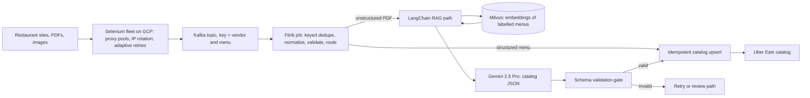
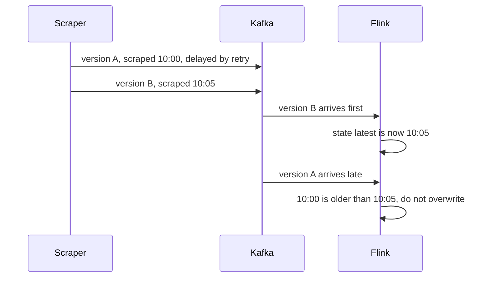

# Uber Menu Ingestion Deep Dive (Kafka, Flink, RAG over Milvus)

<div class="callout note">
<b>How to use this page</b>
<ul>
<li><b>What it covers:</b> the Uber Eats Menu Ingestion and Automation project in depth. It teaches Kafka, Flink, delivery guarantees, RAG, embeddings and Milvus from scratch, then applies them to the project. A short ANZ section and a clearly labelled Spark study section are at the end.</li>
<li><b>When to read it:</b> when you expect a system design or data-engineering round, or when an interviewer is likely to dig into "Kafka and Flink" on the resume. For a quick refresh, read the Menu section of the interview pack (first quick link below) instead.</li>
<li><b>What to memorise:</b> the architecture diagram in section 3, the four Flink ideas (keyed state, event time, watermarks, checkpoints), the sentence "at-least-once delivery plus idempotent upsert gives an exactly-once effect", and the numbers in section 11.</li>
</ul>
</div>

Quick links: [Interview pack, Menu section](23b_uber_interview_packs.md) · [Streaming numbers](03_uber_menu_streaming_numbers.md) · [Metrics derivations](09_metrics_derivations.md) · [Ground truth](GROUND_TRUTH.md)

## Tags used on this page

- **MEASURED** means there is a log, document or code behind it.
- **TARGET** means a design goal. Say "targeting".
- **ESTIMATED** means arithmetic I can show. Say "roughly, derived from...".
- **HISTORICAL** means it comes from my past work records and resume, not re-measured from logs in this repo.

<div class="callout warn">
<b>Resume alignment (current PDF).</b> Menu outcomes: from 24 hours to 2 hours, $600K a year, 30K+ menus a month, 98% field fidelity in <b>offline evaluation</b> using Gemini 2.5 Pro and LangChain RAG over Milvus, and 95%+ extraction success. The pipeline is <b>Kafka plus Apache Flink</b> with stateful keyed deduplication, schema normalization and exactly-once catalog upserts.
<ul>
<li>Exactly-once here means at-least-once delivery plus idempotent upserts. Never say zero message loss.</li>
<li>ClickHouse belongs to Impact Analytics, not this pipeline.</li>
<li><b>Spark is NOT on the PDF.</b> It appears in section 13 only as a verbal, study-only backfill option. It is not a resume claim.</li>
<li>ANZ (Uber Mobility) 99.9% and 20 hours a week are HISTORICAL. Masters India Kafka is a different product from Menu Kafka.</li>
</ul>
</div>

---

## 1. The project in plain English

Uber Eats lists restaurants and their menus. When a restaurant joins, its menu has to become structured catalog data: item names, prices, categories, options, in a fixed schema. Restaurants send this in whatever form they have. Some give a website that builds the menu with JavaScript. Some send a PDF. Some send a photo of a printed menu. Many are not in English.

Before this pipeline, conversion was slow and partly done by a paid third-party tool at about $2 per menu. A restaurant could wait about a day before its menu was ready. I architected the automated pipeline that does this at 30K+ menus a month. It has three parts:

1. **Acquisition:** a Python Selenium fleet on GCP that fetches menus reliably, even from sites that block scrapers.
2. **Streaming backbone:** Kafka carries every scraped menu event, and Flink deduplicates, normalizes and writes them to the catalog exactly once in effect.
3. **AI extraction for unstructured input:** multilingual PDFs go through a LangChain RAG pipeline that retrieves similar labelled menus from Milvus and asks Gemini 2.5 Pro to produce catalog fields, followed by a strict schema check.

---

## 2. Words you need

This section teaches the vocabulary. Each term gets a plain definition, an analogy and a tiny example.

### 2.1 Kafka

**Kafka** is a distributed, durable, append-only log. Producers write messages to the end. Consumers read from any position. Messages are kept for a configured time even after they are read. *Analogy:* a post office that keeps a copy of every letter, in order, for a week, so anyone authorised can come back and re-read them.

- **Topic:** a named stream of messages. *Example:* `menu.raw` holds every scraped menu event.
- **Partition:** each topic is split into partitions so it can be read in parallel. Order is guaranteed only within a partition. *Analogy:* a bank with several tellers. Each teller's line is in order, but the lines move independently.
- **Message key:** Kafka hashes the key to pick the partition. Same key, same partition, every time. *Example:* key `v123` (a vendor id) always lands on, say, partition 4, so all of that restaurant's events stay in order.
- **Consumer group:** a team of consumers sharing one topic. Each partition is assigned to exactly one member at a time. Add members to scale out, up to the number of partitions. *Example:* 12 partitions and 4 Flink workers means each worker owns 3 partitions.
- **Offset:** the position of a message within a partition, an increasing number. A consumer commits the offset it has finished. *Analogy:* a bookmark.
- **Replay:** reset a consumer group's offsets to an earlier point and re-read. *Example:* a parser bug shipped at 10:00. Fix it, rewind to 09:55, and reprocess.
- **Consumer lag:** how far behind the newest message a consumer is. Rising lag means processing is slower than arrivals. It is the main health alert for a streaming pipeline.

```text
Topic menu.raw (3 partitions shown)

partition 0: [v101 e1][v104 e1][v101 e2][v104 e2] ...
partition 1: [v123 e1][v123 e2][v150 e1] ...        <- all v123 events, in order
partition 2: [v099 e1][v177 e1][v099 e2] ...
                       ^ consumer's committed offset (bookmark)
```

*What to notice:* one vendor's events always sit in one partition, in order, so per-vendor processing never sees them shuffled.

### 2.2 Flink

**Apache Flink** is a stream-processing engine. It reads events continuously, processes each one as it arrives, and keeps state between events. *Analogy:* an assembly line where each worker has a notebook and remembers what passed by before.

- **Keyed stream and keyed state:** `key_by(vendor_id, menu_id)` routes all events for one key to the same worker. That worker keeps a small piece of memory per key. *Example:* for key `(v123, m9)`, remember `last_hash = "ab12"`. *Analogy:* a clerk with one index card per restaurant.
- **State backend:** where keyed state lives. For large state, Flink commonly uses RocksDB, an embedded key-value store on local disk. (General Flink knowledge, useful for interviews.)
- **Event time:** the time an event actually happened, for example when the page was scraped. Different from **processing time**, which is when Flink sees it. Using event time means a late-arriving page is still handled as "older than" a newer one.
- **Watermark:** a marker flowing with the data that says "all events up to time T have probably arrived". It lets Flink close windows and decide what counts as late. *Example:* watermark = newest scrape time minus 2 minutes, which tolerates pages arriving up to 2 minutes out of order. (The 2 minutes is a teaching example, not a project setting.)
- **Checkpoint:** Flink periodically takes a consistent snapshot of all state plus the Kafka offsets it has read. After a crash, it restores state from the snapshot and resumes reading from those offsets. *Analogy:* a save point in a video game. You lose only what happened since the last save.
- **Backpressure:** if a downstream step (like the catalog write) slows down, Flink's internal buffers fill and it slows its reading from Kafka. Nothing runs out of memory. Kafka simply holds the messages, and consumer lag rises.

### 2.3 Delivery guarantees

- **At-most-once:** each message is processed zero or one times. Fast, but you can lose data.
- **At-least-once:** each message is processed one or more times. No loss, but after a failure a few messages are processed again.
- **Exactly-once:** each message's effect happens exactly once. Inside Flink, checkpoints give exactly-once *state*. To an external system, true exactly-once needs a sink that takes part in transactions.
- **Idempotent upsert:** a write that gives the same final result however many times it runs. "Insert this item for `(vendor, menu, item)`, or update it if it is already there."

**The key sentence:** *at-least-once delivery plus an idempotent upsert gives an exactly-once effect.* If the same message is processed twice, the second write overwrites the same row with the same data. The catalog cannot tell the difference. That is what "exactly-once catalog upserts" means on the resume.

```sql
-- Illustrative only. The real sink was the Uber Eats catalog.
-- The idea: the write is keyed, so repeating it is harmless.
INSERT INTO catalog_items (vendor_id, menu_id, item_key, name, price, content_hash)
VALUES ('v123', 'm9', 'tacos-al-pastor', 'Tacos al Pastor', 3.50, 'ab12')
ON CONFLICT (vendor_id, menu_id, item_key)
DO UPDATE SET name = EXCLUDED.name,
              price = EXCLUDED.price,
              content_hash = EXCLUDED.content_hash;
```

### 2.4 RAG, embeddings and Milvus

- **Embedding:** a list of numbers (a vector) that captures the meaning of text. Texts with similar meaning get vectors that are close together. *Analogy:* GPS coordinates for meaning. Two taqueria menus end up as neighbours, a sushi menu lands far away.
- **Vector database:** a database built to store embeddings and quickly find the nearest ones to a query vector.
- **Milvus:** the open-source vector database used here. We stored embeddings of already-labelled menus in it.
- **RAG (Retrieval-Augmented Generation):** retrieve relevant examples first, put them in the prompt, then ask the LLM. *Analogy:* before asking a new hire to fill a form, show them three correctly filled forms for similar cases.
- **LangChain:** a Python framework that chains the steps: load, split, embed, retrieve, prompt, call the model, parse.
- **Gemini 2.5 Pro:** Google's large language model, used to read menu content and return catalog-shaped JSON.
- **Schema validation gate:** a strict check (for example a Pydantic model) that every field exists, has the right type, and uses allowed values, before anything is written.
- **Field fidelity:** the share of extracted fields that exactly match a hand-labelled answer key.
- **Offline evaluation:** measuring on a fixed labelled test set rather than live traffic. Repeatable and comparable between versions, but not a live production SLA.

### 2.5 Acquisition terms

- **Selenium:** drives a real browser from code. Needed because JavaScript-built menus do not exist in the raw HTML.
- **Proxy pool:** a set of intermediate servers with different IP addresses that requests go through. **Dynamic** means proxies that start getting blocked are removed and fresh ones are added automatically.
- **IP rotation:** using a different outgoing address for successive requests, so no single address looks like a bot.
- **Adaptive retries:** retrying failures with growing waits (exponential backoff) and a retry budget per source, so one hostile site cannot consume the whole fleet.

---

## 3. Architecture



*What to notice:* Kafka decouples scraping from processing. Flink is the one place where deduplication and normalization happen. The LLM never writes to the catalog directly. Its output must pass the schema gate first.

**Walking through it.**

1. The **Selenium fleet** on GCP fetches menus. It routes requests through a dynamic proxy pool, rotates IPs, and retries with backoff and per-source budgets.
2. Each fetched menu becomes an event on a **Kafka topic**, keyed by vendor and menu. Kafka absorbs bursts when the fleet runs, keeps messages for replay, and lets more than one consumer read the same data.
3. A **Flink job** consumes the topic. It groups events by key and keeps the last content hash per key. If a new event has the same hash, it is a duplicate and is dropped. Otherwise Flink normalizes fields to the catalog schema and routes the event.
4. Structured menus go directly to the **idempotent catalog upsert**.
5. Unstructured PDFs go to the **RAG path**. It retrieves similar labelled menus from **Milvus**, prompts **Gemini 2.5 Pro**, and passes the output to the **schema gate**. Valid output is upserted. Invalid output goes to a retry or review path instead of the catalog.

The older plain-text version of this diagram, kept because it shows the role split clearly:

```text
Partner sites / PDF + image menus
        |
        v
Selenium scrapers (GCP) + proxy pools     <- acquire HTML / files
        |
        v
Kafka (keyed by vendor_id)                <- buffer, replay, fan-out
        |
        +--> Flink (event time)           <- normalize, validate, dedupe, route
        |         |
        |         +--> catalog upsert (idempotent)
        |         +--> unstructured -> RAG / Gemini path
        |
        +--> [study only, NOT on PDF] Spark backfill (see section 13)

ANZ compliance is a separate Uber Mobility project. It is not on this path.
```

*What to notice:* the Spark branch is drawn only to support a "what would you do for backfills" discussion. It is not something I claim.

---

## 4. Why Kafka plus Flink for this project

### 4.1 Why Menu is the right home for the streaming story

| Project | Verdict | Why |
|---|---|---|
| **Uber Menu** | **Kafka plus Flink, on the PDF** | Bursty scraping needs a durable buffer (Kafka) and online per-key dedupe with recovery (Flink). |
| Masters India | Not Flink | It already has Kafka plus Celery for bulk GST e-invoicing. Adding Flink there would not be backed by evidence. |
| Impact Analytics | Not Kafka or Flink | That work is ClickHouse analytics and Go/Gin APIs, not a stream job. |
| Skills line only | Too weak | Data and backend screens want an experience bullet, not just a skills chip. |

### 4.2 The decision in full

**What.** Selenium publishes menu events to Kafka. A Flink job consumes them, deduplicates by key and content hash, normalizes to the catalog schema, and upserts idempotently.

**Why Kafka.**
- Scrapers must not block on slow catalog writes. Kafka lets them publish and move on.
- After a bad parser deploy, we can rewind offsets and replay.
- Several consumers can share one log (the Flink job, audits, future consumers).
- Keying by vendor keeps one restaurant's events in order.

**Why Flink.**
- Per-key state for deduplication by content hash.
- Event-time handling, so a page that arrives late does not overwrite a newer version.
- Checkpointed recovery with Kafka offsets, which is the basis of the exactly-once effect.
- Low latency per event, so catalog freshness is minutes, not a nightly batch.

**How.** Topic keyed by vendor and menu. Flink `key_by` on the same key. `ValueState` holds the last content hash. A normalize step maps prices, currencies and category names to the schema. The sink is an idempotent upsert.

**Alternatives considered.**
- *Scrapers write straight to the catalog over HTTP.* Simple, but scrapers stall when the catalog is slow, there is no replay, and duplicate handling is scattered.
- *A plain Kafka consumer script.* Works for stateless transforms. For per-key state, event time and crash recovery you would rebuild what Flink already gives you.
- *Kafka Streams.* A reasonable option for lighter transforms at this event rate, especially if it were the team standard. Flink was chosen for richer event-time support, larger keyed state and a clearer story for a dedicated processing job.
- *Spark Structured Streaming.* Not on the resume. Its micro-batch model adds seconds of latency per batch. See section 13 for how to discuss Spark if asked.

**Trade-off.** Flink is more to operate than a consumer script: checkpoints, state size, upgrades.

**What I'd do differently.** Put consumer lag, dedupe drop rate and schema-gate reject rate on one dashboard from day one. Those three numbers tell you almost everything about pipeline health.

---

## 5. Kafka in this pipeline, in detail

**Topic and key.** One topic for raw menu events, keyed by vendor and menu. Same key, same partition, so per-restaurant order holds.

**Why key by vendor and menu, not randomly.** Random keys spread load perfectly but scramble order. If version 2 of a menu is processed before version 1, the catalog ends up with stale data. Keying by vendor and menu keeps versions in order.

**Hot keys.** A very large restaurant group can make one partition busier than the others. Options: include menu id in the key (which we did) so a vendor's menus spread out, and add partitions if needed.

**Consumer group.** The Flink job's Kafka source is one consumer group. Partitions are split across its parallel tasks.

**Offsets and replay.** Flink stores the Kafka offsets inside its checkpoints rather than relying only on Kafka's committed offsets. On restore it resumes from exactly the checkpointed positions. For a deliberate replay after a bad deploy, start the job from an earlier offset or timestamp.

**What an event looks like** (illustrative shape):

```json
{
  "vendor_id": "v123",
  "menu_id": "m9",
  "source": "website",
  "scraped_at": "2025-03-14T10:02:11Z",
  "content_hash": "ab12...",
  "payload_uri": "gs://bucket/menus/v123/m9.html",
  "scrape_status": "ok"
}
```

The `payload_uri` field shows a general practice worth knowing: large payloads (HTML, PDF) sit in object storage and the event carries a pointer, so Kafka messages stay small and brokers stay fast. If asked exactly how payload size was handled on the project, keep it qualitative.

---

## 6. Flink in this pipeline, in detail

| Topic | What I say |
|---|---|
| API | DataStream API, keyed by vendor and menu |
| Time | Event time from the scrape timestamp. Watermarks with bounded out-of-orderness for late pages. |
| State | Keyed dedupe state (last content hash or menu version), commonly in the RocksDB state backend |
| Fault tolerance | Checkpoint barriers. On a worker loss, restore from the last successful checkpoint. |
| Delivery | Kafka source with checkpointed offsets. The catalog sink is idempotent, so replays are harmless. |
| Backpressure | A slow catalog fills Flink's network buffers, Flink reads Kafka more slowly, and consumer lag rises. Lag is the alert. |
| Bad deploy | Fix the normalizer, rewind Kafka offsets to before the bad deploy, and reprocess. Idempotent upserts make the replay safe. |

### 6.1 Keyed dedupe, worked example

State for key `(v123, m9)` starts empty.

| Event | content_hash | State before | Action | State after |
|---|---|---|---|---|
| e1 | ab12 | empty | new, normalize and upsert | ab12 |
| e2 (retry of e1) | ab12 | ab12 | duplicate, drop | ab12 |
| e3 (menu changed) | cd34 | ab12 | new, normalize and upsert | cd34 |

An illustrative PyFlink-style implementation:

```python
class DedupeMenu(KeyedProcessFunction):
    def open(self, ctx):
        desc = ValueStateDescriptor("last_hash", Types.STRING())
        self.last_hash = ctx.get_state(desc)

    def process_element(self, event, ctx):
        if self.last_hash.value() == event["content_hash"]:
            return
        self.last_hash.update(event["content_hash"])
        yield normalize(event)

(events
    .key_by(lambda e: (e["vendor_id"], e["menu_id"]))
    .process(DedupeMenu())
    .add_sink(idempotent_catalog_upsert))
```

### 6.2 Event time and watermarks, worked example

Two versions of the same menu are scraped at 10:00 and 10:05. Because of a retry, the 10:05 version reaches Flink first and the 10:00 version arrives a minute later. With processing time, the older 10:00 version would be applied last and overwrite the newer one. With event time, Flink compares scrape timestamps and keeps the 10:05 version as the latest. The watermark bounds how long Flink waits for stragglers before it treats an event as late.



*What to notice:* ordering by when the event happened, not when it arrived, is what stops stale menus from winning.

### 6.3 Checkpoints and recovery, worked example

1. Flink checkpoints at offset 1,000 on partition 4, with `last_hash = ab12` for `(v123, m9)`.
2. It processes offsets 1,001 to 1,050 and upserts them.
3. A worker crashes before the next checkpoint.
4. Flink restores state from the checkpoint and resumes reading at offset 1,001.
5. Offsets 1,001 to 1,050 are processed again. The upserts are idempotent, so the catalog is unchanged.

That is the whole exactly-once story in five steps.

### 6.4 Backpressure

Flink uses credit-based flow control between tasks. If the catalog sink slows, its input buffers fill, it stops granting credits upstream, and the Kafka source reads more slowly. Kafka holds the unread messages, and consumer lag rises. Nothing runs out of memory. The fix is to speed up or scale the sink, not to "add pods and hope". This is a Menu concept. Do not tell it as an Impact Analytics story.

---

## 7. Exactly-once, honestly

**Q: Is it exactly-once end to end?**
"Not in the strict distributed-transaction sense. Across Selenium, Kafka, Flink and an external catalog, what you really get is at-least-once delivery plus an idempotent upsert. Inside Flink, state and Kafka offsets are checkpointed together. After a failure some messages are replayed, and the keyed upsert makes those replays harmless. True end-to-end exactly-once needs a transactional sink that participates in the commit. I don't claim two-phase commit across Gemini or third-party sites, and I never claim zero message loss."

---

## 8. The RAG path over Milvus

**What.** Multilingual PDF and image menus become catalog JSON through LangChain RAG plus Gemini 2.5 Pro, with Milvus as the retrieval store.

**Why.** PDFs and photos have no stable structure. Rule-based parsers break on every new layout and language. An LLM can read them, and retrieval keeps it grounded in what correct output looks like.

**How, step by step.**

1. Parse the PDF and split it into chunks.
2. Embed the content.
3. Query Milvus for the nearest labelled menus (similar cuisine, layout or language).
4. Build the prompt: the catalog schema, the retrieved examples with their correct outputs, and the new menu.
5. Gemini 2.5 Pro returns JSON.
6. A Pydantic model validates it. Valid output is upserted. Invalid output is retried or sent for review.

```python
examples = milvus_store.similarity_search(menu_text, k=3)
prompt = build_prompt(schema=CATALOG_SCHEMA, examples=examples, menu=menu_text)
raw = gemini.invoke(prompt)
try:
    menu = CatalogMenu.model_validate_json(raw)
except ValidationError:
    send_to_retry_or_review(menu_id)
else:
    upsert_catalog(menu)
```

*This sketch is illustrative, to show the shape of the flow. It is not Uber code.*

**Alternatives.**
- *Paid third-party extraction at about $2 per menu.* This is what we replaced.
- *Prompt-only with no retrieval.* Cheaper, but more invented fields and inconsistent categories.
- *Fine-tuning (SFT).* Discussed in older prep, removed from the PDF. Treat as verbal only.
- *Another vector store (Pinecone, Weaviate, pgvector).* Do not claim any of them for Menu. The vector store was Milvus.

**Trade-off.** LLM cost per menu, and the labelled examples and test set have to be kept fresh.

**What I'd do differently.** Sample live outputs weekly against human labels, so there is an online quality signal next to the offline 98%.

**Industry parallel (citation, not a personal claim).** Delivery platforms commonly combine OCR or LLM structuring with retrieval grounding and a confidence or human gate. Mention the pattern, but defend my own LangChain, Gemini and Milvus work, not any other company's internals.

---

## 9. The Selenium fleet and anti-bot hardening

**What.** A Python Selenium fleet on GCP that fetches restaurant menus.

**Why it needed hardening.** Sites detect and block scrapers: IP bans, CAPTCHA walls, soft 403 responses, and pages that load but hide the menu.

**How.**
- Dynamic proxy pools: requests go out through many IP addresses, and proxies that start getting blocked are swapped out.
- IP rotation and user-agent variation, so traffic does not look like one bot.
- Adaptive retries: exponential backoff with a retry budget per source, so one hostile site cannot use up the fleet.
- Scrape-health signals in each event, so empty or suspiciously small menus are caught instead of being treated as success.

**Result.** Extraction success reached **95%+**. The starting point was an **estimated** 60 to 65%.

**Trade-off.** Proxies cost money and add latency, and the fleet needs monitoring when sites change.

---

## 10. Bullet defenses (current PDF)

### Bullet 1

> Accelerated restaurant onboarding from 24 hours to 2 hours and saved $600K annually by architecting an automated ingestion pipeline processing 30K+ menus monthly. Converted unstructured, multilingual PDFs into a strict catalog schema at 98% field fidelity utilizing a Gemini 2.5 Pro and LangChain RAG pipeline over Milvus vector embeddings.

- **What I own:** the architecture of the menu ingestion pipeline and the RAG extraction path. Not all of the Uber Eats catalog platform.
- **Impact:** onboarding from 24 hours to 2 hours. $600K a year from replacing a roughly $2 per menu tool (derivation in section 11).
- **Quality:** 98% field fidelity on an offline, hand-labelled evaluation set. Always say "offline".
- **Do not attach:** ClickHouse, or "hundreds of millions of transactions".

### Bullet 2

> Scaled menu extraction success to 95%+ by hardening a Selenium fleet with dynamic proxy pools and adaptive retries. Designed a large-scale data ingestion and processing pipeline using Kafka and Apache Flink, with stateful keyed deduplication and schema normalization to guarantee exactly-once catalog upserts.

- **Acquisition:** proxy pools and adaptive retries took success to 95%+ (baseline estimated 60 to 65%).
- **Bus:** Kafka keyed by vendor and menu, for order, buffering and replay.
- **Processing:** Flink keyed state for dedupe by content hash, and schema normalization.
- **Guarantee:** exactly-once effect via at-least-once delivery plus idempotent upserts.

---

## 11. The numbers, explained

| Number | What it measures | How it is derived | Tag |
|---|---|---|---|
| From 24 hours to 2 hours | Menu onboarding cycle time | Before and after cycle time. 22 of 24 hours saved is about 92%, or twelve times faster. | HISTORICAL |
| $600K a year | Money saved | About $2 per menu times 30,000 a month is $60K a month. Times 12 is $720K list, floored to $600K. | HISTORICAL arithmetic |
| 30K+ menus a month | Pipeline volume | From records. About 1,000 a day (30,000 divided by 30). | HISTORICAL |
| 98% field fidelity | Share of extracted fields matching labels | Offline evaluation on a labelled set | HISTORICAL, offline |
| 95%+ extraction success | Share of attempts producing a usable menu | End point is the claim. The 60 to 65% start is an estimate. | HISTORICAL, baseline ESTIMATED |
| About 200 to 500 events a second at peak | Kafka throughput during fleet runs | About 1,000 menus a day, each producing many item, retry and health events, bunched into run windows | ESTIMATED, prep only, not on PDF |

**How to say each one.**

- *24 hours to 2 hours:* "Onboarding went from 24 hours to 2 hours." Why it mattered: restaurants go live the same day and start taking orders.
- *$600K:* "About $600K a year. The vendor tool cost roughly $2 a menu, at 30K menus a month that's $720K list, and I quote $600K as the conservative number." Do not say $720K as the saving.
- *30K+:* "30K-plus menus a month, about a thousand a day." Do not inflate it into a firehose.
- *98%:* "98% field fidelity in offline evaluation." Do not call it a live SLA. Older prep also had "100% schema consistency". It is not on the current PDF. If asked: the gate rejects anything malformed, so everything that lands is schema-valid by construction.
- *95%+:* "To 95%-plus, from roughly 60 to 65%, and that starting point is an estimate."
- *200 to 500 events a second:* only if asked about throughput. "Order of magnitude, a few hundred events a second at peak during fleet runs. Steady state is much lower. That's an estimate, not a dashboard number."

---

## 12. ANZ Document Compliance (Uber Mobility), separate project

This is **not** Uber Eats. It is a separate PDF project under **Uber Mobility**: automating driver and vehicle document verification for drivers in Australia and New Zealand against local authority requirements. A deterministic validation backend replaced manual review queues. It reached **99.9%** regulatory compliance and removed **20 hours a week** of manual work. Both numbers are **HISTORICAL**, from past work records, not re-measured from logs in this repo. Do not say "main-app". Do not invent a Selenium, RAG or LLM stack for this path. Full talking points are in the [interview pack, Part 3](23b_uber_interview_packs.md).

---

## 13. Spark: verbal, study-only backfill option (NOT a resume claim)

<div class="callout warn">
<b>Read this label first.</b> Spark is not on the PDF, not in the Menu tech line, and not something I claim to have run on this project. This section exists only so I can answer "how would you reprocess history?" or "why Flink and not Spark?" with good judgement. If I mention Spark, I say "as an option I'd consider", never "we ran Spark".
</div>

**Apache Spark in one paragraph.** Spark is a distributed batch-processing engine. It splits a big dataset into partitions, runs the same function on each across a cluster, and shuffles data between machines for joins and group-bys. *Analogy:* instead of one person counting a warehouse, a hundred people each count one aisle, then the totals are combined. Spark Structured Streaming adds a streaming mode built on small, frequent batches (micro-batches).

**When I'd suggest Spark for this design.** For a one-off historical reprocess, for example re-normalizing 90 days of menu items after a schema change. That job is batch-shaped: large reads from object storage, big joins, run once. An older prep estimate put a typical 90-day reprocess at about 1 to 2 million item rows. That figure is ESTIMATED and study-only.

**Why Flink, not Spark, for the live path.** Scrapes are bursty. The live path needs per-key state for dedupe, event-time ordering for late pages, and per-event latency so catalog freshness is minutes. Spark micro-batches add seconds of delay per batch and are a weaker fit for keyed state.

**Why Spark, not Flink, for a big backfill (as an option).** A one-shot rewrite of history is a large shuffle and SQL-style join. Spark's DataFrame API fits that shape. Standing up large Flink state for a one-time job is the wrong cost curve. In this pipeline, though, Kafka replay plus idempotent upserts already covers short reprocessing windows, so Spark would only matter for history older than Kafka retention.

| Study topic | What to know |
|---|---|
| Role in a design like this | Backfill, reprocess, large joins. Not the live path. |
| API | Spark SQL and DataFrames over object-storage dumps |
| Skew | A few huge vendors can overload one partition. Salt the keys or isolate the biggest vendors. |
| AQE | Adaptive Query Execution re-plans at runtime to handle skew and merge small partitions. |
| Structured Streaming | A near-real-time option. Do not claim both Flink and Spark for the same live path. |

**Study questions with speakable answers.**

- *"Why not only Spark Structured Streaming?"* "Micro-batch latency and weaker keyed-state support make it a worse fit for live catalog freshness under scrape bursts. On my resume the live path is Kafka and Flink. Spark is something I'd consider for a large one-off backfill."
- *"Spark versus ClickHouse?"* "Different problems. A Menu backfill would be ETL over scrape history. ClickHouse is my Impact Analytics work, which is interactive analytics on planner data. I keep the two stories separate."
- *"How deep is your Spark?"* "Study-level. I know the execution model, shuffles, skew handling and AQE, but Spark is not on my resume and I don't claim production ownership. My production streaming experience is Kafka and Flink on Menu."

Industry reading (for study, not claims): [Confluent: Spark Streaming vs Flink](https://www.confluent.io/compare/spark-streaming-vs-flink/), [Estuary: Spark vs Flink](https://estuary.dev/blog/apache-spark-vs-flink/), [Spark cluster overview](https://spark.apache.org/docs/latest/cluster-overview.html), [Structured Streaming guide](https://spark.apache.org/docs/latest/structured-streaming-programming-guide.html).

---

## 14. Mock interview: the hardest questions

**"An earlier version of your resume said Menu was only Selenium. Which is it?"**
"Both layers were there. Selenium acquires the pages. Kafka and Flink process them and land catalog data. An earlier one-page version dropped the streaming detail to save space. The current resume matches the fuller story, and that's what I defend. Kafka at Masters India is a separate product, for GST e-invoices."

**"Derive 200 to 500 events a second."**
"30K menus a month is about a thousand a day. Each menu produces many item-level events plus retry and health events during a fleet run, and runs are bunched into windows. That puts the peak in the hundreds per second. Steady state is much lower. It's an order-of-magnitude estimate, not a dashboard screenshot, and it's not on my resume."

**"A Flink checkpoint fails mid-run. What happens?"**
"The job restores from the last successful checkpoint. State goes back to that snapshot and the Kafka offsets rewind to the checkpointed positions. Messages since then are re-read, and the idempotent upserts make that harmless. Consumer lag alerts fire until it catches up. If a whole window was corrupted by a bad deploy, I fix the code and replay from Kafka."

**"Isn't Kafka plus Flink overkill at 30K menus a month?"**
"Volume is moderate, yes. The choice is about the shape of the problem, not just throughput. Scraping is bursty, the same menu shows up more than once, pages arrive out of order, and we need replay after a bad deploy. Kafka gives buffering and replay, and Flink gives keyed state, event time and recovery. A single consumer script could work at this scale, but we'd be rebuilding those guarantees by hand."

**"Why not Kafka Streams?"**
"Kafka Streams is a good fit for lighter transforms, and at this event rate it could have worked if it were the team standard. Flink gave us richer event-time handling, larger keyed state and a clearer story for a dedicated processing job."

**"How do you know the dedupe isn't dropping real updates?"**
"Dedupe is by content hash per vendor and menu, so only byte-identical repeats are dropped. If anything on the menu changes, the hash changes and the event goes through. I'd watch the drop rate. A sudden spike would mean something upstream is re-sending, or the hash input is wrong."

**"What happens when the catalog is slow?"**
"Backpressure. Flink's buffers fill, it reads Kafka more slowly, and consumer lag rises. Nothing is lost because Kafka holds the messages. Lag is the alert, and the fix is to speed up or scale the sink."

**"Does Databricks-style Spark depth apply to you?"**
"I'd be straightforward. Spark is study-level for me and it's not on my resume. My production streaming work is Kafka and Flink on Menu, and my analytics depth is ClickHouse at Impact Analytics."

---

## 15. Confidence audit

| Claim | Rating | Fallback if pressed |
|---|---|---|
| Kafka plus Flink pipeline, keyed dedupe, exactly-once upserts | SOLID, with the at-least-once plus idempotent explanation | "At-least-once delivery plus idempotent upserts gives an exactly-once effect." |
| From 24 hours to 2 hours, $600K, 30K+ | SOLID on outcomes | $600K is a floor under $720K list |
| 98% field fidelity | SOLID if "offline evaluation" is stated | Always say offline |
| 95%+ extraction | NEEDS CARE on the baseline | "From roughly 60 to 65%, estimated" |
| Peak events a second | Off PDF | Only verbally, as an estimate |
| Spark | NOT A CLAIM | Study-only option, section 13 |
| ANZ 99.9% and 20 hours a week | SOLID HISTORICAL | Separate Mobility project |

**Honesty summary.** Do not claim Pinot or Spark on this PDF. Do not claim Spark at Impact Analytics. Do not claim Flink at Masters India. Do not claim zero message loss.

---

## 16. Official references

- [Flink documentation (stable)](https://nightlies.apache.org/flink/flink-docs-stable/)
- [Flink stateful stream processing concepts](https://nightlies.apache.org/flink/flink-docs-stable/docs/concepts/stateful-stream-processing/)
- [Flink high availability overview](https://nightlies.apache.org/flink/flink-docs-stable/docs/deployment/ha/overview/)
