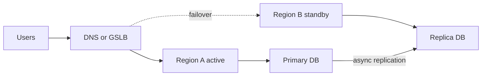

# Senior Systems Deep Dive (Ownership, Reliability, Data Infra)

<div class="callout highlight">
<b>How to use this page</b>
<ul>
<li><b>What it covers:</b> the "senior systems" topics that big-tech screens love: ownership, on-call and SLOs, fault tolerance, multi-region, Kubernetes, Terraform, Spark, Flink, design patterns. Each topic is taught from zero, then mapped to what I can honestly claim.</li>
<li><b>When to read it:</b> the week before an infra-heavy or senior backend loop, and again the night before any round with "reliability", "platform" or "data infrastructure" in the title.</li>
<li><b>What to memorise:</b> the status table in the next section (which topics are RESUME-SAFE and which are STUDY ONLY), plus the "How to talk about it honestly" paragraph under each STUDY ONLY topic.</li>
</ul>
</div>

<div class="callout warn">
<b>The STUDY ONLY rule.</b> Any section marked <code>STUDY ONLY - NOT RESUME EXPERIENCE</code> is study material for interview fluency. I must not present it as production ownership. Multi-region, Kubernetes cluster operations, Terraform and Spark are study-only for me. I can explain how they work and how I would design with them. I do not say "I operated clusters", "I owned our Terraform" or "I ran Spark in production".
</div>

**What the tags mean on this page.** MEASURED means there is a log, doc or code behind the number. ESTIMATED means it is arithmetic I can show on a whiteboard, so I say "roughly, derived from...". HISTORICAL means it comes from my past work records. TARGET means a design goal, so I say "targeting". RESUME-SAFE means a resume bullet backs it. STUDY ONLY means I can teach it but I did not own it in production.

## Where each topic stands

| # | Topic | Status | One-line honest position |
|---|---|---|---|
| 1 | Ownership, software design and architecture | RESUME-SAFE | Uber FRM (via EPAM), Masters India migration, Impact Analytics platform. |
| 2 | On-call, incident response, SLOs | PARTIAL RESUME-SAFE | ELK + New Relic triage at Masters, Datadog tracing at IA. No formal pager title. |
| 3 | Fault tolerance | RESUME-SAFE | Masters bulk path, IA orchestration registry, Menu idempotent upserts. |
| 4 | Multi-region, HA, DR | STUDY ONLY | Never operated multi-region production. |
| 5 | Kubernetes operations | STUDY ONLY beyond the skills keyword | Docker yes. Kubernetes is skills-level literacy. |
| 6 | Terraform and IaC | STUDY ONLY | No Terraform ownership. |
| 7 | Spark | STUDY ONLY (not on the PDF) | Verbal backfill option for Menu only. |
| 8 | Flink | RESUME on Uber Menu | Keyed dedupe and normalization on Kafka. |
| 9 | Design patterns | Verbal depth | Not a skills keyword any more. |

**Skills-line context (older prep notes, still true).** Skills no longer list Design Patterns or JUnit (trimmed August 2026). The core skills line does not use the keywords Fault Tolerance, High Availability, Operational Excellence or On-call. It uses Multithreading and Concurrency instead, and the reliability story lives inside the experience bullets. Kubernetes stays on the skills line as literacy only. Multi-region, Kubernetes operations, Spark and Terraform are off the resume. Flink is on the Uber Menu experience bullet.

**Older prep said X, current resume says Y.** Older prep said "Spark is a resume claim on Uber Menu". The current PDF does not mention Spark. Spark is a verbal backfill option only, so section 7 is now STUDY ONLY. Older prep also said "30+ APIs" for FRM. The current PDF says 36 FastAPI endpoints, so this page uses 36.

Resume-safe claims are cross-checked in [`GROUND_TRUTH.md`](GROUND_TRUTH.md).

---

## 1. Ownership and software design / architecture (RESUME-SAFE)

### Plain English first

When a recruiter says "end-to-end ownership", they mean you were the person who could answer every hard question about a system, not just the person who wrote some of its code. Think of the difference between renting a room and owning a house. A renter fixes what is in their room. An owner knows where the water main is, who to call when the roof leaks, and what it costs to rebuild the kitchen. Interviewers probe ownership because seniors are hired to own outcomes, not tickets.

### How it works: the five questions that prove ownership

An owner can answer all five of these about a system:

1. **Who wrote the design doc?** You can explain the problem, the options considered and why one won.
2. **Who set the API contracts?** You froze request and response shapes before the UI team started building, so two teams could work in parallel.
3. **Who owned the cutover?** You planned how traffic or data moved from old to new.
4. **Who owned the rollback?** You knew exactly what you would do if the cutover went wrong, before it went wrong.
5. **Who owned the post-incident fix?** When something broke, you found the root cause and closed the gap.

A tiny example from my own work: on Uber FRM, the reconciliation screen moved from Google Sheets (v1) to MySQL (v2). I owned that migration branch. The design was a parallel run: v1 and v2 endpoints served side by side, the numbers were compared, and v1 stayed alive until the MySQL path was trusted. That covers questions 1, 3 and 4 in one story.

### Map to my work

| Pattern | My evidence | How I say it |
|---|---|---|
| Owned a platform | Uber FRM Risk Scoping (via EPAM): 8 screens, 36 FastAPI endpoints | "I owned the FRM scoping backend and the recon v2 migration, and I enforced layer boundaries across the pod." |
| Software design and architecture | FRM handler, service, repository, ORM layering | "Controllers stay thin. Services own the business rules. Repositories own the SQL." |
| Led design reviews | Led 3 engineers on the FRM pod (EPAM tech lead, not people manager) | "I sliced work by layer and reviewed PRs for API contracts and test gates." |
| Strangler migration ownership | Masters India PHP monolith to FastAPI microservices, mentored 2 engineers | "Per-endpoint canary, shared database first, no dual-write source of truth." |
| Platform architecture | Impact Analytics Go/Gin platform at 10k peak RPS, shared orchestration registry | "I designed the Go/Gin edge and the orchestration registry that every AI pipeline runs through." |

Keep "led 3" (Uber FRM) and "mentored 2" (Masters India) as two separate facts. Never merge them into "led 5".

### Typical interview questions with answers

**Interviewer:** What does "owned design and architecture" mean for you day to day?
**Me:** It means I am the person who can explain every non-obvious trade-off on the critical path. Concretely, I ran the design review agenda, froze API contracts before the UI started, wrote the migration plan with its rollback, and set the CI quality gates. On Uber FRM that looked like freezing the scoping endpoints, then running recon v1 and v2 side by side until the MySQL numbers matched.
*Follow-up they may ask:* "What did you do when someone disagreed with the design?" Answer with the trade-off you wrote down and how the review settled it.

**Interviewer:** Amazon asks for years of leading design. How do you answer without lying?
**Me:** I do not say five years of leading design. I say roughly three years of leading design reviews and architecture decisions, across Masters India (about 1.5 years) and Uber FRM via EPAM (about 1.9 years), plus individual-contributor architecture ownership at Impact Analytics since May 2026. That is honest arithmetic from my dates, and it still shows a pattern of owning design.

**Interviewer:** Give me an example of a decision you owned that you would make differently now.
**Me:** At Impact Analytics I chose an app-native orchestration registry over Airflow or Temporal, because I needed resume behaviour tightly coupled to ClickHouse inserts and config hashing. That was right for one team and a handful of pipelines. If the number of pipelines grew a lot, I would revisit a managed workflow engine, because the registry's custom code becomes something we must maintain forever.

### Official references
- [AWS Reliability Pillar](https://docs.aws.amazon.com/wellarchitected/latest/reliability-pillar/welcome.html)
- [Martin Fowler: Patterns of Distributed Systems](https://martinfowler.com/articles/patterns-of-distributed-systems/)
- [microservices.io patterns](https://microservices.io/patterns/index.html)

---

## 2. On-call, incident response, SLOs (PARTIAL RESUME-SAFE)

### Plain English first

SRE (Site Reliability Engineering) is Google's name for treating operations as an engineering problem. Instead of "keep the servers up at all costs", you agree on how reliable a service must be, measure it, and spend the leftover unreliability on shipping features. Think of a monthly phone data plan. You know your limit, you check how fast you are using it, and you slow down when you are close to the cap.

### Words you need

- **SLI (Service Level Indicator):** the thing you measure. Example: the share of requests that finish under 300 ms.
- **SLO (Service Level Objective):** the target for that measurement. Example: 99.9% of requests succeed over 30 days.
- **SLA (Service Level Agreement):** a contract with a customer, usually with money attached if you miss it. The SLA is normally looser than the internal SLO.
- **Error budget:** 100% minus the SLO. It is the amount of failure you are allowed.
- **Burn rate:** how fast you are using the error budget compared to the normal pace.
- **Postmortem:** a blameless write-up after an incident: timeline, root cause, blast radius, action items with owners.
- **p95 latency:** the time under which 95% of requests finish. It shows what slow users feel, which an average hides.

### How it works, with a worked example

Say the SLO is 99.9% availability over 30 days.

```text
30 days x 24 hours x 60 minutes = 43,200 minutes
Error budget = 0.1% of 43,200 = 43.2 minutes of allowed downtime per month
```

If the service is burning budget at 14.4 times the normal rate, the whole month's budget is gone in about 30 / 14.4, which is roughly 2 days. That is why good alerts fire on burn rate, not on single blips. A fast burn pages a human now. A slow burn opens a ticket.

Three ideas interviewers want to hear:

1. **Alert on symptoms users feel**, like error rate or p95 latency, not on every CPU spike.
2. **Mitigate first, then diagnose.** Roll back, open a circuit breaker or shed load before you hunt the root cause.
3. **Correlation IDs are the fastest triage tool.** One request ID that appears in every log line across API, queue consumer and worker lets you follow a single failed request end to end.

### Resume-safe wording

- **Masters India:** I set up ELK (Elasticsearch, Logstash, Kibana, a log search stack) and New Relic tracing, and incident triage time fell about 70%. The 70% is HISTORICAL. The baseline of roughly 30 minutes down to under 10 minutes is ESTIMATED. Test coverage went from 35% to 82%, and deployment success was 98%.
- **Impact Analytics:** the Go/Gin platform uses Datadog distributed tracing, and the AI pipelines emit custom JSON telemetry (tokens, USD cost, step duration, batch fallbacks). That is observability I built. It is not a pager-rotation title.

### Do not claim

A pager rotation that I owned, an incident commander or "SEV commander" title, Netflix-scale error budgets, or Uber Menu dashboards as proof of on-call work.

### Typical interview questions with answers

**Interviewer:** Walk me through an incident from alert to close.
**Me:** First the alert fires on an error-rate or p95 spike, and it carries request IDs. I search those IDs in ELK and follow one request across the API, the worker and the third-party call. I mitigate before I diagnose, so I roll back, open the circuit or shed load. Then I write an incident note with the cause and follow-up actions with owners. At Masters India the big triage win was correlation IDs across API, Kafka consumer and IRP worker. I do not claim a formal pager rotation I cannot prove.

**Interviewer:** How would you pick an SLO for a new service?
**Me:** I start from what users feel, usually success rate and p95 latency on the main user path. I look at current performance and pick a target slightly better than today, not a heroic number. Then I compute the error budget and agree with product what happens when it runs out, for example a feature freeze. An SLO nobody acts on is just a dashboard.

**Interviewer:** Why alert on p95 and not average latency?
**Me:** An average hides the slow tail. If 5% of requests take 10 seconds, the average can still look fine. p95 shows the experience of the unhappy users, which is what drives complaints. At Masters our latency headline was p95, from 1.2 seconds to 300 ms.

### Official references
- [Google SRE: Service Level Objectives](https://sre.google/sre-book/service-level-objectives/)
- [Google SRE Workbook: Alerting on SLOs](https://sre.google/workbook/alerting-on-slos/)
- [Monitoring distributed systems](https://sre.google/sre-book/monitoring-distributed-systems/)

---

## 3. Fault tolerance (RESUME-SAFE at Masters, IA and Menu)

### Plain English first

Fault tolerance means the system keeps doing the right thing when a part of it fails. In real systems the failing part is usually something you do not control: a government portal, a third-party website, an LLM provider. A good analogy is a careful courier. If the recipient is not home, the courier tries again later, never delivers the same parcel twice, and after a few failed tries puts the parcel in a "needs attention" pile instead of driving around forever.

### Words you need, with tiny examples

**Idempotency key.** A unique label for an operation, so doing it twice has the same effect as doing it once. Like a cheque number: the bank will not cash cheque #1042 twice. At Masters India the key looked like `client + fileHash + batchIndex`.

```python
key = f"{client_id}:{file_hash}:{batch_index}"
if store.exists(key):
    return store.get_result(key)        # already done, return the old result
result = irp.submit(batch)
store.save(key, result)
```

**Exponential backoff with jitter.** After each failure, wait longer before retrying, plus a small random amount so a thousand clients do not all retry at the same moment.

```python
for attempt in range(MAX_RETRIES):
    try:
        return call_portal()
    except TransientError:
        sleep((2 ** attempt) + random.uniform(0, 1))
raise GiveUp()   # bounded: we stop and park the work
```

**Dead-letter queue (DLQ).** A side queue where messages that keep failing are parked so an operator can inspect and replay them. It is the "needs attention" pile.

**Circuit breaker.** A switch that stops calling a dependency after repeated failures, so you stop hammering something that is already down. Like a household fuse. At Impact Analytics the orchestration registry trips after about 5 consecutive failures or a high failure fraction.

**Cache-aside.** The app checks Redis first. On a miss it reads the database and writes the result into Redis. Adding a small random spread to expiry times (TTL jitter) and a lock (Redis SETNX) stops many requests rebuilding the same key at once, which is called a cache stampede.

**Graceful fallback.** When the smart path fails, return a safe, simpler answer. At Impact Analytics, if the LLM times out, the Keep/Drop engine falls back to the deterministic baseline score.

**Checkpoint and resume.** Save progress to disk so a crashed job continues where it stopped. At Impact Analytics that is `det.json`, `agent_progress.json` and a `--resume` flag, which skips redundant deterministic scoring.

### Resume-safe wording

At Masters India I built fault-tolerant bulk paths with idempotency keys, bounded retries and DLQ replay, plus a Redis cache-aside layer that cut database read load by 30%. At Impact Analytics I built a shared orchestration registry with hard timeouts, circuit breakers, durable checkpoints and fallback to deterministic scores on LLM timeouts. On Uber Menu (via EPAM), "exactly-once catalog upserts" means at-least-once delivery plus idempotent upserts.

### Patterns I can defend

| Pattern | Why it exists | My example |
|---|---|---|
| Idempotency key | Retries must not double-register invoices with the government IRP (Invoice Registration Portal) | Masters: `client + fileHash + batchIndex` |
| Exponential backoff + jitter | The government portal is flaky, especially near filing deadlines | Masters: bounded concurrency and retries on IRP submit |
| Dead-letter queue | Park poison batches for operator replay | Masters bulk import DLQ |
| Circuit breaker | Stop hammering a dead dependency | IA registry trips after about 5 consecutive failures. Masters IRP breaker is a prep narrative, not a PDF bullet |
| Hard and nested timeouts | A slow call must not hold a thread or a batch forever | IA registry timeouts, IA Go/Gin nested timeouts |
| Graceful fallback | Ship a safe answer when the smart path fails | IA: deterministic baseline on LLM timeout |
| Checkpoint and resume | Crashes must not redo expensive work | IA: `det.json`, `agent_progress.json`, `--resume` |
| Cache-aside + TTL jitter + SETNX | Stampede protection | Masters Redis masters and config cache |

### Typical interview questions with answers

**Interviewer:** Why not exactly-once end to end?
**Me:** Because the government portal is outside my transaction boundary. True exactly-once needs a sink that can join one shared transaction with my queue, and the IRP cannot. So I do at-least-once delivery plus idempotency, which gives the same visible result: each invoice is registered once even if a message is processed twice. The same logic applies to Menu, where "exactly-once catalog upserts" really means at-least-once plus idempotent upserts.

**Interviewer:** How do you stop retries from making an outage worse?
**Me:** I bound them. Retries use exponential backoff with jitter so clients spread out. There is a maximum attempt count, after which the work goes to a dead-letter queue. A circuit breaker stops calls entirely after repeated failures, and checks again later. At Impact Analytics the registry breaker trips after about 5 consecutive failures, and the batch falls back to deterministic scores instead of waiting.

**Interviewer:** What is the difference between a timeout and a circuit breaker?
**Me:** A timeout protects one call: it gives up on a single slow request. A circuit breaker protects the whole system: after enough failures it stops sending any requests for a while. You usually need both. Timeouts alone still send every request into a dead dependency and wait the full timeout each time.

### Official references
- [AWS Reliability: Fault isolation](https://docs.aws.amazon.com/wellarchitected/latest/reliability-pillar/rel_fault_isolation_multiaz_region.html)
- [Google SRE: Handling overload](https://sre.google/sre-book/handling-overload/)

---

## 4. Multi-region / HA / DR (`STUDY ONLY - NOT RESUME EXPERIENCE`)

### Why it is off the resume

There is no personal multi-region ownership in my source material. Some Impact Analytics CDC (change data capture) docs mention active-active and disaster-recovery goals, but that tool was authored by a colleague, Ashvin Sharma, and I do not claim it. I never say I built multi-region HA.

One subtle point: my Impact Analytics C1 bullet says the Go/Gin edge guarantees high availability through native h2c, nested timeouts and Datadog tracing. That "high availability" is about a single service protecting itself under load. It is not geo-failover across regions. Do not let an interviewer blur the two.

### Plain English first

A region is a geographic area where a cloud provider runs data centres, like "Mumbai" or "Iowa". An availability zone (AZ) is one or more separate data centres inside a region, with independent power and cooling. Multi-region design means your service survives the loss of an entire region. Think of a bank that keeps copies of its records in two cities, so a flood in one city does not close the bank.

- **HA (High Availability):** the service stays up through component failures.
- **DR (Disaster Recovery):** how you get back after a big failure, like losing a region.
- **RPO (Recovery Point Objective):** how much data you are allowed to lose, measured in time. "RPO of 5 seconds" means you may lose the last 5 seconds of writes.
- **RTO (Recovery Time Objective):** how long you are allowed to be down while recovering.
- **Replication:** copying data from one database to another. **Synchronous** waits for the copy before confirming a write (safe, slower). **Asynchronous** confirms first and copies later (fast, may lose recent writes).
- **GSLB (Global Server Load Balancing) or DNS failover:** the traffic switch that sends users to the healthy region.

### How it works

```text
Client
  |
  +-- Region A (active) ---- DB primary + replicas
  |
  +-- Region B (passive or active) ---- replica or second primary
         |
         +-- DNS / GSLB failover + data replication lag budget
```

*What to notice:* the replication arrow between regions is where the trade-offs live. Its lag sets your RPO, and the DNS switch sets most of your RTO.



*What to notice:* in active-passive, Region B only takes traffic after failover, so there is one writer and no conflicts.

**Active-passive vs active-active.**

| Model | How it works | Strength | Cost |
|---|---|---|---|
| Active-passive | One region serves, the other waits with a replica | Simple consistency, one writer | Longer failover, idle capacity |
| Active-active | Both regions serve and accept writes | Lower RTO, users served nearby | Write conflicts need resolution rules |

**Worked example.** With async replication and a typical lag of 5 seconds, a sudden loss of Region A can lose up to about 5 seconds of writes, so the RPO is about 5 seconds. If DNS failover plus warming the standby takes 10 minutes, the RTO is about 10 minutes. To get RPO near zero you need synchronous replication, which adds cross-region round-trip time to every write.

Trade-offs to recite:

- Active-passive gives simpler consistency but longer failover.
- Active-active gives lower RTO but harder conflict resolution.
- RPO is data you can lose. RTO is time to recover.
- Multi-AZ is not multi-region. An AZ failure is not a region failure.
- A failover you have never tested is a hope, not a plan. Run game days.

### Typical interview questions with answers

**Interviewer:** Have you operated multi-region production?
**Me:** No. My production reliability work has been single-region SaaS with fault-tolerant bulk paths and strong observability. I can design for multi-region: I would define RPO and RTO with the business, choose async or sync replication based on that, decide active-passive or active-active, and test failover on a schedule.

**Interviewer:** How would you resolve write conflicts in active-active?
**Me:** First I would try to avoid them by routing each user or tenant to a home region, so each record has one writer. Where that is impossible, I would pick a rule per data type: last-writer-wins with timestamps for low-value fields, or merge logic and CRDTs (data types designed to merge safely) for counters and sets. For money, I would keep a single writer region and accept a higher RTO.

**Interviewer:** Multi-AZ or multi-region for a new SaaS?
**Me:** Usually multi-AZ first. It handles the common failures, a data centre or a rack, at much lower cost and complexity. Multi-region is justified when the business needs to survive a full-region loss or has data-residency rules.

### How to talk about it honestly given my experience

"I have not run multi-region production. What I have done is design single-region systems to fail gracefully: idempotent retries and DLQs at Masters India, circuit breakers and checkpoint-resume at Impact Analytics. I understand RPO, RTO and replication trade-offs and can whiteboard an active-passive design, but I would be learning the operational side on the job."

### Official references
- [Kubernetes multiple zones](https://kubernetes.io/docs/setup/best-practices/multiple-zones/)
- [AKS multi-region models](https://learn.microsoft.com/en-us/azure/aks/reliability-multi-region-deployment-models)
- [GCP Architecture Framework: Reliability](https://cloud.google.com/architecture/framework/reliability)

---

## 5. Kubernetes operational depth (`STUDY ONLY` beyond the skills keyword)

### Resume boundary

Kubernetes appears on my skills line as literacy. There is no kubectl, Helm or operator production narrative in my material, and Impact Analytics has no Kubernetes operations claim. I do not say "operated production clusters". Docker is real: my services were containerised.

### Plain English first

A container is a packaged app with everything it needs to run, like a shipping container that fits on any ship. Kubernetes (often "K8s") is the port authority. You tell it "I want 3 copies of this container running, each with this much memory", and it finds machines, starts them, restarts them when they crash, and routes traffic to the healthy ones. You declare the desired state and Kubernetes keeps reality matching it.

### Words you need

- **Cluster:** a set of machines (nodes) managed by Kubernetes. The **control plane** is the brain. **etcd** is the key-value database where the control plane stores cluster state.
- **Pod:** the smallest unit Kubernetes runs, one or more containers sharing a network address.
- **Deployment:** says "keep N copies of this pod running at this version" and handles rolling updates.
- **Service:** a stable internal address that load-balances across pods, because pods come and go.
- **Ingress:** the front door that routes outside HTTP traffic to services.
- **ConfigMap and Secret:** configuration and sensitive values injected into pods. Secrets are only base64-encoded by default, not encrypted, unless you enable encryption at rest.
- **Requests and limits:** requests are what the scheduler reserves for a pod. Limits are the ceiling. Exceed the memory limit and the pod is killed (OOMKilled).
- **HPA (Horizontal Pod Autoscaler):** adds or removes pods based on CPU or custom metrics.
- **PDB (Pod Disruption Budget):** "never take more than one of my pods down at a time during maintenance".
- **Readiness probe:** "is this pod ready for traffic?" If it fails, the pod is removed from the Service but not restarted.
- **Liveness probe:** "is this pod stuck?" If it fails, Kubernetes restarts the container.

### A tiny example

```yaml
apiVersion: apps/v1
kind: Deployment
metadata:
  name: api
spec:
  replicas: 3
  template:
    spec:
      containers:
        - name: api
          image: example/api:1.4.2
          resources:
            requests: { cpu: "250m", memory: "256Mi" }
            limits:   { memory: "512Mi" }
          readinessProbe:
            httpGet: { path: /ready, port: 8080 }
          livenessProbe:
            httpGet: { path: /health, port: 8080 }
```

*What to notice:* three replicas, a memory ceiling, and two different probes. Readiness gates traffic. Liveness triggers restarts.

### Rollouts and failure modes

- **Rolling update:** replace pods a few at a time. Default for Deployments.
- **Blue/green:** run the new version beside the old one and switch all traffic at once.
- **Canary:** send a small share of traffic to the new version first. This is the same idea as my Masters India per-route canary, just done at the cluster layer.
- **CrashLoopBackOff:** the container keeps crashing on start, and Kubernetes waits longer between restarts. Check logs from the previous run and the startup config.
- **OOMKilled:** the container passed its memory limit. Fix the leak or raise the limit with evidence.
- **ImagePullBackOff:** Kubernetes cannot fetch the image, usually a wrong tag or missing registry credentials.
- **Network policy blocks:** pods cannot talk because a policy denies the traffic.

### Typical interview questions with answers

**Interviewer:** How deep is your Kubernetes experience?
**Me:** Honestly, it is literacy rather than operations. I have built containerised services with Docker and I list Kubernetes as familiarity. I have not owned cluster upgrades, operators or the control plane. What I can defend from production is the service side: health checks, timeouts, deploy gates and canary rollouts, like the per-route canary in the Masters India migration.

**Interviewer:** Readiness vs liveness, what is the difference?
**Me:** Readiness decides whether a pod gets traffic. Liveness decides whether a pod gets restarted. A pod that is warming a cache should fail readiness, not liveness, otherwise Kubernetes will kill it in a loop. A common bug is pointing liveness at a check that depends on the database, so a database blip restarts every pod at once.

**Interviewer:** A pod is in CrashLoopBackOff. What do you do?
**Me:** I look at the logs of the previous crashed run, then describe the pod to see events and the exit code. Exit code 137 usually means OOMKilled. Otherwise it is often a bad config value, a missing secret or a failing startup dependency. I fix the cause and roll back the Deployment if the new version is the trigger.

**Interviewer:** How do you scale pods automatically?
**Me:** With the Horizontal Pod Autoscaler, on CPU or a custom metric like queue depth or requests per second. It only works well if requests are set honestly, because utilisation is measured against them. For bursty work I prefer queue depth, since CPU reacts late.

### How to talk about it honestly given my experience

"Kubernetes is on my skills line as literacy. I understand the objects, probes, autoscaling and rollout strategies, and I have designed services that behave well inside a cluster. I have not operated clusters in production, so for a role with heavy cluster ownership I would be ramping on the operations side."

### Official references
- [kubeadm HA](https://kubernetes.io/docs/setup/production-environment/tools/kubeadm/high-availability/)
- [Kubernetes production best practices](https://kubernetes.io/docs/setup/best-practices/multiple-zones/)

---

## 6. Terraform / IaC (`STUDY ONLY - NOT RESUME EXPERIENCE`)

### Why it is off the resume

There are no Terraform modules, state files or IaC ownership in my material.

### Plain English first

IaC (Infrastructure as Code) means describing your cloud resources in text files that live in Git, instead of clicking around a console. Terraform is the most common IaC tool. Think of an architect's blueprint. You edit the blueprint, Terraform compares it with the building that exists, shows you exactly what will change, and then makes only those changes.

### How it works: the ideas that matter in interviews

1. **Providers** are plugins that talk to a cloud (AWS, GCP and others). **Resources** are the things you create, like a bucket or a cluster.
2. **State** is Terraform's record of what it created and the real IDs. Teams keep it in **remote state** (for example a cloud bucket) with **locking**, so two people cannot apply at the same time.
3. **Plan then apply.** `terraform plan` shows the diff. `terraform apply` executes it. Reviewing the plan in a PR is the main safety gate.
4. **Drift** is when reality changes outside Terraform, for example someone edits a firewall rule by hand. The next plan shows it. **Import** brings an existing hand-made resource under Terraform.
5. **Modules** are reusable bundles of resources. **Workspaces** keep separate state for environments.
6. **Secrets in state:** state can contain sensitive values in plain text, so lock down the state bucket and pull secrets from a secret manager.

### A tiny example

```hcl
resource "google_storage_bucket" "exports" {
  name                        = "example-exports-bucket"
  location                    = "US"
  uniform_bucket_level_access = true
  lifecycle_rule {
    condition { age = 30 }
    action    { type = "Delete" }
  }
}
```

*What to notice:* this is desired state. Running apply twice changes nothing the second time, which is what "idempotent infrastructure" means. Compare that with a "snowflake server" that someone configured by hand and nobody can rebuild.

### Typical interview questions with answers

**Interviewer:** Did you manage infrastructure with Terraform?
**Me:** No, I have no production Terraform ownership. I owned application deploy quality instead: CI gates, test coverage from 35% to 82% and 98% deployment success at Masters India, and stacked Bazel PRs for zero-downtime releases on Uber FRM. I can explain plan and apply, remote state and drift, and I would be comfortable learning a team's modules.

**Interviewer:** Two engineers run apply at the same time. What happens?
**Me:** With remote state and locking, the second run waits or fails to get the lock, so state is not corrupted. Without locking, both can write state and you can end up with resources Terraform no longer knows about. That is why remote state with locking is the first thing a team sets up.

**Interviewer:** Someone changed a resource by hand. How do you handle it?
**Me:** The next plan shows the drift. I decide whether the manual change was right. If yes, I update the code to match. If no, I apply to put it back. Then I close the gap that allowed console edits, for example by restricting write permissions.

### How to talk about it honestly given my experience

"I have not owned Terraform. My deploy-side ownership is CI gates, tests and safe rollouts. I understand the plan, apply and state model well enough to read and review modules, and I would ramp on writing them."

### Official references
- [Terraform language](https://developer.hashicorp.com/terraform/language)
- [AWS EKS Terraform resource](https://registry.terraform.io/providers/hashicorp/aws/latest/docs/resources/eks_cluster)
- [GKE Terraform resource](https://registry.terraform.io/providers/hashicorp/google/latest/docs/resources/container_cluster)

---

## 7. Spark (`STUDY ONLY` - not on the PDF)

### Resume boundary

Spark is **not** on the current PDF. Older prep listed Spark as a Uber Menu resume claim for batch backfills and reprocessing after the Selenium, Kafka and Flink online path. That is obsolete. Spark is now a verbal backfill option only: if someone asks "how would you reprocess a year of scraped menus?", Spark is a reasonable answer, but I do not say I ran it. Older prep also estimated about 1 to 2 million item rows per reprocess window. Because Spark is off the PDF, do not quote that number. See [`14_uber_menu_deep_dive.md`](14_uber_menu_deep_dive.md) for the Menu pipeline that is on the PDF.

### Plain English first

Apache Spark is an engine for processing large datasets by splitting the work across many machines. Think of counting every word in a library. One person would take years. Spark hands each shelf to a different helper, each helper counts their shelf, and then the counts are combined. It is mostly used for batch ETL (Extract, Transform, Load) jobs and machine-learning feature generation over files in object storage.

### How it works: the ideas that matter in interviews

1. **Driver and executors.** The driver is the coordinator that plans the job. Executors are worker processes that do the actual work on chunks of data.
2. **Partitions.** Data is split into partitions. One task processes one partition. More partitions means more parallelism, up to a point.
3. **Lazy evaluation.** Transformations like `filter` and `groupBy` only build a plan. Nothing runs until an action like `write` or `count`.
4. **Shuffle.** Operations like `groupBy` and `join` must move rows with the same key to the same executor. Shuffles go over the network and are the usual bottleneck.
5. **Skew.** If one key has far more rows than others, one task runs forever while the rest sit idle. Fixes include salting the key or AQE.
6. **AQE (Adaptive Query Execution).** Spark re-plans at runtime using real statistics, for example splitting skewed partitions or switching join strategies.
7. **Structured Streaming** processes streams as a series of small batches (micro-batches). Flink processes event by event. On my resume, Flink owns the online Menu path.

### A tiny example

```python
df = spark.read.parquet("gs://example-bucket/menus/2025/")
latest = (
    df.withColumn("rn", F.row_number().over(
        Window.partitionBy("vendor_id", "menu_id").orderBy(F.desc("scraped_at"))))
      .filter("rn = 1")      # keep newest version per menu
      .drop("rn")
)
latest.write.mode("overwrite").parquet("gs://example-bucket/menus_dedup/2025/")
```

*What to notice:* the window function forces a shuffle by `vendor_id, menu_id`. If one giant vendor dominates, that partition becomes skewed.

### Spark vs Flink vs ClickHouse

| Tool | Best at | Not great at |
|---|---|---|
| Spark | Large offline ETL, backfills, ML features over object storage | Low-latency per-event processing, interactive dashboards |
| Flink | Continuous per-event stream processing with state | Ad-hoc analytics |
| ClickHouse | Interactive analytical queries on huge tables | Heavy multi-stage ETL with many joins and custom code |

### Typical interview questions with answers

**Interviewer:** Have you used Spark in production?
**Me:** No, Spark is study-level for me and it is not on my resume. My production streaming work was Kafka plus Flink on Uber Menu, and my analytics work was ClickHouse at Impact Analytics. I understand Spark's model, driver and executors, partitions, shuffles and skew, and on Menu I would pick it for a large historical backfill.

**Interviewer:** A Spark job has one task running much longer than the others. Why?
**Me:** Almost always data skew. One key, say one huge vendor, has far more rows, so its partition is much bigger. I would check task-level metrics, then enable AQE skew-join handling or salt the hot key by adding a random suffix, aggregating, then combining.

**Interviewer:** Spark or ClickHouse for planner analytics like AssortSmart?
**Me:** ClickHouse, for the interactive part. Planners need pivots on demand, and at Impact Analytics I cut planner pivots from 189 seconds to 12 seconds on a 250M-row harness with ClickHouse pre-aggregation rollups. Spark fits large offline ETL and ML feature generation across object storage. I own the ClickHouse path. Spark remains study-only for me.

### How to talk about it honestly given my experience

"Spark is not something I have run in production. Menu's online path was Kafka and Flink, and at Impact Analytics the interactive analytics are ClickHouse. If you asked me to design a backfill over a year of scraped data, Spark is what I would reach for, and I can explain why and where it would hurt."

### Official references
- https://spark.apache.org/docs/latest/cluster-overview.html
- https://spark.apache.org/docs/latest/structured-streaming-programming-guide.html

---

## 8. Flink (RESUME on Uber Menu, study extras below)

### Resume claim

On Uber Menu (via EPAM), the PDF says I built a large-scale Kafka plus Apache Flink ingestion and processing pipeline with stateful keyed deduplication, schema normalization and exactly-once catalog upserts. The deduplication is keyed by vendor and menu with a content hash. "Exactly-once catalog upserts" means at-least-once delivery plus idempotent upserts in practice. I do not claim zero message loss or two-phase commit across third parties. Peak of roughly 200 to 500 events per second is an ESTIMATE for prep only, not a PDF number. Flink is not part of Masters India or Impact Analytics. See [`14_uber_menu_deep_dive.md`](14_uber_menu_deep_dive.md) and [`03_uber_menu_streaming_numbers.md`](03_uber_menu_streaming_numbers.md).

### Plain English first

Kafka is a durable log of events, like a conveyor belt that remembers every parcel it carried. Flink is the sorting machine standing next to the belt. It reads each event as it arrives, remembers things about what it has seen (state), and emits clean results. Unlike Spark batch jobs, it never "finishes". It runs continuously.

### How it works: the ideas that matter in interviews

1. **Event time vs processing time.** Event time is when the thing happened. Processing time is when Flink saw it. Late or out-of-order events make these differ.
2. **Watermarks.** A watermark is Flink's statement "I believe I have seen everything up to time T". It lets windows close even when events arrive late.
3. **Keyed state.** Flink splits the stream by a key (for Menu, vendor and menu) and keeps small state per key, for example "the last content hash I saw".
4. **Checkpoints and savepoints.** Flink periodically snapshots all state plus the Kafka offsets. After a crash it restores both, so state and input position stay consistent. Savepoints are manual snapshots for upgrades.
5. **Exactly-once.** Inside Flink, checkpoints give exactly-once state. End to end, you also need a transactional or idempotent sink. Menu used idempotent upserts.
6. **Backpressure.** If a downstream step is slow, Flink slows the upstream reads rather than dropping data.

### A tiny example (keyed dedupe in pseudocode)

```python
class DedupeByContent(KeyedProcessFunction):     # key = (vendor_id, menu_id)
    def process_element(self, menu, ctx):
        h = sha256(menu.normalized_payload)
        if self.last_hash.value() == h:
            return                                # same content, drop it
        self.last_hash.update(h)
        yield menu                                # changed, send to upsert
```

*What to notice:* a re-scrape that produced identical content is dropped. Because the catalog write is an upsert on a stable key, a replay after a crash writes the same row again harmlessly.

### Typical interview questions with answers

**Interviewer:** Why Flink and not just Kafka consumers in Python?
**Me:** Because we needed state per vendor and menu, the last content hash, kept consistent with Kafka offsets across restarts. Flink's keyed state and checkpoints give that out of the box. Hand-rolled consumers would need their own state store and offset bookkeeping, which is exactly where duplicate and lost updates come from.

**Interviewer:** You say exactly-once. Prove it.
**Me:** I say exactly-once catalog upserts, and I mean it carefully. Delivery is at-least-once, so a message can be processed twice after a failure. The catalog write is an idempotent upsert keyed by vendor and menu, so the second write produces the same row. The visible effect is once. I do not claim zero message loss or a distributed transaction across third-party sites.

**Interviewer:** Flink vs Kafka Streams vs Spark Structured Streaming?
**Me:** Kafka Streams is a library inside your app, great when everything is in Kafka and the logic is simple. Spark Structured Streaming uses micro-batches, so latency is higher but it shares code with batch jobs. Flink is a dedicated per-event engine with strong state and event-time support, which fit Menu's keyed dedupe.

### Bridge line

"Masters India Kafka was asynchronous e-invoice processing with no Flink. Uber Menu is where Flink sits. Impact Analytics has no Kafka or Flink."

### Official references
- https://nightlies.apache.org/flink/flink-docs-stable/
- https://nightlies.apache.org/flink/flink-docs-stable/docs/deployment/ha/overview/
- https://nightlies.apache.org/flink/flink-docs-stable/docs/concepts/stateful-stream-processing/

---

## 9. Design patterns (verbal depth, not a skills keyword)

### Plain English first

A design pattern is a named, reusable solution to a common design problem. Naming patterns lets engineers talk quickly: saying "strangler migration" replaces ten minutes of explanation. Design Patterns is no longer a keyword on my skills line, but interviewers still ask for examples, so I keep these ready.

### Patterns I can name from my projects

| Pattern | What it is in one line | Where I used it |
|---|---|---|
| Strangler Fig | Replace an old system route by route, like a vine slowly replacing a tree | Masters India PHP monolith to FastAPI, canary per route |
| Layered / Repository | Each layer has one job: handler, service, repository | Uber FRM handler, service, repository, ORM |
| Parallel run / expand-contract | Run old and new side by side, compare, then remove the old | Uber FRM recon v1 (Sheets) and v2 (MySQL) |
| Cache-aside | Check cache, on miss read DB and fill cache | Masters Redis |
| Idempotent consumer | Processing a message twice has the same effect as once | Masters bulk IRP, Menu catalog upserts |
| Circuit breaker | Stop calling a failing dependency for a while | Impact Analytics orchestration registry |
| Checkpoint / resume | Save progress so restarts skip finished work | Impact Analytics Keep/Drop batches |
| Split read and write stores (CQRS-like, verbal only) | Different stores for different access patterns | Impact Analytics: PostgreSQL keeps thin metadata, UAM and roles. ClickHouse serves large analytical reads |

On the last row, say this carefully. It is a verbal example, not a resume bullet, and I would not call it formal CQRS (Command Query Responsibility Segregation). Older prep cited an Impact Analytics "Order Batching" POC for this row. The safer, current framing is the PostgreSQL versus ClickHouse split above.

### Typical interview questions with answers

**Interviewer:** Give me one design pattern and its trade-off.
**Me:** Strangler versus a full rewrite. At Masters India we moved route by route from the PHP monolith to FastAPI, with a canary per route. Strangler kept filing day safe because any route could roll back on its own, at the cost of running two stacks and a more complex gateway for a while. A rewrite is cleaner in the long run but was unacceptable for compliance deadlines.

**Interviewer:** Why a repository layer? Isn't it just boilerplate?
**Me:** It keeps SQL in one place. On Uber FRM, a latent column-aliasing bug in joined raw SQL silently mapped rows to the wrong identity. Because SQL lived in repositories, the SQLAlchemy 2.0 migration could fix it in one layer with aliased selects and explicit labels, and the services did not change.

---

## 10. Mock interviewer loop (hardest combined questions)

**Q1: Sell me on your ownership in 60 seconds without buzzwords.**
**A:** At Uber, via EPAM, I owned the FRM scoping backend and the recon v2 migration end to end: schema, repository, service, handlers, tests, and the cutover off Google Sheets. I led 3 engineers on the core ORM migration. At Masters India I owned the strangler migration plan from the PHP monolith, mentored two engineers through canaries, and owned the bulk e-invoicing path that handles over 1 million government submissions a day. At Impact Analytics I designed the Go/Gin platform and the orchestration registry the AI pipelines run on.

**Q2: Where is fault tolerance in your stack, with numbers?**
**A:** The clearest example is Masters bulk e-invoicing: over 1 million daily submissions, which is about 12 per second on average (1,000,000 divided by 86,400). Peaks around filing deadlines were roughly 8 to 10 times that, which is an estimate. Throughput went from 700 to 4,000 requests per minute. Idempotency keys stop double registration with the IRP across 100K+ concurrent imports, bounded retries with backoff absorb portal flakes, a DLQ holds poison batches, and Redis cut database read load by 30%. At Impact Analytics, circuit breakers, hard timeouts and deterministic fallback keep batches finishing when the LLM fails.

**Q3: Why should PlanetScale or Netflix care if you lack multi-region and Terraform?**
**A:** Because I can show production ownership of data correctness, sharding, throughput, latency and observability. Multi-region and Terraform are study-ready, and I will not invent cluster or IaC ownership. My closest HA story is fault-tolerant bulk processing and observability, not geo-failover.

**Q4: Spark vs ClickHouse for AssortSmart analytics?**
**A:** ClickHouse for the interactive planner metrics. On a 250M-row harness, ClickHouse pre-aggregation rollups took planner pivots from 189 seconds to 12 seconds, about 15.5 times faster. An earlier PostgreSQL versus ClickHouse POC showed ClickHouse winning large analytical reads, while PostgreSQL stayed for thin metadata, UAM and roles. Spark fits large offline ETL and ML features over object storage. I own the ClickHouse path. Spark remains study-only for me.
*Say this carefully:* do not say "sub-second" for ClickHouse. If they ask for the POC numbers, use [`19_ia_ch_pg_poc_source.md`](19_ia_ch_pg_poc_source.md) with its hardware caveat, and say they are POC numbers, not resume numbers.

**Q5: How do you answer Kubernetes depth without failing the screen?**
**A:** I give the honest scope first: Dockerised services, Kubernetes listed as familiarity, no claim of operating control planes. Then I show that I understand the model, probes, autoscaling and rollouts, and pivot to deploy-quality stories I own: CI gates, health checks, canary cutovers and rollback plans.

**Q6: Design a multi-region version of your Masters India e-invoicing pipeline.**
**A:** I would start by asking the business for RPO and RTO. Because invoice registration is money and compliance, I would keep one writer region per tax quarter shard and make the second region a warm standby with async replication, so active-passive. Idempotency keys already make replays safe, so after failover we can safely re-drive anything in flight. I would be clear that this is a design answer. I did not run it multi-region.

**Q7: What happens if your Flink job dies mid-stream?**
**A:** It restarts from the last checkpoint, restoring both keyed state and Kafka offsets. Events after the checkpoint are replayed, so some catalog upserts happen twice, but they are idempotent, so the catalog ends up the same. That is why I describe it as at-least-once delivery with idempotent upserts.

---

## 11. Company targeting cheat sheet

| Company | Lean on | Do not invent |
|---|---|---|
| Google / Amazon | Ownership, design reviews, latency, observability and triage | Five years leading design, multi-region |
| Microsoft | Backend + agentic AI + cloud | Azure-only depth |
| Airbnb | Java track for App Foundation, Kafka + scale | Kotlin unless true |
| PlanetScale | This PyGo track (Go/Gin at IA), MySQL and PostgreSQL, sharding, TPS and RPS, Linux | Vitess internals, database engine work |
| Databricks | ClickHouse analytics + distributed design | Production Spark ownership |
| Netflix | HA vocabulary, observability, p95 latency | Netflix-scale blast radius |
| Roku / Rubrik | Skip hard years-of-experience gates, study Kubernetes and Terraform only | Fake infra ownership |

**Units reminder.** RPS means requests per second (Impact Analytics 10k peak RPS). TPS means transactions per second (Masters about 12 TPS average). Rows per second is an ingest rate (the ClickHouse migration pump at about 344k rows per second), not RPS. Never mix them.
