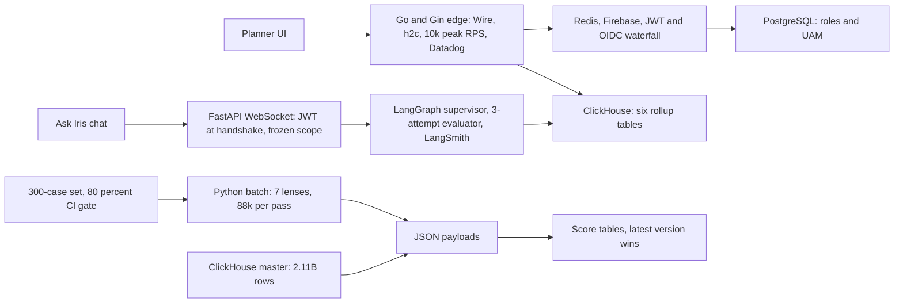

# Impact Analytics: Interview Pack

<div class="callout highlight">
<b>How to use this page</b>
<ul>
<li><b>What it covers:</b> the spoken pitches (30 seconds, 2 minutes, 3 minutes), the architecture you draw, the six big design decisions, and an attack-and-reply card for each of the ten Impact Analytics bullets on <code>Tarun_Mittal_SSE_5yr.pdf</code>.</li>
<li><b>When to read it:</b> the day before an interview, after you have read the <a href="10_impact_analytics_deep_dive.md">deep dive (10)</a> once. For longer follow-up answers per bullet, use the <a href="43_ia_bullet_defense.md">bullet defense (43)</a>.</li>
<li><b>What to memorise:</b> the 30-second and 2-minute pitches word for word, the "Numbers at a glance" table, and the "Do not say" list.</li>
</ul>
</div>

<div class="callout note">
<b>Tags used here.</b> <b>MEASURED</b> means there is a log, benchmark report, config or code behind it. <b>ESTIMATED</b> means arithmetic I can show. <b>TARGET</b> means a design goal, so say "targeting". <b>HISTORICAL</b> means from my past work records. <b>VERBAL</b> means true but not printed on the PDF, so use it only when they dig.
</div>

<div class="callout warn">
<b>Honesty in one box.</b>
The 300-case set and the 80% bar are a <b>CI promotion gate</b>, not "all tenants are live".
The 73% cost cut at 100% coverage comes from the <b>gold-200 benchmark</b> (two models compared on 200 cases), <b>not</b> the 300-case file.
Ask Iris is a <b>shipped capability</b> (JWT WebSocket, 3-attempt evaluator). There are no SLA or usage numbers.
On the PDF: 10k peak RPS, 2.11B-row master, 348k article-seasons, 88k items per pass, six rollup tables, 170GB OOM, about 344k rows/s, 4.09B rows.
Off the PDF (VERBAL): $100 per pass, the 1.6M catalog, the 55 GB and 16 GB OOM settings, 100% Go coverage.
Cluster Copilot and Hindsight are <b>verbal only</b>. No Kafka, Flink or Kubernetes operations on Impact Analytics.
</div>

**Role.** Senior Software Engineer, Impact Analytics, Bangalore, May 2026 to present. Individual contributor.
**Project title on the PDF.** AssortSmart, Senior Software Engineer (Platform & AI).
**Product.** AssortSmart, an AI-powered retail merchandise planning product. Planners use it to decide which products (articles) to keep, drop or add each season.
**Stack.** Agent plane: Python, FastAPI, LangGraph. Platform APIs: Go with Gin.
**Sources.** Canonical wording: [`docs/ASSORTSMART_TAB_RESUME.md`](../../docs/ASSORTSMART_TAB_RESUME.md). Full Q&A: [`43_ia_bullet_defense.md`](43_ia_bullet_defense.md).

---

## Words you need

Short definitions. The [deep dive](10_impact_analytics_deep_dive.md) has longer ones.

- **Article-season.** One product in one selling season, such as "blue linen shirt, Summer 2025". It is the unit the engine scores, like a report card per student per year.
- **Sell-through.** Share of stock that sold. 84 sold out of 100 available is 84%.
- **Lens.** One focused question the LLM answers about an article, like one specialist doctor on a panel. There are 7 active lenses.
- **Deterministic score (s_det).** A score computed by plain code from sell-through and rate of sale.
- **Blend.** `s_final = 0.4 × s_det + 0.6 × s_agent`, keep if at least 0.55.
- **ClickHouse.** A columnar analytics database. It reads only the columns a query needs, like a library that shelves every chapter 3 together.
- **MergeTree.** ClickHouse's main table type. Each insert writes a sorted chunk, and a background process merges chunks, like a clerk merging sorted stacks of index cards.
- **ReplacingMergeTree.** A MergeTree that keeps only the newest version of rows with the same key. Like a notebook where you write the new value below and a cleaner crosses out old lines later.
- **Rollup.** A table of already-summed results, like a monthly bank statement instead of every card swipe.
- **OOM (out of memory).** A query needs more RAM than allowed and is killed.
- **Spill.** When aggregation state outgrows memory, ClickHouse writes part of it to disk. Like moving overflow paperwork from the desk to the floor.
- **Native protocol.** ClickHouse's own binary protocol that moves columnar blocks. Port 9440 is the TLS version.
- **Double buffering.** Fill the next batch while the previous one sends. Two trays in a kitchen.
- **DROP PARTITION.** Delete one whole partition (here, one season) at once. Like emptying one drawer of a filing cabinet.
- **LangGraph supervisor.** The routing node in an LLM workflow graph, like a triage nurse sending each patient to the right doctor.
- **Evaluator loop.** A step that checks an answer and sends it back for another try, at most 3 times. Like a teacher who returns homework up to three times.
- **LangSmith.** A tracing tool that records every step, prompt and token of an LLM run.
- **JWT (JSON Web Token).** A signed token saying who you are, checked without calling anyone. A stamped wristband at a concert.
- **WebSocket handshake.** The first HTTP request that "upgrades" to a long-lived two-way connection. The natural moment to check identity once.
- **OIDC (OpenID Connect).** The standard behind "Sign in with Google".
- **Constant-time compare.** Comparing secrets in a way that takes the same time whether they differ early or late, so timing leaks nothing.
- **Circuit breaker.** Stops calling a failing dependency after too many failures, like the breaker in your house.
- **Checkpoint.** Saved progress so a crash resumes. A save point in a game.
- **config_hash.** A SHA-256 fingerprint of guardrails, parameters, prompts and catalog, stamped on every output row. Like the recipe card ID printed on every plate.
- **Wire.** A Go tool for compile-time dependency injection. Missing wiring fails the build.
- **h2c.** HTTP/2 without TLS on that hop. Many requests share one connection.
- **CI gate.** An automated check that blocks promotion if a quality bar is not met.

---

## 1. Pitches

### 30 seconds

"At Impact Analytics I work on AssortSmart, a retail merchandise planning product. On the AI side, I built a decision engine for Keep/Drop, Missed Opportunities and Top Style that has evaluated 348k article-seasons. It runs 88k items per pass, blends KPI math with structured LLM calls across seven lenses, and never lets the LLM query our 2.11-billion-row ClickHouse master. I also shipped Ask Iris, a JWT-secured WebSocket copilot, and an 80% accuracy CI gate. On the platform side, I built a Go and Gin API at 10k peak RPS and ClickHouse rollups that took pivots from 189 seconds to 12 seconds."

### 2 minutes

"AssortSmart helps retail planners decide which products to keep, drop or add each season. My work splits into an agentic half and a platform half.

On the agentic side, there are three batch pipelines: Keep/Drop, Missed Opportunities and Top Style. For each article-season, Python computes sell-through and rate of sale into a deterministic score. Then the LLM answers seven focused lens questions, such as whether demand is dying or whether a colour is cannibalising its sibling, from JSON we prepare. The LLM has no SQL tool. We blend the two scores, 40% rules and 60% agent. If the LLM times out, the rule score stands, so the run never stalls. A shared registry adds hard timeouts, a circuit breaker and checkpoints, so a crash resumes without recomputing the rule scores. Every row carries a config hash of the exact prompts and parameters.

Ask Iris is the interactive side. It's a WebSocket chat where the JWT is checked once at the handshake and the user's hierarchy is frozen for the session. Questions go through a LangGraph supervisor with an evaluator loop capped at three attempts, and LangSmith traces every run.

Quality is gated. Nothing is promoted unless it clears 80% on a 300-case proxy set. On a separate 200-case benchmark I picked a model that was 73% cheaper at full coverage. The rule baseline scored 74% there, and when the LLM blend came in below it, I froze the weights instead of overfitting.

On the platform side, I built the multi-tenant Go and Gin edge at 10k peak RPS, with Wire, h2c, nested timeouts and Datadog, and no reverse proxy. Custom KPIs go through a formula parser that compiles to safe ClickHouse SQL. Auth is a Redis-fronted waterfall over Firebase, JWT and Google OIDC, with Postgres roles. On data, ClickHouse rollups took pivots from 189 seconds to 12 seconds on a 250-million-row harness. I fixed a 170 GB out-of-memory failure by building weekly rollups one fiscal week at a time. And I wrote a Go native-TLS pump that copied rollups between clusters at about 344k rows per second."

### 3 minutes (add these to the 2-minute version)

- **The honest split.** "Two things people mix up. The 15.5× is query time on a benchmark harness. The 170 GB fix is load time. They're not cause and effect. And the 80% is a gate, not a live accuracy number."
- **A failure.** "My favourite failure is the weekly OOM. It failed even at 80 GB and 200 GB caps, so more RAM wasn't the answer. I profiled by grain and found one attribute week alone needed over 40 GB. The fix was one week per insert with a 55 GB cap and 16 GB of spill."
- **A judgement call.** "When the LLM blend scored about 63% against a 74% rule baseline, the easy move was to retune the weights until the number looked good. On 200 cases that's overfitting, so I froze them."

<details><summary>Verbal only, not on the PDF (Cluster Copilot and Hindsight)</summary>

Cluster Recommendation Copilot: from days to under 1 hour is a TARGET. Failures from 8.5% (37 of 437, MEASURED) to under 2% is a TARGET. 14 tools, 3 gates, Phase 1 design PASS, load test pending. Hindsight is a prior-season decision layer. The 63/8 DDL and the line-plan reduction from about 12B to about 25M rows are interview depth, not PDF bullets.

</details>

---

## 2. Architecture



*What to notice: the LLM in the batch only ever sees JSON, and the gate sits in front of every config change.*

The same picture in plain text, for a whiteboard:

```text
Planner UI / Ask Iris WebSocket
        │
Go/Gin edge (Wire, h2c, 10k peak RPS, Datadog)
        │
 Redis   Postgres roles/UAM   ClickHouse 2.11B fact / six rollup tables / RMT
        │
Python agent plane: 7 lenses, 88k per pass, JSON payloads vs 2.11B master
Ask Iris: JWT WebSocket, LangGraph supervisor, 3-attempt evaluator, handshake freeze
300-case / 80% CI gate · 73% cost (gold-200) · 74% deterministic · frozen weights
```

Any sketch that puts Kafka, Flink or Kubernetes operations on Impact Analytics is an overclaim. Kafka and Flink belong to Uber Menu.

---

## 3. The six big design decisions

### 3.1 Go edge with no reverse proxy

- **What.** The Go and Gin service is the first thing a request hits. No Nginx or Envoy in front.
- **Why.** One less hop and one less system to configure. The process owns h2c, nested timeouts and Datadog traces, so all the behaviour is in one place.
- **How.** Wire for compile-time DI, h2c handler, server deadlines around per-request and per-query context deadlines, a body size cap, and a SIGTERM drain.
- **Alternatives.** A reverse proxy (valid, but splits timeout logic) or runtime DI with Fx or Dig (errors surface at runtime).
- **Trade-off.** You own caps and graceful shutdown yourself.
- **Differently.** If it went multi-region, I'd revisit a managed load balancer.

### 3.2 ClickHouse for reads, Postgres for metadata and edits

- **What.** Pivots and rollups on ClickHouse. Roles, UAM, plan state and single-cell edits on Postgres.
- **Why.** Columnar storage wins large analytical reads. Postgres wins keyed updates. BigQuery's shared-slot latency varies with org-wide load (older prep quoted 1 to 20+ seconds, so keep that qualitative), and Snowflake's cost and latency did not fit an interactive UI.
- **Alternatives.** All-Postgres (189 seconds at 250M) or all-ClickHouse (bad at keyed updates).
- **Trade-off.** Two stores means two query paths and consistent tenant filters on both.

### 3.3 JSON payloads instead of an LLM SQL tool

- **What.** The scoring LLM gets prepared JSON. It never queries the 2.11B-row master.
- **Why.** A hallucinated query must never scan or write production data.
- **How.** Feature SQL runs in our code, gets trimmed per lens, and is sent as JSON. Results go to ReplacingMergeTree tables, and a timeout falls back to the deterministic score.
- **Alternatives.** An agent with a SQL tool. Rejected for safety, cost and latency.
- **Trade-off.** An extra hop, and readers must ask for the latest row version.

### 3.4 LangGraph supervisor with a 3-attempt evaluator for Ask Iris

- **What.** A routing node plus an evaluator capped at `MAX_ATTEMPTS = 3`, with scope frozen at the handshake.
- **Why.** Chat is both a tenant-leak surface and a token-loop surface.
- **Alternatives.** Re-checking scope per message (scope could depend on message content) or an uncapped loop (runaway cost).
- **Trade-off.** Framework surface area, and a hard question may get a best-effort answer.

### 3.5 An 80% gate against a 74% baseline, with frozen weights

- **What.** No promotion below 80% on the 300-case set. The rule baseline on the gold-200 set was 74%.
- **Why.** Models must beat a free rule to earn weight.
- **Trade-off.** The gate can fail the agent. That is success, not breakage.

### 3.6 Kafka and Flink are not part of this

They belong to Uber Menu. Do not move them onto Impact Analytics.

| Decision | Why | Trade-off |
|---|---|---|
| Go edge, no reverse proxy | 10k RPS with h2c, nested timeouts, Wire | You own caps and SIGTERM |
| ClickHouse vs Postgres vs Snowflake | Columnar pivots, predictable latency | ClickHouse is not keyed-UPDATE OLTP |
| JSON payloads vs the 2.11B master | Hallucinated SQL must not run | Extra hop, timeout falls back to deterministic |
| Supervisor plus 3-attempt evaluator | Stop infinite loops and tenant bleed | Framework surface |
| 80% gate vs 74% baseline, frozen weights | Models must beat a free rule | The gate can fail the agent, and that is success |
| Kafka and Flink | Uber Menu only | Do not move them onto Impact Analytics |

---

## 4. Bullet by bullet: claim, attack, reply

Each card: the claim, what it means in plain words, the tag, the attack they may make, and a reply you can say out loud.

### C1. Go/Gin at 10k peak RPS, Wire, h2c, Datadog

- **Claim.** A multi-tenant Go and Gin platform scaling to 10k peak RPS, Google Wire compile-time DI, a self-protecting HTTP edge without a reverse proxy, native h2c, nested timeouts, Datadog tracing.
- **Plain words.** The API the planner UI talks to is a Go service that protects itself, because nothing sits in front of it.
- **Tag.** On the PDF, from the AssortSmart platform record.
- **Attack.** "Is 10k measured in Datadog? Where's the reverse proxy?"
- **Reply.** "10k is the peak requests per second the Go edge was built and deployed for. We ran it without a reverse proxy on purpose, so the process owns h2c, the timeouts and the traces in one place. I won't attach a 99.9% SLA or a tenant count to it, because those aren't numbers I'd stand behind."
- **Follow-up they may ask.** "Why Wire over Fx?" Wire generates plain Go at build time, so a missing dependency fails the build instead of a request.

### C2. KPI tokenizer with division-by-zero protection

- **Claim.** A dynamic KPI configurator that tokenizes operator math into parameterized ClickHouse SQL with native division-by-zero protection.
- **Plain words.** Merchandisers type a formula, and a Go parser compiles it into safe SQL without a code release.
- **Tag.** On the PDF. The mechanism is an allowlisted parser plus an `ifNotFinite` wrap.
- **Attack.** "Isn't that just SQL injection with extra steps?"
- **Reply.** "No, because operators never write SQL. The parser tokenizes the formula, allowlists the functions, maps logical names to physical columns through a catalog, binds constants as parameters, and fails closed on anything it doesn't recognise. The result is wrapped in `ifNotFinite(toFloat64(expr), 0)`, so a divide by zero gives 0 instead of Infinity or NaN in the planner's JSON."

```text
units_sold / (units_sold + eop_units) * 100
-> ifNotFinite(toFloat64(sum(qty) / (sum(qty) + sum(eop_units)) * {p1:Float64}), 0)
```

### C3. Firebase, JWT and OIDC with Redis and Postgres roles

- **Claim.** Multi-tenant data isolation and UAM-scoped hierarchy access control across PostgreSQL and ClickHouse. A Redis-fronted Firebase Admin to JWT and Google OIDC waterfall, constant-time API keys, Postgres-backed roles.
- **Plain words.** Several login methods are tried in order, Redis caches the result, Postgres says what the user may see, and every query on both databases is filtered to that.
- **Tag.** On the PDF.
- **Attack.** "What happens on a cache miss? Do you fail open?"
- **Reply.** "Never. A Redis miss falls through to real verification, Firebase first and then JWT or Google OIDC. If nothing verifies, it's a 401. The same tenant ID is used for identity on Postgres and for filtering facts on ClickHouse. API keys use a constant-time compare so timing leaks nothing. To be clear, this is access control, not encryption and not a privacy programme. And Milvus is from Uber Menu, not this bullet."

### C4. 15.5×, the 170 GB OOM, temporal chunks

- **Claim.** Reduced planner pivot latency by 15.5× (189s to 12s on 250M-row operations) with season and weekly rollups. Prevented 170GB OOM crashes by slicing inserts into temporal chunks with memory and disk-spill caps.
- **Plain words.** Two stories. Pivots got faster by reading pre-aggregated ClickHouse tables. Separately, building the weekly rollups crashed, and I fixed that by building one week at a time.
- **Tag.** On the PDF. 189 seconds to 12 seconds is a MEASURED POC (12.3 s rounded). 170 GB is load time. The 55 GB, 16 GB and one-fiscal-week settings are VERBAL.
- **Attack.** "So the OOM fix caused the 15.5×?"
- **Reply.** "No, they're separate. The pivot number is query time, measured on a 250-million-row harness where Postgres took 189 seconds and ClickHouse took about 12. The OOM was load time: a whole-season weekly GROUP BY needed around 170 GB. I sliced it to one fiscal week per insert so weekly grain could exist at all."
- **Follow-up they may ask.** "Why not just add RAM?" It failed at 200 GB too. The unit of work was the problem. Full detail in [`42`](42_clickhouse_rollup_migration.md) and [`43` C4](43_ia_bullet_defense.md).

### C5. Go native-TLS pump, about 344k rows/s, 4.09B, partition rollbacks

- **Claim.** Migrated rollups across Cloud clusters at about 344k rows/s with a Go native-TLS pump, bypassing IP allowlists. Partitions up to 4.09B rows, 500k-row double-buffered batches, TSV ledgers, atomic partition rollbacks.
- **Plain words.** The clusters couldn't talk directly, so a Go program on an allowlisted machine read from one and wrote to the other in big batches, with bookkeeping so crashes never leave fake-complete data.
- **Tag.** On the PDF. 344k is two season streams combined. The 4.09B copy was in flight. Rollback means DROP PARTITION then recopy.
- **Attack.** "So you finished 4.09 billion?" or "344k TPS?" or "The TSV was the copier's ledger?"
- **Reply.** "Three corrections, gently. The PDF says partitions up to 4.09B. I measured on that attribute weekly set while it was in flight, so I say 'measured on', not 'migrated'. 344k is rows per second of native-protocol ingest, two streams of roughly 150 to 190 thousand each, not transactions. And the TSV ledger is the weekly loader's skip file. The copier uses `.done` files per table. Partition rollback is how we restart a season, not a swap with live readers."

### A1. 348k article-seasons, 88k per pass, 7 lenses

- **Claim.** A multi-pipeline AI merchandise decision engine (Keep/Drop, Missed Opportunities, Top Style) evaluating 348k article-seasons, 88k items per pass, deterministic KPI math blended with structured LLM calls across 7 lenses.
- **Plain words.** Three batch pipelines that score every product-season with code first and seven focused LLM questions second.
- **Tag.** On the PDF. $100 per pass is VERBAL. The 1.6M catalog is VERBAL and a different number.
- **Attack.** "Isn't this just a chatbot over your data?"
- **Reply.** "No, it's three named batch pipelines. 348k is the number of article-seasons scored. The KPI math is plain Python, so it's exact. The LLM answers seven narrow lens questions with structured JSON, and a cheap gate skips lenses that have no data for an article."

### A2. JSON payloads against the 2.11B master, ReplacingMergeTree, timeout fallback

- **Claim.** Decoupled inference from a 2.11B-row ClickHouse master via JSON payloads, eventually consistent writes via ReplacingMergeTree, and graceful fallback to deterministic baselines on LLM timeouts.
- **Plain words.** The LLM gets JSON we prepare, never database access. Duplicate writes are harmless, and if the LLM is slow, the rule score stands.
- **Tag.** On the PDF.
- **Attack.** "So the LLM still queries ClickHouse, just asynchronously?"
- **Reply.** "No. 'Async' is how the batch executor runs. The model never gets a SQL tool. We run the feature queries, send JSON, and write results ourselves. On a timeout, the article keeps its deterministic score so the 88k-item run doesn't stall on one provider 504. And for the record, I didn't author the pg2ch_cdc pipeline."

### A3. Registry, checkpoints that skip deterministic work, config_hash

- **Claim.** A shared orchestration registry so 88k-article runs survive provider failure: hard timeouts, circuit breakers, durable checkpoints that bypass redundant deterministic scoring, a frozen config hash on every row, and JSON telemetry (tokens, USD, duration, fallbacks).
- **Plain words.** One harness for all three pipelines that sets deadlines, stops calling a dead provider, resumes after a crash, and records cost and config per row.
- **Tag.** On the PDF.
- **Attack.** "Why not just use Airflow?"
- **Reply.** "We needed resume logic tightly coupled to ClickHouse inserts, config hashing and per-run token and dollar accounting. With `--resume`, the job reloads `det.json`, skips finished articles in `agent_progress.json`, and continues only the LLM part. The breaker trips after about five consecutive failures or a high failure fraction. The config hash is a SHA-256 of the frozen prompts, parameters, guardrails and catalog. A heavy external orchestrator would have been extra infrastructure for a batch CLI we already owned."

### A4. Ask Iris: JWT WebSocket, 3-attempt evaluator, handshake freeze

- **Claim.** Shipped Ask Iris, a JWT-secured WebSocket copilot for planners to query KPIs and inspect AI decisions. LangGraph supervisor, 3-attempt evaluator, LangSmith, hierarchy frozen at the handshake.
- **Plain words.** A chat assistant where your identity and permissions are locked when the connection opens, and the agent can't loop forever.
- **Tag.** On the PDF as a shipped capability.
- **Attack.** "How many planners use it? What's the SLA?"
- **Reply.** "I describe it as a shipped capability, and I don't quote usage or SLA numbers I can't back up. What I can explain in depth is the safety design. Scope binds at the JWT handshake and every tool call inherits it, so a later message can't pivot into another tenant. The evaluator caps at three attempts, and LangSmith traces every run."

### A5. 300-case set, 80% gate, 73% cost, 74% baseline, frozen weights

- **Claim.** A 300-case proxy evaluation harness and an 80% accuracy CI gate. Live execution cost cut by 73% at 100% coverage by benchmarking models against a 74% deterministic baseline, freezing decision weights when the LLM underperformed.
- **Plain words.** Changes must pass 80% on 300 test cases. A separate 200-case benchmark picked a much cheaper model and showed the LLM blend wasn't beating the rule yet, so I didn't let it take more weight.
- **Tag.** 80% is a promotion gate. 73% and 100% come from the gold-200 benchmark.
- **Attack.** "So your agent is 80% accurate and 73% cheaper on the same test?"
- **Reply.** "Two different sets, and I keep them apart. The 300-case file is the CI gate, with a minimum accuracy of 0.8. The 73% cost cut at 200 out of 200 complete was a model comparison on a separate 200-case gold set. On that same set the rule baseline was 74% and the LLM blend was around 63%, so I froze the blend weights instead of tuning them to a small sample."

### Verbal only: Cluster Copilot and Hindsight (not on the PDF)

Use only if asked. Don't present them as resume bullets. Deep dive: [`01b_hindsight_defense.md`](../campaign_extras/interview_prep/projects/01b_hindsight_defense.md) and the verbal section of [`10`](10_impact_analytics_deep_dive.md).

---

## 5. Numbers at a glance

| Number | What it is | Say it like this |
|---|---|---|
| 348k | Article-seasons scored | "348 thousand article-seasons" |
| 88k | Items per batch pass | "about 88 thousand items per pass" |
| 7 | Active AI lenses | "seven lenses" |
| 2.11B | Rows in the ClickHouse master | "a 2.11-billion-row master" |
| 3 | Max evaluator attempts in Ask Iris | "capped at three attempts" |
| 300 / 80% | Proxy set size and CI gate | "an 80% gate on 300 cases" |
| 73% / 100% | Cost cut at full coverage, gold-200 | "73% cheaper at full coverage" |
| 74% | Rule baseline on gold-200 | "a 74% rule baseline" |
| 10k | Peak RPS on the Go edge | "10k peak requests per second" |
| 15.5× | 189 s to 12 s on 250M rows | "from 189 seconds to 12 seconds" |
| 170 GB | Whole-season weekly build memory | "about 170 GB, so it OOM'd" |
| ~344k | Rows per second, two streams combined | "about 344 thousand rows per second" |
| 4.09B | Largest partition set measured on | "measured on a 4.09-billion-row set" |
| 500k | Rows per batch in the pump | "500 thousand-row batches" |

**How the key ones are derived.**
- **15.5×** is 189,408 ms divided by 12,256 ms, which is 15.45, rounded to 15.5.
- **4.09B** is 2,779,317,472 plus 1,311,108,195 rows of attribute weekly data across two seasons.
- **344k** is two season streams of about 150k to 190k rows per second each, read off live copy logs at a snapshot.
- **73%** means the chosen model's run cost about 27% of the previous model's run on the same 200 cases.
- **74% vs about 63%** is rule-only accuracy at the 0.65 threshold versus blended accuracy on the same 200 cases.

---

## 6. Mock Q&A

**Is it shipped or gated?**
"Both, for different things. Ask Iris is a shipped capability. The 80% bar is a promotion gate for decision-engine configs. AssortSmart itself is a live SaaS product, but I don't claim every tenant runs every agent config."

**Why not Snowflake?**
"Because this is an interactive planner UI. We needed predictable, low latency on large pivots, and per-query warehouse cost adds up for a screen people click all day. ClickHouse's columnar engine beat Postgres's row store on those reads, and BigQuery's shared-slot latency varied too much."

**Why JSON payloads instead of letting the LLM write SQL?**
"A 2.11-billion-row master can't be exposed to hallucinated queries. Async batching is about throughput. The no-SQL-tool rule is the isolation invariant. Those are two separate ideas."

**How do you debug a problem: agent side or Go side?**
"I use a four-step routine. Isolate which plane it's in. Read the traces: LangSmith for the graph, tokens and tool calls, Datadog for HTTP and ClickHouse spans, plus JSON logs with tenant_id and trace_id. Check saturation, such as connection pools, memory and rate limits. Then mitigate first and fix the root cause second."

**Did you use Kubernetes, CDC or Flink on Impact Analytics?**
"No. Flink was Uber Menu. The CDC pipeline here was authored by a colleague, Ashvin Sharma. Kubernetes is skills-level literacy for me, not cluster operations."

**What was the hardest bug?**
"The 170 GB weekly OOM. More memory didn't fix it, even at 200 GB. Profiling per week showed attribute weeks needed over 40 GB each, so I changed the unit of work to one fiscal week with memory and spill caps."

---

## 7. Do NOT say

- "All tenants are live at 80%."
- "The 73% was measured on the 300-case file."
- HITL or human review queues, or Kafka, Flink or CDC on Impact Analytics.
- Any throughput number for Impact Analytics beyond the PDF's 10k peak RPS.
- Spark, Pinot, Kubernetes operations, Terraform, Flink on Impact Analytics, or MCP as a PDF claim.
- Cluster Copilot or Hindsight as PDF bullets.
- A tenant-wide Ask Iris SLA or usage figure.
- "I built pg2ch_cdc."
- "344k TPS", "finished the 4.09B cutover", "atomic swap", or "sub-second ClickHouse".
- "The OOM fix caused the 15.5×."

**Related:** [Deep dive (10)](10_impact_analytics_deep_dive.md) · [Bullet defense (43)](43_ia_bullet_defense.md) · [ClickHouse rollups and copier (42)](42_clickhouse_rollup_migration.md) · [Ground truth](GROUND_TRUTH.md)
