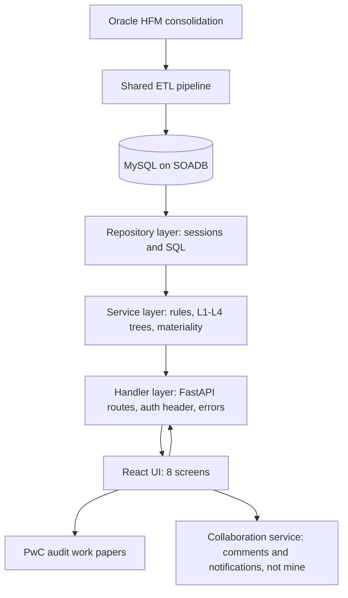
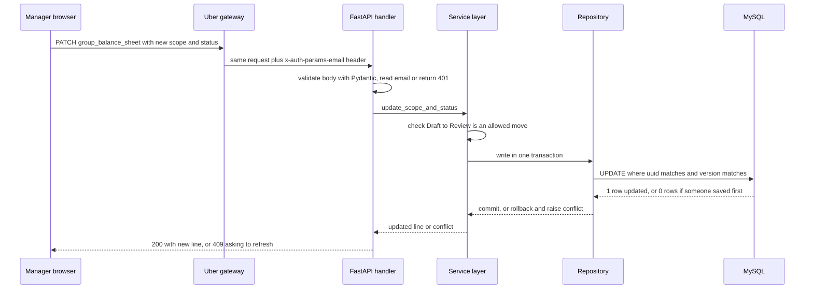
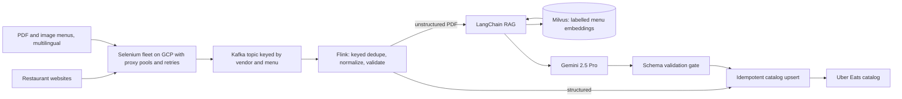
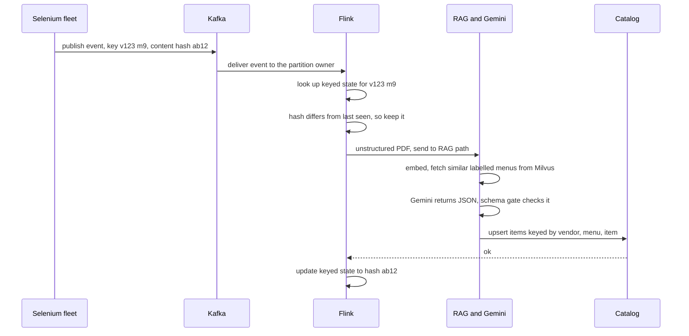
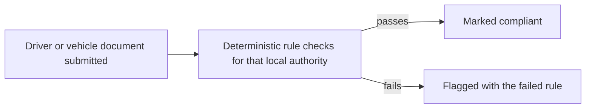

# Uber Interview Packs: FRM Scoping, Menu Ingestion and ANZ Document Compliance

<div class="callout note">
<b>How to use this page</b>
<ul>
<li><b>What it covers:</b> all three Uber projects on the resume (Uber via EPAM, July 2024 to May 2026). Part 1 is the FRM Scoping Platform (Uber Finance). Part 2 is Menu Ingestion and Automation (Uber Eats). Part 3 is Document Compliance (Uber Mobility ANZ).</li>
<li><b>When to read it:</b> the day before any interview that may touch Uber. Read the one-minute versions out loud first. Then read the "bullet decoded" sections and the mock questions.</li>
<li><b>What to memorise:</b> FRM: 70% (from 14 days to 3 days), $340M, 19M raw GL rows, 36 FastAPI endpoints, 8 tables, led 3 engineers, 100% statement coverage, 50% delta-variance. Menu: from 24 hours to 2 hours, $600K a year, 30K+ menus a month, 98% field fidelity (offline evaluation), 95%+ extraction success. ANZ: 99.9% compliance and 20 hours a week (historical).</li>
<li><b>Go deeper:</b> the FRM deep dive and the Menu deep dive, linked just below this box.</li>
</ul>
</div>

Related pages: [FRM deep dive](11_uber_frm_deep_dive.md) · [Menu deep dive](14_uber_menu_deep_dive.md) · [Menu streaming numbers](03_uber_menu_streaming_numbers.md) · [Metrics derivations](09_metrics_derivations.md) · [Ground truth](GROUND_TRUTH.md) · [Menu / ANZ panel check](30_panel_menu_anz_milvus.md)

## Before you start: tags and framing

Some numbers on this page carry a tag. The tag tells you how confident you can be and how to phrase it.

| Tag | What it means | How to say it |
|---|---|---|
| MEASURED | There is a log, a document or code that shows it. | State it plainly. |
| TARGET | It was a design goal written in a design doc. | "We were targeting..." |
| ESTIMATED | It is arithmetic I can show on a whiteboard. | "Roughly, derived from..." |
| HISTORICAL | It comes from my past work records and resume. It is not re-measured from logs in this repo. | State it, and if pressed say "that's from my records at the time". |

Two framing rules apply to every Uber answer. First, always say **"Uber via EPAM"**. I was an EPAM Systems engineer embedded in Uber teams, with the title Software Development Engineer 2, based in Bangalore. Second, the three projects are separate. FRM is Uber Finance. Menu is Uber Eats. ANZ is Uber Mobility. Never merge their architectures into one story.

---

# Part 1. Uber FRM Scoping Platform (Uber Finance)

## 1.1 The one-minute version

**30-second version (say this out loud):**

"At Uber, through EPAM, I owned the backend of the Financial Risk Management scoping platform for Uber Finance. Every quarter, Finance decides which line items and legal entities on the financial statements are significant enough to be audited, and they used to do that in Google Sheets. I moved that process onto a Python FastAPI service backed by MySQL. It cut quarterly reconciliation time by 70%, from 14 days to 3 days, against a $340M materiality threshold. I migrated 19M raw general-ledger rows off Sheets, shipped 36 FastAPI endpoints, and led 3 engineers on a SQLAlchemy 2.0 migration that took the module's statement coverage to 100%."

**2-minute version:**

"Uber Finance runs a scoping process every quarter during the financial close. The output decides which financial statement line items and which entities PwC, the external auditor, will test. Before the platform, this lived in a Google Sheets workbook. Formulas broke, people overwrote each other, and there was no audit trail.

I owned the backend. It is a FastAPI service on Uber's standard MySQL platform, SOADB. The service exposes 36 endpoints that do the financial math: materiality checks, a nested four-level line-item hierarchy, residual-risk calculations and quarter annualization so a partial-year number can be compared against an annual threshold.

The data model was the hard part. The old ETL loads and the users' edits fought over locks during the close, so I designed an 8-table normalized schema. One review-status model is shared by every screen. Updates use optimistic row-locking, so two managers cannot silently overwrite each other. Cross-table changes happen in one transaction. Rows get deterministic SHA-256 natural keys, so loading the same quarter twice does not create duplicates.

I also led a pod of 3 EPAM engineers on a migration to SQLAlchemy 2.0. That removed a class of silent column-aliasing bugs and took the module to 100% statement coverage. We shipped with stacked Bazel pull requests so there was no downtime, and we added review-status gates that flag any line that moves by more than 50% for SOX review.

Two honest boundaries. The ETL from Oracle HFM was a shared pipeline, and the comments and notifications service was a separate service I did not build."

## 1.2 The business in plain English

Uber is a public company. Every quarter it files a report with the US regulator called a 10-Q. Before that, the external auditor (PwC) needs to know which parts of the financial statements are big or risky enough to test. Deciding that is called **scoping**. The FRM (Financial Risk Management) team inside Uber Finance owns scoping.

Before this platform, scoping was a Google Sheets workbook. It had formulas, hand-built parent and child mappings between line items, and no history. If two managers edited the same cell, the last one won. Nobody could attach a comment to a specific line and keep it across quarters. For a process that feeds audit evidence, that is a real risk. A wrong number in scoping can end up in PwC's work papers.

Uber paid for this because the close is time-boxed and audited. A faster, traceable close means fewer manual hours, fewer reconciliation errors, and clean evidence for SOX (the US law that requires public companies to prove their financial controls work).

## 1.3 Words you need

- **FSLI (Financial Statement Line Item):** one line on the balance sheet or income statement, such as Cash, Accounts Receivable or Revenue. Think of the rows in a household budget: Rent, Groceries, Salary.
- **FSLI hierarchy, L1 to L4:** line items nest four levels deep. Example: L1 "Total Assets", L2 "Current Assets", L3 "Cash and Equivalents", L4 a specific cash sub-line. A parent's amount must equal the sum of its children, like folders whose size is the sum of their files.
- **GL (General Ledger):** the master record of every accounting balance. A "raw GL row" is one account balance for one entity and period.
- **Materiality:** the dollar amount above which a mistake would change a reader's decision about the financials. On the Q4 2025 close it was **$340M**. Anything bigger than that is automatically significant.
- **Residual risk:** what is left uncovered after you have put the significant pieces in scope. If a line is $1B and the in-scope components cover $900M, the residual is $100M. If that leftover is still large compared with materiality, someone has to look at it. The residual threshold on the Q4 2025 close was $170M.
- **Oracle HFM (Hyperion Financial Management):** the consolidation system where Uber's entity balances are combined into group numbers. The scoping tool consumes data loaded from HFM.
- **10-Q reconciliation:** checking that the HFM numbers tie to the numbers Uber publicly filed. A nonzero difference has to be explained.
- **SOADB:** Uber's standard for service-owned MySQL databases. Choosing it was a platform rule, not a free choice.
- **ORM (Object-Relational Mapper):** a library that lets you work with database rows as Python objects. **SQLAlchemy 2.0** is the main Python ORM. Version 2.0 added typed models and a cleaner `select()` query style.
- **Pydantic:** a Python library that validates request and response data against a declared shape. FastAPI uses it to reject bad input with a 422 error automatically.
- **Bazel:** Uber's monorepo build and test system. Every pull request runs its Bazel test targets before merge.
- **Stacked pull requests:** a big change split into a chain of small PRs, where each one builds on the previous one and passes tests on its own. Like moving house one box at a time instead of in one truck.
- **Optimistic row-locking:** each row carries a version number. You read version 7, and when you save you say "update only if it is still version 7". If someone else saved first, the version is now 8, your update touches zero rows, and you get a conflict instead of silently overwriting them. It is "optimistic" because you do not lock the row while the user is thinking.
- **Natural key with SHA-256:** instead of a random ID, the row's ID is computed from its content. SHA-256 is a hash function that turns any text into a fixed 64-character fingerprint. Same input, same fingerprint, every time. So loading the same question twice produces the same ID and updates in place.
- **Polymorphic review-status model:** one status model (Draft, Review, ReOpen, Closed) reused by every screen, instead of each screen inventing its own status columns.
- **FSM (Finite State Machine):** a set of allowed states and allowed moves between them. Example: Draft can move to Review, Review can move to Closed or ReOpen. A move that is not on the list is rejected.
- **Quarter-annualization:** converting a part-year figure into an annual equivalent so it can be compared against an annual threshold. As a general illustration: a year-to-date figure after Q2 is roughly half a year, so you scale it by 4 divided by 2. "Dynamic" means the factor depends on which quarter you are in.

## 1.4 Architecture



*What to notice:* data flows in from HFM through a shared ETL into MySQL. My service is the three middle boxes. The UI and the collaboration service sit around it but are not mine.

Walking through it box by box. Oracle HFM holds the consolidated numbers. A shared ETL job extracts raw balances and entity data and loads them into MySQL tables keyed by fiscal quarter and year. The **repository layer** is the only code that opens database sessions and runs SQL. The **service layer** holds the finance rules: it builds the L1 to L4 trees, computes significance against materiality, computes residuals and annualizes quarter figures. The **handler layer** is the FastAPI routes. It reads the `x-auth-params-email` header that Uber's gateway injects after login, rejects requests without it, maps errors to HTTP status codes and records who made each change. The React UI has 8 screens: Reconciliation, Materiality, EMI Scoping, Group Scoping, Threshold Setup, Component Scoping, Residual Risk and Summary. The output becomes evidence in PwC's work papers.

The older ASCII sketch is still useful because it shows the table names:

```text
Oracle HFM (consolidation)
        |  ETL (shared pipeline: consumes, does not own end-to-end)
        v
+-----------------------------------------------------------+
|  MySQL (SOADB): scoping service ORM models                |
|  level_mapping <-- balance_sheet / income_statement       |
|                <-- component_entity                       |
|  recon_* (v2) . frm_metrics_table . threshold_table_v2    |
|  emi_data . scoping_questions / assessments               |
+-----------------------------------------------------------+
        ^
        |  repository (sessions, SQL) -> service (rules, trees)
        |  -> handler (HTTP, auth, errors)  /frm-scoping/*
+-------+---------------------------------------------------+
|  FastAPI (langfx) . Pydantic . asyncio.to_thread(DB)      |
|  x-auth-params-email -> created_by / updated_by           |
+-----------------------------------------------------------+
        ^
        |  scoping routes (part of the 36 endpoints)
+-------+--------------+     +-----------------------------+
|  React (Fusion.js)   |     |  frm-collaboration-service  |
|  8 screens           |     |  comments / notifications   |
|  -> PwC work papers  |     |  (separate: do not claim)   |
+----------------------+     +-----------------------------+
```

*What to notice:* `level_mapping` is the spine. Every fact row points to it by `level_id`, so renaming a parent line never rewrites thousands of fact rows.

## 1.5 One request, step by step

Scenario: a Finance manager marks the Cash line on the Group Scoping screen as "In Scope" and moves it from Draft to Review.



*What to notice:* the state-machine check happens before the write, and the version check happens inside the write. Both protect the audit trail.

The request body is small (illustrative shape):

```json
{
  "conclusion_scope": "In Scope",
  "group_status": "Review",
  "version": 7
}
```

The write follows the optimistic-locking pattern. This SQL is illustrative of the pattern, not a paste of Uber code:

```sql
UPDATE balance_sheet
SET conclusion_scope = 'In Scope',
    group_status     = 'Review',
    version          = version + 1,
    updated_by       = 'manager@uber.com'
WHERE uuid = :line_uuid
  AND version = 7;
-- 1 row affected: success.
-- 0 rows affected: someone else saved first, so return a conflict.
```

## 1.6 Each resume bullet decoded

### Bullet 1: ownership, 70%, $340M, 19M rows, 36 endpoints, L1-L4, annualization

> Owned the Financial Risk Management scoping backend, reducing quarterly reconciliation time by 70% (from 14 days to 3 days) against a $340M materiality threshold. Engineered the Sheets-to-MySQL migration across 19M raw GL rows, shipping 36 FastAPI endpoints to automate custom financial math and a nested 4-level FSLI (L1–L4) hierarchy with dynamic quarter-annualization.

**In plain words.** I owned the backend that replaced a spreadsheet close. Reconciliation used to take two working weeks a quarter and now takes three days. I moved the general-ledger data out of Sheets into MySQL and built the API that does the finance math.

**How it works.** The service reads HFM-loaded tables, builds the line-item tree for a quarter, applies materiality and threshold rules, and serves the result to 8 screens. Reconciliation moved from a Sheets-backed v1 API to a MySQL-backed v2 API. Both ran in parallel until the numbers matched, then the UI switched to v2.

**What I owned and did not own.** I owned the scoping service backend: design, schema, APIs and the recon v2 migration. The HFM ETL was shared. The collaboration service and the React UI were not mine.

**The numbers.**

- **70% (from 14 days to 3 days).** What it measures: calendar time Finance spent on quarterly reconciliation. Where it comes from: the technical design doc framed the 70% reduction, and that is what the platform delivered for the close. If someone does the arithmetic, 14 days to 3 days is about a 79% cut (11 divided by 14). Quoting 70% is the conservative figure, so it under-claims. Why it mattered: the close is time-boxed, so eleven fewer days means the audit evidence is ready earlier. How to say it: "from 14 days to 3 days, about a 70% cut". Do not walk it back unprompted. If pressed: "the design doc framed that cut and that's what the platform delivered for the close."
- **$340M materiality.** What it measures: the group materiality threshold on the Q4 2025 close (MEASURED from that quarter's data). It is stored as a configurable metric, not hard-coded. How to say it: "$340M on the Q4 2025 close". Do not present it as a fixed constant.
- **19M raw GL rows.** What it measures: raw general-ledger rows migrated off Sheets into MySQL. How to say it: "19 million raw GL rows". Say this carefully: individual quarterly GL extracts were much smaller, roughly 38K to 95K rows, with about 1.7K to 1.8K accounts and about 400 entities. If someone asks about scale, the value of the project was correctness, hierarchy and auditability, not big-data throughput. Do not invent where the 19M comes from beyond "raw GL rows migrated off Sheets".
- **36 FastAPI endpoints.** What it measures: endpoints on the platform. If asked for the breakdown: about 31 functional routes in the scoping service handler, plus the collaboration-service APIs for comments and notifications listed in the design doc, make 36. I owned the scoping routes. Older prep said "30+, never 36". That guidance is obsolete because the PDF now says 36.

**Questions they will ask.**

- *"Is 70% measured or a target?"* "It's the outcome on the resume: reconciliation went from 14 days to 3 days. The design doc framed the 70% cut, and that's what the platform delivered for the close. Strictly, 14 to 3 is closer to 79%, so 70% is the conservative way to say it."
- *"19 million rows sounds like big data. Is it?"* "No, and I wouldn't pitch it that way. 19M is the raw GL rows migrated off Sheets. Each quarter's working set is tens of thousands of rows. The hard part was getting a recursive financial tree exactly right and auditable, because a wrong number becomes audit evidence."

### Bullet 2: 8-table schema, review status, optimistic locking, atomic syncs, SHA-256 keys

> Resolved ETL pipeline lock contention during financial close by designing an 8-table normalized MySQL schema on Uber's SOADB featuring a polymorphic review-status model. Guaranteed real-time, multi-user collaboration integrity by implementing optimistic row-locking, atomic cross-table syncs, and deterministic SHA-256 natural-key hashing to eliminate data duplication across quarterly audit trails.

**In plain words.** During the close, data loads and many managers' edits were hitting the same data at the same time. I designed a cleaner schema and write rules so nobody blocks or overwrites anyone, and so re-running a load does not create duplicate rows.

**How it works.**

1. **Normalized schema.** Facts (amounts per line, entity and period) are separate from the hierarchy (`level_mapping`), metrics (materiality, benchmarks), thresholds, questions and assessments. Each table has one job, so a load into one table does not lock rows that users are editing in another.
2. **Polymorphic review status.** One status model with Draft, Review, ReOpen and Closed is reused across screens. The rules for moving between statuses live in one place.
3. **Optimistic row-locking.** Every update carries the version it read. If the version changed, the update affects zero rows and the user gets a conflict. See the SQL in section 1.5.
4. **Atomic cross-table syncs.** Some edits touch two tables. Example from the code: the EMI "Total" patch also mirrors the amount into `balance_sheet` or `income_statement`. Both writes happen in one transaction. If either fails, both roll back.
5. **SHA-256 natural keys.** Example: a scoping question's ID is `SHA-256(question_text + normalized page_name)`. Re-loading the same question produces the same ID, so the upsert updates in place.

```python
import hashlib

def question_uuid(question_text: str, page_name: str) -> str:
    key = question_text.strip() + page_name.strip().lower()
    return hashlib.sha256(key.encode("utf-8")).hexdigest()

question_uuid("Is there significant fraud risk?", "Group Scoping")
# Same text and page always gives the same 64-character ID.
```

**Why this design, and alternatives.**

- *Why normalized and not one wide table:* a wide "everything" table means every load and every edit fight over the same rows. Separate tables shrink the lock footprint.
- *Why optimistic and not pessimistic locking:* pessimistic locking (`SELECT ... FOR UPDATE`) holds a lock while a human is looking at the screen. Managers can take minutes, so locks would pile up. Conflicts are rare, so optimistic locking is cheaper and only bothers the user when there really is a clash.
- *Why natural keys and not auto-increment IDs:* an auto-increment ID is different every time you insert, so re-running a load duplicates rows. A content hash is the same every time.
- *Trade-off:* natural keys mean a change to the hashed text creates a new identity. That is acceptable because a reworded question genuinely is a different question for audit purposes.

**Say this carefully.** The PDF says 8 tables. The scoping service code has 11 ORM model classes in total. If someone asks why the counts differ, say the 8 tables are the core normalized scoping schema I designed, and the service also maps some supporting tables. Do not try to map them one-to-one unless asked, and if asked, keep it qualitative. The real-time push of comments and Slack notifications lives in the separate collaboration service, which I did not build.

**Questions they will ask.**

- *"Why optimistic locking instead of a lock?"* "Because humans are slow and conflicts are rare. A row lock would be held while a manager reads the screen. With a version check, nobody waits, and in the rare case two people edit the same line, the second one gets a clear conflict instead of silently overwriting the first."
- *"What is a natural key and why SHA-256?"* "It's an ID computed from the row's content. I hash the question text plus the normalized page name. The same input always gives the same ID, so re-loading a quarter updates rows instead of duplicating them. SHA-256 is stable and collision-resistant, and the 64-character output fits a string column."

### Bullet 3: led 3 engineers, SQLAlchemy 2.0, 100% coverage, stacked PRs, allowlists, FSM gates

> Led 3 engineers in a core SQLAlchemy 2.0 ORM migration that eliminated latent column-aliasing bugs and raised module statement coverage to 100%. Orchestrated zero-downtime releases via stacked Bazel PRs, embedding reporting SQL allowlists and automated FSM gates with 50% delta-variance checks to enforce SOX compliance.

**In plain words.** I was the tech lead of a 3-person EPAM pod. We moved the data access code to the modern SQLAlchemy 2.0 style, which removed a sneaky bug class, and we tested every line of the module. We shipped in small safe steps and added automated checks that Finance's controls require.

**The column-aliasing bug (tell this precisely).** The old read path built row dictionaries like this:

```python
keys = list(result.keys())
rows = [dict(zip(keys, tuple(r))) for r in result.fetchall()]
```

That is only safe if every column name is unique. A join between the fact table and `level_mapping` returned two columns both named `uuid`. Python's `dict` keeps the last value for a repeated key, so the row silently took the `level_mapping` uuid instead of the fact uuid. A PATCH by uuid then edited the wrong line. The fix was SQLAlchemy 2.0 `select()` over `aliased()` models with an explicit label on every column:

```python
i = aliased(fact_model, name="i")
lm = aliased(LevelMapping, name="lm")
select(
    func.min(i.uuid).label("fsli_id"),
    func.max(lm.uuid).label("level_mapping_uuid"),
    lm.level1.label("level_1"),
)
```

Now no two columns can share a name, so the mapping cannot collide.

**The other pieces.**

- **100% module statement coverage.** Every statement in the migrated module runs in at least one test. Verbal depth: the service has 1,100+ tests. Do not confuse this with Masters India's coverage numbers (35% to 82%).
- **Stacked Bazel PRs.** The migration went in as a chain of small PRs. Each one passed the Bazel test targets on its own and could ship without breaking the live service. That is what "zero-downtime" means here.
- **Reporting SQL allowlists.** Reporting queries can only run from an approved list. A query that is not on the list is refused. Think of a building where only pre-approved keys open doors.
- **FSM gates with 50% delta-variance checks.** The review-status state machine (Draft, Review, ReOpen, Closed) will not let a line move forward silently if its value moved by more than 50% compared with its comparison figure. That line has to be reviewed. For SOX, this proves a human looked at large swings. If asked for the exact comparison formula, keep it qualitative.

**Why this design, and alternatives.**

- *Why migrate the ORM at all, instead of patching each query:* patching one query fixes one bug. Moving to labelled `select()` removes the whole class of bugs.
- *Why stacked PRs, instead of one big-bang PR:* a big PR is hard to review and risky to roll back. Small PRs are reviewed faster and each is safe to revert.
- *Trade-off:* stricter select discipline on every join, and more PRs to coordinate.
- *What I'd do differently:* add a lint rule that rejects unlabelled columns in joins, so the convention is enforced by tooling instead of review.

**Leadership, honestly.** "Led 3" means tech lead of an EPAM pod, not people manager. I split work by layer (handler, service, repository, model) so engineers did not collide, set the conventions, and ran the review gate that required tests with every PR. Never merge this with "mentored 2" at Masters India.

## 1.7 Design decisions at a glance

| Decision | Choice | Why | Trade-off |
|---|---|---|---|
| Datastore | MySQL on SOADB (InnoDB) | Platform standard, and it gives ACID transactions for many people editing during the close | No recursive SQL used, so the hierarchy is flattened by the ETL |
| Layering | Handler, service, repository | Testable with mocks, and 3 engineers can work one feature without collisions | More files per change |
| Hierarchy | `level_mapping` plus `level_id` | Stable IDs, renames do not rewrite facts | The app must keep logical joins consistent, because there are no foreign keys in the ORM |
| Materiality rules | Quantitative OR qualitative, 5% component benchmarks | Deterministic and auditable, matches the finance process | Qualitative answers still need a human |
| Recon cutover | v1 Sheets and v2 MySQL run in parallel | Zero downtime and side-by-side checking | Two code paths until the UI cuts over |
| Column identity | `aliased()` plus `.label()` | Kills silent last-write-wins on joined uuid columns | Discipline required on every join |
| Concurrency | Optimistic row-locking | No locks held while humans think | Users occasionally see a conflict and refresh |
| Auth | Trust gateway header, record the email | Audit trail for a SOX-adjacent tool | Fine-grained authorization is upstream |
| Blocking DB calls | `asyncio.to_thread` | Keeps the FastAPI event loop responsive | Uses a thread pool, which is fine at this load |

The main ones in full:

**MySQL on SOADB.** *What:* MySQL with InnoDB. *Why:* SOADB is Uber's paved road for service-owned relational data, and InnoDB gives ACID transactions for concurrent edits. *How:* the ETL resolves the recursive tree into `level_mapping`, and the service joins facts on `level_id` plus fiscal quarter and year. *Alternatives:* PostgreSQL has recursive CTEs, but fighting the platform standard brings no product gain, and recursion is resolved once in the ETL anyway. A columnar warehouse would not give transactional edits. *Trade-off:* hierarchy logic lives in the ETL and the app. *Differently:* nothing major. I would add composite indexes on `(fiscal_quarter, fiscal_year, level_id)` earlier.

**Parallel recon cutover.** *What:* new `/v2/recon_*` endpoints beside the old v1. *Why:* the close cannot stop. *How:* both return the same period, QA compares them side by side, and the UI switches when they match. v1 stays as a fallback. *Alternatives:* a big-bang switch risks a broken close. *Trade-off:* two paths for a while. *Differently:* automate the v1 versus v2 diff as a CI check.

## 1.8 Mock interview (FRM)

**Q1. Prove "36 endpoints" isn't padding.**
"It's the platform's endpoint count. The scoping service handler registers about 31 functional routes plus a health check, and the design doc's collaboration-service APIs for comments and notifications bring the total to 36. I owned the scoping routes. None of them are duplicate verbs for padding. The PATCH and PUT routes carry real logic like status transitions and benchmark recomputation."
*Follow-up they may ask:* "Which ones did you write?" Answer: the scoping and recon routes, not the collaboration ones.

**Q2. Why MySQL and not Postgres?**
"MySQL on SOADB was Uber's standard for service-owned data, and it fit. InnoDB gives ACID transactions for many managers editing during the close. Each quarter's working set is tens of thousands of rows, so this is a correctness problem, not a scale problem. I didn't need recursive SQL because the ETL flattens the tree into a stable level_id, and the API joins on that plus the fiscal period."

**Q3. Walk me through the materiality rule.**
"There are two tests per line and then an OR. Quantitative is yes if the HFM amount is above materiality, which was $340M on the Q4 2025 close. Qualitative is a yes or no answer to a scoping question. The line is significant if either is yes. At component level, a component is financially significant if its revenue share or the absolute value of its asset share is above 5%, and that 5% is configurable."

**Q4. Explain residual risk.**
"After you put the significant components in scope, residual is what's left uncovered. Residual balance is the HFM amount minus the total in scope. Residual multiple is that balance divided by materiality. The screen flags lines where the leftover is still large, for example above 50% of materiality, so scoping proves the remainder is small enough to ignore."

**Q5. Describe the column-aliasing bug precisely.**
"A raw SQL join returned two columns both named uuid. The code zipped column names with values into a dict, and a dict keeps the last value for a repeated key. So rows silently carried the level_mapping uuid instead of the fact uuid, and a PATCH edited the wrong line. I moved to SQLAlchemy 2.0 select over aliased models and labelled every column, for example fsli_id and level_mapping_uuid, so names can't collide."

**Q6. How would you scale this?**
"It barely needs it. Server-side, only the SQLAlchemy engine is memoized, with pool_pre_ping. If load grew, I'd add read-replica routing, a per-period response cache, because a closed quarter's tree never changes, and composite indexes on fiscal quarter, year and level_id. There's no Redis in the shipped scoping service and I won't claim one."

**Q7. Auth is one header. Is that secure enough?**
"It works because Uber's gateway authenticates the user first and only then injects x-auth-params-email. The service returns 401 if it's missing and stores the email as created_by and updated_by. That's authentication trust plus an audit trail. Fine-grained authorization was upstream. Standalone, I'd verify a signed token and add role checks."

**Q8. Did you build the HFM ETL?**
"No. It was a shared pipeline. My service consumes the HFM-loaded tables. I owned the scoping APIs, the schema and the recon v2 migration."

**Q9. "Led 3 engineers": what's the evidence?**
"I was tech lead of a 3-engineer EPAM pod, not a people manager. I split work by layer so two people could build one feature without collisions. The recon migration is the clean example: 18 files across five layers. I set the conventions, like every write recording updated_by, and I ran the review gate that required tests and passing Bazel targets on every PR."

**Q10. Isn't this just a spreadsheet with APIs?**
"On volume, yes. On risk, no. The hard part is a recursive tree where every parent must equal the sum of its children, a parallel migration during a live close, and identity bugs that silently edit the wrong line. A wrong number here becomes PwC audit evidence. That's why correctness and traceability were the whole job."

**Q11. How do optimistic locking and the review-status FSM work together?**
"The FSM decides whether a move is allowed, for example Draft to Review. Optimistic locking decides whether you're still editing the version you read. The FSM check runs first in the service. The version check runs inside the UPDATE. If someone saved before you, you get a conflict and refresh."

**Q12. What does the 50% delta-variance gate do?**
"If a line's value moves by more than 50% against its comparison figure, the state machine won't let it move forward silently. Someone has to review it. For SOX, that gives evidence that large swings were looked at by a human."

**Q13. What did SQLAlchemy 2.0 actually change for you?**
"Two things. Typed models with Mapped and mapped_column, so the type checker sees columns. And the select() style with aliased models, which is exactly what let us label every joined column and kill the aliasing bug. Sessions were also standardized: commit on success, rollback on any error, close in finally."

## 1.9 Say this, don't say this (FRM)

<div class="callout warn">
<b>Say:</b> 70% (from 14 days to 3 days), $340M on the Q4 2025 close, 19M raw GL rows, 36 FastAPI endpoints, 8-table schema, led 3 engineers as an EPAM pod tech lead, 100% module statement coverage, 50% delta-variance gates.
<ul>
<li>Do not walk back 70% unprompted. If pressed: "the design doc framed that cut and that's what the platform delivered for the close."</li>
<li>Do not invent where 19M comes from beyond "raw GL rows migrated off Sheets". If asked about scale, say the value was correctness, hierarchy and auditability.</li>
<li>Do not claim the HFM ETL, the React UI, or the collaboration service (comments, WebSockets, Slack notifications).</li>
<li>Do not invent FRM p95 latency, Redis or a response cache. Only the engine is memoized.</li>
<li>Do not present $340M or 5% as fixed forever. They are from the Q4 2025 close and configurable.</li>
<li>Do not merge "led 3" (FRM) with "mentored 2" (Masters India).</li>
<li>Older prep said "do not say 36, do not say 19M, 70% is only a target". That guidance is obsolete. The current PDF states all three.</li>
</ul>
</div>

---

# Part 2. Uber Eats Menu Ingestion and Automation

## 2.1 The one-minute version

**30-second version:**

"At Uber Eats, through EPAM, I architected the automated menu ingestion pipeline that onboards restaurant menus into the catalog. It cut onboarding from 24 hours to 2 hours and saved about $600K a year at 30K+ menus a month. Messy multilingual PDF menus go through a Gemini 2.5 Pro and LangChain RAG pipeline over Milvus embeddings, which hits 98% field fidelity in offline evaluation. I also hardened the Selenium scraping fleet with proxy pools and adaptive retries to get extraction success to 95%+, and designed the Kafka and Flink pipeline that dedupes and normalizes menus so catalog writes are effectively exactly-once."

**2-minute version:**

"Restaurants send menus in every shape: JavaScript-heavy websites, PDFs and photos, in many languages. Uber Eats needs each one as clean catalog data: items, prices, categories, options.

Acquisition is a Python Selenium fleet on GCP. Sites block scrapers, so I added dynamic proxy pools and adaptive retries. Extraction success went to 95%+, from an estimated 60 to 65% before.

Everything the fleet produces goes onto Kafka, keyed by vendor and menu. Apache Flink consumes it, keeps per-key state to drop duplicates by content hash, normalizes fields to the catalog schema and upserts. Kafka gives at-least-once delivery, and the upsert is idempotent, so a replayed message changes nothing. That's what exactly-once catalog upserts means in practice.

Unstructured PDFs go down a RAG path. We embed the menu, retrieve similar already-labelled menus from Milvus, give them to Gemini 2.5 Pro as examples, and validate the output against the catalog schema before writing. On our offline evaluation set that reached 98% field fidelity.

The business result: onboarding went from 24 hours to 2 hours, and replacing a roughly $2 per menu vendor tool at 30K menus a month is $720K list, which I floor to $600K."

## 2.2 The business in plain English

When a restaurant joins Uber Eats, its menu has to appear in the app with the right items, prices and options. Restaurants do not send clean data. They send a website link, a PDF, or a photo of a printed menu, often not in English. Before this pipeline, turning that into catalog data was slow and partly paid out to a third-party tool at roughly $2 per menu. A restaurant could wait a day before its menu was ready.

Faster onboarding means restaurants start taking orders sooner. Removing the per-menu vendor cost saves real money at 30K+ menus a month. Clean, deduplicated catalog data means customers do not see doubled items or wrong prices.

## 2.3 Words you need

- **Selenium:** a tool that drives a real web browser from code. Needed because many restaurant sites build the menu with JavaScript, so a plain HTTP fetch gets an empty page.
- **Proxy pool:** a set of intermediate servers with different IP addresses. Requests go out through them, so one site does not see thousands of hits from one address and ban it. "Dynamic" means bad proxies are dropped and fresh ones added automatically. Like rotating which door you use so the guard does not get suspicious.
- **Adaptive retries:** retrying failed fetches with waits that grow (backoff), with a retry budget per source, so one hostile site does not burn the whole fleet.
- **Kafka:** a durable, append-only log that producers write to and consumers read from. Think of a post office that keeps every letter, in order, for days.
- **Kafka topic:** a named stream of messages, like a mailbox labelled "raw-menus".
- **Partition:** a topic is split into partitions so many consumers can read in parallel. Order is guaranteed only within one partition.
- **Message key:** the field Kafka hashes to choose a partition. Using `vendor_id` as the key keeps all of one restaurant's events in order on one partition.
- **Consumer group:** a set of consumers sharing the work of a topic. Each partition is read by exactly one member of the group at a time.
- **Offset:** a message's position number in a partition. A consumer remembers the offset it has finished, like a bookmark.
- **Replay:** moving the bookmark back and re-reading old messages. Useful after a buggy parser deploy.
- **Apache Flink:** a stream-processing engine. It reads events continuously, keeps state, and processes each event as it arrives.
- **Keyed state:** per-key memory inside Flink. For each `(vendor_id, menu_id)` it remembers the last content hash seen. Like a clerk with one index card per restaurant.
- **Event time:** the time the event actually happened (when the page was scraped), not when Flink saw it. Late or out-of-order events still land in the right place.
- **Watermark:** Flink's marker that says "I believe all events up to time T have arrived". It lets Flink decide when to stop waiting for late events.
- **Checkpoint:** a periodic consistent snapshot of Flink's state plus the Kafka offsets. After a crash, Flink restarts from the last checkpoint, like a video game save point.
- **At-least-once vs exactly-once:** at-least-once means every message is processed, but a few may be processed twice after a failure. Exactly-once means the effect happens once. Across an external system you usually get exactly-once *effect* by combining at-least-once delivery with an idempotent write.
- **Idempotent upsert:** a write that gives the same result no matter how many times you run it. "Insert this item, or update it if it exists, keyed by vendor, menu and item." Running it twice leaves one row.
- **Embedding:** a list of numbers that represents the meaning of a piece of text. Similar menus get similar numbers. Like map coordinates for meaning.
- **Milvus:** a vector database. It stores embeddings and quickly finds the ones closest to a query embedding.
- **RAG (Retrieval-Augmented Generation):** before asking the LLM, retrieve relevant examples and put them in the prompt, so the answer is grounded. Like giving a new employee three filled-in example forms before asking them to fill one.
- **LangChain:** a Python framework that wires the steps together: load, split, embed, retrieve, prompt, call the model, parse the output.
- **Gemini 2.5 Pro:** Google's large language model, used here to read the menu and produce structured catalog fields.
- **Field fidelity:** the share of extracted fields (item name, price, category and so on) that match a hand-labelled answer key.
- **Offline evaluation:** measuring the pipeline on a fixed labelled test set, not on live traffic. It is repeatable, but it is not a live production SLA.

## 2.4 Architecture



*What to notice:* Kafka sits between the scrapers and everything else, so slow downstream steps never block scraping. Flink is the single place where dedupe and normalization happen. The LLM path ends at a schema gate before anything reaches the catalog.

Box by box. The **Selenium fleet** fetches menus from restaurant sites and collects uploaded files. It rotates through proxy pools and retries with backoff. Each result becomes an event on a **Kafka topic**, keyed by vendor and menu so one restaurant's events stay in order. **Flink** consumes the topic. For each key it keeps the last content hash and drops exact repeats. It normalizes fields (prices, currencies, category names) to the catalog schema. Structured menus go straight to the **idempotent upsert**. Unstructured PDFs go to the **RAG path**: retrieve similar labelled menus from **Milvus**, prompt **Gemini 2.5 Pro**, and validate the output against the catalog schema. Only valid output is upserted.

## 2.5 One menu, step by step

Scenario: a Spanish-language PDF menu from a taqueria arrives.



*What to notice:* if the same event is delivered again after a crash, the hash matches the stored state and Flink drops it. Even if it got through, the upsert would just overwrite the same rows.

The event on Kafka might look like this (illustrative shape):

```json
{
  "vendor_id": "v123",
  "menu_id": "m9",
  "source": "pdf_upload",
  "language": "es",
  "scraped_at": "2025-03-14T10:02:11Z",
  "content_hash": "ab12...",
  "payload_uri": "gs://bucket/menus/v123/m9.pdf"
}
```

What the catalog receives after the gate:

```json
{
  "vendor_id": "v123",
  "menu_id": "m9",
  "items": [
    {"name": "Tacos al Pastor", "price": 3.50, "currency": "USD", "category": "Tacos"},
    {"name": "Agua de Horchata", "price": 2.00, "currency": "USD", "category": "Drinks"}
  ]
}
```

## 2.6 Each resume bullet decoded

### Bullet 1: 24 hours to 2 hours, $600K, 30K+ menus, 98% field fidelity

> Accelerated restaurant onboarding from 24 hours to 2 hours and saved $600K annually by architecting an automated ingestion pipeline processing 30K+ menus monthly. Converted unstructured, multilingual PDFs into a strict catalog schema at 98% field fidelity utilizing a Gemini 2.5 Pro and LangChain RAG pipeline over Milvus vector embeddings.

**In plain words.** I designed the pipeline that turns restaurant menus into catalog data automatically. It made onboarding twelve times faster and removed a paid vendor step. The hardest inputs, PDFs in many languages, go through an LLM that is grounded with similar examples.

**How the RAG path works.**

1. Load the PDF and split it into chunks (sections of the menu).
2. Embed the menu content and query Milvus for the most similar already-labelled menus, for example other Mexican menus with a similar layout.
3. Build a prompt: the target catalog schema, the retrieved examples with their correct outputs, and the new menu.
4. Gemini 2.5 Pro returns JSON in the catalog shape.
5. A strict schema check (a Pydantic model) rejects anything malformed. Only valid output is upserted.

An illustrative LangChain-style sketch, not Uber code:

```python
examples = milvus_store.similarity_search(menu_text, k=3)
prompt = build_prompt(schema=CATALOG_SCHEMA, examples=examples, menu=menu_text)
raw = gemini.invoke(prompt)
try:
    menu = CatalogMenu.model_validate_json(raw)
except ValidationError:
    route_to_retry_queue(menu_id)
else:
    upsert_catalog(menu)
```

**Why this design, and alternatives.**

- *Why an LLM at all:* PDFs and photos have no stable HTML structure, and regex rules break on every new layout and language.
- *Why RAG instead of prompt-only:* retrieved examples show the model the exact output shape and how similar cuisines are categorized, which cuts made-up fields.
- *Why Milvus:* we needed fast similarity search over many labelled menu embeddings. Milvus is a dedicated vector database built for that.
- *Why a schema gate:* the catalog is strict. Anything that does not validate never reaches it.
- *Alternatives:* a paid third-party extraction tool at about $2 per menu, which is what we replaced. Fine-tuning a model (SFT) was discussed in older prep but is not on the PDF, so treat it as verbal only.
- *Trade-off:* LLM cost per menu and an evaluation set that must be kept fresh.
- *What I'd do differently:* add live sampling of production outputs against human labels, so we have an online quality signal and not only the offline number.

**The numbers.**

- **From 24 hours to 2 hours.** What it measures: onboarding cycle time for a restaurant's menu. Arithmetic: 22 hours saved out of 24 is about a 92% cut, or twelve times faster. Why it mattered: restaurants go live and start taking orders the same day. How to say it: "from 24 hours to 2 hours".
- **$600K a year.** Derivation: the vendor tool cost about $2 per menu. $2 times 30,000 menus is $60,000 a month. Times 12 is $720,000 a year list. I floor that to $600K so I am not quoting the best case. How to say it: "about $600K a year, from replacing a roughly $2 per menu tool at 30K menus a month."
- **30K+ menus a month.** That is about 1,000 menus a day (30,000 divided by 30). It is a daily batch-and-burst workload, not a firehose.
- **98% field fidelity (offline evaluation).** What it measures: on a hand-labelled test set, the share of extracted fields that match the labels. A toy example to explain the metric: a test menu with 10 items and 4 fields each has 40 fields. If 39 match, that menu scores 97.5%. Always say "offline evaluation". Older prep also quoted "100% schema consistency". That is not on the current PDF. If asked, say the schema gate rejects anything malformed, so everything that lands is schema-valid by construction.

### Bullet 2: 95%+ extraction, Kafka and Flink, keyed dedupe, exactly-once upserts

> Scaled menu extraction success to 95%+ by hardening a Selenium fleet with dynamic proxy pools and adaptive retries. Designed a large-scale data ingestion and processing pipeline using Kafka and Apache Flink, with stateful keyed deduplication and schema normalization to guarantee exactly-once catalog upserts.

**In plain words.** The scrapers used to fail a lot because sites blocked them. I made them reliable. Then I designed the streaming pipeline that takes what they produce, removes duplicates, cleans it up and writes it to the catalog once.

**How it works.**

- *Fleet hardening:* rotate egress IPs through a dynamic proxy pool, drop proxies that start getting bans or CAPTCHAs, back off and retry with a per-source budget.
- *Kafka:* the fleet publishes events to a topic keyed by vendor and menu. Kafka absorbs bursts, keeps messages for replay, and lets several consumers read the same log.
- *Flink keyed dedupe:* for each key, Flink stores the last content hash in keyed state. An identical hash is dropped. A new hash is normalized and upserted, then the state is updated.
- *Exactly-once in practice:* Flink checkpoints its state together with the Kafka offsets. After a crash it rewinds to the checkpoint and re-reads a few messages. Those duplicates hit an idempotent upsert, so the catalog ends up the same. That is at-least-once delivery plus idempotent writes, which gives an exactly-once effect.

An illustrative PyFlink-style sketch of keyed dedupe:

```python
class DedupeMenu(KeyedProcessFunction):
    def open(self, ctx):
        desc = ValueStateDescriptor("last_hash", Types.STRING())
        self.last_hash = ctx.get_state(desc)

    def process_element(self, event, ctx):
        if self.last_hash.value() == event["content_hash"]:
            return
        self.last_hash.update(event["content_hash"])
        yield normalize(event)

events.key_by(lambda e: (e["vendor_id"], e["menu_id"])).process(DedupeMenu())
```

**Why this design, and alternatives.**

- *Why Kafka instead of scrapers calling the catalog directly:* scrapers should never block on a slow catalog write, and we need replay after a bad parser deploy.
- *Why Flink instead of a plain consumer script:* we need per-key state, event-time handling for late pages, and checkpointed recovery. A script would have to rebuild all of that.
- *Alternatives:* Kafka Streams could work at this event rate if that were the team standard. Spark is not on the resume. It only comes up as a study-only backfill option (see the [Menu deep dive](14_uber_menu_deep_dive.md)).
- *Trade-off:* running Flink is more operational work than a simple consumer.
- *What I'd do differently:* make consumer lag a first-class dashboard and alert from day one, because lag is the clearest health signal.

**The numbers.**

- **95%+ extraction success, from an estimated 60 to 65%.** What it measures: the share of scrape or extraction attempts that produce a usable menu. The 95%+ end point is the resume claim. The 60 to 65% starting point is ESTIMATED. How to say it: "to 95%+, from roughly 60 to 65% before hardening, and that baseline is an estimate."
- **Peak about 200 to 500 events a second.** ESTIMATED and prep-only. It is not on the PDF. Reasoning: about 1,000 menus a day, each producing many item, retry and health events, bunched into fleet run windows. That gives hundreds a second at peak. Steady state is much lower. Only use this if someone asks for throughput, and call it an order-of-magnitude estimate.

## 2.7 Design decisions at a glance (Menu)

| Decision | Choice | Why | Trade-off |
|---|---|---|---|
| Acquisition | Selenium on GCP | JavaScript-rendered sites need a real browser | Fragile when sites change their page structure |
| Anti-bot | Dynamic proxy pools, IP rotation, adaptive retries | Lifted success to 95%+ (baseline estimated 60 to 65%) | Cost and latency of the proxy fleet |
| Event bus | Kafka keyed by vendor and menu | Absorbs bursts, keeps order per restaurant, allows replay | One more system to operate |
| Processing | Flink keyed state | Per-key dedupe by content hash, event time, checkpoints | Operational complexity |
| Delivery | At-least-once plus idempotent upsert | Exactly-once effect without distributed transactions | Upsert must be keyed correctly |
| Unstructured input | LangChain RAG plus Gemini 2.5 Pro over Milvus | Grounded extraction across layouts and languages | LLM cost, offline eval is not a live SLA |
| Quality gate | Schema validation before upsert | Nothing malformed reaches the catalog | Rejected menus need a retry or review path |
| Money model | Replace a roughly $2 per menu tool | In-house pipeline at 30K+ menus a month | We own the reliability burden |

## 2.8 Mock interview (Menu)

**Q1. Why Selenium and not a simple HTTP client?**
"Because many restaurant sites build the menu with JavaScript. A plain fetch returns an empty shell without items or prices. Selenium runs a real browser, so we see what a customer sees. The cost is maintenance when sites change their layout, which is why we monitored scrape health."

**Q2. Derive the $600K.**
"The vendor tool cost about $2 per menu. At 30K menus a month that's $60K a month, or $720K a year list. I quote $600K as a conservative floor so I'm not claiming the best case."

**Q3. Is 98% live or offline?**
"Offline. We measured field fidelity on a hand-labelled evaluation set: the share of fields like name, price and category that match the labels. It's repeatable, but it's not a live production SLA, and I say that up front."

**Q4. How does RAG help Gemini here?**
"Before calling Gemini, we embed the menu and pull the most similar already-labelled menus from Milvus. Those go into the prompt as worked examples, so the model copies the exact catalog shape and categorizes similar cuisines consistently, across languages. LangChain wires the retrieve, prompt and call steps, and then a schema check rejects anything malformed."

**Q5. What would fine-tuning (SFT) buy over prompt-only?** (verbal only, not on the PDF)
"It would teach the model the field layout and allowed values directly, so fewer invalid outputs hit the schema gate. It's not on my resume, so I'd discuss it as an option, not something I shipped."

**Q6. What fails without proxies?**
"IP bans, CAPTCHA walls and soft 403s. Success collapses because one address hammers the same site. Rotating through a dynamic pool, dropping burned proxies and backing off per source is what got us to 95%+."

**Q7. How do you avoid duplicate menus?**
"Two layers. Flink keeps the last content hash per vendor and menu, and drops exact repeats. And the catalog write is an upsert keyed by vendor, menu and item, so even a duplicate that slips through just overwrites the same row."

**Q8. Is ANZ part of Uber Eats?**
"No. ANZ is Uber Mobility: driver and vehicle documents for drivers in Australia and New Zealand. Same EPAM engagement at Uber, separate project on the resume."

**Q9. Where are Kafka and Flink in Menu?**
"Kafka is the bus between the Selenium fleet and processing, keyed by vendor and menu, so bursts are absorbed and we can replay. Flink consumes it, does keyed dedupe and schema normalization, and drives the idempotent catalog upsert. Kafka also appears at Masters India, but that's a different product for GST e-invoices."

**Q10. What's the biggest silent failure mode?**
"A site changes its layout or adds a CAPTCHA, and the scraper returns an empty or partial menu that looks successful. Or the LLM invents an item when retrieval is weak. The defenses are scrape-health checks that reject suspiciously small menus, RAG grounding, and the schema gate."

**Q11. Did you guarantee exactly-once end to end?**
"Not in the strict distributed-transaction sense, and I'd never claim zero message loss. Inside Flink, state and Kafka offsets are checkpointed together. To the catalog, delivery is at-least-once, and the upsert is idempotent, so the effect is exactly-once. There's no two-phase commit across third-party sites or Gemini."

**Q12. Why not ClickHouse for this pipeline?**
"Because this is an ingestion and catalog problem, not analytics. ClickHouse is my Impact Analytics story. Menu is Kafka, Flink and the catalog. I keep those separate."

## 2.9 Say this, don't say this (Menu)

<div class="callout warn">
<b>Say:</b> from 24 hours to 2 hours, about $600K a year, 30K+ menus a month, 98% field fidelity in offline evaluation, 95%+ extraction success, Kafka and Flink, keyed dedupe, exactly-once catalog upserts in the sense of at-least-once delivery plus idempotent writes.
<ul>
<li>Always say "offline evaluation" with 98%. Do not present it as a live SLA.</li>
<li>Call the 60 to 65% baseline an estimate.</li>
<li>Do not quote 200 to 500 events a second as measured. It is an estimate for prep only.</li>
<li>Do not claim zero message loss, or two-phase commit across third parties.</li>
<li>Spark and Pinot are not on the PDF. Do not raise them. If asked, Spark is a study-only backfill option.</li>
<li>Do not attach ClickHouse to Menu. Do not invent Pinecone or Weaviate. The vector database was Milvus.</li>
<li>Do not claim ownership of all of the Uber Eats catalog platform. I owned the menu ingestion pipeline.</li>
<li>Do not merge Menu Kafka with Masters India Kafka. Different products.</li>
</ul>
</div>

---

# Part 3. Document Compliance (Uber Mobility ANZ)

## 3.1 The one-minute version

"Separately from Eats, on the Uber Mobility side, I automated driver and vehicle document verification for Australia and New Zealand. Each local authority has its own rules about licences, registration and similar documents. I replaced manual review queues with a deterministic validation backend that checks each document against those rules. That reached 99.9% regulatory compliance and removed about 20 hours a week of manual work. Those numbers are from my records at the time."

## 3.2 The business in plain English

Ride-hailing drivers in ANZ must hold valid documents, and the rules differ by state or local authority. If a driver with an expired or non-compliant document stays active, Uber has a regulatory problem. Before this work, people checked documents by hand in review queues. That was slow and inconsistent. A deterministic backend applies the same rule the same way every time and leaves an audit trail.

## 3.3 Words you need

- **Deterministic validation:** the same input always produces the same decision, from explicit rules. No machine learning and no judgement calls. Like a checklist rather than an opinion.
- **Local authority requirements:** the rules set by each regional regulator for drivers and vehicles.
- **Manual review queue:** a list of documents waiting for a person to check them.



*What to notice:* the decision is rule-based and repeatable, which is what makes the compliance number defensible.

An illustrative rule check, to explain what "deterministic" means. It is not the real rule set:

```python
def check(doc, rules):
    failures = [r.name for r in rules if not r.passes(doc)]
    return ("compliant", []) if not failures else ("flagged", failures)
```

## 3.4 The bullet decoded

> Achieved 99.9% regulatory compliance for Uber Mobility ANZ by automating driver and vehicle document verification workflows against local authority requirements. Eliminated 20 hours of manual operational overhead per week by replacing manual review queues with a deterministic validation backend.

**The numbers.** Both are HISTORICAL. They come from my work records, not re-measured from logs in this repo.

- **99.9% regulatory compliance.** What it measures: the share of documents meeting the local authority requirements after automation. How to say it: "99.9% compliance". If pressed: "that's from my records at the time".
- **20 hours a week.** What it measures: manual review time the backend replaced. That is roughly half of one person's working week. How to say it: "about 20 hours a week of manual review".

**Questions they will ask.**

- *"Is this part of Uber Eats?"* "No. It's Uber Mobility, for drivers in Australia and New Zealand. Separate project, same EPAM engagement."
- *"Why deterministic and not ML?"* "Because compliance needs a decision you can explain and repeat. A rule either passes or fails, and you can show which rule failed. That's what an auditor wants."
- *"How was 99.9% measured?"* "It's from my records at that time. I'd keep it at that level rather than invent a measurement method."

## 3.5 Say this, don't say this (ANZ)

<div class="callout warn">
<ul>
<li>ANZ is Uber Mobility, not Uber Eats or the menu catalog.</li>
<li>99.9% and 20 hours a week are HISTORICAL. Do not claim they were re-measured from logs.</li>
<li>Do not invent a Selenium, RAG or LLM stack for ANZ. It is a deterministic validation backend.</li>
<li>Do not use the old "main-app" wording.</li>
</ul>
</div>

---

## Appendix: current PDF bullets (memorise)

**FRM Scoping Platform.** Tech: Python, FastAPI, SQLAlchemy 2.0, Pydantic, MySQL, Bazel, Docker.

1. Owned the Financial Risk Management scoping backend, reducing quarterly reconciliation time by 70% (from 14 days to 3 days) against a $340M materiality threshold. Engineered the Sheets-to-MySQL migration across 19M raw GL rows, shipping 36 FastAPI endpoints to automate custom financial math and a nested 4-level FSLI (L1–L4) hierarchy with dynamic quarter-annualization.
2. Resolved ETL pipeline lock contention during financial close by designing an 8-table normalized MySQL schema on Uber's SOADB featuring a polymorphic review-status model. Guaranteed real-time, multi-user collaboration integrity by implementing optimistic row-locking, atomic cross-table syncs, and deterministic SHA-256 natural-key hashing to eliminate data duplication across quarterly audit trails.
3. Led 3 engineers in a core SQLAlchemy 2.0 ORM migration that eliminated latent column-aliasing bugs and raised module statement coverage to 100%. Orchestrated zero-downtime releases via stacked Bazel PRs, embedding reporting SQL allowlists and automated FSM gates with 50% delta-variance checks to enforce SOX compliance.

**Menu Ingestion and Automation (Uber Eats).** Tech: Python, Selenium, Kafka, Flink, LangChain, Gemini, RAG, Milvus, GCP, Docker.

1. Accelerated restaurant onboarding from 24 hours to 2 hours and saved $600K annually by architecting an automated ingestion pipeline processing 30K+ menus monthly. Converted unstructured, multilingual PDFs into a strict catalog schema at 98% field fidelity utilizing a Gemini 2.5 Pro and LangChain RAG pipeline over Milvus vector embeddings.
2. Scaled menu extraction success to 95%+ by hardening a Selenium fleet with dynamic proxy pools and adaptive retries. Designed a large-scale data ingestion and processing pipeline using Kafka and Apache Flink, with stateful keyed deduplication and schema normalization to guarantee exactly-once catalog upserts.

**Document Compliance (Uber Mobility).**

1. Achieved 99.9% regulatory compliance for Uber Mobility ANZ by automating driver and vehicle document verification workflows against local authority requirements. Eliminated 20 hours of manual operational overhead per week by replacing manual review queues with a deterministic validation backend.

*Older wording note:* an August 2026 version of this page had four Menu-area bullets (including "100% schema consistency" and "owned end to end on GCP") and FRM bullets with "30+ APIs" and "targeting 70%". The bullets above are the current PDF and replace them.
