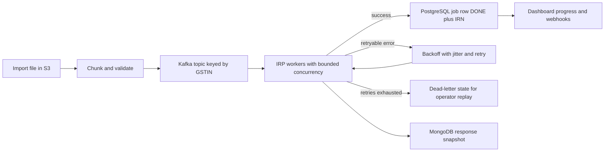

# Masters India and GeeksforGeeks: Interview Packs

<div class="callout note">
<b>How to use this page</b>
<ul>
<li><b>What it covers:</b> the speakable interview packs for the current PDF bullets at Masters India (3 bullets) and GeeksforGeeks (2 bullets). Each pack has a 30-second and 2-minute explanation, the architecture, design decisions, a probe-by-probe defense of every bullet and mock Q&A.</li>
<li><b>When to read it:</b> the hour before an interview. For the full teaching version with code and worked examples, read the deep dive linked below.</li>
<li><b>What to memorise:</b> the numbers line at the top of each pack, the 30-second answer, the Kafka vs RabbitMQ vs SQS answer and the honesty notes.</li>
</ul>
</div>

**Companion docs:** full deep dive with snippets in [`12_masters_gfg_deep_dive.md`](12_masters_gfg_deep_dive.md). MongoDB and Elasticsearch detail in [`02_mongodb_elasticsearch.md`](02_mongodb_elasticsearch.md). Number sources in [`GROUND_TRUTH.md`](GROUND_TRUTH.md).

**Tags.** HISTORICAL means the number comes from my past work records and earlier resumes. ESTIMATED means arithmetic I can show, such as 1,000,000 / 86,400. MEASURED means a log, doc or code exists. TARGET means a design goal. These packs are mostly HISTORICAL and ESTIMATED. Per-second figures (TPS, RPS) are not on the PDF. Use them only verbally, if asked.

<div class="callout warn">
<b>Older prep vs the current PDF.</b> "Support tickets down 35%" and "audit-log churn down 15%" are older resume details and are not on the current PDF. Premium is <b>20%</b>, not "15 to 20%". Clients are <b>1,500+</b>, never 2,500+. Older packs had four bullets per job. The current PDF has three for Masters India and two for GeeksforGeeks, and this page follows the PDF.
</div>

---

# Masters India: Interview Pack

**Role:** SDE 2, Noida, Dec 2022 to Jun 2024. GST Compliance and E-Invoicing Platform.

**Numbers to memorise:** 1,500+ clients. p95 from 1.2s to 300ms (75%). 700 to 4,000 requests per minute. Mentored 2 engineers. 1M+ government submissions per day. 100K+ concurrent idempotent imports. Triage down 70%. Database read load down 30%. Coverage 35% to 82%. 98% deployment success.

**Framing:** an event-driven Kafka platform for bulk registration with the government, not a CRUD monolith rewrite story.

## 0. Words you need

- **GST (Goods and Services Tax):** India's national tax on goods and services. Businesses claim back GST paid on purchases as input tax credit, so the government wants every B2B invoice verifiable.
- **E-invoice and IRP (Invoice Registration Portal):** above a turnover threshold, B2B invoices must be registered with a government IRP to be valid. There is more than one authorised IRP.
- **IRN (Invoice Reference Number):** a unique 64-character hash the IRP generates from the seller's GSTIN, invoice number, document type and financial year. It is the invoice's passport number, and the same invoice always maps to the same IRN.
- **Signed QR code:** returned with the IRN. Anyone can scan it to confirm the invoice is genuine.
- **GSTIN:** the 15-character GST ID of a business, for example `29ABCDE1234F1Z5`. It starts with a two-digit state code, followed by the 10-character PAN.
- **p95 latency:** the response time that 95% of requests beat. It shows what your slow-but-normal users feel.
- **Strangler fig pattern:** replace an old system one route at a time until nothing is left of it, like a vine that slowly replaces a tree.
- **Canary:** send a small slice of real traffic to the new version first and watch it, like the canary miners carried to detect gas.
- **Kafka partition key:** messages with the same key land on the same partition and stay in order. We keyed by seller GSTIN.
- **Idempotency key:** a unique label for one unit of work, so doing it twice has the effect of doing it once. Like a cheque number. Ours was `client + fileHash + batchIndex`.
- **Exactly-once (in practice):** at-least-once delivery plus idempotency, so duplicates become no-ops.
- **DLQ (dead-letter queue):** a parking shelf for work that keeps failing, so it stops blocking everything else.
- **Bounded retries with backoff and jitter:** retry a fixed number of times, wait longer each time (1s, 2s, 4s), and add randomness so retries do not all fire together.
- **Sharding by tax quarter:** one set of tables or a schema per quarter, with the app routing by invoice date. Like a filing cabinet with one drawer per quarter.
- **Cache-aside, TTL jitter, SETNX lock:** check Redis first, on a miss read the database and store it with an expiry (TTL). Add random jitter so keys do not expire together. Use a SETNX ("set if not exists") lock so only one request rebuilds a hot key.
- **ELK and New Relic APM:** ELK is Elasticsearch, Logstash and Kibana, a searchable home for all logs. New Relic APM measures where time goes inside and across services.
- **Request ID correlation:** one ID per request, logged everywhere and passed downstream, like a parcel tracking number.
- **Statement coverage:** the share of code statements that ran at least once in the tests.

## 1. 30-second and 2-minute explanations

**30 seconds**

"At Masters India I owned the GST e-invoicing path for more than 1,500 enterprise clients. I spearheaded the move from a legacy PHP monolith to FastAPI microservices and mentored two engineers through it. That cut p95 latency from 1.2 seconds to 300 milliseconds and raised throughput from 700 to 4,000 requests per minute. I also architected a bulk pipeline on Kafka and PostgreSQL sharded by tax quarter that processes more than a million government submissions a day. Idempotency keys, dead-letter queues and bounded retries mean we never double-register an invoice with the government, even when the portal is flaky."

**2 minutes**

"GST e-invoicing is a compliance product. Clients push invoices, we validate them and register them with the government's Invoice Registration Portal, and we return the signed IRN and QR code. Filing-deadline days spike the load. Correctness beats raw speed, but timeouts still lose clients.

The old PHP monolith was synchronous. One slow call to the portal held a PHP worker hostage, deploys were all-or-nothing, and scaling meant scaling everything. We moved to FastAPI services behind the gateway one endpoint at a time, using canaries, which is the strangler pattern. We kept a shared database during the traffic move so there were no dual writes, used contract tests against the old PHP payloads, and only split table ownership afterwards. I mentored two engineers on the extraction conventions.

The bulk path is where Kafka earns its keep. An import file goes to S3, gets chunked and validated, then flows through Kafka topics for portal submission, signed-response persistence and webhooks. Invoice data lands in PostgreSQL tables per tax quarter, so the hot quarter stays small. The partition key is the client's GSTIN for per-taxpayer ordering. Idempotency keys (client plus file hash plus batch index), exponential backoff and dead-letter replay handle the flaky portal.

On operations, ELK and New Relic with request-ID correlation cut triage by about 70%, a Redis cache cut database read load by 30%, coverage went from 35% to 82%, and deploys succeeded 98% of the time.

If they ask why Kafka, my answer is ordering, durable replay for GST disputes, and independent consumer groups on the same log. RabbitMQ could have dispatched the work at our scale. Replay and multi-reader audit are what won."

## 2. Architecture

```text
Client ERP / Dashboard
        |
   API Gateway (Nginx canary % -> FastAPI | fallback PHP)
        |
   FastAPI services (auth, e-invoice submit, bulk import, recon)
        |
   +----+----------+----------------+---------------+
   |               |                |               |
PostgreSQL       Redis          Kafka topics      MongoDB
(tax-quarter     (config,       (import chunks,   (invoice payload
 tables)          GSTIN,         IRP jobs,         + IRP response
                  tokens)        webhooks,         snapshots)
                                 audit projector)
        |
   Kafka consumers / Celery workers --bounded concurrency--> IRP (government)
        |
   ELK (JSON logs + request ID)  .  New Relic APM
```

*What to notice: the gateway chooses old or new per route, and Kafka separates "we accepted your invoice" from "the government registered it".*



*What to notice: a failing chunk loops through backoff a bounded number of times, then parks in dead-letter state while the rest of the import keeps going.*

**Hot path (one invoice):** validate, look up Redis, write the job row with its idempotency key, publish to Kafka, return 202 Accepted (or submit synchronously when the portal is healthy), then a worker registers with the IRP, stores the IRN and QR, and fires the webhook.

**Bulk path:** S3 file, chunk validation, Kafka, IRP workers, progress on the dashboard.

**Migration rule:** shared database until 100% of a domain's traffic is on FastAPI, then carve out service-owned tables.

**Kafka vs Celery in one line:** Kafka carries the durable, replayable pipeline stages. Celery runs side tasks like PDFs, emails and scheduled jobs.

## 3. Design decisions

| Decision | Chose | Rejected |
|---|---|---|
| Migration shape | Step-by-step cutover with gateway canaries (strangler) | Big-bang rewrite |
| Async runtime | FastAPI plus workers | Sync Django, or keep PHP |
| Event bus | Kafka | SQS or RabbitMQ alone |
| Partition key | Seller GSTIN, sometimes plus document type | Random or invoice ID |
| Data during cutover | Shared database, split later | Dual writes |
| Data layout | PostgreSQL tables per tax quarter | One big table, or hash-only sharding |
| Fault model | Idempotency plus backoff plus DLQ | Fire-and-forget retries |
| Cache | Cache-aside Redis with SETNX lock | Write-through everywhere |

**Why, in prose.** A big-bang rewrite was off the table because a broken filing day is not acceptable, and per-route canaries made every rollback a config flip. FastAPI won because calls to the portal must not pin a worker. Kafka won for per-GSTIN ordering, durable replay and several consumer groups on one log. Keying by GSTIN keeps one taxpayer's submit, callback and webhook in order. A shared database during cutover meant one source of truth and no reconciliation nightmare. Quarter tables suit GST's period-based work and let cold quarters archive cleanly. Idempotency, backoff and a DLQ exist because a double registration with the government is not cleanly recoverable. Cache-aside fits because the same config and GSTIN lookups repeat on every row of a bulk import, and the SETNX lock controls stampedes.

## 4. Bullet-by-bullet defense

### Bullet MI1: PHP to FastAPI microservices, 1,500+ clients, p95 from 1.2s to 300ms, 700 to 4,000 requests per minute, mentored 2

> "Reduced p95 API latency by 75% (from 1.2s to 300ms) across 1,500+ enterprise clients by spearheading the migration of a legacy PHP monolith to a FastAPI microservices architecture. Mentored two engineers through the transition, optimizing backend design to drive overall system throughput from 700 to 4,000 requests per minute."

**What did you own?** I owned the design, the cutover playbook and the conventions. Two engineers each extracted services under my review.

**Why not a rewrite?** It is a compliance product. Per-endpoint canaries gave instant rollback.

**Is that really "strangler"?** Yes. It was endpoint canaries behind the gateway, a gradual cutover rather than a big bang.

**Where did the latency go?** Async calls to the IRP meant no PHP-FPM worker sat blocked. Add connection pooling, composite indexes on `(client_id, invoice_date)` and removal of N+1 queries. Redis moved the median. Async and query fixes moved p95.

**What is the math?** (1.2 - 0.3) / 1.2 = 0.75, so 75%, or four times faster at the slow end. 700 / 60 is about 12 requests per second and 4,000 / 60 is about 67, roughly 5.7 times the throughput.

**How many clients?** Always 1,500+. Never 2,500+.

**What did mentoring look like day to day?** I set the router, service and repository layering, Pydantic at the boundary and shared idempotency helpers. I reviewed early PRs closely and paired on the first canary.

**One-line version:** "I cut p95 from 1.2 seconds to 300 milliseconds for 1,500-plus clients by moving a PHP monolith to FastAPI microservices and mentoring two engineers. Throughput went from 700 to 4,000 requests per minute."

### Bullet MI2: high-concurrency Kafka plus PostgreSQL by tax quarter, 1M+ per day, 100K+ idempotent imports, DLQ and bounded retries

> "Architected a high-concurrency bulk e-invoicing pipeline processing 1M+ daily government submissions by orchestrating a Kafka event bus and a PostgreSQL database horizontally sharded by tax quarter. Enforced exactly-once, idempotent processing for 100K+ concurrent imports with fault-tolerant state management via dead-letter queues and bounded retries against volatile state IRP portals."

**Where is Kafka?** It carries import chunks, IRP submit jobs, signed-response persistence, webhooks and the audit projector.

**What is "high-concurrency" here?** Bulk import workers registering invoices with the IRP in parallel. It is not a payments or money-movement product.

**What is the fault-tolerant state?** Kafka offsets, PostgreSQL job rows and the DLQ. The IRP is outside our transaction, so we use at-least-once delivery plus an idempotency key.

**What does exactly-once mean?** Each invoice takes effect once. Duplicates arrive and become no-ops through the unique key. No two-phase commit with the government.

**What is the idempotency key?** `client + fileHash + batchIndex`, plus the client's invoice references. PostgreSQL enforces it with a unique constraint and `INSERT ... ON CONFLICT DO NOTHING`.

**What are "bounded retries"?** Timeouts and 5xx errors retry with exponential backoff and jitter up to a fixed limit, then park in the DLQ. Validation errors such as a bad GSTIN fail at once, because retrying them never helps.

**Why a DLQ?** A poison batch parks while the rest of the import continues, and an operator replays it later. Replay is safe because the key is stable.

**Is there a circuit breaker?** It is verbal prep only, not a resume metric.

**How does quarter sharding work?** Hot writes land in the current quarter, cold quarters archive whole, and the app routes by invoice date. Say it carefully: these are quarter-scoped tables or schemas with application routing. Do not claim one database server per quarter.

**How does a 100K import flow?** Chunk validation, then bounded concurrency toward the IRP, then a progress stream. Older prep framed it as 100K+ invoices per import. If asked "100,000 files at once?", clarify that it means 100K-plus invoice records in flight across concurrent imports.

**Should TPS and RPS go on the PDF?** No, keep them off the resume. If asked verbally: 1,000,000 / 86,400 is about 11.6, so roughly 12 per second on average (ESTIMATED). Peaks are roughly 8 to 10 times that, around 100+ per second (ESTIMATED).

**One-line version:** "I architected a Kafka and PostgreSQL pipeline, with data split by tax quarter, that processes more than a million government submissions a day, with idempotency keys, dead-letter queues and bounded retries so a flaky portal never caused a double registration."

### Bullet MI3: ELK and New Relic, triage down 70%, read load down 30%, coverage 35% to 82%, 98% deploys

> "Decreased incident triage time by 70% and lowered database read load by 30% by instrumenting ELK and New Relic distributed tracing alongside a Redis caching layer. Hardened the CI/CD release cycle by driving test coverage from 35% to 82%, achieving a 98% deployment success rate across the microservices ecosystem."

**What changed?** We went from SSH and grep to structured JSON logs carrying a request ID across the API, the Kafka consumer and the worker.

**What is the 70% math?** Roughly 30 minutes to under 10 is my ESTIMATED baseline behind the HISTORICAL 70% cut. (30 - 9) / 30 = 70%.

**Why are 30% fewer reads plausible?** The same config and GSTIN lookups hit on every row of a 100K-row import, and the cache removes that repeated fan-out.

**How do you stop a stampede?** TTL jitter plus a SETNX lock, so one request rebuilds while the others wait or serve slightly stale data.

**What did you cache, and how did you invalidate it?** IRP auth tokens with a TTL below the token's lifetime, client config and flags, GSTIN masters and tax rates. Config and GSTIN entries are deleted on write. Masters use TTL plus jitter.

**Do you own an on-call title?** Claim alerting and triage. Do not invent an incident-commander role.

**Where did coverage focus?** Money paths first: registration, reconciliation, import. Coverage was enforced as a pytest CI gate.

**What does 98% mean?** 98 of every 100 deploys went out without failure or rollback (HISTORICAL).

**What about support tickets down 35%?** That is an older resume detail tied to a client usage dashboard and log downloads, and it is not on the current PDF. Do not lead with it.

**One-line version:** "One request ID across ELK and New Relic cut triage by 70%, a Redis cache-aside layer cut database read load by 30%, and coverage went from 35% to 82% with a 98% deployment success rate."

### Tech line: defend if pressed

Python, FastAPI, Kafka, PostgreSQL, MongoDB (payload and IRP response snapshots), Redis, Elasticsearch (the log plane in ELK, plus search), Celery (side tasks), Docker, ELK, New Relic, AWS (hosting and S3 for import files).

## 5. Mock interview: 10 Q&A

**Q1. Why Kafka over SQS or RabbitMQ for e-invoicing?**
**A.** I picked Kafka because we needed per-client ordering, durable replay for GST disputes and independent consumer groups on one log. We partitioned by GSTIN, so one taxpayer's events stayed in order. SQS deletes messages once processed, so there is no cheap multi-consumer replay, and FIFO queues cap throughput per message group. RabbitMQ could have dispatched work at our scale, and I say that openly. Replay, multi-reader audit and the asyncio Kafka client the team already used are what tipped it.
*Follow-up they may ask:* "What did Kafka cost you?" Operational overhead, which is the honest trade-off.

**Q2. Derive TPS and RPS. Do the numbers hang together?**
**A.** Yes. 1M per day divided by 86,400 seconds is about 11.6, so roughly 12 per second on average, which is an estimate. We sized for roughly 8 to 10 times that at peaks, around 100-plus per second, also an estimate. 700 to 4,000 requests per minute is about 12 to 67 requests per second. They are different meters: the daily count is government-registered documents, and the per-minute count is API capacity. I keep per-second numbers off the resume.

**Q3. Caching alone cannot move p95 from 1.2s to 300ms. What did?**
**A.** Agreed. The tail came down because calls to the portal went async, so no PHP worker was held hostage. Connection pooling, removing N+1 queries and composite indexes did the rest. Redis removed 30% of redundant reads and mainly helped the median. Async and query fixes are the p95 story.

**Q4. Cache-aside: keys, TTL, invalidation, herd.**
**A.** On a miss we read the database and set the value with a TTL. Hot keys were IRP auth tokens with a TTL under the token's lifetime, client config and flags, GSTIN masters and tax rates. Config and GSTIN entries are deleted on write, and masters use TTL plus jitter. For the herd, one request takes a SETNX lock and rebuilds while others wait or serve slightly stale data. The 30% is plausible because 100K-row imports repeat the same lookups on every row.

**Q5. Why shard by financial quarter?**
**A.** Because GST work and filing spikes are period-based. Writes land in the current quarter, and older quarters are reconciliation and audit reads. Quarter tables keep hot indexes small and let us archive or drop a cold quarter cleanly. The cost is application-level routing, and the footgun is a wrong-quarter write, which we prevented by deriving the quarter from the invoice date at the API boundary and rejecting mismatches.

**Q6. Sketch the IRP path and where Kafka sits.**
**A.** The client posts invoice JSON. We validate the schema and GSTIN, then register with the IRP, which returns the signed IRN and QR. Kafka carries accepted chunks, IRP submit jobs, the MongoDB snapshots of responses and client webhooks. Idempotency keys prevent double registration. For bulk imports, the file goes to object storage, gets chunked, and is sent to the IRP with bounded concurrency while the dashboard shows progress. That handled 100K-plus invoice imports and more than a million submissions a day.

**Q7. What did "mentored 2" mean day to day?**
**A.** I set the conventions: router, service and repository layers, Pydantic at the boundary, and shared retry and idempotency helpers. Each engineer owned one service extraction. I reviewed their early PRs closely and paired on the first Nginx percentage canary, where we watched errors and latency and ramped up or rolled back with a config change. We shared the database during cutover to avoid dual writes.

**Q8. ELK plus New Relic cut triage 70%. Vanity or real?**
**A.** Real, because the change was correlation. Before, it was SSH and grep with nothing linking requests together. After, one request ID flowed through the API, the Kafka consumer and the IRP worker, New Relic showed where time went, and alerts fired on errors and latency. Roughly 30 minutes to under 10 is my estimate behind the 70% we reported. I claim alerting, not unproven pager ownership. Coverage went from 35% to 82% on money paths, with 98% deploy success.

**Q9. Did you do dual writes during the migration?**
**A.** No, we avoided them on purpose. We shared one database through the traffic cutover so there was one source of truth, and split table ownership only after a domain was 100% on FastAPI. Contract tests pinned the PHP response shapes field for field, so clients saw no change.

**Q10. What broke in the early canary?**
**A.** A timeout mismatch. PHP allowed 60 seconds and we had set 10, so some legitimately slow IRP calls failed on the new path. We fixed it by moving those calls fully async and returning 202 with polling, rather than raising the timeout. The canary caught it at a small percentage, before a full ramp.

---

# GeeksforGeeks: Interview Pack

**Role:** SDE, Noida, Aug 2021 to Nov 2022. Courses Platform and Influencer Dashboard.

**Numbers to memorise:** 10K+ daily queries (not 1K, not 100K). 10x contest spikes. Premium subscriptions up 20%. Course sales up 30%. Engineering ops efficiency up 70%.

**Framing:** early-career reliability and product APIs on a high-traffic education platform. It is the foundation for the Masters India ownership story.

## 0. Words you need

- **Doubt support:** the Q&A layer where learners post questions (doubts) on courses and articles and others answer.
- **Django and DRF:** Django is a "batteries included" Python web framework with ORM, admin and auth built in, like a fully furnished flat. DRF (Django REST Framework) adds tools for building REST APIs.
- **Hot row:** one database row that many requests update at once, such as a viral post's vote count. Updates queue on its lock, like a single checkout counter.
- **Unique constraint:** a database rule that a pair like `(user_id, content_id)` appears only once, which makes double votes impossible.
- **Reconciliation:** a periodic job that recomputes totals from the source of truth and fixes drift in the fast copy.
- **Scheduled workflows and lease:** background jobs on a timer (cron). A lease is a lock the job takes first so two servers do not both run it.
- **Relative lift:** 20% relative means 1,000 becomes 1,200 (example numbers), not 20 percentage points.

## 1. 30-second and 2-minute explanations

**30 seconds**

"At GeeksforGeeks I migrated the doubt-support backend from PHP to Django so it could handle more than 10,000 daily queries and tenfold spikes during live coding contests. I built voting, pinning and locking REST APIs across MySQL, MongoDB, Redis and Elasticsearch, and the growth team attributed a 20% lift in premium subscriptions to that work. I also launched an influencer analytics and earnings dashboard, which the business tied to a 30% rise in course sales, and built scheduled workflows for video processing, reminders and cleanup that raised ops efficiency by 70%."

**2 minutes**

"Doubt support is the Q&A layer on articles and courses. It has high read volume, contest spikes and messy legacy PHP. We migrated it page by page behind the same URLs to Django and DRF, which gave us transactions, validation, a cleaner read and write split and staging discipline.

For voting and pinning, a unique constraint on user and content makes votes idempotent. Redis display counters reconcile back to MySQL so viral posts do not become hot rows, and pinning is an ordering column per context. Locking is a moderation flag. Some interactions were gated behind premium. I own the APIs, and the growth team attributed the 20% lift.

The influencer dashboard showed partners their transactions, coupon conversions and earnings, using near-real-time Redis counters plus daily rollups. The scheduled jobs handle video processing handoffs, reminders and data cleanup, and each takes a lease so hosts do not double-run. I owned the engineering. The sales and efficiency numbers are business metrics.

Why Django then and FastAPI at Masters? In 2021 this was a CMS-style product that needed admin and ORM batteries. Masters India later needed async IO for government API fan-out."

## 2. Architecture

```text
Learners / influencers
        |
   Django + DRF (doubt APIs, votes, pins, locks, dashboard)
        |
   +----+------+-----------+-------------+
   |           |           |             |
 MySQL       Redis       MongoDB     Elasticsearch
 (threads,   (badges,    (flexible   (doubt/content
  perms,      counters,   bodies /    search)
  votes       unread)     attachments)
  source of
  truth)
        |
   Scheduled job host(s) -- lease/lock --> video handoff, reminders, cleanup
        |
   SMTP connection reuse for reminder/promo batches (older resume detail)
```

*What to notice: MySQL is the truth, Redis is the fast copy that is reconciled back, and the scheduled jobs live outside the request path.*

**Scale honesty:** 10,000 / 86,400 is about 0.12 per second, well under 1 per second on average. Contest days run about 10 times normal (ESTIMATED). Reliability and surviving the spike matter more here than big-company scale.

## 3. Design decisions

| Decision | Chose | Rejected |
|---|---|---|
| Stack migration | PHP to Django and DRF, incrementally | Big-bang, or stay on PHP |
| Vote correctness | Unique `(user, content)` with MySQL as truth | Counter-only in Redis |
| Hot counters | Redis display counters plus async reconcile | Update MySQL on every vote |
| Search vs documents | Elasticsearch for search, MongoDB for flexible shapes | Everything as JSON in MySQL |
| Scheduled job safety | Lease plus idempotent job keys | Naive cron on several hosts |
| Mail sending (older detail) | Persistent SMTP connection | New connection per message |

**Why, in prose.** Migrating behind the same URLs gave transactions and validation without an outage. The unique constraint makes a double-submit idempotent, and counters in Redis can drift safely because MySQL holds the truth. Updating MySQL on every vote would melt the hot row on viral posts. Search and document shape are different problems, so they got different stores. A lease and idempotent keys stop double video runs and double reminders. Reusing an SMTP connection saves a 100 to 400 millisecond handshake per message, roughly halving wall-clock send time, which is an older resume detail and prep depth only.

## 4. Bullet-by-bullet defense

### Bullet G1: Django migration, 10K+ daily, 10x contest spikes, voting, pinning and locking APIs, 20% premium

> "Stabilized the doubt-support platform to handle 10K+ daily queries and 10x traffic spikes during live coding contests by migrating the backend to Django. Engineered high-throughput REST APIs for voting, pinning, and locking threads utilizing MySQL, MongoDB, Redis, and Elasticsearch, driving a 20% lift in premium subscriptions."

**Which scale number?** 10K+ daily, the standardized figure. Never 100K. The older "1K+ doubts per day" was a narrower metric.

**What improved?** ORM transactions, request validation, read and write separation, plus code review and staging.

**What is the spike story?** Contest days run about ten times normal. We designed for the burst so the write path did not melt.

**What is the average RPS?** On the order of ten thousand a day, which is far below 1 per second (ESTIMATED).

**How are votes idempotent?** The unique constraint means a second vote updates the first instead of double-counting.

**What does "locking" mean?** A moderation lock on a doubt thread. Older resumes list voting, pinning and locking.

**How do you avoid hot rows?** A Redis counter serves the badge and UI, and it reconciles to MySQL.

**How did the data split?** MySQL is relational truth, MongoDB holds flexible bodies, Elasticsearch handles search and Redis serves hot reads.

**Where does the 20% come from?** It is a relative lift attributed by the growth team. I own the APIs and their reliability, not the whole cause. The current PDF says 20%, not "15 to 20%".

**One-line version:** "I stabilised doubt support for 10K-plus daily queries and tenfold contest spikes by moving it to Django, and built the voting, pinning and locking APIs that the growth team tied to a 20% lift in premium subscriptions."

### Bullet G2: influencer dashboard +30% course sales, scheduled workflows +70% ops efficiency

> "Accelerated platform course sales by 30% by launching an influencer analytics and earnings dashboard to dynamically track transactions and affiliate coupon conversions. Increased engineering operational efficiency by 70% by designing asynchronous scheduled workflows for automated video processing, user reminders, and data cleanup."

**What was on the dashboard?** Earnings, transactions and affiliate coupon conversions, with filters and CSV export according to older resumes. Redis gave near-real-time numbers and scheduled rollups gave history.

**What are the metrics?** HISTORICAL business attribution. I engineered the system and attribute the result carefully.

**Which jobs ran on a schedule?** Video processing handoffs, user reminders and data cleanup.

**How did you keep them reliable?** A host lease, idempotent keys, success and fail logs, and retry for partial batches.

**What does 70% measure?** HISTORICAL time saved on the manual video, reminder and cleanup workflows.

**Do not mix:** the dashboard drives the 30%, and the scheduled workflows drive the 70%. They share one bullet on the PDF but are separate pieces of work.

**One-line version:** "I launched an influencer earnings dashboard that the business tied to a 30% rise in course sales, and built scheduled workflows for video, reminders and cleanup that saved about 70% of that ops time."

## 5. Mock interview: 6 Q&A

**Q1. Design unread counts for 10K+ daily queries without melting MySQL.**
**A.** The scale is 10K-plus daily interactions, not 100K, so the problem is the contest spike, not volume. The badge path uses per-user counters in Redis, and the durable thread and message rows live in MySQL. A new reply increments the counter and a read receipt clears it. A periodic reconcile fixes any drift. The Django migration gave us the transactional write paths that PHP lacked.

**Q2. Voting API: idempotency and hot rows. How did MySQL, Redis, MongoDB and Elasticsearch split?**
**A.** A unique constraint on user and content makes votes idempotent. Redis holds the display counters and reconciles to MySQL asynchronously, so viral posts do not create hot rows. MySQL holds threads, permissions and the truth. MongoDB holds variable bodies and attachments, and Elasticsearch handles search. Pinning is an ordered column per context. The 20% premium lift is the growth team's attribution.

**Q3. You claimed +70% ops efficiency from scheduled jobs. How do you keep them honest?**
**A.** Each job takes a lease or advisory lock so two hosts never double-run, uses idempotent job keys, writes structured logs, and retries or parks partial batches. The 70% is time saved on manual video, reminder and cleanup workflows, which is a HISTORICAL figure. The 30% course sales lift is the business team's attribution for the influencer dashboard. I own the engineering.

**Q4. Why Django at GeeksforGeeks but FastAPI at Masters India?**
**A.** Different jobs. In 2021 GeeksforGeeks needed a CMS-style product with admin, auth and an ORM, and Django ships those. Masters India needed async IO against flaky government portals and an event-driven bulk pipeline, which FastAPI and Kafka suit.

**Q5. SMTP 50% faster: is that real?**
**A.** It is an older resume detail, not on the current PDF. We reused one SMTP connection across a batch instead of a new TCP and TLS handshake per message, which often costs 100 to 400 milliseconds. Amortising that roughly halves wall-clock time for reminder and promo sends. It is a GeeksforGeeks detail, not a Masters India claim.

**Q6. What would you change today?**
**A.** I would put vote events on a queue with event-sourced counters, make idempotency keys the default on every reminder job, and set clear latency targets for contest days. The Django migration and the vote and pin models were the right call in 2021. The event patterns I later owned at Masters India are what I would backport.
