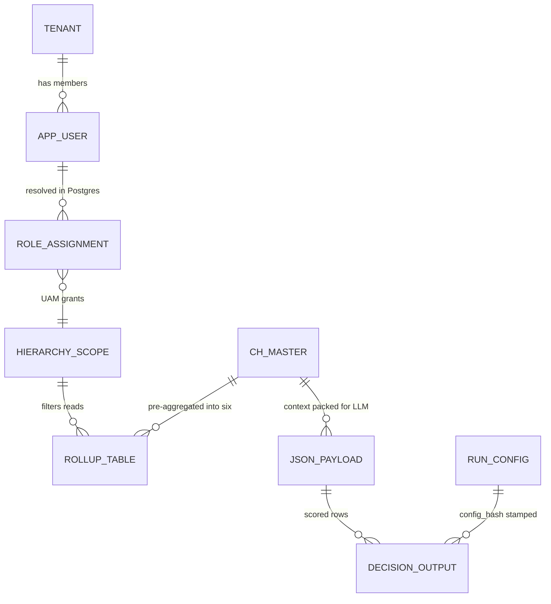
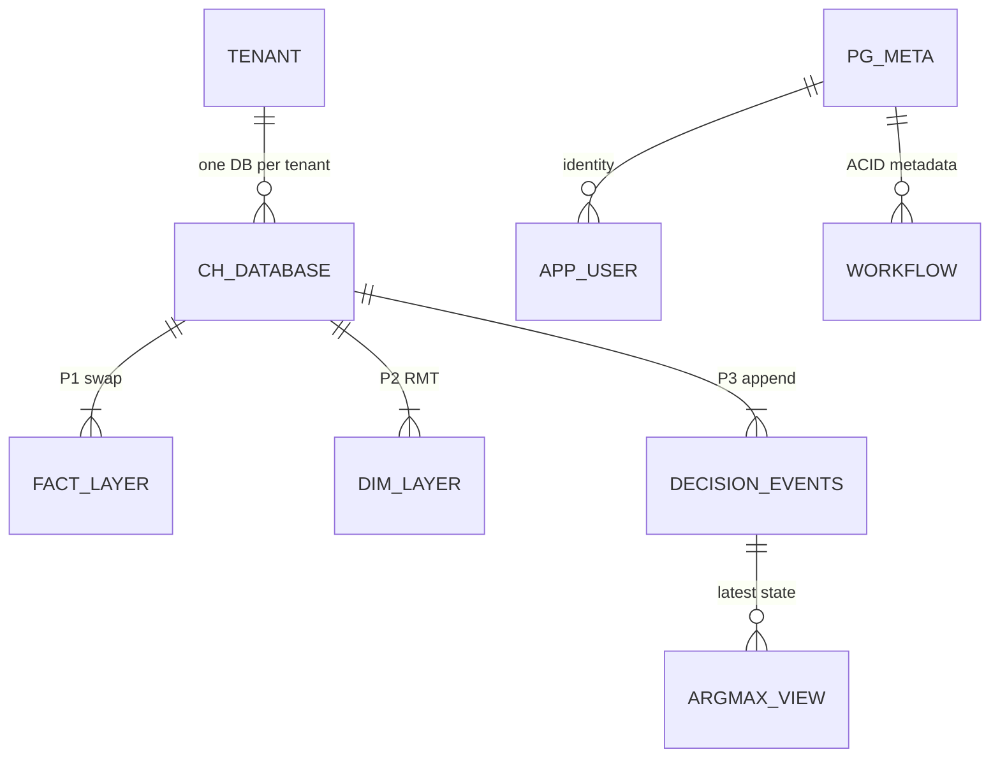
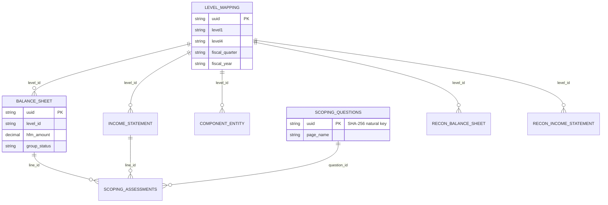
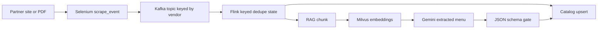
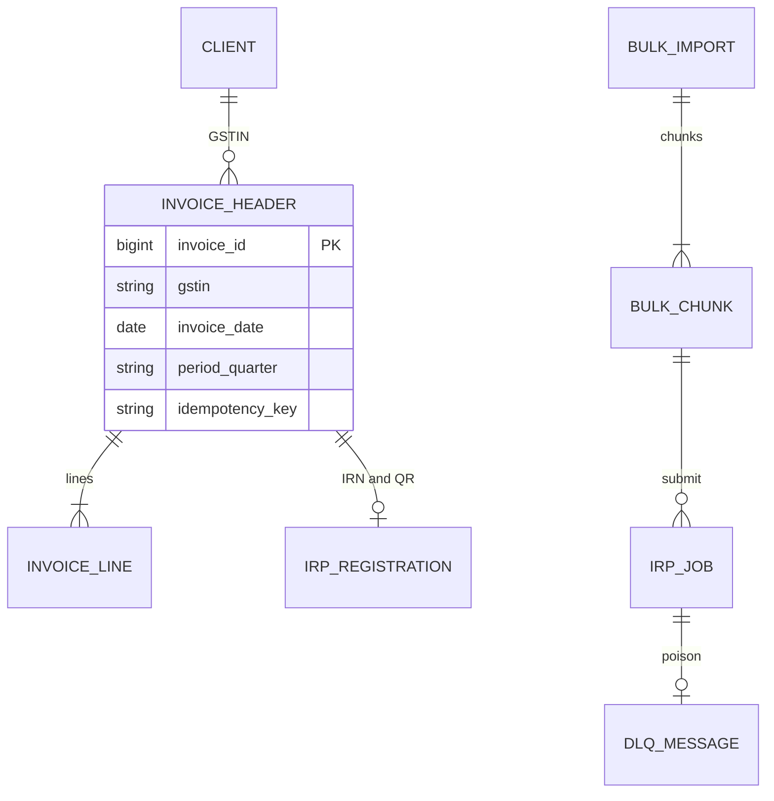
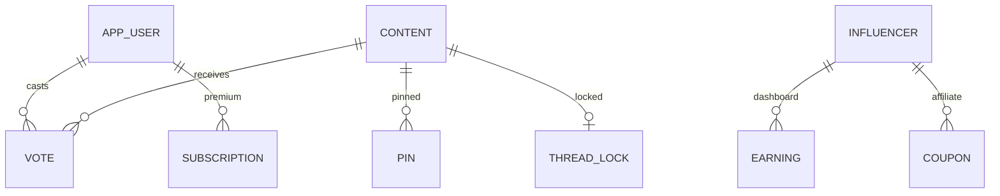

# ER diagrams, table design and why each tech (all resume projects)

<div class="callout highlight">
<b>How to use this page</b>
<ul>
<li><b>What it covers:</b> for every project on the PyGo resume, the shape of the data (which stores, which tables, how they join) and why each technology fits that shape, with the alternative we did not pick.</li>
<li><b>When to read it:</b> before any system design, "walk me through your schema", or "why ClickHouse / MySQL / Kafka?" round.</li>
<li><b>What to memorise:</b> one ER sketch per project (IA rollups and decision outputs, FRM <code>level_mapping</code> spine, Masters invoice to IRP registration, Menu Kafka to Flink to catalog, GFG votes), and one "problem, why this tech, what we rejected" sentence per technology.</li>
<li><b>Column-level detail and API contracts</b> live in the companion page <a href="35_table_schemas_api_design.md">35_table_schemas_api_design.md</a>.</li>
</ul>
</div>

HTML version: [`34_er_tables_tech_why.html`](34_er_tables_tech_why.html)

**Sources behind this page:** FRM ORM models and deep dive ([`11_uber_frm_deep_dive.md`](11_uber_frm_deep_dive.md)), the IA ClickHouse DDL Phase-1 notes ([`29_ia_ch_ddl_phase1_source.md`](29_ia_ch_ddl_phase1_source.md)), the IA rollup and copier notes ([`42_clickhouse_rollup_migration.md`](42_clickhouse_rollup_migration.md)), the IA bullet defense ([`43_ia_bullet_defense.md`](43_ia_bullet_defense.md)), the Masters / GFG deep dive ([`12_masters_gfg_deep_dive.md`](12_masters_gfg_deep_dive.md)) and the Menu deep dive ([`14_uber_menu_deep_dive.md`](14_uber_menu_deep_dive.md)). Industry notes (ClickHouse docs on ReplacingMergeTree and partition operations, the common Flink keyed-state dedupe pattern) are general teaching, not my metrics.

---

## Reading the tags on this page

Every schema and number here carries a tag so you know how hard you can lean on it.

| Tag | What it means | How to say it |
|---|---|---|
| **MEASURED** | There is a log, a document or code behind it (for schemas: the ORM models or a validated DDL file). | State it plainly. |
| **MEASURED design** | A written, validated design document exists, but it has not run under production load. | "The design specifies..." |
| **TARGET** | A design goal. | "We were targeting..." |
| **ESTIMATED** | Arithmetic I can show. | "Roughly, derived from..." |
| **HISTORICAL** | From my past work records, no artifact in this repo. | State it, keep it qualitative if pushed for raw data. |
| **LOGICAL** | The shape of the data as I would draw it on a whiteboard. Not the literal production table names. | "Logically, the data looked like..." |
| **ILLUSTRATIVE** | A teaching example I wrote to explain a mechanism. Column names and sample values are made up. | "To illustrate..." Never present it as the production schema. |

---

## Words you need on this page

- **ER diagram (entity-relationship diagram).** A drawing of the things a system stores (entities, usually tables) and how they connect. Think of a family tree for data: boxes are tables, lines say "one of these has many of those".
- **Primary key (PK).** The column that uniquely identifies a row, like a passport number for that row.
- **Natural key.** A key built from the real-world content itself (for example a hash of the question text) instead of a random number. The same input always produces the same key, so re-inserting the same thing finds the existing row instead of making a duplicate.
- **Foreign key (FK).** A column that points at another table's primary key. Some systems enforce it in the database. Others, like the FRM scoping service, keep it as a "logical join" that the application respects.
- **Index.** A sorted lookup structure that lets the database find rows without reading the whole table, like the index at the back of a book.
- **OLTP vs OLAP.** OLTP (online transaction processing) is many small reads and writes of individual rows, like a bank ledger. OLAP (online analytical processing) is a few huge reads that scan and summarise millions of rows, like a quarterly sales report.
- **Row store vs columnar store.** A row store (MySQL, PostgreSQL) keeps each row together on disk, which is great for "fetch or update this one invoice". A columnar store (ClickHouse, BigQuery) keeps each column together, which is great for "sum revenue over 250 million rows" because it only reads the columns it needs.
- **Partition.** A physical slice of a table, usually by time (a month, a season, a tax quarter). Queries that filter on the partition key skip every other slice. You can also drop or replace one slice without touching the others.
- **MergeTree.** ClickHouse's main table engine. Data is written in sorted chunks ("parts") that a background process merges together, like shuffling small sorted piles of cards into bigger sorted piles.
- **ReplacingMergeTree (RMT).** A ClickHouse table type that keeps only the newest version of rows that share the same sort key. Think of a notebook where you never erase. You write the new value below, and a cleaner later crosses out the old lines. Until the cleaner runs, you read with `argMax` or `FINAL` to see only the newest line.
- **argMax.** A ClickHouse function: "give me the value of column X from the row where column Y is largest". `argMax(status, event_seq)` returns the latest status.
- **Append-only / insert-only.** You never update or delete a row in place. A change is a new row. Current state is computed by a view over the history.
- **Sharding.** Splitting one logical dataset across separate physical tables, schemas or databases by a key (tenant, tax quarter). Each shard is smaller and hotter or colder independently.
- **Idempotency.** Doing the same operation twice has the same effect as doing it once. A pressed-twice lift button still takes you to one floor.

---

## How to answer schema questions in interviews

1. **Draw the store map first.** Boxes for each store (MySQL, ClickHouse, Kafka, Redis) and arrows for who writes and who reads.
2. **Name 2-3 critical tables** and say their primary key or natural key out loud.
3. **For each major technology, say one sentence:** the problem, why this tech fits the data shape, and what we rejected.
4. **Tag numbers** MEASURED, TARGET, ESTIMATED or HISTORICAL as you say them.

---

# 1. Impact Analytics: AssortSmart (ClickHouse plus thin PostgreSQL)

**In plain English.** AssortSmart is a retail merchandise planning product. Planners at a retailer decide which articles (products) to keep, drop or add each season. They look at huge pivot tables of sales, inventory and forecasts, and the AI engine scores every article-season (one product in one selling season) to recommend Keep or Drop. The data problem has two halves. The read side is enormous analytical scans, so it belongs in a columnar database. The control side (users, roles, which hierarchy a user may see) is small and must be transactional, so it belongs in PostgreSQL.

There are two different schema stories at IA. Keep them apart in an interview.

1. **The resume-level stores** (what the PDF bullets rest on): the 2.11B-row ClickHouse master that agents never query directly, the six ClickHouse rollup tables that made planner pivots fast, the AI decision outputs written through ReplacingMergeTree with a `config_hash` on every row, and PostgreSQL for identity, UAM (User Access Management) and roles, fronted by Redis for auth.
2. **The Agentic Cluster Module Phase-1 DDL design** (63 tables, 8 layers). This is a validated design document for the Cluster Recommendation Copilot. It is verbal depth only, not a resume bullet, and it has no runtime evidence yet (load test planned at bring-up). Older prep treated it as "the one resume ClickHouse bullet". The current PDF does not, so present it as "a design I wrote and validated", not as production.

### The problem we faced

- **Planner pivots were slow on PostgreSQL.** We ran proof-of-concept comparisons of PostgreSQL vs ClickHouse. ClickHouse won the large analytical reads. PostgreSQL kept the thin metadata, UAM and roles.
- **Agent probes on shared BigQuery were jittery.** The Phase-1 design notes record planner probes on shared BigQuery varying from about 1 second to 20+ seconds, which is too unpredictable for an AI agent tool loop. BigQuery stays the upstream company warehouse, not the runtime store for agents.
- **The incumbent product updates and deletes rows in place.** ClickHouse "mutations" (its `ALTER TABLE ... UPDATE / DELETE`) run asynchronously and rewrite whole data parts, so they degrade under many small updates. ClickHouse is not an OLTP database. We needed a way to correct data without a mutation queue.
- **LLMs must not touch the database.** A model that can write SQL against a 2.11B-row table is a runaway-query, connection-pool and prompt-injection risk.

### Resume-level store map (draw this first)



*What to notice:* PostgreSQL entities (tenant, user, role, hierarchy scope) are small and relational. ClickHouse entities (master, rollups, decision outputs) are huge and append-friendly. The LLM only ever sees `JSON_PAYLOAD`, never `CH_MASTER`. Entity names here are logical (ILLUSTRATIVE), not physical table names, except the six rollups below which are real.

**Walking through it.** The ClickHouse master holds the large fact data (2.11 billion rows, MEASURED). Planner screens never group that table on every request. Instead a load job pre-aggregates it into six rollup tables, and screens read those. The AI batch reads the master once per pass, packs per-article context into JSON payloads, and sends the payloads to the model. Scored rows come back and are inserted into a ReplacingMergeTree table with the frozen `config_hash` of the run. Every request is first authenticated (Redis cache in front of Firebase Admin, then JWT / Google OIDC), and the user's roles and hierarchy scope are resolved from PostgreSQL. That scope filters what ClickHouse rows the user may see.

### The six rollup tables (MEASURED names)

All six are ClickHouse MergeTree tables, all `PARTITION BY season_code`. The daily source grain is SKU by store by date, which planners cannot group on every chart.

| Grain | Product (keeps SKU dimensions) | Store (no SKU, two-pass totals) | Attr (attribute unpivot, about 5x product weekly) |
|---|---|---|---|
| Season | `product_season` | `store_season` | `attr_season` |
| Weekly | `product_weekly` | `store_weekly` | `attr_weekly` |

- **Why partition by season.** Planners almost always look at one season. Partition pruning means a season filter skips every other season. A season is also the unit of rebuild and of copy: the Go copier checkpoints per season, and a failed season is fixed by `DROP PARTITION` then recopy (not an atomic swap with live readers).
- **Why attr weekly is the biggest.** "Attr" is an unpivot: each product row becomes one row per attribute pair (via `ARRAY JOIN`). Attr weekly for two seasons is 4.09B rows (2,779,317,472 + 1,311,108,195). Product weekly for the same two seasons is about 839M.
- **Why store totals still match.** Store and attr tables drop SKU-level leftovers and re-weight with two-pass sums, so the store total equals the sum of SKUs. The team validated product vs store vs attr sums at the same filters.

### Decision outputs (A2 and A3)

The Keep/Drop, Missed Opportunities and Top Style pipelines write scored rows through the engine's insert path onto a ReplacingMergeTree table. A version column means a retried or overlapping batch that lands twice collapses to one row per article. Reads use `argMax` or `LIMIT 1 BY`, not `OPTIMIZE FINAL` at runtime. Every output row carries the frozen `config_hash` (SHA-256 of guardrails, parameters, prompts and catalog), so any number can be traced to the exact configuration that produced it. Say this carefully: Keep/Drop defaults to CSV output first, and the ClickHouse publish is a separate operations step.

### Why each tech (resume level)

| Tech | The problem | Why it fits the data shape | Alternative and why not |
|---|---|---|---|
| **ClickHouse** | Huge planner pivots and per-pass AI context reads over billions of rows | Columnar OLAP. Only reads the columns a pivot needs, compresses well, scans fast. The 250M-row pivot POC went from 189 seconds to 12.3 seconds (PDF rounds to 12s, about 15.5x, MEASURED). | PostgreSQL for the heavy grids (it lost the POC on large analytical reads). |
| **Six MergeTree rollups** | Grouping SKU by store by date on every chart is the wrong cost model | Pay once at load time, read cheap at query time. Partition by season matches how planners filter. | Querying daily facts with `FINAL` on every request (`FINAL` also cannot use projections). |
| **ReplacingMergeTree for AI outputs** | Retries and overlapping batches can write the same article twice | Keeps the newest version per key, so writes are eventually consistent and retry-safe without UPDATEs | Plain MergeTree (duplicates). ClickHouse `ALTER UPDATE` per row (mutation storm). |
| **JSON payloads instead of a SQL tool** | LLM querying a 2.11B-row master | Model gets pre-computed context. Math stays deterministic. No injection or runaway query surface. | Giving the agent a database tool. |
| **PostgreSQL (thin)** | Identity, UAM, roles need real ACID transactions | Small, relational, transactional. Exactly what a row store is for. | Putting identity in ClickHouse (no transactions, eventual consistency). Putting planner facts in Postgres forever (lost the POC). |
| **Redis** | Hitting Firebase / OIDC on every API call is slow | Caches verified tokens in front of the auth waterfall. A miss falls through to the real check. It does not fail open. | Calling the identity provider on every request. |
| **BigQuery** | Company historical truth | Upstream feed into ClickHouse | Using BigQuery as the runtime agent store (1 to 20+ second jitter). |
| **Go / Gin** | Multi-tenant HTTP platform at 10k peak RPS | Compiled, cheap goroutines, Wire compile-time dependency injection, native h2c (HTTP/2 without TLS inside the trust boundary) | A reverse proxy plus a slower runtime. |
| **Python / FastAPI / LangGraph** | Agent plane (Ask Iris, batch scoring) | Python is where the LLM ecosystem lives. LangGraph gives an explicit state machine for the supervisor and the 3-attempt evaluator. | One opaque prompt chain. |
| **Datadog / LangSmith** | Different debugging questions | Datadog for platform traces. LangSmith for Ask Iris agent traces (LangSmith is Ask Iris only on the resume, not the Keep/Drop batch). | One tool for everything. |

### Design decisions, explained

**Decision 1: ClickHouse for reads, PostgreSQL for control data.**
- *What:* Large analytical facts and rollups live in ClickHouse. Users, roles, hierarchy access and metadata live in PostgreSQL.
- *Why:* The two halves have opposite data shapes. Pivots scan hundreds of millions of rows and touch a few columns. Role checks touch one row and must be transactionally correct.
- *How:* POCs compared both. ClickHouse won large reads. PostgreSQL kept UAM and roles. Redis fronts the auth path.
- *Alternatives:* All-PostgreSQL (lost the pivot POC). All-ClickHouse (no real transactions for permission changes).
- *Trade-off:* Two databases to keep consistent. Tenant isolation has to be enforced across both (C3 on the resume). Isolation is access control, not encryption.
- *What I'd do differently:* Write down the cross-store consistency rules (which side is the source of truth for each entity) on day one instead of discovering them during migration.

**Decision 2: Pre-aggregate into six rollups instead of grouping on request.**
- *What:* Six MergeTree tables (product, store, attr by season and weekly).
- *Why:* The 250M-row pivot went from 189 seconds to 12 seconds (15.5x, query time).
- *How:* Generated load SQL. Weekly builds are sliced one fiscal week per `INSERT SELECT` with memory and disk-spill caps, because a whole-season weekly aggregate needed about 170GB of memory and failed even at 80GB and 200GB caps.
- *Alternatives:* Materialized views on every insert (harder to rebuild at a known watermark). Querying raw daily facts (too slow).
- *Trade-off:* Rollups are only as fresh as the last build. Load cost moves from query time to build time.
- *What I'd do differently:* Execute the incremental `REPLACE PARTITION` design (written, not run) so a rebuild never exposes a half-loaded season to readers.

Say this carefully: 15.5x is query time (pivots). The 170GB OOM fix is load time (weekly builds). One did not cause the other.

**Decision 3: AI outputs on ReplacingMergeTree, never UPDATE.**
- *What:* Scored rows are inserted. Corrections and retries are new versions.
- *Why:* ClickHouse mutations are slow and asynchronous. Batches can land twice.
- *How:* Version column. Read latest with `argMax` or `LIMIT 1 BY`. On an LLM timeout the precomputed deterministic score is written instead, so the run keeps going.
- *Alternatives:* MergeTree plus a dedupe job. A transactional database for outputs (cannot join cheaply with the analytical data).
- *Trade-off:* Until background merges run, raw reads can see two versions, so every reader must use the latest-version pattern.
- *What I'd do differently:* Wrap the latest-version read in a named view from the start so no reader forgets it.

### Agentic Cluster Module, Phase-1 DDL design (verbal depth only)

<div class="callout warn">
<b>Say this carefully.</b> This 63-table design is for the Cluster Recommendation Copilot, which is verbal depth and not a resume bullet. It is MEASURED design: syntax-validated on ClickHouse 25.12, four adversarial review passes, 58 named SQL operations mapped. It has <b>zero runtime evidence</b> (load test at bring-up). Do not quote production latency from it. The approval and write-back flow in this design is not a shipped human-review queue, and the IA resume makes no HITL (human-in-the-loop) claim. Omit the old "624 columns" figure: it is not on the source page. If someone says "60 tables", the overview abbreviated it; the DDL creates 63 including 7 stage twins.
</div>

**The one idea: never erase.** The incumbent product updates rows in place. This design bans that on the hot path. Facts and cubes arrive as whole-partition swaps (build a "stage twin" table, then `REPLACE PARTITION`). Decisions arrive as append-only events. Approvals mint immutable snapshots. "Current state" is always a view over history. A stage twin is a copy of a table with the same structure where you build the new version of a partition offline before swapping it in, like rehearsing on a spare stage before moving the set onto the main one.

**Inventory (MEASURED design):** 63 tables including 7 stage twins, 8 layers, 5 dictionaries (store, hierarchy, fiscal, channel, sister-store, plus `dict_user` at bring-up), 19 views, 4 roles / 3 profiles / 2 quotas. The agent database profile is `readonly=1`, so the exploring surface physically cannot write. Service roles are INSERT-only on the tables they own.

The design uses four storage patterns, named P1 to P4 in the notes:

- **P1, partition swap:** MergeTree plus stage twin plus `REPLACE PARTITION`. Used for facts and cubes.
- **P2, ReplacingMergeTree plus dictionaries:** used for slowly changing dimensions (stores, hierarchy, fiscal calendar).
- **P3, append-only status events:** status is a stream of events, and the latest status is `argMax(event_seq)` in a view.
- **P4, immutable ledger / snapshot:** written once, never changed. Used for watermarks, approvals, outcomes, telemetry.

| Layer | Pattern | What it holds |
|---|---|---|
| L0 facts plus ledger | P1 partition swap, P4 ledger | Ingested facts (sales, inventory, forecast) and sync watermarks |
| Grounding dimensions | P2 RMT plus dictionaries | Store, hierarchy, fiscal calendar |
| L1 cubes plus caches | P1 / P2 | Planner rollups, significance caches |
| PostgreSQL mirrors (transitional) | EXCHANGE / swap | Read models bridging from the incumbent while migrating |
| Decision plane | P2 / P3 / P4 | Cluster configs, runs, status events, approvals |
| Outcome loop | P4 / P1 | Immutable outcomes |
| Write-back (transitional) | P3 status | Wire back to the incumbent product |
| Telemetry | P4 | Probe logs |

```text
 tenant_db (one ClickHouse database per retailer)
   |
   +-- fact_* / cube_*   --P1--  stage twin, then REPLACE PARTITION
   +-- dim_* / dict_*    --P2--  ReplacingMergeTree(version), read with FINAL / argMax
   +-- decision_event_*  --P3--  append-only, v_* views = argMax(event_seq)
   +-- approval_snapshot --P4--  immutable
   +-- telemetry_*       --P4--  append-only

 thin Postgres (separate):
   user >--< membership >--< tenant
   tenant --< workflow_state / feature_flags
```

*What to notice:* nothing in the ClickHouse half is ever updated in place. Every arrow into a table is an INSERT.



*What to notice:* the conceptual layers, not physical tables. Use this when asked "how would you model mutable planning data in an append-only engine?"

**Industry note (general teaching).** ReplacingMergeTree deduplicates rows with the same `ORDER BY` key during background merges. Correctness at query time needs `FINAL` or `argMax`. That matches the "views over history" doctrine ([ClickHouse ReplacingMergeTree guide](https://clickhouse.com/docs/guides/replacing-merge-tree)).

**Why each tech in the Cluster Module design** (design reasoning, not shipped claims):

| Tech | Problem | Why chosen | Rejected |
|---|---|---|---|
| ClickHouse per tenant | Slow, jittery agent reads and huge pivots | Columnar OLAP. One database per retailer makes isolation a database boundary. | PostgreSQL-only for heavy grids. ClickHouse `ALTER UPDATE` per cell. |
| Insert-only plus partition swap | Mutations pile up | Facts restate by stage twin plus `REPLACE PARTITION`. Decisions append. Latest via `argMax` views. | Row UPDATE / DELETE on the hot path. |
| Agent `readonly=1` | An LLM inventing SQL or writing silently | The database profile is physically SELECT-only. 14 audited, templated tools (the verbal Cluster Copilot design). | A prompt saying "please don't write". |
| Go / Gin write APIs | Agent and manual UI diverging on auth and rules | One "doing layer" owns writes for clustering (and, in the design, Hindsight and Strategy, which are also verbal only) | Agent-owned writes. |
| FastAPI plus LangGraph plus MCP | Multi-step exploration needs a state machine | Explicit graph plus typed tools. MCP (Model Context Protocol) is skills-level on the resume. | A single opaque prompt chain. |
| Thin PostgreSQL | Real ACID for identity and UAM | Auth, tenant, workflow metadata | All planner facts in PostgreSQL. |
| LangSmith / Datadog / PostHog | Different debug questions | Agent quality vs platform vs product analytics, in the design notes. On the resume, LangSmith is tied to Ask Iris only, and PostHog is not on the resume at all. | One tool for everything. |

---

# 2. Uber FRM: MySQL scoping service on SOADB

**In plain English.** FRM (Financial Risk Management) scoping is how Uber Finance decides, every quarter, which financial statement lines and which entities are material enough to be in scope for audit testing. Before this tool it lived in Google Sheets. I owned the backend (via EPAM): FastAPI with SQLAlchemy 2.0 on MySQL, running on Uber's SOADB (the service-owned MySQL standard). Reconciliation time went from 14 days to 3 days (70%) against a $340M materiality threshold.

**Resume facts this schema backs (PDF):** 36 FastAPI endpoints, Sheets-to-MySQL migration across 19M raw GL (general ledger) rows, a nested 4-level FSLI (Financial Statement Line Item) hierarchy L1 to L4 with dynamic quarter-annualization, an **8-table normalized MySQL schema on SOADB**, a polymorphic review-status model, optimistic row-locking, atomic cross-table syncs and deterministic SHA-256 natural keys.

<div class="callout note">
<b>8 tables vs 11 models.</b> The PDF says an 8-table normalized schema. The scoping service code has 11 SQLAlchemy ORM models (listed below), and the full physical schema file has 16+ tables because the collaboration service (comments, notifications) lives in the same schema. Lead with the PDF number. If someone counts the models, say "the core normalized schema is 8 tables. The scoping service code has 11 ORM models once you include the recon v2 leaves and the configuration tables." The notes do not record an exact 8-of-11 mapping, so do not improvise one. Older versions of this page said "say 11 models, 30+ APIs". The current PDF says 8-table SOADB and 36 endpoints.
</div>

### The problem we faced

- Quarterly scoping lived in **Google Sheets**: no stable line IDs, no audit trail, managers overwriting each other, nowhere to attach comments.
- The work feeds SOX-adjacent, **PwC**-audited work papers, which need durable identity for every line.
- ETL loads during financial close were contending for locks with people editing.
- A join bug: two joined tables both had a column called `uuid`, so raw SQL results mapped rows to the wrong `uuid` silently (the column-aliasing bug).

### Why each tech

| Tech | The problem | Why it fits | Alternative and why not |
|---|---|---|---|
| **MySQL on SOADB (InnoDB)** | Sheets is not a system of record | Uber's standard for service-owned relational data. ACID multi-user edits during close. The data is small and highly relational (individual quarterly GL extracts were about 38K-95K rows, about 1.7K-1.8K accounts, about 400 entities), so a row store with composite indexes on the fiscal period is the right shape. | Keep Sheets. Go straight to a warehouse (no transactional edit semantics). PostgreSQL (would have meant fighting the platform standard for no product gain, and we did not need recursive CTEs because the hierarchy is flattened by ETL). |
| **FastAPI plus SQLAlchemy 2.0** | Typed APIs, nested trees, raw-SQL bugs | Uber Python service norms. SQLAlchemy 2.0 typed `Mapped` columns and explicit `.label()` on selects removed the aliasing bug class. Pydantic models give typed request and response bodies. | Flask with ad-hoc handlers. Raw SQL everywhere. |
| **Handler / service / repository layers** | Three engineers working in parallel | Clean seams so each PR owns one layer | Fat handlers that mix HTTP, math and SQL. |
| **React** | Finance needs interactive grids | 8 screens over REST (frontend was not mine to claim) | Server-rendered only. |
| **Bazel plus pytest** | PwC-facing merges need a real gate | Monorepo CI, five layer targets must pass, 1,100+ tests (verbal), module statement coverage to 100% (PDF) | Ad-hoc test scripts. |
| **Header auth** (`x-auth-params-email`) | The edge already authenticates | The service reads the authenticated email and writes it to `created_by` / `updated_by` for audit | Re-implementing SSO inside the service. |

### Table catalog: the 11 ORM models in the scoping service (MEASURED from code)

| # | Table | What it stores, in plain words | Keys and joins |
|---|---|---|---|
| 1 | `balance_sheet` | One row per balance-sheet FSLI line per quarter: HFM amount, significance conclusions, scope, residual risk, review statuses | PK `uuid`. `level_id` joins to `level_mapping.uuid`. |
| 2 | `income_statement` | Same shape for income-statement lines | Same |
| 3 | `emi_data` | Equity-method investees (minority stakes Uber does not consolidate), one row per investee | PK `uuid` |
| 4 | `frm_metrics_table` (class `ScopingMetrics`) | Key-value metrics such as materiality and benchmarks | `metric_key`, for example materiality $340M |
| 5 | `scoping_questions` | Qualitative scoping questions shown on each screen | Deterministic `uuid` from question text plus page name (SHA-256) |
| 6 | `scoping_assessments` | Answers to those questions for a specific line | `line_id` (fact `uuid`) and `question_id` |
| 7 | `threshold_table_v2` (class `ThresholdSetup`) | Per legal entity significance: assets, revenue, percentages, conclusion | `legal_entity` |
| 8 | `level_mapping` | The FSLI hierarchy spine: one row per L1-L4 path per quarter | PK `uuid`, which is the `level_id` every fact joins to |
| 9 | `component_entity` | Amounts per scoping component | `level_id` |
| 10 | `recon_balance_sheet` | HFM vs filed 10-Q balance sheet, per leaf | `difference = HFM minus filed` |
| 11 | `recon_income_statement` | Same for the income statement | Same |

Name traps worth saying out loud: the threshold table is physically `threshold_table_v2` (class `ThresholdSetup`), and the materiality store is `frm_metrics_table` (class `ScopingMetrics`).

### ER diagram



*What to notice:* `level_mapping` is the spine. Every financial fact hangs off it by `level_id` plus the fiscal period. Assessments hang off a fact line. `frm_metrics_table`, `threshold_table_v2` and `emi_data` stand alone and are joined by period, not by key.

```text
                    level_mapping (uuid = level_id)
                         ^              ^
         level_id+period |              | level_id+period
                         |              |
              balance_sheet /     component_entity
              income_statement
                         |
              line_id = fact.uuid
                         v
              scoping_assessments --question_id--> scoping_questions

 frm_metrics_table     threshold_table_v2     emi_data
 recon_balance_sheet / recon_income_statement  (HFM vs 10-Q leaves)
```

*What to notice:* the same picture in ASCII, which is faster to draw on a whiteboard.

**Period key.** Almost every row carries `(fiscal_quarter, fiscal_year)`. Joins match on `level_id` plus period plus active flags. There are **no database-enforced foreign keys**. Joins are logical and enforced by the application.

### Design decisions, explained

**Decision 1: A flattened hierarchy spine (`level_mapping`) instead of a recursive parent-child table.**
- *What:* ETL flattens the recursive FSLI tree into one row per L1-L4 path with a stable `uuid`. Facts store that `uuid` as `level_id`.
- *Why:* The API needs a nested L1-L4 tree per quarter, fast and predictable. Resolving recursion at query time is slower and harder to test.
- *How:* The service joins facts to `level_mapping` by `level_id` plus period and builds the nested JSON tree in Python. Fact rows also carry denormalized `level_1` to `level_4` labels for the UI tree.
- *Alternatives:* An adjacency list (`parent_id`) resolved with recursive CTEs. That is a PostgreSQL-style answer and unnecessary here.
- *Trade-off:* A hierarchy change means re-running the flattening for that quarter. Denormalized labels must stay in sync with the spine.
- *What I'd do differently:* Add a validation job that checks every fact's denormalized labels against its spine row each quarter.

**Decision 2: Deterministic SHA-256 natural keys.**
- *What:* `scoping_questions.uuid` is SHA-256 of `question_text` plus normalized `page_name`, truncated to 32 hex characters.
- *Why:* Questions are re-seeded every quarter. A random UUID would create a duplicate question each time and break quarter-over-quarter audit trails.
- *How:* The bulk endpoint computes the hash and upserts, so re-sending the same payload updates in place.
- *Alternatives:* Auto-increment IDs plus a unique constraint on text (fragile to whitespace and case changes, which is why the page name is normalized first).
- *Trade-off:* Editing the question text produces a new key. That is intended: a changed question is a different audit item.
- *What I'd do differently:* Document the normalization rules next to the hash function so nobody "fixes" the normalization and silently re-keys every question.

**Decision 3: Polymorphic review status.**
- *What:* One status model (Draft, Review, ReOpen, Closed) reused across screens through columns like `group_status`, `component_status` and `residual_status`.
- *Why:* Eight screens each need a review workflow. One allowlisted status vocabulary means one set of transition rules and one test suite.
- *How:* PATCH endpoints accept a status only from the allowlist. Automated FSM (finite state machine) gates, including the 50% delta-variance checks for SOX, decide whether a transition is allowed.
- *Alternatives:* A separate status table per screen (eight copies of the same logic).
- *Trade-off:* Screens with slightly different needs have to fit the shared vocabulary.

**Decision 4: Concurrency through transactional, per-uuid writes plus version checks.**
- *What:* The PDF says optimistic row-locking. Optimistic locking means you read a row with its version, and the update only succeeds if the version has not changed since you read it. If someone else edited first, you get a conflict and retry instead of overwriting them.
- *How it is split in practice:* In the scoping service, every write targets one `uuid` with an explicit column set inside one committed transaction, and records `updated_by`. Cross-table syncs (for example an assessment answer updating the balance sheet's qualitative fields) happen in the same transaction, so they commit or roll back together.
- Say this carefully, only if pressed on exactly where the version check lives: the TDD places version-number concurrency control in the separate collaboration service and its MySQL, plus the frontend. Real-time sync and Slack notifications were not mine.

---

# 3. Uber Eats Menu ingestion (and ANZ Mobility, separately)

**In plain English.** When a restaurant joins Uber Eats, its menu has to become a clean catalog: items, prices, modifiers. Menus arrive as messy websites, PDFs and images in many languages. I owned the ingestion pipeline (via EPAM): a Selenium scraper fleet, Kafka plus Apache Flink for large-scale processing, and Gemini 2.5 Pro with LangChain RAG over Milvus for extraction. Onboarding went from 24 hours to 2 hours, saving $600K per year at 30K+ menus per month, with 98% field fidelity on offline evaluation.

This is not a single relational database. It is a pipeline of stores, each chosen for one job.

### The problem we faced

- Manual or third-party onboarding was slow and expensive (about $2 per menu, 24 hours).
- Scrapers are bursty and flaky, and partner sites block bots.
- Unstructured PDF and image menus defeat regex.
- When a parser breaks, we need to replay the raw input.

### Why each tech

| Tech | The problem | Why it fits | Alternative and why not |
|---|---|---|---|
| **Selenium** | JavaScript-heavy partner sites | A real browser renders the page | Static `curl` fetches (miss JS-rendered content) |
| **Kafka** | Bursty input, need replay | A durable, ordered log. Partitioned by vendor key, so one vendor's events stay in order. Consumers can rewind. | Synchronous HTTP straight into the catalog (no buffer, no replay) |
| **Apache Flink** | Per-event validate, dedupe, route | Keyed state (remembers what each vendor already sent) and event-time handling on the hot path | Spark micro-batch for every page (Spark is not on the PDF, only a verbal backfill option) |
| **Milvus plus LangChain RAG plus Gemini 2.5 Pro** | Multilingual PDFs and images | Retrieve similar labeled menus from Milvus embeddings, generate structured output with Gemini, then gate it through a JSON schema | Pure OCR plus regex. Do not say Pinecone. |
| **Proxy pools, IP rotation, adaptive retries** | Anti-bot blocks | Lifted extraction success to 95%+ from an estimated 60-65% | A fixed IP fleet |
| **GCP, Docker** | Hosting scrapers and workers | The org's footprint | (no alternative discussed) |

**Industry note (general teaching).** Flink keyed state with a TTL for dedupe, Kafka as the ingest bus and an idempotent upsert at the sink is a standard streaming pattern. It matches the keyed menu-hash dedupe story.

### Logical data design (LOGICAL, not Uber table names)

| Store | What it holds | Key |
|---|---|---|
| Kafka topics | Raw scrape events, retries, health signals | Vendor / menu key |
| Flink keyed state | Content hashes already seen | Vendor plus content hash |
| Object storage | Raw HTML, PDF, image bytes | Content hash |
| **Milvus** | Embeddings of labeled menu chunks | Vector plus `menu_id` metadata |
| Catalog records | Normalized items, prices, modifiers | Vendor plus item (upsert) |
| Eval fixtures | Offline fidelity and schema cases | 98% fidelity, 100% schema consistency (offline, HISTORICAL) |



*What to notice:* there are two paths into the catalog. Structured pages go straight through Flink. Unstructured PDFs and images go through retrieval, generation and a schema gate first. Both end in an idempotent upsert.

**Exactly-once, said honestly.** The PDF says exactly-once catalog upserts. In practice that is at-least-once delivery from Kafka plus idempotent upserts keyed by vendor and menu version, so a redelivered event rewrites the same row. Do not claim zero message loss or two-phase commit across third parties. Peak load of about 200-500 events per second is an ESTIMATE, prep-only.

### ANZ document compliance (Uber Mobility, a separate product)

Logical entities: `driver`, `vehicle`, `document`, `compliance_check`, `authority_rule`. A deterministic validation backend checks each driver and vehicle document against local authority rules. Outcomes are HISTORICAL: 99.9% regulatory compliance and about 20 hours per week of manual effort removed. Do not mix it into the Eats Kafka / Flink ER, and do not invent Selenium or RAG here.

---

# 4. Masters India: GST e-invoicing

**In plain English.** Masters India is a GST compliance and e-invoicing SaaS for Indian enterprises. Clients send invoices. We validate them and register them with the government IRP (Invoice Registration Portal), which returns an IRN (Invoice Reference Number) and a signed QR code. I led the move from a PHP monolith to FastAPI microservices and built the bulk e-invoicing pipeline: 1M+ daily government submissions, Kafka, PostgreSQL sharded by tax quarter, idempotent processing for 100K+ concurrent imports.

### The problem we faced

- The PHP (Laravel) monolith called the IRP **synchronously**, so workers blocked during filing-deadline spikes.
- A big-bang rewrite of a compliance product was too risky.
- Registering the same invoice twice with the government is **not recoverable**.
- Hot current-quarter writes were competing with cold history.

### Why each tech

| Tech | The problem | Why it fits | Alternative and why not |
|---|---|---|---|
| **FastAPI microservices** | Monolith deploy and scale pain | Async IO for IRP calls. Strangler pattern with a canary per route. | Big-bang rewrite |
| **Kafka** | Ordering, replay, fan-out | Per-GSTIN ordering (GSTIN is the business's tax ID), dead-letter queues, multiple consumers | Synchronous only. RabbitMQ alone (honestly, it would have been fine for simple dispatch, but we wanted replay and fan-out). |
| **PostgreSQL sharded by tax quarter** | GST is quarter-scoped. Hot writes vs cold history. | Current quarter is isolated and hot. Older quarters can be archived. | One fat table forever |
| **MongoDB** | IRN / QR responses vary in shape | Snapshot the signed responses as flexible documents | Forcing every response into rigid relational columns |
| **Redis** | The same GSTIN and client config looked up on every bulk row | Cache-aside, DB read load down 30% (MI3 on the PDF) | Hitting PostgreSQL for every row |
| **Elasticsearch** | Searching invoices | Optional search backend for invoice lookup | SQL `LIKE` |
| **Celery** | Background jobs in Python | On the Masters tech line. General role: a Python task queue for background work. The prep notes do not detail which jobs ran on it, so keep it qualitative if asked. | (keep qualitative) |
| **Idempotency plus bounded retries plus DLQ** | Poison batches and retries against volatile IRP portals | Key `client + fileHash + batchIndex` so a re-run never double-registers | Fire-and-forget |
| **ELK plus New Relic** | Triage by SSH and grep | Request-id correlation. Incident triage down 70% on the PDF (the minute values, about 30 minutes to under 10, are ESTIMATED). | (no alternative discussed) |

### Logical ER (LOGICAL / HISTORICAL)



*What to notice:* an invoice has at most one IRP registration (`||--o|`). That "at most one" is the business rule the idempotency key protects.

```text
 client (GSTIN) 1--* invoice_header (period_quarter, invoice_date)
 invoice_header 1--* invoice_line
 invoice_header 1--0..1 irp_registration (irn, qr, status)
 bulk_import 1--* bulk_chunk (file_hash, batch_index) --idempotency--> irp_job
 irp_job *--> dlq_message (poison)
 mongo: invoice_payload_snapshot (flexible IRP response)
 redis: gstin_master, client_config, irp_token (TTL)
```

### Design decision: shard PostgreSQL by tax quarter

- *What:* Invoice data is split by GST tax quarter (physically quarter tables or schemas, HISTORICAL narrative).
- *Why:* Every GST question is quarter-scoped. Filing-deadline traffic hits the current quarter. History is read rarely.
- *How:* The API derives the quarter from `invoice_date` and rejects a mismatch, then routes to that quarter's table.
- *Alternatives:* One table forever (indexes and vacuum grow without bound). Sharding by client (spreads load, but every quarter-close report fans out across all shards).
- *Trade-off:* Cross-quarter queries need a union or a reporting path. An invoice dated in the wrong quarter must be caught at the edge.
- *What I'd do differently:* Use PostgreSQL native declarative partitioning so the routing lives in the database rather than application code.

The throughput numbers: 1M+ daily submissions is about 12 TPS on average (1,000,000 / 86,400). Peaks around filing deadlines were ESTIMATED at 8-10x.

---

# 5. GeeksforGeeks

**In plain English.** GeeksforGeeks runs courses and a doubt-support forum where learners ask questions during live coding contests. I migrated the PHP backend to Django and built REST APIs for voting, pinning and locking threads. The platform was stabilised for 10K+ daily queries and 10x traffic spikes during contests, and the growth team attributed a 20% lift in premium subscriptions. Separately, I built an influencer analytics and earnings dashboard (course sales +30%) and asynchronous scheduled workflows for video processing, reminders and cleanup (engineering ops efficiency +70%). For business numbers: "I owned the engineering. The business team attributed the lift."

### The problem we faced

- The PHP backend struggled under 10K+ daily doubt queries and 10x contest spikes.
- Votes, pins and locks needed to work without melting hot rows.
- Search and flexible content shapes.

### Why each tech

| Tech | The problem | Why it fits | Alternative and why not |
|---|---|---|---|
| **Django** | PHP velocity and reliability | ORM, auth and admin out of the box. Faster features. | Keep PHP forever |
| **MySQL** | Relational truth | Users, votes, subscriptions, with unique constraints | Everything in MongoDB |
| **MongoDB** | Variable content payloads | Flexible documents for doubt and article bodies | A schema migration for every new field |
| **Redis** | Contest spikes and hot counters | Cache plus buffered vote counts reconciled to MySQL asynchronously | A synchronous MySQL increment on every vote (hot-row contention) |
| **Elasticsearch** | Findability | Full-text search beyond `LIKE` | SQL only |
| **Scheduled jobs (crons)** | Video, reminder and cleanup ops | Asynchronous batch workflows (ops efficiency +70%, HISTORICAL) | Manual ops |

### Logical ER (LOGICAL / HISTORICAL)



*What to notice:* a vote sits between a user and a piece of content, with a unique `(user_id, content_id)` pair. That one constraint is what makes "vote twice" impossible and makes the vote API idempotent.

```text
 user 1--* vote (unique user_id+content_id)
 user 1--* subscription
 content 1--* pin / lock
 content -- indexed --> elasticsearch_doc
 influencer_account 1--* earning_txn / coupon   (dashboard, +30% course sales HISTORICAL)
 cron_job --> video_asset / reminder / cleanup
```

---

## Cheat sheet: one data problem per project

| Project | Core data problem | Core tech fix |
|---|---|---|
| IA | Planner-scale analytical reads, mutation-hostile engine, LLM safety | ClickHouse six rollups by season, ReplacingMergeTree outputs with `config_hash`, JSON payloads (no SQL tool), thin PostgreSQL for UAM. Verbal extra: the 63-table, 8-layer insert-only Cluster Module design. |
| FRM | Sheets is not audit-safe | 8-table normalized MySQL on SOADB (11 ORM models in code), `level_mapping` spine, SHA-256 natural keys, labeled joins |
| Menu | Bursty scraping plus unstructured menus | Kafka plus Flink keyed dedupe plus RAG over Milvus with Gemini, idempotent upserts |
| Masters | Filing-day IRP spikes, no double registration | Kafka plus PostgreSQL sharded by tax quarter plus idempotency key plus DLQ |
| GFG | Contest spikes plus engagement features | Django plus MySQL / MongoDB / Redis / Elasticsearch |

---

## Practice drill

1. **Why ClickHouse and not PostgreSQL for AssortSmart?** Planner pivots scan hundreds of millions of rows and touch a few columns, which is a columnar workload. We ran POCs and ClickHouse won large analytical reads. A 250M-row pivot went from 189 seconds to 12 seconds once we read from pre-aggregated rollups. PostgreSQL still holds users, roles and UAM, because those need transactions.
2. **Why ReplacingMergeTree for AI outputs?** Batches can retry or overlap and write the same article twice. ReplacingMergeTree keeps the newest version per key, so the write is eventually consistent and retry-safe without UPDATEs. Readers take the latest with `argMax` or `LIMIT 1 BY`.
3. **Is the 63-table design in production?** No. It is a validated design for the Cluster Recommendation Copilot, which is verbal depth. It passed syntax validation and review but has no runtime evidence yet.
4. **Why partition the rollups by season?** Planners filter by season, so pruning skips everything else. A season is also the unit of rebuild and copy, and a failed season is fixed by dropping that partition and recopying.
5. **FRM: why MySQL?** It is Uber's SOADB standard for service-owned data, and it fits: small, relational, multi-user edits during close. We flattened the hierarchy so we never needed recursive SQL.
6. **FRM: 8 tables or 11?** The PDF's normalized core is 8 tables. The scoping service code has 11 ORM models including recon v2 leaves and configuration tables.
7. **FRM: what is `level_mapping`?** It is the flattened FSLI hierarchy, one row per L1-L4 path per quarter. Its `uuid` is the `level_id` that every fact row joins to.
8. **FRM: why SHA-256 keys?** So re-seeding the same question every quarter updates the existing row instead of creating a duplicate. Same input, same key.
9. **Menu: is it really exactly-once?** End to end it is at-least-once delivery plus idempotent upserts keyed by vendor and menu version. A replayed event rewrites the same row, so the catalog effect is exactly once.
10. **Masters: why shard by tax quarter?** GST is quarter-scoped, so the current quarter is hot and history is cold. Quarter shards keep the hot working set small and let us archive old quarters.
11. **Masters: how do you avoid double registration?** Every bulk chunk carries an idempotency key built from client, file hash and batch index. A replay finds the existing record and does not call the IRP again.
12. **GFG: how do you make voting idempotent?** A unique constraint on `(user_id, content_id)`. Casting the same vote again is an upsert. Redis buffers the counts during contest spikes.

---

## Study checklist

- [ ] Draw the IA store map: ClickHouse master, six rollups, decision outputs with `config_hash`, PostgreSQL UAM, Redis auth cache. Say where the LLM is not allowed.
- [ ] Say the six rollup table names and why they are partitioned by season.
- [ ] Draw the Cluster Module 8 layers and say P1 vs P3 in one sentence each, and say "design, verbal only".
- [ ] Draw the FRM `level_mapping` spine. Say "8-table SOADB on the PDF, 11 ORM models in code".
- [ ] Draw Masters invoice to IRP registration to Mongo snapshot, with the idempotency key.
- [ ] Draw the Menu Kafka to Flink branches. Say ANZ is a separate Mobility product.
- [ ] For any tech on the PDF: problem, why it fits, what we rejected.

Column-level schemas, sample rows and API contracts: [`35_table_schemas_api_design.md`](35_table_schemas_api_design.md). Architecture diagrams: [`33_architecture_diagrams.md`](33_architecture_diagrams.md).
