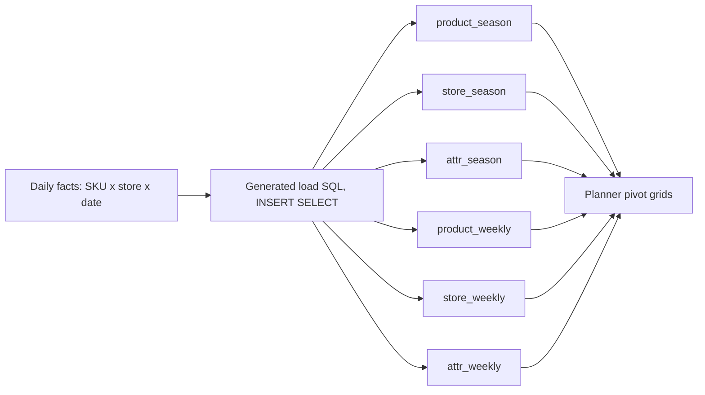
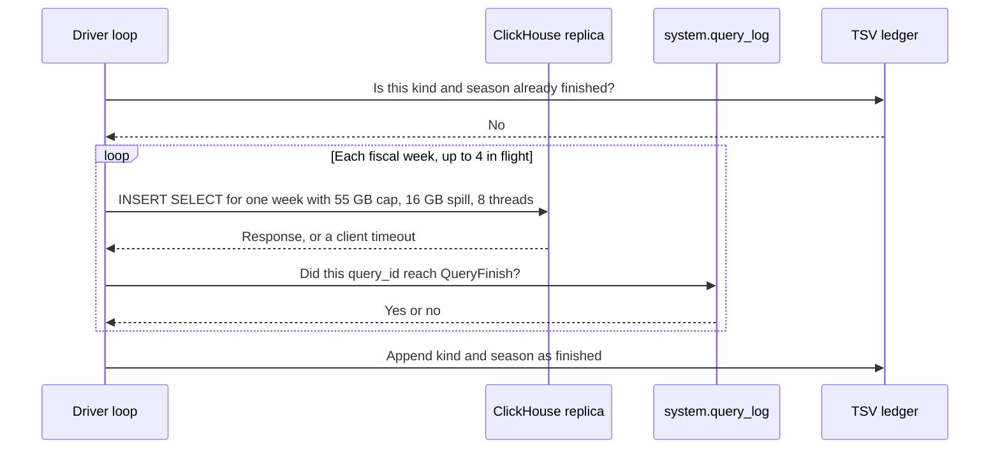
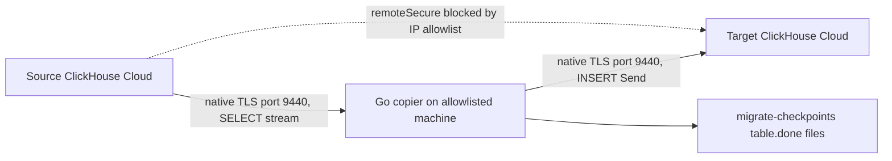
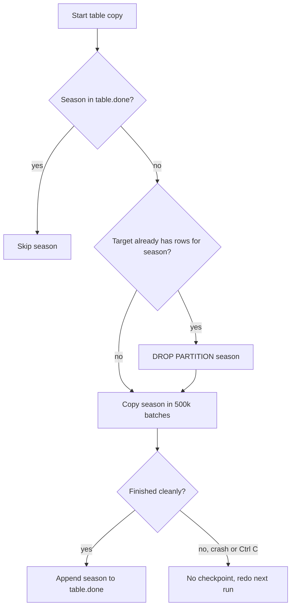

# ClickHouse rollups and cluster copy (PDF bullets C4 and C5)

<div class="callout highlight">
<b>How to use this page</b>
<ul>
<li><b>What it covers:</b> the two Impact Analytics infrastructure bullets about ClickHouse. C4 covers the six rollup tables, the 15.5× pivot speed-up and the 170 GB out-of-memory failure. C5 covers the custom Go copier that moved rollups between ClickHouse Cloud clusters at about 344k rows per second.</li>
<li><b>When to read it:</b> before any data-infrastructure, "hardest technical problem" or "debugging at scale" round, and before a system-design round where you might draw your own work.</li>
<li><b>What to memorise:</b> the six-table grid, the three honesty splits in the warning box, the numbers table in section 5, the hero story in section 6, and the checkpoint status table in section 9.</li>
<li><b>Related pages:</b> every PDF bullet with its tech is in <a href="41_pdf_bullet_tech_defense.md">41 PDF bullet + tech defense</a>. The full IA set is in <a href="43_ia_bullet_defense.md">43 IA bullet defense</a>.</li>
</ul>
</div>

**PDF:** `Tarun_Mittal_SSE_5yr.pdf`. Canonical wording: [`docs/ASSORTSMART_TAB_RESUME.md`](../../docs/ASSORTSMART_TAB_RESUME.md). Benchmark source for 15.5×: [21 IA pivot benchmark source](21_ia_pivot_benchmark_source.md).

**Snapshot date.** The measured numbers on this page come from 8 Sep 2026: generated SQL, pipeline comments, migrate checkpoints and live copy logs.

**Tags.** MEASURED means there is a log, document, benchmark or code behind the number. ESTIMATED means arithmetic I can show. Say "roughly, derived from..." HISTORICAL means from past work records. If a figure is an estimate, say so out loud.

**Bullet labels.** Older prep called these bullets **P4** and **P5**. The handbook calls them **C4** and **C5** (Core Infrastructure bullets 4 and 5). They are the same two lines. The KPI configurator is C2 and tenant isolation is C3. Those are different bullets.

<div class="callout warn">
<b>Safety rules.</b> Never paste cluster passwords, hostnames or <code>.env</code> values into an interview, GitHub, LinkedIn or a commit. The copier stays private. Whiteboard the design instead of sharing the code.
</div>

<div class="callout warn">
<b>Split the jobs. Say these out loud before anyone asks.</b>
<ul>
<li><b>15.5× is query time.</b> It is a 250M-row pivot benchmark. <b>170 GB is load time.</b> It is the estimated memory for one whole-season weekly GROUP BY. The Go copier is a cloud-to-cloud copy. None of these caused the others.</li>
<li><b>4.09B is one table:</b> attr weekly, two seasons. It is not "all weekly rollups". The copy of that table was measured in flight, not a finished cutover.</li>
<li><b>The 64.1M half-loaded partition</b> happened in the POC <b>loader</b>, not in the copier.</li>
<li><b>"TSV ledgers"</b> on the PDF means the weekly loader's skip file. The copier's ledger is <code>migrate-checkpoints/&lt;table&gt;.done</code>.</li>
<li><b>"Atomic partition rollbacks"</b> means DROP PARTITION, then recopy that season. It is <b>not</b> an atomic swap that live readers never notice.</li>
<li><b>100% Go statement coverage and 1,200+ tests</b> are still true, but they are LinkedIn and verbal now, not on this PDF.</li>
<li><b>1.6M article-seasons</b> is still the true catalog size (product × season). It is off this PDF for space. Say it if asked.</li>
<li>The PDF does not name <code>remoteSecure</code>. You may explain the allowlist workaround if they ask why a laptop ran the copy.</li>
</ul>
</div>

---

## 1. The two PDF lines (memorise word for word)

**C4.** Reduced planner pivot latency by 15.5× (189s to 12s on 250M-row operations) by building a ClickHouse pre-aggregation layer for season and weekly rollups. Prevented 170GB OOM crashes by slicing batch inserts into temporal chunks and enforcing strict distributed memory and disk-spill caps.

**C5.** Migrated ClickHouse rollups across Cloud clusters at ~344k rows/s by writing a custom Go native-TLS data pump to bypass strict cross-cluster IP allowlist restrictions. Processed partitions up to 4.09B rows using 500k-row double-buffered batches, and eliminated partial-commit ghost rows using TSV ledgers and atomic partition rollbacks.

**What the PDF names and what stays verbal.** The PDF names allowlists and TSV ledgers on C5, and "temporal chunks" and "memory and disk-spill caps" on C4. The verbal knobs behind C4 are: one fiscal week per insert, a 55 GB memory cap, a 16 GB spill threshold, 8 threads and 4 weeks in flight.

**XYZ framing** ("Accomplished X, measured by Z, by doing Y"):

- **C4.** X = serve planners from pre-aggregated rollups. Z = 15.5×, from 189 seconds to 12 seconds on 250M rows, plus weekly builds that survive after the roughly 170 GB OOM. Y = six tables, one fiscal week per INSERT SELECT. (Older prep mislabelled this line "XYZ for P2". It is C4, formerly P4.)
- **C5.** X = copy season-partitioned rollups between Cloud clusters. Z = about 344k rows per second combined, with the largest source object 4.09B rows (attr weekly, two seasons). Y = Go native TLS, 500k-row columnar batches, double buffering, season checkpoints and DROP PARTITION replay.

---

## 2. The story in plain English (the one-minute version)

AssortSmart is retail planning software. Planners look at big pivot grids: sales by department, by store, by week, by attribute such as colour or fabric. The raw data is one row per product, per store, per day. Grouping that on every click is far too slow.

So I built a **pre-aggregation layer**. Six ClickHouse tables hold the data already summed up at the grains planners actually use. Planners read those small, ready-made tables instead of the raw daily data. On the pivot benchmark, the heavy pivot went from 189 seconds to about 12.

Building the weekly versions of those tables was its own problem. A whole season at weekly grain needed an estimated 170 GB of memory in one query, and it crashed even with 80 GB and 200 GB limits. I changed the unit of work to one fiscal week per insert, with memory and spill caps, and it built reliably.

Later we had to move these tables between two ClickHouse Cloud clusters that were not allowed to talk to each other. I wrote a Go program that reads from one and writes to the other through an allowlisted machine. It copied at about 344k rows per second combined, measured on a 4.09-billion-row table. It used checkpoint files and partition drops so a crash never left a half-copied season counted as "done".

**Say it in 30 seconds:**
"I'm a Senior Software Engineer who owns high-throughput backends and data platforms. At Impact Analytics I moved planner reads onto six ClickHouse rollup tables, and the 250M-row pivot benchmark dropped from 189 seconds to about 12. Weekly grain is built one fiscal week at a time, because a full-season weekly aggregate needed around 170 GB and ran out of memory. I also wrote a Go native-TLS pump that copies season partitions between ClickHouse Cloud clusters at about 344k rows per second combined, measured on a 4.09-billion-row attr weekly set."

**Hook if they want data infrastructure:** "A lot of my time goes into memory-bound ClickHouse builds, and into moving billion-row partitions without pretending a crash is an atomic swap."

Kafka and Flink stay on Uber Menu. Do not put stateful event streaming on AssortSmart.

---

## 3. Words you need

Each term gets one plain sentence and, where it helps, an analogy.

**ClickHouse basics**

- **ClickHouse.** A columnar analytics database. It stores each column in its own file, so "sum revenue over 250M rows" reads only the revenue column. Think of a warehouse where all the left shoes are on one shelf and all the right shoes on another. It is great for counting left shoes, bad for fetching one particular pair.
- **ClickHouse Cloud.** The managed, hosted version of ClickHouse. You get a cluster with an address and credentials, and the vendor runs the machines.
- **Replica.** One copy of the database server in a cluster. Ours had about 59 CPU cores and 234 to 236 GiB of RAM.
- **MergeTree.** ClickHouse's main table engine. Inserts land as small sorted "parts", and a background process merges them into bigger parts. Think of a mailroom that drops letters into trays all day and sorts trays together at night.
- **ReplacingMergeTree.** A MergeTree that keeps only the newest version of rows with the same key, during those background merges. Think of a notebook where you never erase. You write the new value below, and a cleaner later crosses out the old lines. Until the cleaner comes, both lines exist, so queries must pick the newest one themselves.
- **FINAL.** A query keyword that forces ReplacingMergeTree to deduplicate at read time. It is correct but slower, and it does not use projections.
- **Projection.** A hidden, pre-sorted or pre-aggregated copy of a table that ClickHouse can use automatically to speed up matching queries. Think of an index at the back of a book that already lists the totals.
- **argMax / argMin.** Functions that return the value of one column at the row where another column is largest or smallest. `argMax(price, sale_date)` means "the price on the latest date".
- **any().** Returns any one value from the group. It is used for columns that are the same for every row in the group, like a product's style name. It is cheap per call, but a hundred of them add up.
- **Bloom filter index.** A compact "definitely not here / maybe here" index that lets ClickHouse skip blocks of data. Think of a bouncer with a list who can say "you are definitely not on it" without checking the whole guest book.

**Partitions and grains**

- **Partition.** A physical slice of a table, stored separately. Our rollups use `PARTITION BY season_code`, so each selling season is its own slice. You can drop, replace or copy one season without touching others, like one drawer in a filing cabinet.
- **Grain.** The level of detail of one row. "Product × season" is coarser than "product × week".
- **Rollup / pre-aggregation.** A table that stores results already summed up at a chosen grain, so queries read the answer instead of recomputing it. It is like keeping a running monthly total in your budget sheet instead of re-adding every receipt each time.
- **Fiscal week (`fiscal_year_week`).** A week in the retailer's own accounting calendar. It is the unit planners use at weekly grain.
- **Unpivot / ARRAY JOIN.** Turning columns into rows. One product row with five attributes becomes five rows, one per attribute. ClickHouse does this with `ARRAY JOIN`.

**Memory words**

- **INSERT SELECT.** A single SQL statement that runs a query and writes its result straight into another table. All the work happens inside the database.
- **Aggregator state.** The working memory ClickHouse keeps while grouping: one entry per group, with running sums and the partial state for every `any()` and `argMax()`. More groups and more functions mean more memory.
- **OOM (out of memory) / MEMORY_LIMIT_EXCEEDED.** The query asked for more memory than its cap allowed, so ClickHouse killed it with that error.
- **Spill to disk (external GROUP BY).** When the aggregator state passes a threshold, ClickHouse writes partial results to disk and merges them later. It is slower than RAM but it does not crash. Think of a desk that is full, so you stack finished pages on the floor and collect them at the end.

**Copier words**

- **Native protocol.** ClickHouse's own binary wire format. It is more efficient than HTTP for big transfers because data travels in columnar blocks. With TLS it uses port 9440.
- **TLS.** Encryption for data in transit. It is the "s" in https.
- **IP allowlist.** A list of network addresses a server accepts connections from. Everyone else is refused, like a gated community's guest list.
- **remoteSecure.** A ClickHouse function that lets one cluster query another cluster directly over TLS. It only works if the two clusters can reach each other.
- **Columnar batch.** A block of rows held as one array per column, ready to send in ClickHouse's native format.
- **Double buffering.** Using two buffers so one is being filled while the other is being sent. Think of two dishwasher racks: one in the machine, one being loaded.
- **Checkpoint / ledger.** A small file that records which units of work finished, so a restart can skip them.
- **TSV.** Tab-separated values, a plain text file with one record per line.
- **Ghost rows.** Rows from a partially committed load that look like real data but belong to a run that never finished.
- **DROP PARTITION / REPLACE PARTITION.** DROP deletes one whole partition. REPLACE swaps a partition in from another table in one step.
- **system.query_log.** ClickHouse's built-in table that records every query with its id and whether it finished (`QueryFinish`) or failed.
- **flock.** A file lock. Two processes cannot hold it at once.
- **SIGINT.** The signal sent when you press Ctrl+C.
- **Watermark.** A recorded point in time ("data up to here was included") used to make rebuilds repeatable.

---

## 4. The six rollup tables (C4, first half). Draw this first.

### 4.1 What and why, in plain English

The daily source table has one row per SKU (stock-keeping unit, one specific product variant), per store, per date. A planner's grid wants totals by product, by store or by attribute, per season or per week. Running that GROUP BY over the daily data on every chart click is the wrong design for an interactive tool.

So we pay the cost once, at load time, and planners read six small, pre-summed MergeTree tables. All six are `PARTITION BY season_code`.

| Grain | Product (keeps SKU dimensions) | Store (no SKU, two-pass totals) | Attr (unpivot, about 5× product weekly) |
|---|---|---|---|
| **Season** | product_season | store_season | attr_season |
| **Weekly** | product_weekly | store_weekly | attr_weekly |



*What to notice:* the expensive arrow is on the left, at load time, once. The arrows on the right are cheap, partition-pruned reads that happen on every click.

### 4.2 What a row looks like at each grain (illustrative values)

These rows are made up to show the shape. Column names are simplified.

**Daily source row (SKU × store × date):**

| season_code | sale_date | sku | style | color | size | store_code | units | revenue |
|---|---|---|---|---|---|---|---|---|
| 7 | 2026-03-02 | SKU-88121 | Linen Shirt | Blue | M | ST-014 | 3 | 89.97 |

**product_weekly row (product × fiscal week, all stores summed):**

| season_code | fiscal_year_week | product_code | style | color | size | units | revenue |
|---|---|---|---|---|---|---|---|
| 7 | (week id) | SKU-88121 | Linen Shirt | Blue | M | 412 | 12,355.88 |

**store_weekly row (store × fiscal week, all products summed, no SKU columns):**

| season_code | fiscal_year_week | store_code | units | revenue |
|---|---|---|---|---|
| 7 | (week id) | ST-014 | 5,880 | 171,402.10 |

**attr_weekly rows (one product week unpivoted into one row per attribute):**

| season_code | fiscal_year_week | attr_name | attr_value | units | revenue |
|---|---|---|---|---|---|
| 7 | (week id) | color | Blue | 412 | 12,355.88 |
| 7 | (week id) | fabric | Linen | 412 | 12,355.88 |
| 7 | (week id) | fit | Regular | 412 | 12,355.88 |
| 7 | (week id) | sleeve | Long | 412 | 12,355.88 |
| 7 | (week id) | collar | Button-down | 412 | 12,355.88 |

*What to notice:* one product row became five attr rows. That multiplication is why attr weekly is about 5× product weekly, and why it is the largest table and the memory hog.

### 4.3 How the unpivot works (simplified SQL)

```sql
SELECT
    season_code,
    fiscal_year_week,
    attr.1 AS attr_name,
    attr.2 AS attr_value,
    sum(units)   AS units,
    sum(revenue) AS revenue
FROM product_weekly_source
ARRAY JOIN [('color', color), ('fabric', fabric), ('fit', fit)] AS attr
GROUP BY season_code, fiscal_year_week, attr_name, attr_value;
```

`ARRAY JOIN` takes the array of (name, value) pairs and emits one row per pair. This is a simplified illustration. The real load SQL is generated per tenant.

### 4.4 Table shape (simplified DDL)

```sql
CREATE TABLE product_weekly
(
    season_code       UInt16,
    fiscal_year_week  UInt32,
    product_code      String,
    style             String,
    units             Float64,
    revenue           Float64,
    INDEX bf_product product_code TYPE bloom_filter GRANULARITY 4
)
ENGINE = MergeTree
PARTITION BY season_code
ORDER BY (season_code, fiscal_year_week, product_code);
```

*Illustrative types and index settings.* What matters: `PARTITION BY season_code` (each season is a drawer you can drop or copy), and bloom filter indexes on product, store and attr keys, so a filtered pivot skips blocks it does not need.

### 4.5 How the store and attr tables stay consistent with product

Store and attr tables drop the style, colour and size leftovers that only make sense per SKU. Store totals are built in **two passes**: first the weighted sums, then a re-weight so that each store's total equals the sum of its SKUs. Validation compares `sum(product)`, `sum(store)` and `sum(attr)` under the same filters. On an earlier Briscoes season-grain check, product and store revenue matched the weekly spine with 0% difference across seasons 1 to 7.

**Build order that ran:** product, then store, then attr, for each grain. Kik and Briscoes are two retailer tenants. Their builds are not just a rename of each other: hierarchy depth, store names and deduplication identity differ. Load SQL is generated, not hand-written.

### 4.6 Design decision: pre-aggregate at load, read cheap

- **What.** Six MergeTree rollup tables, product, store and attr at season and weekly grain, partitioned by season.
- **Why.** A daily GROUP BY with many `any()` and `argMax()` states over wide rows is far too slow for an interactive grid. Running FINAL on ReplacingMergeTree at read time is slower still, and it does not use projections.
- **How.** Generated INSERT SELECT per table and per partition, with bounded memory, published by partition. Reads are pruned by `season_code` and filtered with bloom filter indexes.
- **Alternatives an interviewer may suggest, and how I'd answer.**
  - *"Query the daily facts directly with good indexes."* Indexes help find rows, not add up hundreds of millions of them. The GROUP BY cost is still paid on every click.
  - *"Use materialized views that update on insert."* That works for simple sums. These rollups need many `any()` and `argMax()` states and two-pass re-weighting, and a correct incremental version is harder. The incremental design was written but not executed.
  - *"Keep it in PostgreSQL."* On the benchmark, PostgreSQL took 189 seconds on the heavy pivot and spilled 42 GB to disk.
- **Trade-off.** Data in rollups is only as fresh as the last build. Every new grain is another table to build, validate and copy. Storage is spent to save query time.
- **What I'd do differently.** Make the incremental, partition-replace pipeline the default from day one, so a correction rebuilds one season into a scratch table and swaps it in, instead of dropping and reloading in place.

---

## 5. The numbers, explained

| Number | What it measures | Derivation or source | Tag |
|---|---|---|---|
| **15.5×** | Speed-up on the heavy planner pivot | 189,408 ms ÷ 12,256 ms ≈ 15.45, rounded to 15.5 | MEASURED |
| **189 s to 12 s** | Wall-clock time of that pivot at 250M rows | 189.4 s baseline, 12.26 s on ClickHouse. The PDF rounds 12.3 s to 12 s | MEASURED |
| **250M rows** | Size of the benchmark fact table | Benchmark harness scale (current Briscoes was about 5M; 250M tests growth) | MEASURED |
| **170 GB** | Estimated aggregator memory for one whole-season weekly INSERT SELECT | Estimate from the failed builds, which also failed at 80 GB and 200 GB caps | ESTIMATED, failures MEASURED |
| **~11 GB / >40 GB** | Peak memory of one product week / one Briscoes attr week | Measured per-week peaks | MEASURED |
| **55 GB, 16 GB, 8 threads, 4 weeks** | Weekly build caps: memory, spill threshold, threads, weeks in flight | Generated weekly settings | MEASURED (verbal, off PDF) |
| **~344k rows/s** | Combined copy rate, two season streams | ~150k to 190k rows/s per stream, live snapshot about 34 minutes in | MEASURED |
| **4.09B rows** | Attr weekly, Briscoes seasons 6 and 7, one table | 2,779,317,472 + 1,311,108,195 = 4,090,425,667 | MEASURED |
| **500k rows** | Copier batch size | `batchSize = 500_000` | MEASURED (code) |
| **~839M rows** | Product weekly, seasons 6 and 7 | 569.4M + 269.8M | MEASURED |
| **1.6M** | Article-season catalog (product × season) | Catalog count. Off PDF | MEASURED (verbal) |
| **2.11B** | Agentic fact table (bullet A2) | A different table from the rollups | MEASURED |

### 5.1 The 15.5× in depth

- **What it measures.** Wall-clock time of the heaviest planner pivot (a grid with contribution percent and option count, joined across hierarchy, cluster and calendar) at 250M rows.
- **How it was derived.** On the benchmark, the old PostgreSQL path took 189,408 ms and spilled 42 GB of sort files to disk. ClickHouse took 12,256 ms on the same pivot. 189,408 ÷ 12,256 ≈ 15.45, which rounds to 15.5. The ClickHouse side ran on a small VM (about 10 CPUs and 3.3 GB), while PostgreSQL had a 48 GB host, so the hardware did not favour ClickHouse.
- **Why it mattered.** Three minutes per grid refresh makes a planning tool unusable. Twelve seconds is slow but workable for a 250M-row grid.
- **How to say it.** "From 189 seconds to about 12 on the 250M-row pivot benchmark, roughly 15.5 times faster."
- **Say this carefully.** The 189 s baseline in the benchmark was PostgreSQL, the old path, not a raw-ClickHouse query. If someone asks "189 seconds on what?", say "on the old PostgreSQL path, same 250M-row pivot." The rollups are how that ClickHouse read layer is served to planners in production. The benchmark notes also say lighter, typical aggregates were closer to 2 to 3 times faster. The 15.5× is the heavy grid.
- **What not to say.** "Sub-second pivots." "Every query got 15.5× faster." "The OOM fix caused the 15.5×."

### 5.2 Scale cheat sheet

- **1.6M article-seasons:** product × season catalog (verbal, LinkedIn).
- **Product weekly, seasons 6 and 7:** about 839M rows (569.4M + 269.8M).
- **Attr weekly, seasons 6 and 7:** **4.09B** rows (2,779,317,472 + 1,311,108,195).
- **2.11B:** the agentic fact table from bullet A2. It is a different table.
- **Ratios:** weekly grain has roughly 2× the groups of season grain. The attr unpivot is why attr weekly is the largest object, about 5× product weekly on Briscoes seasons 6 and 7.

---

## 6. The 170 GB OOM (C4, second half): hero story

Use this for "hardest technical hurdle", "tell me about a failure" and "how do you debug at scale".

### 6.1 Plain English first

Building the weekly rollup for a whole season in one SQL statement needed more memory than the machine had. We tried giving it more memory and it still died. The fix was not more memory. It was a smaller unit of work: one fiscal week per statement, with hard caps so any single statement stays inside a known budget.

### 6.2 Why weekly is so heavy

A weekly rollup row carries about 110 `any()` states, plus `argMax()` and `argMin()` over wide string columns. ClickHouse must hold all of that for every group until the GROUP BY finishes. Weekly grain has roughly twice as many groups as season grain, and attr multiplies rows again through the unpivot. For a whole season the estimated aggregator state was around 170 GB. The replica has about 59 cores and 234 to 236 GiB of RAM, shared with everything else.

### 6.3 STAR

- **Situation.** Weekly rollups need about 110 `any()` states plus `argMax` and `argMin` over wide strings. A whole-season weekly INSERT SELECT was estimated at around 170 GB of aggregator state. It failed with `MEMORY_LIMIT_EXCEEDED` at an 80 GB cap and again at a 200 GB cap. The replica is about 59 cores and 234 to 236 GiB.
- **Task.** Keep weekly grain, because planners need `fiscal_year_week`, without melting the box.
- **Action.** I changed the unit of work from one season to one fiscal week. The generated weekly settings were 8 threads, a 55 GB memory cap, a 16 GB spill threshold, and 4 weeks in flight. I measured per-week peaks: a product week peaked around 11 GB, and a Briscoes attr week peaked above 40 GB, which is why a 40 GB cap was too low. Rule I set: never raise season parallelism and week parallelism together on the same box.
- **Result.** Weekly grain builds reliably. The request path stays partition-pruned reads. The 15.5× is a different benchmark (the 250M pivot). Say that unprompted.

**Trap:** "So you fixed the OOM, and that is why latency is 15.5×." No. The OOM is load time. The 15.5× is query time.

### 6.4 What one weekly insert looks like (simplified SQL)

```sql
INSERT INTO product_weekly
SELECT
    season_code,
    fiscal_year_week,
    product_code,
    any(style)                 AS style,       -- ~110 any() columns in the real build
    argMax(price, sale_date)   AS last_price,
    argMin(price, sale_date)   AS first_price,
    sum(units)                 AS units,
    sum(revenue)               AS revenue
FROM daily_sales
WHERE season_code = {season}
  AND fiscal_year_week = {week}               -- one fiscal week per statement
GROUP BY season_code, fiscal_year_week, product_code
SETTINGS
    max_memory_usage                   = 55000000000,  -- 55 GB hard cap for this query
    max_bytes_before_external_group_by = 16000000000,  -- start spilling to disk at 16 GB
    max_threads                        = 8;
```

*Simplified illustration. Column names are illustrative. The real SQL is generated, and the generated settings are the source of truth.* `{season}` and `{week}` are filled in by the driver loop.

**The three settings, in plain words.**

- **`max_memory_usage`** is the hard ceiling for one query. Go over it and ClickHouse kills the query with `MEMORY_LIMIT_EXCEEDED` instead of letting it take down the server. It is a circuit breaker for RAM.
- **`max_bytes_before_external_group_by`** is the spill threshold. When the GROUP BY's in-memory state passes it, ClickHouse writes partial aggregates to disk and merges them at the end. Setting it well below the hard cap (16 GB against 55 GB) means a heavy week slows down instead of dying.
- **`max_threads`** limits how many CPU threads the query uses. Each thread keeps its own partial aggregation state, so fewer threads also means less memory.

### 6.5 The driver loop



*What to notice:* success is judged by `system.query_log`, not by whether the HTTP client returned cleanly. The ledger is written only after every week finished.

**Sanity-check arithmetic (ESTIMATED).** Four weeks in flight at a 55 GB cap each is at most 220 GB, which is under the replica's roughly 234 to 236 GiB. Raising weeks in flight and season parallelism together would blow straight through that. That is the reason for the "never raise both" rule.

### 6.6 Design decision: shrink the unit of work, don't buy RAM

- **What.** One fiscal week per INSERT SELECT, with a memory cap, a spill threshold, a thread cap and bounded weeks in flight.
- **Why.** Memory grows with the number of groups in one statement. Cutting the time range cuts the groups. More RAM did not work: it failed at 200 GB too.
- **How.** A generated loop over weeks, capped settings per statement, success checked in `system.query_log`, finished seasons recorded in a TSV ledger.
- **Alternatives an interviewer may suggest, and how I'd answer.**
  - *"Just use a bigger machine."* It failed at a 200 GB cap on a 234 GiB box. There is no headroom left to buy on that replica, and a bigger box just moves the cliff.
  - *"Spill everything to disk."* Spill alone at season scale would be very slow and still risky. Spill works best as a safety net under a right-sized unit of work.
  - *"Slice by store instead of week."* It is possible, but week is the natural grain of the target table, so each slice writes complete rows with no later merge step.
- **Trade-off.** More statements and more orchestration. Total build time is longer than one giant query would be if it could fit. The ledger and query-log checks are extra code.
- **What I'd do differently.** Profile memory per grain on a small sample before the first full-season run, instead of discovering the 170 GB cliff by failing.

---

## 7. Partial loads, ghost rows and the TSV ledger (the loader)

### 7.1 Plain English

A load can fail halfway and still leave rows behind. If the next run only asks "does this partition have rows?", it will wrongly skip a half-loaded season. Those leftover rows are **ghost rows**: they look like real data but belong to a run that never finished.

### 7.2 What actually happened

- A weekly HTTP INSERT failed on the client side, but the server had **already committed some blocks**.
- A half-loaded partition with **64.1M rows** once passed a "skip if the partition has rows" check. This was in the POC **loader**, not the copier.
- **Fix 1: a TSV ledger.** Weekly resume reads a TSV file listing finished `(kind, season_code)` pairs. If a pair is missing, the loader runs DROP PARTITION for that season and rebuilds it from scratch.
- **Fix 2: trust the server, not the client.** Completion of each HTTP INSERT is checked by its query id reaching `QueryFinish` in `system.query_log`, not by the `curl` exit code.

**What the ledger looks like (illustrative):**

```text
product_weekly	6
product_weekly	7
store_weekly	6
```

Each line means "this kind of table, for this season, finished completely". If `attr_weekly 7` is not in the file, that season is dropped and rebuilt, no matter how many rows it currently has.

**Rule to say out loud:** never use `count() > 0` as the success test for a weekly build.

---

## 8. The Go native-TLS copier (C5)

### 8.1 Plain English first

We had to move rollup tables from one ClickHouse Cloud cluster to another. Normally you would tell the target cluster to pull directly from the source with `remoteSecure`. That was blocked: each cluster's IP allowlist did not include the other cluster. The operator machine's IP was allowed on both. So I wrote a Go program that runs on that machine, reads from the source and writes to the target, both over ClickHouse's native protocol with TLS. It is an allowlisted pump, a workaround, not a design goal.



*What to notice:* the dotted line is the direct path that was blocked. Everything goes through one machine, which is why caps are per process and why it is not a production pattern.

Whiteboard version:

```text
source CH Cloud  --native TLS-->  laptop Go process  --native TLS-->  target CH Cloud
                     SELECT stream                    INSERT Send()
                     500k columnar                    500k columnar
                     buffer A while B sends           checkpoint season_code
```

### 8.2 How it gets about 344k rows per second

- **Batch size.** `batchSize = 500_000` rows per batch.
- **Columnar buffers.** Each column is a typed Go slice (`[]T`). Rows are appended with `batch.Column(i).Append(...)`, then `Send()` ships the block. There is no per-row `reflect`. Reflection inspects types at runtime and is slow when done billions of times.
- **Double buffering.** Two buffer sets. While batch N is being sent to the target, the reader is already filling batch N+1 from the source.
- **Why double buffering also fixed an error.** In an earlier HTTP-based version, the source SELECT sat idle while the INSERT ran, and the idle connection died with "unexpected EOF". Overlapping read and write keeps the read stream busy. Moving to the native protocol helped too.
- **Never retry `Send` on a spent batch.** Once `Send()` has been called, the batch is consumed. Retrying it either duplicates rows or fails again. The correct recovery is DROP PARTITION and restart that season.

**Simplified double-buffering sketch (not the real code):**

```go
const batchSize = 500_000

type colBuf struct {
    ids     []uint64
    names   []string
    revenue []float64
}

func (b *colBuf) reset() { b.ids, b.names, b.revenue = b.ids[:0], b.names[:0], b.revenue[:0] }

func copySeason(ctx context.Context, src, dst driver.Conn, season uint16) error {
    rows, err := src.Query(ctx, "SELECT id, name, revenue FROM attr_weekly WHERE season_code = ?", season)
    if err != nil {
        return err
    }
    defer rows.Close()

    free := make(chan *colBuf, 2)  // two buffers: one filling, one sending
    full := make(chan *colBuf, 1)
    errc := make(chan error, 1)
    free <- &colBuf{}
    free <- &colBuf{}

    go func() { // writer: sends a full buffer while the reader fills the other one
        for buf := range full {
            batch, err := dst.PrepareBatch(ctx, "INSERT INTO attr_weekly")
            if err != nil {
                errc <- err
                return
            }
            batch.Column(0).Append(buf.ids)
            batch.Column(1).Append(buf.names)
            batch.Column(2).Append(buf.revenue)
            if err := batch.Send(); err != nil { // a spent batch is never retried
                errc <- err
                return
            }
            buf.reset()
            free <- buf
        }
        errc <- nil
    }()

    handOff := func(b *colBuf) error { // give a full buffer to the writer unless it already failed
        select {
        case full <- b:
            return nil
        case err := <-errc:
            return err
        }
    }

    buf := <-free
    for rows.Next() {
        var id uint64
        var name string
        var rev float64
        if err := rows.Scan(&id, &name, &rev); err != nil {
            return err
        }
        buf.ids, buf.names, buf.revenue = append(buf.ids, id), append(buf.names, name), append(buf.revenue, rev)
        if len(buf.ids) == batchSize {
            if err := handOff(buf); err != nil {
                return err
            }
            select {
            case buf = <-free: // waits only if both buffers are busy
            case err := <-errc:
                return err
            }
        }
    }
    if len(buf.ids) > 0 {
        if err := handOff(buf); err != nil {
            return err
        }
    }
    close(full)
    return <-errc
}
```

*What to notice:* the channel `free` holds at most two buffers. The reader blocks only when both are in use, which is exactly when the writer is still sending. That back-pressure keeps memory bounded at two batches per worker. The real copier also handles per-table column lists, connection setup with TLS from environment variables, the per-table lock and checkpoints.

### 8.3 Workers and resource caps

- `-workers N` copies N seasons in parallel. Each worker has its own source and target connections.
- Caps are **per process**. Two terminals each running `-workers 2` double the total budget, so they can oversubscribe the cluster.
- The copier assumes the host has about 59 CPUs and 236 GiB. It splits about 48 threads and 180 GiB across workers. Example: with 2 workers, each query gets 24 threads and 90 GiB.

### 8.4 The 344k number, explained

- **What it measures.** Rows per second written to the target, combined across two season streams. It is an **ingest rate**, not requests or transactions per second.
- **How it was derived.** A live snapshot about 34 minutes into a run with two workers and 500k batches. Each stream ran at roughly 150k to 190k rows per second, about 344k combined. Cross-check: each worker committed about 0.3 to 0.4 `Send()` calls per second. 0.35 × 500,000 ≈ 175,000 rows per second per worker, and two workers give about 350,000, consistent with 344k.
- **Why it mattered.** At billions of rows, the copy rate decides whether a migration takes hours or days.
- **How to say it.** "About 344 thousand rows per second combined, two season streams on one machine, measured on a 4.09-billion-row table."
- **What not to say.** "344k TPS" or "344k RPS". "I migrated 4.09 billion rows." If they hear TPS, correct them.

### 8.5 Failure handling and idempotency

**Plain English.** The unit of work is one season (one partition). A season is either recorded as done, or it is treated as dirty and redone from scratch. There is no "resume from the middle of a season".

1. **Ledger.** The copier writes `migrate-checkpoints/<table>.done`, listing finished seasons.
2. **Incomplete season.** If the target already has rows for a season not in the ledger, the copier runs DROP PARTITION (or DELETE) for that season and recopies it.
3. **No full wipe.** There is no TRUNCATE of the whole table unless the operator passes `-reset`.
4. **Ctrl+C (SIGINT).** The copier finishes the in-flight batch and does **not** checkpoint that season, so it will be redone next time.
5. **Per-table flock.** Two terminals cannot copy the same table at once.



*What to notice:* the only way a season counts as done is a clean finish followed by a ledger write. That is what "eliminated partial-commit ghost rows" means.

**Say this carefully.** DROP PARTITION is **not** an atomic swap. If the copier crashes, the target has a truncated season until it is dropped and retried, and readers of the target can see that partial season meanwhile. The incremental design, which builds into scratch tables and swaps in with `REPLACE PARTITION`, was written and **not executed**. Do not claim it ran.

### 8.6 Checkpoint status at the 8 Sep 2026 snapshot

Say this if they ask "did the 4.09B copy finish?"

| Table | Status at snapshot |
|---|---|
| product_season | seasons 3 to 7 done |
| attr_season | seasons 3, 6 and 7 done |
| store_weekly | seasons 6 and 7 done |
| product_weekly | empty ledger. Failed mid-copy, partitions dirty |
| attr_weekly | empty ledger. In flight for seasons 6 and 7 (the 4.09B object) |
| Hindsight three tables | season 7 done |

So the phrase is **"measured on"** a 4.09-billion-row set, never **"migrated 4.09 billion rows"**.

The Hindsight tables on this path are tiny (season 7 on source): keep_drop_score 4,150 rows, missed 360, top style 360. Mention only if asked. Hindsight is not a PDF headline.

### 8.7 Design decision: a laptop pump over native TLS

- **What.** A custom Go program on an allowlisted machine, native protocol with TLS on both sides, 500k-row columnar batches, double buffering, per-season checkpoints, DROP PARTITION replay.
- **Why.** Cluster-to-cluster pull was not available because of the Cloud IP allowlists. The operator machine was allowed. The PDF does not name the Cloud function that failed.
- **How.** Sections 8.2 to 8.5.
- **Alternatives an interviewer may suggest, and how I'd answer.**
  - *"Use remoteSecure or INSERT SELECT across clusters."* That is the right answer when the clusters can reach each other. Here the allowlists blocked it.
  - *"Export to object storage and import."* Freezing partitions out through object storage is a good production pattern. It is one of the things I would pick for production.
  - *"Use the HTTP interface."* HTTP is simpler, but the earlier HTTP version hit unexpected EOF when the SELECT sat idle. Native blocks are also more efficient for columnar data.
- **Trade-off.** Everything flows through one machine, so it is a single point of failure, and the caps are per process. There is no atomic swap, so target readers can see partial seasons during a redo.
- **What I'd do differently.** For production I would get the clusters allowlisted to each other and use INSERT SELECT, or freeze through object storage, rather than copy through a laptop. I would also make REPLACE PARTITION from a scratch table the default, so readers never see a partial season.

---

## 9. Failure catalog (say these out loud)

1. **OOM on the weekly GROUP BY.** Shrink the unit to one week, and measure attr weeks before raising RAM.
2. **A half-written partition looks complete.** Never use `count() > 0` as the success test for weekly builds. Use the ledger.
3. **HTTP client timeout after the server already committed.** Trust `system.query_log`, not the client's exit code.
4. **HTTP SELECT dies with EOF during the INSERT.** Double buffer, or use the native protocol.
5. **Retrying a spent batch.** It causes duplicates or a second failure. DROP PARTITION and restart the unit instead.
6. **Connection reset on native TLS.** The copier crashes. Only finished seasons are checkpointed, so the next run redoes the dirty season.
7. **Cluster-to-cluster pull blocked by allowlists.** The laptop pump is a workaround, not the ideal design.
8. **Oversubscribed workers.** Caps are per process, so two terminals double the load.
9. **Credentials.** Never commit Cloud passwords. They come from environment variables only, and the binary does not read `.env` for you.

---

## 10. Interview questions (speakable answers)

### 1. How did you design the rollup schema, and why not query daily facts on every request?

"We pay once at load time and read cheap. A daily GROUP BY with many `any()` and `argMax()` states over wide rows is far too slow for an interactive grid, and FINAL on a ReplacingMergeTree is slower still and skips projections. So there are six MergeTree rollups, product, store and attr at season and weekly grain, all partitioned by season, with bloom filter indexes on product, store and attr keys. Product keeps SKU dimensions. Store and attr drop them and re-weight so store totals match the sum of SKUs. Attr is an unpivot using ARRAY JOIN, which is why attr weekly is about five times product weekly on the Briscoes seasons 6 and 7."

**Follow-up they may ask:** "How do you know the rollups are right?" Answer: "We compare product, store and attr sums under the same filters. On the earlier season-grain check, product and store revenue matched the weekly spine with zero difference across seasons 1 to 7."

### 2. Walk through a time you hit severe resource limits. How did you debug and fix the OOM?

"Building weekly rollups for a whole season in one statement needed an estimated 170 GB, and it failed at both 80 and 200 GB caps on a replica with about 236 GiB. The cause was aggregator state: about 110 `any()` columns plus `argMax` over wide strings, for every group. I did not raise memory first. I profiled by grain, shrank the unit to one fiscal week, then capped it at 55 GB with a 16 GB spill threshold, 8 threads and four weeks in flight. Product weeks peaked around 11 GB and attr weeks above 40 GB, so attr is the hog, and now it builds reliably."

### 3. How did you get about 344k rows per second in Go? Was that an HTTP API?

"No, it is a copy rate in rows per second, not requests. Two workers each streamed one season over native TLS at roughly 150 to 190 thousand rows a second, about 344 thousand combined at a live snapshot around 34 minutes in. The speed came from 500k-row columnar batches with typed slices, no per-row reflection, and double buffering, so reading the next batch overlaps sending the previous one. That overlap also fixed an unexpected-EOF problem we had when the SELECT sat idle over HTTP."

**Follow-up they may ask:** "Why a Go pump at all?" Answer: "Cluster-to-cluster pull was blocked by the Cloud IP allowlists, and the operator machine was allowed on both. It is a workaround, not a shard-to-shard design goal."

### 4. How did you handle failure and idempotency on billion-row copies?

"The unit is one season partition, and a season is either done or redone from scratch. The copier records finished seasons in a per-table `.done` checkpoint file. If the target has rows for a season that is not in the file, it drops that partition and recopies. Ctrl+C finishes the in-flight batch but does not checkpoint the season, and a file lock stops two terminals copying the same table. Separately, on the loader side, we once had a 64.1-million-row half-loaded partition pass a 'has rows' check, which is why weekly loads use a TSV ledger and check `system.query_log` instead of trusting the client."

**Say this carefully:** "DROP PARTITION then recopy is not an atomic swap. Readers can see a partial season until the redo finishes. The REPLACE PARTITION design was written, not run."

### 5. What is the scale?

"The largest object I timed is the Briscoes attr weekly table for seasons 6 and 7: 4.09 billion rows in one table, two partitions. Product weekly for the same seasons is about 839 million. Season grain is smaller. The replica is about 59 cores and 234 to 236 GiB. The 15.5× is a separate number, a 250M-row pivot benchmark, and the PDF rounds 12.3 seconds to 12."

### 6. Why not one INSERT of the whole season at weekly grain?

"Because it needed about 170 GB of aggregator state and failed at both an 80 GB and a 200 GB cap. One week at a time is about 11 GB for product and over 40 GB for attr, which fits under a 55 GB cap with spill as a safety net."

### 7. How do store totals stay consistent with SKUs?

"Store totals are built in two passes: weighted sums first, then a re-weight so each store's total equals the sum of its SKUs. Then we validate product, store and attr sums at the same filters. On the earlier Briscoes season-grain check, product and store revenue matched the weekly spine with zero difference across seasons 1 to 7."

### 8. How do ReplacingMergeTree corrections work?

"A correction is a new INSERT with a newer `updated_at` version, and ReplacingMergeTree keeps the newest version per key during background merges. Rollups are rebuilt at a captured watermark, so a rebuild is repeatable. I avoid FINAL where I want projections to work. One subtlety: the 'dirty' arrival token on the materialized view is not the same clock as the build watermark, so you cannot use one to reason about the other. The incremental pipeline is a design only."

### 9. What is the biggest production risk in the copier?

"There is no atomic swap. If it crashes, the target has a truncated season until we drop and retry, and readers of the target can see that partial season. For a real production move I would not copy through a laptop. I would allowlist the clusters to each other and use INSERT SELECT, or freeze through object storage, and swap seasons in with REPLACE PARTITION."

### 10. Whiteboard the Go copier.

"I draw three boxes: source cluster, the Go process on an allowlisted machine, target cluster, both connections native TLS. Inside the Go box I draw two buffers of 500k rows: one filling from the SELECT stream while the other is sent with `Send()`. Then I add the `.done` checkpoint per table and the rule that only finished seasons are recorded. Finally I note that `-workers N` means N seasons in parallel with their own connections, and that caps are per process: about 48 threads and 180 GiB split across workers, so 24 threads and 90 GiB each with two workers."

### 11. Did the 4.09-billion-row copy finish?

"At the snapshot I am quoting, no, it was in flight. The attr weekly ledger was still empty, with seasons 6 and 7 being copied, and product weekly had failed mid-copy with dirty partitions. Product season, attr season, store weekly and the small Hindsight tables had finished seasons. So I say the rate was measured on a 4.09-billion-row set, not that I migrated 4.09 billion rows."

---

## 11. Say this / don't say this

| Safe to say | Not safe to say |
|---|---|
| Six rollup tables, partitioned by season | "Sub-second pivots" |
| From 189 seconds to about 12 on a 250M-row pivot benchmark, against the old PostgreSQL path | "Every query got 15.5× faster" or "the OOM fix caused the 15.5×" |
| A whole-season weekly build needed about 170 GB and failed at 80 and 200 GB caps. Fixed with one fiscal week per insert | "We just added more RAM" |
| Go native-TLS pump, about 344k rows per second combined | "344k TPS" or "344k requests per second" |
| Measured on a 4.09B-row attr weekly set | "I streamed 4.09 billion rows at 344,000 rows a second" as a finished job |
| 500k batches with double buffering | "Atomic DROP PARTITION" or "zero-downtime swap" |
| TSV ledger for the loader, `.done` checkpoints for the copier | "The TSV file is the copier's checkpoint" |
| REPLACE PARTITION incremental design written | "We run incremental REPLACE PARTITION in production" |
| | Kafka, Flink or CDC on Impact Analytics. Open-sourcing or sharing the copier. Hosts or passwords |

**LinkedIn and outreach.** Safe: six tables, the 170 GB OOM and week slicing, the Go pump, about 344k rows per second combined, 4.09B attr weekly as the largest object timed, 500k batches and double buffering. The CI gate (100% statement coverage, 1,200+ Go tests, SAST and SBOM checks) is fine on LinkedIn. It left the PDF for the copier bullet. SAST is static application security testing. SBOM is a software bill of materials, the list of dependencies.

---

## 12. Three-minute whiteboard script

1. **First, draw the daily fact box and the six-table grid** (product, store, attr × season, weekly). Say: "Planners can't GROUP BY daily data on every click, so we pay once at load and read small tables partitioned by season."
2. **Second, draw one weekly INSERT SELECT with a loop around it.** Say: "Whole-season weekly needed about 170 GB and failed even at 200. One fiscal week per statement, 55 GB cap, 16 GB spill, 8 threads, four weeks in flight. The TSV ledger and query_log decide success, not row counts."
3. **Third, draw source cluster, Go box, target cluster.** Say: "The allowlists blocked direct pull, so a Go pump on an allowlisted machine copies seasons over native TLS in 500k double-buffered batches, about 344k rows a second combined. Seasons are checkpointed only when finished. Dirty seasons are dropped and recopied."
4. **Close with the honesty line.** "15.5× is query time, 170 GB is load time, and the 4.09-billion-row copy was measured in flight. DROP PARTITION is not an atomic swap. For production I'd use REPLACE PARTITION from a scratch table."

---

## 13. Code map (verbal only, never share the code)

- `docs/scripts/gen_rollup_from_imputed.py` is the generator for the rollup load SQL.
- `docs/scripts/{kik,briscoes}/run_pipeline.sh` is the POC loader that actually ran.
- `cmd/migrate-rollup-table/` is the Cloud-to-Cloud copier.
- `docs/scripts/automated_rollup/` is the incremental REPLACE PARTITION design. It was not run.
