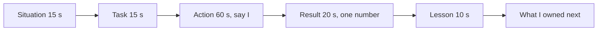
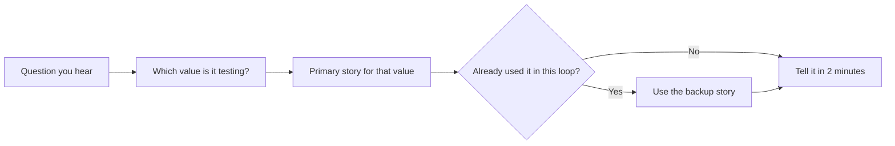
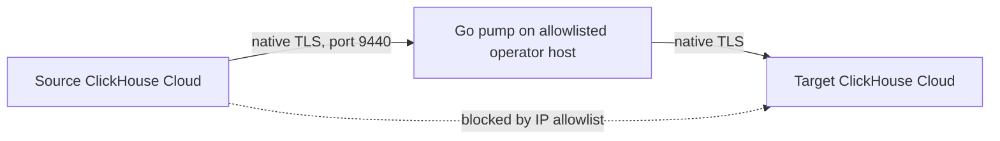
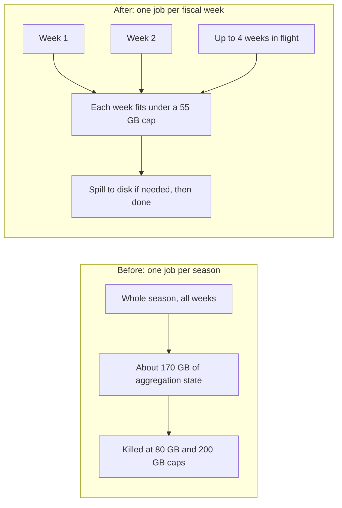
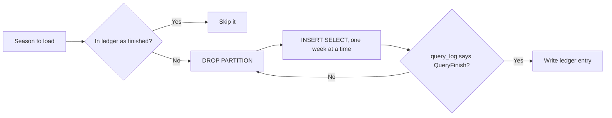
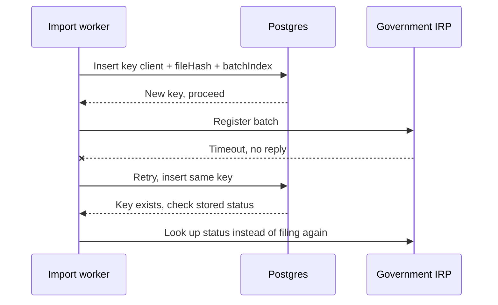
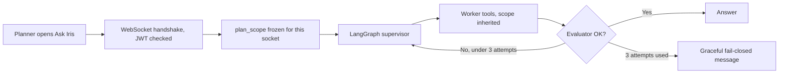

# 01. OCI core values: STAR answers for every value

Source: *OCI Interview Prep Pack* (11 core values plus the STAR method). Resume: PyGo track (Python and Go wording). Every story uses real work from the PDF or from verified prep. Where a detail is verbal only (true, but not printed on the PDF), the page says so.

<div class="callout highlight">
<b>How to use this page</b>
<ul>
<li><b>What it covers:</b> all 11 Oracle core values, the questions each one produces, and a ready STAR story (plus a backup) for each.</li>
<li><b>When to read it:</b> the week before the hiring manager or bar raiser round, and again the night before. Read section 1 (the story bank) first.</li>
<li><b>What to memorise:</b> the 17 story names in section 1, the "Say it" version of each primary story, and the honesty box at the end. The "Details if they probe" lists are for follow-ups, not for the first answer.</li>
<li><b>How to practise:</b> pick a random question from any "Likely questions" list, name the story out loud in 5 seconds, then tell it in 2 minutes.</li>
</ul>
</div>

<div class="callout note">
<b>What the tags mean.</b> <b>MEASURED</b> means there is a log, a doc, or code behind the number. <b>ESTIMATED</b> means it is arithmetic I can show on a whiteboard, so I say "roughly, derived from...". <b>HISTORICAL</b> means it comes from my past work records and I cannot re-run it today. <b>TARGET</b> means it was a design goal, so I say "targeting". <b>VERBAL</b> means it is true and fine to say, but it is not printed on the PDF.
</div>

<div class="callout note">
<b>How OCI scores this.</b> The pack says: choose real examples, give details (they are "a technical organization"), every answer needs a beginning, middle, and end, and be ready for follow-ups. Interviewers probe each STAR letter with the questions in section 0. Aim for 2 minutes per answer: 15 seconds of Situation, 15 seconds of Task, 60 seconds of Action (say "I", not "we"), 20 seconds of Result with a number, and 10 seconds of lesson.
</div>

---

## Words you need for this page

These terms come up in the stories. Each one gets a plain sentence and an everyday picture, so you can explain it if the interviewer is not from your domain.

**The interview itself**

- **OCI (Oracle Cloud Infrastructure).** Oracle's public cloud, the same kind of product as AWS or Google Cloud. Companies rent computers, storage, and databases from it instead of running their own. Think of it as renting electricity from a utility instead of owning a generator.
- **Oracle core values.** Eleven behaviours Oracle says it hires for, such as "Put customers first" and "Choose safety". They are the grading rubric. Every behavioral question is secretly checking one row of that rubric, the way an exam question checks one chapter.
- **STAR.** A way to tell a work story in four parts: **S**ituation (where and what was at stake), **T**ask (what you personally owned), **A**ction (what you did, in order), **R**esult (what changed, with a number). It is a short story with a beginning, middle, and end.
- **JD (job description).** The posting for the role. This one is heavy on reliability, operability, and safe change.

**Release and reliability words**

- **Canary release.** Sending a new version to a small slice of traffic first and watching it before sending everyone. Miners carried a canary underground because it reacted to bad air before people did.
- **Rollback by config.** Undoing a change by flipping a setting (for example, a gateway routing rule) instead of shipping new code. It is a light switch, not rewiring the house.
- **p95 latency.** The response time that 95 out of 100 requests beat. If p95 is 300 ms, only 5 in 100 requests are slower than 300 ms. It shows the slow tail that an average hides.
- **Idempotency and idempotency key.** An operation is idempotent when doing it twice has the same effect as doing it once. Pressing a lift button five times still calls one lift. An idempotency key is the unique label (for example client + file hash + batch number) that lets the system recognise "I have already done this one".
- **DLQ (dead-letter queue).** A parking area for messages that keep failing, so they stop blocking the line and a person can replay them later. Like a post office shelf for letters with unreadable addresses.
- **Circuit breaker.** Code that stops calling a failing dependency for a while after repeated errors, like the breaker in your house that trips to stop a fire. While it is open, the system uses a fallback.
- **Checkpoint.** A saved marker of finished work so a restarted job skips what is already done. A bookmark in a long book.
- **Blameless incident review.** A written review of what went wrong that focuses on the mechanism, not on who to blame.

**Data words**

- **PostgreSQL (Postgres) and MySQL.** Row-oriented databases built for many small reads and writes, like bank transactions. This kind of work is called **OLTP** (online transaction processing).
- **ClickHouse.** A column-oriented database built for big analytical scans, like "sum sales for every store for every week". This kind of work is called **OLAP** (online analytical processing). Picture a spreadsheet where each column is stored as its own file, so a query that only needs 3 columns never reads the other 200.
- **Partition.** A slice of a table stored separately, here one slice per season (`season_code`). Queries for one season skip the other slices. Like filing invoices in one folder per year.
- **Rollup table.** A table that stores pre-computed totals (for example, sales per product per week) so a query reads totals instead of adding up raw rows every time. Like keeping a running monthly total instead of re-adding every receipt.
- **MergeTree and ReplacingMergeTree.** ClickHouse table types. MergeTree stores data in sorted chunks that merge in the background. ReplacingMergeTree also keeps only the newest version of rows with the same key. Think of a notebook where you never erase. You write the new value below, and a cleaner later crosses out the old lines.
- **`INSERT SELECT`.** One SQL statement that reads from one table and writes the result into another.
- **OOM (out of memory).** The database killed the query because it needed more memory than allowed.
- **Spill to disk.** Letting a big query park some working data on disk when memory is full. Slower, but it finishes.
- **Ledger file.** A plain record of which units of work finished successfully. A sign-off sheet.

**AI words**

- **LLM (large language model).** A model like GPT or Gemini that reads text and writes text.
- **Lens.** One structured question the LLM answers about an article, for example "is this a missed opportunity?". AssortSmart uses 7 lenses.
- **Deterministic baseline.** A plain rule-based score computed from KPIs (key performance indicators such as sell-through and rate of sale). Same input, same answer, every time.
- **Evaluation harness and CI gate.** A fixed set of test cases with known answers. CI (continuous integration) runs it on every change, and the "gate" blocks promotion if accuracy drops below a bar. A driving test the model must pass before it gets the keys.
- **Gold-200.** A separate, carefully labelled benchmark of 200 cases used to compare models.
- **JWT (JSON Web Token).** A signed token that proves who the user is. A tamper-proof ID badge.
- **WebSocket and handshake.** A WebSocket is a connection that stays open for a back-and-forth chat. The handshake is the moment it opens, which is where we check the badge.
- **LangGraph supervisor and LangSmith.** LangGraph is a Python library for building multi-step AI agents as a graph. The supervisor is the node that decides which worker step runs next. LangSmith is a tracing tool that records every step so you can debug it.

**Finance and compliance words (Uber FRM)**

- **FRM (Financial Risk Management) scoping.** Each quarter Uber Finance decides which financial line items are big or risky enough to be in audit scope.
- **GL (general ledger).** The master record of every account balance.
- **FSLI (Financial Statement Line Item).** A line on the financial statements, such as "Cash". In FRM they nest four levels deep (L1 to L4), like folders inside folders.
- **Materiality threshold.** The size above which an error would matter to a reader of the financial statements. Here it was $340M.
- **SOX (Sarbanes-Oxley).** A US law that requires controls and audit trails around financial reporting.
- **SOADB.** Uber's standard service-owned MySQL setup.
- **Optimistic row locking.** Each row has a version number. An update only succeeds if the version has not changed since you read it. Like editing a shared doc that warns "someone changed this since you opened it" instead of locking everyone else out.
- **SHA-256 natural key.** An id computed by hashing the row's meaningful fields, so the same row always gets the same id. Like a fingerprint instead of a ticket number.
- **ORM (object-relational mapper) and SQLAlchemy 2.0.** An ORM lets code work with database rows as typed Python objects. SQLAlchemy 2.0 is the modern version of Python's main ORM.
- **Stacked Bazel PRs.** Bazel is the build system. Stacked PRs are a chain of small pull requests where each builds on the previous one, so each can be reviewed and reverted alone.
- **FSM (finite state machine).** A fixed set of states (Draft, Review, ReOpen, Closed) and allowed moves between them.

**Masters India words**

- **GST (Goods and Services Tax) and IRP (Invoice Registration Portal).** In India, businesses register e-invoices with the government IRP, which returns an IRN (Invoice Reference Number) and a signed QR code.
- **Strangler pattern.** Replacing an old system one piece at a time while it keeps running, like a vine slowly growing around a tree until the tree is no longer needed.
- **ELK and New Relic.** ELK (Elasticsearch, Logstash, Kibana) collects logs from every server into one searchable place. New Relic is an APM (application performance monitoring) tool that traces each request through the system.
- **Request ID.** A unique id attached to a request and logged everywhere it goes, so you can follow one invoice across services. A parcel tracking number.
- **Test coverage and mocks.** Coverage is the share of code lines that tests actually execute. A mock is a fake object that stands in for real code in a test. If you mock too much, the real code never runs.

---

## 0. The probes they will use (from the PDF)

**In plain words.** The interviewer will not just listen. They will poke each part of your story with follow-up questions. If you prepare answers to these probes in advance, you never get caught without detail.

| STAR part | What they will ask | Have this ready |
|---|---|---|
| **Situation** | What happened? How did this come about? Who was involved? What was the main issue? | Team size, your role, the system, the stakes (customer, money, deadline) |
| **Task** | What responsibility did you take on? Did your manager assign it? Did you take it on your own? Did others have tasks? | Say clearly what *you* owned versus what others owned |
| **Action** | What did you do first? How did the person or situation respond? What did you do next? What were the alternatives? | Ordered steps, and one rejected alternative with the reason |
| **Result** | What was the end result? Was your manager satisfied? Did you keep handling it over time? Were you given new responsibilities because of it? | A number, the follow-up process change, and what you owned next |

The diagram shows how to spend your 2 minutes. Notice that Action gets half the time.



**Always prepare the "what next, new responsibilities" tail.** OCI asks it a lot. These are the real ones you have:

- After the ClickHouse proof of concept (POC), I owned the rollup tables, the Go copy tool, and the KPI configurator.
- After the FRM reconciliation moved from Sheets to MySQL (v1 to v2), I led 3 engineers on the SQLAlchemy 2.0 migration.
- After the Masters strangler migration, I owned the bulk pipeline and mentored 2 engineers.

---

## 1. Story bank (learn these 17 names, map any question to one)

**In plain words.** You do not need 50 stories. You need 17 good ones and the reflex to pick the right one in 5 seconds. Each story below fits two or three values, so one story can answer several different questions. The table is your index. The full stories are in the value sections that follow.

| # | Story name | Company | One line | Values it fits |
|---|---|---|---|---|
| S1 | **Timeout canary** | Masters India | My 10-second timeout broke legitimate long IRP calls in canary. I rolled back by config and moved the call to async (202 plus polling). | Own without ego, Take risks remain calm, Customers first |
| S2 | **Double-filing near-miss** | Masters India | A retry almost double-filed e-invoices. I flagged it, wrote the review, and retrofitted idempotency and a DLQ everywhere. | Earn trust, Choose safety, Own without ego |
| S3 | **Strangler under deadlines** | Masters India | PHP monolith to FastAPI one endpoint at a time, with canaries and deadline freezes. p95 from 1.2 s to 300 ms for 1,500+ clients. | Act now iterate, Expect change, Champion execution |
| S4 | **SSH-and-grep to ELK** | Masters India | Structured logs, request IDs, and New Relic alerts. Triage 70% faster (ESTIMATED), coverage 35% to 82%, 98% deploy success. | Nail the basics, Take pride, Continuous improvement |
| S5 | **Sheets to SOX-grade MySQL** | Uber FRM (via EPAM) | Reconciliation from 14 days to 3 days at a $340M materiality threshold. 8-table SOADB schema, optimistic locking, SHA-256 keys. | Customers first, Nail the basics, Choose safety |
| S6 | **Pure refactor that wasn't** | Uber FRM | My stacked PR smuggled in a behavior change. I caught it, fixed it, and added "pure refactor means zero test diff" to the checklist. | Own without ego, Take pride, Earn trust |
| S7 | **Coverage that lied** | Uber FRM | 34.6% coverage despite tests, because mocks hid the model layer. 12 direct tests took it to 100%. | Nail the basics, Challenge ideas |
| S8 | **Rulebook disagreement** | Uber FRM | I argued for query classmethods on ORM models against the "repository only" rule, documented the exception, and committed. | Challenge ideas, Innovate together, Earn trust |
| S9 | **ClickHouse verdict** | Impact Analytics | The org was split on ClickHouse. I separated facts from conclusions and ran a row-identical POC: 189 s to 12 s on 250M rows. | Challenge ideas champion execution, Innovate together |
| S10 | **170 GB weekly OOM** | Impact Analytics | The season-wide weekly rollup ran out of memory at 80 GB and 200 GB caps. I sliced the unit of work to one fiscal week with caps and spill. | Take risks remain calm, Nail the basics |
| S11 | **64.1M half-loaded partition** | Impact Analytics | A failed HTTP INSERT still committed blocks. "Skip if rows exist" passed a partial partition. I built a TSV ledger and a DROP PARTITION rebuild. | Choose safety, Own without ego, Take pride |
| S12 | **Allowlist pump** | Impact Analytics | Cloud cluster-to-cluster copy was blocked. I wrote a Go native-TLS pump, about 344k rows/s combined, and double buffering fixed an EOF error. | Act now iterate, Take risks |
| S13 | **LLM lost to the rule** | Impact Analytics | The blended LLM scored about 63%, below the 74% rule-based baseline on gold-200. I froze the weights, gated promotion at 80% on 300 cases, and picked a model 73% cheaper at 100% coverage. | Challenge ideas, Customers first, Choose safety |
| S14 | **No SQL tool, frozen scope** | Impact Analytics | LLMs get JSON payloads, never a SQL tool. Ask Iris freezes plan scope at the JWT handshake and caps the evaluator at 3 attempts. | Choose safety, Earn trust |
| S15 | **Anti-bot arms race** | Uber Eats (via EPAM) | Scraper success from about 60% (ESTIMATED) to 95%+ using per-source block signatures, proxy pools, and retry budgets. | Act now iterate, Expect change |
| S16 | **Mentoring two engineers** | Masters India | I set layering conventions, reviewed every PR, and paired on their first canary. Both shipped services independently. | Innovate together, Give trust |
| S17 | **KPI configurator** | Impact Analytics | Operators write formulas. A tokenizer compiles them to parameterized ClickHouse SQL with `ifNotFinite`. No deploy per formula. | Customers first, Innovate together |

This is the five-second reflex. Hear the question, find the value, pick the primary story, and keep the backup ready in case they already heard the primary.



---

## 2. Put customers first

**In plain words.** This value is about doing what actually helps the customer, even when it is not exactly what they asked for. The interviewer wants a story where the easy option and the right option were different, and you chose the right one with evidence.

> "We put doing the right thing for customers ahead of doing what they specifically say or ask for. When faced with a choice between what is easy for us and what is good for customers, customers win every time."

**Likely questions**
- Tell me about a time you did what was right for the customer even though it was not what they asked for.
- Tell me about a time you pushed back on a customer or stakeholder request.
- How do you find out what customers really need?

### Primary: S13 LLM lost to the rule (what they asked for versus what was right)

**Say it (about 2 minutes)**

- **Situation.** "At Impact Analytics I work on AssortSmart. Retail planners use it to decide which products to keep or drop each season. Product wanted our Keep/Drop engine to let AI make the final call."
- **Task.** "I owned the evaluation and promotion path. That means which model scores live, and how the AI score blends with the rule-based score."
- **Action.** "First I built a test harness and made it a CI gate, so no model or prompt change could ship without passing. Then I benchmarked models on a carefully labelled gold set against our rule-based baseline. The rule scored 74%. The blended AI scored about 63%, worse than the free rule. The easy move was to retune the blend weights until the AI looked good. I argued that would overfit a small test set and hand planners worse decisions with an AI label on them. So I froze the weights. The AI lenses stayed as explanations the planner reads. And I picked the model that finished every case, at a much lower cost than the incumbent."
- **Result.** "Planners got decisions no worse than the baseline, with AI explanations on top, and live cost dropped 73% with full coverage. The lesson for me: the customer asked for AI, but what they needed was correct decisions."

**Details if they probe**
- The engine scores 348k article-seasons (one product in one selling season), 88k items per pass, across 7 AI lenses.
- The CI gate is a 300-case proxy evaluation harness with an 80% accuracy bar.
- The 74% baseline, the ~63% blended score, and the 73% cost cut all come from the separate gold-200 benchmark. The chosen model completed 200 out of 200 cases.
- Model names are not on the PDF. If asked, keep it to "the incumbent model versus a cheaper newer one".

**Follow-ups they may ask**
- *Did product agree?* "I showed the numbers side by side, 74 against about 63, and framed it as protecting planners' trust in the tool. We agreed to revisit the weights when the evaluation set is larger."
- *Is 80% the live accuracy?* "No. 80% is the CI promotion gate on the 300-case file. The 73% cost cut and the 74% baseline are from gold-200. I keep those separate on purpose."

### Backup: S1 Timeout canary (async 202 instead of the synchronous call clients asked for)

**Say it**

- **Situation.** "At Masters India we ran GST e-invoicing for over 1,500 enterprise clients. Clients wanted a faster synchronous submit. During the FastAPI migration I set a 10-second timeout on the new submit path. The old PHP path allowed 60."
- **Task.** "I owned the cutover of the submit endpoint."
- **Action.** "In canary, the error rate rose on a small slice. I rolled back by gateway config, with no deploy. The logs showed that some government IRP calls legitimately take longer than 10 seconds. Raising the timeout would just hold workers hostage again. So I moved IRP registration fully async. The API returns 202 Accepted with a status URL. Workers process the call with retries and idempotency keys, and push status to the dashboard."
- **Result.** "Clients stopped seeing failed submits from slow IRP calls, and p95 on the API went from 1.2 seconds to 300 milliseconds. It was not what clients literally asked for, but it was what they needed on filing-deadline days."

*202 Accepted* is the HTTP status that means "I have your request and will finish it later". It is a restaurant handing you a buzzer instead of making you stand at the counter.

---

## 3. Act now, iterate

**In plain words.** Oracle prefers a rough working solution today over a perfect plan next month. They want a story where you saw a gap, shipped something simple and safe, and then improved it based on what you measured.

> "A grungy solution now is superior to no solution at all. We keep it simple. We don't discuss endlessly, and we are scientific in our approach. We offer solutions, not problem statements."

**Likely questions**
- Tell me about a time you saw a gap and filled it without being asked.
- Tell me about a time you shipped something imperfect and then improved it.
- Tell me about a time you moved fast with incomplete information.

### Primary: S12 Allowlist pump

A **Cloud IP allowlist** is a list of network addresses allowed to connect to a database. It is a guest list at a door. Here the two ClickHouse clusters were not on each other's guest list, but my operator machine was on both.



*What to notice:* the dotted direct path was blocked, so the data goes through a machine both clusters trust.

**Say it**

- **Situation.** "At Impact Analytics we needed season partitions of the new ClickHouse rollup tables copied between two ClickHouse Cloud clusters. The direct cluster-to-cluster copy was blocked by Cloud IP allowlists. Waiting on network changes meant planners could not read the new tables."
- **Task.** "Nobody owned moving billions of rows between clusters. I took it on."
- **Action.** "I started grungy: a Go program on an allowlisted operator machine that reads from the source and writes to the target over native TLS. One season partition is one unit of work. A checkpoint file marks finished seasons, and a file lock stops two terminals copying the same table. The first version used HTTP and failed with an unexpected end-of-stream error, because the read stream sat idle while the write ran. So I added double buffering: read the next batch while sending the previous one. And I made failure boring. If a season is incomplete, I drop that partition and copy it again."
- **Result.** "It reached about 344 thousand rows per second combined, measured on a 4.09-billion-row table while the copy was still running. The lesson: ship the simple safe version, then let measurements tell you what to fix."

**Details if they probe**
- Two season workers ran in parallel, each roughly 150 to 190 thousand rows per second, which together made about 344k at a live snapshot. MEASURED.
- Buffers are 500k rows each, columnar, with no per-row reflection (reflection is Go inspecting types at runtime, which is slow).
- On SIGINT (Ctrl+C), the pump finishes the in-flight batch and does *not* checkpoint that season, so a restart recopies it.
- **Double buffering** is like two waiters: one carries plates to the table while the other loads the next tray in the kitchen. Nobody stands idle.
- Say "measured on", not "migrated". The 4.09B copy was in flight at that snapshot. 344k is rows per second, not requests per second.

**Follow-ups they may ask**
- *Why not wait for the proper path?* "The proper path is allowlisting plus a server-side `INSERT SELECT`, or going through object storage. I said so in the doc. The pump was a workaround with a clear retirement plan."
- *What is the biggest risk?* "There is no atomic swap. A crash leaves a truncated season until I drop it and retry, and readers can see a partial season in that window."

### Backup: S4 SSH-and-grep to ELK (see Nail the basics), or S15 Anti-bot (experiment loop)

**S15 short form, said out loud:** "At Uber Eats, via EPAM, our menu scrapers kept getting blocked as sites rotated their bot defenses. I treated it as an experiment loop. I logged a block signature per source, then iterated on IP rotation, browser fingerprints, and proxy pools, with a retry budget per source. Block rate went on the same dashboard as parse failures. Success went from roughly 60% to over 95%, and new defenses got countered in days."

Say the 60% carefully: it is ESTIMATED (about 60 to 65%). The 95%+ is the PDF number. A **proxy pool** is a set of different network exits, so requests look like they come from many places. A **retry budget** is a cap on how many retries one source may use, so one stubborn site cannot eat the whole fleet.

---

## 4. Nail the basics

**In plain words.** Oracle wants engineers who fix the boring fundamentals (logging, tests, indexes) before reaching for something fancy. The story should show you found a basic gap, fixed it properly, and that the fix produced real results.

> "We focus on fundamentals over flash... the path to advanced solutions always runs through the basics."

**Likely questions**
- Tell me about a time you found a fundamental gap and fixed it.
- Tell me about a time you chose a simple solution over a fancy one.
- How do you make sure your code is production ready?

### Primary: S4 SSH-and-grep to ELK plus test coverage (Masters India)

**Say it**

- **Situation.** "At Masters India, on-call debugging meant logging into servers one by one and searching log files by hand. Test coverage was 35%. We were about to split a monolith into services, which makes both problems worse."
- **Task.** "I took ownership of observability and test discipline for the services I was migrating."
- **Action.** "I added structured JSON logs with a request ID that travels across services and Celery workers, all shipped to ELK. One ID now follows an invoice from the API, to the IRP call, to the webhook. I added New Relic tracing with alerts on error rate and latency. I made pytest coverage a CI gate, and we covered the money paths first: registration, reconciliation, and imports. And during the rewrite I fixed the boring things: a composite index, removing N+1 queries, pagination, and connection pooling."
- **Result.** "Incident triage got about 70% faster, coverage went from 35% to 82%, and deploy success reached 98%. The big latency win came mostly from these basics plus async IO, not from anything exotic."

**Details if they probe**
- The 70% triage figure is ESTIMATED: roughly 30 minutes down to under 10 minutes per incident.
- The index was a composite index on `(client_id, invoice_date)`, which matches how clients query their invoices.
- An **N+1 query** is code that runs one query for a list and then one more query per item. For 100 invoices that is 101 trips to the database instead of 1 or 2.
- **Connection pooling** keeps database connections open and reuses them, like a taxi rank instead of calling a new cab every time.
- **Celery** is a Python task queue that runs background jobs on worker processes.
- p95 went from 1.2 s to 300 ms on the same migration (story S3).

### Backup: S7 Coverage that lied (Uber FRM)

**Say it**

- **Situation.** "At Uber, via EPAM, my SQLAlchemy 2.0 ORM migration failed CI at 34.6% coverage on new lines, even though I had tests for those paths."
- **Task.** "I had to find out why tested code showed up as uncovered."
- **Action.** "The repository tests replaced the new ORM methods with mock chains, so the model code never actually ran. I wrote 12 direct unit tests on the model layer, including the rejection paths, like empty updates and unknown columns."
- **Result.** "Coverage on the changed module went to 100%. 'Test where the code lives, not where it is called' went into the team's testing notes. The lesson: a metric you don't understand will lie to you."

**Third option for AI-heavy panels: deterministic KPI math, never the LLM.** "At 88k items per pass, the LLM gets pre-computed KPIs as JSON. It never does arithmetic. Our formula compiler also wraps every division in `ifNotFinite(..., 0)`, so a zero denominator gives zero instead of an error or infinity. Correctness does not depend on the model."

---

## 5. Expect and embrace change

**In plain words.** Priorities shift, tools change, and plans get rewritten. Oracle wants someone who adapts fast and drops old habits that no longer fit, instead of defending them. Learning a new language or database model under real pressure is a strong story here.

> "We value people who align quickly with current priorities, who have situational awareness, and who are willing to adapt... We do not hang on to outdated processes and goals."

**Likely questions**
- Tell me about a time priorities changed suddenly. What did you do?
- Tell me about a time you had to learn a new technology quickly.
- Tell me about a process you changed because it was outdated.

### Primary: Python to Go, Postgres to ClickHouse at Impact Analytics (S9 short form plus learning)

A few terms first. **Go** is a compiled language from Google known for simple concurrency. **Gin** is a popular Go web framework. **Google Wire** is a tool that wires dependencies together at compile time, so a missing piece fails the build instead of a live request (like checking you packed every part before leaving the house). **h2c** is HTTP/2 without TLS, used inside a trusted network. **Datadog** is a monitoring service, and its distributed tracing follows one request across services.

**Say it**

- **Situation.** "I joined Impact Analytics as a Python engineer. The platform direction shifted to a Go and Gin API layer for throughput. Planner analytics were also moving from Postgres to ClickHouse, because pivots were taking 189 seconds at 250 million rows."
- **Task.** "I had to become productive in Go, and in ClickHouse's very different write model, fast enough to own production parts, not just follow."
- **Action.** "I learned Go by owning real parts: the Gin edge with nested timeouts, Google Wire for dependency injection, h2c, and Datadog tracing. For ClickHouse, I learned the engine before building on it: how MergeTree stores data, how ReplacingMergeTree keeps the latest version, why the FINAL keyword is expensive, and how partition pruning works. I dropped the Postgres habit of updating rows in place and designed insert-only, versioned writes instead."
- **Result.** "The platform scales to 10 thousand requests per second at peak. I built the six rollup tables, which took pivots from 189 seconds to 12. The lesson: learn the new system's model, don't port the old one."

**Details if they probe**
- I also built the KPI formula compiler and the Go copy pump (about 344k rows per second, a data ingest rate, not requests per second).
- **Nested timeouts** means the edge sets a total time budget and every inner call inherits whatever time is left, like a meeting that ends at 3 pm no matter which agenda item is running.
- **FINAL** forces ClickHouse to merge versions at query time, which is slow on big tables. We read the latest version with `argMax` or `LIMIT 1 BY` instead.
- **Partition pruning** means the query skips every partition that cannot match the filter.

### Backup: S3 Strangler under deadlines (priorities shift around GST deadlines)

"At Masters we froze cutovers during GST deadline weeks and reordered the migration. Bulk async paths went first and interactive filing went later, because deadline spikes were where it hurt. The plan changed every month based on the filing calendar. We had no deadline-window outage during the migration."

**Or: Uber FRM reconciliation, v1 on Google Sheets to v2 on MySQL.** "The team's tool had lived on Sheets. The finance close needed audit history and collaboration, so the old process had to go. I owned the v2 reconciliation endpoints on MySQL while v1 kept serving, and the SQLAlchemy 2.0 migration followed."

---

## 6. Innovate together

**In plain words.** This value is about collaboration. Oracle wants to hear that you made other people better, listened to people who think differently, or built tools that let non-engineers do their job without you.

> "We practice empathy and respect... We seek and celebrate the diverse perspectives... collaboration drives innovation. We provide the tools, processes, and resources to enable everyone."

**Likely questions**
- Tell me about a time you worked with people who thought very differently from you.
- Tell me about a time you helped someone else succeed.
- How have you made your team more effective?

### Primary: S16 Mentoring two engineers, plus S17 tooling for non-engineers

**Say it**

- **Situation.** "At Masters India, two junior engineers joined the strangler migration. They had never pulled a service out of a monolith before."
- **Task.** "I owned the migration, and I was asked to grow them into independent owners, not just hand them tickets."
- **Action.** "First I wrote the conventions down once: router, service, and repository layers, Pydantic schemas at the boundary, and shared helpers for retries and idempotency. That way they did not have to guess. Then I gave each of them a whole service extraction to own, not subtasks. For the first months I reviewed every PR and explained the why, and I paired with each of them on their first canary cutover."
- **Result.** "Both of them shipped services independently by the end. The conventions doc became the way new services started."

**Pydantic** is a Python library that validates data against a typed schema, like a form that refuses to submit if a field is the wrong type. **Router, service, repository** layering means HTTP handling, business logic, and database access live in separate files, like a restaurant's front desk, kitchen, and storeroom.

Say "mentored 2" for Masters. Do not merge it with "led 3" at Uber FRM.

### Backup: S17 KPI configurator (innovation with operators, not for them)

**Say it**

- **Situation.** "At Impact Analytics, every new KPI formula a client wanted meant an engineering change and a release."
- **Task.** "I wanted operators to own their formulas without waiting on us."
- **Action.** "I sat with the people defining formulas to see what they actually write. Then I built a configurator with a Go tokenizer and parser. It only allows a known list of functions, maps business names to real columns, and compiles to parameterized ClickHouse SQL with built-in division-by-zero protection."
- **Result.** "Operators author formulas without a code release. Business logic is decoupled from deploys."

A tiny example of what the configurator does (column names are illustrative):

```text
Operator writes:   (sales - cost) / sales
Tokens:            ( sales - cost ) / sales
Allowlist check:   sales, cost are known names. No unknown functions.
Compiled SQL:      ifNotFinite(toFloat64((net_sales - cost_amt) / net_sales), 0)
If sales = 0:      result is 0, not an error or infinity
Unknown token:     compile fails closed, nothing runs
```

**Also: S9 ClickHouse verdict.** "Two expert camps disagreed. I accepted every measured fact from both sides and found the hidden assumption. Everyone agreed to a staged path." The full story is in section 7.

---

## 7. Challenge ideas, champion execution

**In plain words.** Oracle wants people who question decisions with evidence, and who then own the outcome and build it. The best story has two halves: you changed a decision with data, and then you executed it yourself.

> "We ask why. We test the validity of ideas through rigor, research, and critical thinking... We own decisions. We drive effective implementation."

**Likely questions**
- Tell me about a time you disagreed with a technical decision.
- Tell me about a time you used data to change someone's mind.
- Tell me about a decision you owned end to end.

### Primary: S9 ClickHouse verdict, then execution

A **POC (proof of concept)** is a small, real experiment that answers one question before you commit. A **row-identical harness** means both databases got exactly the same rows and the same query, and the answers were compared, so the speed comparison is fair. An **RFC (request for comments)** is a design document circulated for review.

**Say it**

- **Situation.** "At Impact Analytics, planner pivots on Postgres took 189 seconds at 250 million rows. The org was split. An audit of the legacy backend said no to ClickHouse, because updates are painful there. Senior subject-matter experts said yes, use one analytics database."
- **Task.** "I owned the RFC and a recommendation the org could commit to."
- **Action.** "I asked why each side believed what it did. The audit's facts were right, but its 'no' came from the old write model, which updated rows in place. That was a property of the old design, not of planning workloads. So I proposed insert-only, versioned writes with ReplacingMergeTree, which avoids the update problem. Then I built a row-identical test: same 250 million rows, same query, both engines, answers checked. I kept Postgres for transactional data like roles and config. I did not insist on one database for everything. Then I executed. I built the six rollup tables, fixed a memory blow-up on the weekly ones, and built the copy tool."
- **Result.** "The pivot went from 189 seconds to 12, about 15.5 times faster. The org committed to ClickHouse for planning analytics, and I went on to own the rollups, the KPI compiler, and the copier."

**Details if they probe**
- The six rollup tables are product, store, and attribute, each at season grain and weekly grain, partitioned by `season_code`.
- The 12 seconds is rounded (about 12.3 s). MEASURED on the 250M-row harness.

**Follow-up trap:** *So the OOM fix made it 15.5x faster?* "No. 15.5x is query time on the harness. The out-of-memory problem was load time when building the weekly tables. They are different problems, and one did not cause the other."

### Backup: S8 Rulebook disagreement (Uber FRM)

**Say it**

- **Situation.** "At Uber, via EPAM, the team rule was that all data access lives in a `repository/` folder. For the SQLAlchemy 2.0 migration I wanted some query methods directly on the ORM models."
- **Task.** "I had to make the case without just ignoring the rule."
- **Action.** "I wrote the argument down. If the SQL sits next to the column definitions, a column rename fails the type checker immediately. The motivating bug was raw SQL reading income-statement rows with balance-sheet column lists. I listened to the consistency argument, documented a scoped exception, and committed to repository functions for dynamic queries that span several models."
- **Result.** "The exception was accepted and documented, and that class of column-aliasing bug could not come back."

**Column aliasing bug, in plain words:** when a raw SQL join returns two columns with the same name, the code can silently pick the wrong one and attach a row to the wrong id. Typed ORM models with explicit labels make that impossible.

---

## 8. Take risks, remain calm

**In plain words.** Things will break. Oracle wants to see that you stay calm, size the risk with data, act on a mitigation plan, and learn from it. A production incident or a calculated risk you took on purpose both work.

> "We are logical and data-driven in assessing our risks. We react to unexpected situations by remaining calm, and then making and executing mitigation plans... learning from our failures is part of our path to success."

**Likely questions**
- Tell me about a production incident you handled.
- Tell me about a calculated risk you took.
- Tell me about a failure and what you learned.

### Primary: S10 170 GB weekly OOM

The **unit of work** is how much a single job tries to do at once. The fix here was to shrink it, not to buy more memory. The diagram compares the two.



*What to notice:* the total work is the same. Only the size of each bite changed.

**Say it**

- **Situation.** "We were building weekly-grain ClickHouse rollups for planners. Building a whole season's weekly table in one INSERT needed around 170 GB of memory for the aggregation. It failed at an 80 GB cap and again at 200 GB."
- **Task.** "I had to keep the weekly grain, because planners need week-level numbers, without taking down the shared database server."
- **Action.** "I stopped the reflex to just raise memory. I profiled by grain first and found that the attribute weeks were the heavy ones. Then I changed the unit of work from one season to one fiscal week. I generated settings per build: a memory cap, a disk-spill limit, a thread count, and a few weeks in flight. And I set a rule: never raise season parallelism and week parallelism at the same time on the same box."
- **Result.** "Weekly grain now builds reliably, and planner queries stay fast partition-pruned reads. The lesson: shrink the unit of work before you buy RAM."

**Details if they probe** (all MEASURED or from the build configs)
- The query needed about 110 `any()` aggregation states plus `argMax` and `argMin` over wide string columns. That is what made the state so large.
- The replica had about 59 cores and about 236 GiB of memory.
- Product weeks peaked around 11 GB. Attribute weeks peaked above 40 GB.
- Generated settings: 8 threads, 55 GB memory cap, 16 GB external spill, 4 weeks in flight.
- This is load time. It is not the reason pivots got 15.5x faster.

A sketch of one per-week build (table and column names illustrative, setting names are real ClickHouse settings):

```sql
INSERT INTO attr_weekly
SELECT season_code, fiscal_year_week, attr_name, attr_value, sum(units) AS units
FROM sales_fact
WHERE season_code = 'S1' AND fiscal_year_week = 202614
GROUP BY season_code, fiscal_year_week, attr_name, attr_value
SETTINGS max_threads = 8,
         max_memory_usage = 55000000000,
         max_bytes_before_external_group_by = 16000000000;
```

### Backup: S1 Timeout canary (calm rollback)

"When the error rate rose in canary, I didn't debug live on customer traffic. I rolled back by gateway config in minutes, then diagnosed from the logs, then fixed the design by making the call async. The risk was small by design, because the canary slice was small and rollback was a config change, not a deploy."

**Calculated-risk version: S12 pump.** "Running the copy through an operator machine was a risk. I sized it: there is no atomic swap, and readers can see a partial season. I mitigated it with a checkpoint ledger, drop-and-recopy for bad seasons, a file lock, and finishing the batch on Ctrl+C without checkpointing. And I wrote down the proper path for later."

---

## 9. Own without ego

**In plain words.** Oracle wants people who admit their own mistakes quickly and fix them, and who never say "not my job". The strongest story is one where you were the cause, you said so plainly, and you turned it into a process change that helped others.

> "We take responsibility for the state of our team, our products, and ourselves... We are the first to admit when we are wrong... We never say, 'That's not my job.'"

**Likely questions**
- Tell me about a mistake you made.
- Tell me about a time you took ownership of something outside your role.
- Tell me about feedback that changed how you work.

### Primary: S6 The pure refactor that wasn't

A **refactor** changes how code is written without changing what it does. A **pure** refactor should leave every test result exactly the same.

**Say it**

- **Situation.** "At Uber, via EPAM, I split a refactor into three stacked Bazel PRs. The second PR was supposed to only consolidate constants across 31 files. Then a downstream test failed. It expected one strategy to be kept when the user selected nothing, and it got a different one."
- **Task.** "It was my PR, so finding and fixing it was mine."
- **Action.** "I diffed my own PR line by line. I had slipped in a small helper that silently downgraded the strategy. That was a behavior change hidden inside a refactor. I told the reviewers plainly, removed it, and restored the old pass-through. Then I added 'pure refactor means zero test diff' to the team's stacked-PR checklist."
- **Result.** "It shipped as a true refactor. A few weeks later that checklist line caught a similar issue for a teammate. The lesson: call your own fouls fast and turn them into process."

**Details if they probe:** the test expected the COMPONENT strategy on empty selection and got AGGREGATE. The helper was called `_resolve_strategy`.

### Backup: S11 64.1M half-loaded partition (owning a bug in my loader)

**Say it**

- **Situation.** "My weekly rollup loader resumed with a simple rule: skip a season if its partition already has rows."
- **Task.** "It was my loader, so the bug was mine."
- **Action.** "In ClickHouse, a failed HTTP INSERT still keeps the blocks it already wrote. A half-loaded partition of about 64 million rows passed my 'has rows' check and would have been served as complete. I replaced the check with a ledger file of finished seasons. Success now comes from the server's own query log saying the query finished, not from the HTTP client's exit code. If a season is missing from the ledger, I drop the partition and rebuild it."
- **Result.** "Resume became correct by construction. 'Never use count greater than zero as a success check' went into our failure catalog."

**Details if they probe:** the partition was 64.1M rows. The ledger is a TSV (tab-separated) file of finished `(kind, season_code)` pairs. Success is read from `system.query_log` where the event type is `QueryFinish`. A **block** in ClickHouse is a chunk of rows written together, so a failed insert can leave some chunks behind. The analogy: a removal van that crashed halfway still left some boxes in the new house. Counting "is there at least one box?" does not tell you the move finished.



*What to notice:* the old check was "does the partition have rows?". The new check is "did the server say the whole job finished?".

**Also good for "not my job, did it anyway":** S12 (nobody owned the cluster copy).

---

## 10. Earn trust, give trust

**In plain words.** Trust comes from being open, especially when hiding a problem would be easy. Oracle also wants to hear that you trust others with real responsibility. One story about raising a problem, and one about handing over ownership, covers both halves.

> "We build trust by communicating openly and transparently... We learn from failures rather than seeking to place blame, and we don't invoke rank to convince others we are right."

**Likely questions**
- Tell me about a time you had to deliver bad news.
- Tell me about a time you trusted a teammate with something important.
- Tell me about a time you raised a problem you could have hidden.

### Primary: S2 Double-filing near-miss

**Say it**

- **Situation.** "At Masters India, a retried bulk import almost filed duplicate e-invoices with the government portal. For a GST compliance product, that is a serious error for the client. No customer was hurt yet, and nobody outside the team would have known."
- **Task.** "I had to choose between quietly patching one endpoint and treating it as a systemic risk."
- **Action.** "I flagged it to leadership as a near-miss the same day. I wrote the incident review myself. It was blameless and focused on the mechanism: retries without idempotency. Then I added idempotency keys across the entire bulk pipeline, not only the endpoint that almost failed. And I added a dead-letter state, so bad batches park for an operator to replay instead of retrying forever."
- **Result.** "We had zero duplicate filings after rollout, and the review became the team's template for later incidents. The lesson: trust is built in the moments where you could have stayed quiet."

How the idempotency key stops a double filing, step by step:



*What to notice:* the retry finds the same key and checks status instead of sending a second filing. Client invoice references were also part of the key.

### Give trust: S16 mentees owned whole services (see Innovate together)

"I gave each junior an entire extraction, including the canary, instead of keeping the risky parts for myself. I kept a safety net with reviews and config rollback, and I let them own it."

**Transparency on numbers (quick add):** "I correct inflated numbers about my own work. 344k is rows per second, not transactions per second. 80% is a CI gate, not live accuracy across all tenants." Interviewers remember that.

---

## 11. Take pride in your work

**In plain words.** This value is about craftsmanship: doing the work well, going past "done", and raising the bar for others. The story should show quality that people depend on, not just speed.

> "We strive for excellence in all that we do... We identify work that needs to be done... and we communicate those goals well to the broader organization."

**Likely questions**
- What are you most proud of?
- Tell me about a time you went beyond "done."
- Tell me about a time you raised the quality bar for your team.

### Primary: S5 Sheets to SOX-grade MySQL (Uber FRM)

**Say it**

- **Situation.** "At Uber, via EPAM, the Finance FRM team decides each quarter which financial line items are in audit scope. The external auditor relies on that output. It all ran on a Google Sheets workbook, with manual parent-child mapping, no history, and no audit trail. Reconciliation took 14 days."
- **Task.** "I owned the scoping backend."
- **Action.** "We moved the data off Sheets into MySQL. I built the API over a four-level hierarchy of financial line items, with quarter annualization. I designed a normalized schema with a shared review status model, optimistic row locking so two reviewers can't silently overwrite each other, atomic updates across tables, and hash-based keys so reloading the same data never creates duplicates. Then I led three engineers on the ORM migration that got the module to full test coverage, behind SOX gates."
- **Result.** "Reconciliation went from 14 days to 3, against a $340 million materiality threshold. Auditors got history and traceability. I'm proud of the correctness more than the speed: nobody can overwrite a reviewer's decision silently."

**Details if they probe**
- 19M raw GL rows moved off Sheets into MySQL. 36 FastAPI endpoints. The hierarchy is L1 to L4 FSLI.
- The schema is 8 tables on SOADB. The review status (Draft, Review, ReOpen, Closed) is one model reused across screens.
- The ORM migration was SQLAlchemy 2.0, 100% statement coverage on the module, shipped as stacked Bazel PRs with reporting SQL allowlists and FSM gates that check for a 50% delta-variance (a quarter-over-quarter swing above 50% needs review).
- The PDF states the cut as 70%. Say "from 14 days to 3 days". If pressed: "the technical design doc framed that cut, and that's what the platform delivered for the close."
- Leadership here means tech lead of an EPAM pod, not people manager.

### Backup: IA CI bar

"On AssortSmart, the Go platform CI enforces 100% statement coverage with more than 1,200 Go tests, plus security scanning. Every scoring output row is stamped with a frozen config hash, so any decision can be traced back to its exact prompts, parameters, and catalog."

Say this carefully: the 100% Go coverage, 1,200+ tests, and SAST/SBOM checks are VERBAL. They are fine on LinkedIn and in conversation, but not on the PDF bullet. **SAST** (static application security testing) scans code for security bugs. An **SBOM** (software bill of materials) lists every dependency, like an ingredients label. A **config hash** is a SHA-256 fingerprint of the guardrails, parameters, prompts, and catalog used for a run.

---

## 12. Choose safety

**In plain words.** Oracle assumes people make mistakes and software has bugs, so it wants guardrails built into the system. This is the value most aligned with the JD. Expect one or two questions on it, and lead with a guardrail you built, not one you followed.

> "We build systems knowing people make mistakes, software has bugs and bad things can happen... We implement guardrails... We speak up and push back when we see unsafe practices."

**Likely questions**
- Tell me about a guardrail you built.
- Tell me about a time you pushed back on something unsafe.
- How do you make deployments safe?

### Primary: S14 No SQL tool, frozen scope (AI on a multi-tenant production database)

**Multi-tenant** means many client companies (tenants) share one system, so one tenant must never see another's data. A **SQL tool** would let the LLM write and run its own database queries. **Prompt injection** is when text in the input tricks the model into doing something it shouldn't.



*What to notice:* scope is fixed once at the door. Nothing later in the chat can widen it.

**Say it**

- **Situation.** "AssortSmart has a ClickHouse master table of about 2.11 billion rows shared by several retail tenants. There was pressure to give the scoring LLM a SQL tool, so the agent could query what it needed, and to let the Ask Iris copilot answer anything."
- **Task.** "I owned the scoring pipeline and the Ask Iris guardrails."
- **Action.** "I pushed back on the SQL tool. At our batch size it means runaway queries, exhausted connection pools, and prompt-injection risk. Instead we pre-compute the context and hand it to the model as JSON. The LLM never touches the database. For Ask Iris, the token is checked when the socket opens, and the tenant and plan scope are frozen right there. Every tool inherits that scope, so a later message can't jump to another tenant. The agent loop is capped at three evaluator attempts, and it fails closed with a polite message instead of looping."
- **Result.** "There is no path for the model to issue SQL or cross tenants, and provider outages fall back to the baseline score instead of failing runs. The lesson: instructions like 'please don't query other tenants' can't be followed perfectly every time. Structure beats instructions."

**Details if they probe**
- 88k items per pass is the batch size.
- Writes go through the engine into a ReplacingMergeTree table with a version column, so a retry cannot create a duplicate. On an LLM timeout the run uses the deterministic score and keeps going.
- The supervisor graph also has a recursion limit. LangSmith traces every Ask Iris run. LangSmith is only on Ask Iris, not on the Keep/Drop batch.
- Ask Iris is a shipped capability. Do not quote usage numbers or an SLA (service level agreement).
- The closing line echoes the value text about people making mistakes.

### Backup: S5 and S2 guardrails in finance and compliance

- **Uber FRM:** reporting SQL allowlists, optimistic locking, and FSM gates with a 50% delta-variance check. A quarter-over-quarter swing above 50% blocks the state transition until someone reviews it. An **allowlist** is a list of the only queries allowed to run, like a whitelist of approved vendors.
- **Masters India:** idempotency keys and a DLQ (story S2).
- **AssortSmart edge:** constant-time API key comparison, Postgres roles per service, and a Redis-fronted auth waterfall (Firebase Admin first, then JWT or Google OIDC). **Constant-time comparison** takes the same time whether the first or last character is wrong, so an attacker cannot guess a key by timing responses. An **auth waterfall** tries several ways to identify a caller in order, with Redis caching the answers. **OIDC (OpenID Connect)** is the "Sign in with Google" standard.

---

## 13. JD core responsibilities as behavioral questions

**In plain words.** The job description lists five core responsibilities. Interviewers often turn each one into a behavioral question. This table tells you which story to reach for.

| JD line | Question you'll hear | Story |
|---|---|---|
| **Planning and execution:** track timelines with minimal supervision, reprioritize as resources change | "Tell me about a project where the timeline or resources changed." | S3: deadline freezes reordered the migration. Or S12: the pump when the allowlist blocked the plan. |
| **Collaboration and partnership:** align across teams, understand stakeholder needs, listen | "Tell me about working with a team with different goals." | S9: two camps. S5: finance and auditor needs. S17: operators. |
| **Problem solving:** standard and non-standard issues, escalate appropriately, analyze multiple sources, share knowledge | "Tell me about a hard bug." "When did you escalate?" | S10, S11, S7. Escalation: S2 (took the near-miss to leadership instead of silently patching). |
| **Continuous learning:** new skills and tools, feedback, share knowledge | "What did you learn recently? How?" | Python to Go and ClickHouse internals (section 5). LangGraph and LangSmith evaluation discipline. Wrote the failure catalog for the team. |
| **Continuous improvement:** recommend process updates, seek alternative approaches | "Tell me about a process you improved." | S6 checklist. S7 testing notes. S2 incident template. S4 ELK. |

### Escalation answer (they like this for Senior)

> I escalate when the blast radius is beyond my team, or when the fix needs a decision I don't own. The double-filing near-miss touched compliance with a government system, so I took it to leadership the same day with a proposed fix instead of patching quietly. For the cluster allowlist, I built the workaround myself, but I raised the proper network fix with the owner in writing, with the risks of the workaround listed.

**Blast radius** means how much breaks if this goes wrong, like how far glass flies from a dropped plate.

---

## 14. Generic questions mapped fast

**In plain words.** Some questions do not name a value. Use this table to pick a story instantly. The last four rows have short scripts you can say as written.

| Question | Story |
|---|---|
| Tell me about yourself | Hub intro ([index](index.md)) or the HM1 script in [08c](08c_behavioral_terraform.md) |
| Most challenging project | S9 plus S10 (ClickHouse plus OOM) |
| Conflict with a teammate | S8 |
| Conflict with a manager | S8 framed upward, or S13 with product |
| Failure | S6, S1 |
| Tight deadline | S3 |
| Ambiguity | S12 |
| Customer impact | S5, S13 |
| Mentoring | S16 |
| Went above and beyond | S2 (the whole pipeline, not one endpoint) |
| Disagreed and committed | S8 (committed to repository functions for dynamic queries) |
| Biggest technical decision | S9 |
| Incident or on-call | S11, S1, S10 |
| Security | S14 |

**Why OCI.** "The JD is literally resiliency, operability, and correctness in distributed systems. I've done that at startup scale and at Uber-team scale, and I want it at cloud-provider scale, where fundamentals and safety are the culture. 'Choose safety' and 'Nail the basics' read like my own failure catalog."

**Why leaving.** "I want harder distributed-systems problems and a deeper engineering bench. I want to work on infrastructure where a 1% improvement matters." For the "so soon after joining" version, use HM2 in [08c](08c_behavioral_terraform.md).

**Weakness.** "I over-invest in written artifacts, like decision docs and failure catalogs. Now I time-box them and lead with a one-page summary."

For the project details behind every story, see [07 Projects deep dive](07_projects_deep_dive.md).

---

## 15. Delivery rules

1. Say **"I"** for your actions. OCI wants what *you* did ("what did you do first?").
2. Put a **number** in every Result, but keep it to two or three numbers per answer. Save the rest for follow-ups.
3. Name **one alternative you rejected** in Action. They will ask "what were the alternatives?"
4. End with **what happened next** (a process change, or new ownership).
5. Don't reuse the same story twice in one loop. You have 17.
6. If you don't know a detail, say "I don't remember the exact figure. It was on the order of X." Don't invent.
7. Respect confidentiality: say "a retail client", not internal names or data.

---

## Say this, don't say this (honesty box)

<div class="callout warn">
<b>Say this carefully</b>
<ul>
<li><b>80%</b> is the CI promotion gate on the 300-case file. It is not live accuracy for all tenants.</li>
<li><b>73%</b> (cost cut) and <b>74%</b> (rule baseline) come from the gold-200 benchmark, not the 300-case file. Do not fuse them.</li>
<li><b>15.5x</b> is query time on the 250M-row harness. The <b>170 GB</b> OOM was load time on weekly builds. One did not cause the other.</li>
<li><b>344k</b> is rows per second, not requests or transactions per second. It was measured on a 4.09B-row table while the copy was still running. Say "measured on", not "migrated".</li>
<li><b>Partition rollback</b> means DROP PARTITION, then recopy. It is not an atomic swap with live readers. The REPLACE PARTITION design was written, not executed.</li>
<li><b>Uber</b> is always "via EPAM". <b>Led 3</b> is Uber FRM. <b>Mentored 2</b> is Masters India. Never merge them.</li>
<li><b>Ask Iris</b> is a shipped capability with no SLA or usage numbers. LangSmith is on Ask Iris only.</li>
<li>No Kafka, Flink, CDC, Kubernetes operations, Milvus, or human review queue on AssortSmart.</li>
<li>The <b>70%</b> triage figure at Masters is ESTIMATED (about 30 minutes to under 10). The scraper <b>60%</b> starting point is ESTIMATED.</li>
<li>Go <b>100% coverage and 1,200+ tests</b> on AssortSmart are VERBAL, not on the PDF.</li>
</ul>
</div>
