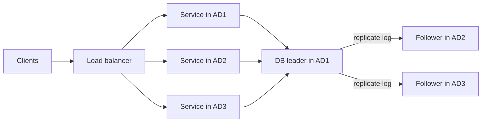
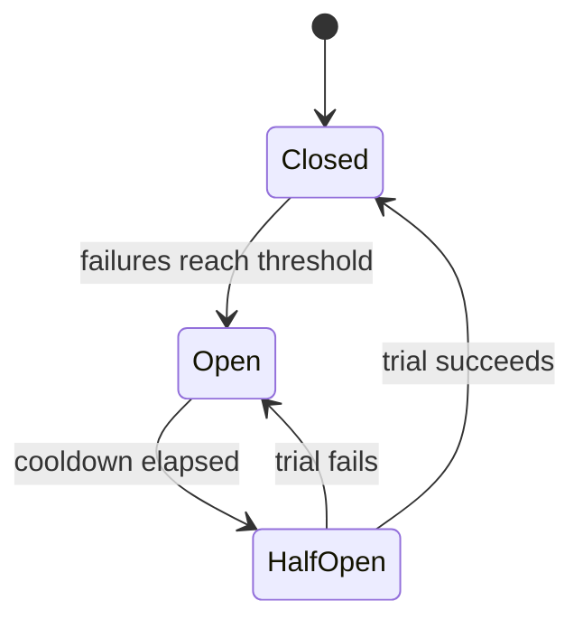
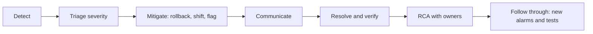
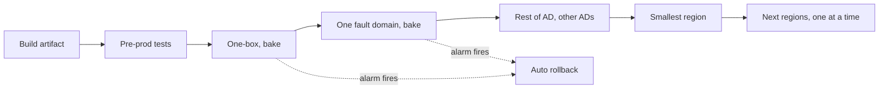

# 02. JD technical map: every responsibility, the concept, and my evidence

<div class="callout note">
<b>How to use this page</b>
<ul>
<li><b>What it covers:</b> every responsibility line in the OCI job description, explained in plain English, with the concepts a strong answer needs and the real evidence from my own projects.</li>
<li><b>When to read it:</b> two or three days before the loop, and again the night before the hiring manager or bar raiser round. Reliability, operations and security questions can come up in any round.</li>
<li><b>What to memorise:</b> the OCI vocabulary table in section 0, the incident response sequence in section 5, the safe deployment waves in section 12, and the "honest bridge" lines, which are what I say when my experience is thinner.</li>
<li><b>How to practise:</b> read a section, close the page, and say the "Speakable answer" out loud in under 90 seconds.</li>
</ul>
</div>

<div class="callout highlight">
<b>What the tags mean.</b> <b>MEASURED</b> means there is a log, document or code behind the number. <b>ESTIMATED</b> means arithmetic I can show on a whiteboard ("roughly, derived from..."). <b>TARGET</b> means a design goal, so I say "targeting". <b>HISTORICAL</b> means it comes from my past work records. <b>Verbal / off PDF</b> means it is true and I can talk about it, but it is not printed on my resume, so I never lead with it.
</div>

**Why this page exists.** An OCI (Oracle Cloud Infrastructure) job description is unusually heavy on reliability, operations, security and change management. For each JD line this page gives four things: what the line means, what a strong answer covers, my real evidence, and an honest bridge where my experience is thinner. OCI interviewers respect "I haven't operated X, here is how I would do it, and here is the closest thing I did." They do not respect bluffing.

Related pages: [system design fundamentals](04_system_design_fundamentals.md), [system design questions](04_system_design_questions.md), [projects deep dive](07_projects_deep_dive.md), [concurrency](06_concurrency.md).

---

## 0. OCI vocabulary you should use naturally

**In plain English.** Oracle's cloud is organised as nested boxes of failure. A region is a city-sized area. Inside it are availability domains, which are separate data centers. Inside each of those are fault domains, which are groups of racks. Every good OCI answer says which box a failure stays inside. Think of it like an apartment building: if one flat's fuse blows (fault domain), the floor is fine; if the whole building loses power (availability domain), the neighbouring building still has power; if the whole city floods (region), another city keeps serving.

| Term | Meaning | Why it matters in answers |
|---|---|---|
| **Region** | A geographic area with one or more availability domains | Deploys go region by region. Data residency rules are per region |
| **Availability Domain (AD)** | One or more isolated data centers in a region, each with independent power, cooling and network | Replicate across ADs for high availability. A quorum across 3 ADs survives one AD loss |
| **Fault Domain (FD)** | A grouping of hardware inside an AD. There are 3 per AD. Used for anti-affinity | Spread replicas across FDs so one rack or hardware failure does not take everything |
| **Control plane** | The APIs that create or change resources (create a bucket, launch a VM) | Can be somewhat less available, but must be correct and idempotent |
| **Data plane** | The path that serves the resource itself (read an object, route a packet) | Must be highly available and should keep working when the control plane is down |
| **Static stability** | The data plane keeps serving with the last known good configuration if the control plane fails | The single most "OCI" idea to mention |
| **Cell / shard architecture** | Split a service into independent cells, each serving a subset of tenants | Limits blast radius. Deploy cell by cell |
| **Blast radius** | How many customers one failure or one bad deploy can hurt | Every design and deploy answer should shrink it |
| **One-box / canary** | Deploy to one host, then one FD, then one AD, then the region, then the next region, with bake time at each step | Change management answers |
| **Tenancy / compartment** | OCI's multi-tenant isolation units. IAM (Identity and Access Management) policies are written against compartments | Access control answers |
| **COE / RCA** | Correction of Error / Root Cause Analysis. A post-incident review: timeline, root cause (5 whys), action items with owners | Incident answers |

A few definitions in everyday words:

- **Control plane vs data plane.** The control plane is the airline's booking system. The data plane is the plane in the air. If the booking website goes down, planes already flying must keep flying. That is static stability.
- **Idempotent** means doing something twice has the same effect as doing it once. Pressing a lift button five times still calls one lift.
- **Blast radius** is how far the damage spreads. Watertight compartments on a ship exist to keep blast radius small.

---

## 1. System scalability

**JD:** components that support horizontal and vertical scaling, distributed state management, optimizing large-scale data processing, reviewing teammates for scalability, data plane platforms, performance and load testing.

**In plain English.** Scalability means the system keeps meeting its speed and correctness goals when load grows. There are two ways to grow: buy a bigger machine, or add more machines. Most of the hard work is about where the *state* (the data that must be remembered) lives, because stateless code is easy to copy and stateful data is not.

### Words you need

- **Vertical scaling (scale up):** a bigger machine with more CPU and memory. Like replacing a small van with a lorry. Simple, but there is a biggest lorry, it is expensive, and if it breaks, everything stops.
- **Horizontal scaling (scale out):** more machines sharing the work. Like adding more vans. Needs the work to be splittable.
- **Stateless service:** any copy of the service can answer any request, because nothing about the user is kept in that copy's memory. Like a bank counter where any teller can serve you because your record is in the central system.
- **Partitioning (sharding):** splitting data by a key so each machine owns a slice. Like a library that puts authors A to F on floor 1 and G to M on floor 2.
- **Hot key:** one key that gets far more traffic than others, so the machine owning it is overloaded. Like one checkout queue for a celebrity book signing.
- **Bottleneck:** the one resource that saturates first and limits everything else (CPU, memory, disk, locks, connection pool, a downstream dependency).

### What a strong answer covers

- Vertical is simple but has a ceiling and is a single point of failure. Horizontal needs stateless services or partitioned state.
- Make compute stateless. Push state into a store built for it (a database, a cache, a log). Session affinity (pinning a user to one server) is a smell.
- Partition state by a key with high cardinality and even load (tenant, hash of id). Avoid hot keys by salting the key, or by moving a hot tenant into its own cell.
- Scale reads with caches and replicas. Scale writes with partitioning, batching and append-only logs.
- Find the bottleneck before scaling. Otherwise you scale the wrong tier.
- Do a back-of-envelope estimate: QPS (queries per second), payload size, storage per day, fan-out.

**Tiny worked example.** Suppose 50 million requests a day. 50,000,000 / 86,400 seconds is about 580 requests per second on average. If the peak is 5 times the average, that is about 2,900 per second. If one instance comfortably handles 1,000 per second, I need 3 instances at peak, plus one spare per fault domain, so 4 to 6. That is the kind of arithmetic interviewers want to hear.

### My evidence

- **Go/Gin platform at 10k peak RPS (requests per second).** Gin is a lightweight Go web framework. The processes are stateless and sit behind the load balancer. Each process is a self-protecting edge, meaning it enforces its own limits and timeouts with no reverse proxy (like nginx) in front. It speaks native h2c (HTTP/2 over plain TCP without TLS, used inside a trusted network), uses nested context timeouts, and is traced with Datadog. It scales horizontally by adding instances. User identity is cached in Redis through an auth waterfall (Firebase Admin first, then JWT or Google OIDC), so no instance holds session state.
- **ClickHouse rollups: 15.5× faster pivots, from 189 seconds to 12 seconds on a 250M-row harness (MEASURED, 12.3 s rounded).** ClickHouse is a columnar analytics database. A rollup table is a pre-summed copy of the data at a coarser grain. This is "scale reads by precomputing": pay the cost once at load time, then reads are cheap. The six rollup tables are `PARTITION BY season_code` so a query touches only the seasons it needs, and older prep notes also mention bloom filter skip indexes on product, store and attribute columns.
- **Vertical limits, handled.** Separately, a weekly rollup build needed about 170 GB of aggregation state and ran out of memory (OOM). Older prep notes it OOM'd on a machine of about 236 GiB, and it failed even with 80 GB and 200 GB memory caps when building a whole season at once. Instead of buying a bigger box, I shrank the unit of work to one fiscal week per INSERT, with a 55 GB memory cap, 16 GB spill to disk, 8 threads and 4 weeks in flight (verbal knobs). A product week needs about 11 GB and an attribute week needs more than 40 GB, so one week fits. That is the classic "you cannot scale up forever" story.
- **Masters India.** Kafka plus PostgreSQL **sharded by tax quarter** for **1M+ daily government submissions**, with throughput raised **from 700 to 4,000 requests per minute** (about 12 to about 67 requests per second). Older prep also mentions autoscaling workers on queue depth, and queue-based load leveling for filing-deadline peaks of roughly 8 to 10 times average (ESTIMATED).
- **Data processing.** A custom Go data pump copied ClickHouse rollups at **~344k rows per second** combined (an ingest rate, not requests per second), using **500k-row double-buffered batches** (read the next batch while sending the previous one) and no per-row reflection. The Keep/Drop engine processes **88k items per pass** with bounded parallel batches.

**Speakable answer: "How have you scaled a system?"**
> "The clearest example is the Go/Gin platform at Impact Analytics, which serves 10k peak requests per second. I kept the processes stateless, with identity resolved from the token and cached in Redis, so scaling is just adding instances. Reads were the real problem, because planner pivots were slow, so I precomputed six ClickHouse rollup tables and pivots went from 189 seconds to 12 seconds on a 250-million-row harness. And when a weekly rollup build ran out of memory at about 170 GB, I did not buy a bigger box. I sliced the work into one fiscal week per insert with memory and spill caps. That taught me to shrink the unit of work before scaling up."
>
> *Follow-up they may ask:* "Is the 15.5× because you fixed the OOM?" No. 15.5× is query time for pivots. The 170 GB OOM was load time for weekly builds. They are separate problems.

### Performance and load testing: how I answer

**In plain English.** Load testing means sending fake but realistic traffic to find out how fast the system is and how it breaks. The key word is realistic. Uniform random keys hide hot-key problems that real traffic will expose.

1. **Define the SLO first.** An SLO (Service Level Objective) is the target, for example "p99 latency under 200 ms at 5,000 QPS". p99 means 99% of requests are faster than this number.
2. **Build a realistic workload.** Use production-shaped payloads and key distributions, including hot keys.
3. **Run four shapes of test.** Step load (ramp up gradually), soak (hours at steady load, looking for memory leaks), spike (sudden 10× jump), and stress (push to breaking point to learn *how* it fails).
4. **Measure** p50, p95 and p99 latency, saturation (CPU, memory, connection pool usage, garbage collection) and downstream latency.
5. **Compare like with like.** My row-identical harness for Postgres vs ClickHouse used the same 250M rows and the same query, and checked the results matched. That is why the 15.5× is not a benchmark trick.
6. **Put a performance regression check in CI** for critical paths.

Tools to name: k6, Locust (Python), vegeta and ghz (Go, gRPC), wrk. In Go, `pprof` for CPU and heap profiles and `go test -bench` for micro-benchmarks.

### Reviewing peers for scalability ("What do you look for in code review?")

**Speakable answer.**
> "I look for anything unbounded first, because that is what breaks at 10×. Loops over user input, queues without a size limit, a SELECT without a LIMIT, goroutines spawned per item, and retries without a cap. Then I look for N+1 queries and missing indexes, anything holding a lock or a database connection across a network call, and outbound calls without timeouts. In hot paths I look for per-request allocations like reflection or JSON encoding in a loop. And I always ask whether any new state can be partitioned, and what happens at 10 times the load."

- Unbounded things: loops over user input, unbounded queues, `SELECT` without `LIMIT`, unbounded goroutines, retries without caps.
- N+1 queries (one query for a list, then one more query per item), missing indexes, full scans.
- Anything holding a lock or connection across a network call.
- Missing timeouts on outbound calls.
- Per-request allocations in hot paths (reflection, JSON in a loop).
- Is the new state partitionable? What happens at 10×?

---

## 2. Reliability design: redundancy, replication, automatic failover, in-service updates

**JD:** fault-tolerant components that withstand in-service updates, redundancy, replication, automatic failover.

**In plain English.** Reliability means customers do not notice when parts break or when we deploy. You get it by having spare capacity, keeping copies of data in different places, switching to a healthy copy automatically, and deploying in a way that never takes everything down at once.

### Words you need

- **Redundancy (N+1, N+2):** run one or two more copies than you need, so losing one is invisible. Like carrying a spare tyre.
- **Replication:** keeping copies of the same data on several machines.
- **Leader-follower replication:** one machine (the leader) accepts writes and the others copy its log. Like one teacher writing on the board and students copying.
- **Quorum:** a majority vote. With N copies, a write is safe when W copies confirm, and a read is fresh when R copies answer, as long as R + W > N.
- **RPO (Recovery Point Objective):** how much recent data you can afford to lose. **RTO (Recovery Time Objective):** how long you can be down.
- **Split brain:** two machines both believe they are the leader and both accept writes. Like two captains steering one ship.
- **Fencing token:** an increasing number handed out with leadership. Storage rejects writes carrying an old number, so a stale leader cannot corrupt data.
- **Expand/contract migration:** change a schema in safe steps (add the new thing, move to it, then remove the old thing) so old and new code both work during a deploy.

### What a strong answer covers

- **Redundancy:** N+1 or N+2 capacity so losing one instance, FD or AD does not breach the SLO. Spread across fault domains and ADs.
- **Replication:** leader-follower (simple, needs failover), multi-leader (conflicts to resolve), leaderless quorum (R + W > N). Synchronous replication costs latency. Asynchronous replication risks losing recent writes on failover, which means RPO greater than zero.
- **Automatic failover:** health checks detect the failure, leader election picks a new leader (Raft, etcd or ZooKeeper leases), fencing tokens stop the old leader from writing, and clients re-resolve where the leader is. Failover must be **tested regularly** or it will not work when needed.
- **In-service updates:** rolling deploys with connection draining, backwards-compatible schemas (expand, migrate, contract), feature flags, versioned APIs, and readiness probes that gate traffic.
- **Static stability:** the data plane keeps serving with last known config if the control plane dies.



*What to notice:* stateless service copies in every AD, one leader for writes, followers in the other ADs ready to be promoted if AD1 fails.

### My evidence

- **Idempotent, replay-safe writes.** `ReplacingMergeTree` is a ClickHouse table type that keeps only the newest version of rows that share the same key. Think of a notebook where you never erase, you just write the new value below, and a cleaner later crosses out the old lines. So a retried batch or an overlapping wave never creates duplicates. Reads use `argMax` or `LIMIT 1 BY` to pick the latest version before the cleaner has run.
- **SHA-256 natural keys (Uber FRM, via EPAM).** A natural key is an ID computed from the content itself, for example `uuid = SHA-256(question_text + normalized page_name)`. Reloading the same source data produces the same keys, so a reload becomes an upsert (update if present, insert if not) instead of a duplicate.
- **Optimistic row locking (FRM).** Each row has a version number. An update says "only if the version is still 7". If someone else changed it first, my update touches zero rows and fails loudly instead of silently overwriting.
- **Zero-downtime migration (Masters India).** The strangler pattern (wrap the old system and replace it route by route, like a fig vine slowly replacing a tree) behind the gateway, a canary per route, and rollback through gateway config. Sharing the database during cutover avoided dual writes.
- **Stacked Bazel PRs (FRM).** Bazel is Uber's build system. Stacked PRs are a chain of small pull requests that each land safely on their own, so changes ship in small reversible steps.

**Speakable answer: "How do you design for failover?"**
> "I make the application side safe for failover, because that is what I have owned. Writes are idempotent, so a client that retries after a failover does not create duplicates. At Uber I used SHA-256 natural keys so reloads became upserts, and in ClickHouse I used ReplacingMergeTree so a retried batch collapses to one version. Every outbound call has a timeout, so clients do not hang on a dead leader. And long jobs checkpoint, so they resume instead of restarting."

### Honest bridge

> "I haven't personally run a leader election or operated a multi-AD failover. Managed services (Cloud SQL, ClickHouse Cloud replicas) handled that for my systems. What I own is the application side of failover: idempotent writes so retries after failover don't duplicate, timeouts so clients don't hang on a dead leader, and replay from checkpoints or a log. For a design at OCI I'd use Raft-based replication across 3 ADs, fencing tokens, and regular game days."

---

## 3. Recovery-oriented computing (ROC), retries, circuit breakers, timeouts

**In plain English.** Recovery-oriented computing accepts that things will fail and focuses on recovering fast. The goal is to make MTTR (mean time to recover) small, not only to make MTBF (mean time between failures) large. A good fire brigade matters as much as fireproof walls.

### ROC principles

1. **Fast, safe restart.** "Crash-only software" means the only way to stop is to crash, and the only way to start is the recovery path. So the recovery path is always tested.
2. **Isolation and partitioning** so failures stay small (bulkheads, cells).
3. **Undo and rollback** for operator actions and data.
4. **Checkpoints** so work resumes instead of restarting from zero. Like a video game save point.
5. **Fault injection** to test recovery paths on purpose.
6. **Diagnosis aids:** tracing and correlation IDs (one ID that follows a request everywhere).

### My evidence, mapped to ROC

| ROC principle | What I built |
|---|---|
| Checkpoint and resume | Orchestration registry: deterministic results land first (`det.json`), LLM progress is appended per article (`agent_progress.json`). `--resume` skips finished work and never recomputes the deterministic phase. |
| Crash-safe unit of work | Go copier: the unit is one `season_code` partition. An incomplete season means DROP PARTITION and recopy. On SIGINT (Ctrl+C) it finishes the batch and does not checkpoint. |
| Truth from the system, not the client | Loader success means a `QueryFinish` row in ClickHouse's `system.query_log`, not the curl exit code. An HTTP client can time out after the server has already committed. |
| Isolation | A file lock (flock) per table. A circuit breaker per provider. Tenant scope frozen per WebSocket. |
| Undo | Config-based rollback at Masters. A frozen `config_hash` on every output row so any bad run can be identified and re-run. |
| Dead-letter | Masters DLQ (dead-letter queue): poison batches are parked for operator replay. |

The `config_hash` is a SHA-256 of the guardrails, parameters, prompts and catalog, frozen at the start of a run and stamped on every output row. It is like a batch number printed on medicine packaging. If one batch is bad, you know exactly which rows came from it.

### Timeouts

**Plain words:** a timeout is the longest you are willing to wait. Without one, a slow dependency holds your threads and connections hostage.

- Every outbound call has a timeout. Set it from the dependency's p99.9 latency, not a guess.
- **Deadline propagation:** in Go, `context.WithTimeout` at the edge, passed down, so inner calls get the *remaining* budget. That is what "nested timeouts" means on my resume.
- Timeouts must **decrease** as you go inward (edge 10 s, service 8 s, database 5 s). Otherwise the outer layer gives up while the inner one keeps burning resources on a result nobody will read.

```go
// Edge sets the total budget; every inner call inherits what is left.
func handler(c *gin.Context) {
    ctx, cancel := context.WithTimeout(c.Request.Context(), 10*time.Second)
    defer cancel()
    rows, err := repo.Query(ctx, q) // DB call gets at most the remaining time
    // ...
}
```

### Retries

**Plain words:** a retry is trying again after a failure. It helps with brief glitches and hurts badly when the dependency is overloaded, because retries add more load.

- Only retry **idempotent** operations, or make them idempotent with idempotency keys.
- Use **exponential backoff with jitter**. "Full jitter" is `sleep = random(0, min(cap, base × 2^attempt))`. Jitter spreads clients out so they do not all retry at the same instant.
- **Cap** attempts, and use a **retry budget** (for example, retries no more than 10% of requests) to avoid retry storms.
- Retry at **one** layer only. Three layers each retrying 3 times gives 3 × 3 × 3 = 27 times amplification.
- Do not retry 4xx client errors, except 429 (Too Many Requests) with a `Retry-After` header.

**Worked example of backoff:** base 100 ms, cap 2 s. Attempt 0 waits up to 100 ms, attempt 1 up to 200 ms, attempt 2 up to 400 ms, attempt 3 up to 800 ms, attempt 4 up to 1.6 s, and attempt 5 and later up to 2 s.

### Circuit breaker

**Plain words:** a circuit breaker is like the fuse box in your house. When a dependency keeps failing, the breaker "trips" and you stop calling it for a while, which protects both you and it. After a cool-off you let one test call through.

- **Closed:** normal, count failures. **Open:** fail fast for a cool-off period. **Half-open:** let a few trial requests through; success closes the breaker, failure reopens it.
- Trip on consecutive failures, or on failure rate over a window with a minimum request count (so 1 failure out of 1 request does not trip it).
- **Fallback** when open: cached value, default, degraded response, or fail fast with a clear error.
- My orchestration registry trips after **about 5 consecutive failures or a fail fraction**. When open, articles get the **deterministic baseline score** (graceful degradation) and the run still finishes.



*What to notice:* there is no path from Open straight to Closed. You always test with a trial first.

### Bulkheads and load shedding

- **Bulkhead:** separate pools per dependency, so one slow dependency cannot eat all threads or connections. Named after the walls between compartments in a ship's hull.
- **Load shedding:** reject early (at admission) with 429 or 503 when queues are too deep. Serving everyone slowly is worse than rejecting some quickly.

### Go sketch for "timeout plus retry plus breaker" (they may ask you to write it)

**Plain words first.** `Breaker` counts failures under a mutex. Once the count hits the threshold it sets `openUntil` and refuses calls until that time. `CallWithRetry` gives each attempt its own 2-second timeout, stops immediately if the breaker is open, and sleeps a jittered, growing backoff between attempts while respecting the caller's overall deadline. This is simplified: after the cooldown it lets all traffic back in, whereas a true half-open state lets only one trial through (see the Python version in [LLD problems](05_lld_problems.md) section 8).

```go
type Breaker struct {
    mu        sync.Mutex
    failures  int
    threshold int
    openUntil time.Time
    cooldown  time.Duration
}

var ErrOpen = errors.New("circuit open")

func (b *Breaker) Do(ctx context.Context, fn func(context.Context) error) error {
    b.mu.Lock()
    if time.Now().Before(b.openUntil) {
        b.mu.Unlock()
        return ErrOpen
    }
    b.mu.Unlock()

    err := fn(ctx)

    b.mu.Lock()
    defer b.mu.Unlock()
    if err != nil {
        b.failures++
        if b.failures >= b.threshold {
            b.openUntil = time.Now().Add(b.cooldown) // half-open after cooldown
            b.failures = 0
        }
        return err
    }
    b.failures = 0
    return nil
}

func CallWithRetry(ctx context.Context, b *Breaker, attempts int, fn func(context.Context) error) error {
    base, maxBackoff := 100*time.Millisecond, 2*time.Second
    var err error
    for i := 0; i < attempts; i++ {
        cctx, cancel := context.WithTimeout(ctx, 2*time.Second)
        err = b.Do(cctx, fn)
        cancel()
        if err == nil || errors.Is(err, ErrOpen) {
            return err
        }
        backoff := time.Duration(rand.Int63n(int64(min(maxBackoff, base<<i))))
        select {
        case <-time.After(backoff):
        case <-ctx.Done():
            return ctx.Err()
        }
    }
    return err
}
```

**Speakable answer: "Tell me about a circuit breaker you built."**
> "In the AssortSmart orchestration registry, every LLM provider call goes through a hard timeout and a circuit breaker per provider. The breaker trips after about five consecutive failures or a failure fraction. When it is open, the article gets its deterministic baseline score instead of an LLM score, so the run still finishes and the telemetry shows how many items fell back. I chose degrade-and-finish over fail-the-run because a planner would rather have a complete, slightly less nuanced result than nothing."
>
> *Follow-up they may ask:* "How do you know the fallback isn't hiding a problem?" The per-run JSON telemetry records batch fallbacks, so a high fallback rate is visible. I would alarm on it (see section 4).

---

## 4. Tests, alarms, dashboards, telemetry

**In plain English.** You cannot run what you cannot see. Telemetry is the data a system emits about itself (logs, metrics, traces). Dashboards show it. Alarms wake a human only when customers are hurting. Tests stop bad changes before they ship.

### Words you need

- **SLI (Service Level Indicator):** a measured number, like "percent of requests under 200 ms".
- **SLO (Service Level Objective):** the target for that number, like "99.9%".
- **Error budget:** the failure you are allowed. 99.9% availability means 0.1% may fail, about 43 minutes a month (0.001 × 30 × 24 × 60 = 43.2). When the budget is burnt, you freeze risky launches.
- **Burn rate:** how fast you are spending the error budget. A burn rate of 1 uses exactly the whole budget in the window. A burn rate of 14.4 uses 2% of a 30-day budget in one hour (14.4 / 720 hours = 0.02).
- **Four golden signals:** latency, traffic, errors, saturation. **RED** for services: rate, errors, duration. **USE** for resources: utilization, saturation, errors.
- **Distributed trace:** a record of one request as it hops across services, like a parcel tracking history.
- **Correlation ID:** one ID attached to a request and copied into every log line, so you can search one ID and see the whole story.

### What a strong answer covers

- SLIs (availability, p99 latency, error rate, freshness), SLOs (targets), and error budgets.
- **Alarms on symptoms** (customer impact), not causes. Page only when a human is needed now. Everything else is a ticket.
- **Multi-window burn-rate alerts.** For example, page if the 1-hour burn rate is above 14.4 *and* the 5-minute burn rate is above 14.4. The long window proves it is real, the short window proves it is still happening.
- **Canaries / synthetic probes:** a script that calls your API like a customer, from outside, all the time.
- Dashboards: one top-level "is it healthy?" page, then drill-downs per dependency, with deploy markers on graphs.
- Telemetry: structured logs with correlation IDs, metrics (counters, histograms), distributed traces.
- Tests: unit, integration, contract, end-to-end, load, chaos. Alarms themselves should be tested.

### My evidence

- **Masters India.** I built ELK (Elasticsearch, Logstash, Kibana: a log search stack) plus New Relic (a tracing and monitoring service) alerting on error rate and latency, with structured JSON logs and request IDs across services and workers. Incident triage became **70% faster (ESTIMATED, about 30 minutes to under 10 minutes)**. Older resumes also said support tickets fell 35%. That number is not on the current resume, so don't quote it.
- **AssortSmart (Impact Analytics).** Datadog distributed tracing on the Go edge. **Per-run JSON telemetry** in the orchestration registry: tokens, USD cost, step duration and batch fallbacks. Every output row is stamped with a frozen `config_hash`. LangSmith (LangChain's tracing tool for LLM apps) traces on Ask Iris only.
- **Tests as guardrails.** A **300-case proxy evaluation harness** with an **80% accuracy CI gate**. This is a promotion gate, not live accuracy for every tenant. Coverage **from 35% to 82%** at Masters. **100% module statement coverage** on the FRM ORM migration at Uber (on the PDF). The IA Go platform's 100% statement coverage is verbal / off PDF.
- **Alarms I would define for the Keep/Drop engine:** fallback rate above a threshold in a run (provider degraded), cost per 1k items above budget, and run duration p95.

**Speakable answer: "How do you know your system is healthy?"**
> "I start from what the customer feels, so the first alarms are on error rate and latency, not CPU. At Masters India I set up ELK and New Relic with structured JSON logs and a request ID that followed an invoice across services and workers, and that cut incident triage by about 70%, roughly from 30 minutes to under 10. On AssortSmart, every batch run writes JSON telemetry with tokens, cost, step duration and fallbacks, and every output row carries a config hash. So if results look wrong, I can tell exactly which configuration produced them."

Honest line: "I built alerting and dashboards and was on the escalation path at Masters. I don't claim a formal pager rotation title."

---

## 5. Runbooks, incident response, RCA

**In plain English.** An incident is when customers are hurt now. The first job is to stop the hurt (mitigate), not to understand it. Understanding comes after, in a blameless review that produces fixes with owners. A runbook is the recipe card on-call engineers follow at 3 a.m.

### Incident response flow (say this as a sequence)

1. **Detect:** an alarm or a customer report. Acknowledge it.
2. **Triage:** set severity by customer impact and blast radius. Open an incident channel. For big incidents, assign roles: incident commander, communications, operations.
3. **Mitigate first, root-cause later:** roll back the last change, shift traffic away from a bad AD or cell, scale up, flip a feature flag, or shed load. "What changed?" is the first question.
4. **Communicate:** status updates on a fixed cadence, and a customer-facing status page if external.
5. **Resolve and verify:** metrics are back to baseline.
6. **RCA / COE:** timeline, impact, 5 whys, what went well and badly, **action items with owners and dates**. Blameless means you fix mechanisms, not people.
7. **Follow through:** track action items to done. Add the alarms and tests that would have caught it.



*What to notice:* mitigation comes before root cause. Interviewers listen for that ordering.

### Runbook structure

- **Symptom / alarm name**, what it means, customer impact.
- **Dashboards and queries** to check (links).
- **Diagnosis tree:** if X, go to step N.
- **Mitigation steps** as copy-pasteable, idempotent commands. Prefer scripts over manual steps, because people make mistakes under pressure (OCI's "Choose safety" value).
- **Rollback steps.**
- **Escalation:** who, and when.
- **Verification:** how to know it is fixed.

### My real incident story (use for "walk me through an incident")

**The 64.1M-row half-loaded partition (ClickHouse rollup loader).**

- **Detect:** counts did not reconcile between the product and store rollups at the same filters.
- **Diagnose:** a failed HTTP INSERT into ClickHouse still commits the blocks it already wrote. My resume check, "skip the season if its partition already has rows", treated a partial partition as done.
- **Mitigate:** DROP PARTITION for that season and rebuild it.
- **Root cause:** the success signal came from the wrong place (row existence or the client's exit code).
- **Fix:** a TSV ledger of finished `(kind, season_code)` pairs. Success means a `QueryFinish` entry in `system.query_log`. No ledger entry means drop and rebuild.
- **Prevent:** a failure catalog entry, "never use `count() > 0` as success", plus a parity check that `sum(product) = sum(store) = sum(attr)` at the same filters.

**Speakable version.**
> "One weekly rollup season reconciled wrong between the product and store tables. I found that a failed HTTP insert into ClickHouse had still committed part of its data, about 64 million rows, and my loader's resume logic saw rows in the partition and treated it as finished. I mitigated by dropping that partition and rebuilding it. The root cause was trusting the wrong success signal, so I changed the loader to record success in a ledger only after ClickHouse's own query log showed the insert finished, and I added a parity check across the three rollups. The lesson I took is that data being present is not the same as the job having succeeded."

I also wrote a failure catalog for the copier with 9 entries: OOM, half-written partition, client timeout after commit, EOF, retrying a spent batch, TLS reset, IP allowlists, oversubscription, and secrets handling. That is effectively a runbook.

Other options: the Masters **double-filing near-miss** review (it became the team's incident template) and the **timeout canary rollback**. Details for both are in [projects deep dive](07_projects_deep_dive.md) and [core values STAR](01_core_values_star.md).

---

## 6. Fault injection and brown-out testing

**In plain English.** Fault injection means breaking things on purpose to prove the recovery works, like a fire drill. A brown-out is a partial failure: the dependency is slow, or fails some requests. Brown-outs are harder than clean outages, because the system has to decide when to give up.

### Concepts

- **Fault injection:** kill an instance, add latency, drop packets, return 500s, fill a disk, expire certificates, skew a clock. Start in test, then staging, then small production experiments with an abort switch.
- **Brown-out:** a slow dependency, or one failing 20% of requests. Timeouts, retries and breakers must all behave together. Brown-outs cause most real cascades (retry storms, thread pool exhaustion).
- **Game days:** scheduled exercises where a team practises an incident using its runbooks.
- Tools: Chaos Monkey-style instance kills, `tc netem` for latency and packet loss, Toxiproxy between a service and its dependency, and fault flags in code.

### What I would test for my systems (strong because it is specific)

| Fault | Expected behaviour | Where my design handles it |
|---|---|---|
| LLM provider returns 504 for 20% of calls (brown-out) | Timed-out batches fall back to the deterministic score. The breaker opens after its threshold. The run finishes. Telemetry shows the fallback rate | Orchestration registry |
| Process killed mid-run | `--resume` reloads `det.json` and skips finished articles | Checkpoints |
| ClickHouse INSERT fails midway | The partition is not in the ledger, so it is dropped and rebuilt | Loader ledger |
| Copier TLS reset | The copier crashes. The season is not checkpointed. A rerun recopies it | Copier |
| IRP slow (Masters) | Async 202 Accepted, bounded concurrency, backoff with jitter, DLQ after max attempts | Bulk pipeline |
| Redis down | Auth falls through the waterfall to the source of truth. Latency goes up, but no errors | Auth cache-aside |

IRP is the government Invoice Registration Portal. It returns an IRN (Invoice Reference Number) and a signed QR code for each valid e-invoice.

**Speakable answer: "How would you test resilience in your system?"**
> "I would start with a brown-out, not a clean outage, because that is what really happens. For the Keep/Drop engine I would make the LLM provider return 504 for 20% of calls and check three things: timed-out batches fall back to the deterministic score, the breaker opens, and the run still completes with the fallback rate visible in telemetry. Then I would kill the process mid-run and confirm `--resume` skips finished work without recomputing the deterministic phase."

---

## 7. Replication, synchronization, data integrity

**In plain English.** When data lives in several places, the copies drift. Synchronization is how they catch up. Integrity checks prove the copies, and any derived tables, still agree with the source.

### Concepts

- Replication modes and consistency levels are in [fundamentals](04_system_design_fundamentals.md) section 6.
- **Synchronization techniques:**
  - **CDC (change data capture):** stream every committed change out of a database's log. Like subscribing to a bank statement instead of re-reading your whole account.
  - **Log shipping:** copy the database's write-ahead log to a replica.
  - **Anti-entropy with Merkle trees:** a tree of hashes lets two replicas find which ranges differ by comparing a few hashes, instead of comparing every row.
  - **Read repair:** when a read finds a stale replica, fix it on the spot.
  - **Hinted handoff:** if a replica is down, another node holds its writes and hands them over later.
  - **Version vectors / last-writer-wins (LWW):** ways to resolve conflicts. LWW depends on clocks, which drift, so it can lose writes.
  - **CRDTs (conflict-free replicated data types):** data types designed so merges always converge, like a counter where each node only increments its own slot.
- **Integrity checks:** checksums per block or object (end to end), row counts and sums per partition, parity checks between derived and source data, and periodic scrubbing (background re-verification).

### My evidence

- **Parity validation** in ClickHouse: `sum(product)` vs `sum(store)` vs `sum(attr)` at the same filters. Store totals are re-weighted to match SKU sums. Older prep notes that earlier season-grain parity showed 0% difference across seasons 1 to 7.
- **Row-identical harness** to verify ClickHouse answers equal Postgres answers on the same 250M rows.
- **SHA-256 natural keys** for idempotent reloads (Uber FRM).
- **Keyed dedup with exactly-once catalog upserts** (Uber Menu: Kafka plus Apache Flink). Say this honestly: end to end it is at-least-once delivery plus idempotent upserts. I do not claim zero message loss or two-phase commit across third parties.

```sql
-- Parity check: the three rollups must agree at the same grain
SELECT
  (SELECT sum(units) FROM rollup_product WHERE season_code = 'S1') AS p,
  (SELECT sum(units) FROM rollup_store   WHERE season_code = 'S1') AS s,
  (SELECT sum(units) FROM rollup_attr    WHERE season_code = 'S1') AS a;
-- Expect p = s = a. Any gap means a partial or double load.
```

(Table and column names here are illustrative, not the real schema.)

---

## 8. Zero maintenance windows

**JD:** "ensuring no maintenance windows are required for customers and users when resolving issues."

**In plain English.** Customers should never see "down for maintenance". Every fix and every schema change must be applied while the service keeps serving. It is like repairing a motorway one lane at a time while traffic keeps moving.

### Techniques

- Rolling deploys with connection draining. Blue/green (two full environments, switch traffic). Canary (a small slice first).
- **Expand/contract schema migrations:** add the new column as nullable, dual-write or backfill, switch reads, then drop the old column in a later release. Never rename in place.
- Online index builds. Chunked, throttled backfills.
- Feature flags to turn off a broken path without a deploy.
- Backwards- and forwards-compatible API and message formats: add fields, never repurpose them.
- Config-driven behaviour (hot reload) so fixes do not need restarts.

**Worked example (expand/contract to rename `cust_name` to `customer_name`):**

1. Release 1: add `customer_name` (nullable). Code writes both columns, reads the old one.
2. Backfill `customer_name` from `cust_name` in chunks of, say, 10,000 rows with a pause between chunks.
3. Release 2: read `customer_name`, still write both.
4. Release 3: stop writing `cust_name`.
5. Release 4: drop `cust_name`.

At every step, the previous release still works, so rollback is always safe.

### My evidence

- **Masters strangler migration:** a canary per endpoint, rollback through gateway config, a shared database during cutover (no dual writes), and contract tests that pinned the old PHP responses field by field, so clients saw no payload change.
- **KPI configurator:** new formulas ship as data, without a code release.
- **ClickHouse partition rebuilds:** one season at a time, while the other seasons keep serving. Say this carefully: DROP PARTITION then recopy is **not** an atomic swap with live readers. During the gap that season is missing. The proper design is to build into a scratch table and then `REPLACE PARTITION`. That design was written but not executed.

---

## 9. Automation, troubleshooting tooling, Infrastructure as Code

**In plain English.** Infrastructure as Code (IaC) means servers, networks and permissions are described in files that are reviewed and versioned like application code, instead of being clicked together in a console. Good operational tools are safe to run twice and show you what they will do before they do it.

### Concepts

- **IaC** with Terraform (OCI supports it through the OCI Terraform provider and **Resource Manager**, OCI's managed Terraform service): declarative files, reviewed in PRs, `plan` before `apply`, remote state with locking, modules, and drift detection (noticing when reality no longer matches the files).
- **Immutable infrastructure:** replace servers, do not patch them in place. Like replacing a light bulb instead of rewiring it.
- **Operational tooling** should be **idempotent**, have `--dry-run`, log what it does, and ask for confirmation before destructive steps.

### My evidence

- **Go copier as operational tooling:** a flock (file lock) per table so two copies cannot run on the same table, a checkpoint ledger, a required `-reset` flag for a full truncate, and secrets read only from the environment (never auto-read from a `.env` file, never committed).
- **Generated settings:** weekly rollup memory caps, thread counts and spill settings are generated per build, not hand-typed.
- **CI/CD:** Bazel at Uber, Docker, and CI gates (coverage, evaluation, and SAST/SBOM on IA as a verbal detail). SAST is static application security testing (scanning code for vulnerabilities). SBOM is a software bill of materials (a list of every dependency).
- **Resume flags** (`--resume`) on the batch engine.

### Honest bridge

> "I've written Dockerfiles and CI pipelines and built operational tooling. I haven't been the Terraform owner for a production estate. I know the workflow (modules, remote state with locking, plan in PR, apply from CI), and I'd be comfortable picking up OCI Resource Manager."

More on Terraform as it came up in the real loop: [08c behavioral and Terraform](08c_behavioral_terraform.md).

---

## 10. Security in multi-tenant environments

**In plain English.** Multi-tenant means many customers share the same software and hardware. Security means each tenant can only see its own data, secrets stay secret, and data is protected both on the wire and on disk. It is like an apartment building: shared walls and plumbing, but every flat has its own lock, and the building manager never hands out the wrong key.

### Concepts to cover

- **Encryption in transit:** TLS everywhere, mTLS (mutual TLS, where both sides prove identity with certificates) between services, and certificate rotation.
- **Encryption at rest with envelope encryption.** A data encryption key (DEK) encrypts the data. A key encryption key (KEK) stored in a KMS or HSM (OCI Vault) encrypts ("wraps") the DEK. Rotation re-wraps the DEKs without re-encrypting all the data. Think of putting your house key in a lockbox: you change the lockbox code, not every lock in the house. Customer-managed keys let a customer revoke access.
- **Access control:** authentication (who you are) vs authorization (what you may do). Least privilege, RBAC (role-based) and ABAC (attribute-based) access control, OCI IAM policies on compartments, and short-lived credentials (instance principals instead of static keys).
- **Tenant isolation:** the tenant ID comes from the *authenticated token*, never from request parameters. Enforce it at the data layer (row-level security, per-tenant schemas or keys). Add noisy-neighbour limits (quotas, per-tenant rate limits).
- **Secrets:** never in code or logs. Use a vault. Rotate.
- **Input safety:** parameterized queries, allowlists, and constant-time comparison for secrets (so an attacker cannot learn a key by timing how long a comparison takes).
- **Remediation:** vulnerability scanning (SAST, dependency/SBOM), patch deadlines by severity, and pen-test findings tracked to closure.

### My evidence

- **Auth waterfall on the Go platform.** A Redis-fronted chain: check the Redis cache, then Firebase Admin, then JWT / Google OIDC. API keys are compared in **constant time**. Roles are resolved from PostgreSQL. Isolation here is access control, not encryption.
- **UAM-scoped access** (UAM is User Access Management): multi-tenant data isolation and hierarchy-scoped access control across PostgreSQL and ClickHouse.
- **Multi-tenant scope frozen at the handshake (Ask Iris).** Tenant, hierarchy and `plan_scope` are bound when the JWT is verified on WebSocket connect. Tools cannot widen it later, which prevents cross-tenant leaks.
- **No LLM SQL tool.** The LLM receives JSON payloads only, which removes a whole injection surface.
- **KPI formula compiler.** Allowlisted functions and logical-to-physical column mapping, compiled to **parameterized** SQL. Unknown tokens fail closed (are rejected).
- **Uber FRM:** reporting SQL allowlists and SOX controls.
- **Secrets hygiene:** cloud passwords from environment variables only, never committed.
- **CI:** SAST/SBOM on the IA Go platform (verbal).

```go
// Constant-time API key check: time taken does not depend on how many bytes match.
if subtle.ConstantTimeCompare([]byte(presented), []byte(expected)) != 1 {
    return ErrUnauthorized
}
```

**Speakable answer: "How do you keep tenants apart?"**
> "The rule I follow is that the tenant comes from the verified token, never from a request parameter. On the Go platform the auth waterfall resolves identity and roles, and every query is scoped through the user access hierarchy in both Postgres and ClickHouse. In the Ask Iris copilot, the tenant and plan scope are frozen at the WebSocket handshake, so no tool call later in the conversation can widen them. And the LLM never gets a SQL tool, only JSON payloads we prepared, which removes an injection path entirely."

### Honest bridge on encryption

> "I've used TLS everywhere and managed KMS-backed encryption on cloud databases. I haven't implemented envelope encryption myself. I can explain it and would design with it: per-tenant DEKs wrapped by a KEK in Vault, so revoking a tenant's key crypto-shreds their data."

---

## 11. Compliance and documentation

**In plain English.** Compliance means proving to an outside party (an auditor or a government) that you follow the rules. The proof is evidence: logs, access reviews, change records. Documentation is how a team remembers decisions and how a new person learns the system.

- **SOX (Sarbanes-Oxley, US financial controls law) at Uber FRM:** an audit trail (review status history), FSM gates (a finite state machine, here a 50% delta-variance check that blocks a status transition until someone reviews it), and change control through code review and CI. Older prep notes the output feeds the external auditor's work papers.
- **GST compliance at Masters India:** e-invoices registered with the government IRP. Idempotency prevents double filing, and every record is traceable.
- **Documentation habits:** RFCs (the ClickHouse RFC), failure catalogs, a conventions doc for new services, and the incident review template.
- **For OCI:** know the names SOC 1/2, ISO 27001, PCI DSS, HIPAA and FedRAMP. Compliance means evidence: logs, access reviews and change records.

**Worked example of an FSM gate:** a line item's balance was 100 last quarter and is 160 this quarter. The delta is (160 - 100) / 100 = 60%. That exceeds the 50% threshold, so the status cannot move from Review to Closed until a reviewer records a justification.

---

## 12. Change management: patching, updating, rolling back

**In plain English.** Most outages are caused by changes. Safe change management means every change goes out in small waves, each wave is watched for a while (baked), and a bad wave rolls back automatically before it reaches everyone.

### Safe deployment pipeline (say this for OCI)

1. Code review, then CI (unit, integration, security scans), then build an immutable artifact.
2. Deploy to **pre-prod / integration** and run automated tests.
3. **One-box** in the first production region, then bake (alarms watched automatically).
4. **One fault domain**, then the rest of the AD, then the other ADs, then **the next region**. Start with the smallest, least-used region. Bake at each step. Never deploy to several regions at once.
5. **Automated rollback** when alarms fire during bake.
6. Rollback must be tested. The previous artifact stays deployable. Data migrations must be backwards compatible, so a rollback never needs a data rollback.
7. Change freezes around peak periods (I did this around GST filing deadlines).



*What to notice:* each wave is larger than the last, and every wave has a rollback exit.

### My evidence

- **Masters India:** canary ramps with config rollback, cutover freezes during GST deadline weeks, and **98% deployment success**.
- **Uber FRM:** stacked Bazel PRs for small reversible changes, with the rule "a pure refactor means zero test diff".
- **AssortSmart:** the frozen `config_hash` on every output row makes prompt and config changes auditable and revertible.
- **The 80% evaluation gate** is the promotion gate for AI changes. It is change management for models and prompts.

**Speakable answer: "How do you roll out a risky change?"**
> "Small waves with automatic rollback. At Masters India we moved a PHP monolith to FastAPI one route at a time behind the gateway, with a canary per route and rollback by flipping gateway config, and we froze cutovers during GST deadline weeks. Deployment success was 98%. For AI changes at Impact Analytics, the equivalent is the 80% CI evaluation gate: a new prompt or model does not get promoted unless it passes the 300-case harness. At OCI I would follow the one-box, fault domain, AD, region sequence with bake time at each step."

---

## 13. Distributed state tools (they may name them)

**In plain English.** Different kinds of state need different tools. A tiny, critical fact like "who is the leader" goes in a consensus store. Hot, short-lived data goes in a cache. A history of events goes in a log. Money and metadata go in a relational database. Big analytics go in a columnar store. Big files go in object storage.

| Tool | What it is | When |
|---|---|---|
| etcd / ZooKeeper / Consul | A consensus-backed small key-value store for config, leader election and locks | Coordination, not bulk data |
| Redis / Memcached | In-memory cache, rate-limit counters, short-lived locks | Hot reads, counters |
| Kafka | A durable, partitioned, append-only log | Event streams, replay, decoupling |
| Cassandra / DynamoDB-like | Leaderless or partitioned wide-column stores with tunable consistency | High write volume key-value |
| Oracle DB / MySQL / Postgres | Relational, transactional | Control plane metadata, money |
| ClickHouse | Columnar OLAP (analytics) database | Aggregations over billions of rows |
| Object storage | Immutable blobs, cheap, durable | Data lakes, backups, large payloads |

**What I have used.** Redis, Kafka, PostgreSQL, MySQL, ClickHouse, BigQuery and S3 in production. I know etcd and ZooKeeper conceptually (Raft and ZAB consensus, leases, watches) but have not operated them. DynamoDB is skills-level literacy, not a production ownership claim.

**Speakable answer: "Where would you keep leader election state?"**
> "In a consensus store like etcd or ZooKeeper, not in Redis or the main database. Leader election needs linearizable writes and leases that expire when a node dies, which is exactly what Raft-based stores give you. I would also hand out a fencing token with each lease so storage can reject a paused old leader. I have not operated etcd myself, but I have built the application-side patterns that depend on it, like idempotent writes and checkpointed jobs."
