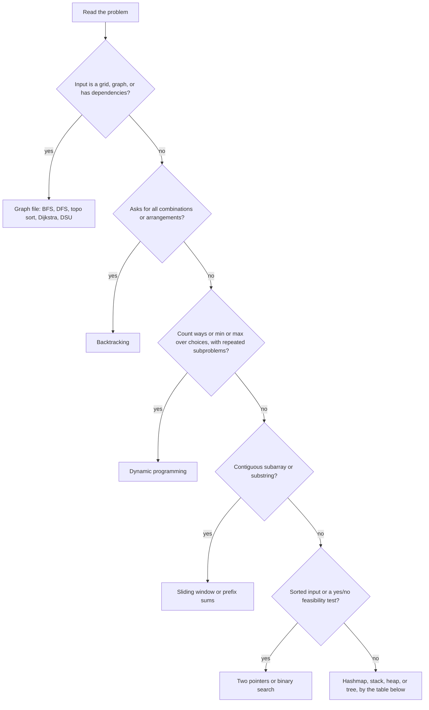

# 03. DSA hub: patterns, how to recognize them, what to practice

<div class="callout note">
<b>How to use this page</b>
<ul>
<li><b>What it covers:</b> how a 45-minute OCI coding round runs, how to spot which pattern a problem wants, a complexity cheat sheet, the Python tools you should reach for without thinking, and the practice list.</li>
<li><b>When to read it:</b> first, before any topic file, and again the morning of a coding round as a warm-up.</li>
<li><b>What to memorise:</b> the eight steps of the round, the "if the problem says X, think Y" table, and the "n versus allowed complexity" table.</li>
<li><b>How the topic files work:</b> every pattern has a plain-English idea, the signals that point to it, a hand-traced example, a template, complexity and common mistakes. Every problem has a one-line restatement, the key insight, a dry run, code, complexity and a 60-second "say it out loud" script.</li>
</ul>
</div>

**Language for solutions: Python.** It is the fastest language to write correctly under time pressure. Go is fine too. Tell the interviewer which one you are using in the first minute. OCI (Oracle Cloud Infrastructure) coding rounds are usually LeetCode medium, sometimes a hard, and often come with a follow-up such as "what if the input doesn't fit in memory?" or "make it thread safe". The thread-safety follow-ups are covered in [concurrency](06_concurrency.md).

## Topic files

1. [Arrays, strings, hashing, two pointers, sliding window, prefix sums, binary search](03_dsa_1_arrays_hashing_search.md)
2. [Linked list, stack, monotonic stack, queue, deque, heap](03_dsa_2_linkedlist_stack_queue_heap.md)
3. [Trees, BST, trie](03_dsa_3_trees_bst_trie.md)
4. [Graphs, BFS/DFS, topological sort, shortest paths, MST, DSU](03_dsa_4_graphs_dsu.md)
5. [Dynamic programming](03_dsa_5_dynamic_programming.md)
6. [Backtracking, greedy, intervals, matrix, bit manipulation, math](03_dsa_6_backtracking_greedy_intervals_matrix_bits.md)

---

## Words you need for every DSA page

- **Big-O (time complexity)** describes how the running time grows as the input grows, ignoring constant factors. O(n) means "double the input, roughly double the time". Think of it as the shape of the cost curve, not the exact seconds.
- **Space complexity** is the same idea for extra memory you allocate, not counting the input itself.
- **Amortized O(1)** means a single operation is occasionally expensive, but averaged over many operations it is constant. A Python list append is like a suitcase that is sometimes repacked into a bigger suitcase. The repack is slow, but it happens so rarely that the average append is cheap.
- **Brute force** is the obvious solution that tries everything. You always state it first because it proves you can get some answer.
- **Invariant** is a fact that stays true at every step of your loop, such as "everything left of `l` is already processed". Saying your invariant out loud is the fastest way to convince an interviewer the code is correct.
- **Dry run** means tracing your code by hand on a tiny input, writing down the variables after each step.
- **Edge case** is an unusual input that often breaks code: empty input, one element, all elements equal, negative numbers, the maximum size.

---

## The 45-minute coding round, step by step

The interviewer is scoring four things: did you understand the problem, can you reason about a better solution, can you write clean working code, and can you test it. The steps below make each of those visible.

1. **Clarify (3 minutes).** Ask about input size, negative numbers, duplicates, whether the input is sorted, what to return if there is no answer, and whether you may modify the input. Example: "Can the array be empty? If there is no valid window, should I return 0 or -1?"
2. **Examples (2 minutes).** Walk one normal case and one edge case by hand. Write them as comments at the top of your code so you can test against them later.
3. **Brute force out loud (2 minutes).** State it and its complexity. Example: "The brute force checks every pair, which is O(n²). With n up to 10⁵ that is 10¹⁰ operations, too slow, so I need O(n log n) or better."
4. **Optimize (5 minutes).** Name the pattern and say why it fits. Example: "This is a sliding window because we want the longest contiguous subarray, and once a window becomes invalid, making it bigger can never make it valid again."
5. **Code (15 minutes).** Use clear names and small helper functions. Avoid clever one-liners. Talk while you type, but keep it short: "Now I shrink from the left until the window is valid again."
6. **Test (5 minutes).** Trace your example through the actual code, line by line. Then try the edge cases: empty, one element, all the same, maximum size.
7. **Complexity (1 minute).** Give time and space with the reason. Example: "O(n) time because each index enters and leaves the window once. O(k) space for the counts."
8. **Follow-ups.** Be ready for scale ("the data is 1 TB"), streaming ("numbers arrive one at a time"), concurrency ("two threads call this") and memory limits.

<div class="callout highlight">
<b>The 60-second explanation template</b> (use it for every problem in the topic files):
<ol>
<li>"The problem is really asking..." (one sentence in your own words).</li>
<li>"The brute force is ..., which costs ..."</li>
<li>"The key observation is ..." (the one insight that removes the wasted work).</li>
<li>"So I ..." (the algorithm in two or three sentences, naming the data structure).</li>
<li>"That's O(...) time because ..., and O(...) space for ..."</li>
<li>"Edge cases I handle: ..."</li>
</ol>
</div>

---

## Pattern recognition

Most interview problems are a known pattern wearing a costume. The skill is reading the problem statement for **signals**: specific words that point to a pattern. The diagram below is the rough order of questions to ask yourself. Notice that the first question is always about the shape of the input.



The table maps signal words to a pattern and to the file that teaches it.

| If the problem says... | Think | File |
|---|---|---|
| "subarray / substring", "contiguous", "longest/shortest with condition" | Sliding window | 1 |
| "sum of subarray equals k", "range sum", "count subarrays" | Prefix sum + hashmap | 1 |
| Sorted array, "pair with sum", "remove duplicates in place" | Two pointers | 1 |
| Sorted, or "minimum X such that feasible(X)" | Binary search (on index or on answer) | 1 |
| "Anagram", "frequency", "seen before", "group by" | Hashmap / counter | 1 |
| "next greater/smaller", "span", "histogram" | Monotonic stack | 2 |
| "Matching brackets", "undo", "evaluate expression" | Stack | 2 |
| "k-th largest", "top k", "merge k sorted", "median of stream" | Heap | 2 |
| "Sliding window max/min" | Monotonic deque | 2 |
| "Cycle in list", "middle", "k-th from end" | Fast/slow pointers | 2 |
| Tree traversal, "path", "depth", "LCA" | DFS recursion (return info up) | 3 |
| "Level by level", "right side view" | BFS on tree | 3 |
| "Prefix", "autocomplete", "word search many words" | Trie | 3 |
| "Shortest path, unweighted", "min steps" | BFS | 4 |
| "Weighted shortest path, non-negative" | Dijkstra | 4 |
| "Dependencies", "ordering", "course schedule" | Topological sort | 4 |
| "Connected components", "union", "redundant edge", "accounts merge" | DSU / union-find | 4 |
| "Number of ways", "min/max cost", "can you reach", overlapping subproblems | DP | 5 |
| "All combinations/permutations/subsets", "place N queens" | Backtracking | 6 |
| "Intervals", "meeting rooms", "merge" | Sort by start + sweep / heap | 6 |
| "Locally best choice works", "schedule to maximize" | Greedy (prove with exchange argument) | 6 |
| "Grid", "islands", "rotate" | Matrix traversal / BFS/DFS on grid | 6, 4 |
| "Single number", "XOR", "power of two", "subsets as masks" | Bit manipulation | 6 |

A quick worked example of reading signals: "Given an array of integers and k, return the number of contiguous subarrays whose sum equals k. Values can be negative." The word "contiguous" suggests sliding window. But "values can be negative" breaks sliding window, because adding a number can make the sum smaller, so the window is no longer monotonic. "Count subarrays with sum k" is the prefix-sum signal. So the answer is prefix sums plus a hashmap (file 1, section B1).

---

## Complexity cheat sheet

A typical judge runs roughly 10⁷ to 10⁸ simple operations per second in compiled languages, and fewer in Python. So the input size tells you which complexity the interviewer expects. Use this table to work backwards from the constraints.

| n | Allowed complexity (~1 second) | Typical technique |
|---|---|---|
| ≤ 10 | O(n!) | Permutations, brute force |
| ≤ 20 | O(2^n) | Subsets, bitmask DP |
| ≤ 500 | O(n^3) | Interval DP, Floyd-Warshall |
| ≤ 5,000 | O(n^2) | Two-sequence DP, all pairs |
| ≤ 10^6 | O(n log n) | Sorting, heap, binary search |
| ≤ 10^8 | O(n) | One pass, hashmap, two pointers |
| larger | O(log n) or O(1) | Binary search, math formula |

Example: "n is up to 10⁵" means O(n²) is 10¹⁰ operations, which is far too slow. You should aim for O(n log n) or O(n).

Costs of the core data structures. "Avg" means average case. Hash tables can degrade when many keys collide, but that is rare with a good hash.

| Structure | Access | Search | Insert | Delete |
|---|---|---|---|---|
| Array / list | O(1) | O(n) | O(n) (O(1) amortized append) | O(n) |
| Hashmap / set | n/a | O(1) avg | O(1) avg | O(1) avg |
| Heap | O(1) top | O(n) | O(log n) | O(log n) pop |
| Balanced BST | O(log n) | O(log n) | O(log n) | O(log n) |
| Linked list | O(n) | O(n) | O(1) at a node | O(1) at a node |
| Trie | n/a | O(L) | O(L) | O(L) |
| DSU | n/a | ~O(α(n)) | ~O(α(n)) union | n/a |

L is the length of the word. α(n) is the inverse Ackermann function, which grows so slowly that it is at most 4 for any input that fits in the universe, so treat it as a constant.

Other costs to say from memory: sorting is O(n log n), and Python's sort (Timsort) is **stable**, meaning equal items keep their original order. Building a heap from a list with `heapify` is O(n), not O(n log n). BFS and DFS are O(V + E), where V is the number of vertices (nodes) and E is the number of edges. Dijkstra with a heap is O((V + E) log V).

---

## Python tools you should use without thinking

```python
from collections import Counter, defaultdict, deque, OrderedDict
import heapq          # min-heap; push -x for max-heap
import bisect         # bisect_left / bisect_right on sorted lists
from functools import lru_cache, cache
from itertools import accumulate, combinations, permutations, product
import math           # math.inf, math.gcd, math.isqrt
```

What each one is for, in one line:

- `Counter(s)` counts items, like a tally sheet. `Counter("aab")` gives `{'a': 2, 'b': 1}`.
- `defaultdict(list)` is a dict that creates an empty list the first time you touch a missing key, so you never write "if key not in d".
- `deque` is a double-ended queue. `popleft()` is O(1), while `list.pop(0)` is O(n) because every other element shifts left.
- `heapq` turns a plain list into a min-heap (smallest item always at index 0).
- `bisect_left(a, x)` returns the first index where `x` could be inserted into sorted list `a` and keep it sorted. `bisect_right` returns the index after any existing copies of `x`.
- `@cache` remembers the result of a function for each argument, which turns plain recursion into top-down dynamic programming.
- `accumulate([1, 2, 3])` gives running totals `[1, 3, 6]`, which is a prefix sum.

Habits that avoid common bugs:

- `heapq.heappush(h, (priority, tiebreak, item))`. Add a tiebreak counter if items aren't comparable. Without it, two equal priorities make Python compare the items, and a `ListNode` cannot be compared, so it raises `TypeError`.
- `deque.popleft()` is O(1); `list.pop(0)` is O(n). Using `pop(0)` inside a loop silently turns O(n) into O(n²).
- Recursion limit: Python stops at about 1,000 nested calls by default. Use `sys.setrecursionlimit(10**6)` or convert to an iterative loop for deep DFS, such as a linked-list-shaped tree with 10⁵ nodes.
- `@cache` on a nested function is the fastest way to write top-down DP. Define it inside the solving function so the cache is cleared for every new test case.

---

## Top 100 list (do in this order, grouped)

Work through these by group, because doing five problems of one pattern in a row trains the recognition reflex. For each problem, try 20 minutes on your own, then read the solution in the topic file, then redo it the next day without looking.

**Arrays and hashing:** Two Sum, Group Anagrams, Top K Frequent, Product of Array Except Self, Longest Consecutive Sequence, Valid Sudoku, Encode/Decode Strings, Subarray Sum Equals K.

**Two pointers:** Valid Palindrome, 3Sum, Container With Most Water, Trapping Rain Water, Sort Colors.

**Sliding window:** Best Time to Buy/Sell Stock, Longest Substring Without Repeating, Longest Repeating Character Replacement, Permutation in String, Minimum Window Substring, Sliding Window Maximum.

**Binary search:** Binary Search, Search in Rotated Sorted Array, Find Min in Rotated, Koko Eating Bananas, Time Based Key-Value Store, Median of Two Sorted Arrays, Capacity to Ship Packages.

**Stack:** Valid Parentheses, Min Stack, Evaluate RPN, Daily Temperatures, Car Fleet, Largest Rectangle in Histogram, Decode String, Asteroid Collision.

**Linked list:** Reverse List, Merge Two Sorted, Linked List Cycle, Reorder List, Remove Nth From End, Copy List with Random Pointer, Add Two Numbers, LRU Cache, Merge K Sorted, Reverse Nodes in K-Group.

**Trees:** Invert, Max Depth, Diameter, Balanced, Same Tree, Subtree, LCA of BST, Level Order, Right Side View, Good Nodes, Validate BST, Kth Smallest in BST, Build from Preorder+Inorder, Max Path Sum, Serialize/Deserialize.

**Trie:** Implement Trie, Add and Search Words, Word Search II.

**Heap:** Kth Largest in Stream, Last Stone Weight, K Closest Points, Task Scheduler, Design Twitter, Find Median from Data Stream.

**Graphs:** Number of Islands, Clone Graph, Max Area of Island, Pacific Atlantic, Surrounded Regions, Rotting Oranges, Course Schedule I/II, Redundant Connection, Number of Connected Components, Graph Valid Tree, Word Ladder, Network Delay Time, Cheapest Flights Within K Stops, Min Cost to Connect Points, Alien Dictionary, Accounts Merge.

**DP:** Climbing Stairs, House Robber I/II, Longest Palindromic Substring, Palindromic Substrings, Decode Ways, Coin Change, Max Product Subarray, Word Break, LIS, Partition Equal Subset Sum, Unique Paths, LCS, Best Time with Cooldown, Coin Change II, Target Sum, Interleaving String, Edit Distance, Burst Balloons, Regular Expression Matching.

**Backtracking:** Subsets, Combination Sum, Permutations, Subsets II, Word Search, Palindrome Partitioning, Letter Combinations, N-Queens.

**Intervals and greedy:** Merge Intervals, Insert Interval, Non-overlapping Intervals, Meeting Rooms II, Jump Game I/II, Gas Station, Hand of Straights, Partition Labels.

**Bits:** Single Number, Number of 1 Bits, Counting Bits, Reverse Bits, Missing Number, Sum of Two Integers.

**OCI-flavored (seen in cloud interviews):** LRU/LFU Cache, Design Hit Counter, Rate Limiter, Time Based Key-Value Store, Merge K Sorted (log merge), Top K Frequent (logs), Meeting Rooms II (resource allocation), Course Schedule (dependency resolution), Word Ladder, Network Delay Time, Snapshot Array, File System design, Logger Rate Limiter.

Why these are "cloud-flavored": each one maps to a real infrastructure task. Merge K Sorted is how you merge log files from many machines in time order. Meeting Rooms II is "how many servers do I need so no job waits". Course Schedule is "in what order do I deploy services that depend on each other". Rate limiters and hit counters protect APIs. If you solve one of these, add one sentence connecting it to the real system, because OCI interviewers like hearing that you see the link. The design versions (LRU, rate limiter, file system) are in [LLD problems](05_lld_problems.md).
