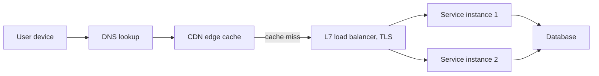
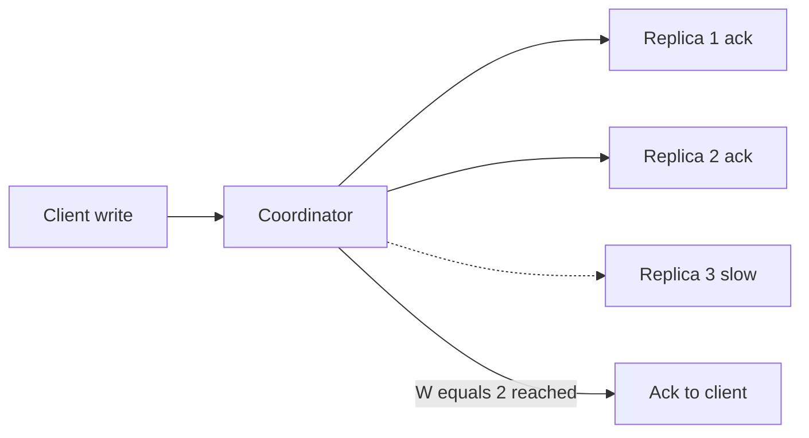
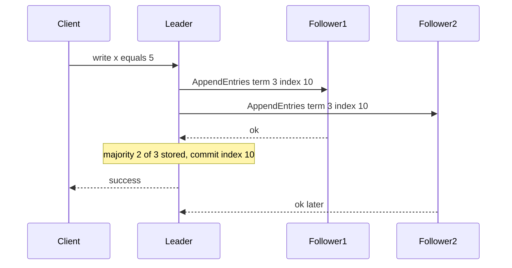
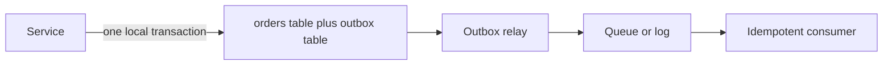
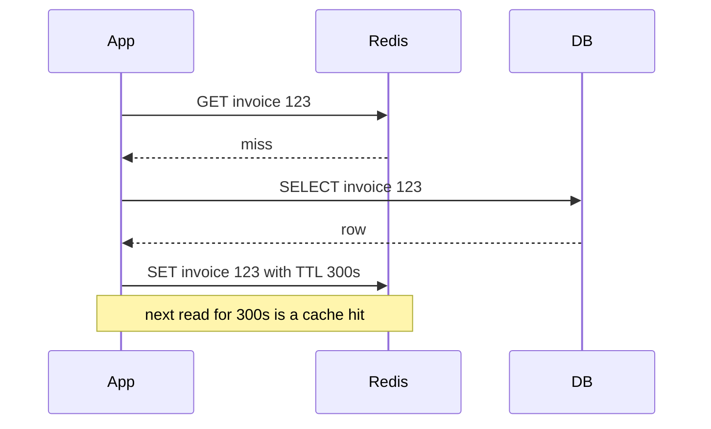
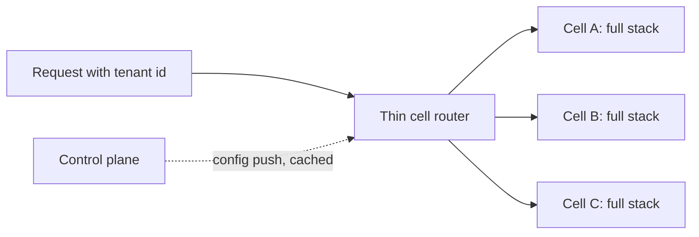

# 04. System design fundamentals: basics to distributed systems

<div class="callout note">
<b>How to use this page</b>
<ul>
<li><b>What it covers:</b> the building blocks you need to <i>reason</i> in a design round, from latency numbers and estimation up to consensus, caching, messaging and cloud-provider patterns. Every term is defined in plain words the first time it appears.</li>
<li><b>When to read it:</b> before the design questions page. Sections 1 to 6 on one day, 7 to 15 on the next. Full worked designs are in <a href="04_system_design_questions.md">04 System design questions</a>.</li>
<li><b>What to memorise:</b> the latency table and conversions (section 1), the consistency models and CAP/PACELC (section 6), Raft in two minutes (section 7), the resilience pattern table (section 8), and the 13 cloud-provider patterns (section 13).</li>
<li><b>My project tie-ins</b> are marked "My use" or "My example" so you can drop a real story into any concept.</li>
</ul>
</div>

<div class="callout highlight">
<b>What the tags mean.</b> <b>MEASURED</b> means there is a log, document or code behind the number. <b>ESTIMATED</b> means arithmetic I can show. <b>TARGET</b> means a design goal. <b>HISTORICAL</b> means from my past work records. Numbers without a tag on this page are general industry rules of thumb for teaching, not claims about my work.
</div>

**In plain English.** A system design interview asks you to sketch how a large service would work: what boxes exist, how data flows between them, and what happens when things break. You do not need to know every product. You need a small set of ideas that combine well: estimate the load, keep compute stateless, split data sensibly, copy it for safety, cache what is hot, queue what can wait, and plan for failure. This page is that set of ideas.

---

## 1. Numbers and estimation

**In plain English.** Before drawing boxes, you estimate how big the problem is. Numbers decide the design. If it is 10 requests per second, one database is fine. If it is 1 million, you need sharding and caches. Interviewers want rough, fast, reasoned arithmetic, not precision.

### Latency numbers (order of magnitude)

Latency is how long one operation takes. These are rough, but the *ratios* are what matter: memory is about 1,000 times faster than an SSD random read, and a cross-region round trip is about 100 times slower than one inside a data center.

| Operation | Time |
|---|---|
| L1 cache | 1 ns |
| Main memory | 100 ns |
| Compress 1 KB (fast codec) | ~2 µs |
| SSD random read | ~16–100 µs |
| Read 1 MB sequential from memory | ~3 µs–10 µs |
| Round trip within a data center (same AD) | ~0.5 ms |
| Read 1 MB sequential from SSD | ~50 µs–1 ms |
| Disk seek (HDD) | ~10 ms |
| Cross-AD round trip (same region) | ~1–2 ms |
| Cross-region round trip | 50–150 ms |

**Analogy.** If reading main memory took 1 second, a same-data-center round trip would take about 1.4 hours, and a cross-region round trip would take about 2 to 17 days. That is why you never put a cross-region synchronous call in a hot request path.

(Arithmetic: 0.5 ms / 100 ns = 5,000, so 5,000 seconds is about 1.4 hours. 50 ms / 100 ns = 500,000 seconds, about 5.8 days. 150 ms gives about 17 days.)

### Useful conversions

- 1 day ≈ 86,400 s ≈ **10^5 s** for quick maths.
- **1M requests a day ≈ 12 per second.** I used exactly this for Masters India: 1,000,000 / 86,400 ≈ 11.6 TPS (transactions per second) on average for 1M+ daily government submissions.
- 1 month ≈ 2.5 × 10^6 s. 1 year ≈ 3 × 10^7 s.
- Peak QPS is usually 2 to 10 times the average. Filing deadlines at Masters were roughly 8 to 10 times average (ESTIMATED).
- Storage per year = writes per second × size × 3 × 10^7 s.
- One server handles roughly 1k to 50k simple HTTP requests per second depending on work per request. Our Go/Gin platform at Impact Analytics serves 10k peak RPS.

### Estimation procedure (2 to 3 minutes, out loud)

1. Users, then DAU (daily active users), then requests per user per day, then average QPS, then peak QPS.
2. Read to write ratio.
3. Object size, then storage per day, then retention, then total (times the replication factor).
4. Bandwidth = QPS × size.
5. Cache memory ≈ 20% of hot data (the 80/20 rule: 20% of items get 80% of reads).

**Worked example (a photo-sharing feature).**

- 10M DAU, each uploads 2 photos and views 50 a day.
- Writes: 10M × 2 = 20M a day. 20M / 86,400 ≈ 230 per second. Peak at 5× ≈ 1,150 per second.
- Reads: 10M × 50 = 500M a day ≈ 5,800 per second. Peak ≈ 29,000 per second. Read to write is 25 to 1, so the read path matters most.
- Storage: 20M × 500 KB = 10 TB a day. One year ≈ 3.65 PB. With 3 replicas that is about 11 PB, which pushes you toward erasure coding (section 4).
- Cache: if the hot set is one day of photos, 20% of 10 TB = 2 TB of cache.

**How to say it.** "Roughly 6k reads per second on average, 30k at peak, and 25 reads per write, so I will optimise the read path with a CDN and cache first."

---

## 2. Scaling

**In plain English.** Scaling is how you handle more load. You can make one machine bigger or add more machines. The trick is that adding machines only works if the work can be split without them needing to talk to each other all the time.

- **Vertical (scale up):** bigger CPU and RAM. Simple, no code change. Hard ceiling, expensive at the top, still one failure domain. Like upgrading to a bigger kitchen oven.
- **Horizontal (scale out):** more nodes. Needs stateless services plus a load balancer, or partitioned state. Near-linear if there is no shared bottleneck. Like adding more ovens and more cooks.
- **Stateless service:** any instance can serve any request. State lives in a DB, a cache or a client token like a JWT (JSON Web Token, a signed bundle of identity claims). *My use:* my Go/Gin platform is stateless. Identity is resolved from the token and a Redis-fronted lookup.
- **Autoscaling:** add or remove instances based on CPU, QPS, or **queue depth**. Queue depth is better for workers because it measures the actual backlog. *My use (older prep detail):* Masters workers scaled on queue depth.
- **Bottlenecks move.** Scale the web tier and the DB connection pool breaks. Scale the DB and a hot partition breaks. Always ask "what is the next bottleneck?"
- **Amdahl's law:** the part of the work that must run serially limits total speedup. If 10% is serial, you can never be more than 10 times faster, no matter how many machines. Locks, single leaders and global counters are serial parts.

---

## 3. Networking and the request path

**In plain English.** A request travels from a user's device to your service through several hops: DNS finds the address, a CDN may answer from nearby, a load balancer picks a healthy server, and a protocol carries the bytes. Each hop can add latency or fail, and each hop is a place to add caching, security or routing.



*What to notice:* the CDN answers many reads before they reach you, and the load balancer is where TLS, routing and rate limits usually live.

- **DNS (Domain Name System):** turns a name into an IP address. Answers are cached for a TTL (time to live). Geo-DNS or latency routing sends users to the nearest region. Health-checked records allow failover. Like a phone book that also knows which branch is open.
- **CDN (Content Delivery Network) / edge cache:** copies of static content and cacheable GETs near users.
- **Load balancers:**
  - **L4 (TCP/UDP):** fast, works per connection, cannot see HTTP content.
  - **L7 (HTTP):** routes by path or header, terminates TLS, can retry and rate-limit.
  - Algorithms: round robin, least connections, least latency (EWMA, an exponentially weighted moving average), consistent hashing (sticky by key), and **power of two choices** (pick 2 random servers, send to the less loaded one; nearly optimal and cheap).
  - Health checks: active (send a probe) and passive (outlier detection on real traffic). Drain connections on deploy.
- **Protocols:**
  - **HTTP/1.1:** one request at a time per connection, so a slow response blocks the ones behind it (head-of-line blocking).
  - **HTTP/2:** many multiplexed streams over one connection, plus header compression. **h2c** is HTTP/2 cleartext (no TLS), used inside trusted networks. *My use:* my Go edge serves native h2c without a reverse proxy.
  - **HTTP/3 / QUIC:** runs over UDP, so no TCP-level head-of-line blocking.
  - **gRPC:** HTTP/2 plus protobuf (a compact binary format), with streaming and built-in deadlines. Good for service-to-service calls. gRPC is skills-level for me, not a production ownership claim.
  - **WebSocket:** a full-duplex (both directions at once) channel over one TCP connection. *My use:* the Ask Iris chat copilot. Scaling it needs sticky routing or a pub/sub backplane.
  - **Long polling / SSE (Server-Sent Events):** simpler one-way server push.
- **TLS:** the handshake costs one round trip with TLS 1.3. Session resumption avoids repeating it. mTLS gives each service a certificate identity.
- **Connection pooling:** reuse TCP/TLS connections instead of opening a new one per request. Like keeping a phone line open instead of redialling. *My example (older prep detail):* at GeeksforGeeks, reusing the SMTP connection cut email send time roughly in half.

---

## 4. Storage

**In plain English.** Different data needs different stores. Money and metadata want strict transactions. Huge key lookups want horizontal scale. Analytics over billions of rows want columnar storage. Big files want object storage. A senior answer picks the store per access pattern and says why.

### SQL vs NoSQL

| | Relational (Oracle DB, MySQL, Postgres) | Key-value / wide-column (Cassandra, DynamoDB-like, Redis) | Document (Mongo) | Columnar OLAP (ClickHouse, BigQuery) |
|---|---|---|---|---|
| Model | Tables, joins, schema | Key to value or row | JSON documents | Columns stored separately |
| Transactions | Full ACID | Per key (usually) | Per document (multi-doc exists) | Weak, append-oriented |
| Scale | Vertical, read replicas, manual sharding | Horizontal by design | Horizontal | Horizontal, scan-optimised |
| Use | Metadata, money, control plane | High QPS lookups, sessions, counters | Flexible payloads | Aggregations over billions of rows |

*My stack across all four:* MySQL (Uber FRM, via EPAM), Postgres (Impact Analytics roles and metadata, Masters India), Redis, MongoDB (Masters invoice payload snapshots, older prep detail), and ClickHouse and BigQuery (analytics).

### Indexes

**Plain words:** an index is like the index at the back of a book. Instead of reading every page, you jump to the right one. It makes reads fast and writes slower, because every write must also update the index.

- **B+ tree:** a balanced, sorted tree. Great for range scans and in-place updates. Read-optimised. Used by Oracle, MySQL InnoDB and Postgres.
- **LSM tree (log-structured merge tree, used by RocksDB and Cassandra):** writes go to an in-memory table plus a WAL (write-ahead log, an append-only safety journal), then flush to sorted files called SSTables, which are merged ("compacted") in the background. Write-optimised. A read may check several levels, and Bloom filters help skip files. Like jotting notes on sticky pads and filing them into folders later.
- **Composite index order matters (leftmost prefix).** An index on `(client_id, invoice_date)` helps `WHERE client_id = ? AND invoice_date > ?` but not `WHERE invoice_date > ?` alone. *My example:* at Masters India, a `(client_id, invoice_date)` index fixed slow invoice lists.
- **Covering index:** the query is answered from the index alone, without reading the table.
- **Cost of indexes:** slower writes and more storage.

### ACID and isolation

**Plain words:** ACID is the promise a transactional database makes.

- **Atomicity:** all or nothing (via WAL and undo). Like a bank transfer that either moves the money or does not.
- **Consistency:** constraints always hold.
- **Isolation:** concurrent transactions do not see each other's half-done work.
- **Durability:** once committed, it survives a crash (fsync, replication).

Isolation levels trade safety for speed. The anomalies are:

- **Dirty read:** you see another transaction's uncommitted change.
- **Non-repeatable read:** you read a row twice and get different values.
- **Phantom:** you run the same range query twice and new rows appear.
- **Write skew:** two transactions each read a condition, both decide it is safe, and together break a rule (two doctors both going off call because each saw the other was on).

| Level | Dirty read | Non-repeatable read | Phantom | Notes |
|---|---|---|---|---|
| Read uncommitted | yes | yes | yes | |
| Read committed | no | yes | yes | Oracle and Postgres default |
| Repeatable read | no | no | maybe | MySQL InnoDB default (gap locks prevent most phantoms) |
| Snapshot isolation | no | no | no* | *write skew possible |
| Serializable | no | no | no | Costly |

- **Optimistic concurrency:** keep a version column and update with `UPDATE ... WHERE id = ? AND version = ?`. Zero rows updated means someone else changed it first, so retry or report a conflict. *My use:* **optimistic row locking** at Uber FRM so two reviewers cannot overwrite each other.

```sql
UPDATE scoping_row
SET status = 'Closed', version = version + 1
WHERE id = 42 AND version = 7;
-- 1 row updated: success. 0 rows: someone else saved first, show a conflict.
```

(Illustrative table name.)

- **Pessimistic:** `SELECT ... FOR UPDATE` takes a lock up front. Risks deadlocks. Fine for short hot sections.
- **MVCC (multi-version concurrency control):** readers do not block writers. Each transaction sees a consistent snapshot, like reading yesterday's printed newspaper while today's is being typeset.

### OLTP vs OLAP

- **OLTP (online transaction processing):** many small transactions, row-oriented storage, indexes. A shop till.
- **OLAP (online analytical processing):** few big scans, **columnar** storage, compression, vectorised execution, partition pruning, skip indexes. The shop's year-end report.
- *My example:* moving planner pivots onto ClickHouse rollups took them **from 189 seconds to 12 seconds on a 250M-row harness** (MEASURED, 15.5×).

**ClickHouse specifics I can explain:**

- **MergeTree:** the core table engine. Inserts create immutable "parts" that are merged in the background.
- **`ORDER BY`** defines the sparse primary index, which stores one index mark per granule (a block of rows, 8,192 by default) rather than one per row.
- **`PARTITION BY`** splits data for pruning and partition-level operations like DROP PARTITION. *My use:* `PARTITION BY season_code` on six rollup tables.
- **ReplacingMergeTree:** keeps only the newest version of rows with the same key, removed at merge time. Think of a notebook where you never erase, you write the new value below, and a cleaner later crosses out old lines. Until the merge happens, read with `argMax` or `FINAL` to get the latest.
- Materialized views and rollup tables precompute aggregates.

```sql
-- Latest version per key, correct even before background merges finish
SELECT article_id, argMax(score, version) AS score
FROM decisions
GROUP BY article_id;
```

(Illustrative names.)

### Object, block and file storage

- **Block (OCI Block Volume):** a raw disk attached to one VM. Low latency. Like a USB drive plugged into one laptop.
- **File (OCI File Storage, NFS):** a shared POSIX file system. Like a shared network drive.
- **Object (OCI Object Storage):** immutable blobs by key, massive scale, HTTP API, about 11 nines of durability (99.999999999%) via erasure coding or replication across ADs. Internally split into a metadata service and storage nodes. Like a warehouse with a ticket for every box.
- **Erasure coding:** split data into k pieces and add m parity pieces, so any k of the k + m pieces rebuild the data. With 8 + 4, you store 12/8 = 1.5 times the data and survive 4 lost pieces. Triple replication stores 3 times and survives 2 lost copies.

---

## 5. Partitioning (sharding) and distributed state

**In plain English.** When data or write traffic is too big for one machine, you split it into partitions (shards), each owned by a different machine. The hard parts are choosing the split key so the load is even, and moving data when you add machines.

- **Why:** data or write load bigger than one node.
- **Range partitioning:** by key range (time, alphabetical). Good for range scans. Risks hot spots, because all of today's writes land on one partition. *My use:* ClickHouse `PARTITION BY season_code` and Postgres **sharded by tax quarter** at Masters India are range-style partitions.
- **Hash partitioning:** `hash(key) % N`. Even spread, but no range scans, and changing N moves almost every key.
- **Consistent hashing:** put nodes and keys on a ring. Each key belongs to the next node clockwise. Adding a node moves only about 1/N of the keys. **Virtual nodes** (many ring positions per machine) smooth the load and handle machines of different sizes. Used by Dynamo, Cassandra and cache clusters. Analogy: seats around a round table, where a new guest only takes over a slice of the neighbours' plates.
- **Rendezvous (HRW, highest random weight) hashing:** for each key, pick the node with the highest `hash(key, node)`. Simple, and moves very few keys.
- **Directory-based:** a lookup service maps key to shard. Flexible (you can move one hot tenant) but adds a dependency, so cache it.
- **Hot keys (celebrities):** split the key into `key#1..#k` and sum on read, cache aggressively, isolate hot tenants in their own cell, and coalesce duplicate requests.
- **Rebalancing:** move whole partitions, not individual keys (create more partitions than nodes up front), throttle it, and never rebalance during an incident.
- **Secondary indexes on sharded data:** local (each shard indexes its own rows, so a lookup must ask every shard, called scatter-gather) vs global (the index itself is partitioned by the indexed value and updated asynchronously).
- **Distributed state tools:** see [02 JD map section 13](02_jd_technical_map.md).

**Worked example of consistent hashing movement.** With 4 nodes and simple `hash % 4`, going to 5 nodes changes the owner of about 80% of keys (only keys where `h % 4 == h % 5` stay). With a consistent hash ring, the new node takes over only about 1/5 = 20% of keys.

---

## 6. Replication and consistency

**In plain English.** Replication keeps copies of data on several machines so a crash does not lose data or availability. The price is that copies can briefly disagree. Consistency models describe how much disagreement a reader might see.

### Replication topologies

- **Single leader:** all writes go to the leader, and followers replicate its log. Simple and consistent on the leader. Needs failover. Read replicas can be stale, which is called **replication lag**.
- **Multi-leader:** writes are accepted in each region. Conflicts need resolution (last-writer-wins, CRDTs, or an application merge). Used for multi-region active-active.
- **Leaderless (Dynamo-style):** write to W of N replicas, read from R. **R + W > N** guarantees the read set overlaps the write set, so the read sees the latest write. With N = 3, W = 2, R = 2, any 2 readers share at least 1 node with any 2 writers. When nodes are down, a "sloppy quorum" plus **hinted handoff** keeps writes going. **Read repair** and **anti-entropy with Merkle trees** make replicas converge.



*What to notice:* the client gets its acknowledgement after 2 of 3 replicas confirm. The slow third replica catches up later.

### Sync vs async

- **Synchronous:** acknowledge after the replica confirms. RPO (data you can lose) is zero. Higher latency, and availability depends on the replica.
- **Asynchronous:** fast, but a leader failover can lose the last few writes (RPO greater than zero).
- **Semi-sync / quorum:** acknowledge after a majority. Raft does this.

### Consistency models (strong to weak)

1. **Linearizable:** behaves like a single copy. Every read sees the latest completed write. Needed for locks, leader election and unique constraints. Like one shared whiteboard.
2. **Sequential:** everyone sees the same order, though not necessarily in real time.
3. **Causal:** cause comes before effect for everyone (a reply never appears before its question).
4. **Read-your-writes and monotonic reads:** session guarantees. You always see your own writes, and time never goes backwards for you. Route a user's reads to the leader for a few seconds after a write, or use version tokens.
5. **Eventual:** replicas converge if writes stop. *My use:* `ReplacingMergeTree` writes are eventually consistent. Duplicates collapse at merge, and reads use `argMax` to be correct before the merge.

### CAP and PACELC

- **CAP:** during a network **P**artition you must choose **C**onsistency (reject some requests) or **A**vailability (serve possibly stale data). Partitions will happen, so it is really C vs A under partition. Analogy: two bank branches lose their phone line. Either they stop cashing cheques (C) or they keep cashing and risk an overdraft (A).
- **PACELC:** if Partition, choose A or C. **E**lse (normal operation), choose **L**atency or **C**onsistency. DynamoDB-style systems are PA/EL. Spanner-style systems are PC/EC.
- Say which one your design picks **per operation**: "Creating a bucket name must be globally unique, so it is CP. Reading an object listing can be slightly stale, so it is AP."

### RPO and RTO

- **RPO (Recovery Point Objective):** how much data you can lose, measured as time since the last safe copy.
- **RTO (Recovery Time Objective):** how long until you are serving again.
- Backups give an RPO of hours, async replication seconds, sync replication zero.

---

## 7. Consensus, coordination, time

**In plain English.** Consensus is how a group of machines agrees on one value (like "who is the leader" or "what is the next log entry") even if some of them crash. Coordination tools built on consensus give you locks and leader election. Time is tricky because every machine's clock is slightly wrong.

### Raft (know it well enough to explain in 2 minutes)

- **Roles:** leader, follower, candidate. **Terms** are increasing election numbers, like numbered parliaments.
- **Leader election:** a follower that hears nothing for a randomised timeout (150 to 300 ms) becomes a candidate, increments its term, and asks for votes. A majority wins. A node votes only for a candidate whose log is at least as up to date as its own.
- **Log replication:** the leader appends an entry and sends it to followers (AppendEntries). The entry is **committed** once a majority stores it, and then applied to the state machine.
- **Safety:** a committed entry is present in every future leader's log.
- **Fault tolerance:** 3 nodes tolerate 1 failure, 5 tolerate 2 (a majority must survive). Spread them across **3 ADs**.
- Used in etcd, Consul, CockroachDB and TiKV. **Paxos** is the older equivalent (Multi-Paxos in Chubby and Spanner). **ZAB** is ZooKeeper's protocol.



*What to notice:* the leader commits as soon as a majority (itself plus one follower) has the entry. It does not wait for the slowest follower.

**Speakable two-minute version.**
> "Raft keeps a replicated log consistent across, say, three nodes. One node is leader for a term. Clients send writes to the leader, which appends them and replicates to followers. Once a majority has stored an entry, it is committed and applied. If followers stop hearing from the leader, one times out after a random delay, becomes a candidate with a higher term and asks for votes. It only wins if its log is up to date, which guarantees committed entries are never lost. With three nodes in three ADs, we survive losing any one AD."

### Leases, locks and fencing

- **Lease:** a lock with a timeout. The holder must keep renewing it. If the holder pauses (garbage collection, network) past the lease, someone else takes over. Like a parking meter.
- **Fencing token:** the lock service hands out an increasing number with each lease, and storage rejects writes with an older number. This stops a paused old leader from corrupting data (split brain).
- **Redis lock (`SET NX PX`):** fine for efficiency (avoid duplicate work), not for correctness without fencing. Redlock is debated. Use etcd or ZooKeeper for correctness locks.

**Worked example of fencing.** Node A gets lease token 33, then freezes in a long GC pause. Its lease expires and node B gets token 34 and writes. A wakes up and tries to write with token 33. Storage has already seen 34, so it rejects 33.

### Clocks

- Physical clocks drift, and NTP (Network Time Protocol) can jump backwards. **Never** use wall-clock timestamps to order events across machines for correctness. Last-writer-wins with clock skew silently loses writes.
- **Lamport clock:** a counter, set to `max(local, received) + 1` on each message. Gives a total order consistent with cause and effect.
- **Vector clock:** one counter per node. It can detect **concurrent** writes (conflicts), which a Lamport clock cannot.
- **Hybrid logical clock (HLC):** physical time plus a logical counter. Used by CockroachDB.
- **TrueTime (Spanner):** clocks with a known error bound. A commit waits out the uncertainty to guarantee external consistency.

### Distributed transactions

- **2PC (two-phase commit):** a coordinator asks everyone to prepare (vote), then tells everyone to commit. It **blocks** if the coordinator dies after prepare. Use it inside one database system, and avoid it across services. Like a wedding officiant who must hear "I do" from both before declaring it done.
- **Saga:** a sequence of local transactions, each with a **compensating action** (refund, release). Orchestrated by a central coordinator, or choreographed through events. Like booking a trip: if the hotel fails, cancel the flight you already booked.
- **Transactional outbox:** write the business row and an "outbox" row in one local transaction. A relay publishes outbox rows to the queue. That solves "database updated but message never sent".
- **Idempotent consumers plus at-least-once delivery ≈ effectively once.**



*What to notice:* the message is only published after the database commit, and the consumer tolerates duplicates.

### Gossip and membership

- Nodes periodically swap state with random peers, like office gossip spreading. Information reaches everyone in about O(log N) rounds. Used for membership and failure detection (SWIM, phi-accrual detectors, which output a suspicion level instead of a yes/no).

---

## 8. Resilience patterns

**In plain English.** Resilience patterns are the standard tools for staying up when a dependency is slow or broken: give up on time, retry carefully, stop calling a broken service, fall back to something useful, and keep one problem from spreading. The deep version with Go code is in [02 JD map section 3](02_jd_technical_map.md).

| Pattern | What | My use |
|---|---|---|
| **Timeout** | Bound every remote call. Propagate deadlines | Nested Go context timeouts at the edge. Hard per-batch LLM timeouts |
| **Retry + backoff + jitter** | Only idempotent operations. Cap attempts, use a retry budget | Bounded retries against the IRP (Masters India) |
| **Circuit breaker** | Fail fast when a dependency is unhealthy. Half-open probe | Orchestration registry, per provider, trips after about 5 consecutive failures |
| **Fallback / graceful degradation** | A degraded but useful answer | Deterministic baseline score on LLM timeout |
| **Bulkhead** | Separate pools per dependency or tenant | Per-worker connection budgets in the copier |
| **Backpressure** | Slow the producer when the consumer lags | Kafka consumer lag as the SLO (Uber Menu). Bounded queues |
| **Load shedding** | Reject early with 429 or 503 when overloaded | Admission control at the Go edge |
| **Rate limiting** | Per tenant or key quotas | See the rate limiter design |
| **Idempotency keys** | Safe retries of non-idempotent operations | `client + fileHash + batchIndex` (Masters India) |
| **Checkpointing** | Resume long work | `det.json` plus `agent_progress.json`. Partition ledger |
| **Dead-letter queue** | Park poison messages | Masters DLQ replay |
| **Health checks** | Liveness (is it alive?) vs readiness (can it take traffic?) | Readiness gates traffic during deploys |

### Rate limiting algorithms

**Plain words:** a rate limiter decides whether to let a request through based on recent traffic from the same caller.

| Algorithm | How | Pros / cons |
|---|---|---|
| **Token bucket** | Tokens refill at rate r up to capacity b. Each request takes one | Allows bursts up to b. Most common (OCI API throttling behaves like this) |
| **Leaky bucket** | A queue drains at a fixed rate | Smooths output, adds latency |
| **Fixed window counter** | Count per minute | Simple. Allows a double burst at the window edge |
| **Sliding window log** | Store every timestamp | Exact, memory heavy |
| **Sliding window counter** | Weighted current plus previous window | Good approximation, cheap |

**Worked example of a token bucket.** Rate 10 per second, capacity 20. A client idle for a while has 20 tokens and can send a burst of 20 instantly. After that it gets 1 token every 100 ms. If it sends 5 requests 200 ms later, it has 2 tokens, so 2 pass and 3 get 429.

**Worked example of the sliding window counter.** Limit 100 per minute. The previous minute had 80 requests, the current minute has 30 so far, and we are 25% into the current minute. Estimate = 30 + 80 × 0.75 = 90, which is under 100, so allow.

Distributed versions: Redis `INCR` plus `EXPIRE`, or a Lua script for an atomic token bucket. Or local buckets with a periodically synced global budget (fast, slightly inaccurate).

---

## 9. Caching

**In plain English.** A cache keeps a copy of frequently read data somewhere faster, so most reads never reach the slow source. Like keeping your most-used spices on the counter instead of in the cellar. The hard problems are keeping the copy fresh enough, and what happens when a very popular entry expires.

- **Where:** client, CDN, load balancer, application memory (in-process), distributed cache (Redis or Memcached), and the database's own buffer cache.
- **Patterns:**
  - **Cache-aside (lazy loading):** read the cache. On a miss, read the DB and store the result with a TTL. Most common. *My use:* at Masters India a Redis cache-aside layer cut DB read load by 30%.
  - **Read-through:** the cache itself loads from the DB on a miss.
  - **Write-through:** write the cache and the DB together (consistent, slower writes).
  - **Write-behind:** write the cache, flush to the DB asynchronously (fast, risk of loss).
  - **Refresh-ahead:** refresh hot keys before they expire.
- **Invalidation:** TTL, explicit delete on write (delete rather than update the cache, to avoid ordering races), versioned keys, or CDC-driven invalidation.
- **Stampede / thundering herd:** a hot key expires and 1,000 requests hit the DB at once. Fixes: **singleflight / request coalescing** (one fetch, the others wait for it), a lock with `SETNX`, **TTL jitter** (randomise expiry so keys do not all expire together), serve stale while revalidating, and probabilistic early refresh. Older prep notes I used stampede protection like this at Masters.
- **Eviction:** LRU (least recently used), LFU (least frequently used), TTL, size-aware.
- **Consistency:** a cache is always potentially stale. Say how stale is acceptable per data type.
- **Negative caching:** cache "not found" briefly, to protect against repeated lookups for missing keys.



*What to notice:* the application, not the cache, talks to the database. That is what makes it cache-aside.

```python
def get_invoice(inv_id):
    key = f"inv:{inv_id}"
    cached = redis.get(key)
    if cached:
        return json.loads(cached)
    row = db.fetch_invoice(inv_id)
    redis.set(key, json.dumps(row), ex=300 + random.randint(0, 30))  # TTL jitter
    return row

def update_invoice(inv_id, data):
    db.update_invoice(inv_id, data)
    redis.delete(f"inv:{inv_id}")  # delete, do not update, to avoid races
```

---

## 10. Messaging and streams

**In plain English.** Messaging lets one part of a system hand work or events to another without waiting. A queue is like a to-do tray: a worker takes a task and it is gone. A log (like Kafka) is like a newspaper archive: every reader keeps their own bookmark and can re-read old issues.

| | Queue (SQS, RabbitMQ, OCI Queue) | Log (Kafka, OCI Streaming) |
|---|---|---|
| Consumption | A message is deleted after acknowledgement | Messages are retained; consumers track offsets |
| Replay | No | Yes (reset the offset) |
| Multiple consumers | Competing consumers | Many independent consumer groups |
| Ordering | FIFO variants, limited | Per partition |
| Use | Task dispatch | Event streaming, audit, replay, fan-out |

- **Offset:** a message's position number in a partition. A consumer's offset is its bookmark.
- **Delivery semantics:**
  - **At-most-once:** acknowledge before processing. A crash loses the message.
  - **At-least-once:** acknowledge after processing. A crash causes a duplicate.
  - **Exactly-once:** Kafka transactions plus idempotent or transactional sinks.
  - **In practice it is at-least-once plus an idempotent consumer.** I say that honestly about Uber Menu's Kafka plus Flink "exactly-once catalog upserts": at-least-once delivery with idempotent upserts keyed by vendor/menu and content hash.
- **Ordering:** partition by key for per-entity order (vendor_id at Uber Menu, client GSTIN at Masters India). GSTIN is the GST Identification Number of a taxpayer.
- **Consumer lag** (how far behind the latest message a consumer is) is the key SLO. Alert on lag *growth*, not just the value.
- **Poison messages:** messages that always fail. Bounded retries, then a DLQ with a replay tool.
- **Backpressure:** bounded buffers. Stream processors like Flink push backpressure upstream automatically.
- **Stream processing concepts:**
  - **Event time vs processing time:** when it happened vs when we saw it.
  - **Watermark:** "I believe all events up to time T have arrived", which tells a window when to close.
  - **Windows:** tumbling (fixed, non-overlapping), sliding (overlapping), session (gap-based).
  - **Keyed state plus checkpoints:** Flink keeps per-key state (often in RocksDB) and snapshots it with checkpoint barriers so it can recover.

---

## 11. Observability and operations

**In plain English.** Observability is being able to answer "what is wrong and where?" from the outside, using the data the system emits. Logs tell you what happened, metrics tell you how much, and traces tell you where the time went.

- **Logs:** structured JSON with correlation IDs. **Metrics:** counters, gauges and histograms (percentiles come from histograms). **Traces:** spans across services, linked by W3C trace context headers.
- SLI, SLO and error budget. Burn-rate alerts. Page on symptoms.
- Dashboards: golden signals per service and per dependency, with deploy markers.
- Synthetic canaries calling from outside.
- Full detail with my evidence: [02 JD map sections 4 to 6](02_jd_technical_map.md).

---

## 12. Security basics

**In plain English.** Security starts with two questions: who are you (authentication) and what are you allowed to do (authorization). Then protect data while moving (TLS) and while stored (encryption at rest), keep secrets out of code, and never trust input.

- **AuthN** (who: passwords, OAuth2/OIDC, mTLS, API keys, instance principals) vs **AuthZ** (what: RBAC, ABAC, policies).
- **JWT:** signed claims. Verify the signature, `exp` (expiry), `aud` (audience) and `iss` (issuer). Keep it short-lived. Revocation is hard, so use short TTLs plus refresh tokens. Like a festival wristband: easy to check, hard to cancel once issued.
- TLS in transit, envelope encryption at rest with KMS or Vault, key rotation.
- Least privilege, secret management, audit logs.
- **Multi-tenant:** tenant ID from the token, enforced at the data layer. Per-tenant quotas and noisy-neighbour isolation.
- **OWASP basics:**
  - **Injection:** parameterise queries.
  - **SSRF (server-side request forgery):** an attacker tricks your server into calling internal URLs. Use egress allowlists and block the cloud metadata IP.
  - **Timing attacks:** use constant-time comparison for secrets, as I did for API keys on the Go platform.

---

## 13. Cloud-provider architecture patterns (what OCI interviewers love)

**In plain English.** Big cloud providers have learnt a handful of hard lessons: keep the serving path simple, split customers into independent cells, never let one region depend on another, deploy in small waves, and make every API safe to retry. Naming these patterns, and saying where your design uses them, is a strong senior signal.

1. **Control plane vs data plane:** keep the data plane simple and highly available. It caches config and keeps working if the control plane is down (**static stability**). Like traffic lights that keep their last timing plan if the central traffic computer fails.
2. **Cells:** N independent copies of the full stack, each serving a subset of tenants. A thin, simple cell router maps tenant to cell. A bad deploy or a poison request hurts one cell.
3. **Shuffle sharding:** each tenant gets a random subset of k workers out of N. Two tenants rarely share all workers, so one noisy tenant cannot take down the others. With N = 8 and k = 2 there are 28 possible pairs (8 × 7 / 2), so any two tenants share both workers only about 1 time in 28.
4. **Multi-AD by default:** replicas in 3 ADs with quorum writes. Spread instances across fault domains.
5. **Region independence:** no cross-region synchronous dependency in the request path. Regions fail independently.
6. **Constant work:** systems that do the same work regardless of load (for example, push the full config every N seconds instead of deltas) have no surprise modes.
7. **Avoid bimodal behaviour:** fallback paths that are rarely used break when you need them. Exercise them with fault injection.
8. **Safe deployment:** one-box, FD, AD and region waves with bake times and automatic rollback.
9. **Idempotent APIs** with client tokens. OCI APIs take an `opc-retry-token` header for this.
10. **Quotas and limits** per tenancy, with throttling (429) instead of falling over.
11. **Backpressure and admission control** at every tier.
12. **Everything is metered:** usage events flow to billing through a durable log.



*What to notice:* if Cell B gets a bad deploy, only Cell B's tenants are affected, and the router keeps working on cached config even if the control plane is down.

---

## 14. Data-structure building blocks for big systems

**In plain English.** Large systems reuse a small set of clever data structures, many of which trade a little accuracy for huge savings in memory. Knowing what each one answers lets you drop it into a design in one sentence.

| Structure | What it answers | Where |
|---|---|---|
| **Bloom filter** | "Definitely not present" or "maybe present" | LSM reads, ClickHouse skip indexes, cache guard |
| **Count-Min Sketch** | Approximate frequency | Heavy hitters, top-k at scale |
| **HyperLogLog** | Approximate distinct count (~1.6% error with a few KB) | Unique visitors |
| **Merkle tree** | Which ranges differ between replicas | Anti-entropy (Dynamo, Cassandra), Git |
| **Consistent hash ring** | Key to node with minimal movement | Caches, KV stores |
| **Skip list** | Sorted set with O(log n) operations | Redis sorted sets (ZSET), memtables |
| **LSM tree** | Write-heavy storage | RocksDB, Cassandra |
| **B+ tree** | Read-heavy indexed storage | Oracle DB, InnoDB |
| **Write-ahead log** | Durability and replication | Every DB, the Raft log |
| **Geohash / quadtree** | Spatial lookup | Nearby search |
| **Inverted index** | Term to documents | Search (Elasticsearch) |
| **t-digest / HDR histogram** | Latency percentiles | Monitoring |

Short analogies:

- **Bloom filter:** a bouncer with a fuzzy guest list. If you are not on it, you are definitely out. If you are on it, you are probably in, so check properly.
- **Count-Min Sketch:** several tally sheets with hashed columns. Take the smallest tally across sheets as the estimate. It can over-count, never under-count.
- **HyperLogLog:** estimates how many distinct visitors you had by tracking the longest run of leading zeros in their hashed IDs. Rare long runs imply many visitors.
- **Merkle tree:** a hash of hashes. If the two roots match, everything matches. If not, walk down only the branches that differ.

---

## 15. Batch vs stream processing

**In plain English.** Batch processing handles a big pile of data at once, like doing the laundry once a week. Stream processing handles each item as it arrives, like washing each dish right after use. Batch is simpler and cheaper per item. Stream is faster to react but harder to run.

- **Batch** (MapReduce, Spark, SQL over a data lake): high throughput, minutes to hours of latency, easy reprocessing. Spark is study-only for me, not on my resume.
- **Stream** (Flink, Kafka Streams): seconds of latency, stateful, harder to operate.
- **Lambda architecture:** a batch layer plus a speed layer (two code paths, complex). **Kappa:** stream only, and reprocess by replaying the log.
- **My examples:**
  - **Batch:** the Keep/Drop engine at Impact Analytics (88k items per pass, checkpoints, part of evaluating 348k article-seasons) and the ClickHouse rollups (week-sliced builds).
  - **Stream:** Uber Menu's Kafka plus Apache Flink pipeline with stateful keyed dedup and schema normalisation.
- **Memory-bounded aggregation:** shrink the unit of work (my one-fiscal-week slicing), spill to disk, and cap parallelism. That is how I got past the 170 GB OOM on weekly rollup builds, using a 55 GB memory cap, 16 GB spill, 8 threads and 4 weeks in flight (verbal knobs). Remember this is load time. The 15.5× pivot speedup is query time, and the two are not cause and effect.
