# 04. System design: interview framework and top questions with answers

<div class="callout note">
<b>How to use this page</b>
<ul>
<li><b>What it covers:</b> a 45 to 60 minute framework you can follow out loud, then 15 common OCI-style design questions. Each one follows the same speakable flow: clarify requirements, estimate with shown arithmetic, API, data model, a high-level diagram, deep dives, bottlenecks, trade-offs, and how it maps to my real projects.</li>
<li><b>When to read it:</b> after <a href="04_system_design_fundamentals.md">fundamentals</a>. Do three questions a day and practise drawing the diagram from memory.</li>
<li><b>What to memorise:</b> the framework table in section A, and for each question the opening sentence, the key numbers and the one trade-off you would defend.</li>
<li><b>Estimates</b> in questions 1 to 14 are interview assumptions you state out loud, not claims about my work. Numbers in the "My projects" parts come from my resume and keep their tags.</li>
</ul>
</div>

<div class="callout highlight">
<b>What the tags mean.</b> <b>MEASURED</b> means there is a log, document or code behind the number. <b>ESTIMATED</b> means arithmetic I can show ("roughly, derived from..."). <b>TARGET</b> means a design goal ("targeting"). <b>HISTORICAL</b> means from my past work records. <b>Off PDF</b> means true and speakable if asked, but not on my resume.
</div>

Background concepts: [fundamentals](04_system_design_fundamentals.md). Reliability depth: [JD map](02_jd_technical_map.md). Class-level versions of several of these: [LLD problems](05_lld_problems.md).

---

## A. The 45 to 60 minute framework

**In plain English.** A design round is a guided conversation, and you are expected to drive it. The framework below keeps you from jumping into boxes before you know the problem, and from running out of time before you talk about failures, which OCI cares about most.

| Step | Time | What you do | What you say |
|---|---|---|---|
| 1. Requirements | 5–8 min | Functional (3–5 core features), non-functional (scale, latency, availability, consistency, durability, security), out of scope | "Let me confirm scope before designing." |
| 2. Estimates | 3–5 min | QPS (average and peak), storage, bandwidth, read to write ratio | "About 12k QPS peak writes, mostly reads, so read path optimisation matters most." |
| 3. API | 3–5 min | 3–6 endpoints with key parameters, idempotency tokens, pagination | "Every mutating call takes a retry token." |
| 4. Data model | 5 min | Entities, keys, partition key, which store and why | "Partition by tenant_id plus hash, to avoid hot shards." |
| 5. High-level design | 10 min | Boxes: client, load balancer, services, stores, queues, caches | Draw the **write path** and the **read path** separately |
| 6. Deep dives | 15 min | 2–3 hardest parts: consistency, hot keys, failure handling, scaling the bottleneck | Offer options and choose with a trade-off |
| 7. Reliability and ops | 5 min | Failure modes, multi-AD, monitoring, deployment, security | OCI weighs this heavily |
| 8. Wrap up | 2 min | Summarise, bottlenecks, what you would do next | "If I had another week, I would..." |

### Senior signals interviewers look for

- You drive. You do not wait for prompts.
- Trade-offs are named explicitly: "I choose X over Y because of Z. If Z changes, Y is better."
- Numbers justify decisions.
- Failure handling is designed in, not added at the end.
- Operability: how would I know it is broken? How do I deploy safely? How do I roll back?
- Simplicity: do not add Kafka and five databases without a reason.

### Non-functional checklist (read it out)

Availability target (99.9% = about 8.7 hours a year, 99.99% = about 52 minutes a year) · p99 latency · consistency per operation · durability · throughput · multi-tenancy · security and compliance · cost · operability.

(Arithmetic: a year is 8,760 hours. 0.1% of that is 8.76 hours. 0.01% is 0.876 hours, about 52.6 minutes.)

### Words used on every question

- **QPS:** queries (requests) per second. **p99:** the latency that 99% of requests beat.
- **Idempotency token (retry token):** a client-chosen ID sent with a request so that a retry is recognised and not executed twice. Like a cheque number: the bank will not cash the same number twice.
- **Partition key:** the field that decides which shard a record lives on.
- **AD / FD:** Availability Domain (an isolated data center in a region) and Fault Domain (a rack group inside an AD).
- **Static stability:** the data plane keeps working on cached config when the control plane is down.

---

## B. Top questions with answers

### Q1. Design a distributed rate limiter (OCI API throttling)

**In plain English.** A rate limiter is a bouncer that counts how often each customer comes in and turns them away politely (HTTP 429 Too Many Requests) when they exceed their allowance. At cloud scale the hard parts are counting fast enough on every request, keeping counts consistent across many servers, and not becoming a single point of failure.

**Opening line to say.** "I will use a token bucket per tenant and operation, enforced at the API gateway, with the counters either in a sharded Redis cluster or held locally with a synced budget, depending on how accurate we need to be."

**1. Clarify requirements**
- Functional: limit per tenant, API key or operation (for example 100 requests per second with bursts to 200). Return 429 with a `Retry-After` header. Limits configurable without a deploy.
- Non-functional: under 1 ms added latency. Highly available. Decide **fail open or fail closed** when the limiter itself is down. Usually fail open for availability, except security-sensitive limits like login attempts.
- Out of scope: billing, abuse detection beyond simple counts.

**2. Estimate**
- Assume 1M QPS across the fleet and 10M active keys.
- State per key: key name about 40 bytes, tokens 8 bytes, last-refill timestamp 8 bytes, plus store overhead. Call it about 100 bytes. 10M × 100 B = 1 GB. Memory is small.
- Operations: every request is one read-modify-write, so 1M ops per second. If one Redis shard comfortably does about 100k ops per second (assumption), I need 10 shards, and 20 with 2× headroom, each with a replica.
- Latency: one in-data-center hop is about 0.5 ms, which fits the 1 ms budget but leaves little room.

**3. API**
```text
Internal (gateway to limiter):
  Allow(key, cost=1) -> { allowed: bool, remaining: int, retry_after_ms: int }

Control plane:
  PUT /v1/limits/{tenantId}/{operation}   { rate: 100, burst: 200 }
  GET /v1/limits/{tenantId}

Response headers to clients:
  429 Too Many Requests, Retry-After: 1, X-RateLimit-Remaining: 0
```

**4. Data model**
- Limits config (control plane, relational DB): `tenant_id, operation, rate, burst, version`.
- Bucket state (data plane, Redis hash): key `rl:{tenant}:{op}`, fields `tokens`, `ts`. TTL a little longer than a full refill, so idle keys disappear.

**Algorithm:** token bucket per key, stored as `(tokens, last_refill_ts)`. On each request: `tokens = min(cap, tokens + (now - last) × rate)`. If tokens ≥ 1, decrement and allow.

```lua
-- Redis Lua: atomic refill + take. KEYS[1]=bucket, ARGV: rate, cap, cost
local t = redis.call('TIME')
local now = t[1] + t[2] / 1e6               -- server clock, not the client's
local b = redis.call('HMGET', KEYS[1], 'tokens', 'ts')
local tokens = tonumber(b[1]) or tonumber(ARGV[2])
local ts = tonumber(b[2]) or now
tokens = math.min(tonumber(ARGV[2]), tokens + (now - ts) * tonumber(ARGV[1]))
local ok = tokens >= tonumber(ARGV[3])
if ok then tokens = tokens - tonumber(ARGV[3]) end
redis.call('HSET', KEYS[1], 'tokens', tokens, 'ts', now)
redis.call('EXPIRE', KEYS[1], 60)
return ok and 1 or 0
```

**5. High-level design**

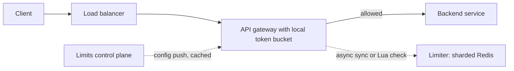

*What to notice:* the gateway can decide locally on cached limits, and the control plane is off the request path (static stability).

**Design options.**
1. **Central store (Redis cluster):** a Lua script does refill and decrement atomically. Keys are sharded by hash. Accurate. Adds a network hop (about 0.5 ms). Needs a fallback (local limits) if Redis fails.
2. **Local buckets plus async sync:** each API node holds buckets with `rate / N_nodes`, or a leased share of the global budget, reconciled periodically. No hop, slightly inaccurate. Good at very large scale.
3. **Hybrid:** decide locally first, and consult the central store only for tenants near their limit.

**6. Deep dives**
- **Hot tenant:** its key lives on one Redis shard. Pre-aggregate locally, or split the key into `key#1..#k` and give each sub-key `rate / k`.
- **Clock:** use the Redis server's time inside the script, not client clocks, which drift.
- **Config:** limits come from the control plane and are cached in the data plane.
- **Multi-region:** limits per region (simple), or global with approximate sync.
- **Observability:** metrics for throttled requests per tenant, so throttling is visible and not a silent mystery.

**7. Bottlenecks**
- The Redis shard holding a hot tenant. The network hop on every request. The control plane if limits are read synchronously.

**8. Trade-offs**
- Accuracy vs latency: central is exact but adds a hop. Local is instant but can over-admit by up to the sync interval's worth of traffic.
- Fail open vs fail closed: fail open protects availability, fail closed protects the backend and security.

**9. How it maps to my projects**
> "The Masters India bulk pipeline sat on the other side of this problem. The government IRP (Invoice Registration Portal) is rate-limited and volatile, so I used bounded concurrency and backoff with jitter against it, with a dead-letter queue after max attempts. On the Go/Gin platform at Impact Analytics, the HTTP edge is self-protecting with no reverse proxy, so admission control and nested timeouts live in the service itself. Rate limits per tenant would sit naturally in that same edge middleware."

*Follow-up they may ask:* "Why token bucket and not sliding window?" Token bucket allows controlled bursts and needs only two numbers per key. Sliding window log is exact but stores every timestamp.

---

### Q2. Design a distributed key-value store (Dynamo / etcd style)

**In plain English.** A key-value store is a giant dictionary spread across many machines: you give it a key, it gives you back the value. The design questions are how to split keys across machines, how many copies to keep, and what a reader sees if copies disagree.

**Opening line to say.** "I will partition keys with consistent hashing and keep three replicas in three ADs. Then the big choice is AP with quorums, like Dynamo, or CP with a Raft group per partition, like etcd. I will pick per use case."

**1. Clarify requirements**
- Functional: `put(k, v)`, `get(k)`, `delete(k)`. Values up to, say, 1 MB.
- Non-functional: billions of keys, 100k+ QPS, p99 under 10 ms, highly available, durable, tunable consistency.
- Out of scope: secondary indexes, range queries, multi-key transactions.

**2. Estimate**
- 2B keys × 1 KB average value = 2 TB of data. With 3 replicas, 6 TB stored.
- If each node holds 1 TB, I need 6 nodes minimum. Plan 12 for headroom and even spread across 3 ADs (4 per AD).
- 100k QPS, assume half reads and half writes. Writes: 50k × 3 replicas = 150k replica writes. Reads with R = 2: 50k × 2 = 100k replica reads. Total 250k ops per second / 12 nodes ≈ 21k ops per node, which an SSD-backed node handles.

**3. API**
```text
PUT    /v1/kv/{key}     body: value, header: If-Match: <version>   -> 200 {version}
GET    /v1/kv/{key}?consistency=strong|eventual                  -> 200 {value, version}
DELETE /v1/kv/{key}                                              -> 204
```
`If-Match` gives compare-and-set: the write only succeeds if the version is still the one I read.

**4. Data model**
- Per node: an LSM-tree storage engine (WAL, then memtable, then SSTables plus compaction plus Bloom filters). Write-optimised.
- Record: `key, value, version (vector clock or a monotonically increasing number), tombstone flag, ttl`.
- Metadata: the partition map (which vnode ranges live on which nodes), stored in a small Raft-backed metadata service and cached by routers.

**5. High-level design**

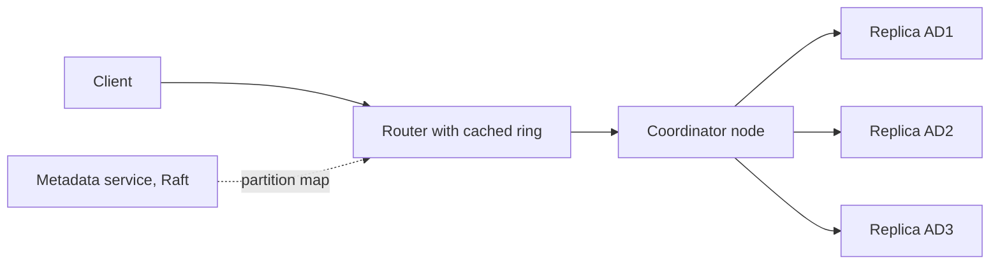

*What to notice:* the coordinator writes to all three replicas and acknowledges after W of them confirm.

**Request path.** A put writes to N replicas and acknowledges after W. A get reads R replicas, returns the newest version, and repairs any stale replica it saw.

**Two replication designs.**
- **AP design (Dynamo):** leaderless quorums with N = 3, W = 2, R = 2 (R + W > N, so reads overlap the latest write). Sloppy quorum plus hinted handoff when a node is down. Read repair. Anti-entropy with Merkle trees. Vector clocks or last-writer-wins for conflicts.
- **CP design (etcd / Spanner-like):** each partition is a **Raft group** of 3 across ADs. The leader serves linearizable reads using a lease or a read index.

**Membership:** gossip plus a phi-accrual failure detector, or the Raft-based metadata service holding the partition map.

**6. Deep dives**
- **Rebalancing when a node is added:** move only the affected vnode ranges, throttled so it does not starve foreground traffic.
- **Hot keys:** a cache in front, or key splitting.
- **Durability:** fsync the WAL per batch (group commit, many writes share one disk flush), and replicate across ADs.
- **Deletes:** write a tombstone (a "deleted" marker). Remove it during compaction after a grace period, so a replica that was offline does not resurrect the key.
- **Consistency per use:** bucket names or locks need CP. Session data or carts can be AP.

**7. Bottlenecks**
- Compaction I/O competing with foreground reads. A hot partition. Cross-AD latency on every write (1 to 2 ms per round trip).

**8. Trade-offs**
- AP gives availability during partitions but needs conflict resolution. CP gives a single truth but writes stall if a majority is unreachable.
- LSM trees are great for writes but reads may check several files. B+ trees are the opposite.

**9. How it maps to my projects**
> "I have not built a KV store, but I have relied on the same merge-time ideas. ClickHouse's ReplacingMergeTree behaves a lot like LSM compaction with last-version-wins: inserts create immutable parts, and background merges collapse duplicate keys to the newest version. That is why retried batches in my Keep/Drop engine never create duplicates, and why reads use argMax to be correct before the merge has happened."

---

### Q3. Design object storage (like OCI Object Storage / S3)

**In plain English.** Object storage keeps files ("objects") of any size under a name inside a bucket, and lets you read them back over HTTP. It must essentially never lose data. The core trick is to separate the small, frequently changing metadata ("where are the pieces of this file?") from the large, write-once data itself.

**Opening line to say.** "I will split it into a metadata service and storage nodes. Data is chunked and erasure-coded across ADs, and an object only becomes visible when its metadata commits, which gives strong read-after-write consistency."

**1. Clarify requirements**
- Functional: buckets and objects (KB to TB), PUT, GET, DELETE, LIST, multipart upload, versioning, lifecycle policies.
- Non-functional: 11 nines durability, high availability, strong read-after-write consistency (OCI Object Storage offers this), encryption at rest, IAM.
- Out of scope: CDN, static website hosting.

**2. Estimate**
- Assume 10B objects with a 1 MB average. Logical data: 10B × 1 MB = 10 PB.
- Erasure coding 8 + 4 stores 12/8 = 1.5× the data, so 15 PB raw. Triple replication would need 30 PB. That is the cost argument for erasure coding.
- Metadata: about 500 bytes per object × 10B = 5 TB. That needs a sharded metadata store, not one database.
- Traffic: assume 10k PUTs per second and 20k GETs per second. GET egress: 20k × 1 MB = 20 GB per second across the fleet.

**3. API**
```text
PUT    /n/{namespace}/b/{bucket}/o/{object}           -> 200 {etag, versionId}
GET    /n/{namespace}/b/{bucket}/o/{object}           -> 200 bytes (Range header supported)
DELETE /n/{namespace}/b/{bucket}/o/{object}           -> 204
GET    /n/{namespace}/b/{bucket}/o?prefix=&start=&limit=   -> {objects[], nextStartWith}
POST   /n/{namespace}/b/{bucket}/u                    -> {uploadId}        (multipart start)
PUT    .../u/{object}?uploadId=&uploadPartNum=        -> {etag}            (part)
POST   .../u/{object}?uploadId=   body: parts[]       -> commit
```

**4. Data model**
- Metadata (sharded, Raft-replicated, ordered by `(bucket, key)`): `bucket, key, version_id, size, etag, chunk_list[], storage_tier, created_at, encryption_key_ref, is_latest`.
- Storage nodes: chunks addressed by `chunk_id`, each with a checksum.

**5. High-level design**

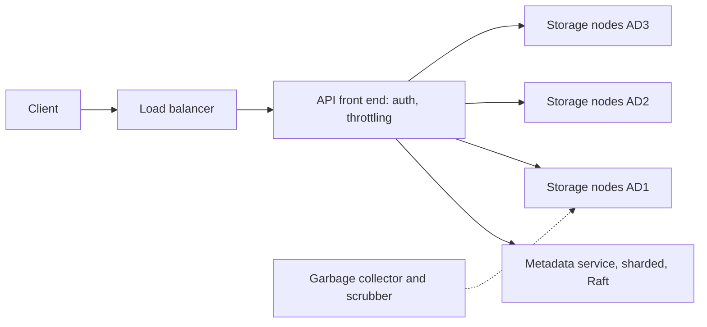

*What to notice:* data goes straight to storage nodes in all three ADs, and only a small record goes to the metadata service.

**PUT flow.**
1. Authenticate and authorise (IAM policy on the compartment), and check quotas.
2. Split into chunks (for example 8 to 64 MB) and stream them to storage nodes. **Erasure code** each chunk group (for example 8 data plus 4 parity) and place pieces across ADs and fault domains.
3. Checksum every chunk and verify end to end.
4. **Commit metadata last** (an atomic write of "this version maps to this chunk list"). The object becomes visible only after this commit, which is what gives read-after-write consistency.
5. A garbage collector cleans up orphaned chunks from failed uploads.

**GET:** look up metadata (cached), fetch chunks in parallel, and reconstruct from any 8 of the 12 pieces if some nodes are slow (**hedged reads**: ask a few extra nodes and use the first answers).

**LIST:** metadata is ordered by `(bucket, key)`, so LIST is a range scan with a pagination token. Big buckets are partitioned by key range, and hot ranges split automatically.

**Multipart upload:** upload parts in parallel with part numbers and ETags, then a commit stitches the metadata together. Resumable.

**6. Deep dives**
- **Durability operations:** background **scrubbing** re-verifies checksums. On node failure, repair re-encodes lost pieces, prioritising chunk groups with the most missing pieces.
- **Security:** TLS, envelope encryption per object (a DEK wrapped by a KEK in Vault), customer-managed keys, and pre-authenticated requests with expiry.
- **Hot objects:** CDN or cache. **Small objects:** pack many small objects into one chunk to cut overhead.
- **Metadata scaling:** shard by bucket plus key hash, with range partitioning inside a bucket.
- **Overwrite consistency:** version IDs, and the last committed version wins.

**7. Bottlenecks**
- The metadata service, especially LIST on huge buckets with hot prefixes. Repair bandwidth after losing a whole AD.

**8. Trade-offs**
- Erasure coding saves half the storage of 3× replication but costs CPU and makes small reads and repairs more expensive.
- Strong consistency needs the metadata commit on the write path, which adds latency compared with eventual consistency.

**9. How it maps to my projects**
> "Commit metadata last is the same lesson I learnt the hard way in my ClickHouse loader. A failed HTTP insert had still committed about 64 million rows, and my resume logic saw rows and assumed the season was done. The fix was a ledger entry written only after ClickHouse's query log showed the insert finished. The data being present is not success. The commit record is."

---

### Q4. Design a URL shortener (warm-up, often first)

**In plain English.** A URL shortener turns a long web address into a short code and redirects anyone who visits the short link. It is mostly a read-heavy lookup table, so the design is about generating unique short codes and caching the popular ones.

**Opening line to say.** "This is a read-heavy key-value problem. I will generate IDs from a distributed counter and encode them in base62, store short-to-long in a KV store partitioned by the short code, and put a cache and CDN in front for hot links."

**1. Clarify requirements**
- Functional: create a short URL, redirect, optional custom alias and expiry.
- Non-functional: 100M new URLs a month, 10:1 read to write, low redirect latency, high availability.
- Out of scope: user accounts, rich analytics dashboards.

**2. Estimate**
- Writes: 100M / (30 × 86,400 s = 2.59M s) ≈ 39, so about 40 writes per second.
- Reads: 10 × 40 = about 400 per second on average.
- Five years: 60 months × 100M = 6B URLs × 500 bytes ≈ 3 TB.
- Key space: base62 with 7 characters is 62^7 ≈ 3.5 trillion codes, far more than 6B.

**3. API**
```text
POST /v1/urls   { longUrl, customAlias?, expiresAt? }   -> 201 { shortCode }
GET  /{shortCode}                                       -> 301 or 302 Location: longUrl
```

**4. Data model**
- KV store: `short_code (partition key) -> long_url, created_at, expires_at, owner`.

**5. High-level design**

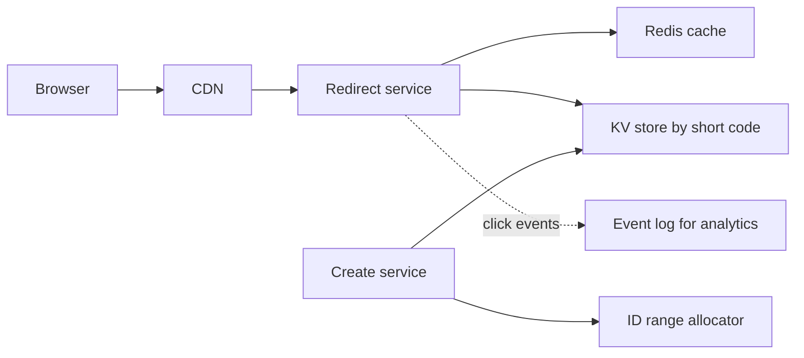

*What to notice:* reads and writes are separate services, and analytics are asynchronous so they never slow a redirect.

**Key generation.** Base62 of a unique ID. IDs come from a distributed ID generator (Snowflake style: timestamp plus machine ID plus sequence) or from pre-allocated ranges per server (a ticket server hands each server a block of 1M IDs). Avoid hash-then-check-for-collision at scale.

```python
ALPHABET = "0123456789abcdefghijklmnopqrstuvwxyzABCDEFGHIJKLMNOPQRSTUVWXYZ"
def base62(n: int) -> str:
    s = []
    while n:
        n, r = divmod(n, 62)
        s.append(ALPHABET[r])
    return "".join(reversed(s)) or "0"
# base62(125) == "21" because 125 = 2*62 + 1
```

**6. Deep dives**
- **Read path:** a cache (Redis or CDN) in front, since a few hot links dominate. 301 is permanent and cacheable by browsers. 302 is temporary, so every click reaches you and can be counted.
- **Analytics:** emit click events to a log and aggregate asynchronously.
- **Abuse:** rate limit creation, scan for malware URLs.

**7. Bottlenecks**
- The ID allocator (avoid it being a single point by handing out large ranges). Hot links on one cache shard.

**8. Trade-offs**
- 301 saves load but loses analytics. 302 keeps analytics but costs more traffic.
- Sequential IDs are guessable. If that matters, shuffle the ID bits or add a random component.

**9. How it maps to my projects**
> "The closest pattern I have used is deterministic keys. At Uber FRM via EPAM, I used SHA-256 natural keys, for example a hash of the question text plus the normalised page name, so reloading the same data produced the same key and became an upsert. For a URL shortener I would not hash, because collisions need checking at scale, so I would use range-allocated IDs instead."

---

### Q5. Design a distributed cache (like a Memcached / Redis cluster)

**In plain English.** A distributed cache is a big shared memory spread over many machines that sits in front of a slower database. It must be fast, survive node loss without crushing the database behind it, and handle a few very popular keys.

**Opening line to say.** "I will shard keys over cache nodes with consistent hashing, use LRU eviction per node, and spend most of the time on failure behaviour, because a cache node dying can take down the database behind it."

**1. Clarify requirements**
- Functional: `get`, `set` with TTL, `delete`.
- Non-functional: sub-millisecond reads, 1M ops per second, hit rate above 90%, tolerate node loss.

**2. Estimate**
- Hot data: assume 500 GB. With 64 GB usable per node, 500 / 64 ≈ 8 nodes. Use 12 for headroom, and 24 with one replica each.
- Ops: 1M / 12 ≈ 83k ops per second per primary, which a Redis-class node handles.
- Database protection: at a 90% hit rate, 10% of 1M = 100k QPS reach the DB. If one node of 12 dies, its share of hits becomes misses: about 1M × 0.9 / 12 ≈ 75k extra DB QPS. That is why failure handling is the main topic.

**3. API**
```text
GET key                 -> value | nil
SET key value EX 300    -> OK
DEL key                 -> 1
```

**4. Data model**
- Per node: a hashmap of key to entry, plus a doubly linked list for LRU order (see [LLD LRU](05_lld_problems.md)). Entry: `value, expires_at, size`.
- Client side: the hash ring (node list with virtual nodes).

**5. High-level design**

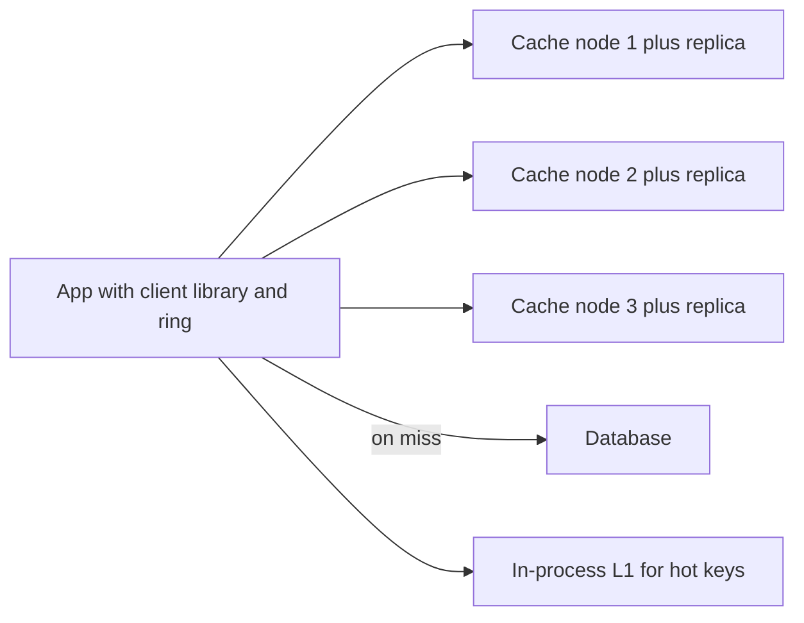

*What to notice:* the client library knows the ring, so there is no central proxy hop, and the database is only hit on misses.

**6. Deep dives**
- **Partitioning:** consistent hashing, via the client library or a proxy.
- **Eviction:** LRU per node with a memory limit.
- **Replication:** optional primary-replica per shard for availability. Cache data is usually rebuildable, so async replication is fine.
- **Failure:** when a node dies, its keys miss and the DB load spikes. Protect with request coalescing (singleflight), gradual warm-up, and replica promotion.
- **Hot keys:** replicate hot keys to several nodes, and add a small in-process L1 cache with a short TTL.
- **Consistency:** cache-aside with delete-on-write, and TTL as a safety net. Stampede protection with singleflight, a `SETNX` lock, and TTL jitter.

**7. Bottlenecks**
- A single hot key's node. Network bandwidth for large values. The database during cold start.

**8. Trade-offs**
- Replicas cost double memory but prevent a miss storm when a node dies.
- Longer TTLs raise the hit rate but increase staleness.

**9. How it maps to my projects**
> "At Masters India I added a Redis cache-aside layer that cut database read load by 30%, alongside ELK and New Relic tracing. On the Go/Gin platform at Impact Analytics, auth identity is Redis-fronted, and if Redis is down the waterfall falls through to the source of truth, so latency goes up but requests do not fail. That is the behaviour I would want from any cache: losing it should make things slower, not broken."

---

### Q6. Design a distributed job scheduler (cron at scale)

**In plain English.** A job scheduler runs tasks at the right time, like a giant alarm clock for millions of jobs. It must not lose a job when a machine dies, must not run the same job twice by accident, and must handle the rush when many jobs are due at midnight.

**Opening line to say.** "Job definitions live in a partitioned database indexed by next run time. Scheduler instances own partitions through leases, push due jobs to a queue, and workers run them with heartbeats. Firing is at-least-once, so every job run has an idempotency key."

**1. Clarify requirements**
- Functional: schedule one-off and recurring jobs, retries, timeouts, priorities, cancel, status and logs.
- Non-functional: millions of jobs, start within a few seconds of schedule, no job lost if a node dies, at-least-once with idempotent jobs.

**2. Estimate**
- 10M scheduled runs a day: 10,000,000 / 86,400 ≈ 116 starts per second on average.
- Midnight spike: if 1M jobs are set for 00:00 and we spread them over 60 seconds, that is about 16.7k starts per second.
- Storage: job definitions at 1 KB × 10M = 10 GB. Execution records at 500 B × 10M a day = 5 GB a day.

**3. API**
```text
POST   /v1/jobs   { schedule: "cron expr" | runAt, payload, timeoutS, maxAttempts, priority }  -> { jobId }
DELETE /v1/jobs/{jobId}
GET    /v1/jobs/{jobId}/runs?limit=20
```

**4. Data model**
- `jobs`: `job_id (hash partition key), schedule, next_run_at (indexed), payload, priority, max_attempts, owner`.
- `job_runs`: `run_id = (job_id, scheduled_time) UNIQUE, attempt, status, worker_id, heartbeat_at, started_at, finished_at`.

**5. High-level design**

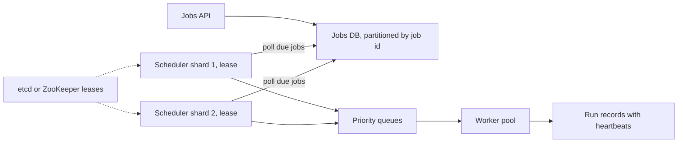

*What to notice:* each partition of the jobs table has exactly one scheduler owner at a time, enforced by a lease.

The scheduler loop is: `SELECT due jobs WHERE next_run_at <= now LIMIT n`, enqueue them, then advance `next_run_at`.

**6. Deep dives**
- **Ownership:** partitions are assigned to scheduler instances via leases (etcd or ZooKeeper) with fencing tokens, so two schedulers do not fire the same job.
- **Exactly-once firing is hard:** use at-least-once plus idempotency. The run ID is `(job_id, scheduled_time)`, and a unique constraint dedups.
- **Timing wheel:** an in-memory ring of time slots for near-term timers, like a clock face with a bucket per second. The database holds long-term schedules.
- **Worker heartbeats:** if a heartbeat stops, the attempt is presumed dead and re-enqueued after a visibility timeout.
- **Retries** with backoff and max attempts, then a DLQ.
- **Checkpoints** for long jobs so a retry resumes rather than restarts.
- **Backpressure:** do not enqueue faster than workers drain. Use priority lanes.
- **Missed schedules after an outage:** a per-job policy (catch up all, run once, or skip).
- **Observability:** schedule lag (actual start minus scheduled time), failure rate, queue depth.

**7. Bottlenecks**
- The midnight spike on the due-jobs index. Spread with jitter where the user allows it.
- The lease service, if leases are too short and renew constantly.

**8. Trade-offs**
- Polling the DB is simple and durable but adds a few seconds of lag. A timing wheel is precise but must be rebuilt from the DB after a crash.
- At-least-once is achievable and honest. Exactly-once firing would need distributed transactions with the job's side effects.

**9. How it maps to my projects**
> "I built the application-level version of this for the AssortSmart Keep/Drop engine. The orchestration registry runs batches of 88k items per pass with hard timeouts, circuit breakers, durable checkpoints (det.json and agent_progress.json), a claim ledger and per-run telemetry. I chose not to add Airflow or Temporal because I needed resume logic tied directly to the ClickHouse inserts and the frozen config hash, and the extra infrastructure was not justified for one workload. I would pick Temporal or Airflow when there are many teams, many DAGs, or workflows that cross services."

*Follow-up they may ask:* "What would you do differently?" If more pipelines started sharing the registry, I would revisit Temporal, because a durable workflow engine gives retries, timers and visibility for free once there are enough workflows to justify running it.

---

### Q7. Design a metrics and alerting system (like OCI Monitoring)

**In plain English.** A metrics system collects numbers (CPU, latency, error counts) from millions of resources every few seconds, stores them as time series, lets people chart them, and fires alarms when they cross thresholds. The challenges are huge write volume, cheap long-term storage, and making sure the alarms themselves never silently stop.

**Opening line to say.** "Agents push points to a throttled ingestion tier, which writes to a partitioned log. Aggregators pre-compute one-minute rollups into a time-series store, and a streaming alarm evaluator reads the same log. The monitoring system gets its own separate meta-monitoring."

**1. Clarify requirements**
- Functional: ingest metrics, query with aggregations over time windows, threshold alarms, notifications, retention with downsampling, multi-tenant.
- Non-functional: 10M series, one point per 10 to 60 seconds, alarm evaluation within about a minute, highly available ingestion.

**2. Estimate**
- 10M series / 10 s = 1M points per second.
- Raw point: 8-byte timestamp plus 8-byte value = 16 bytes. 1M × 16 B = 16 MB per second, or 16 MB × 86,400 ≈ 1.4 TB a day before compression. Gorilla-style compression (below) shrinks this a lot, which is why it exists.
- Query side is far smaller than write side. This is a write-heavy system.

**3. API**
```text
POST /v1/metrics   [{ namespace, name, dimensions:{...}, timestamp, value }]   -> 202
GET  /v1/metrics/query?q=mean(cpu{host=a})[1m]&start=&end=
POST /v1/alarms    { query, threshold, window, severity, destinations[] }
```

**4. Data model**
- Series ID = hash of `(tenant, namespace, metric name, sorted dimensions)`.
- Time-series store: sharded by `(tenant, series_id)` and partitioned by time. Columnar chunks per series.
- Alarms table: `alarm_id, tenant, query, threshold, window, state (OK, FIRING, INSUFFICIENT_DATA), last_eval`.

**5. High-level design**

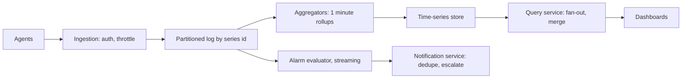

*What to notice:* alarms read from the log directly, so a slow query tier never delays an alarm.

**6. Deep dives**
- **Storage:** a time-series database with columnar chunks per series. Gorilla compression stores delta-of-delta timestamps (regular intervals compress to almost nothing) and XOR-encoded floats (similar consecutive values share most bits). Recent data in memory or SSD, older data downsampled (1 minute to 1 hour) in object storage.
- **Cardinality explosion:** someone puts a request ID in a label and creates millions of series. Enforce per-tenant series limits and reject the excess.
- **Alarm evaluation:** streaming evaluation on ingest vs periodic queries. Handle late data with a grace window. Define a **missing data** policy (treat as breaching or not).
- **Alerting on the monitoring system itself:** a separate meta-monitoring stack and synthetic heartbeats (a "dead man's switch" alarm that fires if it stops receiving a regular signal).
- **Multi-AD:** replicate ingestion. Alarm evaluators run active-passive per partition with leases.
- **Notification:** dedupe, grouping, suppression during maintenance, escalation policies.

**7. Bottlenecks**
- Ingestion during a fleet-wide incident (everything reports errors at once). High-cardinality tenants. Wide queries that fan out to many shards.

**8. Trade-offs**
- Streaming alarm evaluation is fast but harder to make correct with late data. Periodic queries are simpler but slower.
- Downsampling saves storage but loses detail for old incidents.

**9. How it maps to my projects**
> "I have built telemetry on the application side rather than a monitoring platform. On AssortSmart there is Datadog distributed tracing on the Go edge, and the batch engine writes per-run JSON telemetry with tokens, USD cost, step duration and fallback counts. At Masters India I set up ELK and New Relic alerting on error rate and latency, which cut incident triage by about 70%, roughly from 30 minutes to under 10. So I know what a service team needs from a system like this: cheap high-cardinality tags, and alarms on symptoms."

---

### Q8. Design a notification service (email, SMS, push, webhooks)

**In plain English.** A notification service accepts "tell this user X" requests from other services and delivers them through the right channel. It must not spam, must not lose important messages like one-time passwords, and must survive an external provider going down.

**Opening line to say.** "Producers call one API with an idempotency key. Messages go to a queue per channel and priority, workers call providers through a circuit breaker with a fallback provider, and delivery status flows back into an event store."

**1. Clarify requirements**
- Functional: send via email, SMS, push and webhooks. User preferences, templates, localisation. Delivery status.
- Non-functional: OTP (one-time password) delivered within seconds, at-least-once with dedup, provider failover, per-user rate limits.

**2. Estimate**
- 100M notifications a day: 100,000,000 / 86,400 ≈ 1,160 per second on average. Peak at 10× ≈ 11.6k per second.
- Storage of status events: 100M × 300 bytes = 30 GB a day.

**3. API**
```text
POST /v1/notifications  { idempotencyKey, userId, templateId, params, channels?, priority }  -> 202 { notificationId }
GET  /v1/notifications/{id}   -> { status per channel }
POST /v1/webhooks/subscriptions  { url, events[], secret }
```

**4. Data model**
- `notifications`: `notification_id, idempotency_key UNIQUE, user_id, template_id, priority, created_at`.
- `deliveries`: `notification_id, channel, provider, attempt, status, provider_msg_id, updated_at`.
- `preferences`: `user_id, channel, opted_in, quiet_hours`.

**5. High-level design**

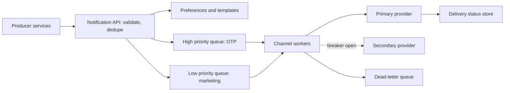

*What to notice:* OTPs and marketing never share a queue, so a marketing blast cannot delay a login code.

**6. Deep dives**
- **Reliability:** at-least-once with dedup by notification ID. Retries with backoff per provider. A circuit breaker per provider with failover to a secondary. DLQ.
- **Rate limits:** per user (do not spam) and per provider quota.
- **Priority:** OTP and security first, marketing last, in separate queues.
- **Tracking:** provider delivery callbacks write to the status store.
- **Webhooks:** sign payloads with HMAC (a keyed hash, so receivers can verify the sender), retry with backoff for up to 24 hours, and let customers replay.

**7. Bottlenecks**
- Provider quotas and slowdowns. Template rendering for huge broadcast campaigns.

**8. Trade-offs**
- At-least-once means a user might rarely get a duplicate. Exactly-once is impossible across an SMS provider.
- Failing over to a second provider improves delivery but costs more and may look different to the user.

**9. How it maps to my projects**
> "At Masters India, clients got webhooks and status updates as their invoices moved through IRP registration, and the pipeline used idempotency keys and dead-letter queues so a retry never double-filed. Say this carefully about Uber: the real-time collaboration and Slack notification service around the FRM platform was a separate service, and I do not claim building it."

---

### Q9. Design a distributed message queue / log (like Kafka / OCI Streaming)

**In plain English.** A distributed log is an append-only journal split into partitions. Producers add messages to the end, and each consumer group reads at its own pace using a bookmark (an offset). Copies of every partition live on several machines so nothing is lost if one dies.

**Opening line to say.** "Topics are split into partitions, each an ordered append-only log with a leader and followers in other ADs. A write is committed once the in-sync replicas have it. Consumers track offsets, so replay is just moving the bookmark."

**1. Clarify requirements**
- Functional: create topics, publish, subscribe with consumer groups, replay from an offset, retention by time or size.
- Non-functional: high throughput, ordering per key, durability across ADs, horizontal scale.

**2. Estimate**
- Assume 100k messages per second at 1 KB = 100 MB per second ingress.
- With replication factor 3, disks absorb 300 MB per second fleet-wide.
- Retention 7 days: 100 MB × 604,800 s ≈ 60 TB, times 3 replicas ≈ 181 TB.
- If one partition comfortably sustains about 10 MB per second (assumption), I need at least 10 partitions. I would choose about 50 so up to 50 consumers in a group can work in parallel.

**3. API**
```text
Produce(topic, key, value, acks=all)        -> { partition, offset }
Fetch(topic, partition, offset, maxBytes)   -> { records[], nextOffset }
CommitOffset(group, topic, partition, offset)
```

**4. Data model**
- On disk: `topic/partition/segment-files` (append-only, with an offset index and a time index).
- Metadata (controller, Raft): partition to leader and in-sync replica set.
- Consumer offsets: an internal compacted topic `group, topic, partition -> offset`.

**5. High-level design**

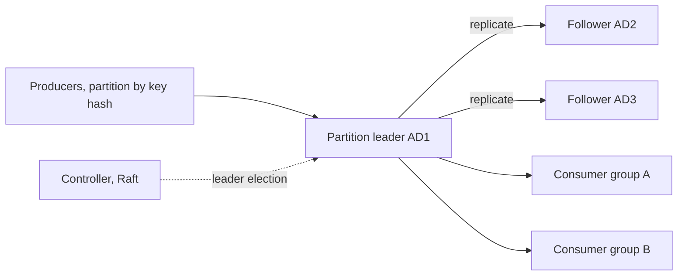

*What to notice:* two consumer groups read the same partition independently, each with its own offset.

- **Producers:** partition by key hash for per-key ordering. Batch and compress. `acks=all` for durability. Idempotent producer (producer ID plus sequence number) for dedup.
- **Replication:** each partition has a leader and followers in other ADs. The **ISR** (in-sync replicas) set is the followers that are caught up. A commit needs the ISR, with `min.insync.replicas = 2`. A controller (Raft-based KRaft) handles leader election.
- **Consumers:** consumer groups with one partition per consumer in a group. Offsets committed to an internal topic. Rebalancing when consumers join or leave.
- **Retention:** by time or size. Log compaction keeps only the latest message per key.

**6. Deep dives**
- **Performance:** sequential disk IO, the OS page cache, zero-copy `sendfile` (the kernel sends file bytes straight to the socket), and batching.
- **Exactly-once:** idempotent producer plus transactions across partitions plus read-committed consumers. External sinks must still be idempotent.
- **Ops:** consumer lag alerts, partition skew, under-replicated partition alarms.

**7. Bottlenecks**
- A hot key on one partition. Rebalancing storms when many consumers restart together. Disk on brokers that host many leaders.

**8. Trade-offs**
- More partitions give more parallelism but more open files, slower leader elections and costlier rebalances.
- `acks=all` is durable but slower than `acks=1`.

**9. How it maps to my projects**
> "I have used Kafka in two different products. At Masters India, the bulk e-invoicing pipeline used Kafka partitioned by client GSTIN so each taxpayer's invoices stayed in order, and when a parser bug hit we reset offsets to replay. At Uber Menu, Kafka with Apache Flink did stateful keyed dedup by vendor and menu with a content hash, feeding exactly-once catalog upserts, which honestly means at-least-once delivery plus idempotent upserts. I have operated these as a user of the platform, not as the broker operator."

---

### Q10. Design a log aggregation and search system (like ELK / OCI Logging)

**In plain English.** Every server writes log lines. A log aggregation system collects them all in one place, makes them searchable within seconds, and keeps older logs cheaply. The danger is a "log storm", where one broken service floods the system.

**Opening line to say.** "Agents ship logs into a durable buffer, indexers write time-based shards of an inverted index, and older data moves to object storage. Every query is time-bounded first, and every line carries a trace ID."

**1. Clarify requirements**
- Functional: collect logs from hosts and services, full-text search, filter by fields, retention tiers, per-tenant isolation.
- Non-functional: searchable within about 30 seconds, survive bursts, cheap long retention.

**2. Estimate**
- Assume 10k hosts × 50 lines per second = 500k lines per second.
- At 300 bytes per line, 500k × 300 B = 150 MB per second ≈ 13 TB a day.
- Hot tier of 7 days ≈ 91 TB before index overhead. That is why only recent logs are fully indexed.

**3. API**
```text
POST /v1/logs/ingest      [{ timestamp, service, level, traceId, message, fields }]  -> 202
GET  /v1/logs/search?q=level:ERROR AND service:billing&start=&end=&limit=100
```

**4. Data model**
- Time-based indices (for example one per tenant per day), sharded. Fields: `timestamp, tenant, host, service, level, trace_id, message`.
- Cold storage: compressed files in object storage, keyed by tenant and hour.

**5. High-level design**

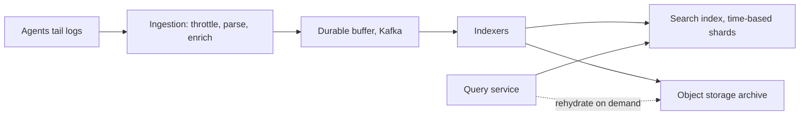

*What to notice:* the durable buffer absorbs bursts, so indexers can fall behind without dropping data.

**6. Deep dives**
- **Query:** time-bounded first (prune whole indices), then full-text inside them.
- **Retention tiers:** hot (7 days searchable), warm, cold (archived in object storage and rehydrated on demand).
- **Log storms:** per-source rate limits and sampling for debug logs.
- **Correlation:** a trace ID in every log line.

**7. Bottlenecks**
- Indexing CPU during bursts. Huge queries without a time filter.

**8. Trade-offs**
- Indexing every field makes search flexible but costs storage and CPU. Indexing only key fields is cheaper but slower for ad hoc search.

**9. How it maps to my projects**
> "At Masters India I rolled out ELK with structured JSON logs and a request ID that followed each invoice across the API services and the workers. Combined with New Relic tracing, incident triage went down about 70%, roughly from 30 minutes to under 10. The lesson was that a correlation ID in every line matters more than any dashboard."

---

### Q11. Design a VM provisioning control plane (OCI Compute "LaunchInstance")

**In plain English.** When a customer clicks "launch instance", many systems must cooperate: find a host with free capacity, allocate a network interface and IP, attach a boot disk, start the VM, and report it running. Any of those steps can fail midway. The control plane must be idempotent, resumable, and must never affect VMs that are already running.

**Opening line to say.** "The API records the desired state and returns quickly with an OCID in PROVISIONING. A durable workflow then runs each step idempotently with compensation on failure, and host agents reconcile actual state to desired state. Running VMs never depend on the control plane."

**1. Clarify requirements**
- Functional: `LaunchInstance(shape, image, subnet, AD)` returns quickly with an OCID (Oracle Cloud ID) in PROVISIONING. `GetInstance` shows state. `TerminateInstance`.
- Non-functional: idempotent, handles capacity shortages, survives component failure mid-workflow, per-tenancy limits.

**2. Estimate**
- Assume a busy region does 1,000 launches a minute at peak ≈ 17 per second.
- If each launch takes about 60 seconds end to end, in-flight workflows ≈ 17 × 60 ≈ 1,000 at any moment.
- Instances DB: 10M instances × 2 KB = 20 GB. Volume is small. Correctness and failure handling are the hard parts.

**3. API**
```text
POST   /20160918/instances  header opc-retry-token: <uuid>
       { compartmentId, availabilityDomain, shape, imageId, subnetId }  -> 200 { id: ocid, lifecycleState: PROVISIONING }
GET    /20160918/instances/{ocid}                                       -> { lifecycleState }
DELETE /20160918/instances/{ocid}
```

**4. Data model**
- `instances`: `ocid, tenancy, compartment, ad, fd, shape, desired_state, actual_state, host_id, retry_token UNIQUE per tenancy`.
- `workflows`: `workflow_id, ocid, step, step_state, attempt, updated_at`.
- `capacity`: `host_id, ad, fd, free_cpu, free_mem, version` (optimistic reservation).

**5. High-level design**

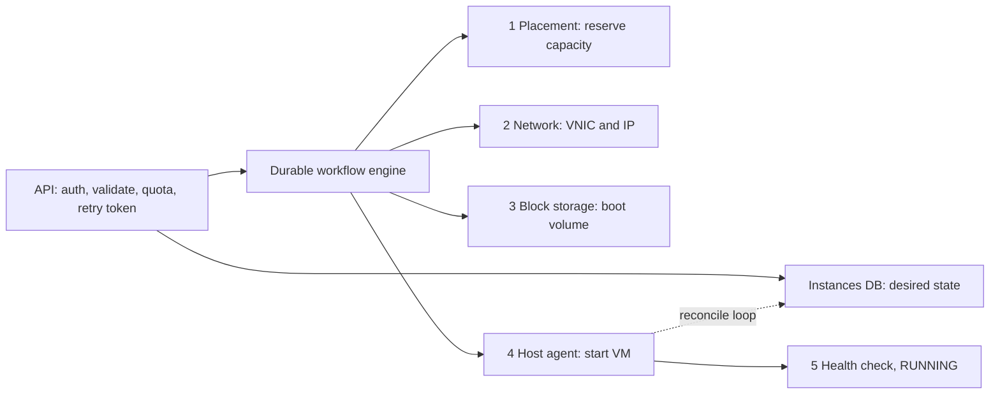

*What to notice:* every numbered step is idempotent, and the host agent's reconcile loop repairs anything a lost message missed.

**Workflow steps.** Reserve capacity (placement service picks a host in an AD and FD with capacity and anti-affinity), allocate network (VNIC and IP), attach the boot volume, tell the host agent to start the VM, health check, then RUNNING. On failure, compensate in reverse (release the IP, release capacity).

**6. Deep dives**
- **Desired state plus reconciliation** (like Kubernetes controllers): agents continually converge actual state to desired state, which handles lost messages naturally. Like a thermostat that keeps nudging the room toward the setpoint.
- **Durable workflow (saga):** persist the step state. On a crash, resume from the last completed step.
- **Idempotency:** the retry token maps to the same instance OCID, so a client retry returns the existing instance instead of launching a second one.
- **Placement:** bin packing with constraints (shape, FD, anti-affinity) and a scoring function. Optimistic reservation with retry on conflict.
- **Static stability:** running VMs do not depend on the control plane. If it is down, launches fail but existing workloads are fine.
- **Cells:** per-AD control planes limit blast radius.
- **Throttling:** per-tenancy limits and service limits.
- **Observability:** per-step latency and failure metrics, and alarms for stuck workflows.

**7. Bottlenecks**
- Placement under contention (many launches racing for the last capacity). Downstream control planes (network, storage) during a mass launch.

**8. Trade-offs**
- Returning early with PROVISIONING keeps the API fast but means clients must poll or subscribe for completion.
- Optimistic capacity reservation is fast under low contention but retries a lot when capacity is tight.

**9. How it maps to my projects**
> "The pattern I have built is the durable, resumable workflow. The AssortSmart orchestration registry writes the deterministic phase to det.json and appends LLM progress per article, so `--resume` continues from the last completed step instead of starting over. At Masters India, every bulk import carried an idempotency key built from client, file hash and batch index, which is the same job the opc-retry-token does here. I have not built a compute control plane, but these are the two properties that make one safe."

---

### Q12. Design a distributed lock / configuration service (like ZooKeeper / etcd)

**In plain English.** A coordination service stores a small amount of critical data (who is leader, which config is live, who holds a lock) and guarantees every client sees the same answer. It is small but must be absolutely consistent, which is why it runs a consensus protocol.

**Opening line to say.** "A 3 or 5 node Raft cluster across ADs, with versioned keys for compare-and-set, watches for change notification, and ephemeral keys tied to leases. Locks return a fencing token so storage can reject a stale holder."

**1. Clarify requirements**
- Functional: create, get, set, delete with versions (compare-and-set), **watches**, ephemeral keys tied to sessions or leases, sequential keys.
- Non-functional: linearizable writes, survive one AD loss, small data (MBs), many readers.

**2. Estimate**
- Data: a few MB to a few GB at most.
- Writes: consensus limits throughput to roughly 10k writes per second, so this is not a database.
- Readers: assume 100k clients watching config. A config change fans out 100k notifications, so batch and coalesce them.

**3. API**
```text
Put(key, value, expectedVersion?) -> newVersion
Get(key) -> { value, version }
Watch(prefix) -> stream of changes
Grant(ttlSeconds) -> leaseId ; KeepAlive(leaseId)
Put(key, value, lease=leaseId)   // ephemeral: deleted when lease expires
```

**4. Data model**
- A key-value map with a global revision counter. Every key stores `value, create_revision, mod_revision, version, lease_id`.

**5. High-level design**

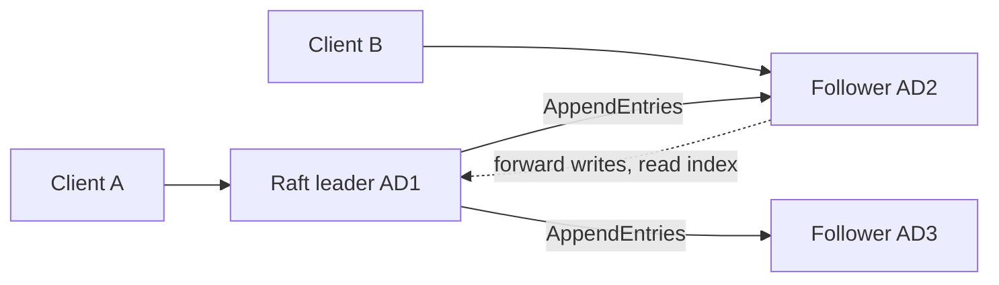

*What to notice:* followers can serve reads after confirming with the leader (read index), but all writes go through the leader.

**6. Deep dives**
- **Lock recipe:** create an ephemeral sequential key under `/locks/x`. The lowest sequence number holds the lock. Every other client watches only its predecessor, which avoids a thundering herd when the lock is released. Return a **fencing token** (the key's revision).
- **Leader election:** the same recipe. The holder of the lowest key is the leader.
- **Scale:** small data, writes limited by consensus. Scale reads with followers and learners (non-voting replicas).
- **Config distribution:** clients cache config and watch for changes. Data planes keep the last known config if the service is down (static stability).

**7. Bottlenecks**
- The leader's write throughput. Watch fan-out on hot prefixes. Disk fsync latency on the Raft log.

**8. Trade-offs**
- 5 nodes survive 2 failures but every write waits for 3 acknowledgements. 3 nodes are faster but survive only 1.
- Follower reads scale out but need a read index round trip to stay linearizable.

**9. How it maps to my projects**
> "I have not operated etcd or ZooKeeper, and I would say so. What I have built depends on the same ideas at a smaller scale. My Go copier takes a file lock per table so two copies cannot run on the same table, and the AssortSmart registry freezes a config hash at the start of a run so every output row can be traced to the exact configuration. In a distributed setting I would use etcd leases with fencing tokens for the first, and watches with cached last-known config for the second."

---

### Q13. Design a chat / real-time copilot service (WebSocket)

**In plain English.** A chat service keeps a live two-way connection to each user so messages appear instantly. A copilot is the same thing where one side of the chat is an AI agent. The design problems are holding millions of open connections, routing messages to the right gateway, and making sure a user can only ever see their own data.

**Opening line to say.** "Clients hold WebSocket connections to stateful gateway nodes. Identity and scope are bound at the handshake. Messages are persisted first, then fanned out through pub/sub to whichever gateway holds the recipient."

**1. Clarify requirements**
- Functional: send and receive messages in real time, conversation history, delivery receipts, offline sync. For a copilot, the agent answers using tools.
- Non-functional: low latency, strict tenant isolation, graceful reconnect on deploys.

**2. Estimate (generic chat assumptions, not Ask Iris numbers)**
- Assume 1M concurrent connections. If one gateway holds about 50k connections, I need 20 gateways, plus spares.
- Messages: 1M users × 20 messages a day = 20M a day ≈ 231 per second on average.
- For an AI copilot, the dominant cost is LLM latency and tokens per turn, not message volume.

**3. API**
```text
WS  /v1/chat?token=<JWT>            (handshake verifies JWT, binds tenant and scope)
  client -> { type: "message", conversationId, text, clientMsgId }
  server -> { type: "message" | "ack" | "tool_progress" | "final", seq, ... }
GET /v1/conversations/{id}/messages?afterSeq=120
```

**4. Data model**
- `messages`: partitioned by `conversation_id`, ordered by `seq`. Fields `sender, text, created_at, client_msg_id`.
- Connection registry (Redis): `user_id -> gateway_node`.

**5. High-level design**

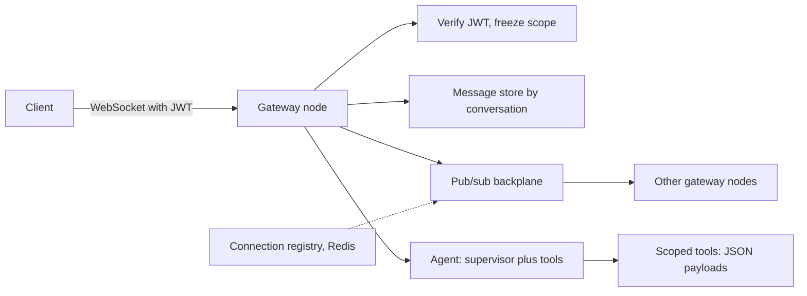

*What to notice:* the scope is fixed at the handshake box, and every tool call downstream inherits it.

**6. Deep dives**
- **Fan-out:** persist first, then publish to the gateways holding the recipients.
- **Ordering per conversation:** a sequence number from the conversation's partition.
- **Delivery receipts and offline sync** by last-seen sequence.
- **Scaling gateways:** scale horizontally. On deploy, drain connections and have clients reconnect with backoff plus jitter to avoid a reconnect storm.
- **Auth at the handshake:** verify the JWT on connect and bind identity and scope to the connection.
- **For an AI agent:** cap the number of agent iterations so a confused agent cannot loop forever, and trace each step.

**7. Bottlenecks**
- Gateway memory per connection. Reconnect storms after a deploy. LLM provider latency for copilots.

**8. Trade-offs**
- WebSocket gives true two-way streaming but needs sticky, stateful gateways. SSE plus POST is simpler but one-way.
- Freezing scope at the handshake is safest, but a permission change only takes effect on the next connection.

**9. How it maps to my projects**
> "Ask Iris, the copilot I shipped on AssortSmart, is exactly this pattern. Planners connect over a JWT-secured WebSocket to query KPIs and inspect AI decisions. The tenant, hierarchy and plan scope are frozen at the socket handshake, so no tool call later can widen it, which prevents cross-tenant leaks. Behind it is a LangGraph supervisor with a three-attempt evaluator loop, so it cannot loop forever, and LangSmith traces every run. I describe it as a shipped capability. I do not quote usage or latency numbers for it."

---

### Q14. Design top-K / heavy hitters (trending items, top API callers)

**In plain English.** "Top-K" means finding the K most frequent things in a huge stream, like the 10 most-called APIs in the last 5 minutes. Exact counting of everything is too expensive at scale, so you split the work by key, or accept a tiny error using a sketch.

**Opening line to say.** "At small scale a hashmap plus a min-heap of size K. At scale, partition the stream by key so each partition's top-K is exact, then merge. If memory is tight, a Count-Min Sketch plus a heap gives an approximate answer with a known error."

**1. Clarify requirements**
- Functional: top K items over a sliding window (for example 5 minutes, 1 hour), per tenant.
- Non-functional: refresh every few seconds, tolerate small error?

**2. Estimate**
- Assume 1B events a day: 1,000,000,000 / 86,400 ≈ 11.6k events per second.
- Count-Min Sketch sizing: width w = ⌈e / ε⌉ and depth d = ⌈ln(1/δ)⌉. For ε = 0.0001 and δ = 0.01, w ≈ 27,183 and d = 5 (ln 100 ≈ 4.6). Memory = 27,183 × 5 × 4 bytes ≈ 544 KB. Tiny.

**3. API**
```text
GET /v1/topk?metric=api_calls&window=5m&k=10   -> [{ key, count }]
```

**4. Data model**
- Per partition: a count map or sketch per time bucket (for example per minute), plus a min-heap of size K.
- Serving cache: the latest merged top-K per window.

**5. High-level design**

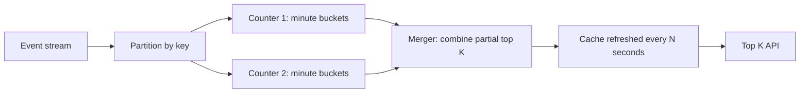

*What to notice:* because the stream is partitioned by key, every count for one key lives on one counter, so merging partial top-K lists is exact.

```python
import heapq
from collections import Counter
def top_k(events, k):
    counts = Counter(events)
    return heapq.nlargest(k, counts.items(), key=lambda kv: kv[1])
# top_k(["a","b","a","c","a","b"], 2) -> [("a", 3), ("b", 2)]
```

**6. Deep dives**
- **Exact at small scale:** hashmap counts plus a min-heap of size K.
- **At scale:** partition by key, count per partition in windows, merge the partial top-K. Careful: if you partition by something other than the key, merging partial top-K lists is not exact.
- **Approximate:** Count-Min Sketch plus a heap, or the Space-Saving algorithm. Sliding windows via per-minute bucketed counts that are summed and expired.
- **Serving:** precompute and refresh every N seconds.

**7. Bottlenecks**
- A single viral key overloading one counter partition. Split it with salting and sum on read.

**8. Trade-offs**
- Exact counts cost memory proportional to distinct keys. Sketches use fixed memory but over-count slightly.

**9. How it maps to my projects**
> "I have not built a trending system. The nearest thing is the ClickHouse pre-aggregation layer, which is the same idea of paying once to precompute so reads are cheap. Six MergeTree rollup tables took planner pivots from 189 seconds to 12 seconds on a 250-million-row harness. For top-K I would apply the same principle with minute buckets."

---

### Q15. Design a large-scale batch AI scoring system (my own system; they may ask)

**In plain English.** This is the AssortSmart Keep/Drop engine at Impact Analytics, generalised. Retailers need to decide, every season, which products to keep, drop or add. The engine scores each article-season (one product in one selling season) with deterministic KPI maths and with LLM judgements from several angles, blends the two, and writes a decision with an explanation. The design is about running a huge batch safely: bounded cost, no duplicates on retry, resume after a crash, and a fallback when the LLM fails.

**Opening line to say.** "I will freeze the configuration first so every output is traceable, run the deterministic maths and checkpoint it, then run the LLM lenses in bounded, timed batches with a circuit breaker and a deterministic fallback, blend with frozen weights, and write idempotently to ClickHouse."

**Words you need**
- **Article-season:** one product (article) in one selling season. The unit that gets a decision.
- **Lens:** one LLM "angle" of judgement on an article. There are 7 AI lenses.
- **Deterministic score (s_det):** pure maths from sell-through and rate of sale. No LLM.
- **Agent score (s_agent):** the LLM lenses combined by a decider.
- **config_hash:** a SHA-256 of guardrails, parameters, prompts and catalog, frozen at the start and stamped on every output row. Like a batch number on medicine.

**1. Clarify requirements**
- Functional: score every article-season, produce Keep/Drop plus Missed Opportunities and Top Style pipelines, write decisions and explanations, resume after failure.
- Non-functional: bounded cost per pass, no duplicates on retry, graceful degradation on LLM failure, every output traceable to its configuration, the LLM never touches the database directly.

**2. Estimate (resume numbers keep their meaning)**
- **348k article-seasons evaluated**, at **88k items per pass**: 348,000 / 88,000 ≈ 3.95, so about 4 passes. (ESTIMATED from resume numbers.)
- Work units per pass if every item went through every lens separately: 88,000 × 7 = 616k lens judgements. That upper bound is why context is packed into structured batches rather than one call per item per lens. (ESTIMATED. Do not quote this as an actual call count.)
- Cost: about $100 of token spend per pass is true but off PDF. If asked: $100 / 88,000 ≈ $0.0011, about a tenth of a cent per item.
- Source data: a **2.11B-row** ClickHouse master. The 1.6M article-season catalog is a different number (off PDF) from the 348k that were scored.

**3. API**
```text
CLI:  keepdrop run --season S --config config.yaml
      keepdrop run --resume <run_id>
HTTP: POST /v1/runs { season, pipeline: "keep_drop" | "missed_opp" | "top_style" } -> { runId, configHash }
      GET  /v1/runs/{runId}   -> { status, processed, fallbacks, tokens, usd, stepDurations }
```

**4. Data model**
- Checkpoints: `det.json` (deterministic results for the whole catalog slice) and `agent_progress.json` (appended per article as LLM results land).
- Output table (ClickHouse `ReplacingMergeTree`): `article_id, season_code, s_det, s_agent, s_final, decision, explanation, config_hash, version`. Same key plus a higher version replaces the old row at merge time.
- Telemetry JSON per run: tokens, USD cost, step duration, batch fallbacks.

**Blend rule and a worked example.** `s_final = 0.4 × s_det + 0.6 × s_agent`, and keep if `s_final ≥ 0.55`.
- s_det = 0.70, s_agent = 0.50: 0.28 + 0.30 = 0.58, so **keep**.
- s_det = 0.40, s_agent = 0.60: 0.16 + 0.36 = 0.52, so **drop**.
- If the LLM times out, s_agent is unavailable and the item gets its deterministic baseline score.

**5. High-level design**

```mermaid
flowchart LR
    T["Trigger: CLI or HTTP"] --> FZ["Freeze config, compute config_hash"]
    FZ --> DET["Deterministic KPI maths, no LLM"]
    DET --> CK1["Checkpoint det.json"]
    CK1 --> CL["Claim ledger and batch mapper, 88k per pass"]
    CL --> B["Batch: packed JSON context"]
    B --> LLM["LLM lenses, hard timeout"]
    LLM --> BR{"Breaker open or timeout?"}
    BR -->|"no"| SV["Schema-validated lens scores"]
    BR -->|"yes"| FB["Deterministic fallback score"]
    SV --> CK2["Append agent_progress.json"]
    FB --> CK2
    CK2 --> BL["Blend with frozen weights"]
    BL --> CH["ClickHouse ReplacingMergeTree, config_hash on every row"]
    BL --> TEL["Telemetry JSON: tokens, USD, duration, fallbacks"]
```

*What to notice:* the LLM only ever sees JSON we prepared, never the database, and both outcomes of the breaker check lead to a finished row.

**Fixed batch order.** There is no LLM orchestrator deciding what to do next. The order is fixed: peer, then decider, then lenses, then blend, then explain.

**6. Deep dives (the talking points)**
- **Why the LLM never gets SQL:** safety (no injection, no cross-tenant reads), cost (no exploratory queries over 2.11B rows), and determinism (the same context gives a reproducible run). Context is served as JSON payloads.
- **Why ReplacingMergeTree:** retries and overlapping waves do not create duplicates. Writes are eventually consistent, and reads use argMax or FINAL to see the latest version before merges finish.
- **Why checkpoints:** a provider outage at item 70k does not redo the deterministic maths. `--resume` skips everything already in `agent_progress.json`.
- **Why a circuit breaker per provider:** it trips after about 5 consecutive failures or a fail fraction, so a degraded provider fails fast and items fall back instead of the whole run hanging.
- **Why frozen blend weights:** on the gold-200 benchmark, the blended LLM scored about 63%, below the **74% deterministic baseline** (production deterministic threshold 0.65 on that 200 set). So the weights were frozen rather than retuned to chase the benchmark.
- **Evaluation:** a **300-case proxy evaluation harness** with an **80% accuracy CI gate** for promotion. Separately, a gold-200 benchmark drove model choice: the chosen model gave **73% lower live execution cost at 100% coverage** (200 of 200 complete). Say this carefully: 80% is a CI promotion gate, not live accuracy for every tenant, and 73% and 74% come from the gold-200 bench, not the 300-case file.
- **Why not Airflow or Temporal:** I needed app-native resume coupled to the ClickHouse inserts and the config hash, and the extra infrastructure was not justified.

**7. Bottlenecks**
- LLM provider throughput and rate limits (bounded parallel batches keep us inside them).
- Assembling JSON context from the 2.11B-row master (served from pre-aggregated data).
- Cost per pass (watched through the per-run telemetry).

**8. Trade-offs**
- Degrade-and-finish vs fail-the-run: I chose degrade, because a complete result with some deterministic fallbacks is more useful to a planner than no result. The cost is that fallback rate must be watched.
- Fixed batch order vs an LLM orchestrator: fixed is predictable, testable and cheaper. An orchestrator would be more flexible but harder to evaluate.
- **What I would do differently:** alarm on fallback rate and cost per 1k items from day one, rather than reading them from telemetry after a run.

**9. How it maps to my projects**
This question *is* my project. Things to keep straight:
- LangSmith is used on Ask Iris, not on this batch engine.
- There is no human review queue here. Offline evaluations replaced critic or evaluator agents in Keep/Drop.
- Model names are not on the PDF, so do not lead with them.

> "Our Keep/Drop engine evaluated 348k article-seasons, 88k items per pass, blending deterministic KPI maths with structured LLM calls across seven lenses. The two design rules I would defend are that the LLM never queries the database, it only gets JSON context we prepared, and that every failure path still produces a row, because timeouts and an open breaker fall back to the deterministic score. Checkpoints mean a crash at item 70k resumes rather than restarts, ReplacingMergeTree means retries never duplicate, and the config hash on every row means any output can be traced to the exact prompts and parameters that produced it."

---

## C. Common follow-up questions and short answers

**In plain English.** These come up at the end of almost every design. Have a two-sentence answer ready for each, and tie it to your design rather than reciting a definition.

| Follow-up | Answer shape |
|---|---|
| "What if the DB goes down?" | Replicas across ADs, automatic failover (Raft or managed), clients retry with backoff. Writes queue up or fail fast. Reads served from cache or replica, if stale is acceptable |
| "What if traffic is 10× tomorrow?" | Say which component saturates first by the numbers, autoscale stateless tiers, add partitions, shed load, protect with rate limits |
| "How do you avoid a hot partition?" | A better key (add a hash or salt), split hot tenants into their own cell, cache, and shard writes with aggregation on read |
| "How do you deploy without downtime?" | Rolling deploy waves, backwards-compatible schemas (expand and contract), feature flags, automatic rollback on alarms |
| "Exactly once?" | At-least-once plus idempotent processing (dedup keys, upserts, versioned writes) |
| "Consistency vs availability here?" | Pick per operation and justify it |
| "How do you know it's working?" | SLIs, burn-rate alarms, canaries, dashboards, traces |
| "How do you secure it?" | AuthN and AuthZ at the edge, tenant from the token, TLS, encryption at rest with KMS, least privilege, audit logs |
| "Cost?" | Erasure coding vs replication, tiered storage, caching, batch vs real time, right-sizing |

**Speakable example for "Exactly once?"**
> "In practice I design for at-least-once delivery and make the consumer idempotent, which is effectively once. At Masters India each bulk import had an idempotency key of client, file hash and batch index, so a replayed message could never double-file an invoice. In ClickHouse I used ReplacingMergeTree so a retried insert collapses to one version. True exactly-once across a third-party system would need a distributed transaction that the third party does not support."
