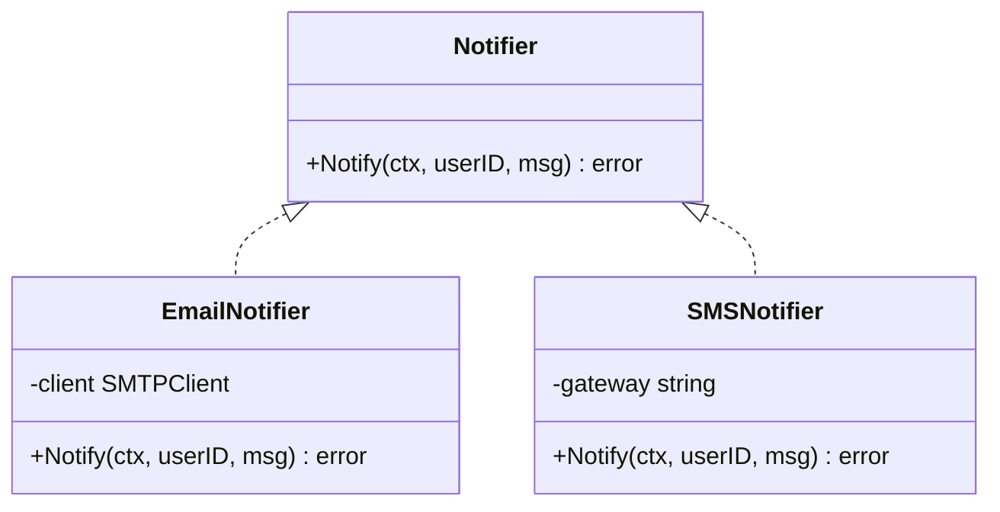
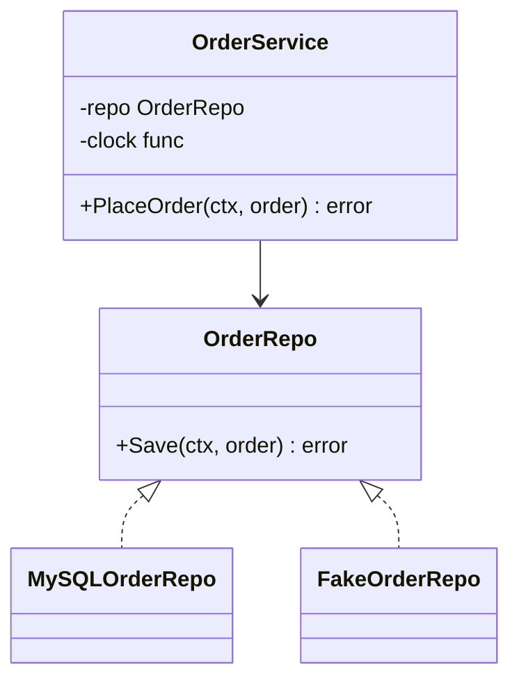
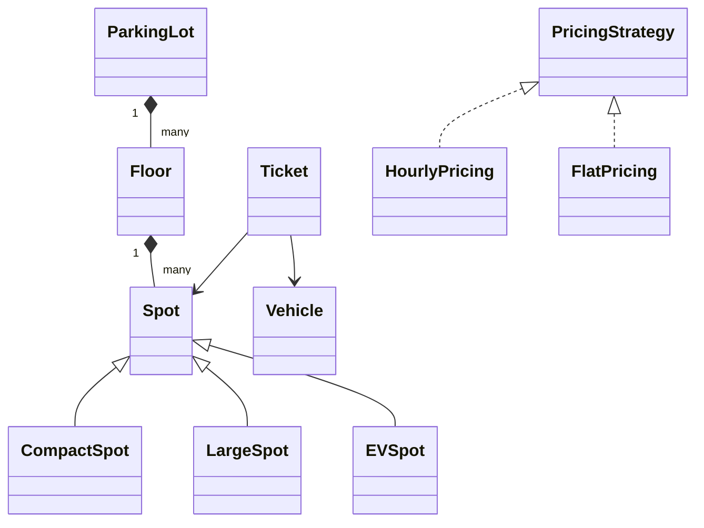
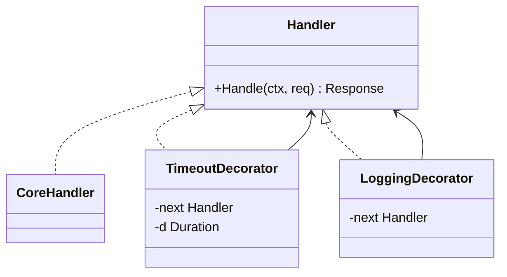
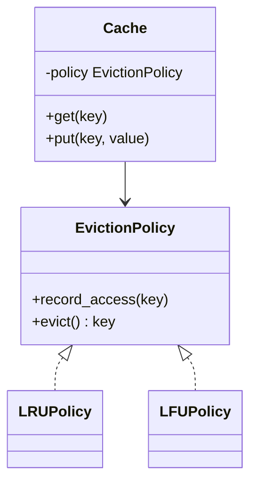
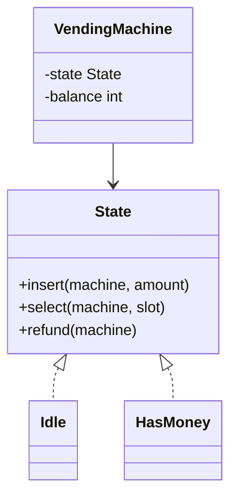
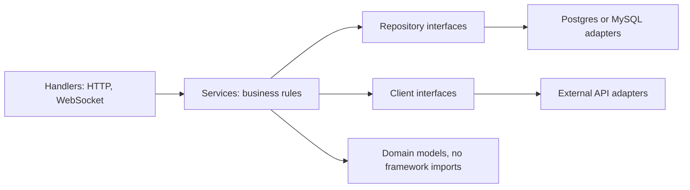

# 05. Low-level design foundations: zero to hero

<div class="callout note">
<b>How to use this page</b>
<ul>
<li><b>What it covers:</b> everything you need before solving an LLD (low-level design) problem: how the round is graded, OOP, SOLID, class relationships, the design patterns that actually come up, designing for failure, testing, and clean service architecture. Each idea is explained in plain words first, then shown in Go or Python.</li>
<li><b>When to read it:</b> before <a href="05_lld_problems.md">05 LLD problems</a>. Concurrency primitives are in <a href="06_concurrency.md">06 concurrency</a>.</li>
<li><b>What to memorise:</b> the 7-step approach in Level 0, one violation and fix for each SOLID letter, the Strategy, Decorator and State patterns, and the "Where I've used patterns" table so you can tie every pattern to a real project.</li>
</ul>
</div>

<div class="callout highlight">
<b>Tags.</b> This page has almost no numbers. Where my projects appear, the facts come from my resume (PyGo track: Python and Go, FastAPI at Masters India and Uber FRM via EPAM, Go/Gin at Impact Analytics). <b>Verbal</b> means true and speakable but not on the PDF.
</div>

**In plain English.** System design is about boxes and arrows between services. Low-level design is about what goes *inside* one box: which classes exist, what each is responsible for, how they talk, and how the code survives the next requirement change. A good LLD answer is like a well-organised kitchen. Every tool has one place, you can add a new appliance without rebuilding the counters, and two cooks can work at once without bumping into each other.

---

## Level 0. What an LLD round is

**In plain English.** You get a vague prompt ("design a parking lot", "design an LRU cache", "design a rate limiter library") and about 45 minutes. The interviewer is not checking whether you memorised a solution. They are checking whether you can turn a fuzzy problem into clean, extensible, working code, and reason about what happens when two threads use it at once.

They grade:

1. **Requirements:** you clarify and scope.
2. **Modeling:** the right classes and responsibilities, with clean relationships.
3. **Extensibility:** adding a new vehicle type, pricing rule or eviction policy does not need edits everywhere (the open/closed principle, explained below).
4. **Code quality:** working, readable code for the core parts.
5. **Concurrency** (common at OCI): what if two threads call this at once?
6. **Testing:** how would you test it?

### Step-by-step approach

1. **Clarify (5 min):** actors, core use cases, what is out of scope. Write 4 to 6 requirements down.
2. **Identify entities (5 min):** nouns become classes, verbs become methods. Find what **varies**, because that becomes an interface or strategy.
3. **Relationships (5 min):** has-a (composition), is-a (inheritance, used sparingly), uses (dependency).
4. **Class diagram and interfaces (5 min):** method signatures before bodies.
5. **Code the core (20 min):** the main flow end to end, then the most interesting class in detail.
6. **Concurrency and edge cases (5 min).**
7. **Extensions (the rest):** "to add X, I would add a new Strategy class, and nothing else changes."

**Worked example of step 2 (parking lot).** "A *vehicle* *enters* through a *gate*, gets a *ticket*, *parks* in a *spot*, and *pays* on exit." Nouns: Vehicle, Gate, Ticket, Spot, Payment. Verbs: enter, park, pay. What varies: vehicle types, spot assignment rules, pricing rules. So `PricingStrategy` and `SpotAssignmentStrategy` become interfaces.

**Opening line to say in the round.** "Let me list the requirements and what is out of scope, then the entities, and I will call out which parts are likely to change so I can put them behind interfaces."

---

## Level 1. OOP fundamentals

**In plain English.** Object-oriented programming groups data with the code that is allowed to change it. The four "pillars" are just four ways of keeping that grouping clean and flexible.

| Pillar | Meaning | Everyday analogy | Example |
|---|---|---|---|
| **Encapsulation** | Hide state behind methods and enforce rules | A cash machine: you cannot reach into the vault, you ask for money and it checks your balance | `Account.withdraw()` checks the balance. The balance is not public |
| **Abstraction** | Expose *what*, hide *how* | A car's steering wheel hides the steering rack | `Storage.put(key, value)` without saying whether it is disk or S3 |
| **Inheritance** | Reuse via is-a | A sports car is a car | `Car(Vehicle)`. Use it sparingly |
| **Polymorphism** | Same call, different behaviour | "Play" on any music player | `pricing.calculate(ticket)` for hourly vs flat |

**Composition over inheritance.** "Has-a" beats "is-a" for flexibility. A `Car` *has* an `Engine`, so you can swap engines without creating new subclasses. Deep inheritance trees get rigid. Changing the base class breaks children you forgot about, which is called the "fragile base class" problem. Analogy: building with Lego bricks (composition) instead of carving a statue (inheritance).

**Go has no inheritance.** It uses **interfaces**, which are implicit (a type implements an interface simply by having the methods, with no `implements` keyword), and **struct embedding** for composition. That forces good design. Say so if you code LLD in Go.



*What to notice:* callers depend only on `Notifier`. Adding `PushNotifier` touches no existing code.

```go
type Notifier interface {
    Notify(ctx context.Context, userID string, msg string) error
}

type EmailNotifier struct{ client *smtp.Client }
func (e *EmailNotifier) Notify(ctx context.Context, userID, msg string) error { /* ... */ return nil }

type SMSNotifier struct{ gateway string }
func (s *SMSNotifier) Notify(ctx context.Context, userID, msg string) error { /* ... */ return nil }
```

In Python, use `abc.ABC` with `@abstractmethod`, or `typing.Protocol` for structural typing (which works like Go: anything with the right methods fits).

```python
from abc import ABC, abstractmethod

class Notifier(ABC):
    @abstractmethod
    def notify(self, user_id: str, msg: str) -> None: ...

class EmailNotifier(Notifier):
    def notify(self, user_id, msg):
        ...
```

---

## Level 2. SOLID (with a violation and a fix for each)

**In plain English.** SOLID is five rules of thumb that keep classes small, swappable and easy to test. You do not need to recite them as theory. You need one quick "bad, then good" example for each, and ideally one from your own work.

### S: Single Responsibility

**Plain words:** a class should have one reason to change. A Swiss army knife is handy, but you would not want your chef's knife to also be a corkscrew.

- ✗ `Invoice` computes totals, saves itself to the DB, and sends email.
- ✓ `Invoice` (data and totals), `InvoiceRepository` (persistence), `InvoiceNotifier` (email).
- *My example:* at Masters India I set **router / service / repository** layering for every new FastAPI service. Routers handle HTTP, services hold business rules, and repositories handle SQL.

### O: Open/Closed

**Plain words:** open for extension, closed for modification. You add new behaviour by adding new code, not by editing old, tested code. Like adding a new plug-in to a browser instead of recompiling the browser.

- ✗ `if vehicle_type == "car": ... elif "truck": ...` spread across the code.
- ✓ A `PricingStrategy` interface. Add `EVPricing` without touching existing code.
- *My example:* the **KPI configurator** at Impact Analytics. New KPIs are data (operator-authored formulas compiled by a Go tokenizer and parser into parameterized ClickHouse SQL), not code changes. That decouples business formulas from code releases.

### L: Liskov Substitution

**Plain words:** a subtype must work anywhere the base type is expected, without surprises. If a toy duck needs batteries and a real duck does not, the toy is not a safe substitute in code that says "make the duck swim".

- ✗ `Square(Rectangle)` where `set_width` also changes the height, which breaks callers that set width and height separately.
- ✗ A `ReadOnlyRepository` subclass that throws on `save()`.
- ✓ Separate interfaces: `Reader` and `Writer`.

### I: Interface Segregation

**Plain words:** many small interfaces beat one fat one. A TV remote with 80 buttons is worse than one with the 6 you need.

- ✗ `Worker` with `work()`, `eat()`, `sleep()` forced on robots.
- ✓ Go's `io.Reader`, `io.Writer`, `io.Closer`, composed as `io.ReadWriteCloser` only where needed.

### D: Dependency Inversion

**Plain words:** high-level code depends on abstractions, and concrete implementations are passed in ("injected") from outside. Like a lamp that takes any bulb with the right socket, instead of one with a bulb soldered in.

- ✗ `OrderService` creates `MySQLRepository()` inside itself.
- ✓ `OrderService(repo: OrderRepository)`: pass MySQL in production and a fake in tests.
- *My example:* **Google Wire** compile-time dependency injection on the Go/Gin platform at Impact Analytics. Constructors declare their dependencies, and Wire generates the wiring code, so a missing dependency fails the **build**, not a live request.



*What to notice:* `OrderService` points at the interface, never at MySQL. Tests pass in `FakeOrderRepo`.

```go
// Dependency inversion with constructor injection (what Wire wires)
type OrderRepo interface {
    Save(ctx context.Context, o Order) error
}

type OrderService struct {
    repo  OrderRepo
    clock func() time.Time
}

func NewOrderService(repo OrderRepo) *OrderService {
    return &OrderService{repo: repo, clock: time.Now}
}
```

**Speakable answer: "Which SOLID principle do you rely on most?"**
> "Dependency inversion, because it makes everything else testable. On the Go platform at Impact Analytics we used Google Wire for compile-time dependency injection. Every constructor takes interfaces, Wire generates the wiring, and if a dependency is missing the build fails instead of a request failing at runtime. In tests I pass fakes for the repositories and the clock, so I can test business rules without a database."

### Other principles to name-drop correctly

- **DRY (Don't Repeat Yourself):** one source of truth for each piece of *knowledge*. It does not mean "never repeat two lines".
- **KISS / YAGNI (Keep It Simple / You Aren't Gonna Need It):** do not build extension points nobody asked for. In an interview, *mention* the extension point and build it only if it is cheap.
- **Law of Demeter:** talk to friends, not strangers. `a.b().c().d()` is a smell, because you depend on the inside of three other objects.
- **Tell, don't ask:** `account.withdraw(x)` instead of `if account.balance > x: account.balance -= x`.
- **Fail fast:** validate at the boundary. For me that is Pydantic models at the FastAPI edge.
- **Immutability:** immutable value objects are thread-safe by default, because nobody can change them.

---

## Level 3. Relationships and UML (just enough)

**In plain English.** UML (Unified Modeling Language) is a standard way to draw classes and how they relate. You only need six relationships, and in interviews a quick diagram is enough. The main distinction worth getting right is aggregation vs composition: can the part live without the whole?

| Relationship | Meaning | Everyday example | UML | Code |
|---|---|---|---|---|
| Association | Uses or knows | A teacher knows students | line | holds a reference |
| Aggregation | Has-a, parts can live alone | A team has players (players survive if the team folds) | hollow diamond | `Team` has `Player`s |
| Composition | Has-a, parts die with the whole | An order has order lines (no order, no lines) | filled diamond | `Order` has `OrderLine`s |
| Inheritance | Is-a | A car is a vehicle | hollow triangle | `class Car(Vehicle)` |
| Realization | Implements | Email notifier implements Notifier | dashed triangle | implements an interface |
| Dependency | Uses temporarily | A printer uses a document passed in | dashed arrow | parameter |

A quick text diagram is fine in interviews:

```text
ParkingLot 1──* Floor 1──* Spot
Spot <|── CompactSpot, LargeSpot, EVSpot
Ticket ──> Spot, Vehicle
PricingStrategy <|── HourlyPricing, FlatPricing
```

The same thing as a mermaid class diagram:



*What to notice:* floors and spots are composed (filled diamond) into the lot. Pricing is a separate strategy, not a subclass of anything.

---

## Level 4. Design patterns (the ones that actually come up)

**In plain English.** Design patterns are named, reusable answers to problems that keep recurring. Using the names saves time ("I will make pricing a Strategy") and signals experience. You only need about a dozen, grouped into three families: **creational** (how objects get made), **structural** (how objects are wrapped and combined), and **behavioural** (how objects divide up work and communicate).

### Creational

**Singleton:** exactly one instance of something, like a config object or a connection pool. Like a country having one president at a time. In Python, a module-level instance is enough, and it is thread-safe because imports are locked. Singletons hide dependencies and make tests harder, so prefer injecting the instance. In Go, `sync.Once` guarantees the initialiser runs exactly once even with many goroutines.

```go
var (
    once     sync.Once
    instance *Config
)

func GetConfig() *Config {
    once.Do(func() { instance = loadConfig() })
    return instance
}
```

**Factory method / simple factory:** creates objects without the caller knowing the concrete class. Like ordering "a coffee" at a counter and letting the barista decide which machine makes it. The registry dictionary below means adding a vehicle type is one line.

```python
class VehicleFactory:
    _registry = {"car": Car, "bike": Bike, "truck": Truck}

    @classmethod
    def create(cls, kind: str, plate: str):
        try:
            return cls._registry[kind](plate)
        except KeyError:
            raise ValueError(f"unknown vehicle {kind}")
```

**Abstract factory:** creates *families* of related objects that must match. `AWSFactory` makes `AWSStorage` and `AWSQueue`. `OCIFactory` makes `OCIStorage` and `OCIQueue`. Like an IKEA range where every piece in a collection matches.

**Builder:** step-by-step construction for objects with many optional parameters. Like ordering a sandwich one choice at a time. In Go the idiomatic form is the **functional options** pattern: each option is a small function that tweaks the struct, and defaults are set first.

```go
type Server struct {
    addr    string
    timeout time.Duration
    maxConn int
}

type Option func(*Server)

func WithTimeout(d time.Duration) Option { return func(s *Server) { s.timeout = d } }
func WithMaxConn(n int) Option          { return func(s *Server) { s.maxConn = n } }

func NewServer(addr string, opts ...Option) *Server {
    s := &Server{addr: addr, timeout: 10 * time.Second, maxConn: 1000}
    for _, o := range opts {
        o(s)
    }
    return s
}
// NewServer(":8080", WithTimeout(5*time.Second))  -> timeout 5s, maxConn 1000 (default)
```

**Prototype:** clone an existing configured object instead of building from scratch. Like photocopying a filled-in form and changing one field.

**Object pool:** reuse expensive objects (DB connections, or `sync.Pool` for byte buffers in Go). Like a library lending books instead of printing a new copy for each reader.

### Structural

**Adapter:** makes an incompatible interface fit. Like a travel plug adapter. Example: wrap a third-party SMS SDK behind your own `Notifier` interface so the rest of the code never sees the SDK.

**Decorator:** adds behaviour by wrapping an object while keeping the same interface. Like putting a phone in a case: still a phone, now with extra protection. HTTP middleware is decorators: logging, auth, timeouts, metrics. Each wrapper takes a handler and returns a handler, so you can stack them in any order.



*What to notice:* each decorator both *is* a Handler and *holds* a Handler. That is what lets them stack.

```go
type Handler func(ctx context.Context, req Request) (Response, error)

func WithTimeout(d time.Duration, next Handler) Handler {
    return func(ctx context.Context, req Request) (Response, error) {
        ctx, cancel := context.WithTimeout(ctx, d)
        defer cancel()
        return next(ctx, req)
    }
}

func WithLogging(log *slog.Logger, next Handler) Handler {
    return func(ctx context.Context, req Request) (Response, error) {
        start := time.Now()
        resp, err := next(ctx, req)
        log.Info("request", "dur", time.Since(start), "err", err)
        return resp, err
    }
}
// h := WithLogging(log, WithTimeout(2*time.Second, core))
```

A Python decorator for retries does the same wrapping at the function level. It retries only the listed exceptions, with exponential backoff and full jitter, and re-raises on the last attempt.

```python
import functools, random, time

def retry(attempts=3, base=0.1, cap=2.0, retry_on=(TimeoutError,)):
    def deco(fn):
        @functools.wraps(fn)
        def wrapper(*args, **kwargs):
            for i in range(attempts):
                try:
                    return fn(*args, **kwargs)
                except retry_on:
                    if i == attempts - 1:
                        raise
                    time.sleep(random.uniform(0, min(cap, base * 2 ** i)))
        return wrapper
    return deco
```

**Proxy:** same interface, but controls access. Like a receptionist who checks your badge before letting you see the manager. Types: caching proxy, auth proxy, lazy loading, remote proxy (an RPC stub).

**Facade:** a simple interface over a complex subsystem. Like a hotel concierge: you say "book me dinner", they handle the restaurant, taxi and reservation. `CheckoutService.place_order()` hides inventory, payment and shipping.

**Composite:** treat a group the same as a single item. A file system: `Directory` and `File` both implement `size()`, and a directory's size is the sum of its children's.

**Flyweight:** share immutable state to save memory. Like a font: every letter "e" on the page shares one glyph shape. Examples: glyphs, interned strings.

**Bridge:** separate an abstraction from its implementation so both can vary independently. `Notification` (alert, reminder, digest) × `Channel` (email, SMS). Without a bridge you would need 3 × 2 = 6 classes. With one you need 3 + 2 = 5, and the gap grows fast.

### Behavioural

**Strategy:** swap an algorithm at runtime behind one interface. Like choosing walking, driving or transit in a maps app: same "get directions" button, different algorithm. This is the most useful pattern in LLD interviews: pricing, eviction, rate limiting algorithms, load balancing algorithms, payment methods.



```python
class EvictionPolicy(ABC):
    @abstractmethod
    def record_access(self, key): ...
    @abstractmethod
    def evict(self): ...
```

**Observer / pub-sub:** subjects notify subscribers of events. Like a YouTube subscription: the channel posts once and every subscriber is told. Order placed, then email, analytics and inventory all react, without the order code knowing about any of them.

**Command:** wrap a request as an object, so it can be queued, logged or undone. Like a restaurant order ticket: the waiter writes it, the kitchen executes it later. Used for undo/redo, job queues and transaction logs.

**State:** behaviour changes with internal state, and each state is its own class. Like a traffic light: "what happens next" depends on its current colour. Examples: vending machine, order lifecycle, TCP connection, circuit breaker (closed, open, half-open). It replaces big `if state == ...` blocks.



*What to notice:* the machine delegates every action to its current state object, and states swap the machine's state field. Full code is in [LLD problems section 10](05_lld_problems.md).

**Chain of responsibility:** a request passes along a chain of handlers until one handles it. Like a support ticket going from level 1 to level 2 to an engineer. Examples: middleware, approval chains, log levels, and my auth waterfall.

**Template method:** a base class defines the skeleton of an algorithm and subclasses fill in the steps. Like a recipe card with "add your choice of filling" in step 3. `DataImporter.run()` = read, validate, transform, write.

**Iterator:** walk through a collection without exposing how it is stored. Python generators are the everyday version.

**Mediator:** central coordination instead of many-to-many links. Like air traffic control: planes talk to the tower, not to each other. Also a chat room.

**Memento:** snapshot and restore state. Like a save game. Used for undo and checkpoints.

**Visitor:** add new operations to a class hierarchy without changing the classes. Like a tax inspector visiting different kinds of businesses and applying the right rule to each. Common in AST (abstract syntax tree) processing. My KPI formula parser could use a visitor to compile the AST to SQL.

### Where I've used patterns (use these in answers)

| Pattern | Where | One-line story |
|---|---|---|
| Strategy | LLM model selection behind one interface; deterministic vs LLM scoring (Impact Analytics) | The model was chosen from a gold-200 benchmark, so swapping it had to touch nothing else |
| Decorator / middleware | Go Gin middleware for auth, timeouts and tracing | Nested timeouts and Datadog tracing are wrappers around every handler |
| State machine | Uber FRM review status (Draft, Review, ReOpen, Closed) with FSM gates; the circuit breaker | One polymorphic review-status model reused across screens, with a 50% delta-variance gate |
| Repository | FastAPI services at Masters India and Uber FRM | Routers, services and repositories kept SQL out of business rules |
| Factory + DI | Google Wire providers on the Go platform | A missing dependency fails the build |
| Command + Memento | Checkpoints and `--resume` in the orchestration registry | `det.json` and `agent_progress.json` are snapshots a run resumes from |
| Interpreter / Visitor | KPI formula tokenizer and parser compiling to parameterized SQL | Allowlisted functions, unknown tokens fail closed, division wrapped in `ifNotFinite(toFloat64(expr), 0)` |
| Observer | Webhooks and status updates at Masters India | Clients were told as invoices moved through registration |
| Chain of responsibility | Auth waterfall: Redis cache, then Firebase Admin, then JWT / Google OIDC | Each step either resolves identity or passes it on |

**Speakable answer: "Tell me about a design pattern you used in production."**
> "The clearest one is the KPI configurator at Impact Analytics, which is really an interpreter. Operators write formulas like a ratio of two KPIs, and a Go tokenizer and parser turns them into parameterized ClickHouse SQL fragments. Only allowlisted functions are accepted, logical names are mapped to physical columns, unknown tokens fail closed, and every division is wrapped so a divide by zero returns 0 instead of an error. The benefit is that new business formulas ship as data, without a code release."

---

## Level 5. Designing for change and failure

**In plain English.** Good classes are easy to change and fail in predictable ways. Put whatever is likely to change behind an interface, make small value types that cannot be invalid, and be explicit about errors, retries, time and threads.

- **Identify what varies** and put it behind an interface.
- **Value objects** (Money, Email, TimeRange) validate in the constructor, so an invalid one can never exist. Like a passport office that refuses to print a passport with a missing name.
- **Error handling:** separate domain errors (insufficient balance) from infrastructure errors (DB timeout). Do not swallow errors. Wrap them with context, for example `fmt.Errorf("save order %s: %w", id, err)` in Go.
- **Idempotency** in methods that can be retried: pass a request ID so a second call with the same ID does nothing new.
- **Clock and randomness injection** for testability (`clock func() time.Time`), so tests can "fast-forward" time.
- **Thread safety:** say which classes are shared and how they are protected: a lock per object, a lock per key, immutable data, or confinement to one goroutine.

```python
from dataclasses import dataclass

@dataclass(frozen=True)
class Money:
    cents: int
    currency: str
    def __post_init__(self):
        if self.cents < 0:
            raise ValueError("negative money")
        if len(self.currency) != 3:
            raise ValueError("currency must be ISO 4217, e.g. INR")
    def add(self, other: "Money") -> "Money":
        assert self.currency == other.currency
        return Money(self.cents + other.cents, self.currency)
```

---

## Level 6. Testing an LLD

**In plain English.** Interviewers ask "how would you test this?" to see whether your design is testable at all. If you used dependency injection, the answer is easy: pass in fakes.

- Unit tests per class, with fakes for dependencies (that is why DI matters).
- Table-driven tests in Go (a list of input and expected output pairs in one loop).
- Concurrency tests: many goroutines or threads hammering an object, then assert invariants. Run Go tests with `-race` to catch data races.
- Property tests: state rules that must always hold, such as "the cache never exceeds capacity" or "tokens never exceed the bucket size", and let the tool generate inputs.
- **Test where the code lives.** My lesson from the Uber coverage work: mocks can hide the very layer you think you are testing. The FRM ORM migration took module statement coverage to 100% and eliminated latent column-aliasing bugs, where duplicate column names in joined raw SQL silently mapped rows to the wrong uuid.

```go
func TestTokenBucket(t *testing.T) {
    now := time.Unix(0, 0)
    tb := &TokenBucket{rate: 1, cap: 2, buckets: map[string]*bucket{}, now: func() time.Time { return now }}
    cases := []struct{ advance time.Duration; want bool }{
        {0, true}, {0, true}, {0, false},   // burst of 2, then empty
        {time.Second, true},                // refilled 1 token
    }
    for i, c := range cases {
        now = now.Add(c.advance)
        if got := tb.Allow("k"); got != c.want {
            t.Fatalf("case %d: got %v want %v", i, got, c.want)
        }
    }
}
```

(The `TokenBucket` type is in [LLD problems section 3](05_lld_problems.md).)

---

## Level 7. Clean architecture in services (senior-level talk)

**In plain English.** Clean architecture keeps business rules in the middle and pushes frameworks, databases and external APIs to the edges. The rules do not know whether they are called over HTTP or a queue, or whether data lives in MySQL or Postgres. Like a power socket standard: the appliance does not care which power station produced the electricity.

```text
handlers (HTTP/gRPC/WebSocket) → services (use cases, business rules) → repositories (DB) / clients (external APIs)
                                   ↑ depend on interfaces, not concrete stores
domain models (pure, no framework imports)
```



*What to notice:* arrows only point inward toward business rules and interfaces. Adapters at the edge can be swapped.

- Business rules do not import the web framework or the ORM.
- Adapters sit at the edges (hexagonal, or "ports and adapters", architecture).
- This is how I structured the FastAPI services at Masters India and the Uber FRM scoping service, and the Go platform at Impact Analytics uses the same shape with Wire providers.

**Speakable answer: "How do you structure a backend service?"**
> "Three layers with dependencies pointing inward. Handlers deal with HTTP or WebSocket and validation, services hold the business rules, and repositories or clients talk to databases and external APIs behind interfaces. At Masters India I set this router, service, repository layering for every new FastAPI service during the PHP migration, and on the Go platform we get the same shape with Google Wire providers. It means I can test business rules with fakes and swap a store without touching the rules."
