# 05. LLD problems with full designs and code

<div class="callout note">
<b>How to use this page</b>
<ul>
<li><b>What it covers:</b> 15 classic low-level design problems. Each has a plain-English explanation, the classes in plain words, a small class diagram where it helps, working code, a tiny worked example, the concurrency discussion, extensions, and a link to my real projects where one exists.</li>
<li><b>When to read it:</b> after <a href="05_lld_foundations.md">05 LLD foundations</a>. Do two or three problems a day. Type the code from memory once, then explain it out loud.</li>
<li><b>What to memorise:</b> LRU (section 1), rate limiter (3), parking lot (4), KV store with TTL and transactions (5) and circuit breaker (8) are the most asked at OCI. For each, memorise the core data structure, the one lock decision, and the first extension you would offer.</li>
<li><b>Finish every answer</b> with the checklist at the bottom of the page.</li>
</ul>
</div>

<div class="callout highlight">
<b>Tags.</b> Numbers in worked examples are made up for teaching. Project facts come from my resume (PyGo track). <b>ESTIMATED</b> means arithmetic I can show. <b>Verbal</b> means true but not on the PDF.
</div>

**In plain English.** Each problem below is a small piece of software you could put inside one service: a cache, a limiter, a scheduler, a booking system. The interviewer wants to see you pick the right data structure, split responsibilities into sensible classes, make it safe for several threads, and explain how you would extend it. The code is deliberately short enough to write on a whiteboard in 15 to 20 minutes.

Words used throughout:

- **O(1):** the operation takes the same time no matter how much data there is. Like looking up a word by page number instead of reading the whole book.
- **Mutex / lock:** a token only one thread can hold at a time. Like the single key to a shared bathroom.
- **Thread-safe:** works correctly even when many threads call it at once.
- **Sentinel node:** a dummy node at the start or end of a list so you never have to special-case "empty" or "first item".
- **Injectable clock:** passing in the "what time is it" function, so tests can control time.

---

## 1. LRU cache (most asked, often with "make it thread safe")

**In plain English.** An LRU (least recently used) cache holds a fixed number of items and, when full, throws out the one that has not been used for the longest time. Think of a small desk where you keep your most recent papers on top: when the desk is full, the paper at the bottom of the pile goes back to the filing cabinet.

**Requirements:** `get(key)` and `put(key, value)` in O(1). A capacity limit. Evict the least recently used item.

**Design in plain words.**
- A **hashmap** from key to node gives O(1) lookup ("where is this paper?").
- A **doubly linked list** keeps items in recency order, with the most recent at the head. Because each node knows its neighbours on both sides, you can unhook it and move it to the front in O(1).
- `Node` is one entry: key, value, and links to previous and next. It stores the key too, so when we evict the tail we know which hashmap entry to delete.
- Sentinel `head` and `tail` nodes mean the list is never truly empty, which removes edge cases.

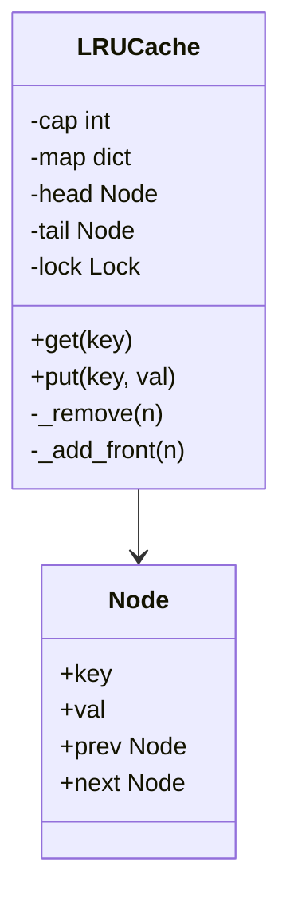

```python
import threading

class Node:
    __slots__ = ("key", "val", "prev", "next")
    def __init__(self, key=None, val=None):
        self.key, self.val, self.prev, self.next = key, val, None, None

class LRUCache:
    def __init__(self, capacity: int):
        self.cap = capacity
        self.map = {}
        self.head, self.tail = Node(), Node()
        self.head.next, self.tail.prev = self.tail, self.head
        self.lock = threading.Lock()

    def _remove(self, n):
        n.prev.next, n.next.prev = n.next, n.prev

    def _add_front(self, n):
        n.prev, n.next = self.head, self.head.next
        self.head.next.prev = n
        self.head.next = n

    def get(self, key):
        with self.lock:
            n = self.map.get(key)
            if not n:
                return None
            self._remove(n)
            self._add_front(n)
            return n.val

    def put(self, key, val):
        with self.lock:
            n = self.map.get(key)
            if n:
                n.val = val
                self._remove(n)
                self._add_front(n)
                return
            if len(self.map) >= self.cap:
                lru = self.tail.prev
                self._remove(lru)
                del self.map[lru.key]
            n = Node(key, val)
            self.map[key] = n
            self._add_front(n)
```

**Worked example (capacity 2).**
1. `put(a, 1)`: list is `a`.
2. `put(b, 2)`: list is `b, a`.
3. `get(a)` returns 1 and moves `a` to the front: `a, b`.
4. `put(c, 3)`: full, so evict the tail `b`. List is `c, a`.
5. `get(b)` returns None.

Python shortcut (say you know it): `collections.OrderedDict` with `move_to_end` and `popitem(last=False)`.

**Go version with a mutex** (uses the standard `container/list` doubly linked list). `entry` holds the key and value, `items` maps key to list element, and the same "move to front on access, remove from back when full" logic applies.

```go
type entry struct {
    key string
    val []byte
}

type LRU struct {
    mu    sync.Mutex
    cap   int
    ll    *list.List
    items map[string]*list.Element
}

func NewLRU(cap int) *LRU {
    return &LRU{cap: cap, ll: list.New(), items: make(map[string]*list.Element)}
}

func (c *LRU) Get(k string) ([]byte, bool) {
    c.mu.Lock()
    defer c.mu.Unlock()
    if e, ok := c.items[k]; ok {
        c.ll.MoveToFront(e)
        return e.Value.(*entry).val, true
    }
    return nil, false
}

func (c *LRU) Put(k string, v []byte) {
    c.mu.Lock()
    defer c.mu.Unlock()
    if e, ok := c.items[k]; ok {
        e.Value.(*entry).val = v
        c.ll.MoveToFront(e)
        return
    }
    if c.ll.Len() >= c.cap {
        old := c.ll.Back()
        c.ll.Remove(old)
        delete(c.items, old.Value.(*entry).key)
    }
    c.items[k] = c.ll.PushFront(&entry{k, v})
}
```

**Concurrency discussion.**
- Even `get` changes the list order, so a read-write lock does not help (every operation is a write). Use one mutex.
- To scale, **shard** the cache into N segments by `hash(key) % N`, each with its own lock (like Java's old ConcurrentHashMap). That makes LRU approximate globally, which is fine for a cache.
- Or use sample-based LRU (Redis evicts the oldest of a few random keys, 5 by default), which needs no list and has less contention.

**Extensions:** TTL per entry (store an expiry, check on get, plus a background sweeper), size-based capacity (track bytes), eviction callbacks, and metrics (hit rate).

**Speakable opener.**
> "I will use a hashmap for O(1) lookup and a doubly linked list for recency order, with sentinel head and tail nodes. Get moves the node to the front, put adds at the front and evicts from the tail when full. Since even get mutates the list, one mutex protects both structures, and if contention becomes a problem I would shard by key hash."

**Project tie-in.** At Masters India a Redis cache-aside layer cut DB read load by 30%. Redis's eviction policies (LRU, LFU, TTL) are exactly what this class implements in miniature.

---

## 2. LFU cache (O(1))

**In plain English.** An LFU (least frequently used) cache evicts the item that has been used the *fewest* times. If several items tie, it evicts the least recent among them. Think of a playlist that drops the song you have played least, and if two songs tie, the one you played longest ago.

**Design in plain words.**
- `vals` maps key to `(value, freq)`.
- `buckets` maps each frequency to an `OrderedDict` of keys, which keeps LRU order inside that frequency.
- `min_freq` points at the lowest frequency that currently has keys, so eviction is O(1): pop the oldest key from `buckets[min_freq]`.
- `_touch` moves a key from frequency f to f + 1, and bumps `min_freq` if bucket f just became empty.

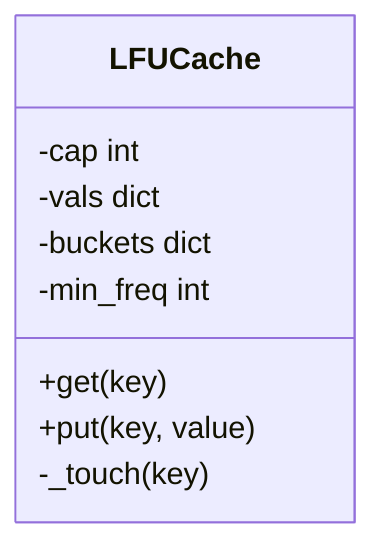

```python
from collections import defaultdict, OrderedDict

class LFUCache:
    def __init__(self, capacity):
        self.cap = capacity
        self.vals = {}                         # key -> (val, freq)
        self.buckets = defaultdict(OrderedDict)
        self.min_freq = 0

    def _touch(self, key):
        val, f = self.vals[key]
        del self.buckets[f][key]
        if not self.buckets[f]:
            del self.buckets[f]
            if self.min_freq == f:
                self.min_freq += 1
        self.vals[key] = (val, f + 1)
        self.buckets[f + 1][key] = None

    def get(self, key):
        if key not in self.vals:
            return -1
        self._touch(key)
        return self.vals[key][0]

    def put(self, key, value):
        if self.cap == 0:
            return
        if key in self.vals:
            self.vals[key] = (value, self.vals[key][1])
            self._touch(key)
            return
        if len(self.vals) >= self.cap:
            old, _ = self.buckets[self.min_freq].popitem(last=False)
            if not self.buckets[self.min_freq]:
                del self.buckets[self.min_freq]
            del self.vals[old]
        self.vals[key] = (value, 1)
        self.buckets[1][key] = None
        self.min_freq = 1
```

**Worked example (capacity 2).**
1. `put(a)`, `put(b)`: both at frequency 1. `min_freq = 1`.
2. `get(a)`: `a` moves to frequency 2. Bucket 1 still has `b`, so `min_freq` stays 1.
3. `put(c)`: full, evict the oldest key in bucket 1, which is `b`. Insert `c` at frequency 1.
4. `get(b)` returns -1.

**Concurrency:** same as LRU. Every operation mutates, so one lock around `get` and `put`, or sharding.

**When to pick LFU over LRU:** when popularity is stable over time (a product catalog), because one-off scans will not flush the popular items. LRU is better when recent items are most likely to be reused.

---

## 3. Rate limiter library (Strategy + thread safety)

**In plain English.** A rate limiter library answers one question per request: "may this caller go ahead right now?" The algorithm is pluggable (a Strategy), so you can switch between token bucket and sliding window without touching callers. Think of a nightclub with a door policy that can change from "10 people per minute" to "no more than 50 inside" without retraining the door staff on anything except the rule.

**Requirements:** `allow(key) -> bool`. Pluggable algorithms (token bucket, sliding window). Per-key limits. Thread-safe. An injectable clock for tests.

**Classes in plain words.**
- `RateLimiter` is the interface: one method, `allow(key)`.
- `TokenBucketLimiter` keeps, per key, how many tokens are left and when it last refilled. Tokens drip in at `rate` per second up to `capacity`. A request spends one token. This allows short bursts.
- `SlidingWindowLogLimiter` keeps, per key, a queue of request timestamps from the last `window` seconds. If there are fewer than `limit`, allow and record. Exact, but stores every timestamp.

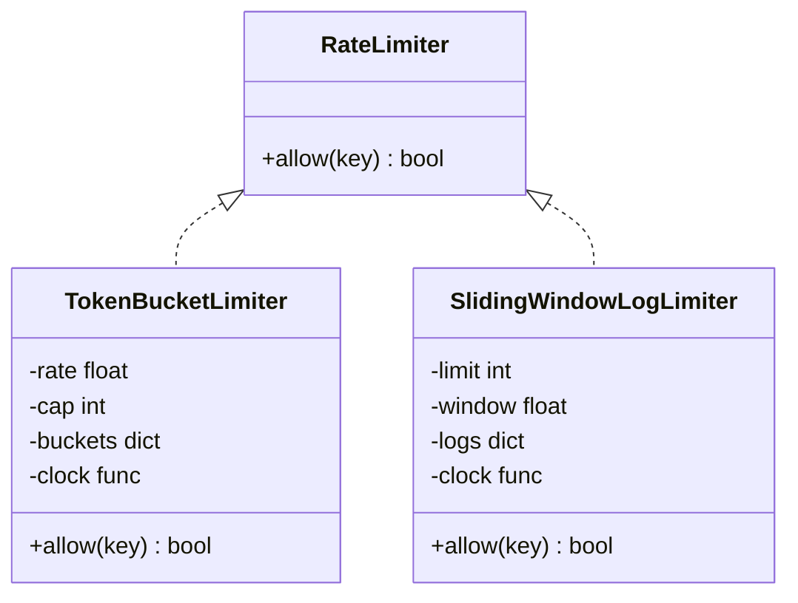

```python
import threading, time
from abc import ABC, abstractmethod
from collections import deque

class RateLimiter(ABC):
    @abstractmethod
    def allow(self, key: str) -> bool: ...

class TokenBucketLimiter(RateLimiter):
    def __init__(self, rate: float, capacity: int, clock=time.monotonic):
        self.rate, self.cap, self.clock = rate, capacity, clock
        self.buckets = {}                     # key -> [tokens, last]
        self.lock = threading.Lock()

    def allow(self, key):
        now = self.clock()
        with self.lock:
            tokens, last = self.buckets.get(key, (self.cap, now))
            tokens = min(self.cap, tokens + (now - last) * self.rate)
            if tokens >= 1:
                self.buckets[key] = (tokens - 1, now)
                return True
            self.buckets[key] = (tokens, now)
            return False

class SlidingWindowLogLimiter(RateLimiter):
    def __init__(self, limit: int, window_s: float, clock=time.monotonic):
        self.limit, self.window, self.clock = limit, window_s, clock
        self.logs = {}
        self.lock = threading.Lock()

    def allow(self, key):
        now = self.clock()
        with self.lock:
            q = self.logs.setdefault(key, deque())
            while q and q[0] <= now - self.window:
                q.popleft()
            if len(q) < self.limit:
                q.append(now)
                return True
            return False
```

**Worked example (token bucket, rate 1 per second, capacity 2, fake clock).**

| Time (s) | Tokens before | Allowed? | Tokens after |
|---|---|---|---|
| 0.0 | 2 (new key) | yes | 1 |
| 0.0 | 1 | yes | 0 |
| 0.0 | 0 | no | 0 |
| 0.5 | 0.5 | no | 0.5 |
| 1.0 | 1.0 | yes | 0 |

**Worked example (sliding window, limit 3 per 10 s).** Requests at t = 0, 2, 4 are allowed. t = 5 is denied (3 in the window). At t = 10.5 the entry from t = 0 has aged out, so it is allowed.

**Go token bucket** (per-key buckets under one mutex. Lock striping would be the next step). `now` is injected for tests.

```go
type bucket struct {
    tokens float64
    last   time.Time
}

type TokenBucket struct {
    mu      sync.Mutex
    rate    float64 // tokens per second
    cap     float64
    buckets map[string]*bucket
    now     func() time.Time
}

func (tb *TokenBucket) Allow(key string) bool {
    tb.mu.Lock()
    defer tb.mu.Unlock()
    t := tb.now()
    b, ok := tb.buckets[key]
    if !ok {
        b = &bucket{tokens: tb.cap, last: t}
        tb.buckets[key] = b
    }
    b.tokens = math.Min(tb.cap, b.tokens+t.Sub(b.last).Seconds()*tb.rate)
    b.last = t
    if b.tokens >= 1 {
        b.tokens--
        return true
    }
    return false
}
```

**Concurrency discussion.** A global lock becomes a bottleneck under many keys. Use a lock per key (a map of locks, itself guarded) or striped locks (N locks, pick one by `hash(key) % N`). Evict idle keys (LRU or TTL) so memory does not grow forever. The distributed version is [system design Q1](04_system_design_questions.md).

**Speakable opener.**
> "I will define a RateLimiter interface with one allow method, and implement token bucket and sliding window log as two strategies. Each keeps per-key state under a lock and takes an injected clock, so I can test refill behaviour without sleeping. The first scaling step is striped locks, and the distributed version moves the bucket into Redis with a Lua script."

**Project tie-in.** At Masters India, the client side of rate limiting mattered: calls to the government IRP used bounded concurrency and backoff with jitter, with a dead-letter queue after max attempts.

---

## 4. Parking lot

**In plain English.** Model a multi-floor car park: vehicles arrive, get a fitting spot and a ticket, and pay on exit. The interesting parts are matching vehicle sizes to spot sizes, making pricing pluggable, and making sure two entry gates never hand out the same spot.

**Requirements (clarify):** multiple floors. Spot types (small, medium, large; EV as an extension). Vehicles park in a fitting spot. Tickets on entry. Pay on exit with pluggable pricing. Show free spots per type. Several entry gates at once (concurrency).

**Entities:** `ParkingLot`, `Floor`, `Spot` (type, id, occupied), `Vehicle` (type, plate), `Ticket`, `SpotAssignmentStrategy`, `PricingStrategy`, `Payment`.

**Classes in plain words.**
- `VehicleType` and `SpotType` are enums. `FITS` says which spot types each vehicle can use, smallest first, so a bike takes a small spot before a large one.
- `Spot` knows its floor, type and current vehicle.
- `Vehicle` is frozen (immutable), because a plate and type never change.
- `Ticket` records who parked where and when.
- `PricingStrategy` is the interface. `HourlyPricing` rounds up to whole hours and multiplies by a rate per spot type.
- `ParkingLot` keeps a stack of free spots per type and a map of active tickets, all under one lock.

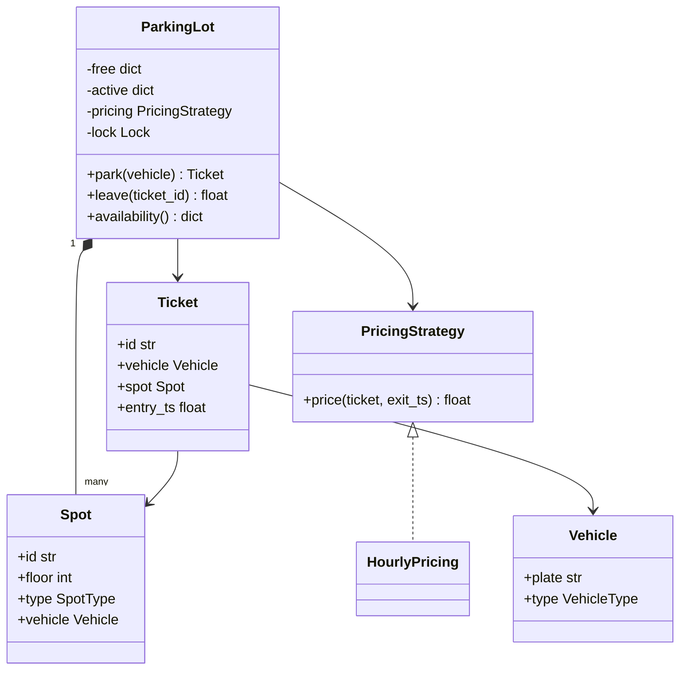

```python
from dataclasses import dataclass, field
from enum import Enum
import itertools, threading, time, uuid

class VehicleType(Enum):
    BIKE = 1; CAR = 2; TRUCK = 3

class SpotType(Enum):
    SMALL = 1; MEDIUM = 2; LARGE = 3

FITS = {
    VehicleType.BIKE: [SpotType.SMALL, SpotType.MEDIUM, SpotType.LARGE],
    VehicleType.CAR: [SpotType.MEDIUM, SpotType.LARGE],
    VehicleType.TRUCK: [SpotType.LARGE],
}

@dataclass
class Spot:
    id: str
    floor: int
    type: SpotType
    vehicle: "Vehicle | None" = None

@dataclass(frozen=True)
class Vehicle:
    plate: str
    type: VehicleType

@dataclass
class Ticket:
    id: str
    vehicle: Vehicle
    spot: Spot
    entry_ts: float

class PricingStrategy:
    def price(self, ticket: Ticket, exit_ts: float) -> float:
        raise NotImplementedError

class HourlyPricing(PricingStrategy):
    RATES = {SpotType.SMALL: 1.0, SpotType.MEDIUM: 2.0, SpotType.LARGE: 4.0}
    def price(self, ticket, exit_ts):
        hours = max(1, -(-int(exit_ts - ticket.entry_ts) // 3600))   # ceil
        return hours * self.RATES[ticket.spot.type]

class ParkingLot:
    def __init__(self, spots, pricing: PricingStrategy, clock=time.time):
        self.free = {t: [] for t in SpotType}       # free spot stacks per type
        for s in spots:
            self.free[s.type].append(s)
        self.active = {}                            # ticket_id -> Ticket
        self.pricing, self.clock = pricing, clock
        self.lock = threading.Lock()

    def park(self, vehicle: Vehicle) -> Ticket:
        with self.lock:                             # two gates can't grab the same spot
            for st in FITS[vehicle.type]:
                if self.free[st]:
                    spot = self.free[st].pop()
                    spot.vehicle = vehicle
                    t = Ticket(str(uuid.uuid4()), vehicle, spot, self.clock())
                    self.active[t.id] = t
                    return t
        raise RuntimeError("lot full for this vehicle type")

    def leave(self, ticket_id: str) -> float:
        with self.lock:
            t = self.active.pop(ticket_id)
            fee = self.pricing.price(t, self.clock())
            t.spot.vehicle = None
            self.free[t.spot.type].append(t.spot)
            return fee

    def availability(self):
        with self.lock:
            return {t.name: len(v) for t, v in self.free.items()}
```

**Worked example.** A car parks in a MEDIUM spot at t = 0 and leaves at t = 7,800 seconds (2 hours 10 minutes). The ceiling trick: `-(-7800 // 3600)` is `-(-3)` = 3 hours. Fee = 3 × 2.0 = 6.0. If no MEDIUM spot were free, `FITS` would try LARGE next and the fee would be 3 × 4.0 = 12.0.

**Talking points.**
- Spot assignment is a **strategy**. "Nearest to the gate" is a min-heap per type keyed by distance.
- Pricing is a **strategy** (hourly, flat, weekend, EV surcharge).
- **Concurrency:** one lock is simple and correct at gate throughput (a few cars a second). At scale, a lock per spot type, or a database with `SELECT ... FOR UPDATE SKIP LOCKED` to claim a free spot (each gate skips rows another gate has locked).
- **Extensions:** reservations, display boards (an **observer** on availability changes), and payment methods (a strategy).

**Speakable opener.**
> "The parts that vary are spot assignment and pricing, so both become strategies. The lot keeps a free-spot stack per type and an active-ticket map under one lock, which is enough for gate-level throughput and guarantees two gates never grab the same spot. If this moved to a database I would claim spots with SELECT FOR UPDATE SKIP LOCKED."

---

## 5. In-memory key-value store with TTL and transactions

**In plain English.** Build a mini Redis: store values by key, let keys expire after a time-to-live, and support transactions you can roll back, including nested ones. Think of writing in pencil inside a "begin" bracket. Rollback erases back to the bracket. Commit makes it ink (or, if nested, hands the eraser marks to the outer bracket).

**Requirements:** `set`, `get`, `delete`, `set(key, val, ttl)`, `begin`, `commit`, `rollback` (nested transactions). Thread-safe.

**Design in plain words.**
- `data` maps key to `(value, expires_at or None)`.
- `expiry` is a min-heap of `(expires_at, key)` so a sweeper can find the next key to expire in O(log n).
- `tx` is a stack of undo logs. Each level records, for every key it touched, the value *before* the first change in that level (or a `_MISSING` marker if the key did not exist).
- **Lazy expiry:** `get` checks whether a key has expired and deletes it on the spot. **Active expiry:** `sweep` runs in the background and removes expired keys from the heap.
- `RLock` (a re-entrant lock) lets a method that holds the lock call another method that takes it again.

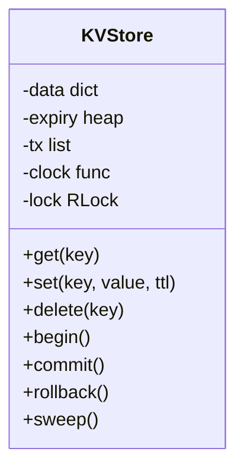

```python
import heapq, threading, time

class KVStore:
    def __init__(self, clock=time.monotonic):
        self.data = {}              # key -> (value, expires_at or None)
        self.expiry = []            # heap of (expires_at, key)
        self.tx = []                # stack of dicts: key -> old value or _MISSING
        self.clock = clock
        self.lock = threading.RLock()

    _MISSING = object()

    def _expired(self, key):
        v = self.data.get(key)
        return v is not None and v[1] is not None and v[1] <= self.clock()

    def get(self, key):
        with self.lock:
            if self._expired(key):
                del self.data[key]                  # lazy expiry
            v = self.data.get(key)
            return None if v is None else v[0]

    def _record(self, key):
        if self.tx and key not in self.tx[-1]:
            self.tx[-1][key] = self.data.get(key, self._MISSING)

    def set(self, key, value, ttl=None):
        with self.lock:
            self._record(key)
            exp = self.clock() + ttl if ttl else None
            self.data[key] = (value, exp)
            if exp:
                heapq.heappush(self.expiry, (exp, key))

    def delete(self, key):
        with self.lock:
            self._record(key)
            self.data.pop(key, None)

    def begin(self):
        with self.lock:
            self.tx.append({})

    def rollback(self):
        with self.lock:
            if not self.tx:
                raise RuntimeError("no transaction")
            for key, old in self.tx.pop().items():
                if old is self._MISSING:
                    self.data.pop(key, None)
                else:
                    self.data[key] = old

    def commit(self):
        with self.lock:
            if not self.tx:
                raise RuntimeError("no transaction")
            changes = self.tx.pop()
            if self.tx:                         # nested: merge undo info into the parent
                for k, old in changes.items():
                    self.tx[-1].setdefault(k, old)

    def sweep(self):
        """Active expiry, run by a background thread."""
        with self.lock:
            now = self.clock()
            while self.expiry and self.expiry[0][0] <= now:
                exp, key = heapq.heappop(self.expiry)
                v = self.data.get(key)
                if v and v[1] == exp:           # skip stale heap entries
                    del self.data[key]
```

**Worked example (nested transactions).**
1. `set(a, 1)`. Data: `a = 1`.
2. `begin()`, then `set(a, 2)`. Level 1 undo log records `a` was 1.
3. `begin()`, then `delete(a)`. Level 2 undo log records `a` was 2.
4. `rollback()` pops level 2 and restores `a = 2`.
5. `commit()` pops level 1. No parent, so the change is final. `get(a)` returns 2.

If instead step 4 were `commit()`, level 2's undo entry would merge into level 1 with `setdefault`, which keeps level 1's older value (`a` was 1). A later rollback of level 1 would then correctly restore `a = 1`.

**Worked example (TTL).** `set(s, "x", ttl=5)` at t = 100 stores expiry 105 and pushes `(105, s)` on the heap. `get(s)` at t = 104 returns "x". At t = 106 `get` sees it expired and deletes it. If `s` was overwritten at t = 103 with a new TTL, the old heap entry `(105, s)` no longer matches the stored expiry, so `sweep` skips it ("stale heap entries").

**Talking points.** Lazy plus active expiry is how Redis does it. The undo log per transaction level makes rollback cost proportional to the number of changes, not the size of the store. Note this transaction model is single-client (global). Multi-client isolation would need MVCC or per-session write sets with commit-time conflict checks (optimistic concurrency). Persistence would be an append-only log (AOF) plus periodic snapshots.

**Speakable opener.**
> "Data is a dict of value and expiry, plus a min-heap of expiries for active sweeping, and get also expires lazily. Transactions are a stack of undo logs that record each key's value before its first change at that level. Rollback replays the top log, and a nested commit merges its undo info into the parent, keeping the older value. One re-entrant lock makes it thread-safe."

---

## 6. Logger / logging framework

**In plain English.** A logging framework lets code write messages at different importance levels to one or more destinations, without slowing down the request that is logging. Think of a newsroom: reporters (callers) hand notes to a desk (the logger), which filters by importance and passes them to printers (handlers), and a mailroom (the async handler) delivers in the background so reporters never wait.

**Requirements:** levels (DEBUG, INFO, WARN, ERROR), multiple sinks (console, file, remote), formatting, async (do not block callers), thread-safe.

**Design in plain words.**
- `Logger` has a minimum level and a list of `Handler`s. It drops messages below its level and sends the rest to every handler (chain of responsibility / observer).
- `Handler` is the interface with one method, `emit(record)`.
- `ConsoleHandler` writes JSON lines to stdout.
- `AsyncHandler` is a **decorator** around another handler: it puts records on a bounded queue and a background thread drains it. When the queue is full it drops the record and counts the drop, so a slow sink can never block the request path. Say this choice out loud (dropping vs blocking).
- `Formatter` would be a strategy (JSON or text).

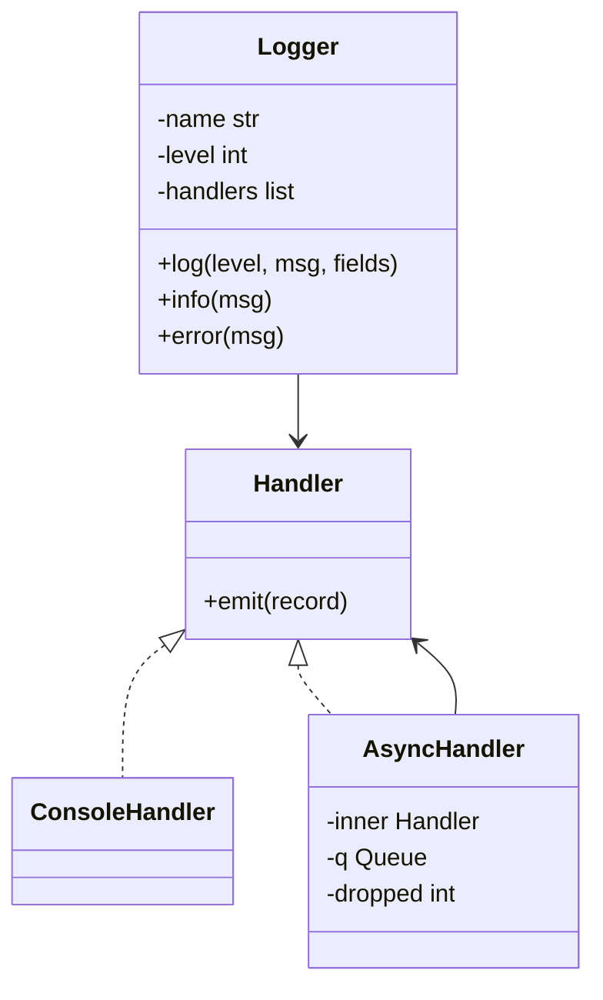

```python
import queue, threading, json, time, sys

class Handler:
    def emit(self, record: dict): raise NotImplementedError

class ConsoleHandler(Handler):
    def emit(self, record):
        sys.stdout.write(json.dumps(record) + "\n")

class AsyncHandler(Handler):
    def __init__(self, inner: Handler, maxsize=10_000):
        self.inner, self.q = inner, queue.Queue(maxsize)
        self.dropped = 0
        threading.Thread(target=self._run, daemon=True).start()

    def emit(self, record):
        try:
            self.q.put_nowait(record)
        except queue.Full:
            self.dropped += 1                   # never block the request path

    def _run(self):
        while True:
            self.inner.emit(self.q.get())

class Logger:
    LEVELS = {"DEBUG": 10, "INFO": 20, "WARN": 30, "ERROR": 40}

    def __init__(self, name, level="INFO", handlers=()):
        self.name, self.level, self.handlers = name, self.LEVELS[level], list(handlers)

    def log(self, level, msg, **fields):
        if self.LEVELS[level] < self.level:
            return
        rec = {"ts": time.time(), "level": level, "logger": self.name, "msg": msg, **fields}
        for h in self.handlers:
            h.emit(rec)

    def info(self, msg, **f): self.log("INFO", msg, **f)
    def error(self, msg, **f): self.log("ERROR", msg, **f)
```

**Worked example.**

```python
log = Logger("invoices", level="INFO", handlers=[AsyncHandler(ConsoleHandler())])
log.log("DEBUG", "parsed row")                         # dropped: below INFO
log.info("submitted", request_id="r-91", invoice="INV-7")
# background thread prints:
# {"ts": 1700000000.1, "level": "INFO", "logger": "invoices", "msg": "submitted", "request_id": "r-91", "invoice": "INV-7"}
```

**Concurrency:** `queue.Queue` is thread-safe, so many request threads can call `emit` at once. The `dropped` counter increment is not atomic in principle, so protect it with a lock or use a per-thread counter if exact counts matter. Expose `dropped` as a metric.

**Extensions:** a file handler with rotation, sampling for DEBUG, a remote handler with batching and retry, and per-module levels.

**Project tie-in.** Structured JSON logs with a `request_id` field are what made ELK triage about 70% faster at Masters India (ESTIMATED, roughly 30 minutes to under 10). The `**fields` argument above is how you get that request ID into every line.

---

## 7. In-memory pub-sub / message broker

**In plain English.** A pub-sub broker lets publishers post messages to a topic and lets every subscriber group read all of them at its own pace. This version is Kafka in miniature: each topic is an append-only log, and each consumer group keeps its own bookmark (offset). Like a noticeboard where every team has its own sticky note marking how far down they have read.

**Requirements:** topics, publish, subscribe with a callback or by polling. Each subscriber group gets every message (fan-out). Consumer offsets (replay). Bounded memory.

**Classes in plain words.**
- `Topic` holds the log (a list), a retention limit, and `base`, the offset of the first message still kept. When the log exceeds retention, old messages are dropped and `base` moves forward. A `Condition` lets readers wait for new messages instead of spinning.
- `read(offset)` returns up to `max_n` messages from that offset and the next offset. If the reader fell behind retention, it starts from the oldest kept message.
- `Broker` maps names to topics and `(topic, group)` to committed offsets. `poll` reads from the committed offset. `commit` moves the bookmark.

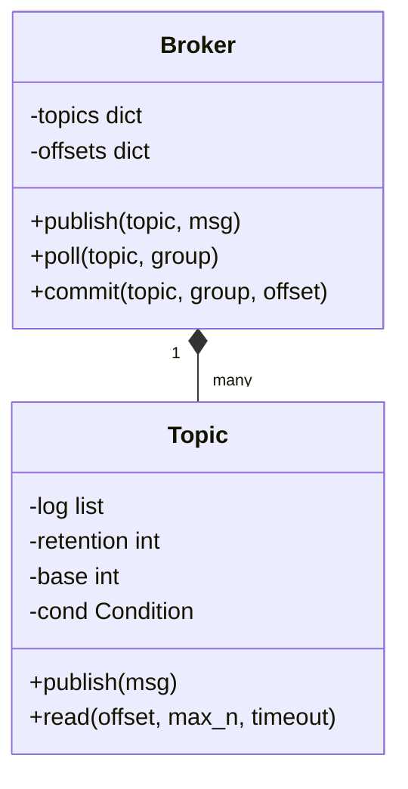

```python
import threading
from collections import defaultdict

class Topic:
    def __init__(self, retention=100_000):
        self.log, self.retention = [], retention
        self.base = 0                    # offset of log[0]
        self.cond = threading.Condition()

    def publish(self, msg):
        with self.cond:
            self.log.append(msg)
            if len(self.log) > self.retention:
                drop = len(self.log) - self.retention
                del self.log[:drop]
                self.base += drop
            self.cond.notify_all()

    def read(self, offset, max_n=100, timeout=1.0):
        with self.cond:
            if offset >= self.base + len(self.log):
                self.cond.wait(timeout)
            start = max(offset, self.base) - self.base
            batch = self.log[start:start + max_n]
            return batch, self.base + start + len(batch)

class Broker:
    def __init__(self):
        self.topics = defaultdict(Topic)
        self.offsets = defaultdict(int)          # (topic, group) -> offset

    def publish(self, topic, msg):
        self.topics[topic].publish(msg)

    def poll(self, topic, group):
        batch, nxt = self.topics[topic].read(self.offsets[(topic, group)])
        return batch, nxt

    def commit(self, topic, group, offset):     # commit after processing = at-least-once
        self.offsets[(topic, group)] = offset
```

**Worked example (why commit-after-process means at-least-once).**
1. Publish `m0, m1, m2` to `invoices`.
2. Group `billing` polls and gets `[m0, m1, m2]` with next offset 3.
3. It processes `m0` and `m1`, then crashes before calling `commit`.
4. On restart it polls from committed offset 0 and gets all three again. `m0` and `m1` are processed twice, so the consumer must be idempotent.
5. Group `analytics` is unaffected, because it has its own offset.

**Talking points.** Offsets committed after processing give at-least-once delivery. Retention drops old messages, and a slow group can fall behind retention, so detect it and alert. Partition each topic for parallelism. Bounded logs provide backpressure. It is Kafka in miniature ([SD Q9](04_system_design_questions.md)).

**Project tie-in.** Real Kafka at Masters India (partitioned by client GSTIN, offset reset to replay after a parser bug) and at Uber Menu (keyed dedup with Flink, idempotent catalog upserts) relied on exactly this at-least-once plus idempotent-consumer behaviour.

---

## 8. Circuit breaker class (State pattern)

**In plain English.** A circuit breaker wraps calls to a flaky dependency. After too many failures it "trips" and refuses calls for a cool-off period, then lets one trial call through to test recovery. Like the fuse box at home: it cuts power when something is wrong, and you flip it back to test.

**Design in plain words.**
- Three states: **CLOSED** (normal, counting failures), **OPEN** (reject immediately with `CircuitOpen`), **HALF_OPEN** (one trial call allowed).
- In OPEN, once `cooldown` has passed, the next caller moves it to HALF_OPEN and becomes the trial. Other callers during the trial are rejected.
- A failure in HALF_OPEN, or reaching the failure threshold in CLOSED, moves it to OPEN and records the time.
- Any success resets to CLOSED with zero failures.
- The lock protects only the state changes, not the call itself, so slow calls do not block other threads from checking state.

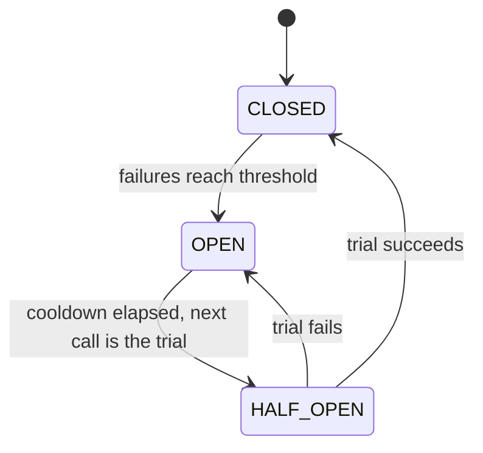

```python
import threading, time

class CircuitOpen(Exception):
    pass

class CircuitBreaker:
    CLOSED, OPEN, HALF_OPEN = "closed", "open", "half_open"

    def __init__(self, failure_threshold=5, cooldown_s=30, clock=time.monotonic):
        self.threshold, self.cooldown, self.clock = failure_threshold, cooldown_s, clock
        self.state, self.failures, self.opened_at = self.CLOSED, 0, 0.0
        self.lock = threading.Lock()

    def call(self, fn, *args, **kwargs):
        with self.lock:
            if self.state == self.OPEN:
                if self.clock() - self.opened_at >= self.cooldown:
                    self.state = self.HALF_OPEN      # allow one trial
                else:
                    raise CircuitOpen()
            elif self.state == self.HALF_OPEN:
                raise CircuitOpen()                  # trial already in flight
        try:
            result = fn(*args, **kwargs)
        except Exception:
            with self.lock:
                self.failures += 1
                if self.state == self.HALF_OPEN or self.failures >= self.threshold:
                    self.state, self.opened_at = self.OPEN, self.clock()
            raise
        with self.lock:
            self.state, self.failures = self.CLOSED, 0
        return result
```

**Worked example (threshold 5, cooldown 30 s).** Five failures in a row at t = 0 to 4 trip it to OPEN at t = 4. Calls at t = 10 and t = 20 get `CircuitOpen` instantly without touching the dependency. At t = 34 the next call becomes the trial. If it succeeds, the breaker is CLOSED again. If it fails, it is OPEN until t = 64.

**Fallback belongs to the caller:**

```python
try:
    score = breaker.call(llm_score, item)
except (CircuitOpen, TimeoutError):
    score = deterministic_score(item)
```

**Project tie-in.** That is exactly the Keep/Drop orchestration registry behaviour at Impact Analytics: a breaker per provider that trips after about 5 consecutive failures or a fail fraction, and items that fall back to the deterministic baseline score so the run still finishes. Fallbacks are counted in the per-run telemetry.

**Speakable opener.**
> "This is the State pattern with three states. Closed counts failures, Open rejects instantly until a cooldown passes, and Half-open lets exactly one trial through. I keep the lock only around state transitions, not around the call, and I leave the fallback to the caller, because the right fallback depends on the business. In my batch engine the fallback is the deterministic score."

---

## 9. Consistent hashing ring

**In plain English.** Consistent hashing decides which server owns which key, in a way that moves very few keys when servers are added or removed. Picture a clock face. Servers sit at several positions around it, and each key belongs to the next server clockwise. Adding a server only takes over the keys just before it.

**Design in plain words.**
- `ring` is a sorted list of hash positions. `owner` maps each position to its server.
- Each server gets `vnodes` positions (virtual nodes) by hashing `"node#i"`. More positions give a more even spread.
- `get(key)` hashes the key and uses binary search (`bisect`) to find the next position clockwise, wrapping around with `% len(ring)`.
- `get_n(key, n)` walks clockwise collecting *distinct* servers, which gives replica placement.

```python
import bisect, hashlib

class HashRing:
    def __init__(self, vnodes=100):
        self.vnodes = vnodes
        self.ring = []            # sorted hashes
        self.owner = {}           # hash -> node

    @staticmethod
    def _h(s: str) -> int:
        return int(hashlib.md5(s.encode()).hexdigest(), 16)

    def add(self, node):
        for i in range(self.vnodes):
            h = self._h(f"{node}#{i}")
            bisect.insort(self.ring, h)
            self.owner[h] = node

    def remove(self, node):
        for i in range(self.vnodes):
            h = self._h(f"{node}#{i}")
            self.ring.remove(h)
            del self.owner[h]

    def get(self, key):
        if not self.ring:
            return None
        i = bisect.bisect(self.ring, self._h(key)) % len(self.ring)
        return self.owner[self.ring[i]]

    def get_n(self, key, n):                 # replicas: next n distinct nodes clockwise
        out, i = [], bisect.bisect(self.ring, self._h(key))
        while len(out) < n and len(out) < len(set(self.owner.values())):
            node = self.owner[self.ring[i % len(self.ring)]]
            if node not in out:
                out.append(node)
            i += 1
        return out
```

**Worked example.** Add servers A, B and C with 100 virtual nodes each, so the ring has 300 positions. Each server owns roughly a third of keys. Remove B: only B's keys move, spread over A and C, so about 1/3 of keys move. With plain `hash % 3` changing to `hash % 2`, about half or more of all keys would move.

**Talking points.**
- MD5 is used for spread, not security. Any fast, well-distributed hash works.
- `add` and `remove` are O(vnodes × N) because of list inserts. A balanced tree or a rebuilt sorted array is fine for rare membership changes.
- Not thread-safe as written. Membership changes are rare, so build a new ring and swap the reference atomically (copy-on-write), so readers never see a half-built ring.

**Where it is used:** cache clusters (SD Q5), Dynamo-style KV stores (SD Q2).

---

## 10. Vending machine (State pattern)

**In plain English.** A vending machine behaves differently depending on whether you have inserted money. Instead of a tangle of `if` statements, each state is its own class that knows which actions are valid. Like a board game where the rules change by phase.

**States:** Idle, then HasMoney, then (dispensing) back to Idle, plus an out-of-stock check. Each state class handles `insert`, `select` and `refund`, and sets the next state. Inventory is a map of slot to `(product, price, count)`. Making change is greedy for canonical coin systems (like 1, 2, 5, 10), where always taking the biggest coin is optimal.

**Classes in plain words.**
- `State` is the base: every action raises "invalid" unless a subclass allows it.
- `Idle` only accepts `insert`, which adds to the balance and moves to `HasMoney`.
- `HasMoney` accepts more money, a selection (checks stock and funds, decrements stock, returns product and change, goes back to Idle), or a refund.
- `VendingMachine` holds inventory, balance and the current state, and forwards every call to the state.

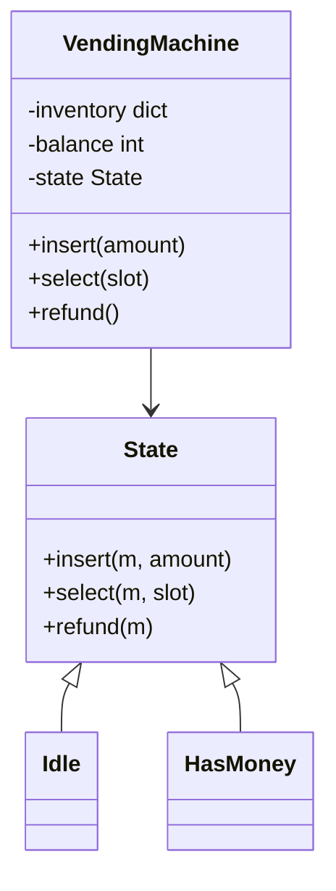

```python
class State:
    def insert(self, m, amount): raise RuntimeError("invalid")
    def select(self, m, slot): raise RuntimeError("invalid")
    def refund(self, m): raise RuntimeError("invalid")

class Idle(State):
    def insert(self, m, amount):
        m.balance += amount
        m.state = HasMoney()

class HasMoney(State):
    def insert(self, m, amount):
        m.balance += amount
    def select(self, m, slot):
        product, price, count = m.inventory[slot]
        if count == 0:
            raise RuntimeError("out of stock")
        if m.balance < price:
            raise RuntimeError("insufficient funds")
        m.inventory[slot] = (product, price, count - 1)
        change, m.balance = m.balance - price, 0
        m.state = Idle()
        return product, change
    def refund(self, m):
        amount, m.balance = m.balance, 0
        m.state = Idle()
        return amount

class VendingMachine:
    def __init__(self, inventory):
        self.inventory, self.balance, self.state = inventory, 0, Idle()
    def insert(self, amount): return self.state.insert(self, amount)
    def select(self, slot): return self.state.select(self, slot)
    def refund(self): return self.state.refund(self)
```

**Worked example.**

```python
vm = VendingMachine({"A1": ("chips", 30, 2)})
vm.select("A1")      # RuntimeError: invalid (Idle does not allow select)
vm.insert(20)        # Idle -> HasMoney, balance 20
vm.select("A1")      # RuntimeError: insufficient funds
vm.insert(30)        # balance 50
vm.select("A1")      # ("chips", 20), stock now 1, back to Idle
```

**Concurrency:** a physical machine has one user, but if exposed over a network, wrap each public method in a lock so two selections cannot both take the last item.

**Project tie-in.** The same idea is the polymorphic review-status model at Uber FRM (via EPAM): Draft, Review, ReOpen and Closed, reused across screens, with FSM gates such as the 50% delta-variance check that blocks a transition until reviewed.

---

## 11. Elevator system

**In plain English.** Several lifts serve many floors. People press up or down in the hall (hall calls) or a floor number inside the lift (car calls). The design is about which lift answers which call, and in what order a lift visits its stops, while requests arrive at any moment.

**Requirements:** N elevators, M floors, hall calls (up or down) and car calls (floor buttons), minimise wait time, concurrency (requests arrive any time).

**Entities in plain words.**
- `Elevator`: current floor, direction, a set of stops, and a state (IDLE, MOVING_UP, MOVING_DOWN, DOORS_OPEN, MAINTENANCE).
- `Request`: floor and direction.
- `Dispatcher`: assigns each hall call to an elevator using a pluggable `SchedulingStrategy`.
- `Controller`: one loop per elevator that moves it and opens doors.

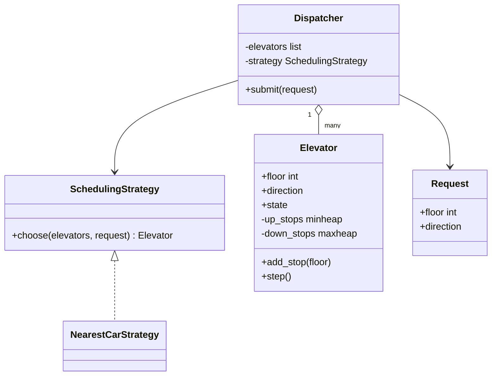

**Scheduling.**
- **SCAN / LOOK per elevator:** keep moving in the current direction serving stops, and reverse only when no stops remain ahead. Like a lift that does not turn around halfway up for someone below. Implement with two heaps: up-stops as a min-heap, down-stops as a max-heap.
- **Dispatch** a hall call to the elevator with the lowest cost: an idle elevator's distance, or the distance if it is already moving toward the call in the same direction, or otherwise the distance to its turnaround point plus the distance back.

```python
def cost(e, req):
    if e.state == "IDLE":
        return abs(e.floor - req.floor)
    moving_up = e.state == "MOVING_UP"
    if moving_up and req.direction == "UP" and req.floor >= e.floor:
        return req.floor - e.floor
    if not moving_up and req.direction == "DOWN" and req.floor <= e.floor:
        return e.floor - req.floor
    turn = e.highest_stop() if moving_up else e.lowest_stop()
    return abs(turn - e.floor) + abs(turn - req.floor)
```

(`highest_stop` and `lowest_stop` are small helpers on `Elevator`.)

**Worked example.** Lift 1 is idle at floor 2. Lift 2 is at floor 5 moving up to 9. A hall call comes at floor 7 going up. Cost for lift 1 = |2 - 7| = 5. Cost for lift 2 = 7 - 5 = 2, because it is already heading that way. Assign lift 2.

**Concurrency:** a thread-safe request queue feeds the dispatcher. Each elevator runs in its own thread or goroutine with a lock on its stop set. In Go: a channel per elevator for assigned requests, and a `select` loop with a ticker for movement.

**Extensions:** maintenance mode, VIP or fire-service override, energy-saving parking of idle lifts, and destination dispatch (passengers enter their floor in the hall).

---

## 12. Movie ticket booking (BookMyShow): the concurrency part

**In plain English.** Many people look at the same seat map at once. The hard part is making sure two users cannot both buy seat F7. The standard answer is a short temporary hold while the user pays, then a confirm that only succeeds if the hold is still theirs.

**Hard part:** two users selecting the same seat.

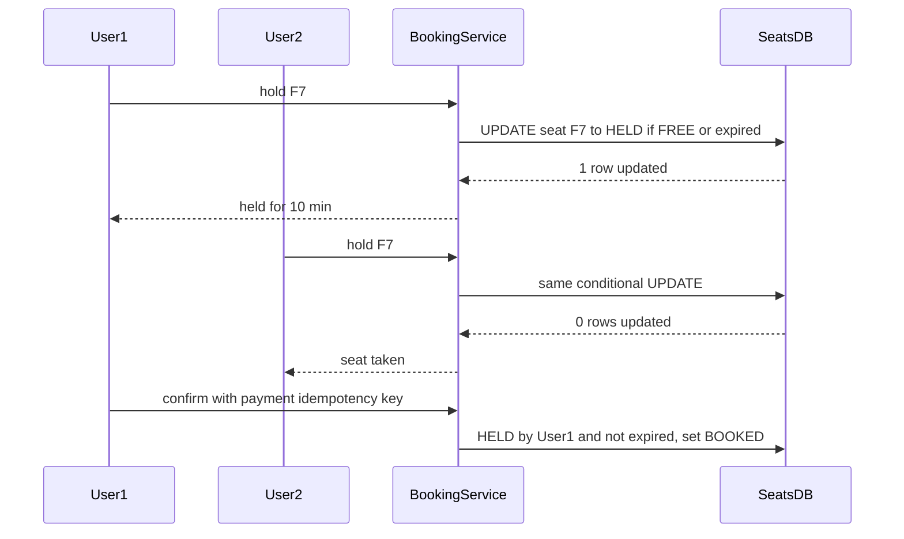

*What to notice:* the database's conditional update is the referee. Whoever's update touches the row wins, and the other sees 0 rows.

- **Temporary hold:** `hold(show_id, seats, user)` sets the seat status to HELD with `hold_expires_at = now + 10 min`, atomically:
  - Database: `UPDATE seats SET status='HELD', user=?, expires=? WHERE show_id=? AND seat_id IN (...) AND (status='FREE' OR expires < now)`, then check that the affected row count equals the seat count. Otherwise roll back, so you never hold half a group booking.
  - Or optimistic versions per seat, or Redis `SET seat:{show}:{id} user NX PX 600000` per seat (NX means only if not exists, PX 600000 is a 10-minute expiry), made all-or-nothing with a Lua script.
- **Confirm** after payment: if HELD by this user and not expired, set BOOKED. Payment uses an idempotency key so a retried payment does not charge twice.
- **Expiry:** lazy (the `expires < now` condition in the UPDATE) plus a sweeper that frees stale holds.
- **Entities:** Movie, Theater, Screen, Show, Seat, Booking, Payment. A pricing strategy per seat class.

**Worked example.** A user holds seats F7 and F8. The UPDATE affects only 1 row because F8 was just taken. 1 is not equal to 2, so the transaction rolls back and F7 is released too. The user is asked to pick again.

**Project tie-in.** This is the same **optimistic row locking** idea I used at Uber FRM (via EPAM) so concurrent reviewers never overwrite each other: the update includes the expected version, and zero rows updated means someone else got there first.

More on how this came up in the real loop: [08b backend, Python and DSA](08b_backend_python_dsa.md).

---

## 13. Splitwise (expense sharing)

**In plain English.** Friends share expenses. The app records who paid what, splits each expense among people, keeps running balances, and suggests a small number of payments to settle up.

**Classes in plain words.**
- `User`, `Group`.
- `Expense`: payer, amount, participants, and a split strategy.
- `SplitStrategy` (a **Strategy**): EQUAL, EXACT or PERCENT. Each validates its inputs (percentages must add to 100, exact amounts must add to the total).
- `BalanceSheet`: `balances[a][b]` = how much a owes b.

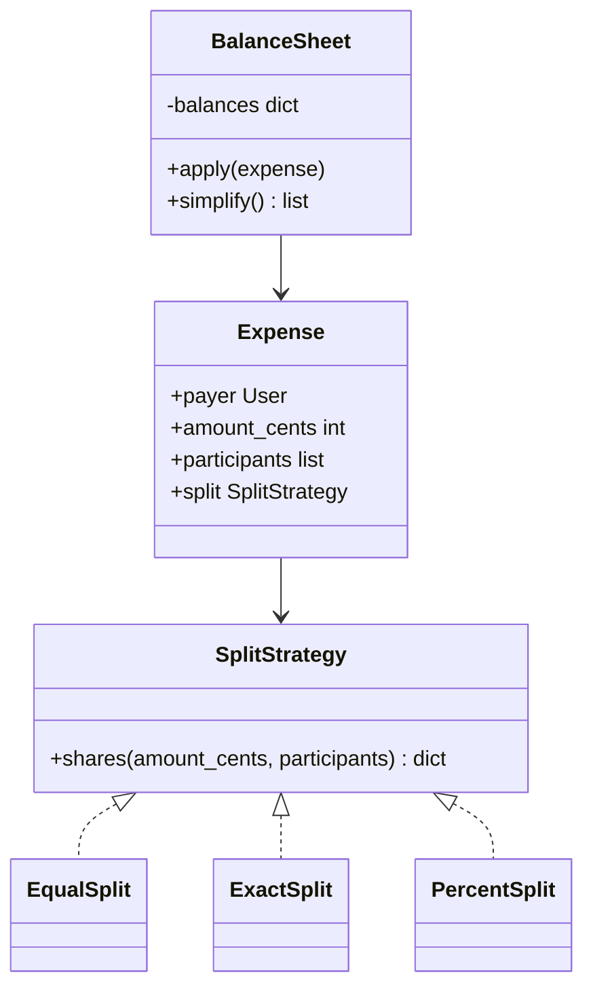

- **Simplify debts:** compute each user's net balance (what they are owed minus what they owe). Then greedily match the largest creditor with the largest debtor, using two heaps. That gives at most n - 1 transactions. The true minimum is NP-hard in general, so say "greedy".
- **Money:** use integer cents, never floats. Distribute rounding remainders deterministically (for example, the first k participants get one extra cent).

```python
def equal_shares(amount_cents, people):
    base, rem = divmod(amount_cents, len(people))
    return {p: base + (1 if i < rem else 0) for i, p in enumerate(people)}
# equal_shares(1000, ["A","B","C"]) -> {"A": 334, "B": 333, "C": 333}
```

**Worked example (simplify).** Net balances: A +50, B +30, C -60, D -20.
1. Largest creditor A (50), largest debtor C (60). C pays A 50. Now A 0, C -10.
2. Creditor B (30), largest debtor D (20). D pays B 20. Now B +10.
3. C pays B 10. Everyone is at 0.

Three payments for four people, which matches the n - 1 bound.

---

## 14. In-memory file system

**In plain English.** Model folders and files in memory, with commands like `mkdir -p`, `ls`, and reading or appending file content. Folders contain folders and files, and both can answer "how big are you?", which is the **Composite** pattern.

**Classes in plain words.**
- `Node` is the shared base with a name and `size()`.
- `Directory` holds a map of child name to node. Its size is the sum of its children.
- `File` holds content. Its size is the content length.
- `FileSystem` parses paths by `/` and walks from the root.

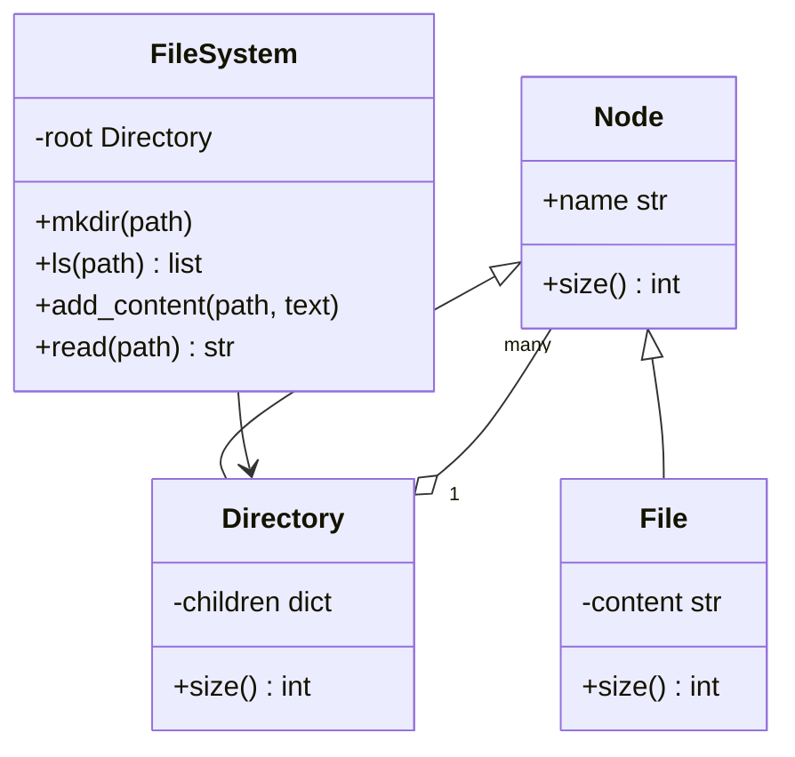

```python
class FileSystem:
    def __init__(self):
        self.root = {"dirs": {}, "files": {}}
    def _walk(self, path, create=False):
        node = self.root
        for part in [p for p in path.split("/") if p]:
            if part not in node["dirs"]:
                if not create:
                    raise FileNotFoundError(path)
                node["dirs"][part] = {"dirs": {}, "files": {}}
            node = node["dirs"][part]
        return node
    def mkdir(self, path):                       # mkdir -p
        self._walk(path, create=True)
    def ls(self, path):
        return sorted({**self._walk(path)["dirs"], **self._walk(path)["files"]})
# fs.mkdir("/a/b/c"); fs.ls("/a") -> ["b"]
```

(A compact dictionary version for a whiteboard. Real `ls` on a file path returns just the file name, and `add_content` / `read` would split off the last path segment as the file name.)

- Commands: `mkdir -p`, `ls` (sorted), `addContentToFile`, `readContentFromFile`, with path parsing by `/` and walking from the root.
- **Extensions:** permissions, size (composite `size()`), search by name (DFS, depth-first search), and a trie-shaped path index for fast prefix lookups.
- **Concurrency:** a read-write lock per directory, or one global lock for simplicity. Renames across directories need both locks taken in a fixed order to avoid deadlock.

---

## 15. Task scheduler / delayed job executor (LLD version)

**In plain English.** Run tasks after a delay or on a repeating schedule, using a pool of worker threads. Think of a kitchen timer rack: timers are sorted by when they ring, one person watches the soonest timer, and when it rings, they hand the dish to whichever cook is free.

**Requirements:** `schedule(task, delay)`, `schedule_at_fixed_rate(task, period)`, cancel, and a worker pool.

**Design in plain words.**
- A **min-heap** of `(run_at, seq, job)` keeps the soonest job on top. `seq` breaks ties so jobs with the same time keep insertion order and dicts are never compared.
- A **Condition** variable guards the heap. The scheduler thread sleeps until the earliest `run_at` with `cond.wait(timeout=run_at - now)`. When a sooner job is added, `notify` wakes it early so it can re-check.
- Due jobs are handed to a `ThreadPoolExecutor`, so a slow task never delays the scheduler loop.
- Recurring jobs re-push themselves with `run_at + period`.
- Cancel marks a flag. The job is skipped when it reaches the top (lazy deletion), which avoids searching the heap.

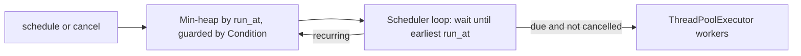

```python
import heapq, itertools, threading, time
from concurrent.futures import ThreadPoolExecutor

class Scheduler:
    def __init__(self, workers=4):
        self.heap, self.seq = [], itertools.count()
        self.cond = threading.Condition()
        self.pool = ThreadPoolExecutor(workers)
        self.running = True
        threading.Thread(target=self._loop, daemon=True).start()

    def schedule(self, fn, delay, period=None):
        job = {"fn": fn, "period": period, "cancelled": False}
        with self.cond:
            heapq.heappush(self.heap, (time.monotonic() + delay, next(self.seq), job))
            self.cond.notify()
        return job

    def cancel(self, job):
        job["cancelled"] = True

    def _loop(self):
        while self.running:
            with self.cond:
                while not self.heap:
                    self.cond.wait()
                run_at, _, job = self.heap[0]
                now = time.monotonic()
                if run_at > now:
                    self.cond.wait(run_at - now)     # may wake early on a new job
                    continue
                heapq.heappop(self.heap)
                if job["period"] and not job["cancelled"]:
                    heapq.heappush(self.heap, (run_at + job["period"], next(self.seq), job))
            if not job["cancelled"]:
                self.pool.submit(job["fn"])
```

**Worked example.** At t = 0, `schedule(report, 5)` is pushed and the loop sleeps for 5 seconds. At t = 1, `schedule(ping, 1)` is pushed with `run_at = 2` and `notify` wakes the loop. The heap top is now `ping`, so the loop sleeps 1 second, runs `ping` at t = 2, then sleeps until t = 5 for `report`.

**Talking points.**
- Using `run_at + period` (not `now + period`) keeps a fixed rate with no drift.
- If tasks run longer than their period, they overlap in the pool. Say whether that is allowed, or skip a run if the previous one is still going.
- Persistence and distribution turn this into the job scheduler in [SD Q6](04_system_design_questions.md).

**Project tie-in.** The AssortSmart orchestration registry is the batch, durable cousin of this: bounded parallel batches, hard timeouts, checkpoints and `--resume`, instead of an in-memory heap.

---

## LLD answer checklist (say it at the end)

**In plain English.** Close every LLD answer by walking through these five points in about a minute. It shows you think about change, threads, failure, testing and scale without being asked.

1. Which parts vary, and which interface hides them.
2. Which objects are shared across threads, and how they are protected.
3. How it fails (invalid input, full capacity, timeouts) and what the caller sees.
4. How I would test it (fakes via DI, a concurrency stress test, property tests).
5. How it would become distributed (sharding, persistence, replication), which connects to system design.

**Speakable example (for the LRU cache).**
> "The part that varies is the eviction policy, so in a fuller version I would put it behind an EvictionPolicy interface. The cache is shared, so one mutex protects both the map and the list, and I would shard by key hash if contention showed up. A miss returns None rather than raising. I would test with a fake clock for TTLs, a stress test with many threads checking that size never exceeds capacity, and a property test against a reference OrderedDict. To distribute it, I would put nodes on a consistent hash ring with a replica each."
