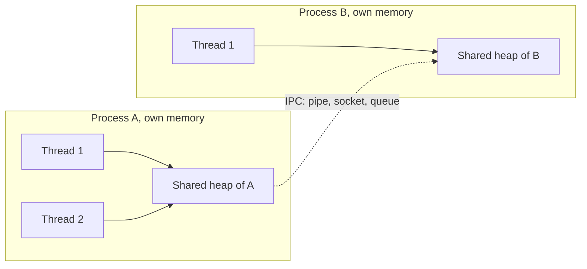
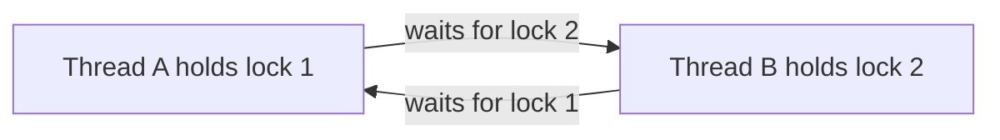
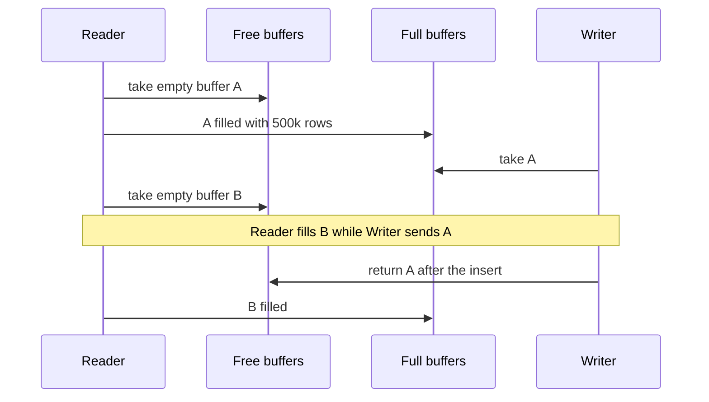

# 06. Multithreading and concurrency in depth (Python + Go)

<div class="callout note">
<b>How to use this page</b>
<ul>
<li><b>What it covers:</b> the vocabulary (process, thread, goroutine, coroutine), what goes wrong (races, deadlock, starvation), the synchronization tools (mutex, semaphore, condition variable, atomics, channels), Python's GIL and asyncio, Go's scheduler and patterns, the classic interview problems with code, and how all of it shows up in my own work.</li>
<li><b>When to read it:</b> before any round that might say "make it thread safe", and before the hiring-manager round, because the "from my work" section links these ideas to my projects.</li>
<li><b>What to memorise:</b> the four deadlock conditions and lock ordering, mutex versus semaphore, "always wait in a while loop", the GIL rule (threads help IO, not CPU), never block the event loop, and the bounded blocking queue code.</li>
<li><b>How the problems are laid out:</b> a one-line restatement, the key insight, a step-by-step interleaving trace, code, cost, and a 60-second spoken version.</li>
</ul>
</div>

<div class="callout warn">
<b>Code snippets on this page are teaching sketches.</b> They show how the mechanism works in general. They are not copies of company code. When you talk about my projects, describe what we built in words and use a snippet only to show you understand the mechanism.
<br><br>
<b>Tags used on this page.</b> MEASURED means there is a log, doc or code behind the number. ESTIMATED means arithmetic I can show. Any number labelled "illustrative" is made up for the example and is not a claim about my work.
</div>

---

## 1. Core concepts

### Concurrency versus parallelism

**Concurrency** means dealing with many things at once: the program is structured so several tasks are in progress and can make progress independently. **Parallelism** means doing many things at the same instant, on multiple CPU cores. Concurrency is possible on one core: the core switches between tasks quickly.

**Analogy:** one chef cooking three dishes, stirring one pot while another simmers, is concurrency. Three chefs each cooking one dish at the same moment is parallelism.

### CPU-bound versus IO-bound

**IO-bound** work spends most of its time waiting: for the network, the disk, or a database. It benefits from concurrency even on one core, because while one task waits, another can run. **CPU-bound** work spends its time calculating (parsing, hashing, compressing, scoring). It only speeds up with parallelism: multiple cores, and in Python, multiple processes.

Tiny example: calling 100 web APIs that each take 200 ms is IO-bound. Doing them one after another takes 20 seconds. Doing them concurrently takes roughly 200 ms plus overhead. Computing SHA-256 over a 10 GB file is CPU-bound, and waiting is not the bottleneck.

### Process, thread, goroutine, coroutine

- **Process:** a running program with its own memory space. Heavy to create, isolated (one crashing doesn't corrupt another), and processes talk through **IPC** (inter-process communication: pipes, sockets, queues). **Analogy:** separate houses. Each has its own kitchen, and to share food you have to carry it across the street.
- **Thread:** a unit of execution **inside** a process. Threads share the process's memory, are scheduled by the operating system (OS), and each has its own fixed-size stack, typically 1 MB or more of reserved memory. **Analogy:** roommates in one house sharing the same fridge. Communication is easy, but two people can grab the last carton of milk at once.
- **Goroutine:** a user-space thread managed by the Go runtime rather than the OS. It starts at about 2 KB of stack that grows as needed, so a program can run hundreds of thousands. **Analogy:** a staffing agency (the Go runtime) that assigns many small jobs to a few full-time workers (OS threads).
- **Coroutine (asyncio):** a function that can pause itself at `await` and resume later. Cooperative: it yields only at `await`. All coroutines in one event loop run on one thread. **Analogy:** a single waiter serving many tables, who moves to the next table whenever the current one is still reading the menu.

The diagram below shows the key difference: threads inside one process share memory, while separate processes only communicate through IPC.



### Context switch

A **context switch** is the CPU saving one task's registers and stack pointer and loading another's. OS thread switches cost on the order of microseconds because they go through the kernel. Goroutine and coroutine switches are much cheaper because they happen in user space.

### Preemptive versus cooperative scheduling

**Preemptive** means the scheduler can interrupt a task at any time to run another. OS threads and goroutines (since Go 1.14, which added asynchronous preemption) are preempted. **Cooperative** means a task runs until it voluntarily yields. Asyncio coroutines are cooperative, so one blocking call freezes everything on that event loop.

**Analogy:** preemptive is a teacher who cuts a speaker off after two minutes. Cooperative is a meeting where everyone must remember to stop talking, and one person who doesn't stop stalls the whole room.

---

## 2. What goes wrong

### Race condition

**What it is:** the result depends on the timing of threads. The classic is **read-modify-write**: `count += 1` is really three steps (load, add, store). Two threads can interleave and one increment is lost.

**Interleaving trace** with two threads and `count = 0`:

```text
time  Thread A           Thread B           count in memory
1     load count (0)                        0
2                        load count (0)     0
3     add 1 -> 1                            0
4                        add 1 -> 1         0
5     store 1                               1
6                        store 1            1    one increment lost
```

**Tiny example in Python:**

```python
import threading

count = 0
lock = threading.Lock()

def unsafe():
    global count
    for _ in range(100_000):
        count += 1                 # load, add, store: can interleave

def safe():
    global count
    for _ in range(100_000):
        with lock:                 # only one thread inside at a time
            count += 1

threads = [threading.Thread(target=unsafe) for _ in range(4)]
for t in threads: t.start()
for t in threads: t.join()
print(count)                       # may be less than 400000 with unsafe
```

Whether you actually see a lost update depends on the Python version and timing. That unpredictability is exactly why races are dangerous: tests pass, production fails.

**Check-then-act** is the other classic: `if key not in cache: cache[key] = compute()`. Two threads both see a miss and both compute. At the cache layer this is a **cache stampede** (many requests recomputing the same expensive value at once). Fix it with **singleflight** (section 6.11): the first caller computes and everyone else waits for its result.

### Data race (Go term)

Two goroutines access the same memory concurrently, at least one writes, and there's no synchronization. It's undefined behaviour in Go's memory model, meaning the program can do anything, including crashing on a concurrent map write. Detect it with `go test -race`, which instruments memory accesses and reports conflicting ones.

### Visibility and ordering (memory model)

CPUs and compilers reorder instructions and cache values in registers or per-core caches for speed. Without synchronization, one thread may **never see** another's write, or see writes out of order. Synchronization primitives (mutex unlock/lock, channel send/receive, atomics) create **happens-before** edges: a guarantee that everything written before point X is visible to whoever observes X.

**Analogy:** two people editing a shared document offline. Without a "sync" step, each sees only their own copy. A mutex unlock followed by a lock is the sync.

- Go: a send on a channel happens before the corresponding receive completes. An unlock happens before the next lock.
- Java: `volatile` and `synchronized`. Python: the GIL makes most single bytecode operations appear atomic, but compound operations aren't.

### Deadlock

**What it is:** two or more threads each wait forever for something another one holds.

**Analogy:** two cars meet on a one-lane bridge from opposite sides. Each waits for the other to back up, and neither does.

Four **Coffman conditions**, all required:

1. **Mutual exclusion:** a resource can be held by only one thread.
2. **Hold and wait:** a thread holds one resource while waiting for another.
3. **No preemption:** nobody can forcibly take a resource away.
4. **Circular wait:** A waits for B, B waits for A (or a longer cycle).

The diagram shows the circular wait. Notice that each arrow is "waits for something the other holds", and the cycle is the deadlock.



**Trace** of two bank transfers without lock ordering:

```text
time  Thread A: transfer(x, y)     Thread B: transfer(y, x)
1     lock x                       lock y
2     wait for y (held by B)       wait for x (held by A)    -> deadlock
```

Break any one condition:

- **Lock ordering** (always acquire locks in a global order, for example by account ID) breaks circular wait. This is the most common fix.
- **Try-lock with timeout** and back off (breaks hold-and-wait on failure).
- Acquire all locks at once.
- Avoid holding locks while calling unknown code or doing IO.

```python
def transfer(a, b, amount):
    first, second = (a, b) if a.id < b.id else (b, a)    # global lock order
    with first.lock, second.lock:
        a.balance -= amount
        b.balance += amount
```

With ordering, both threads in the trace above try to lock the lower ID first, so one of them simply waits at step 1 and no cycle forms.

### Livelock

Threads keep responding to each other and make no progress. **Analogy:** two people stepping aside in a corridor, both to the same side, again and again. Fix: randomized backoff, so they stop mirroring each other.

### Starvation

A thread never gets the resource. For example, writers starved by a continuous stream of readers on a read-write lock. Fix: fair locks, writer preference, aging (raising priority the longer a thread waits).

### Priority inversion

A low-priority thread holds a lock needed by a high-priority one, while a medium-priority thread keeps the low one from running. The high-priority thread is effectively waiting on the medium one. Fix: **priority inheritance** (temporarily raise the lock holder to the waiter's priority).

### Thundering herd

Many waiters are woken for one resource, all rush in, and all but one go back to sleep, wasting CPU. Fix: `notify()` instead of `notify_all()` where correct. In distributed locks, have each waiter watch only its predecessor in the queue.

---

## 3. Synchronization primitives

### Mutex versus semaphore (the question everyone asks)

A **mutex** (mutual exclusion lock) lets **one** thread at a time into a critical section, and the thread that locked it must be the one that unlocks it (it has an **owner**). Use it to protect shared state.

A **semaphore** holds **n permits**. `acquire` takes one (waiting if none are left) and `release` gives one back, and any thread can release. Use it to **limit how many** things happen at once: connection pools, maximum parallel API calls.

**Analogy:** a mutex is the single key to a café bathroom. Whoever has the key goes in, and they bring the same key back. A semaphore is a car park with 50 spaces and a display showing how many are free. Up to 50 cars can be inside, and the count goes up when any car leaves.

A **binary semaphore** (n = 1) looks like a mutex but has no owner, so one thread can acquire and a different thread can release. That makes it useful for **signalling** between threads (see FooBar, section 6.3), and dangerous as a lock because nothing stops the wrong thread from releasing it.

```python
import threading

state_lock = threading.Lock()              # mutex: protect a shared dict
api_slots = threading.BoundedSemaphore(8)  # semaphore: at most 8 calls in flight (illustrative limit)

def call_api(req):
    with api_slots:                        # waits if 8 calls are already running
        return http_post(req)
```

### The full toolbox

| Primitive | What it does | Use for |
|---|---|---|
| **Mutex / Lock** | One holder at a time | Protect shared state |
| **Reentrant lock (RLock)** | The same thread can re-acquire | Recursive code paths |
| **Read-write lock** | Many readers OR one writer | Read-heavy data (config, routing tables) |
| **Semaphore(n)** | n permits | Bound concurrency (connection pools, max parallel calls) |
| **Condition variable** | Wait until a predicate is true; signal | Bounded queues, producer/consumer |
| **Barrier** | N threads wait until all arrive | Phased computation |
| **Latch / WaitGroup** | Wait for N events | Wait for workers to finish |
| **Atomic / CAS** | Lock-free single-word update | Counters, flags, lock-free structures |
| **Spinlock** | Busy-wait | Very short sections in kernels; rarely in app code |
| **Future / Promise** | A placeholder for a result | Async results |
| **Channel** | Typed pipe with synchronization | Go communication |

Short definitions for the ones not covered above:

- **Reentrant lock:** a mutex that remembers its owner and a count, so the same thread can lock it again without deadlocking itself. Needed when a locked method calls another locked method.
- **Read-write lock:** any number of readers together, or exactly one writer alone. **Analogy:** a museum where many visitors can look at a painting at once, but the restorer needs the room empty.
- **Condition variable:** lets a thread sleep until some condition might be true, and lets another thread wake it. Always used together with a lock.
- **Barrier:** N threads each call `wait()`, and nobody continues until all N have arrived. **Analogy:** a tour guide waiting at each stop until the whole group catches up.
- **Latch / WaitGroup:** a countdown. Workers count down when done, and the waiter continues at zero.
- **Spinlock:** a lock that loops checking "is it free yet?" instead of sleeping. It burns CPU, so it's only worth it when the wait is shorter than a context switch.
- **Future / Promise:** an object that will hold a result later. You can hand it around and call `result()` when you need the value.

### Condition variable rule

**Always wait in a `while` loop**, not an `if`. There are **spurious wakeups** (the OS may wake a thread with no notify), and another thread may take the item between the notify and your thread re-acquiring the lock.

```python
with cond:
    while not predicate():
        cond.wait()
    # predicate true and lock held
```

**Trace** of why `if` breaks, with one item and two consumers:

```text
1  queue empty. Consumer A and Consumer B both wait.
2  Producer puts 1 item and calls notify_all().
3  A wakes, re-acquires the lock, takes the item.
4  B wakes, re-acquires the lock. With "if", B skips the check and pops an empty queue -> crash.
   With "while", B re-checks, sees empty, and goes back to waiting.
```

### Compare-and-swap (CAS)

`CAS(addr, expected, new)`: atomically set the value at `addr` to `new` only if it currently equals `expected`, and report whether it did. Lock-free algorithms loop on CAS: read, compute, try to swap, and retry if someone else changed it first.

**Analogy:** editing a shared wiki page. You submit your edit only if the page is still the version you started from. If someone else saved first, you reload and redo your edit.

The **ABA problem**: the value changes A → B → A, and CAS succeeds even though the world changed in between. Fix: version tags (compare a counter that only goes up, not just the value).

The same idea is **optimistic concurrency** in databases (a version column, `UPDATE ... WHERE id = ? AND version = ?`), which I used at Uber FRM: concurrent reviewers each read a row with its version, and an update only succeeds if the version hasn't changed, otherwise the user is told to refresh.

```go
func incrementMax(addr *int64, v int64) {
    for {
        old := atomic.LoadInt64(addr)
        if v <= old || atomic.CompareAndSwapInt64(addr, old, v) {
            return
        }
    }
}
```

**Trace:** two goroutines call `incrementMax` with 5 and 7 while the value is 3. Both load 3. The first CAS(3 → 5) succeeds. The second CAS(3 → 7) fails because the value is now 5, so it loops, loads 5, and CAS(5 → 7) succeeds. The final value is 7, the true maximum.

---

## 4. Python concurrency

### The GIL

- CPython's **Global Interpreter Lock** lets only one thread execute Python bytecode at a time, even on a machine with many cores. **Analogy:** a meeting with one microphone. Many people (threads) can be in the room, but only the one holding the microphone can speak.
- So **threads don't speed up CPU-bound Python**. They do help IO-bound work, because the GIL is released during blocking IO and in many C extensions (NumPy, hashlib, compression). While one thread waits on the network, it hands over the microphone.
- The GIL does **not** make your code thread-safe. `x += 1` is several bytecodes and can interleave between them. Compound operations on dicts/lists need locks.
- Python 3.13+ has an experimental **free-threaded** build (PEP 703) without the GIL. Mention it as awareness.

**Tiny example** showing threads helping IO-bound work:

```python
import threading, time

def io_task():
    time.sleep(1)                 # blocking wait; the GIL is released

start = time.perf_counter()
threads = [threading.Thread(target=io_task) for _ in range(10)]
for t in threads: t.start()
for t in threads: t.join()
print(round(time.perf_counter() - start, 1))   # about 1.0, not 10.0
```

Replace `time.sleep(1)` with a pure-Python loop like `sum(range(10**7))`, and ten threads take about as long as running the ten loops one after another, because only one thread can hold the GIL.

### Choosing the tool

| Workload | Tool |
|---|---|
| Many network calls | `asyncio` (best), or threads |
| Blocking library (no async version) | `ThreadPoolExecutor`, or `asyncio.to_thread` |
| CPU-heavy pure Python | `multiprocessing` / `ProcessPoolExecutor` |
| CPU-heavy in NumPy / C | Threads can work (the GIL is released) |
| Distributed tasks | Celery workers (I used this at Masters), a queue |

### threading and concurrent.futures

A **thread pool** keeps a fixed number of worker threads and feeds them tasks, so you don't pay thread creation per task and you cap concurrency. `submit` returns a future, and `as_completed` yields futures as they finish, in completion order.

```python
from concurrent.futures import ThreadPoolExecutor, as_completed

def fetch_all(urls, max_workers=16):
    results = {}
    with ThreadPoolExecutor(max_workers) as ex:
        futs = {ex.submit(fetch, u): u for u in urls}
        for f in as_completed(futs):
            u = futs[f]
            try:
                results[u] = f.result()
            except Exception as e:
                results[u] = e
    return results
```

### asyncio in depth

**The idea:** one thread runs an **event loop**, which is a scheduler that keeps a list of coroutines ready to run. A coroutine runs until it hits `await` on something not ready yet (a network reply), then the loop switches to another ready coroutine. When the reply arrives, the loop resumes the first one.

**Analogy:** one chef with many pots. The chef puts water on to boil (starts a request), and instead of staring at the pot, chops vegetables for another dish. When a timer rings, the chef goes back to that pot. One chef, many dishes in progress. If the chef stops to hand-whisk for ten minutes (a blocking call), every dish waits.

- `async def` defines a coroutine; `await` yields control until the awaited thing is ready.
- `asyncio.create_task` schedules concurrently. `asyncio.gather` waits for many. `asyncio.TaskGroup` (3.11+) gives structured concurrency: if one fails, the others are cancelled, and the block doesn't exit until all tasks are done.
- **Timeouts:** `asyncio.timeout(5)` (3.11+) or `asyncio.wait_for`.
- **Bounded concurrency:** `asyncio.Semaphore(n)`.
- **Cancellation:** raises `CancelledError` inside the task at the next await. Clean up in `finally`. Don't swallow it.
- **Never block the loop:** `time.sleep`, sync DB drivers, CPU loops, and `requests.get` freeze every request. Use `await asyncio.sleep`, async drivers, or `await asyncio.to_thread(fn)`.
- **Resource lifetime:** always `async with` for clients, sessions, and cursors.

**Trace** of two coroutines sharing one thread:

```text
time  event loop runs     what happens
0     task A              A sends request 1, hits await, yields
1     task B              B sends request 2, hits await, yields
2     (idle)              both are waiting on the network
3     task B              reply 2 arrives first, B resumes and finishes
4     task A              reply 1 arrives, A resumes and finishes
```

### How I used this at Uber FRM

On the FRM scoping backend (Python, FastAPI, SQLAlchemy 2.0, MySQL), the request handlers were `async`, but the SQLAlchemy calls were synchronous. A synchronous DB call inside an `async def` handler would block the event loop and stall every other request on that worker. So the convention was to push blocking DB work onto a thread with `asyncio.to_thread`, which keeps the event loop free. At that service's traffic, the extra thread-pool hop was an acceptable cost.

```python
async def get_scope(quarter_id: int):
    rows = await asyncio.to_thread(repo.load_scope, quarter_id)   # sync SQLAlchemy runs on a worker thread
    return rows
```

**Say it in an interview:** "Our FastAPI handlers were async but the ORM was synchronous, so every repository call went through `asyncio.to_thread`. That runs the blocking call on a thread pool and awaits it, so one slow query doesn't freeze the event loop for everyone. The alternative was an async driver, but the sync ORM was the established pattern and the thread hop was cheap at our traffic."

**The leak story (prep story, not a PDF bullet):** a FastAPI worker leaked DB/HTTP clients created inside a long-lived async loop without context managers, so memory climbed and 504s (gateway timeouts) followed. Fixed with `async with`, pool limits/timeouts, and backpressure. Tell it only if asked about debugging a memory leak, and say plainly it's a story from prep rather than a resume bullet.

### Bounded concurrency, timeouts and structured concurrency

```python
import asyncio

async def fetch_with_limits(session, urls, concurrency=20, timeout_s=5):
    sem = asyncio.Semaphore(concurrency)

    async def one(url):
        async with sem:
            async with asyncio.timeout(timeout_s):
                async with session.get(url) as r:
                    return await r.text()

    async with asyncio.TaskGroup() as tg:
        tasks = [tg.create_task(one(u)) for u in urls]
    return [t.result() for t in tasks]
```

What to notice: the semaphore caps how many requests are in flight at once (so a slow downstream isn't flooded), the timeout caps how long each can take, and the TaskGroup cancels the rest if one fails.

Retry with backoff and jitter in async. **Exponential backoff** doubles the wait after each failure. **Jitter** randomises the wait so many clients that failed at the same moment don't all retry at the same moment.

```python
import random

async def call_with_retry(fn, attempts=3, base=0.1, cap=2.0):
    for i in range(attempts):
        try:
            return await fn()
        except (asyncio.TimeoutError, ConnectionError):
            if i == attempts - 1:
                raise
            await asyncio.sleep(random.uniform(0, min(cap, base * 2 ** i)))
```

An async producer/consumer with a bounded `asyncio.Queue` (backpressure built in). **Backpressure** means a fast producer is slowed down when consumers can't keep up, instead of buffering without limit until memory runs out.

```python
async def pipeline(items, workers=8):
    q = asyncio.Queue(maxsize=100)

    async def producer():
        for it in items:
            await q.put(it)            # blocks when full = backpressure
        for _ in range(workers):
            await q.put(None)          # poison pills

    async def worker():
        while (it := await q.get()) is not None:
            await process(it)

    await asyncio.gather(producer(), *(worker() for _ in range(workers)))
```

A **poison pill** is a special value (here `None`) that tells a worker to stop. One pill per worker ensures every worker exits.

**FastAPI note:** `async def` endpoints run on the event loop, so they must not block. Plain `def` endpoints run in a threadpool. That's why IRP calls at Masters moved to async IO plus Celery workers: the IRP (Invoice Registration Portal, the government e-invoicing API) is slow and volatile, so waiting on it must not hold up other requests.

### Async versus threads, side by side

| | asyncio | Threads |
|---|---|---|
| Who switches tasks | Your code, at `await` | The OS, at any instruction |
| Cost per task | A small object | An OS thread with its own stack |
| Shared-state bugs | Rarer (switches only at `await`) | Common (switch anywhere) |
| Blocking call | Freezes everything | Blocks only that thread |
| Best for | Thousands of network waits | Blocking libraries, modest concurrency |

**Say it in 60 seconds:** "Both give concurrency for IO-bound work in Python, and neither gives CPU parallelism because of the GIL. Asyncio runs everything on one thread and switches only at `await`, so tasks are cheap and races are rarer, but a single blocking call freezes the whole loop. Threads are switched by the OS anywhere, so they tolerate blocking libraries, but each costs an OS thread and needs locks around shared state. For thousands of connections I'd pick asyncio. If a library is blocking, I offload it with `asyncio.to_thread`. For CPU work I'd use processes."

### multiprocessing

- Separate interpreters, so no GIL contention. Data is pickled (serialized) between processes, which adds overhead for large objects.
- Use `ProcessPoolExecutor` for CPU work. Shared memory via `multiprocessing.shared_memory` or `Manager` (slow, because every access is a message).
- The start method matters (`fork` vs `spawn`): don't fork after starting threads. A forked child copies only the thread that called fork, so a lock held by another thread at that moment stays locked forever in the child.

---

## 5. Go concurrency in depth

### The scheduler (GMP)

- **G** = goroutine, **M** = OS thread (machine), **P** = processor (a logical CPU context, `GOMAXPROCS` of them, by default the number of cores).
- Each P has a local run queue of Gs, with **work stealing** between Ps: an idle P takes half of a busy P's queue.
- On a blocking syscall, the M is detached and the P gets another M, so other goroutines keep running. Network IO uses the **netpoller** (epoll on Linux, kqueue on macOS), so goroutines waiting on sockets don't hold threads at all.
- That's why a Go server can hold 100k+ connections with cheap goroutines per connection.

**Analogy:** P is a desk, M is a worker sitting at it, and G is a task card. Each desk has a pile of cards. If a worker has to leave to wait on the phone (a blocking syscall), another worker sits at the desk and continues with the pile.

### Channels

A **channel** is a typed pipe between goroutines that also synchronizes them.

- **Unbuffered:** send blocks until a receiver takes it (synchronous handoff). **Analogy:** handing someone a parcel in person; you both have to be there.
- **Buffered(n):** send blocks only when full. That gives bounded queues and semaphores. **Analogy:** a mailbox that holds n letters.
- `close(ch)` signals no more values. Receivers get the zero value with `ok == false`. `for v := range ch` stops at close. **Only the sender closes.** Closing twice or sending on a closed channel panics.
- A **nil channel** blocks forever. That's useful in `select` to disable a case.
- "Don't communicate by sharing memory; share memory by communicating." But a mutex is fine and often simpler for protecting a map.

```go
ch := make(chan int, 2)   // buffered, capacity 2
ch <- 1                   // does not block
ch <- 2                   // does not block
// ch <- 3 would block until someone receives
close(ch)
for v := range ch {       // prints 1, then 2, then the loop ends
    fmt.Println(v)
}
```

### select

`select` waits on several channel operations and runs whichever is ready first. It's how you combine "a message arrived", "we were cancelled" and "we timed out" in one place.

```go
select {
case msg := <-in:
    handle(msg)
case <-ctx.Done():
    return ctx.Err()
case <-time.After(2 * time.Second):
    return errTimeout
}
```

### context

- A `context.Context` carries **cancellation, deadlines, and request-scoped values** down the call tree.
- `context.WithTimeout(parent, d)`: children inherit the *earlier* deadline. That's how nested timeouts work on my Go/Gin edge at Impact Analytics. The edge sets the budget and every DB/HTTP call beneath gets the remaining time, so a slow ClickHouse query can't hold a request past its overall deadline.
- Always `defer cancel()`. Pass `ctx` as the first parameter. Check `ctx.Err()` in long loops.

**Tiny example** (the durations are illustrative, not production values):

```go
func handler(c *gin.Context) {
    ctx, cancel := context.WithTimeout(c.Request.Context(), 2*time.Second)
    defer cancel()
    rows, err := queryRollup(ctx)          // inherits the 2s budget
    // ...
}

func queryRollup(ctx context.Context) ([]Row, error) {
    ctx, cancel := context.WithTimeout(ctx, 5*time.Second)   // still ends at the parent's 2s deadline
    defer cancel()
    return db.QueryContext(ctx, sqlText)
}
```

**Say it in an interview:** "On our Go/Gin platform the edge sets a time budget per request with a context deadline, and every call underneath derives its context from it. A child timeout can only shorten the deadline, never extend it, so even if a lower layer asks for more time, the request still ends on budget. That's what 'nested timeouts' means on my resume. It stops slow downstream calls from piling up goroutines at 10k peak RPS."

### sync package

| Type | Notes |
|---|---|
| `sync.Mutex` | Don't copy after first use (pass pointers). Not reentrant |
| `sync.RWMutex` | `RLock` for readers. Writers get priority once waiting |
| `sync.WaitGroup` | `Add` before starting the goroutine, `Done` in a defer, `Wait` |
| `sync.Once` | Lazy init, thread-safe |
| `sync.Cond` | Rarely needed; channels usually replace it |
| `sync.Pool` | Reuse temporary objects (buffers) to cut GC. Items may be dropped at any GC |
| `sync.Map` | For write-once/read-many or disjoint key sets. Otherwise a map + mutex is better |
| `sync/atomic` | `atomic.Int64`, `atomic.Bool`, `atomic.Pointer[T]` (Go 1.19+) |
| `golang.org/x/sync/errgroup` | Run goroutines, return the first error, cancel the others via ctx. `SetLimit(n)` bounds concurrency |
| `golang.org/x/sync/singleflight` | Coalesce duplicate concurrent calls for the same key (stampede protection) |
| `golang.org/x/sync/semaphore` | Weighted semaphore |

GC means garbage collection. `errgroup` is the one to know best: it's a WaitGroup that also collects the first error and cancels the shared context.

### Worker pool (bounded parallelism)

**The idea:** start a fixed number of workers that all read jobs from one channel. The number of workers is the concurrency limit. **Analogy:** a bank with four tellers and one queue. However long the queue, only four customers are served at a time.

```go
func WorkerPool(ctx context.Context, jobs []Job, workers int) ([]Result, error) {
    in := make(chan Job)
    out := make(chan Result, len(jobs))
    g, ctx := errgroup.WithContext(ctx)

    for i := 0; i < workers; i++ {
        g.Go(func() error {
            for j := range in {
                r, err := process(ctx, j)
                if err != nil {
                    return err            // cancels ctx for everyone
                }
                out <- r
            }
            return nil
        })
    }

    g.Go(func() error {
        defer close(in)
        for _, j := range jobs {
            select {
            case in <- j:
            case <-ctx.Done():
                return ctx.Err()
            }
        }
        return nil
    })

    err := g.Wait()
    close(out)
    var results []Result
    for r := range out {
        results = append(results, r)
    }
    return results, err
}
```

What to notice: `out` is buffered to `len(jobs)` so workers never block on sending results. The feeder uses `select` with `ctx.Done()` so it stops if a worker fails. `close(in)` ends every worker's `range` loop.

### Pipeline and fan-out / fan-in

A **pipeline** is a chain of stages connected by channels, each stage a goroutine. **Fan-out** runs several copies of a slow stage in parallel. **Fan-in** merges their outputs back into one channel. **Analogy:** an assembly line where a slow station gets three workers, and a conveyor belt merges their output.

```go
func gen(ctx context.Context, nums ...int) <-chan int {
    out := make(chan int)
    go func() {
        defer close(out)
        for _, n := range nums {
            select {
            case out <- n:
            case <-ctx.Done():
                return
            }
        }
    }()
    return out
}

func square(ctx context.Context, in <-chan int) <-chan int {
    out := make(chan int)
    go func() {
        defer close(out)
        for n := range in {
            select {
            case out <- n * n:
            case <-ctx.Done():
                return
            }
        }
    }()
    return out
}

func merge(ctx context.Context, cs ...<-chan int) <-chan int {
    var wg sync.WaitGroup
    out := make(chan int)
    wg.Add(len(cs))
    for _, c := range cs {
        go func(c <-chan int) {
            defer wg.Done()
            for v := range c {
                select {
                case out <- v:
                case <-ctx.Done():
                    return
                }
            }
        }(c)
    }
    go func() { wg.Wait(); close(out) }()
    return out
}
```

Usage: `merge(ctx, square(ctx, src), square(ctx, src))` fans the squaring out to two goroutines reading the same source, then fans in. Every stage closes its output when done and watches `ctx.Done()`, so cancelling the context shuts the whole pipeline down without leaking goroutines.

### Double buffering: the pattern behind my Go pump (~344k rows/s)

**Context:** at Impact Analytics I wrote a Go data pump to migrate ClickHouse rollup tables between ClickHouse Cloud clusters, because cross-cluster IP allowlists blocked a direct cluster-to-cluster copy. It speaks ClickHouse's native protocol over TLS. It moved about **344k rows per second** combined (MEASURED), from two season streams running in parallel at roughly 150k to 190k rows per second each. That is an ingest rate in rows, not requests per second. Batches are 500k rows.

**The idea:** read batch N+1 while batch N is being sent. Two buffers alternate through channels, so the read side never sits idle waiting for the write. **Analogy:** two buckets at a well. While you pour one into the trough, the other is already filling.

Why it mattered: an earlier version used HTTP, and the SELECT stream sat idle while the INSERT ran, which ended in `unexpected EOF`. Double buffering keeps the read stream busy, which fixed that and raised throughput.

The sequence below shows the overlap. Notice that the reader is filling B while the writer is still sending A.



```go
func pump(ctx context.Context, src Reader, dst Writer, batchSize int) error {
    free := make(chan *Batch, 2)
    full := make(chan *Batch, 2)
    free <- NewBatch(batchSize)
    free <- NewBatch(batchSize)

    g, ctx := errgroup.WithContext(ctx)

    g.Go(func() error {                       // reader
        defer close(full)
        for {
            var b *Batch
            select {
            case b = <-free:
            case <-ctx.Done():
                return ctx.Err()
            }
            b.Reset()
            n, err := src.Fill(ctx, b)        // columnar append, no per-row reflection
            if n > 0 {
                full <- b
            } else {
                free <- b                     // an empty read must not lose the buffer
            }
            if err == io.EOF {
                return nil
            }
            if err != nil {
                return err
            }
        }
    })

    g.Go(func() error {                       // writer
        for b := range full {
            if err := dst.Send(ctx, b); err != nil {
                return err                    // never retry a spent batch; the unit is restarted
            }
            free <- b
        }
        return nil
    })

    return g.Wait()
}
```

An earlier version of this sketch dropped the buffer when `Fill` returned zero rows without an error. After two such reads both buffers were gone and the reader waited on `free` forever. Returning the buffer to `free` fixes that. Both channels have capacity 2 and only two buffers exist, so these sends never block.

**How the copy stays correct (say this carefully):** ghost rows (duplicates from a half-finished batch) are prevented by checkpoint files per table and TSV ledgers that record which units finished. A failed season is rolled back by `DROP PARTITION` and then recopied. That is **not** an atomic swap with live readers. The 4.09B-row partition copy was measured while it was in flight. Don't say the cutover finished.

**Say it in 60 seconds:** "The copier is a reader goroutine and a writer goroutine connected by two channels: one of empty buffers and one of full buffers, with exactly two 500k-row buffers in circulation. The reader fills a buffer from the source cluster and passes it on, then immediately grabs the other buffer and keeps reading while the writer inserts the first one into the target. So reading and writing overlap, and the read stream never sits idle, which is what caused `unexpected EOF` in the first HTTP version. errgroup ties the two together so an error on either side cancels both. We measured about 344k rows a second combined across two season streams."

### Rate limiting in Go

`golang.org/x/time/rate` implements a **token bucket**: tokens refill at a fixed rate up to a burst size, and each request spends one. `limiter := rate.NewLimiter(rate.Limit(100), 200)` allows 100 per second with bursts up to 200. Then `limiter.Wait(ctx)` blocks until a token is available, or `limiter.Allow()` returns false immediately. Or use a `time.Ticker` for simple pacing.

### Goroutine leaks (very common interview topic)

A **goroutine leak** is a goroutine blocked forever on a channel nobody will read or write. It never exits, so its memory is never freed.

- Cause: returning early from the consumer while the producer is still sending on an unbuffered channel.
- Fix: every goroutine must have an exit path, via `ctx.Done()`, closing the input, or a buffered result channel of the right size.
- Detect with `runtime.NumGoroutine()` in tests, `pprof` goroutine profiles, or `go.uber.org/goleak`.

**Tiny example of a leak and its fix:**

```go
func firstResult(urls []string) string {
    ch := make(chan string)              // unbuffered: the bug
    for _, u := range urls {
        go func(u string) { ch <- fetch(u) }(u)
    }
    return <-ch                          // takes one; the other senders block forever
}
// Fix: ch := make(chan string, len(urls)), so every sender can finish.
```

### Common Go concurrency bugs

- Loop variable capture (fixed in Go 1.22: each iteration has its own variable. Before that, pass it as a parameter).
- Concurrent map writes (a runtime fatal error): use a mutex.
- `wg.Add` inside the goroutine (races with `Wait`, which may see a zero counter and return early).
- Copying a struct that contains a mutex (the copy has its own, unrelated lock).
- Forgetting `cancel()` (leaks timers/contexts).
- Holding a mutex while sending on a channel (deadlock risk if the receiver needs the same mutex).

---

## 6. Classic concurrency problems with code

### 6.1 Bounded blocking queue (the most asked)

**Problem in one sentence:** build a fixed-capacity queue where `put` waits while it's full and `take` waits while it's empty, safe for many producers and consumers.

**Key insight:** one lock protects the deque, and two condition variables on that lock let each side sleep until the other side changes something. Producers wait on `not_full` and consumers on `not_empty`, so `notify()` wakes the right kind of thread. Always re-check the condition in a `while`.

**Trace** with capacity 1:

```text
time  Producer                     Consumer                 queue
1     put(1): size 0 < 1, append                            [1]
      notify not_empty
2     put(2): size 1 >= 1, wait
      on not_full (lock released)
3                                  take(): pop 1            []
                                   notify not_full
4     wakes, re-checks: size 0 < 1
      append 2, notify not_empty                            [2]
```

**Python (Condition variables):**

```python
import threading
from collections import deque

class BoundedBlockingQueue:
    def __init__(self, capacity: int):
        self.cap = capacity
        self.q = deque()
        self.lock = threading.Lock()
        self.not_full = threading.Condition(self.lock)
        self.not_empty = threading.Condition(self.lock)

    def put(self, item, timeout=None):
        with self.not_full:
            while len(self.q) >= self.cap:
                if not self.not_full.wait(timeout):
                    raise TimeoutError
            self.q.append(item)
            self.not_empty.notify()

    def take(self, timeout=None):
        with self.not_empty:
            while not self.q:
                if not self.not_empty.wait(timeout):
                    raise TimeoutError
            item = self.q.popleft()
            self.not_full.notify()
            return item

    def size(self):
        with self.lock:
            return len(self.q)
```

Why two conditions on one lock: producers wait on `not_full` and consumers on `not_empty`, so `notify()` wakes the right kind of thread. With one condition, a `notify()` from a consumer might wake another consumer, which finds nothing and goes back to sleep while a producer stays stuck. `cond.wait()` releases the lock while sleeping and re-acquires it before returning, which is what lets the other side get in.

**Go:** a buffered channel *is* a bounded blocking queue. If asked to build it with a mutex:

```go
type BQueue[T any] struct {
    mu       sync.Mutex
    notEmpty *sync.Cond
    notFull  *sync.Cond
    items    []T
    cap      int
}

func NewBQueue[T any](cap int) *BQueue[T] {
    q := &BQueue[T]{cap: cap}
    q.notEmpty = sync.NewCond(&q.mu)
    q.notFull = sync.NewCond(&q.mu)
    return q
}

func (q *BQueue[T]) Put(v T) {
    q.mu.Lock()
    defer q.mu.Unlock()
    for len(q.items) == q.cap {
        q.notFull.Wait()
    }
    q.items = append(q.items, v)
    q.notEmpty.Signal()
}

func (q *BQueue[T]) Take() T {
    q.mu.Lock()
    defer q.mu.Unlock()
    for len(q.items) == 0 {
        q.notEmpty.Wait()
    }
    v := q.items[0]
    q.items = q.items[1:]
    q.notFull.Signal()
    return v
}
```

**Cost:** each operation is O(1) plus waiting time. One lock means producers and consumers serialise on it, which is fine for most workloads. For extreme throughput you'd use a lock-free ring buffer.

**Say it in 60 seconds:** "I guard a deque with one lock and attach two condition variables to it: not-full for producers and not-empty for consumers. `put` waits in a while loop until there's room, appends, and signals not-empty. `take` waits until there's an item, pops, and signals not-full. The while loop handles spurious wakeups and the case where another thread grabbed the slot first. Waiting releases the lock, so the other side can make progress. In Go I'd just use a buffered channel, which is exactly this."

---

### 6.2 Print in order (first, second, third across threads)

**Problem in one sentence:** three threads call `first`, `second` and `third` in any order, and the prints must always come out first, second, third.

**Key insight:** each step waits for a signal from the step before it. A `threading.Event` is a one-time flag: `set()` raises it and `wait()` blocks until it's raised.

**Trace** where thread 3 starts first:

```text
1  third() waits on e2
2  second() waits on e1
3  first() prints "first", sets e1
4  second() wakes, prints "second", sets e2
5  third() wakes, prints "third"
```

```python
class Foo:
    def __init__(self):
        self.e1, self.e2 = threading.Event(), threading.Event()
    def first(self, f):
        f(); self.e1.set()
    def second(self, f):
        self.e1.wait(); f(); self.e2.set()
    def third(self, f):
        self.e2.wait(); f()
```

Go: two unbuffered channels, or a `sync.WaitGroup` per stage.

**Say it in 60 seconds:** "I need a happens-before chain: first before second before third. I use two events. `first` prints and sets the first event. `second` waits for it, prints, and sets the second event. `third` waits for the second. Events stay set once set, so it doesn't matter which thread arrives first. In Go I'd close a channel to signal each stage, since a closed channel releases every waiter."

---

### 6.3 Print FooBar alternately (n times)

**Problem in one sentence:** one thread prints "foo" and another prints "bar". Make the output "foobar" n times.

**Key insight:** two semaphores act as turn tokens. `foo_sem` starts with 1 permit (foo goes first) and `bar_sem` with 0. Each thread waits for its own token and, after printing, hands a token to the other.

**Trace** for n = 2:

```text
foo_sem  bar_sem  event
1        0        foo acquires foo_sem, prints "foo", releases bar_sem
0        1        bar acquires bar_sem, prints "bar", releases foo_sem
1        0        foo prints "foo", releases bar_sem
0        1        bar prints "bar", releases foo_sem
output: foobarfoobar
```

```python
class FooBar:
    def __init__(self, n):
        self.n = n
        self.foo_sem, self.bar_sem = threading.Semaphore(1), threading.Semaphore(0)
    def foo(self, p):
        for _ in range(self.n):
            self.foo_sem.acquire(); p(); self.bar_sem.release()
    def bar(self, p):
        for _ in range(self.n):
            self.bar_sem.acquire(); p(); self.foo_sem.release()
```

This is the semaphore-as-signal use: the thread that releases is not the one that acquired, which a mutex wouldn't allow.

Go ping-pong:

```go
func fooBar(n int) {
    foo, bar := make(chan struct{}), make(chan struct{})
    done := make(chan struct{})
    go func() {
        for i := 0; i < n; i++ {
            <-foo
            fmt.Print("foo")
            bar <- struct{}{}
        }
    }()
    go func() {
        for i := 0; i < n; i++ {
            <-bar
            fmt.Print("bar")
            if i < n-1 {
                foo <- struct{}{}
            }
        }
        close(done)
    }()
    foo <- struct{}{}
    <-done
}
```

The `if i < n-1` check stops the bar goroutine from sending a final token that nobody would receive, which would block it forever.

**Say it in 60 seconds:** "Two semaphores act as a baton. Foo's starts with one permit so foo goes first, bar's starts with zero. Each thread acquires its own semaphore, prints, and releases the other's. That forces strict alternation. A mutex can't do this because the releasing thread isn't the owner. In Go, two unbuffered channels pass the turn back and forth."

---

### 6.4 Zero Even Odd, FizzBuzz Multithreaded, Building H2O

The same technique: semaphores gating whose turn it is.

- **Zero Even Odd:** three threads print `0102030...`. A zero semaphore starts at 1. After printing 0, the zero thread releases either the odd or the even semaphore depending on the next number, and that thread releases zero again.
- **FizzBuzz Multithreaded:** four threads (number, fizz, buzz, fizzbuzz). One shared counter under a condition variable, and each thread waits until the current number is its kind.
- **H2O:** threads arrive as hydrogen or oxygen atoms, and they must leave in groups of exactly two H and one O. `h_sem = Semaphore(2)`, `o_sem = Semaphore(1)`, and a `Barrier(3)` so each molecule forms together, then release the permits.

**H2O trace** with arrivals H, H, H, O:

```text
H1 takes h permit (1 left), waits at barrier (1 of 3)
H2 takes h permit (0 left), waits at barrier (2 of 3)
H3 tries h permit, none left, blocks
O1 takes o permit, reaches barrier (3 of 3), all three released together
H1, H2, O1 release their permits -> H3 can now start the next molecule
```

```python
class H2O:
    def __init__(self):
        self.h, self.o = threading.Semaphore(2), threading.Semaphore(1)
        self.barrier = threading.Barrier(3)
    def hydrogen(self, release):
        with self.h:
            self.barrier.wait()
            release()
    def oxygen(self, release):
        with self.o:
            self.barrier.wait()
            release()
```

**Say it in 60 seconds (H2O):** "The semaphores cap how many of each atom can be forming a molecule at once: two hydrogens and one oxygen. The barrier of three makes those three wait for each other, so they bond together. Only after the barrier do they release their permits, which lets the next group form. A third hydrogen can't sneak into the current molecule because there's no permit left for it."

---

### 6.5 Dining philosophers

**Problem in one sentence:** five philosophers sit around a table with one fork between each pair, and each needs both neighbouring forks to eat. Avoid deadlock.

**Key insight:** if everyone picks up their left fork first, all five hold one fork and wait for the right one forever. That's circular wait (Coffman condition 4). Break the cycle.

**Trace** of the deadlock:

```text
P0 takes fork 0, P1 takes fork 1, P2 takes fork 2, P3 takes fork 3, P4 takes fork 4
P0 waits for fork 1 (P1), P1 waits for 2, ..., P4 waits for fork 0 (P0) -> cycle, deadlock
```

Fixes:

1. **Resource ordering:** always pick up the lower-numbered fork first. P4 now reaches for fork 0 before fork 4, competes with P0, and one of them waits empty-handed, so the cycle can't close.
2. **Waiter/arbitrator:** a semaphore allowing at most 4 to try. With only four reaching, at least one gets both forks.
3. Try-lock and back off (risks livelock without randomness).

```python
def philosopher(i, forks, meals):
    left, right = i, (i + 1) % len(forks)
    first, second = min(left, right), max(left, right)
    for _ in range(meals):
        with forks[first], forks[second]:
            eat(i)
```

**Say it in 60 seconds:** "The deadlock comes from circular wait: each philosopher holds one fork and waits for the next. The standard fix is a global lock order: always take the lower-numbered fork first. Then the last philosopher reaches for fork 0 first, competing with the first philosopher, so someone ends up with no fork and the cycle can't form. It's the same rule I'd use for bank transfers: lock accounts in ID order."

---

### 6.6 Implement a read-write lock (writer preference)

**Problem in one sentence:** allow many concurrent readers or one writer, and don't let a stream of readers starve a waiting writer.

**Key insight:** count active readers and track whether a writer is active. **Writer preference** means new readers also wait if any writer is **waiting**, so writers get in as soon as current readers finish.

**Trace:**

```text
R1 acquire_read: no writer, readers = 1
W1 acquire_write: waiting_writers = 1, readers = 1, so W1 waits
R2 acquire_read: a writer is waiting, so R2 waits (writer preference)
R1 release_read: readers = 0, notify a writer
W1 wakes: writer = True, waiting_writers = 0, writes
W1 release_write: no writers waiting, notify_all readers -> R2 proceeds
```

```python
class RWLock:
    def __init__(self):
        self.lock = threading.Lock()
        self.readers_ok = threading.Condition(self.lock)
        self.writers_ok = threading.Condition(self.lock)
        self.readers = 0
        self.writer = False
        self.waiting_writers = 0

    def acquire_read(self):
        with self.lock:
            while self.writer or self.waiting_writers:
                self.readers_ok.wait()
            self.readers += 1

    def release_read(self):
        with self.lock:
            self.readers -= 1
            if self.readers == 0:
                self.writers_ok.notify()

    def acquire_write(self):
        with self.lock:
            self.waiting_writers += 1
            while self.writer or self.readers:
                self.writers_ok.wait()
            self.waiting_writers -= 1
            self.writer = True

    def release_write(self):
        with self.lock:
            self.writer = False
            if self.waiting_writers:
                self.writers_ok.notify()
            else:
                self.readers_ok.notify_all()
```

The trade-off: writer preference can starve readers if writes are constant. A fair version alternates batches.

**Say it in 60 seconds:** "I keep three counters under one lock: active readers, whether a writer is active, and waiting writers. Readers wait while a writer is active or waiting, which gives writers priority. Writers wait while anyone is active. When the last reader leaves, it wakes one writer. When a writer leaves, it wakes the next writer if any, otherwise all readers at once. Two condition variables keep the wakeups targeted. It's what Go's RWMutex does in spirit."

---

### 6.7 Thread-safe singleton / lazy init

**Problem in one sentence:** create an expensive object once, on first use, even if many threads ask at the same time.

**Key insight (double-checked locking):** check without the lock (fast path for every call after the first), then lock and check again, because another thread may have created it while you were waiting for the lock.

**Trace:**

```text
T1 and T2 both see _instance is None
T1 takes the lock, checks again: None, creates it, releases
T2 takes the lock, checks again: already set, skips creation
```

Python: a module-level instance (modules are imported once, under an import lock), or double-checked locking:

```python
class Config:
    _instance, _lock = None, threading.Lock()
    @classmethod
    def get(cls):
        if cls._instance is None:
            with cls._lock:
                if cls._instance is None:
                    cls._instance = cls()
        return cls._instance
```

Go: `sync.Once` (see [LLD foundations](05_lld_foundations.md)), which runs a function exactly once no matter how many goroutines call it.

**Say it in 60 seconds:** "The first check without the lock keeps the common case fast. If it's empty, I take the lock and check again, because another thread may have created it while I waited. Only then do I create it. In Python a module-level instance is simpler and already safe. In Go I'd use `sync.Once`, which handles the memory-visibility details for me."

---

### 6.8 Concurrent web crawler (LeetCode 1242, a Go favorite)

**Problem in one sentence:** from a start URL, crawl every link on the same hostname exactly once, fetching pages in parallel.

**Key insight:** three concerns, three tools. A mutex-protected `seen` map ensures each URL is visited once (check-and-mark together, under one lock). A WaitGroup knows when all crawling is done. A buffered channel used as a semaphore caps how many fetches run at once.

Requirements: start URL, crawl the same hostname only, visit each once, in parallel.

**Trace** with pages `a → b, c` and `b → c`:

```text
visit(a): fetch a, links b, c
  lock: b unseen -> mark, wg.Add, go visit(b); c unseen -> mark, go visit(c); unlock
visit(b): fetch b, link c
  lock: c already seen -> skip; unlock
visit(c): fetch c, no links
wg reaches zero -> return [a, b, c]
```

```go
func Crawl(ctx context.Context, start string, fetch func(context.Context, string) []string, workers int) []string {
    host := hostname(start)
    var (
        mu   sync.Mutex
        seen = map[string]bool{start: true}
        wg   sync.WaitGroup
        sem  = make(chan struct{}, workers)   // bound parallel fetches
    )
    var visit func(u string)
    visit = func(u string) {
        defer wg.Done()
        sem <- struct{}{}
        links := fetch(ctx, u)
        <-sem
        for _, l := range links {
            if hostname(l) != host {
                continue
            }
            mu.Lock()
            if !seen[l] {
                seen[l] = true
                wg.Add(1)
                go visit(l)
            }
            mu.Unlock()
        }
    }
    wg.Add(1)
    go visit(start)
    wg.Wait()

    out := make([]string, 0, len(seen))
    for u := range seen {
        out = append(out, u)
    }
    return out
}
```

Points: check-and-mark `seen` under one lock (avoid check-then-act races), `wg.Add` before `go`, and a semaphore bounds parallelism. The semaphore is released before spawning children, so there's no deadlock (if a goroutine held its slot while waiting for children that need slots, all slots could end up held by waiting parents).

**Say it in 60 seconds:** "Each URL gets its own goroutine, but a buffered channel used as a semaphore limits how many are fetching at once. Before spawning a child, I check and mark the URL in a shared map under a mutex, as one step, so two goroutines can't both claim it. I call `wg.Add` before `go` so the WaitGroup can't hit zero early. I release the semaphore slot right after the fetch, before spawning children, so a parent never holds a slot while children wait for one. When the WaitGroup reaches zero, everything is crawled."

---

### 6.9 Thread-safe counter / hit counter at high QPS

- A mutex works. An atomic counter is faster, because it's a single CPU instruction with no sleeping.
- At very high contention: **striped counters** (N slots, each thread picks one, and the sum is taken on read), like Java's `LongAdder`. Contention is spread across slots instead of every thread fighting over one memory location.
- Hit counter over 5 minutes: 300 buckets of `(second, count)` with atomic updates (the single-threaded version is in the [heap and queue file](03_dsa_2_linkedlist_stack_queue_heap.md), section D4).

```go
var hits atomic.Int64
func onRequest() { hits.Add(1) }       // safe from any goroutine, no mutex
```

**Say it in 60 seconds:** "For a simple counter I'd use an atomic increment, which is lock-free. If thousands of cores hammer the same counter, even atomics contend on one cache line, so I'd stripe it: several counters, each goroutine updates one, and reads sum them. Reads get slightly more expensive, writes get much cheaper. For a sliding window, 300 one-second buckets with atomic counts."

---

### 6.10 Connection pool

A bounded set of connections. `acquire(timeout)` takes an idle one or creates one if under max, otherwise waits (semaphore + queue). `release` returns it (check health first). Close idle ones after a TTL (time to live). Always use `with pool.connection() as c:` so leaks are impossible. (The leak story: resources must have a lifetime owner.)

**Analogy:** a library with ten copies of a popular book. You borrow one if available, wait in line if not, and the library checks the book isn't damaged when you return it.

```python
from contextlib import contextmanager
import queue

class Pool:
    def __init__(self, factory, max_size):
        self.factory = factory
        self.idle = queue.LifoQueue()
        self.slots = threading.BoundedSemaphore(max_size)

    @contextmanager
    def connection(self, timeout=5):
        if not self.slots.acquire(timeout=timeout):
            raise TimeoutError("pool exhausted")
        try:
            try:
                conn = self.idle.get_nowait()
            except queue.Empty:
                conn = self.factory()
            yield conn
            self.idle.put(conn)
        except Exception:
            conn = None                      # don't return a possibly broken connection
            raise
        finally:
            self.slots.release()
```

The semaphore caps open connections. LIFO (last in, first out) reuses the most recently used connection, which is the one most likely still alive. The context manager guarantees the slot is released even if the caller's code throws.

**Say it in 60 seconds:** "A semaphore with max-size permits caps how many connections can exist. Acquiring takes a permit, then reuses an idle connection or opens a new one. Releasing puts it back and returns the permit. I wrap it in a context manager so a forgotten release is impossible, which is exactly the class of bug behind connection-leak outages. In production I'd add a health check on borrow and close idle connections after a TTL."

---

### 6.11 Singleflight (stampede protection)

**Problem in one sentence:** when many threads ask for the same missing key at once, compute it only once and share the result.

**Key insight:** the first caller for a key becomes the **leader** and computes. Later callers find the leader's in-flight entry and wait on its event. When the leader finishes, it removes the entry and wakes everyone.

**Trace** with three threads asking for key "k":

```text
T1: lock, no entry for k -> creates (event, holder), leader = True, unlock, computes
T2: lock, entry exists -> leader = False, unlock, waits on event
T3: lock, entry exists -> waits on event
T1: stores result, removes entry, sets event
T2, T3: wake and return T1's result. fn ran once.
```

```python
class SingleFlight:
    def __init__(self):
        self.lock = threading.Lock()
        self.calls = {}                    # key -> (event, result holder)

    def do(self, key, fn):
        with self.lock:
            if key in self.calls:
                ev, holder = self.calls[key]
                leader = False
            else:
                ev, holder = threading.Event(), {}
                self.calls[key] = (ev, holder)
                leader = True
        if leader:
            try:
                holder["val"] = fn()
            except Exception as e:
                holder["err"] = e
            finally:
                with self.lock:
                    del self.calls[key]
                ev.set()
        else:
            ev.wait()
        if "err" in holder:
            raise holder["err"]
        return holder["val"]
```

**Say it in 60 seconds:** "Under a lock I check whether a call for this key is already in flight. If not, I register one and become the leader. Followers grab the same entry and wait on its event. The leader runs the function outside the lock, stores the result or the error, removes the entry, and sets the event, which wakes every follower with the same result. The function runs once per burst, which protects the database from a cache stampede. Go has this as `singleflight.Group`."

---

### 6.12 CountDownLatch / barrier / cyclic barrier

- **CountDownLatch:** a one-time countdown. Workers call `count_down`, and `wait` returns when it hits zero. Python: a Condition + counter. Go: a `WaitGroup`.
- **Barrier:** N threads wait until all N arrive, then all continue. Python: `threading.Barrier(n)`.
- **Cyclic barrier:** a barrier that resets automatically for the next round (Python's `Barrier` already does this). Used for phased computation where every worker must finish phase 1 before anyone starts phase 2.

```python
class CountDownLatch:
    def __init__(self, n):
        self.n = n
        self.cond = threading.Condition()
    def count_down(self):
        with self.cond:
            self.n -= 1
            if self.n <= 0:
                self.cond.notify_all()
    def wait(self):
        with self.cond:
            while self.n > 0:
                self.cond.wait()
```

---

## 7. Concurrency across machines (connect to system design)

Every local tool has a distributed cousin. The difference is that machines can crash, pause, or lose network at any moment, so distributed versions add leases, versions and idempotency.

| Local concept | Distributed equivalent |
|---|---|
| Mutex | Distributed lock (etcd lease + **fencing token**) |
| CAS | Conditional write (`UPDATE ... WHERE version = ?`, conditional PUT with ETag) |
| Atomic counter | Redis `INCR`, a sharded counter |
| Bounded queue | Queue with max depth + backpressure / 429 |
| Idempotent retry | Idempotency keys (Masters: `client + fileHash + batchIndex`) |
| Deadlock avoidance | Lock ordering; timeouts; avoid distributed locks by partitioning ownership |
| Double-checked locking | Singleflight / request coalescing at the cache |
| Worker pool | Consumer group; autoscaled workers on queue depth |

Terms in the table:

- **Lease:** a lock that expires automatically unless renewed, so a crashed holder doesn't block everyone forever.
- **Fencing token:** a number that increases every time the lock is granted. The storage rejects writes carrying an older token, so a holder that paused (for example during a long garbage-collection pause) and lost its lease can't overwrite newer data.
- **ETag:** a version string for an HTTP resource. A conditional PUT says "only update if the version is still X", which is CAS over HTTP.
- **429:** the HTTP status "Too Many Requests", the network form of backpressure.
- **Idempotency key:** a unique ID for an operation, so a retry with the same key is recognised and not applied twice.

### From my work

Each of these is a real place where the ideas on this page mattered. Keep the wording close to this.

- **Copier (Impact Analytics, Go):** caps per process (threads, memory), a flock (an OS file lock) per table so two terminals can't copy the same table, and `-workers N` seasons in parallel with separate connections per worker. Double-buffered 500k-row batches, about 344k rows per second combined (MEASURED, rows not requests).
- **Keep/Drop (Impact Analytics, Python):** bounded parallel LLM batches, hard per-batch timeouts, and a circuit breaker shared across workers that trips after about 5 consecutive failures. On an LLM timeout, a batch falls back to the deterministic baseline score instead of failing the run. Durable checkpoints let a run `--resume` without redoing finished work.
- **Go/Gin edge (Impact Analytics):** nested timeouts through `context` deadlines, so every downstream call inherits the request's remaining budget, at 10k peak RPS.
- **Uber FRM (via EPAM, Python):** optimistic row locking (a version check on update) between concurrent reviewers, atomic cross-table syncs in one transaction, and `asyncio.to_thread` to keep synchronous SQLAlchemy calls off the FastAPI event loop.
- **Masters India (Python):** bounded concurrency against the IRP with backoff and jitter; Celery workers autoscaled on queue depth. Async IO for IRP calls was part of the p95 latency drop from 1.2s to 300ms. Idempotency keys (`client + fileHash + batchIndex`) made retries safe across 1M+ daily submissions, which averages about 12 per second (ESTIMATED: 1,000,000 ÷ 86,400).
- **ClickHouse builds (Impact Analytics):** "never raise season parallelism and week parallelism together on the same box." That's a concurrency budget. Weekly rollups were inserted one fiscal week at a time with memory and disk-spill caps, which is what stopped the 170GB out-of-memory failures. That is a load-time fix and is separate from the 15.5× query-time speedup.

**Follow-up they may ask:** "Why a circuit breaker and not just retries?" Answer: "Retries help with one-off failures. When the provider is actually down, retries just multiply load and waste time. The breaker notices consecutive failures, stops calling for a cool-down, and lets batches fall back to the deterministic score, so the run finishes instead of hanging."

---

## 8. Rapid-fire Q&A

Each answer is short enough to say in 20 to 40 seconds.

**Thread vs process?**
Threads share memory, so communication is fast but they need synchronization. Processes are isolated, so they're safer and one crash doesn't take down the others, but they pay an IPC cost to share data. In Python, processes are also how you get CPU parallelism past the GIL.

**Why not threads for CPU-bound Python?**
The GIL lets only one thread run Python bytecode at a time, so CPU-bound threads take turns instead of running in parallel. Use processes, or push the heavy work into a C extension like NumPy that releases the GIL.

**Is `dict[k] = v` thread-safe in Python?**
A single assignment is atomic under the GIL. Check-then-set is not, because another thread can run between the check and the set. Use a lock whenever an invariant spans more than one operation.

**Goroutine vs thread?**
A goroutine is a user-space thread with a 2 KB growable stack, multiplexed onto OS threads by the Go runtime (the GMP scheduler). It's cheap to create and switch, so you can run hundreds of thousands. An OS thread has a fixed, much larger stack and switches through the kernel.

**Buffered vs unbuffered channel?**
Unbuffered is a synchronous handoff: the sender waits for a receiver. Buffered is a queue up to n: the sender waits only when it's full. Unbuffered gives you a guarantee the other side got it. Buffered decouples speeds.

**How do you stop a goroutine?**
Cancel its context, or close its input channel. You can't kill it from outside, so every goroutine must watch for one of those signals. That's also how you avoid goroutine leaks.

**How do you find races?**
In Go, `go test -race`, which instruments memory accesses. In Python, stress tests and code review. In both, keep shared state minimal, so there's less to get wrong.

**Mutex vs channel in Go?**
Mutex for protecting state, like a map or a counter. Channels for passing ownership of data, signalling between goroutines, and building pipelines. If you find yourself building a mutex out of channels, use a mutex.

**Mutex vs semaphore?**
A mutex lets one thread in and must be released by the thread that took it. A semaphore has n permits and any thread can release. Use a mutex to protect data and a semaphore to limit concurrency, like "at most 20 calls to the IRP at once".

**What are the four deadlock conditions, and how do you prevent deadlock?**
Mutual exclusion, hold and wait, no preemption, and circular wait. All four must hold, so breaking one prevents deadlock. The practical fix is a global lock order, which breaks circular wait. Timeouts with backoff are the fallback.

**What is a memory barrier?**
An instruction that stops the CPU and compiler from reordering memory operations across it, so writes before it are visible after it. Mutexes, channel operations and atomics include barriers, which is why you rarely write one by hand.

**Optimistic vs pessimistic locking?**
Optimistic takes no lock: read the version, and at commit only write if the version is unchanged, otherwise retry. It's best at low contention, and it's what I used at Uber FRM for concurrent reviewers. Pessimistic locks first, which is better when conflicts are frequent.

**How do you size a thread pool?**
CPU-bound: about the number of cores. IO-bound: cores × (1 + wait time / compute time), because threads spend most of their time waiting. Then measure under load and adjust.

**What's backpressure?**
Slowing producers when consumers can't keep up, using bounded queues, blocking puts, or 429 responses, instead of buffering without limit until memory runs out. A bounded queue is the simplest form.

**async vs threads in Python for 10k connections?**
asyncio. Each connection is a small coroutine object instead of an OS thread with its own stack, and the event loop multiplexes them on one thread. The rule is never to block that loop.

**What causes asyncio latency spikes?**
Blocking calls on the loop, CPU work, or huge JSON parsing. Every other request waits until that one gives control back. Offload with `to_thread` or processes, which is exactly why we used `asyncio.to_thread` for sync database calls at Uber FRM.

**What is a race condition, in one sentence?**
A bug where the result depends on the timing of threads, typically because a read-modify-write or a check-then-act was not done atomically.

**What does `async with` buy you?**
It guarantees cleanup (closing a client, returning a connection) even if the code inside raises or is cancelled. Without it, long-lived async services leak connections and memory.
