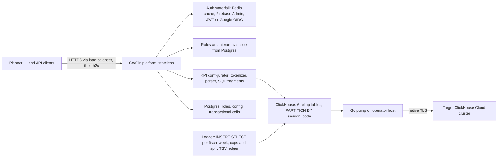
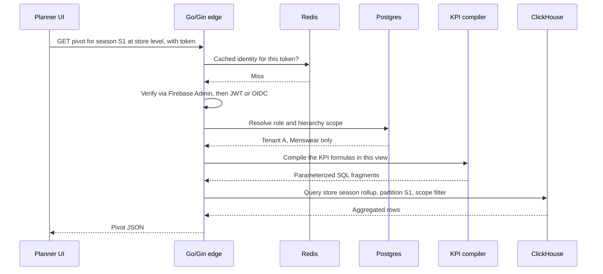
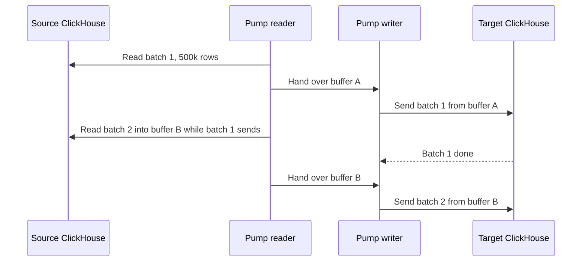
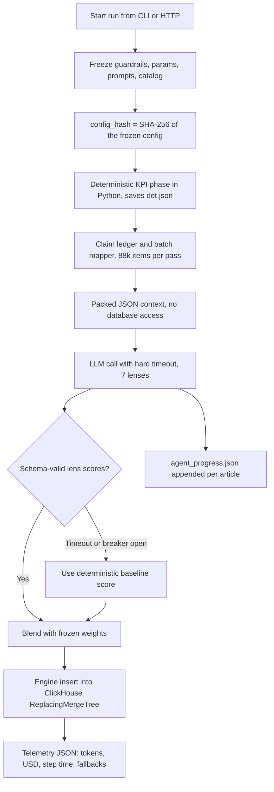
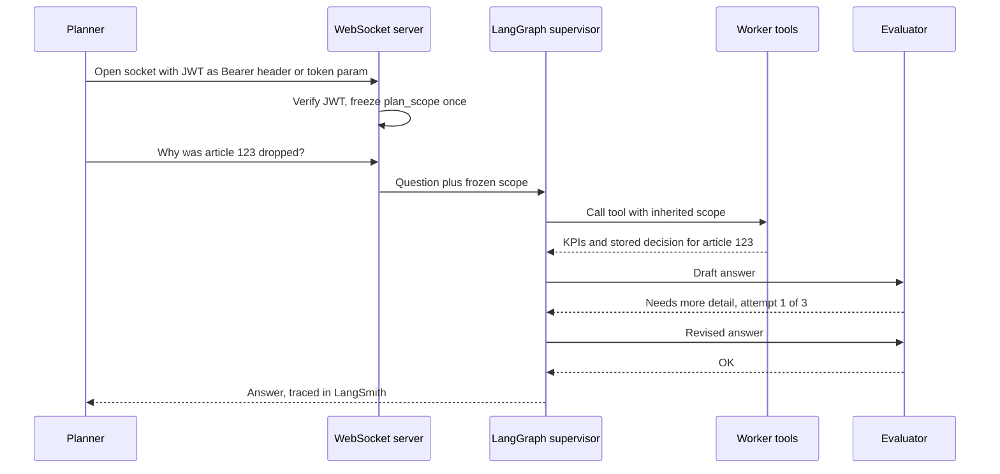
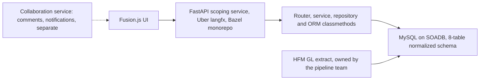
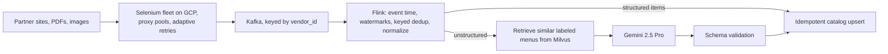
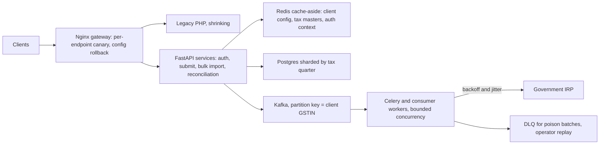
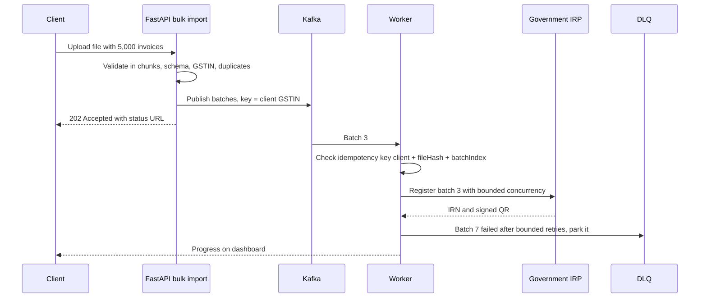

# 07. My projects deep dive (OCI framing)

For each project this page gives you the **one-minute version**, the **business in plain English**, the **words you need**, the **architecture** with a diagram, the **key decisions and trade-offs**, the **numbers explained**, **failure modes**, **OCI JD tie-ins**, **likely questions with speakable answers**, and **honesty lines**. Numbers match the PyGo PDF (Python and Go wording: FRM on FastAPI and SQLAlchemy 2.0, Masters India on FastAPI).

<div class="callout highlight">
<b>How to use this page</b>
<ul>
<li><b>What it covers:</b> every project on the resume, deep enough to survive a 45-minute "walk me through it" round: AssortSmart (core platform and agentic AI), Uber FRM, Uber Menu, Uber ANZ, Masters India, GeeksforGeeks.</li>
<li><b>When to read it:</b> before the hiring manager, bar raiser, and system design rounds. Read the one-minute version and the architecture of each project first. Read the decision and question sections the day before.</li>
<li><b>What to memorise:</b> each one-minute version, one diagram per project you can redraw, and the honesty box below.</li>
<li><b>Companion pages:</b> the STAR stories built on these projects are in <a href="01_core_values_star.md">01 Core values STAR</a>. Ownership boundaries are in <a href="08c_behavioral_terraform.md">08c</a>.</li>
</ul>
</div>

<div class="callout note">
<b>What the tags mean.</b> <b>MEASURED</b> means there is a log, a doc, or code behind the number. <b>ESTIMATED</b> means arithmetic I can show, so I say "roughly, derived from...". <b>HISTORICAL</b> means it comes from my past work records. <b>TARGET</b> means a design goal, so I say "targeting". <b>VERBAL</b> means true and fine to say, but not printed on the PDF.
</div>

<div class="callout warn">
<b>Honesty lines to keep (say these unprompted if anyone fuses numbers).</b>
<ul>
<li>80% is a CI promotion gate on 300 cases, not live accuracy across tenants.</li>
<li>The 73% cost cut and the 74% baseline come from the gold-200 bench.</li>
<li>15.5x is query time on a 250M-row harness. The 170 GB OOM fix is load time. One did not cause the other.</li>
<li>344k is rows per second, not requests per second. It was measured on a 4.09B-row table while the copy was in flight.</li>
<li>Partition rollback is DROP PARTITION, then recopy. It is not an atomic reader swap.</li>
<li>Uber roles are via EPAM. ANZ numbers are historical. Menu 98% is offline evaluation.</li>
<li>No Kafka, Flink, CDC, or Kubernetes cluster operations on AssortSmart. No human review (HITL) queue.</li>
</ul>
</div>

---

## 1. Impact Analytics: AssortSmart (Senior Software Engineer, Platform & AI), May 2026 to present

### The business in plain English

AssortSmart is software that retail merchandise planners use to decide their **assortment**: which products (called **articles**) to keep, drop, or add each season, for each group of stores. Imagine a clothing chain deciding which 500 shirts to stock in its northern stores next summer. Before tools like this, planners did it with huge spreadsheets and pivots that took minutes to load. Clients pay because a better assortment means fewer unsold items and fewer missed sales.

I work on two parts. The **core platform** is the Go services, the ClickHouse analytics layer, and security. The **agentic decision layer** is the batch AI scoring engine and the Ask Iris copilot.

### Words you need

- **Article-season.** One product in one selling season. The same shirt in Summer and in Winter is two article-seasons.
- **Pivot.** A planner's table view that groups and totals data by chosen dimensions, like "units sold by store by week". The same as a spreadsheet pivot table, but over hundreds of millions of rows.
- **Multi-tenant.** One system serving many client companies (tenants). Like an apartment building: shared plumbing, but every flat has its own lock.
- **UAM (User Access Management).** The rules for which user may see which part of the product hierarchy, for example only the Menswear department.
- **Go and Gin.** Go is a compiled language from Google with cheap concurrency. Gin is a popular Go web framework for HTTP APIs.
- **ClickHouse.** A column-oriented database for large analytical queries. Each column is stored separately and compressed, so a query that needs 3 columns never reads the other 200. Think of a library where every chapter of every book is shelved by topic, so you only pull the chapters you need.
- **PostgreSQL (Postgres).** A row-oriented database for many small transactional reads and writes. Here it keeps thin metadata: users, roles, config.
- **OLTP versus OLAP.** OLTP (online transaction processing) is many small reads and writes, like a cash register. OLAP (online analytical processing) is a few huge scans and totals, like the year-end accounts.
- **Partition.** A table split into separately stored slices, here one per season (`season_code`). A query for one season skips the rest. Like a filing cabinet with one drawer per year.
- **Rollup table.** A table of pre-computed totals at a chosen grain. Like keeping a monthly total on the first page of a receipt book.
- **Grain.** The level of detail of a row, for example "one product in one season" versus "one product in one week".
- **MergeTree and ReplacingMergeTree (RMT).** ClickHouse table engines. MergeTree writes data in sorted chunks (called parts) that merge in the background. ReplacingMergeTree also keeps only the latest version of rows with the same key. Think of a notebook where you never erase. You write the new value below, and a cleaner later crosses out the old lines.
- **OOM (out of memory).** A query killed for needing more memory than allowed.
- **LLM (large language model).** A model like GPT or Gemini that reads and writes text.
- **Lens.** One structured question the LLM answers about an article. AssortSmart has 7 lenses.
- **Deterministic score.** A rule-based score from KPIs. Same input, same answer, every time.

---

### 1A. Core Infrastructure & Pipeline

**The one-minute version (say it out loud)**
> I built the Go and Gin platform layer that handles 10 thousand requests per second at peak, as an edge that protects itself without a reverse proxy. I moved planner analytics onto ClickHouse rollup tables, which cut a 250-million-row pivot from 189 seconds to 12. I fixed a memory blow-up of about 170 GB in the weekly rollup builds by slicing the work into one fiscal week at a time. And I wrote a Go copy tool that moves partitions between ClickHouse Cloud clusters at about 344 thousand rows per second.

#### Architecture



*What to notice:* there are three separate paths. The **read path** (planner to Go to ClickHouse) is what users feel. The **build path** (loader) fills the rollup tables. The **copy path** (pump) moves finished partitions between clusters.

**Walking through it box by box**

1. **Planner UI and API clients** call over HTTPS. The load balancer terminates TLS and forwards to the Go service using h2c (HTTP/2 without TLS, used inside the trusted network).
2. **The Go/Gin platform** is stateless, so any instance can serve any request. It uses Google Wire for dependency injection, nested context timeouts, and Datadog distributed tracing.
3. **The auth waterfall** identifies the caller. Redis caches known identities. If there is no cache hit, it tries Firebase Admin, then JWT or Google OIDC. API keys are compared in constant time.
4. **Role and hierarchy resolution** reads Postgres roles and turns the verified identity into a tenant plus a UAM hierarchy scope.
5. **The KPI configurator** compiles operator-written formulas into parameterized ClickHouse SQL fragments.
6. **ClickHouse** holds the six rollup tables (product, store, attribute, each at season and weekly grain), partitioned by `season_code`, with bloom-filter skip indexes. A **bloom filter skip index** is a small summary per chunk that can say "this value is definitely not in here", so ClickHouse skips the chunk.
7. **Postgres** keeps roles, config, and transactional cells.
8. **The loader** builds the rollups with `INSERT SELECT`, one fiscal week at a time, with memory caps, disk spill, and a TSV ledger of finished seasons.
9. **The Go pump** copies partitions from the source ClickHouse Cloud cluster through the operator host to the target cluster, over native TLS on both legs.

#### One request, step by step (a planner pivot)

Sample request: a planner in a retail client's Menswear team opens a store-by-season view for season S1.



*What to notice:* the tenant and hierarchy come from the verified identity, never from request parameters. The query hits one partition of a pre-aggregated table, not the 2.11B-row master.

#### Decisions, one by one

**1. Go/Gin edge with no reverse proxy**
- *What:* the Go process itself handles h2c, nested timeouts, and tracing. There is no Nginx or Envoy in front of it.
- *Why:* one less network hop and one less thing to operate.
- *How:* the edge sets a total time budget per request, and every inner call inherits the remaining deadline through Go's `context`. Think of a meeting that ends at 3 pm no matter which agenda item is running.
- *Alternatives:* a reverse proxy such as Nginx or Envoy. It gives WAF (web application firewall) rules and connection limits for free, but adds a hop and an ops surface we did not need.
- *Trade-off:* no proxy-level features unless we add them in middleware or at the load balancer.
- *Say carefully:* I don't claim an SLA number. I don't claim Kubernetes cluster operations.

**2. Google Wire compile-time dependency injection**
- *What:* Wire generates the code that builds every service object and its dependencies.
- *Why:* wiring mistakes fail the build, not a live request. There is no runtime reflection.
- *Analogy:* checking you packed every part before leaving the house, instead of discovering a missing one at the campsite.
- *Alternative:* runtime DI containers (for example Uber's `fx`). They are more flexible but fail at startup or at request time.

**3. Multi-tenant isolation and access control**
- *What:* identity comes from a Redis-fronted waterfall (Firebase Admin, then JWT, then Google OIDC). Hot identities hit the cache. API keys are compared in **constant time**, meaning the check takes the same time whether the first or the last character is wrong, so an attacker cannot guess a key by timing. **Postgres-backed roles** give UAM-scoped hierarchy access.
- *Why:* the tenant and hierarchy must come from the verified identity, not from request parameters someone could edit.
- *How:* isolation is enforced across both Postgres and ClickHouse queries.
- *Say carefully:* isolation is access control, not encryption.

**4. KPI configurator**
- *What:* operators write formulas like `(sales - cost) / sales`. A Go tokenizer and parser check every function against an allowlist, map logical names to physical columns, and emit **parameterized** SQL fragments wrapped in `ifNotFinite(toFloat64(expr), 0)` for division-by-zero protection.
- *Why:* new KPIs no longer need a code release. Business formulas are decoupled from deploys.
- *Security:* user input is never concatenated into SQL. The grammar is an allowlist. Unknown tokens fail closed (compile fails, nothing runs).
- *Alternative:* hard-coding each KPI in Go, which means a release per formula.

A worked example (column names illustrative):

```text
Operator writes:   (sales - cost) / sales
Tokens:            LPAREN IDENT(sales) MINUS IDENT(cost) RPAREN DIV IDENT(sales)
Name mapping:      sales -> net_sales, cost -> cost_amt   (allowlisted names only)
Emitted fragment:  ifNotFinite(toFloat64((net_sales - cost_amt) / net_sales), 0)
Row with sales=0:  result 0, not an error and not infinity
Input "drop()":    unknown function, compile fails closed
```

A tiny sketch of the allowlist check in Go (illustrative, not the real file):

```go
var allowedFuncs = map[string]bool{"sum": true, "avg": true, "min": true, "max": true}

func checkFunc(name string) error {
    if !allowedFuncs[strings.ToLower(name)] {
        return fmt.Errorf("function %q not allowed", name) // fail closed
    }
    return nil
}
```

**5. Moving pivots to ClickHouse (the 15.5x)**
- *What:* planner pivots moved from Postgres to pre-aggregated ClickHouse rollups.
- *Why:* on Postgres, pivots hit 189 seconds at 250M rows.
- *How:* I wrote the RFC and a **row-identical harness**: same rows, same query, both engines, answers compared. ClickHouse ran it in about 12 seconds. We pay once at load time (pre-aggregated rollups) and read cheaply (partition pruning, bloom indexes).
- *Alternatives:* Postgres indexes or materialized views. See the first likely question below for why not.
- *Trade-off:* a second database to run, and a build pipeline to keep rollups fresh.
- *What I'd keep:* Postgres for OLTP. I did not insist on one database for everything.
- *Background (VERBAL):* the proof-of-concept work compared Postgres and ClickHouse directly. ClickHouse won the large analytical reads.

**6. Six rollup tables**
- *What:* season and weekly grain, times product, store, and attribute.
- *How:* store and attribute tables drop SKU-level dimensions and **re-weight** so that store totals equal the SKU sums. (A SKU, stock keeping unit, is one specific sellable variant, like a shirt in size M.) The attribute table is an **unpivot** (`ARRAY JOIN` over attribute pairs), which turns one row with many attributes into one row per attribute. So attribute weekly is about 5x the size of product weekly.
- *Why:* each planner view reads the smallest table that answers it.

**7. The 170 GB OOM (load time, not query time)**
- *What happened:* a whole-season weekly `INSERT SELECT` needed about 110 `any()` states plus `argMax` and `argMin` over wide strings. That came to about 170 GB of aggregator state. It failed at 80 GB and 200 GB caps on a replica with about 59 cores and about 236 GiB.
- *Fix:* the unit of work became **one fiscal week**, with generated settings: 8 threads, a 55 GB memory cap, 16 GB spill to disk, and 4 weeks in flight.
- *Measured peaks:* product weeks about 11 GB, attribute weeks over 40 GB.
- *Alternative rejected:* a bigger machine. It failed even at 200 GB, and bigger machines only move the cliff.
- *Rule I set:* never raise season parallelism and week parallelism together on the same box.

```text
Before: 1 job  = season S1, all ~26 weeks, all attributes   -> ~170 GB state -> killed
After:  N jobs = season S1, week 202614 only, one at a time  -> under 55 GB cap, spills if needed
        up to 4 weeks run at once, each with 8 threads
```

(The "26 weeks" is just an illustration of a season's size, not a project number.)

**8. The Go pump (~344k rows/s)**
- *Why it exists:* the direct cluster-to-cluster copy was blocked by Cloud IP allowlists, while the operator machine's IP was allowed on both. An **IP allowlist** is a guest list at the door.
- *How it is fast:*
  - Native ClickHouse protocol over TLS (port 9440).
  - 500k-row **columnar** buffers (`batch.Column(i).Append`), with no per-row reflection. Reflection is Go inspecting types at runtime, which is slow for billions of rows.
  - **Double buffering**, so reading the next batch overlaps sending the previous one. That also cured the HTTP `unexpected EOF` error that happened when the SELECT stream sat idle during an INSERT. Picture two waiters: one carries plates while the other loads the next tray.
- *Parallelism:* `-workers N` copies N seasons in parallel, each with its own connections. Caps are per process (about 48 threads and 180 GiB split across workers).
- *Safety:*
  - The per-season checkpoint ledger (`migrate-checkpoints/<table>.done`) records only finished seasons.
  - An incomplete season means DROP PARTITION, then recopy.
  - SIGINT (Ctrl+C) finishes the in-flight batch without checkpointing that season.
  - A per-table `flock` (file lock) stops two terminals copying the same table.
  - Secrets come from environment variables only.
- *Alternatives:* server-side `INSERT SELECT` across clusters (blocked by the allowlist), or export to object storage and re-import (slower to set up, but the right long-term path).
- *What I'd do differently:* build into a scratch table and use `REPLACE PARTITION`, so readers never see a partial season. I wrote that design. It was not executed.



*What to notice:* the read stream is never idle while a write is running. That is what removed the EOF error and raised throughput.

**9. 64.1M ghost rows (the loader, not the pump)**
- *What happened:* a failed HTTP INSERT still commits the blocks it already wrote. A half-loaded partition of 64.1M rows passed the check "skip if the partition has rows".
- *Fix:* a TSV ledger of finished `(kind, season_code)` pairs. Success is read from `system.query_log` (`QueryFinish`), not from the HTTP client. A missing entry means drop and rebuild.
- *Lesson:* never use `count() > 0` as a success signal.

#### The numbers, explained

| Number | What it measures | Tag |
|---|---|---|
| 10k peak RPS | Requests per second at peak on the Go/Gin platform | MEASURED |
| 189 s to 12 s, 15.5x | One planner pivot query on the 250M-row harness, Postgres versus ClickHouse | MEASURED |
| 170 GB | Estimated aggregator memory for one whole-season weekly build | ESTIMATED from the failed builds |
| ~344k rows/s | Combined copy rate of two season workers at a live snapshot | MEASURED |
| 4.09B rows | Size of the attribute weekly table being copied (two seasons) | MEASURED |
| 2.11B rows | Size of the ClickHouse master table | MEASURED |

- **15.5x.** It is the ratio of the two measured query times. The 12 seconds is the rounded figure (about 12.3 s). It mattered because a planner will wait 12 seconds for a pivot, but not over 3 minutes. Say: "from 189 seconds to 12 seconds on the same 250 million rows". Don't say: "ClickHouse is 15x faster in general", or that the OOM fix caused it.
- **344k rows/s.** Two season streams of about 150 to 190 thousand rows per second each, added together at one snapshot. It is an ingest rate, not requests per second. It was measured while the 4.09B copy (2,779,317,472 plus 1,311,108,195 rows) was still running. Say: "about 344 thousand rows per second, measured on a 4-billion-row table". Don't say: "we migrated 4 billion rows at 344k TPS".
- **170 GB.** It is load time on weekly builds. It failed even at 80 GB and 200 GB caps. Say: "the aggregation state was around 170 GB, so I shrank the unit of work". Don't connect it to the 15.5x.
- **10k peak RPS.** Say "scales to 10 thousand requests per second at peak". Don't attach an SLA or uptime figure.

#### Failure catalog (this doubles as a runbook, and OCI loves it)

A **runbook** is a step-by-step guide for an operator handling a known problem.

1. OOM on a weekly GROUP BY: shrink to one week, and measure attribute weeks before adding RAM.
2. A half-written partition looks complete: never use `count() > 0` as success.
3. An HTTP client timeout after the server committed: trust `system.query_log`.
4. HTTP SELECT EOF during an INSERT: double buffer, or use the native protocol.
5. Retrying a batch that was already partly sent creates duplicates: drop and restart the unit instead.
6. Native TLS reset: crash, and checkpoint only finished seasons.
7. Allowlists block cluster pull: the pump is the workaround. The proper fix is allowlisting plus server-side `INSERT SELECT`, or object storage.
8. Oversubscribing workers: caps are per process, so N workers share them.
9. Never commit Cloud passwords.

**OCI JD tie-ins:** large-scale data processing, data plane reads, performance testing (the row-identical harness), recovery-oriented design (ledgers, restartable units), automation tooling, multi-tenant access control, and correctness checks (parity sums).

#### Likely questions

- **Why not just add Postgres indexes or materialized views?**
  "Because the access pattern is wrong for a row store. Pivots aggregate across huge slices with many dimensions, and a row store reads whole rows even when the query needs three columns. Columnar storage, compression, and vectorized execution win by an order of magnitude for that pattern. We measured it on the same rows instead of guessing, and Postgres stays for OLTP."
- **How do you keep rollups consistent with source data?**
  "I rebuild per partition at a captured watermark, which is a fixed point in the source data. Then I run parity checks: the sum over product equals the sum over store equals the sum over attribute, at the same filters. Earlier season-grain parity was 0% difference across seasons 1 to 7. ReplacingMergeTree handles corrections by version."
- **What's the biggest risk in the pump?**
  "There is no atomic swap. A crash leaves a truncated season until I drop and retry, and readers can see it partially. The better design is building into a scratch table and using REPLACE PARTITION. I wrote that, but it wasn't executed. I'd do it before calling the tool production-grade."
- **How would you make this OCI-grade?**
  "Four things. Move the copy server-side so there is no operator host, and use atomic partition swaps. Add a completeness check before publishing a season. Emit per-season metrics like rows per second, lag, and failures, with alarms. And run it as a scheduled, idempotent job with the ledger in a durable store instead of local files."
- **How did you test the 10k RPS?**
  "With load tests against the Gin edge, and with Datadog under real peak traffic. I talk about p95, p99, and saturation, and I don't quote an SLA."
  *Follow-up they may ask:* "What is p99?" "The latency that 99 out of 100 requests beat. It shows the worst tail."

---

### 1B. Agentic Flows & Orchestration

**The one-minute version (say it out loud)**
> I built a batch AI decision engine for merchandise planning. It runs three pipelines: Keep/Drop, Missed Opportunities, and Top Style. It scores 348 thousand article-seasons, 88 thousand per pass, by blending rule-based KPI math with structured LLM calls across 7 AI lenses. It is built to survive provider failures, with hard timeouts, circuit breakers, and checkpoints. I also shipped Ask Iris, a secure chat copilot for planners where the tenant scope is frozen when the connection opens. And no model change ships without passing an 80% gate on 300 test cases.

#### Words you need

- **Batch job.** A program that processes a big list of items in one run, like a payroll run, as opposed to answering one user request.
- **Pass.** One run over a chunk of the catalog. 88k items per pass.
- **Hard timeout.** A strict time limit on one call. If the LLM has not answered by then, we stop waiting.
- **Circuit breaker.** After repeated failures (here about 5 consecutive failures, or a high failure fraction), the code stops calling that provider for a while and uses a fallback. Like the breaker in your house tripping to prevent a fire.
- **Checkpoint.** A saved record of finished work (`det.json` for deterministic scores, `agent_progress.json` for LLM progress), so `--resume` skips what is done. A bookmark.
- **config_hash.** A SHA-256 fingerprint of the guardrails, parameters, prompts, and catalog for a run, stamped on every output row. Like the batch number printed on a medicine box.
- **Telemetry.** Numbers a program reports about itself: tokens used, cost in USD, step duration, how many batches fell back.
- **JWT and WebSocket.** A JWT is a signed token that proves who you are, a tamper-proof badge. A WebSocket is a connection that stays open for a back-and-forth chat. The **handshake** is the moment it opens.
- **LangGraph, supervisor, evaluator.** LangGraph is a Python library for building AI agents as a graph of steps. The supervisor decides which worker step runs next. The evaluator checks the draft answer and can send it back for another try.
- **LangSmith.** A tracing tool that records each step of an agent run for debugging. Used on Ask Iris only.
- **Proxy evaluation harness and gold-200.** The harness is 300 test cases with expected answers, run in CI. Gold-200 is a separate, carefully labelled 200-case benchmark used to choose models.

#### Architecture: the Keep/Drop batch run



*What to notice:* every path ends in a written score. A failed LLM call degrades to the rule score instead of failing the run.

**Box by box.** A run starts from the command line or an HTTP call. The config (guardrails, parameters, prompts, catalog) is frozen and hashed, and that hash goes on every output row. The deterministic KPI phase runs first in Python and saves `det.json`. A claim ledger and batch mapper split the work into bounded parallel batches. Each batch gets a packed JSON context. The LLM never queries the database. Each LLM call has a hard timeout, and the output must pass a schema check. A circuit breaker per provider trips on repeated failures. On a timeout or an open breaker, the article keeps its deterministic score. Scores are blended with frozen weights and inserted through the engine into a ReplacingMergeTree table, so retries do not duplicate. A telemetry JSON per run records tokens, USD cost, step durations, and batch fallbacks.

**The step order is fixed in code.** Keep/Drop has no LLM orchestrator deciding what runs next. The order is always: peer comparison, decider, lenses, blend, explain. The agent score comes from the lenses combined by the decider.

**A worked blend example (VERBAL depth, not on the PDF).** The final score is `s_final = 0.4 × s_det + 0.6 × s_agent`. The article is kept if `s_final` is 0.55 or more.

```text
Article A, season S1:  s_det = 0.70, s_agent = 0.45
s_final = 0.4 * 0.70 + 0.6 * 0.45 = 0.28 + 0.27 = 0.55   -> keep (just)

Article B, season S1:  s_det = 0.40, s_agent = 0.50
s_final = 0.4 * 0.40 + 0.6 * 0.50 = 0.16 + 0.30 = 0.46   -> drop

Article C, LLM timed out:  falls back to its deterministic score, run continues
```

(The article scores are made-up sample values. The weights and the 0.55 threshold are the real frozen config.)

#### Architecture: Ask Iris (the planner copilot)



*What to notice:* `plan_scope` is set once at the handshake. No later message can widen it. The evaluator loop stops at 3 attempts (`MAX_ATTEMPTS = 3`).

#### Decisions and trade-offs

**Deterministic math, LLM for judgment.** LLMs are unreliable at arithmetic, so KPIs are computed in code and the LLM sees them as JSON. *Alternative:* let the LLM compute from raw rows. *Why not:* wrong numbers, and much higher token cost.

**No SQL tool for the LLM.**
- *What:* context is served as JSON payloads. The model never gets a SQL tool.
- *Why:* at 88k items a SQL tool means runaway queries, connection-pool exhaustion, and prompt-injection risk against a 2.11B-row master. **Prompt injection** is text in the input that tricks the model into doing something it shouldn't.
- *Trade-off:* the model can only reason about what we pack. We have to choose the context carefully.
- *Say carefully:* "async" describes how batches run. It does not mean the LLM queries anything.

**ReplacingMergeTree writes.**
- *Why:* retries and overlapping waves can land twice. RMT keeps the latest version per key, so writes are eventually consistent.
- *How:* reads use `argMax` or `LIMIT 1 BY`, not `FINAL`, as a runtime rule. `FINAL` forces the merge at query time and is slow on big tables.

```sql
-- latest score per article-season without FINAL (illustrative names)
SELECT article_id, season_code, argMax(s_final, version) AS s_final
FROM keep_drop_scores
WHERE season_code = 'S1'
GROUP BY article_id, season_code;
```

**Fallback to baseline on timeout.** The run always completes, and telemetry shows how much fell back. *Trade-off:* a run with many fallbacks is mostly rule-based. That is why the fallback count is in telemetry.

**Checkpoints.** A provider outage at item 70k does not redo the deterministic phase or finished articles. *Alternative:* restart from scratch. *Why not:* wasted cost and time on a big run.

**App-native orchestration, not Airflow or Temporal.**
- *What:* the timeouts, breakers, checkpoints, config hashing, and telemetry live in a shared orchestration registry inside the application.
- *Why:* it needed tight coupling to ClickHouse inserts, config hashing, and per-run cost telemetry. Extra infrastructure was not justified.
- *Alternatives:* **Airflow** (a scheduler for data pipelines) and **Temporal** (a durable workflow engine).
- *When I'd pick Temporal:* for cross-team, cross-service workflows with human steps.

**Frozen weights.** On gold-200 the blended LLM scored about 63%, below the 74% deterministic baseline. I refused to retune weights on a small proxy set, because that would overfit.

**Model choice.** The chosen model completed 200 out of 200 cases at 73% lower cost, with 100% lens coverage. A cheaper option left rows pending, so completion reliability won. Model names are not on the PDF.

**Ask Iris safety.**
- The JWT is checked on the handshake, via `Authorization: Bearer` or `?token=`.
- `plan_scope` is frozen once, and every tool inherits it. That prevents cross-tenant leaks.
- The evaluator is capped at 3 attempts, with a recursion limit on the supervisor graph. It fails closed with a graceful response.
- LangSmith traces every run.

#### The numbers, explained

- **348k article-seasons.** How many product-season pairs the engine evaluates. Don't confuse it with the 1.6M article-season catalog (VERBAL, off the PDF), which is the whole catalog, not what was scored.
- **88k items per pass.** The batch size of one run.
- **7 AI lenses.** The number of structured LLM questions per article.
- **300 cases, 80% gate.** The CI promotion gate (`gold_min_accuracy 0.8`). Say: "no model or prompt change ships unless it passes 80% on our 300-case harness". Don't say: "the system is 80% accurate in production".
- **74%, about 63%, 73%.** All from the gold-200 benchmark. 74% is the deterministic baseline (production deterministic threshold 0.65 on that set). About 63% is the blended LLM. 73% is the live execution cost cut of the chosen model at 100% coverage. Say: "on our gold set, the rule scored 74% and the blend about 63%, so I froze the weights". Don't fuse these with the 80% gate.
- **3 attempts.** The evaluator cap in Ask Iris.
- **Token spend** of about $100 per pass is true but off the PDF (VERBAL). Only use it if asked about cost.

#### Failure modes and handling

| Failure | Handling |
|---|---|
| Provider 502/504 storm | Breaker opens, deterministic fallback, run completes, fallback count in telemetry |
| Process crash mid-run | `--resume` reloads `det.json` and progress, and skips finished items |
| Duplicate writes on retry | RMT versioning plus `argMax` reads |
| Prompt or config drift | `config_hash` on every row, eval gate on change |
| LLM loops in chat | 3-attempt evaluator cap plus recursion limit |
| Cross-tenant question in chat | Scope frozen at handshake, tools can't widen it |
| Cost runaway | Per-run USD telemetry, model chosen by cost at 100% coverage |

A 502 or 504 is an HTTP error meaning the provider's gateway failed or timed out.

**OCI JD tie-ins:** retries, circuit breakers, and timeouts. Recovery-oriented design (checkpoints). Telemetry (tokens, cost, fallbacks). Tests as deployment guardrails (the eval gate). Multi-tenant access control. Change management for models (a promotion gate plus the config hash).

#### Likely questions

- **How do checkpoints work?**
  "The deterministic results land first, in `det.json`. As LLM chunks complete, per-article progress is appended to `agent_progress.json`. On restart with `--resume`, the deterministic results are reloaded, finished articles are skipped, and the LLM map continues from where it stopped."
- **How do you handle rate limits at 88k items?**
  "Bounded parallel batches, a hard timeout per batch, backoff, and the circuit breaker. A throttle from the provider slows us down, but it doesn't wipe the run."
- **Is 80% your production accuracy?**
  "No. It's the CI promotion gate on the 300-case file. The model comparison was on gold-200, where the rule baseline was 74%."
- **Why 3 attempts?**
  "It bounds cost and latency. Beyond three attempts, the quality gain wasn't worth a stuck chat, so it fails closed with a helpful message."
- **Why not let an LLM orchestrate the Keep/Drop steps?**
  "The order is the same every time: peer comparison, decider, lenses, blend, explain. A fixed order is cheaper, testable, and can't loop. I'd only add an orchestrator if the steps genuinely varied per item."
- **What would you add for OCI scale?**
  "A durable job store instead of local JSON checkpoints. Per-tenant quotas. SLO alarms on fallback rate and run duration. And canary rollout of prompt changes to one tenant before all."

**Do not say:** HITL review queue. LangSmith on the batch engine (LangSmith is Ask Iris only). Questions per week or tenant SLAs for Ask Iris. "All tenants live at 80%." Kafka, Flink, or CDC on AssortSmart. Cluster Recommendation Copilot and Hindsight are verbal-only topics, not resume bullets.

---

## 2. Uber (via EPAM Systems): FRM Scoping Platform (SDE 2), Jul 2024 to May 2026

### The business in plain English

Every quarter, Uber's Finance team has to decide which financial line items are large or risky enough to be in audit scope. The external auditor relies on that decision. Before this platform, it all lived in a Google Sheets workbook: people mapped parent and child line items by hand, there was no history, and nobody could prove who changed what. A quarterly reconciliation took 14 days. Uber paid for this because a slow, untraceable process is a SOX compliance risk and burns finance staff time every close.

### Words you need

- **FRM (Financial Risk Management) scoping.** Deciding which financial line items go into audit scope each quarter.
- **GL (general ledger).** The master record of every account balance.
- **FSLI (Financial Statement Line Item).** A line on the financial statements, such as "Cash". Here they nest four levels (L1 to L4), like folders inside folders.
- **Materiality threshold.** The size above which an error would matter to someone reading the statements. Here $340M.
- **Quarter annualization.** Turning a quarter's figure into a yearly equivalent so it can be compared with annual thresholds.
- **HFM (Oracle Hyperion Financial Management).** The finance system the GL balances come from. Reconciliation compares HFM with the filed 10-Q (the quarterly report to the US regulator).
- **SOX (Sarbanes-Oxley).** A US law requiring controls and audit trails on financial reporting.
- **SOADB.** Uber's standard service-owned MySQL setup.
- **ORM and SQLAlchemy 2.0.** An ORM lets Python code use database rows as typed objects. SQLAlchemy 2.0 is the modern version, with typed `Mapped[]` columns.
- **Optimistic locking.** Each row carries a version number, and an update only succeeds if the version is unchanged since you read it. Like a shared doc that warns "someone edited this since you opened it".
- **FSM (finite state machine).** A fixed set of states and allowed moves, here Draft, Review, ReOpen, Closed.
- **Bazel and stacked PRs.** Bazel is Uber's build system. Stacked PRs are a chain of small pull requests, each reviewable and revertible on its own.

### The one-minute version (say it out loud)
> At Uber Finance, via EPAM, I owned the backend for Financial Risk Management scoping. That's the quarterly process that decides which financial line items are in audit scope. We moved it from a Google Sheets workbook to FastAPI and MySQL, with a nested four-level hierarchy of line items. Reconciliation went from 14 days to 3 days against a $340 million materiality threshold. I also led three engineers on a SQLAlchemy 2.0 migration that took the module to 100% coverage, with SOX gates.

Details for follow-ups: 19M raw GL rows migrated off Sheets, and 36 FastAPI endpoints.

### Architecture



*What to notice:* the ETL feed and the collaboration service are not mine. I own the scoping service and its schema.

**Box by box.** The Fusion.js front end (Uber's web framework) calls the FastAPI scoping service, built in Uber's `langfx` Python setup inside the Bazel monorepo. Inside the service, routers handle HTTP, services hold business logic, and repositories plus ORM classmethods (SQLAlchemy 2.0 with typed `Mapped[]` columns) talk to the database. The MySQL schema on SOADB has 8 normalized tables:
- `level_mapping` is the spine: the L1 to L4 FSLI hierarchy.
- `balance_sheet`, `income_statement`, and `component_entity` hang off that spine.
- `scoping_questions` and `scoping_assessments` hold qualitative answers.
- Metrics (materiality, benchmarks), threshold setup, EMI data, and reconciliation tables complete it.

The pipeline team's ETL loads HFM GL balances into MySQL. I consume that data. I don't operate the extract.

**Verbal depth, if they want more:** there are 11 ORM models in the service code, and 8 screens (Reconciliation, Materiality, EMI Scoping, Group Scoping, Threshold Setup, Component Scoping, Residual Risk, Summary). On the Q4 2025 close, materiality was $340M and residual was $170M, with 5% significance thresholds.

### Key decisions

**Normalized 8-table schema with `level_mapping` as the spine.**
- *Why:* every line item hangs off one hierarchy, so totals roll up correctly.
- *How:* joins are always ANDed with the fiscal period and active flags, so a query never mixes quarters.
- *Alternative:* one wide table per screen, the way the Sheets worked. *Why not:* duplication, and it is how the old mapping errors happened.

**Polymorphic review status.** One status model (Draft, Review, ReOpen, Closed) is reused across screens on the fact rows, and it drives the FSM transitions. *Why:* one set of rules and one audit trail instead of eight.

**Optimistic row locking.**
- *What:* a version column on each row, so two reviewers editing the same line can't silently overwrite each other. One gets a conflict.
- *Alternative:* pessimistic locking (`SELECT ... FOR UPDATE`). *Why not:* reviewers keep rows open for minutes, so locks would block everyone.

```sql
-- read: version = 7
UPDATE scoping_assessments
SET answer = 'In scope', status = 'Review', version = version + 1
WHERE uuid = 'a3f9...' AND version = 7;
-- 1 row affected: saved.  0 rows affected: someone else saved first, return 409 Conflict.
```

**Atomic cross-table syncs.** An update to a line and its dependent rows happens in one transaction. Either all of it lands, or none of it.

**SHA-256 natural keys.**
- *What:* the id is a hash of meaningful fields, for example SHA-256 of the question text plus the normalized page name.
- *Why:* reloading the same data produces the same keys, so reloads are idempotent and there are no duplicates across quarterly audit trails. A fingerprint, not a ticket number.
- *Alternative:* auto-increment ids. *Why not:* a reload creates new ids for the same rows, and history across quarters stops lining up.

```python
import hashlib

def question_uuid(question_text: str, page_name: str) -> str:
    normalized = page_name.strip().lower()
    return hashlib.sha256(f"{question_text}{normalized}".encode()).hexdigest()
```

(Illustrative. The real code may join the fields differently.)

**SQLAlchemy 2.0 migration (I led 3 engineers).**
- *Why:* the motivating bug was raw SQL reading income-statement rows with balance-sheet column lists. Duplicate column names in joined raw SQL silently mapped rows to the wrong uuid. That is the **column-aliasing bug**. Typed ORM models with aliased selects and explicit labels make it impossible.
- *How:* we shipped via **stacked Bazel PRs** (small, reviewable, reversible) with zero-downtime releases.
- *Leadership:* I was the tech lead of an EPAM pod, not a people manager. They owned pieces. I owned the approach, the review bar, and the rollout. The team wrote 1,100+ tests (VERBAL).

**SOX controls.**
- **Reporting SQL allowlists:** only approved reporting queries can run.
- **FSM gates with 50% delta-variance checks:** a quarter-over-quarter swing above 50% blocks the state transition until it is reviewed.
- 100% statement coverage on the migrated module.

**Reconciliation v1 to v2 (VERBAL depth).** Reconciliation v1 ran on Sheets. v2 runs on MySQL. They ran in parallel during cutover. The v2 change touched 18 files, about 1,268 lines added.

### The numbers, explained

- **14 days to 3 days (70%).** The time for a quarterly reconciliation, before and after. It mattered because the close has a hard deadline and the auditor waits on it. Say: "from 14 days to 3 days". If pressed on where it comes from: "the technical design doc framed that cut, and that's what the platform delivered for the close." Say this carefully: if someone does the arithmetic, 14 to 3 is closer to a 79% cut. The PDF states 70%, which is the smaller claim. Do not walk it back unprompted.
- **$340M materiality.** The threshold the scoping is measured against. It shows the stakes, not a saving.
- **19M raw GL rows.** The raw general ledger rows moved off Sheets into MySQL. If they ask about volume: individual quarterly GL extracts were about 38K to 95K rows, about 1.7K to 1.8K accounts, and about 400 entities. The value was correctness, hierarchy, and auditability, not big-data throughput. Don't invent where 19M comes from beyond "raw GL rows migrated off Sheets".
- **36 endpoints.** If they ask for the breakdown: about 31 functional routes in the scoping service handler, plus the collaboration-service APIs (comments and notifications) from the design doc, make 36. I did not build the collaboration service itself.
- **3 engineers, 100% coverage.** Led 3 on the ORM migration. 100% statement coverage on that module.

**Stories here:** the "pure refactor that wasn't" (my mistake, caught, and a process fix), "coverage that lied" (34.6% to 100%), and the rulebook disagreement (classmethods on models). Full STAR versions are in [01](01_core_values_star.md).

**OCI JD tie-ins:** compliance (SOX), change management (stacked PRs, gates), data integrity (optimistic locking, natural keys), code review for correctness, and leading a small team.

### Likely questions

- **How does optimistic locking work here?**
  "I read the row with its version. Then the update says `SET ..., version = version + 1 WHERE uuid = ? AND version = ?`. If zero rows are affected, someone else changed it first, so I return a conflict and the UI refreshes. I didn't use pessimistic locks because reviewers hold rows open for minutes, and locks would block everyone."
- **What does 14 to 3 days actually come from?**
  "Removing the manual Sheets mapping and reconciliation steps. The HFM versus 10-Q reconciliation became automated, materiality and thresholds were computed, and collaboration with status history lived in one tool. The design doc framed the cut, and that's what the platform delivered for the close."
- **Why SHA-256 natural keys instead of auto-increment?**
  "Deterministic identity across reloads. The same source row always maps to the same key, so a reload is an upsert, and audit history across quarters lines up."
- **How did you do zero-downtime releases?**
  "Stacked PRs where each step is backwards compatible. Schema changes were additive first. The v1 endpoints stayed live while the v2 MySQL-backed endpoints rolled out."
- **What was the hardest bug?**
  "The column-aliasing bug. A joined raw SQL query returned two columns with the same name, and rows got attached to the wrong uuid with no error. I fixed it with aliased selects and explicit labels, and the ORM migration made that whole class of bug impossible."

**Honesty:** via EPAM. The ETL from HFM was a shared pipeline responsibility. The real-time collaboration and Slack notification service was separate. Do not claim building it.

---

## 3. Uber (via EPAM): Menu Ingestion & Automation (Uber Eats)

### The business in plain English

When a restaurant joins Uber Eats, its menu has to be turned into Uber's catalog format: item names, prices, sizes, options. Menus arrive as PDFs, images, and partner websites, often in several languages. Doing that by hand or through a third party was slow (about a day per restaurant) and cost money per menu. Uber paid for automation because faster onboarding means restaurants start selling sooner, and every menu processed in-house saves the manual cost.

### Words you need

- **Selenium.** A tool that drives a real web browser from code, used here to scrape partner sites.
- **Proxy pool.** A set of different network exits, so requests look like they come from many places. **Retry budget** is a cap on how many retries one source may use.
- **Kafka.** A durable log of messages that many consumers can read and replay. Like a conveyor belt that also records every package that passed.
- **Flink (Apache Flink).** A stream-processing engine that keeps per-key state and checkpoints it. Like a sorting office that remembers which parcels it has already seen.
- **Event time and watermarks.** Event time is when something happened, not when it arrived. A watermark is Flink's marker for "I've probably seen everything up to this time".
- **RAG (retrieval-augmented generation).** Before asking the LLM, fetch similar examples and include them in the prompt. Like showing a new employee three filled-in forms before handing them a blank one.
- **Milvus.** A vector database. It stores embeddings (lists of numbers that represent meaning) and finds the closest ones fast.
- **Gemini 2.5 Pro and LangChain.** Gemini is Google's LLM. LangChain is a Python library for building LLM pipelines.
- **Field fidelity.** The share of extracted fields that match the correct value.

### The one-minute version (say it out loud)
> I built an automated menu ingestion pipeline that processes over 30 thousand menus a month. It cut restaurant onboarding from 24 hours to 2 hours and saved about $600K a year. Unstructured, multilingual PDFs are turned into a strict catalog schema with Gemini 2.5 Pro and LangChain RAG over Milvus, at 98% field fidelity in offline evaluation. I also hardened the Selenium scrapers to over 95% success, and built a Kafka and Flink pipeline with keyed dedup and schema normalization for exactly-once catalog upserts.

### Architecture



*What to notice:* structured items take the short path straight to the upsert. Only messy content goes through the LLM.

**Box by box.** The Selenium fleet runs on GCP with dynamic proxy pools and adaptive retries, with a budget per source. Scraped content goes onto Kafka, keyed by `vendor_id`, which gives per-vendor ordering, replay, and fan-out to several consumers. Flink reads it with event-time handling and watermarks, keeps dedup state keyed by vendor and menu with a content hash, and normalizes the schema. Structured items go straight to an idempotent catalog upsert. Unstructured menus go to the RAG path: retrieve similar labeled menus from Milvus as examples, call Gemini 2.5 Pro, validate the output against the schema, then upsert.

A tiny example of keyed dedup:

```text
Event 1: vendor=V42, menu=lunch, content_hash=9ab1  -> new, process
Event 2: vendor=V42, menu=lunch, content_hash=9ab1  -> same hash in state, drop
Event 3: vendor=V42, menu=lunch, content_hash=c7d0  -> menu changed, process
```

### Decisions

**Kafka between scrapers and the catalog.** *Why:* it decouples bursty scrapers from slow catalog writes, gives replay after a bad parser deploy, and supports multiple consumers. *Alternative:* scrapers writing directly to the catalog. *Why not:* one slow catalog write would stall scraping, and there is no replay.

**Flink for processing.** *Why:* keyed state for per-vendor dedup, event-time handling for late pages, and checkpoints. *Alternative:* plain consumer services. *Why not:* we would have rebuilt state and checkpointing by hand. Spark is not on the PDF. It is only a verbal option for backfills.

**"Exactly-once", said honestly.** End to end it is at-least-once delivery plus idempotent upserts. Flink checkpoints plus an idempotent sink make the *effect* exactly once. I never claim 2PC (two-phase commit, a protocol where every party agrees before anything commits) across third-party sites or the LLM. I don't claim zero message loss.

**RAG for extraction.** Retrieving similar labeled menus as few-shot examples, plus strict schema validation. 98% is field fidelity in offline evaluation. *Alternative:* a plain prompt with no examples. *Why not:* lower fidelity on unusual layouts and languages.

**Anti-bot hardening.**
- Per-source block signatures, then IP rotation, browser fingerprints, proxy pools, and retry budgets.
- Block rate goes on the same dashboard as parse failures.
- Success went from roughly 60% (ESTIMATED, about 60 to 65%) to over 95%.

### The numbers, explained

- **24 hours to 2 hours.** Time to onboard one restaurant's menu. Say: "from 24 hours to 2 hours".
- **$600K a year.** Derived: about $2 per menu in third-party or manual cost, times 30K menus, times 12 months, is $720K. I floor it to $600K to stay conservative. ESTIMATED.
- **30K+ menus a month.** Volume through the pipeline.
- **98% field fidelity.** Offline evaluation only. Say "in offline evaluation" every time.
- **95%+ extraction success.** From an estimated 60 to 65%.
- **Peak load (prep-only ESTIMATE):** about 200 to 500 events per second. Only use it if they ask you to size the system, and say it's an estimate.

**OCI JD tie-ins:** retries and backoff, streaming data processing, dedup and synchronization, and metrics dashboards.

### Likely questions

- **What's your SLO?**
  "Consumer lag and freshness, meaning a menu is available within minutes of a scrape, plus parse success rate." (An **SLO**, service level objective, is the internal reliability target.)
- **What happens after a bad parser deploy?**
  "I roll back the parser, rewind the Kafka offsets to before the bad window, and reprocess. The idempotent upserts make the replay safe."
- **How does backpressure show up?**
  "A slow catalog backs up Flink's network buffers, and Kafka consumer lag rises. That lag is the alert." (**Backpressure** is a slow downstream step pushing the slowdown back upstream, like a traffic jam backing up onto the on-ramp.)
- **Is it really exactly-once?**
  "The effect is exactly once. Delivery is at-least-once, and the catalog upsert is idempotent, so a duplicate does no harm."

**Honesty:** Spark isn't on the PDF. ClickHouse is not in this pipeline. Milvus belongs to this project only.

---

## 4. Uber (via EPAM): Document Compliance (Uber Mobility ANZ)

**In plain English.** Drivers and vehicles in Australia and New Zealand must carry valid documents (licences, registrations, inspections) that meet local authority rules. Reviewing them by hand is slow and error-prone. This is Uber Mobility (rides), not Uber Eats.

**The one-minute version.** "I automated driver and vehicle document verification for Uber Mobility in Australia and New Zealand against local authority requirements. It reached 99.9% regulatory compliance and removed about 20 hours a week of manual review, by replacing manual queues with a deterministic validation backend."

**Talking points:** deterministic rules (document type, expiry, jurisdiction-specific requirements), audit trails, and exception routing for what rules can't decide. **Deterministic** means the same document always gets the same verdict, with no model guessing.

**Numbers:** 99.9% and 20 hours a week are HISTORICAL. Don't add Selenium or RAG here.

**OCI tie-in:** compliance, automation replacing manual toil, and deterministic guardrails.

---

## 5. Masters India: GST Compliance & E-Invoicing Platform (SDE 2), Dec 2022 to Jun 2024

### The business in plain English

In India, larger businesses must register every invoice with the government's **IRP (Invoice Registration Portal)** under GST (Goods and Services Tax). The IRP returns an **IRN** (Invoice Reference Number) and a signed QR code, and only then is the invoice valid. Masters India sells software that does this for enterprises: clients send invoices, we validate them and register them with the IRP, and we return the signed e-invoice. The pain was a slow PHP monolith and a flaky government portal, especially around filing deadlines when everyone submits at once.

### Words you need

- **Strangler pattern.** Replacing an old system one endpoint at a time while it keeps running, like a vine growing around a tree.
- **Canary per route.** Sending a small percentage of one endpoint's traffic to the new service first.
- **GSTIN.** A taxpayer's GST identification number.
- **Cache-aside.** The app checks Redis first. On a miss it reads the database and stores the result in Redis for next time. Like checking your desk drawer before walking to the storeroom.
- **TTL jitter and SETNX.** TTL is how long a cache entry lives. Jitter adds a small random amount so entries don't all expire at once. `SETNX` (set if not exists) lets one worker take a lock to recompute, so others don't stampede the database.
- **Sharding by tax quarter.** Splitting data across databases by quarter, so each holds a smaller, mostly-current slice.
- **DLQ (dead-letter queue).** A parking area for messages that keep failing, for an operator to replay.
- **Exponential backoff with jitter.** Waiting longer after each failure (1 s, 2 s, 4 s...) plus a bit of randomness, so retries don't all hit at once.
- **Celery.** A Python task queue that runs background jobs on worker processes.
- **ELK and New Relic.** ELK centralizes and searches logs. New Relic traces requests (APM).

### The one-minute version (say it out loud)
> Masters India is GST compliance and e-invoicing software. Clients push invoices, we validate and register them with the government portal, and we return signed e-invoices. I led the migration from a PHP monolith to FastAPI microservices, which took p95 latency from 1.2 seconds to 300 milliseconds for over 1,500 clients. I also built the bulk pipeline on Kafka and Postgres, handling over a million government submissions a day with idempotent imports, dead-letter queues, and bounded retries. And I rolled out ELK and New Relic, which made incident triage about 70% faster.

Details for follow-ups: throughput from 700 to 4,000 requests per minute, Postgres sharded by tax quarter, 100K+ concurrent imports, mentored 2 engineers.

### Architecture



*What to notice:* the gateway lets old and new code serve side by side. The government portal sits behind a queue and bounded workers, so its slowness never holds an API request hostage.

**Observability across all boxes:** JSON logs with a `request_id` go to ELK. New Relic APM traces requests. Alert rules fire on error rate and latency.

### Walkthrough

**1. Strangler, not big bang.**
- *What:* one domain at a time behind the gateway.
- *How:* a canary percentage per endpoint, watching dashboards, with rollback as a config change. A shared database during cutover (no dual writes). Service-owned tables were split out after traffic moved. Contract tests pinned the PHP responses field by field. Cutovers were frozen during GST deadline weeks.
- *Alternative:* a full rewrite and one big switch. *Why not:* one bad day near a filing deadline would hit every client at once.
- *Trade-off:* for months we ran two stacks.

**2. The latency win.** Async IO for IRP calls (no worker held hostage), connection pooling, the composite index `(client_id, invoice_date)`, removing N+1 queries, pagination, and Redis for hot reads (30% fewer DB reads). Caching moved the median. Async plus query fixes moved the tail.

**3. Bulk pipeline.** One bulk file, step by step:



(The 5,000-invoice file and batch numbers are sample values.)

- The idempotency key is `client + fileHash + batchIndex`, plus client invoice references.
- Poison batches (ones that fail every time) go to the DLQ for replay.
- Sharding by tax quarter matches the access pattern, since filings are per quarter, and keeps hot data small.

**4. Observability and quality.**
- Request IDs across services and workers.
- ELK plus New Relic APM, with alerts on error rate and latency SLOs. Triage went from roughly 30 minutes to under 10 (ESTIMATED, which is the 70%).
- Coverage from 35% to 82% as a CI gate, money paths first. 98% deploy success.

**5. Mentored 2 engineers,** who each owned a service extraction.

**Stories:** the timeout canary (10 s versus 60 s, rolled back by config, moved to async 202), the double-filing near-miss (idempotency everywhere, a DLQ, and an incident template), and the migration under deadlines. Full STAR versions are in [01](01_core_values_star.md).

### The numbers, explained

- **p95 from 1.2 s to 300 ms (75% lower).** The API response time that 95% of requests beat. 1.2 s to 0.3 s is exactly a 75% cut. Say: "from 1.2 seconds to 300 milliseconds".
- **700 to 4,000 requests per minute.** Divide by 60: about 12 to about 67 requests per second at the API.
- **1M+ daily submissions.** 1,000,000 divided by 86,400 seconds is about 12 per second on average. Peaks around filing deadlines are ESTIMATED at 8 to 10 times that, so roughly 100 per second.
- **100K+ concurrent imports.** Handled idempotently.
- **1,500+ enterprise clients.**
- **Triage 70% faster (ESTIMATED), DB reads 30% lower, coverage 35% to 82%, 98% deploy success.**

**OCI JD tie-ins:** almost every line.
- Zero-downtime migration (no maintenance windows).
- Retries, backoff, and a breaker against a flaky dependency.
- Idempotency and a DLQ (recovery).
- Alarms and dashboards.
- Incident reviews.
- Change management (canary, rollback, freezes).
- Scaling (sharding, queue-based load leveling, autoscaling workers on queue depth).
- Compliance (GST).

### Likely questions

- **Derive TPS from your numbers.**
  "A million a day is about 12 per second on average. Peaks around filing deadlines were roughly 8 to 10 times that, so around 100 per second, and I'd call that an estimate. At the API, 700 to 4,000 requests per minute is about 12 to 67 requests per second."
- **Why Kafka over SQS or RabbitMQ?**
  "Per-client ordering by partitioning on GSTIN, replay for compliance disputes, and multiple consumer groups. The ops cost was the trade-off. Honestly, RabbitMQ would have worked for plain task dispatch at our scale."
- **How do you protect against a cache stampede?**
  "TTL jitter, so keys don't all expire together, plus a SETNX lock so one worker recomputes while the others wait or serve the stale value."
- **Circuit breaker on the IRP?**
  "It opens when the IRP error rate spikes. Clients see a degraded 'queued' status instead of errors, and work resumes when it closes."
- **Why shard by tax quarter?**
  "Filings are per quarter, so almost every query hits one quarter. That matches the access pattern and keeps the hot data small."

**Honesty:** say "on-call alerting and faster triage". Don't invent a formal pager rotation title. Kafka here is a different product from the Uber Menu Kafka. There was no Flink at Masters.

---

## 6. GeeksforGeeks: Courses Platform and Influencer Dashboard (SDE), Aug 2021 to Nov 2022

**In plain English.** GeeksforGeeks is a large programming education site. Students ask doubts (questions) on course material, and traffic spikes about 10 times during live coding contests. Influencers sell courses with affiliate coupons and need to see their earnings.

**Words you need:** **Django** is a Python web framework with a built-in ORM and admin. **Elasticsearch** is a search engine for full-text search. **MongoDB** is a document database. **Hot-row contention** is many writers fighting over the same database row, like everyone queueing at one cashier.

**The one-minute version.** "I migrated the doubt-support platform from PHP to Django. It handles over 10 thousand daily queries and 10x spikes during live coding contests. I built REST APIs for voting, pinning, and locking threads on MySQL, MongoDB, Redis, and Elasticsearch, and the growth team attributes a 20% lift in premium subscriptions to it. I also built an influencer analytics and earnings dashboard, which the business credits with a 30% lift in course sales, plus async scheduled workflows for video processing, reminders, and cleanup, which improved engineering ops efficiency by 70%."

**Talking points:**
- **Votes:** a unique `(user, content)` constraint for correctness, Redis counters for display, and async reconciliation to MySQL to avoid hot-row contention on popular posts.
- **Contest spikes:** caching, read and write separation, and pagination.
- **SMTP connection reuse:** it cut email send time roughly in half, because TLS handshakes aren't repeated for every message.
- **What I'd change today:** vote events on a queue, and idempotent cron jobs.

**Numbers:** the 20% and 30% are relative lifts attributed by the business. Say: "I owned the engineering. The business team attributed the lift."

**OCI tie-in:** handling spikes, hot-row contention (distributed state), and automating toil.

---

## 7. Cross-project answers OCI asks

**In plain words.** Some questions ask for "a time when..." without naming a project. This table gives you the best project and a one-line hook for each. Expand the hook using the sections above.

| Question | Best project | One-line answer |
|---|---|---|
| Most complex system you built | AssortSmart core plus agentic | Go edge, ClickHouse rollups, and batch AI with recovery built in |
| Hardest bug | 64.1M ghost rows or 170 GB OOM | The success signal came from the wrong place. Shrink the unit of work. |
| Scaling story | ClickHouse 15.5x, or Masters 700 to 4,000 requests per minute | Measure, find the bottleneck, change the access pattern |
| Reliability story | Orchestration registry (timeouts, breakers, checkpoints) | Provider failures degrade, runs finish |
| Data integrity | FRM optimistic locking and SHA-256 keys, RMT | Concurrent reviewers and retries can't corrupt data |
| Security | Ask Iris frozen scope, auth waterfall, KPI compiler allowlist | Structure beats instructions |
| Zero-downtime change | Masters strangler, FRM stacked PRs | Canary, config rollback, backwards-compatible steps |
| Incident or RCA | Double-filing near-miss, ghost rows | Blameless review, systemic fix, template |
| Observability | Masters ELK and New Relic, IA Datadog and run telemetry | Request IDs, alert on symptoms |
| Leading people | FRM (led 3 engineers), Masters (mentored 2) | Conventions, ownership, reviews. Never merge the two numbers. |
| Automation or tooling | Go pump and ledger, generated rollup settings | Idempotent, restartable, safe by default |
| Compliance | FRM SOX gates, GST | Allowlists, FSM gates, audit trails |

**RCA** means root cause analysis.

---

## Say this, don't say this

<div class="callout warn">
<b>Say this carefully</b>
<ul>
<li>"80% is our CI promotion gate on 300 cases." Not "the model is 80% accurate in production."</li>
<li>"On the gold-200 set the rule scored 74% and the blend about 63%, and the chosen model cut live cost 73% at full coverage."</li>
<li>"189 seconds to 12 seconds on the same 250 million rows." Not "the OOM fix made queries faster."</li>
<li>"About 344 thousand rows per second, measured on a 4-billion-row table while it was copying." Not "we migrated 4 billion rows" and not "344k TPS".</li>
<li>"Rollback is drop the partition and recopy it." Not "atomic swap". The REPLACE PARTITION design was written, not executed.</li>
<li>"Uber, via EPAM." ANZ numbers are historical. Menu 98% is offline evaluation.</li>
<li>"From 14 days to 3 days." Defend the PDF's 70%. Don't walk it back unprompted.</li>
<li>Don't claim the HFM ETL or the collaboration and Slack notification service at Uber FRM.</li>
<li>Don't put Kafka, Flink, CDC, Kubernetes operations, Milvus, or a human review queue on AssortSmart. LangSmith is Ask Iris only.</li>
<li>Don't quote an SLA for the Go platform or usage numbers for Ask Iris.</li>
</ul>
</div>
