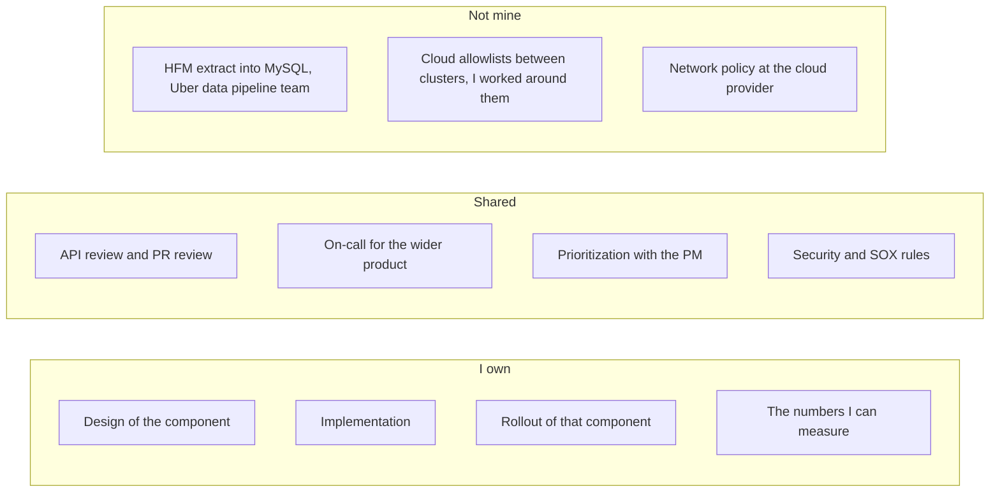
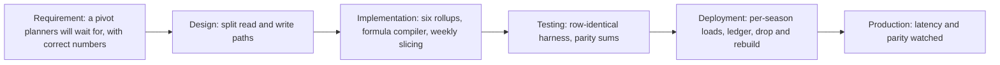
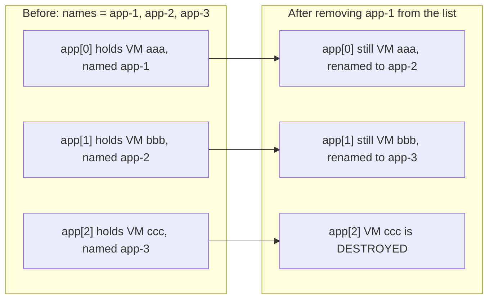
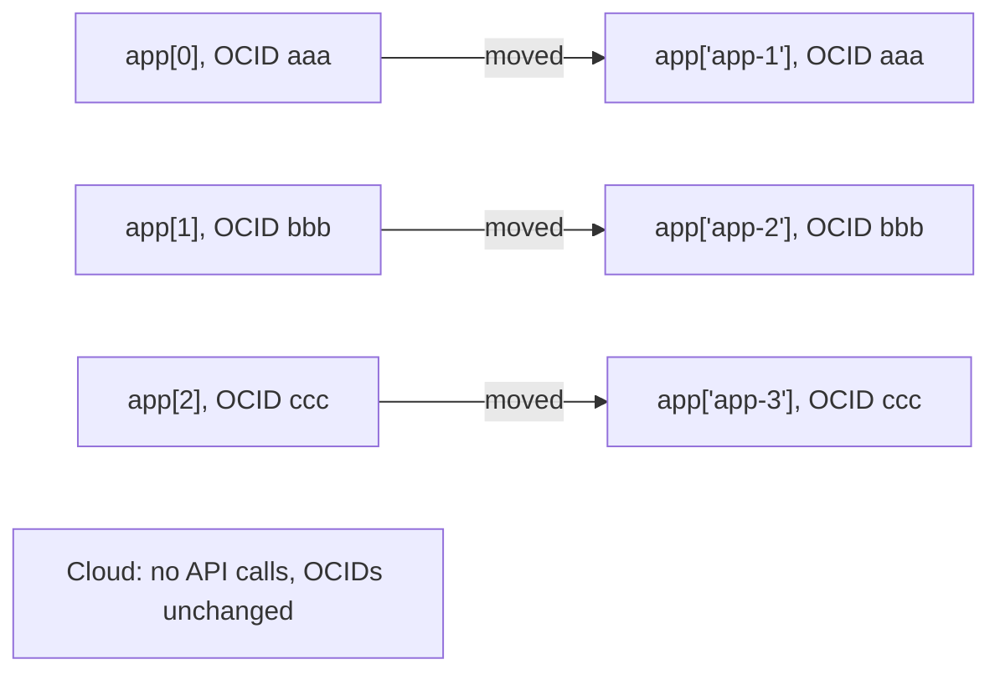
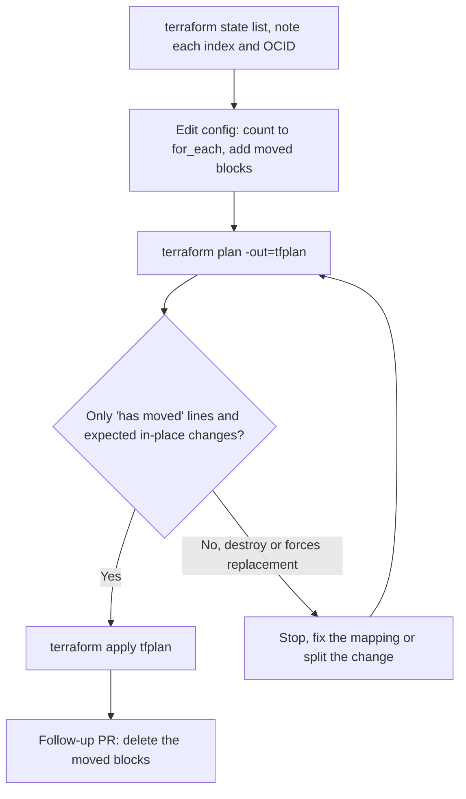

# 08c. Hiring manager answers, and Terraform `count` → `for_each`

This round had two halves. The hiring-manager questions were testing ownership and judgment. The Terraform questions were testing whether you can change **addresses in state** without recreating machines. The syntax was the prop. The real signal was safe production change.

<div class="callout highlight">
<b>How to use this page</b>
<ul>
<li><b>What it covers:</b> scripts for the four hiring-manager questions that were actually asked (intro, why leaving so soon, ownership model, end-to-end ownership), plus a from-zero explanation of Terraform <code>count</code> versus <code>for_each</code> and how to migrate between them without destroying anything.</li>
<li><b>When to read it:</b> before any hiring manager or bar raiser round, and before any round that might touch infrastructure-as-code.</li>
<li><b>What to memorise:</b> the HM2 answer (why leaving), the ownership boundary in HM3, the "Words you need" list for Terraform, and the safe migration sequence in TF6.</li>
<li><b>Related pages:</b> STAR stories in <a href="01_core_values_star.md">01</a>, project details in <a href="07_projects_deep_dive.md">07</a>, and the full list of asked questions in <a href="08_asked_questions_index.md">08</a>.</li>
</ul>
</div>

<div class="callout warn">
<b>Terraform is study material for me, not production ownership.</b> I have not owned production Terraform. Everything in the TF sections is how Terraform works and how I would run the change. If they ask about my experience, I say that plainly, then show I understand the real risk (object identity in state) and connect it to change discipline I have actually practiced: canaries, config rollback, and reading the dry run before acting.
</div>

Resume facts used here: Impact Analytics from **May 2026** (this interview is a few months in). Uber is **via EPAM**, July 2024 to May 2026. You owned specific systems. You did not own every adjacent pipeline. Reviewers existed.

<div class="callout note">
<b>What the tags mean</b> (used on numbers in this page and its companions). <b>MEASURED</b> means a log, doc, or code exists. <b>ESTIMATED</b> means arithmetic I can show. <b>HISTORICAL</b> means from past work records. <b>VERBAL</b> means true but not on the PDF.
</div>

<div class="callout warn">
<b>Notice period.</b> Do not invent a number of days in the interview if you have not read the clause. The script below says you will confirm it. 26 May, from an October interview, is the <b>next</b> 26 May. That is enough calendar time for a normal notice once you have checked the letter.
</div>

---

## Part 1. Hiring manager round

**In plain words.** A hiring manager wants to know three things: can you explain your work clearly, will you stay, and are you honest about what you personally did. Every answer below starts with the direct answer, then the reason, then one example. Speak in "I" for your work and name the edges where other teams start.

---

## HM1. Introduction

**What they want:** 60 to 90 seconds. Current role first, one proof, and why this loop. Not a biography from college.

**Say this**

> I'm a backend engineer, about five years in, mostly Python and Go. I joined Impact Analytics in May 2026. I work on AssortSmart, a retail planning product. The two things I own there are the Go platform that serves planner APIs, and a batch scoring system that decides keep-or-drop for articles.
>
> On the platform side I moved the heavy planner pivots onto ClickHouse rollups. The same query on 250 million rows went from 189 seconds to 12. On the scoring side, the runs are built to finish even when the model provider fails: timeouts, a circuit breaker, and checkpoints, so we don't recompute work that's already done.
>
> Before that I was at Uber via EPAM, for almost two years. I owned the Finance risk-scoping backend. Reconciliation for the quarterly audit went from 14 days to 3, on a $340 million materiality threshold. That was FastAPI and MySQL, and I led a small team of three on the ORM migration.
>
> Earlier I led a PHP-to-FastAPI migration at a GST invoicing company, and I started at GeeksforGeeks on a Django product.
>
> I'm here because this role is that same work at cloud scale: services that stay up, fail in a controlled way, and can be changed without a maintenance window. That's the part I want to go deeper on.

**If they cut you off at 30 seconds,** stop after the ClickHouse sentence and the Uber sentence. Do not keep listing companies.

**Assumptions:** they have the resume. Don't re-read it. Don't open with "I'm passionate."

A few terms, in case they ask: a **pivot** is a planner's table that groups and totals data, like a spreadsheet pivot table. **ClickHouse rollups** are pre-computed total tables in a column-oriented database. A **circuit breaker** stops calling a failing service for a while and uses a fallback. A **checkpoint** is a saved record of finished work, like a bookmark. A **materiality threshold** is the size above which a financial error would matter.

---

## HM2. Why are you looking outside so soon after joining?

**What they are testing:** flight risk. They want to know if you will leave OCI in five months as well, and whether you are running from a problem you caused.

**The situation, said plainly.** You joined Impact Analytics in May 2026. Looking now is early. Acknowledge that in the first sentence. People who dodge the word "soon" sound like they are hiding a bad review.

**Say this**

> It's early, and I don't pretend otherwise. I joined Impact Analytics in May, and the work is real. The ClickHouse path and the scoring runs are in production. I'm not leaving because the role collapsed or because of a manager.
>
> What changed is the kind of system I want to be responsible for next. This team runs a cloud data plane: failover, deployments without a window, incidents, the boring correctness. That is the work I already reach for inside a product company, and here it's the actual job, not a side task.
>
> I didn't start the search in week two. I looked when this role was concrete. If I join, I'm not shopping again in six months. I want a longer run on one platform, which is the opposite of collecting logos.
>
> I also won't disappear on the current team. I'll finish the handover against whatever notice my contract actually specifies. I don't want to quote a day count in this room and then discover the letter says something else.

A **data plane** is the part of a cloud system that actually serves and stores customer data, as opposed to the **control plane** that manages it. Think of the roads (data plane) versus the traffic control centre (control plane).

**Do not say:** the company is chaotic, the stack is boring, you were promised a title, you are underpaid, or "I'm always exploring." Do not invent a grievance.

**If they ask "does your manager know?":** "Not yet. I don't start a resignation conversation before I have a decision. I won't accept an offer and then stall the current team."

### Can you join by 26 May?

**Say this**

> Yes, I can plan around 26 May. Before I sign a start date I need to read the notice clause and tell you the exact last day in writing. If the notice is the usual 30, 60, or 90 days, 26 May is comfortable, and I would rather join earlier than make you wait until May. If something in the letter is longer, I'll tell you this week, not on the day you send the offer.

**Why this shape.** It is "yes" without fake precision. A date you have not checked is how people miss a start date. Offering to come **earlier** if notice allows is the opposite of dragging it out.

**Do not** resign, give notice, or tell the current manager until there is a written offer you intend to accept.

### Likely follow-up: why OCI, not another product company?

> The job description is operability: timeouts, failover, runbooks, change management. I've been doing the application version of that. I want the platform version, where a bad default hits every tenant. Product companies will still need features first. This team is measured on the system staying up.

A **runbook** is a step-by-step guide for handling a known problem. A **tenant** is one customer organisation sharing the system.

### Likely follow-up: why should we believe you won't do this again?

> You shouldn't believe a slogan. Look at the tenure before this: almost two years at Uber via EPAM, a year and a half at Masters, a bit over a year at GeeksforGeeks. The short one is the current role, and I'm being explicit about why this move is different. I'm also not going to pretend five months is a long stay.

---

## HM3. Was the work end-to-end yours? What was the ownership model? Who else was involved? How much autonomy?

**What they are testing:** "I" versus "we", and whether you inflate a team effort into a solo build. Senior people describe the boundary. Juniors say "I owned everything."

**The model, in one diagram**



*What to notice:* the left box is what you say "I" about. The right box is what you name as another team's, even if you depended on it.

**Say this**

> End to end for the component, not end to end for the company. I want to be precise about that.
>
> At Impact Analytics I own the design and the code for the planner read path on ClickHouse, the Go copy tool between clusters, and the scoring orchestration: timeouts, checkpoints, and what happens when the model provider fails. I also shipped Ask Iris, the planner copilot, including the rule that tenant scope is fixed when the socket opens. I write the design, I implement it, and I watch it in production. Other engineers review the PRs. I don't merge my own judgment with nobody looking.
>
> Autonomy is high on the technical choice, and bounded by review and by production safety. Nobody handed me a class diagram for the rollups. I did have to justify ClickHouse against people who had measured the old system and didn't want a new database. I wrote the comparison on the same 250 million rows, and the team committed after the numbers, not before.
>
> At Uber, via EPAM, I owned the risk-scoping backend. The product already had a design doc and a finance stakeholder. I didn't invent the audit process. I replaced the spreadsheet path with a service: the schema, the APIs, the migration off raw SQL, and the SOX checks. I led three engineers on the SQLAlchemy migration. They owned pieces. I owned the approach, the review bar, and the rollout. The feed that loads general-ledger balances from the finance system belonged to a data-pipeline team. I consumed that data. I didn't operate their extract.
>
> So the ownership model is one owner for the service, reviewers on every change, and explicit edges where another team starts. I had room to choose the design. I did not have room to skip review, and I don't want that room.

Terms: **SOX** is the US law requiring controls on financial reporting. **SQLAlchemy** is Python's main ORM (object-relational mapper), which lets code treat database rows as typed objects. **HFM** (Oracle Hyperion Financial Management) is the finance system the ledger balances came from. An **allowlist** is a list of network addresses allowed to connect, a guest list at a door.

**Edges to mention if they push**

| Claim | Honest boundary |
|---|---|
| ClickHouse 15.5x | Query time on a fixed harness. The 170 GB memory failure was a separate, load-time problem. |
| Go copy at ~344k rows/s | Rows per second, measured while a multi-billion-row copy was in flight. Not "the migration finished at that rate." |
| 80% accuracy | A CI gate on a 300-case set. Not live accuracy for every tenant. |
| Uber 14 days to 3 | The outcome on the reconciliation workflow I owned. Not "I did the auditors' job." |
| Led 3, mentored 2 | The FRM migration was three engineers I led. Masters was two people I mentored through a service extraction. Don't merge those numbers. |

### Likely follow-up: tell me about a decision you were not allowed to make alone

> Putting ClickHouse in as the system of record for planner reads. I could prototype alone. I could not commit the org alone. I separated the measured facts from the conclusion, showed that the objection was about in-place updates rather than about analytical reads, and we staged it. That's the autonomy I actually want: a strong proposal, a recorded decision, and then I go execute.

### Likely follow-up: conflict with a reviewer

Use the Uber repository-versus-model story, short.

> At Uber the team rule was that all SQL lives in the `repository/` folder. I wanted query methods on the ORM model, so a column rename would fail the type checker. That came from a real bug, where income-statement rows were read with balance-sheet column lists. I wrote the exception down, and I kept repository functions for queries that don't belong to one model. I disagreed, I didn't ignore the rule, and the exception is auditable.

---

## HM4. End-to-end ownership, from requirement to production

**Pick one story and walk the pipeline they named.** Don't switch projects in the middle. The ClickHouse pivot is the cleanest requirement-to-production arc. The Masters migration is the cleanest "no maintenance window" arc. Use ClickHouse unless they already spent the round on it.



*What to notice:* each box below is one or two sentences when you say it. Do not skip testing and deployment, because that is where the honest caveats live.

**Requirement.** Planners run wide pivots. On Postgres those were hitting about 189 seconds at 250 million rows. The requirement was not "adopt ClickHouse." The requirement was a pivot a planner will wait for, without wrong numbers.

**Design.** The read path and the write path are different. Postgres stays for roles and transactional rows. Analytical reads go to pre-aggregated ClickHouse tables, partitioned by season, so a query prunes instead of scanning the fact table. Writes are versioned inserts, not updates, because the objection to ClickHouse was its update behavior. I wrote that down before building the second table.

A **partition** is a separately stored slice of a table, one per season here. **Pruning** means the query skips every slice it doesn't need, like opening only one drawer of a filing cabinet.

**Implementation.** Six rollup tables, at season grain and weekly grain, for product, store, and attribute. A formula compiler, so a new KPI is configuration, not a deploy. The expression is parsed, identifiers are allowlisted, and division is wrapped so a zero denominator gives zero rather than an exception. The weekly build could not be one `INSERT` for a whole season. Aggregator state was around 170 GB and the query was killed. I changed the unit of work to one fiscal week, with a memory cap and disk spill. That was an implementation decision forced by a limit, not a new product feature.

**Testing.** A row-identical harness: same rows, same query, Postgres and ClickHouse, answers compared. The 189 seconds to 12 number comes from that, not from a screenshot of one lucky query. Separately, store totals are re-weighted so they match the sum of SKUs, and I check those sums against each other.

**Deployment.** The new tables are filled one season at a time. A season only counts as complete when the ledger says so. A failed load must not look complete. I had a bug here: a half-written partition of about 64 million rows still "had rows", so a skip-if-present check would have served it. The fix is a ledger of finished seasons, and success is the server saying the query finished, not the client saying the HTTP call returned. Rollback of a bad season is to drop that partition and rebuild it. I will not call that an atomic swap. During a load, or after a crash, readers can see a partial season until the rebuild finishes. The safer design is to build into a side table and replace the partition. I have that written. I don't claim it is what ran.

**Production.** The read path is the one planners hit. I watch latency and whether the parity checks hold. The copy between clusters is a separate operational path, forced by network allowlists, with a checkpoint per season so a killed process resumes.

**One sentence on the other people.** Reviewers on the design and the PRs. My name is on the decision, the code, and the numbers above.

### A second walkthrough, if they want a service rollout (Masters)

- **Requirement:** filing-week latency, with p95 around 1.2 seconds on a PHP monolith.
- **Design:** the strangler pattern, one endpoint group at a time, not a rewrite. (A **strangler** migration replaces an old system piece by piece while it keeps running, like a vine growing around a tree.)
- **Implementation:** FastAPI behind the same gateway, async calls for the government portal, and idempotency keys on bulk import.
- **Testing:** contract checks so the new response matched the old fields, plus a canary percentage.
- **Deployment:** config to shift traffic, and config to shift it back. I froze cutovers on filing weeks.
- **Production:** p95 dropped to about 300 ms. In canary, my 10-second timeout turned out wrong, because the portal sometimes needs longer. I reverted with config, then moved that call off the request thread.

That is the loop from requirement, to "production disagreed with me", to a fix.

### Likely follow-up: how do you test something you cannot stage at full size?

> Compare on a slice that is identical, not on a toy. The 250 million row harness was the real shape. For the memory failure, I measured single weeks at each grain, product and attribute, before I raised any limit. I would rather have one true number than a full-size run I can't explain.

### Likely follow-up: what did you personally code versus design?

> On these, both. I don't use "owned" for a document I handed to someone else. The rollup build, the formula parser, the copy tool, and the scoring checkpoints are code I wrote. The three-engineer ORM migration at Uber was a design and a review bar, and I was in that code too. I'll say which is which if you ask about a specific line.

---

## Part 2. Terraform `count` versus `for_each`, and migrating safely

## Terraform in plain English

**Terraform** is a tool where you describe the infrastructure you want (virtual machines, networks, databases) in text files, and it creates or changes the real cloud objects to match. You write the shopping list. Terraform works out what to buy, what to return, and what to leave alone. **OCI** (Oracle Cloud Infrastructure) is Oracle's cloud, and Terraform talks to it through the OCI **provider**, a plugin that knows OCI's API.

The interview question is not really about syntax. It is about **identity**: how Terraform knows that the VM in your file is the same VM running in the cloud, and what happens when you change the name it uses for that VM. Get identity wrong and Terraform deletes a working server and builds a new one.

## Words you need

- **Resource.** One block in the config that describes one kind of cloud object, for example `resource "oci_core_instance" "app"`. `oci_core_instance` is the type (a VM). `app` is your local name.
- **OCID (Oracle Cloud Identifier).** The unique id OCI gives every real object, like `ocid1.instance.oc1...aaa`. It is the object's passport number.
- **State.** Terraform's record of which address in your config maps to which real object (OCID), plus that object's last known attributes. It is a JSON file, usually stored remotely. Think of it as an address book: "the entry called app[0] is the person with passport aaa".
- **Resource address.** The name Terraform uses for one object in state, such as `oci_core_instance.app[0]` or `oci_core_instance.app["app-1"]`. It is **not** the OCID. Analogy: the address is a seat number on a ticket, and the OCID is the person in the seat. If you renumber the seats, Terraform assumes the people left and new people arrived.
- **Meta-argument.** A special setting on a resource that changes how Terraform builds it, such as `count`, `for_each`, or `lifecycle`.
- **`count`.** Create N copies of a resource. Addresses are **numbers**: `app[0]`, `app[1]`, `app[2]`. Like numbered seats.
- **`for_each`.** Create one copy per entry in a map or a set of strings. Addresses are **keys**: `app["app-1"]`. Like name cards on seats. Remove one name card and only that person leaves.
- **Plan.** A dry run. Terraform reads the config, refreshes state from the cloud, compares them, and prints what it would create, update, or destroy. It is the receipt you check before you pay. If you don't read the plan, you don't know whether you are about to replace a VM.
- **Apply.** Actually carry out the plan.
- **`moved` block.** A small piece of config that says "the object that used to be at address A is now at address B". It is a change-of-address form at the post office: the person is the same, only the address on file changes. Available from Terraform 1.1.
- **ForceNew (forces replacement).** Some attributes cannot be changed on a live object, for example the image or the availability domain. Changing them means destroy and recreate.
- **Backend and state locking.** The backend is where state is stored (OCI Object Storage, Terraform Cloud, S3). Locking stops two people applying at the same time, like a "room occupied" sign.
- **Workspace.** A separate state for the same config, such as dev and prod.
- **Module.** A reusable bundle of resources. Addresses inside it get a prefix, like `module.compute.`.

**Plan symbols to recognise:** `+` create, `-` destroy, `~` update in place, `-/+` destroy and then create (a replacement). Any `-` or `-/+` on something you meant to keep is a stop sign.

---

## TF5. Terraform `count` versus `for_each`

**What they are testing.** Resource **addresses**, and what happens to those addresses when the input changes. Not the syntax of a VM.

**The short answer, said out loud**

> `count` gives each copy a number, and `for_each` gives each copy a name. The difference only matters when the list changes. With `count`, removing an item from the middle shifts every later number, so Terraform thinks those objects changed or disappeared and may rename or destroy machines you meant to keep. With `for_each`, the key is the identity, so removing one key affects only that one object. I'd use `count` only for truly identical replicas where I only ever change the number, and `for_each` the moment anyone might remove one specific instance.

### `count` with three instances

```hcl
variable "app_count" {
  type    = number
  default = 3
}

resource "oci_core_instance" "app" {
  count               = var.app_count
  availability_domain = var.ad
  display_name        = "app-${count.index + 1}"   # app-1, app-2, app-3
  shape               = var.shape
  # image, subnet, metadata omitted
}
```

Addresses in state:

```text
oci_core_instance.app[0]   ->  ocid1.instance...aaa     display name app-1
oci_core_instance.app[1]   ->  ocid1.instance...bbb     display name app-2
oci_core_instance.app[2]   ->  ocid1.instance...ccc     display name app-3
```

### The trap with `count`

`count` is positional. Terraform does not know that `[1]` "is the same VM" after a shift. Two concrete cases:

**Case 1, a plain number.** Change `app_count` from 3 to 2 because you want to retire app-1. Terraform always removes the **last** index, `[2]`, which is app-3. You cannot say "remove the first one" with a number.

**Case 2, `count` over a list.** This is the classic incident.

```hcl
variable "names" {
  default = ["app-1", "app-2", "app-3"]
}

resource "oci_core_instance" "app" {
  count        = length(var.names)
  display_name = var.names[count.index]
  # ...
}
```

Now remove `"app-1"` from the list. The list becomes `["app-2", "app-3"]`. Every index after the gap shifts down by one.



*What to notice:* you wanted to delete VM aaa. Terraform keeps aaa, renames two machines, and destroys ccc, which was a healthy app-3. If any changed attribute is ForceNew, the "renames" become replacements too.

The plan shows **updates or destroy-and-create** for instances you meant to keep. That is the production incident this question is about.

### `for_each` with the same three instances

```hcl
variable "apps" {
  type    = set(string)
  default = ["app-1", "app-2", "app-3"]
}

resource "oci_core_instance" "app" {
  for_each            = var.apps
  availability_domain = var.ad
  display_name        = each.key
  shape               = var.shape
}
```

Addresses:

```text
oci_core_instance.app["app-1"]  ->  ocid...aaa
oci_core_instance.app["app-2"]  ->  ocid...bbb
oci_core_instance.app["app-3"]  ->  ocid...ccc
```

Remove `"app-2"` from the set and only `app["app-2"]` is destroyed. `app-1` and `app-3` stay untouched. Keys are identity. Indexes are not.

### When `count` is still the right tool

When the replicas are identical, you only ever scale the number, and you accept that you will not delete from the middle. A common use is `count = var.enabled ? 1 : 0` to switch an optional resource on or off. Even then, `for_each` over a set of names is safer the moment anyone will ever remove one specific instance.

### Sets versus maps

- `for_each` on a **set of strings** uses each string as the key.
- `for_each` on a **map** uses each map key, and `each.value` gives you the map value (for example a per-instance shape).
- `for_each` cannot take a list of objects directly. Convert it, for example with `for_each = { for name in var.apps : name => name }` or `toset(var.apps)`.
- Don't use a list index as the key, or you have reinvented `count`.

A map example, where each instance gets its own shape:

```hcl
variable "apps" {
  default = {
    "app-1" = "VM.Standard.E4.Flex"
    "app-2" = "VM.Standard.E4.Flex"
    "app-3" = "VM.Standard3.Flex"
  }
}

resource "oci_core_instance" "app" {
  for_each     = var.apps
  display_name = each.key     # "app-1"
  shape        = each.value   # the shape for that key
  # ...
}
```

(Shape names are illustrative.)

### Referring to them

```hcl
# count
oci_core_instance.app[0].id

# for_each
oci_core_instance.app["app-1"].id

# all of them, either style
[for i in oci_core_instance.app : i.id]
```

### Both in one resource is illegal

`count` and `for_each` on the same resource block conflict, and Terraform rejects it. The migration is a change from one meta-argument to the other, which **changes every address**. Terraform's default reading of an address change is "this object went away, and that object is new." So without help, the migration plan is "destroy three VMs, create three VMs".

---

## TF6. Migrate `count` to `for_each` without destroying the instances

**In plain words.** You want Terraform to start calling the same three VMs by names instead of numbers. Nothing in the cloud should change. Only the labels in Terraform's address book move. The tool for that is the `moved` block.

**The goal.** Same three VMs, same disks, same OCIDs. Only the state address changes. The cloud must not see a delete.

**The short answer, said out loud**

> I'd change `count` to `for_each` and add one `moved` block per instance, mapping each old index to its new key, for example index 0 to "app-1". I'd check the mapping against the OCIDs in state, not against memory. Then I'd run a plan and read every line. I only apply if the plan says "has moved" and shows zero destroys. If I see a destroy or "forces replacement", I stop and fix the mapping or split out whatever other change crept in. I'd also put `prevent_destroy` on anything holding data first, so a mistake errors out instead of deleting.

### What has to be true

1. The new key is stable and matches the instance you intend (`"app-1"` matches today's `[0]`).
2. State is rewritten so the OCID currently stored at `[0]` is stored at `["app-1"]`.
3. `terraform plan` shows **no destroy and no create**, or only in-place attribute updates you expected (for example a tag).
4. You apply only after that plan. You do not "apply and see."

### How Terraform wants you to do it today: `moved` blocks (Terraform 1.1+)

`moved` is config. It is reviewed in git and applied by the next plan. It is better than a one-off CLI command, because the next person can see why the address changed.

```hcl
resource "oci_core_instance" "app" {
  for_each            = toset(["app-1", "app-2", "app-3"])
  availability_domain = var.ad
  display_name        = each.key
  shape               = var.shape
}

moved {
  from = oci_core_instance.app[0]
  to   = oci_core_instance.app["app-1"]
}

moved {
  from = oci_core_instance.app[1]
  to   = oci_core_instance.app["app-2"]
}

moved {
  from = oci_core_instance.app[2]
  to   = oci_core_instance.app["app-3"]
}
```

What changes and what doesn't:



*What to notice:* the OCID on both sides of every arrow is the same. Only the label moved. (Terraform writes the keys with double quotes, `app["app-1"]`. The diagram uses single quotes only for formatting.)

The same thing as text:

```text
state before                         state after
oci_core_instance.app[0]  ocid aaa    oci_core_instance.app["app-1"]  ocid aaa
oci_core_instance.app[1]  ocid bbb    oci_core_instance.app["app-2"]  ocid bbb
oci_core_instance.app[2]  ocid ccc    oci_core_instance.app["app-3"]  ocid ccc

cloud: nothing. The OCID does not change.
```

### The sequence



*What to notice:* the decision diamond is the whole safety story. Nothing is applied until the plan says only "moved".

```bash
# 1. see the current addresses
terraform state list | grep oci_core_instance.app

# 2. edit config: count -> for_each, add moved blocks
# 3. plan. Read every line.
terraform plan -out=tfplan

#    You want:
#      # oci_core_instance.app[0] has moved to oci_core_instance.app["app-1"]
#      (and the same for 1 and 2)
#    You do not want:
#      -/+ destroy and then create
#      forces replacement

# 4. only if the plan is moves and in-place updates
terraform apply tfplan
```

`terraform plan -out=tfplan` followed by `apply tfplan` applies **that** saved plan, not a new one computed later. That matters if someone else is changing the same state in between.

### Older equivalent, still valid: `terraform state mv`

`terraform state mv` edits state immediately, before any plan. It is easier to get wrong, and it is not reviewed as a diff in git. Prefer `moved`.

```bash
terraform state mv 'oci_core_instance.app[0]' 'oci_core_instance.app["app-1"]'
terraform state mv 'oci_core_instance.app[1]' 'oci_core_instance.app["app-2"]'
terraform state mv 'oci_core_instance.app[2]' 'oci_core_instance.app["app-3"]'
terraform plan    # should be empty, or only drift you already understood
```

Quotes matter. The shell will eat `["app-1"]` if you don't wrap the whole address in single quotes.

### After a clean apply

Delete the `moved` blocks in a follow-up PR. Leaving them forever is harmless but noisy, and it can matter for modules other people consume. Removing them in the **same** change as the move is wrong, because the move has to be in the configuration for the plan that performs it.

### If the plan shows destroy or create anyway

Stop. These are the typical causes:

| Plan says replace | Why |
|---|---|
| You changed a **ForceNew** attribute in the same edit (image id, availability domain, some shape changes) | The address move is fine, but a field you touched cannot be updated in place. Split the PRs. Move first. Change the image later, on purpose. |
| The `moved` key points at the wrong index | `app-1` would now track the OCID that used to be `[2]`. The plan may show a display-name change in place, or a replacement if a changed field is ForceNew. Fix the mapping. Run `terraform state show 'oci_core_instance.app[0]'` and match on OCID, not on memory. |
| The `for_each` key is different from `to` | The address in `moved.to` must equal the address `for_each` will produce, character for character. |
| You removed `count` and forgot a `moved` for one index | That index becomes a destroy, and its new key becomes a create. |
| The provider version treats a field as ForceNew that you thought was mutable | Read the plan's "forces replacement" line. It names the field. |

### State locking

Use remote state (an OCI Object Storage backend, Terraform Cloud, or S3) with a lock. Two applies at once can corrupt state. A `moved` migration is exactly when you don't want a second pipeline running.

### Prove it before production

Treat it like a schema change: the plan is the canary. If I can't explain every destroy line, I don't apply. At Masters, traffic shifts were a config change I could undo. With Terraform, the undo for a mistaken destroy is a restore from backup, which is not really an undo. That asymmetry is why the plan gets read line by line.

### Likely follow-up: `terraform import` versus `moved`

`import` adopts an object that Terraform does **not** yet have in state, for example a VM someone created by hand in the console. `moved` renames an object Terraform **already** manages. Using `import` for this migration would create a second state entry for the same OCID, or collide with the existing one. Don't.

```bash
terraform import 'oci_core_instance.app["app-4"]' ocid1.instance.oc1...
```

Terraform 1.5 and later also has an `import` block in config, which is reviewable like `moved`. Either way, run `plan` afterwards. Imported attributes often don't match the config, so the first plan wants to change tags or metadata. Read it.

### Likely follow-up: `create_before_destroy` and `prevent_destroy`

```hcl
lifecycle {
  prevent_destroy       = true
  create_before_destroy = true
}
```

- **`prevent_destroy`:** the plan fails if it would destroy this resource. It is a seatbelt during a refactor, and it **does** catch an accidental destroy caused by an address change. It does not protect you if you delete the whole resource block, because the setting is deleted with it. I would turn it on for the database and for anything holding data before the `count` migration, so a bad plan errors instead of deleting.
- **`create_before_destroy`:** for replacements you **intend**. Terraform builds the new object first, then deletes the old one. It needs a name or id that can exist twice, or the create collides. It is not how you avoid a replacement. `moved` is.

### Likely follow-up: modules and indexes

If the instances live in a module, the address includes the module:

```text
module.compute.oci_core_instance.app[0]
  -> module.compute.oci_core_instance.app["app-1"]
```

`moved` can also rename a whole module (`from = module.old`, `to = module.new`). Same rule: the plan must show moves, not creates.

### Likely follow-up: what does a bad plan look like versus a good one?

**Good, a pure move.** In the `count` example the display names were already `app-1`, `app-2`, `app-3`, so nothing about the VMs changes:

```text
# oci_core_instance.app[0] has moved to oci_core_instance.app["app-1"]
# oci_core_instance.app[1] has moved to oci_core_instance.app["app-2"]
# oci_core_instance.app[2] has moved to oci_core_instance.app["app-3"]
Plan: 0 to add, 0 to change, 0 to destroy.
```

**Also acceptable, a move plus an in-place change you intended.** Suppose the old names had been `app-0`, `app-1`, `app-2` and you are renaming on purpose:

```text
# oci_core_instance.app[0] has moved to oci_core_instance.app["app-1"]
  ~ display_name = "app-0" -> "app-1"
Plan: 0 to add, 1 to change, 0 to destroy.
```

That is fine only if `display_name` updates in place (`~`) and you expected it. Even then, a cleaner habit is to do the move alone first, then the rename in a second PR.

**Bad:**

```text
# oci_core_instance.app[0] will be destroyed
# oci_core_instance.app["app-1"] will be created
Plan: 1 to add, 0 to change, 1 to destroy.
```

That plan replaces the VM. You do not apply it. You add the missing `moved` block.

### Likely follow-up: drift, refresh, and `-replace`

- **Drift:** someone resized the VM in the console, so the cloud no longer matches the config. The next plan wants to change it back, or you update the config to adopt the new size. Run plan and read it. Don't apply a migration plan that also "fixes" a pile of drift you haven't looked at. Split them.
- **`terraform apply -replace='oci_core_instance.app["app-1"]'`** forces replacement of that one address. It is the opposite of this migration. Know the flag so you never pass it by habit.
- **Targeted apply** (`-target`) can apply a move while leaving the rest of the graph half-done. Avoid it for a state migration. The whole plan should already be small.

### Likely follow-up: workspaces and backends

A workspace is a separate state for the same config (dev versus prod). A `moved` block applies to whichever state you have selected. Migrating prod while your shell points at dev does nothing to prod, and it can damage dev. Run `terraform workspace show` before the plan, and say that out loud. It is the same class of mistake as running a script against the wrong cluster.

### Likely follow-up: have you done this in production?

> No. I haven't owned production Terraform. My infrastructure work has been services, databases, and data pipelines. What I've practiced for real is the same discipline this question is about: keep the object's identity, change only the label, read the dry run, and have a rollback that's actually a rollback. For Terraform that means `moved` blocks, a saved plan with zero destroys, and `prevent_destroy` on anything holding data.

---

## How the two halves of this round connect

They asked about ownership, then about Terraform state. Here is the line that closes the loop:

> I treat a state migration the way I treat a schema change. The identity of the object stays. Only its name in the tool changes. I want the dry run to say "moved" and nothing else, and I want a seatbelt like `prevent_destroy` on anything that holds data. Applying a plan I haven't read is how you get a maintenance window you didn't schedule.
